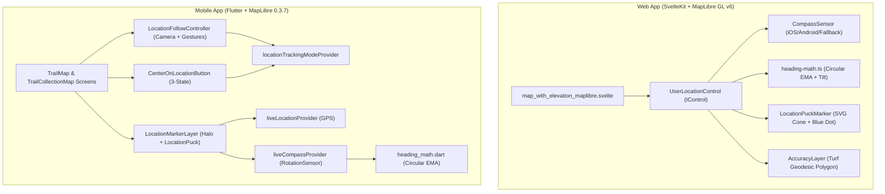

# Google Maps Location & Compass Puck Implementation Plan

> **For agentic workers:** REQUIRED SUB-SKILL: Use superpowers:subagent-driven-development to implement this plan task-by-task. Steps use checkbox (`- [ ]`) syntax for tracking.

**Goal:** Clone `open-wanderer/wanderer` with an `upstream`-friendly Git layout and implement a full Google Maps-style user location puck (geodesic accuracy halo, radial-gradient compass flashlight cone active while stationary, and 3-state tracking/heading-up camera button) across both the SvelteKit + MapLibre GL Web app (`web/`) and the Flutter iOS/Android mobile app (`app/`).

**Architecture:** We encapsulate all new Web logic inside an isolated MapLibre control package (`web/src/lib/vendor/maplibre-user-location/`) and attach it in `map_with_elevation_maplibre.svelte`, replacing the limited default `M.GeolocateControl`. On Flutter (`app/`), we add a reference-counted, background-gated `CompassHeadingStream` backed by `flutter_rotation_sensor`, upgrade `LocationPuck` and `LocationMarkerLayer` with a geodesic accuracy halo and radial-gradient flashlight cone, and add a reusable `LocationFollowController` + 3-state `CenterOnLocationButton` across interactive map screens.

**Architecture Diagram:**



**Tech Stack:** TypeScript 6, SvelteKit 2 / Svelte 5, MapLibre GL JS 6.11, `@turf/destination`, Vitest 4, Playwright, Flutter / Dart 3.13+, `maplibre` 0.3.7, `flutter_riverpod` 3.3, `geolocator` 14, `flutter_rotation_sensor` 0.2.

**Spec:** [2026-11-17-google-maps-location-compass-design.md](file:///Volumes/SSD%20extern/Proiecte/Maps/docs/superpowers/specs/2026-11-17-google-maps-location-compass-design.md)

## Global Constraints

- License compliance: preserve **AGPL-3.0** headers/license across the repository.
- Upstream isolation: keep `upstream` pointing to `https://github.com/open-wanderer/wanderer.git`; minimize diffs in existing upstream files.
- Angle convention: all headings normalized to `[0, 360)` degrees clockwise from North (`0 = N`, `90 = E`, `180 = S`, `270 = W`).
- Circular low-pass filter: smoothing factor `alpha = 0.22` on unit circle `(sin, cos)` with `0.5°` emission deadband.
- GPS movement fallback threshold: use GPS course-over-ground only when compass is unavailable and `speed >= 0.8` m/s with `heading >= 0`.
- Visual constants: `#4285F4` primary blue, `18px` dot diameter with `3px` white border, `88x88px` cone canvas (`44px` outer radius), cone half-angle `25°` (`<=15°` acc) / `35°` (`15°–35°` acc) / `45°` (`>35°` acc), accuracy halo shown for `5m <= accuracy <= 2000m`.
- Flutter MapLibre `0.3.7` rule: always pass an explicit `bearing` to `moveCamera` / `animateCamera` during tracking (never `bearing: null` when a rotation is active), and pause sensors when `AppLifecycleState` is backgrounded (`paused` / `hidden` / `detached`).

---

### Task 1: Upstream Repository Adoption, Git Layout & Local HTTPS Dev Support

**Files:**
- Modify: [vite.config.ts](file:///Volumes/SSD%20extern/Proiecte/Maps/web/vite.config.ts)
- Modify: [package.json](file:///Volumes/SSD%20extern/Proiecte/Maps/web/package.json)
- Create (already present, commit into git): [2026-11-17-google-maps-location-compass-design.md](file:///Volumes/SSD%20extern/Proiecte/Maps/docs/superpowers/specs/2026-11-17-google-maps-location-compass-design.md)
- Create (already present, commit into git): [2026-11-17-google-maps-location-compass.md](file:///Volumes/SSD%20extern/Proiecte/Maps/docs/superpowers/plans/2026-11-17-google-maps-location-compass.md)

**Interfaces:**
- Consumes: Public repository `https://github.com/open-wanderer/wanderer.git`
- Produces: Initialized Git repository on `main` tracking `upstream` history, installed `web/` and `app/` dependencies, optional `VITE_DEV_HTTPS=true` self-signed TLS mode in Vite for LAN mobile testing.

- [ ] **Step 1: Initialize Git in `/Volumes/SSD extern/Proiecte/Maps` and pull `open-wanderer/wanderer` as `upstream`**

Run in `/Volumes/SSD extern/Proiecte/Maps`:
```bash
git init
git remote add upstream https://github.com/open-wanderer/wanderer.git
git fetch upstream
DEFAULT_BRANCH=$(git remote show upstream | sed -n '/HEAD branch/s/.*: //p')
git checkout -b main "upstream/${DEFAULT_BRANCH}"
```
Expected: Working tree populated with `app/`, `db/`, `web/`, `docker-compose.yml`, etc., while preserving `docs/superpowers/specs/` and `docs/superpowers/plans/`.

- [ ] **Step 2: Install Web dependencies and `@vitejs/plugin-basic-ssl` for optional mobile LAN HTTPS testing**

Run in `/Volumes/SSD extern/Proiecte/Maps/web`:
```bash
npm install
npm install -D @vitejs/plugin-basic-ssl
```
Expected: `node_modules` installed cleanly without unmet peer errors.

- [ ] **Step 3: Configure opt-in `VITE_DEV_HTTPS=true` in `web/vite.config.ts`**

Update [vite.config.ts](file:///Volumes/SSD%20extern/Proiecte/Maps/web/vite.config.ts) so `VITE_DEV_HTTPS=true npm run dev -- --host` serves HTTPS on LAN while default `npm run dev` / Playwright stays on HTTP:

```diff
 import adapter from '@sveltejs/adapter-node';
 import { enhancedImages } from '@sveltejs/enhanced-img';
 import { sveltekit } from '@sveltejs/kit/vite';
 import { vitePreprocess } from '@sveltejs/vite-plugin-svelte';
 import tailwindcss from '@tailwindcss/vite';
+import basicSsl from '@vitejs/plugin-basic-ssl';
 import fs from 'fs';
 import openapiPlugin from 'sveltekit-openapi-generator';
 import { defineConfig } from 'vitest/config';
 import { openapiOptions } from './openapi.config.js';
 
 const packageJson = JSON.parse(fs.readFileSync('./package.json', 'utf-8'));
+const useDevHttps = process.env.VITE_DEV_HTTPS === 'true';
 
 export default defineConfig({
 	plugins: [
+		...(useDevHttps ? [basicSsl()] : []),
 		enhancedImages(),
 		openapiPlugin(openapiOptions(packageJson.version)),
 		tailwindcss(),
```
And in the `server` block at the bottom of `web/vite.config.ts`:
```diff
+	...(useDevHttps ? {
+		server: {
+			https: {},
+			host: true
+		}
+	} : {}),
 	...(process.env.WANDERER_ENV == "dev" ? {
```

- [ ] **Step 4: Verify baseline Web unit tests and Flutter package resolution**

Run in `/Volumes/SSD extern/Proiecte/Maps/web`:
```bash
npm run test:unit
```
And if Flutter SDK is installed locally, run in `/Volumes/SSD extern/Proiecte/Maps/app`:
```bash
flutter pub get
flutter test test/util/map/sheet_metrics_test.dart
```
Expected: Baseline unit tests PASS.

- [ ] **Step 5: Commit baseline setup, spec, and plan**

```bash
git add docs/superpowers/ web/package.json web/package-lock.json web/vite.config.ts
git commit -m "chore: adopt open-wanderer upstream, add design spec/plan and optional dev HTTPS"
```

---

### Task 2: Web Heading Math & Cross-Platform Compass Sensor (`types.ts`, `heading-math.ts`, `compass-sensor.ts`)

**Files:**
- Create: [types.ts](file:///Volumes/SSD%20extern/Proiecte/Maps/web/src/lib/vendor/maplibre-user-location/types.ts)
- Create: [heading-math.ts](file:///Volumes/SSD%20extern/Proiecte/Maps/web/src/lib/vendor/maplibre-user-location/heading-math.ts)
- Create: [compass-sensor.ts](file:///Volumes/SSD%20extern/Proiecte/Maps/web/src/lib/vendor/maplibre-user-location/compass-sensor.ts)
- Test: [heading-math.test.ts](file:///Volumes/SSD%20extern/Proiecte/Maps/web/src/lib/vendor/maplibre-user-location/heading-math.test.ts)
- Test: [compass-sensor.test.ts](file:///Volumes/SSD%20extern/Proiecte/Maps/web/src/lib/vendor/maplibre-user-location/compass-sensor.test.ts)

**Interfaces:**
- Consumes: Browser `DeviceOrientationEvent` (`webkitCompassHeading` / `alpha, beta, gamma`), `screen.orientation.angle`
- Produces:
  - `LocationTrackingMode = 'inactive' | 'freeTracking' | 'followNorthUp' | 'followHeadingUp'`
  - `CircularHeadingFilter` (`update(rawDeg): number | null`, `reset(): void`, `current: number | null`)
  - `coneHalfAngleFromAccuracy(accuracyDeg?: number | null): number`
  - `computeTiltCompensatedHeading(alpha: number, beta: number, gamma: number, screenAngle?: number): number | null`
  - `CompassSensor` (`requestPermissionFromGesture(): Promise<boolean>`, `start(cb): void`, `stop(): void`)

- [ ] **Step 1: Write failing unit tests for `heading-math.ts` and `compass-sensor.ts`**

Create [heading-math.test.ts](file:///Volumes/SSD%20extern/Proiecte/Maps/web/src/lib/vendor/maplibre-user-location/heading-math.test.ts):
```ts
import { describe, expect, it } from "vitest";
import {
    CircularHeadingFilter,
    computeTiltCompensatedHeading,
    coneHalfAngleFromAccuracy,
    extractHeadingFromOrientationEvent,
    normalizeHeading,
    shortestAngleDelta,
} from "./heading-math";

describe("heading-math", () => {
    it("normalizes arbitrary angles into [0, 360)", () => {
        expect(normalizeHeading(0)).toBe(0);
        expect(normalizeHeading(360)).toBe(0);
        expect(normalizeHeading(-10)).toBe(350);
        expect(normalizeHeading(725)).toBe(5);
    });

    it("computes shortest signed delta across the 359 <-> 0 boundary", () => {
        expect(shortestAngleDelta(355, 5)).toBeCloseTo(10, 5);
        expect(shortestAngleDelta(5, 355)).toBeCloseTo(-10, 5);
        expect(shortestAngleDelta(90, 270)).toBeCloseTo(180, 5);
    });

    it("smooths across 359 -> 1 without passing through 180", () => {
        const filter = new CircularHeadingFilter(0.22, 0.5);
        expect(filter.update(358)).toBeCloseTo(358, 2);
        const next = filter.update(2);
        expect(next).not.toBeNull();
        expect(next! > 358 || next! < 3).toBe(true);
    });

    it("suppresses sub-deadband jitter (< 0.5 deg) by returning null", () => {
        const filter = new CircularHeadingFilter(0.22, 0.5);
        expect(filter.update(100)).toBeCloseTo(100, 2);
        expect(filter.update(100.2)).toBeNull();
    });

    it("maps compass accuracy to Google Maps cone half-angles", () => {
        expect(coneHalfAngleFromAccuracy(null)).toBe(25);
        expect(coneHalfAngleFromAccuracy(10)).toBe(25);
        expect(coneHalfAngleFromAccuracy(25)).toBe(35);
        expect(coneHalfAngleFromAccuracy(50)).toBe(45);
        expect(coneHalfAngleFromAccuracy(-1)).toBe(45);
    });

    it("computes tilt-compensated heading from W3C Euler angles", () => {
        // Flat device facing North (alpha=0, beta=0, gamma=0) -> 0 deg
        expect(computeTiltCompensatedHeading(0, 0, 0, 0)).toBeCloseTo(0, 1);
        // Flat device rotated 90 deg CCW (alpha=90 -> East = 270? No: W3C alpha increases CCW, so alpha=270 => 90 deg East)
        expect(computeTiltCompensatedHeading(270, 0, 0, 0)).toBeCloseTo(90, 1);
        // Tilted 45 deg in hand facing East (alpha=270, beta=45, gamma=0) stays ~90 deg East
        expect(computeTiltCompensatedHeading(270, 45, 0, 0)).toBeCloseTo(90, 1);
    });

    it("prefers iOS webkitCompassHeading and compensates screen angle", () => {
        const reading = extractHeadingFromOrientationEvent(
            { webkitCompassHeading: 350, webkitCompassAccuracy: 12, alpha: null, beta: null, gamma: null, absolute: false },
            90,
        );
        expect(reading).toEqual({ heading: 80, accuracy: 12 });
    });
});
```

Create [compass-sensor.test.ts](file:///Volumes/SSD%20extern/Proiecte/Maps/web/src/lib/vendor/maplibre-user-location/compass-sensor.test.ts):
```ts
import { afterEach, describe, expect, it, vi } from "vitest";
import { CompassSensor } from "./compass-sensor";

describe("CompassSensor", () => {
    afterEach(() => {
        vi.unstubAllGlobals();
    });

    it("calls DeviceOrientationEvent.requestPermission when present on iOS", async () => {
        const requestPermission = vi.fn().mockResolvedValue("granted");
        vi.stubGlobal("DeviceOrientationEvent", { requestPermission });
        vi.stubGlobal("window", {
            addEventListener: vi.fn(),
            removeEventListener: vi.fn(),
            screen: { orientation: { angle: 0 } },
        });

        const sensor = new CompassSensor();
        const granted = await sensor.requestPermissionFromGesture();
        expect(requestPermission).toHaveBeenCalledTimes(1);
        expect(granted).toBe(true);
    });

    it("emits smoothed compass readings and removes listeners on stop()", () => {
        const listeners: Record<string, (ev: any) => void> = {};
        vi.stubGlobal("DeviceOrientationEvent", class {});
        vi.stubGlobal("window", {
            ondeviceorientationabsolute: null,
            addEventListener: vi.fn((type: string, cb: any) => {
                listeners[type] = cb;
            }),
            removeEventListener: vi.fn((type: string) => {
                delete listeners[type];
            }),
            screen: { orientation: { angle: 0 } },
        });

        const readings: Array<{ heading: number; accuracy: number | null }> = [];
        const sensor = new CompassSensor();
        sensor.start((r) => readings.push(r));

        listeners["deviceorientationabsolute"]?.({
            alpha: 270,
            beta: 30,
            gamma: 0,
            absolute: true,
        });
        expect(readings).toHaveLength(1);
        expect(readings[0].heading).toBeCloseTo(90, 1);

        sensor.stop();
        expect(Object.keys(listeners)).toHaveLength(0);
    });
});
```

- [ ] **Step 2: Run Vitest to confirm both new test files fail**

Run in `/Volumes/SSD extern/Proiecte/Maps/web`:
```bash
npx vitest run src/lib/vendor/maplibre-user-location/heading-math.test.ts src/lib/vendor/maplibre-user-location/compass-sensor.test.ts
```
Expected: FAIL (`Cannot find module './heading-math'`).

- [ ] **Step 3: Implement `types.ts`, `heading-math.ts`, and `compass-sensor.ts`**

Create [types.ts](file:///Volumes/SSD%20extern/Proiecte/Maps/web/src/lib/vendor/maplibre-user-location/types.ts):
```ts
export type LocationTrackingMode =
    | "inactive"
    | "freeTracking"
    | "followNorthUp"
    | "followHeadingUp";

export interface CompassReading {
    heading: number;
    accuracy: number | null;
}

export interface UserLocationFix {
    latitude: number;
    longitude: number;
    accuracy: number;
    gpsHeading: number | null;
    speed: number | null;
}

export interface UserLocationControlLabels {
    locateMe: string;
    followNorthUp: string;
    followHeadingUp: string;
    permissionDenied: string;
    insecureContext: string;
}

export interface UserLocationControlOptions {
    enableHighAccuracy?: boolean;
    animate?: boolean;
    labels?: Partial<UserLocationControlLabels>;
    onModeChange?: (mode: LocationTrackingMode) => void;
    onError?: (message: string) => void;
}
```

Create [heading-math.ts](file:///Volumes/SSD%20extern/Proiecte/Maps/web/src/lib/vendor/maplibre-user-location/heading-math.ts):
```ts
import type { CompassReading } from "./types";

const DEG_TO_RAD = Math.PI / 180;
const RAD_TO_DEG = 180 / Math.PI;

export function normalizeHeading(deg: number): number {
    const mod = deg % 360;
    return mod < 0 ? mod + 360 : mod === 0 ? 0 : mod;
}

export function shortestAngleDelta(fromDeg: number, toDeg: number): number {
    const diff = ((toDeg - fromDeg + 540) % 360) - 180;
    return diff === -180 ? 180 : diff;
}

export function coneHalfAngleFromAccuracy(accuracyDeg?: number | null): number {
    if (accuracyDeg === undefined || accuracyDeg === null) {
        return 25;
    }
    if (accuracyDeg < 0 || accuracyDeg > 35) {
        return 45;
    }
    if (accuracyDeg > 15) {
        return 35;
    }
    return 25;
}

export class CircularHeadingFilter {
    private sinSum: number | null = null;
    private cosSum: number | null = null;
    private lastEmitted: number | null = null;

    constructor(
        private readonly alpha = 0.22,
        private readonly deadbandDeg = 0.5,
    ) {}

    get current(): number | null {
        return this.lastEmitted;
    }

    reset(): void {
        this.sinSum = null;
        this.cosSum = null;
        this.lastEmitted = null;
    }

    update(rawDeg: number): number | null {
        if (!Number.isFinite(rawDeg)) {
            return null;
        }
        const rad = normalizeHeading(rawDeg) * DEG_TO_RAD;
        const s = Math.sin(rad);
        const c = Math.cos(rad);

        if (this.sinSum === null || this.cosSum === null || this.lastEmitted === null) {
            this.sinSum = s;
            this.cosSum = c;
            this.lastEmitted = normalizeHeading(rawDeg);
            return this.lastEmitted;
        }

        this.sinSum = this.alpha * s + (1 - this.alpha) * this.sinSum;
        this.cosSum = this.alpha * c + (1 - this.alpha) * this.cosSum;

        const smoothed = normalizeHeading(Math.atan2(this.sinSum, this.cosSum) * RAD_TO_DEG);
        if (Math.abs(shortestAngleDelta(this.lastEmitted, smoothed)) < this.deadbandDeg) {
            return null;
        }
        this.lastEmitted = smoothed;
        return smoothed;
    }
}

/**
 * Computes tilt-compensated compass heading [0, 360) clockwise from North
 * from W3C DeviceOrientation Euler angles (Z-X'-Y'' intrinsic: alpha, beta, gamma).
 * Projects the device's +Y axis ("top of phone") onto the horizontal East-North plane
 * when nearly flat, switching smoothly to -Z ("back of phone / camera forward") when held upright (>75 deg).
 */
export function computeTiltCompensatedHeading(
    alpha: number,
    beta: number,
    gamma: number,
    screenAngle = 0,
): number | null {
    if (!Number.isFinite(alpha) || !Number.isFinite(beta) || !Number.isFinite(gamma)) {
        return null;
    }
    const a = alpha * DEG_TO_RAD;
    const b = beta * DEG_TO_RAD;
    const g = gamma * DEG_TO_RAD;

    const cA = Math.cos(a);
    const sA = Math.sin(a);
    const cB = Math.cos(b);
    const sB = Math.sin(b);
    const cG = Math.cos(g);
    const sG = Math.sin(g);

    // Rotation matrix R = Rz(alpha) * Rx(beta) * Ry(gamma) mapping device coords (x=right, y=up, z=out-of-screen)
    // to Earth ENU coords (X=East, Y=North, Z=Up).
    // When tilting up to ~75 deg, the user looks along the top edge of the screen (+y_device),
    // or equivalently along the -z_device + +y_device bisector (`v_device = [0, 1, -1]` normalized):
    // Using v_device = [0, cos(0), 0] breaks at beta=90, whereas `v = [0, cB >= 0.25 ? 1 : 0, -1]` jumps;
    // projecting `f_device = [0, 1, -Math.abs(sB)]` works smoothly from flat (beta=0 -> +y) to vertical (beta=90 -> -z)!
    const fy = 1;
    const fz = -1;

    // Column 2 of R (for y_device):
    const r01 = -sA * cB;
    const r11 = cA * cB;

    // Column 3 of R (for z_device):
    const r02 = cA * sG + sA * sB * cG;
    const r12 = sA * sG - cA * sB * cG;

    const east = r01 * fy + r02 * fz;
    const north = r11 * fy + r12 * fz;

    if (Math.hypot(east, north) < 1e-5) {
        return null;
    }

    const azimuthDeg = Math.atan2(east, north) * RAD_TO_DEG;
    return normalizeHeading(azimuthDeg + screenAngle);
}

export interface OrientationLikeEvent {
    webkitCompassHeading?: number | null;
    webkitCompassAccuracy?: number | null;
    alpha: number | null;
    beta: number | null;
    gamma: number | null;
    absolute?: boolean;
}

export function extractHeadingFromOrientationEvent(
    event: OrientationLikeEvent,
    screenAngle = 0,
): CompassReading | null {
    if (
        typeof event.webkitCompassHeading === "number" &&
        Number.isFinite(event.webkitCompassHeading) &&
        event.webkitCompassHeading >= 0
    ) {
        const accuracy =
            typeof event.webkitCompassAccuracy === "number" && Number.isFinite(event.webkitCompassAccuracy)
                ? event.webkitCompassAccuracy
                : null;
        return {
            heading: normalizeHeading(event.webkitCompassHeading + screenAngle),
            accuracy,
        };
    }

    if (event.alpha !== null && event.beta !== null && event.gamma !== null) {
        const heading = computeTiltCompensatedHeading(
            event.alpha,
            event.beta,
            event.gamma,
            screenAngle,
        );
        if (heading !== null) {
            return { heading, accuracy: null };
        }
    }
    return null;
}
```

Create [compass-sensor.ts](file:///Volumes/SSD%20extern/Proiecte/Maps/web/src/lib/vendor/maplibre-user-location/compass-sensor.ts):
```ts
import { CircularHeadingFilter, extractHeadingFromOrientationEvent } from "./heading-math";
import type { CompassReading } from "./types";

type OrientationPermissionFn = () => Promise<"granted" | "denied" | "default">;

export class CompassSensor {
    private readonly filter = new CircularHeadingFilter(0.22, 0.5);
    private activeEventName: "deviceorientationabsolute" | "deviceorientation" | null = null;
    private handler: ((event: Event) => void) | null = null;
    private permissionGranted: boolean | null = null;

    /**
     * Must be invoked synchronously inside a user gesture handler (e.g., button click)
     * so iOS Safari allows the DeviceOrientation permission prompt.
     */
    async requestPermissionFromGesture(): Promise<boolean> {
        if (typeof DeviceOrientationEvent === "undefined") {
            this.permissionGranted = false;
            return false;
        }
        const maybeReq = (
            DeviceOrientationEvent as unknown as { requestPermission?: OrientationPermissionFn }
        ).requestPermission;

        if (typeof maybeReq === "function") {
            try {
                const state = await maybeReq();
                this.permissionGranted = state === "granted";
                return this.permissionGranted;
            } catch {
                this.permissionGranted = false;
                return false;
            }
        }
        this.permissionGranted = true;
        return true;
    }

    start(onReading: (reading: CompassReading) => void): void {
        this.stop();
        if (typeof window === "undefined" || this.permissionGranted === false) {
            return;
        }

        const hasAbsolute = "ondeviceorientationabsolute" in window;
        this.activeEventName = hasAbsolute ? "deviceorientationabsolute" : "deviceorientation";

        this.handler = (rawEvent: Event) => {
            const event = rawEvent as DeviceOrientationEvent & {
                webkitCompassHeading?: number;
                webkitCompassAccuracy?: number;
            };
            // On non-iOS standard `deviceorientation`, ignore non-absolute arbitrary alpha frames
            if (
                this.activeEventName === "deviceorientation" &&
                typeof event.webkitCompassHeading !== "number" &&
                event.absolute !== true
            ) {
                return;
            }

            const screenAngle =
                typeof window.screen?.orientation?.angle === "number"
                    ? window.screen.orientation.angle
                    : 0;
            const extracted = extractHeadingFromOrientationEvent(event, screenAngle);
            if (!extracted) {
                return;
            }
            const smoothed = this.filter.update(extracted.heading);
            if (smoothed !== null) {
                onReading({ heading: smoothed, accuracy: extracted.accuracy });
            }
        };

        window.addEventListener(this.activeEventName, this.handler, true);
    }

    stop(): void {
        if (typeof window !== "undefined" && this.activeEventName && this.handler) {
            window.removeEventListener(this.activeEventName, this.handler, true);
        }
        this.activeEventName = null;
        this.handler = null;
        this.filter.reset();
    }
}
```

- [ ] **Step 4: Run Vitest to verify all heading-math and compass-sensor tests pass**

Run in `/Volumes/SSD extern/Proiecte/Maps/web`:
```bash
npx vitest run src/lib/vendor/maplibre-user-location/heading-math.test.ts src/lib/vendor/maplibre-user-location/compass-sensor.test.ts
```
Expected: PASS (all tests green).

- [ ] **Step 5: Commit Web heading math and compass sensor**

```bash
git add web/src/lib/vendor/maplibre-user-location/types.ts web/src/lib/vendor/maplibre-user-location/heading-math.ts web/src/lib/vendor/maplibre-user-location/compass-sensor.ts web/src/lib/vendor/maplibre-user-location/heading-math.test.ts web/src/lib/vendor/maplibre-user-location/compass-sensor.test.ts
git commit -m "feat(web): add circular heading filter, tilt-compensated math, and compass sensor"
```

---

### Task 3: Web Google Maps Puck Visuals (`accuracy-layer.ts` + `location-puck-marker.ts`)

**Files:**
- Create: [accuracy-layer.ts](file:///Volumes/SSD%20extern/Proiecte/Maps/web/src/lib/vendor/maplibre-user-location/accuracy-layer.ts)
- Create: [location-puck-marker.ts](file:///Volumes/SSD%20extern/Proiecte/Maps/web/src/lib/vendor/maplibre-user-location/location-puck-marker.ts)
- Test: [puck-visuals.test.ts](file:///Volumes/SSD%20extern/Proiecte/Maps/web/src/lib/vendor/maplibre-user-location/puck-visuals.test.ts)

**Interfaces:**
- Consumes: `coneHalfAngleFromAccuracy` from `heading-math.ts`, `@turf/destination`, `maplibre-gl`
- Produces:
  - `buildAccuracyCircleGeoJSON(lon: number, lat: number, accuracyMeters: number): GeoJSON.FeatureCollection`
  - `AccuracyLayer` (`attach(map): void`, `update(lon, lat, accuracyMeters): void`, `clear(): void`, `detach(): void`)
  - `buildConeSvgPath(halfAngleDeg: number, outerRadius?: number, center?: number): string`
  - `LocationPuckMarker` (`attach(map): void`, `setPosition(lon, lat): void`, `setHeading(headingDeg: number | null, accuracyDeg?: number | null): void`, `remove(): void`)

- [ ] **Step 1: Write failing unit tests for accuracy polygon generation, style reload re-hydration, and SVG cone geometry**

Create [puck-visuals.test.ts](file:///Volumes/SSD%20extern/Proiecte/Maps/web/src/lib/vendor/maplibre-user-location/puck-visuals.test.ts):
```ts
import { describe, expect, it, vi } from "vitest";
import { AccuracyLayer, buildAccuracyCircleGeoJSON } from "./accuracy-layer";
import { buildConeSvgPath, createPuckElement } from "./location-puck-marker";

describe("puck-visuals", () => {
    it("omits accuracy polygon below 5m and caps radius at 2000m", () => {
        const tiny = buildAccuracyCircleGeoJSON(25.0, 45.5, 3);
        expect(tiny.features).toHaveLength(0);

        const normal = buildAccuracyCircleGeoJSON(25.0, 45.5, 40);
        expect(normal.features).toHaveLength(1);
        expect(normal.features[0].geometry.type).toBe("Polygon");
        const ring = (normal.features[0].geometry as GeoJSON.Polygon).coordinates[0];
        expect(ring).toHaveLength(65); // 64 segments + closed ring

        const huge = buildAccuracyCircleGeoJSON(25.0, 45.5, 9999);
        const capped = buildAccuracyCircleGeoJSON(25.0, 45.5, 2000);
        expect(huge).toEqual(capped);
    });

    it("re-hydrates GeoJSON source and layers when MapLibre fires style.load", () => {
        const events: Record<string, () => void> = {};
        const sources = new Map<string, any>();
        const layers = new Set<string>();
        const fakeMap: any = {
            isStyleLoaded: () => true,
            getSource: (id: string) => sources.get(id),
            addSource: vi.fn((id: string, spec: any) => {
                sources.set(id, { ...spec, setData: vi.fn() });
            }),
            removeSource: vi.fn((id: string) => sources.delete(id)),
            getLayer: (id: string) => layers.has(id),
            addLayer: vi.fn((spec: any) => layers.add(spec.id)),
            removeLayer: vi.fn((id: string) => layers.delete(id)),
            on: vi.fn((ev: string, cb: () => void) => {
                events[ev] = cb;
            }),
            off: vi.fn(),
        };

        const acc = new AccuracyLayer();
        acc.attach(fakeMap);
        acc.update(25.4, 45.4, 30);
        expect(layers.has("wanderer-user-accuracy-fill")).toBe(true);

        // Simulate style switch wiping sources and layers
        sources.clear();
        layers.clear();
        events["style.load"]?.();
        expect(layers.has("wanderer-user-accuracy-fill")).toBe(true);
        expect(layers.has("wanderer-user-accuracy-outline")).toBe(true);
    });

    it("builds valid SVG wedge path and rotates cone inside puck DOM element", () => {
        const dNarrow = buildConeSvgPath(25, 44, 44);
        const dWide = buildConeSvgPath(45, 44, 44);
        expect(dNarrow).toContain("A 44 44");
        expect(dNarrow).not.toEqual(dWide);

        // Minimal DOM mock check if document is available, or verify helper math
        if (typeof document !== "undefined") {
            const ui = createPuckElement();
            ui.updateHeading(135, 10);
            expect(ui.coneGroup.getAttribute("transform")).toBe("rotate(135 44 44)");
            expect(ui.coneGroup.style.display).toBe("block");
            ui.updateHeading(null, null);
            expect(ui.coneGroup.style.display).toBe("none");
        }
    });
});
```

- [ ] **Step 2: Run Vitest to confirm `puck-visuals.test.ts` fails**

Run in `/Volumes/SSD extern/Proiecte/Maps/web`:
```bash
npx vitest run src/lib/vendor/maplibre-user-location/puck-visuals.test.ts
```
Expected: FAIL (`Cannot find module './accuracy-layer'`).

- [ ] **Step 3: Implement `accuracy-layer.ts` and `location-puck-marker.ts`**

Create [accuracy-layer.ts](file:///Volumes/SSD%20extern/Proiecte/Maps/web/src/lib/vendor/maplibre-user-location/accuracy-layer.ts):
```ts
import destination from "@turf/destination";
import type { GeoJSONSource, Map as MapLibreMap } from "maplibre-gl";

const SOURCE_ID = "wanderer-user-accuracy-source";
const FILL_LAYER_ID = "wanderer-user-accuracy-fill";
const OUTLINE_LAYER_ID = "wanderer-user-accuracy-outline";
const SEGMENTS = 64;

export function buildAccuracyCircleGeoJSON(
    lon: number,
    lat: number,
    accuracyMeters: number,
): GeoJSON.FeatureCollection {
    if (!Number.isFinite(accuracyMeters) || accuracyMeters < 5) {
        return { type: "FeatureCollection", features: [] };
    }
    const radiusKm = Math.min(accuracyMeters, 2000) / 1000;
    const ring: [number, number][] = [];
    for (let i = 0; i <= SEGMENTS; i++) {
        const bearing = (i * 360) / SEGMENTS;
        const pt = destination([lon, lat], radiusKm, bearing, { units: "kilometers" });
        ring.push(pt.geometry.coordinates as [number, number]);
    }
    return {
        type: "FeatureCollection",
        features: [
            {
                type: "Feature",
                properties: {},
                geometry: {
                    type: "Polygon",
                    coordinates: [ring],
                },
            },
        ],
    };
}

export class AccuracyLayer {
    private map: MapLibreMap | null = null;
    private latestData: GeoJSON.FeatureCollection = { type: "FeatureCollection", features: [] };
    private readonly handleStyleLoad = () => {
        this.ensureLayers();
    };

    attach(map: MapLibreMap): void {
        this.detach();
        this.map = map;
        map.on("style.load", this.handleStyleLoad);
        if (map.isStyleLoaded()) {
            this.ensureLayers();
        }
    }

    update(lon: number, lat: number, accuracyMeters: number): void {
        this.latestData = buildAccuracyCircleGeoJSON(lon, lat, accuracyMeters);
        this.syncData();
    }

    clear(): void {
        this.latestData = { type: "FeatureCollection", features: [] };
        this.syncData();
    }

    detach(): void {
        if (!this.map) return;
        this.map.off("style.load", this.handleStyleLoad);
        try {
            if (this.map.getLayer(OUTLINE_LAYER_ID)) this.map.removeLayer(OUTLINE_LAYER_ID);
            if (this.map.getLayer(FILL_LAYER_ID)) this.map.removeLayer(FILL_LAYER_ID);
            if (this.map.getSource(SOURCE_ID)) this.map.removeSource(SOURCE_ID);
        } catch {
            // Map may already be destroyed
        }
        this.map = null;
    }

    private ensureLayers(): void {
        if (!this.map) return;
        if (!this.map.getSource(SOURCE_ID)) {
            this.map.addSource(SOURCE_ID, {
                type: "geojson",
                data: this.latestData,
            });
        }
        if (!this.map.getLayer(FILL_LAYER_ID)) {
            this.map.addLayer({
                id: FILL_LAYER_ID,
                type: "fill",
                source: SOURCE_ID,
                paint: {
                    "fill-color": "#4285F4",
                    "fill-opacity": 0.12,
                },
            });
        }
        if (!this.map.getLayer(OUTLINE_LAYER_ID)) {
            this.map.addLayer({
                id: OUTLINE_LAYER_ID,
                type: "line",
                source: SOURCE_ID,
                paint: {
                    "line-color": "#4285F4",
                    "line-opacity": 0.3,
                    "line-width": 1,
                },
            });
        }
    }

    private syncData(): void {
        if (!this.map) return;
        if (this.map.isStyleLoaded()) {
            this.ensureLayers();
        }
        const source = this.map.getSource(SOURCE_ID) as GeoJSONSource | undefined;
        source?.setData(this.latestData);
    }
}
```

Create [location-puck-marker.ts](file:///Volumes/SSD%20extern/Proiecte/Maps/web/src/lib/vendor/maplibre-user-location/location-puck-marker.ts):
```ts
import * as M from "maplibre-gl";
import { coneHalfAngleFromAccuracy } from "./heading-math";

const SVG_NS = "http://www.w3.org/2000/svg";
const SIZE = 88;
const CENTER = 44;
const OUTER_RADIUS = 44;

export function buildConeSvgPath(
    halfAngleDeg: number,
    outerRadius = OUTER_RADIUS,
    center = CENTER,
): string {
    const rad = (halfAngleDeg * Math.PI) / 180;
    // Facing straight up (0 deg North = -Y in SVG screen space)
    const x1 = center - outerRadius * Math.sin(rad);
    const y1 = center - outerRadius * Math.cos(rad);
    const x2 = center + outerRadius * Math.sin(rad);
    const y2 = center - outerRadius * Math.cos(rad);
    const largeArc = halfAngleDeg * 2 > 180 ? 1 : 0;
    return `M ${center} ${center} L ${x1.toFixed(2)} ${y1.toFixed(2)} A ${outerRadius} ${outerRadius} 0 ${largeArc} 1 ${x2.toFixed(2)} ${y2.toFixed(2)} Z`;
}

export interface PuckElementHandle {
    root: HTMLDivElement;
    coneGroup: SVGGElement;
    conePath: SVGPathElement;
    updateHeading: (headingDeg: number | null, accuracyDeg?: number | null) => void;
}

let gradientCounter = 0;

export function createPuckElement(): PuckElementHandle {
    const gradId = `wanderer-gmaps-cone-grad-${++gradientCounter}`;
    const root = document.createElement("div");
    root.className = "wanderer-gmaps-location-puck";
    root.style.cssText = `width:${SIZE}px;height:${SIZE}px;pointer-events:none;position:relative;display:flex;align-items:center;justify-content:center;`;

    const svg = document.createElementNS(SVG_NS, "svg");
    svg.setAttribute("width", String(SIZE));
    svg.setAttribute("height", String(SIZE));
    svg.setAttribute("viewBox", `0 0 ${SIZE} ${SIZE}`);
    svg.style.cssText = "overflow:visible;display:block;";

    const defs = document.createElementNS(SVG_NS, "defs");
    const radial = document.createElementNS(SVG_NS, "radialGradient");
    radial.setAttribute("id", gradId);
    radial.setAttribute("cx", String(CENTER));
    radial.setAttribute("cy", String(CENTER));
    radial.setAttribute("r", String(OUTER_RADIUS));
    radial.setAttribute("gradientUnits", "userSpaceOnUse");

    const stops: Array<[string, string]> = [
        ["18%", "rgba(66, 133, 244, 0.50)"],
        ["60%", "rgba(66, 133, 244, 0.18)"],
        ["100%", "rgba(66, 133, 244, 0.0)"],
    ];
    for (const [offset, color] of stops) {
        const stop = document.createElementNS(SVG_NS, "stop");
        stop.setAttribute("offset", offset);
        stop.setAttribute("stop-color", color);
        radial.appendChild(stop);
    }
    defs.appendChild(radial);
    svg.appendChild(defs);

    // Subtle pulse halo behind dot
    const pulseCircle = document.createElementNS(SVG_NS, "circle");
    pulseCircle.setAttribute("cx", String(CENTER));
    pulseCircle.setAttribute("cy", String(CENTER));
    pulseCircle.setAttribute("r", "11");
    pulseCircle.setAttribute("fill", "rgba(66, 133, 244, 0.25)");
    const animR = document.createElementNS(SVG_NS, "animate");
    animR.setAttribute("attributeName", "r");
    animR.setAttribute("values", "9;15;9");
    animR.setAttribute("dur", "2.5s");
    animR.setAttribute("repeatCount", "indefinite");
    const animOp = document.createElementNS(SVG_NS, "animate");
    animOp.setAttribute("attributeName", "opacity");
    animOp.setAttribute("values", "0.55;0.08;0.55");
    animOp.setAttribute("dur", "2.5s");
    animOp.setAttribute("repeatCount", "indefinite");
    pulseCircle.appendChild(animR);
    pulseCircle.appendChild(animOp);

    // Rotating flashlight cone group
    const coneGroup = document.createElementNS(SVG_NS, "g");
    coneGroup.style.display = "none";
    const conePath = document.createElementNS(SVG_NS, "path");
    conePath.setAttribute("d", buildConeSvgPath(25));
    conePath.setAttribute("fill", `url(#${gradId})`);
    coneGroup.appendChild(conePath);

    // Central blue dot with 3px white border (diameter 18px => r=9, plus 1.5px half-stroke => r=9)
    const shadowCircle = document.createElementNS(SVG_NS, "circle");
    shadowCircle.setAttribute("cx", String(CENTER));
    shadowCircle.setAttribute("cy", String(CENTER + 1));
    shadowCircle.setAttribute("r", "10.5");
    shadowCircle.setAttribute("fill", "rgba(0, 0, 0, 0.28)");

    const dotCircle = document.createElementNS(SVG_NS, "circle");
    dotCircle.setAttribute("cx", String(CENTER));
    dotCircle.setAttribute("cy", String(CENTER));
    dotCircle.setAttribute("r", "9");
    dotCircle.setAttribute("fill", "#4285F4");
    dotCircle.setAttribute("stroke", "#FFFFFF");
    dotCircle.setAttribute("stroke-width", "3");

    svg.appendChild(coneGroup);
    svg.appendChild(pulseCircle);
    svg.appendChild(shadowCircle);
    svg.appendChild(dotCircle);
    root.appendChild(svg);

    let lastHalfAngle = 25;

    return {
        root,
        coneGroup,
        conePath,
        updateHeading(headingDeg: number | null, accuracyDeg?: number | null) {
            if (headingDeg === null || !Number.isFinite(headingDeg)) {
                coneGroup.style.display = "none";
                return;
            }
            const halfAngle = coneHalfAngleFromAccuracy(accuracyDeg);
            if (halfAngle !== lastHalfAngle) {
                conePath.setAttribute("d", buildConeSvgPath(halfAngle));
                lastHalfAngle = halfAngle;
            }
            coneGroup.style.display = "block";
            coneGroup.setAttribute("transform", `rotate(${headingDeg.toFixed(1)} ${CENTER} ${CENTER})`);
        },
    };
}

export class LocationPuckMarker {
    private map: M.Map | null = null;
    private marker: M.Marker | null = null;
    private ui: PuckElementHandle | null = null;
    private attachedToMap = false;

    attach(map: M.Map): void {
        this.remove();
        this.map = map;
        this.ui = createPuckElement();
        this.marker = new M.Marker({
            element: this.ui.root,
            rotationAlignment: "map",
            pitchAlignment: "map",
        });
    }

    setPosition(lon: number, lat: number): void {
        if (!this.map || !this.marker) return;
        this.marker.setLngLat([lon, lat]);
        if (!this.attachedToMap) {
            this.marker.addTo(this.map);
            this.attachedToMap = true;
        }
    }

    setHeading(headingDeg: number | null, accuracyDeg?: number | null): void {
        this.ui?.updateHeading(headingDeg, accuracyDeg);
    }

    remove(): void {
        this.marker?.remove();
        this.marker = null;
        this.ui = null;
        this.map = null;
        this.attachedToMap = false;
    }
}
```

- [ ] **Step 4: Run Vitest to confirm `puck-visuals.test.ts` passes**

Run in `/Volumes/SSD extern/Proiecte/Maps/web`:
```bash
npx vitest run src/lib/vendor/maplibre-user-location/puck-visuals.test.ts
```
Expected: PASS.

- [ ] **Step 5: Commit Web accuracy layer and puck marker**

```bash
git add web/src/lib/vendor/maplibre-user-location/accuracy-layer.ts web/src/lib/vendor/maplibre-user-location/location-puck-marker.ts web/src/lib/vendor/maplibre-user-location/puck-visuals.test.ts
git commit -m "feat(web): add geodesic GPS accuracy layer and Google Maps SVG puck marker"
```

---

### Task 4: Web 3-State `UserLocationControl`, Map Integration & Playwright E2E Verification

**Files:**
- Create: [user-location-control.ts](file:///Volumes/SSD%20extern/Proiecte/Maps/web/src/lib/vendor/maplibre-user-location/user-location-control.ts)
- Modify: [map_with_elevation_maplibre.svelte](file:///Volumes/SSD%20extern/Proiecte/Maps/web/src/lib/components/trail/map_with_elevation_maplibre.svelte)
- Test: [user-location-control.test.ts](file:///Volumes/SSD%20extern/Proiecte/Maps/web/src/lib/vendor/maplibre-user-location/user-location-control.test.ts)
- Test: [user-location-compass.spec.ts](file:///Volumes/SSD%20extern/Proiecte/Maps/web/tests/playwright/components/user-location-compass.spec.ts)

**Interfaces:**
- Consumes: `CompassSensor`, `AccuracyLayer`, `LocationPuckMarker`, `CircularHeadingFilter`, `LocationTrackingMode`
- Produces: `UserLocationControl implements M.IControl` with public `mode`, `trigger()` (compatible with `allowAutoGeolocate` / `autoGeolocateOnDrawing`), and pure `computeNextTrackingMode(current, hasHeading)` state machine helper.

- [ ] **Step 1: Write failing unit test (`user-location-control.test.ts`) for the 3-state machine, GPS fallback, and manual pan transitions**

Create [user-location-control.test.ts](file:///Volumes/SSD%20extern/Proiecte/Maps/web/src/lib/vendor/maplibre-user-location/user-location-control.test.ts):
```ts
import { describe, expect, it } from "vitest";
import { computeNextTrackingMode, resolveEffectiveHeading } from "./user-location-control";

describe("UserLocationControl state machine & heading fusion", () => {
    it("transitions Inactive -> FollowNorthUp -> FollowHeadingUp -> FollowNorthUp when heading exists", () => {
        expect(computeNextTrackingMode("inactive", true)).toBe("followNorthUp");
        expect(computeNextTrackingMode("freeTracking", true)).toBe("followNorthUp");
        expect(computeNextTrackingMode("followNorthUp", true)).toBe("followHeadingUp");
        expect(computeNextTrackingMode("followHeadingUp", true)).toBe("followNorthUp");
    });

    it("stays in followNorthUp on second tap if no compass or GPS heading is available", () => {
        expect(computeNextTrackingMode("followNorthUp", false)).toBe("followNorthUp");
    });

    it("prefers compass reading even when stationary, and falls back to GPS only at >= 0.8 m/s", () => {
        // Stationary with compass -> uses compass
        expect(
            resolveEffectiveHeading(
                { heading: 215, accuracy: 12 },
                { latitude: 45, longitude: 25, accuracy: 10, gpsHeading: null, speed: 0 },
            ),
        ).toEqual({ heading: 215, accuracy: 12 });

        // Moving without compass -> uses GPS heading
        expect(
            resolveEffectiveHeading(
                null,
                { latitude: 45, longitude: 25, accuracy: 10, gpsHeading: 92, speed: 1.4 },
            ),
        ).toEqual({ heading: 92, accuracy: 20 });

        // Stationary without compass -> null (cone hidden)
        expect(
            resolveEffectiveHeading(
                null,
                { latitude: 45, longitude: 25, accuracy: 10, gpsHeading: 92, speed: 0.2 },
            ),
        ).toBeNull();
    });
});
```

- [ ] **Step 2: Run Vitest to confirm `user-location-control.test.ts` fails**

Run in `/Volumes/SSD extern/Proiecte/Maps/web`:
```bash
npx vitest run src/lib/vendor/maplibre-user-location/user-location-control.test.ts
```
Expected: FAIL (`Cannot find module './user-location-control'`).

- [ ] **Step 3: Implement `user-location-control.ts` and wire it into `map_with_elevation_maplibre.svelte`**

Create [user-location-control.ts](file:///Volumes/SSD%20extern/Proiecte/Maps/web/src/lib/vendor/maplibre-user-location/user-location-control.ts):
```ts
import type { IControl, Map as MapLibreMap } from "maplibre-gl";
import { AccuracyLayer } from "./accuracy-layer";
import { CompassSensor } from "./compass-sensor";
import { CircularHeadingFilter } from "./heading-math";
import { LocationPuckMarker } from "./location-puck-marker";
import type {
    CompassReading,
    LocationTrackingMode,
    UserLocationControlLabels,
    UserLocationControlOptions,
    UserLocationFix,
} from "./types";

const DEFAULT_LABELS: UserLocationControlLabels = {
    locateMe: "Show my location",
    followNorthUp: "Center on my location (tap again to rotate map by compass)",
    followHeadingUp: "Compass mode active (tap for North up)",
    permissionDenied: "Location access was denied.",
    insecureContext: "Location & compass require an HTTPS connection.",
};

export function computeNextTrackingMode(
    current: LocationTrackingMode,
    hasHeading: boolean,
): LocationTrackingMode {
    switch (current) {
        case "inactive":
        case "freeTracking":
            return "followNorthUp";
        case "followNorthUp":
            return hasHeading ? "followHeadingUp" : "followNorthUp";
        case "followHeadingUp":
            return "followNorthUp";
    }
}

export function resolveEffectiveHeading(
    compass: CompassReading | null,
    fix: UserLocationFix | null,
): CompassReading | null {
    if (compass !== null && Number.isFinite(compass.heading)) {
        return compass;
    }
    if (
        fix !== null &&
        fix.speed !== null &&
        fix.speed >= 0.8 &&
        fix.gpsHeading !== null &&
        Number.isFinite(fix.gpsHeading) &&
        fix.gpsHeading >= 0
    ) {
        return { heading: fix.gpsHeading, accuracy: 20 };
    }
    return null;
}

export class UserLocationControl implements IControl {
    private map: MapLibreMap | null = null;
    private container: HTMLDivElement | null = null;
    private button: HTMLButtonElement | null = null;
    private iconEl: HTMLElement | null = null;

    private readonly compass = new CompassSensor();
    private readonly gpsHeadingFilter = new CircularHeadingFilter(0.22, 0.5);
    private readonly accuracyLayer = new AccuracyLayer();
    private readonly puck = new LocationPuckMarker();
    private readonly labels: UserLocationControlLabels;

    private watchId: number | null = null;
    private latestFix: UserLocationFix | null = null;
    private latestCompass: CompassReading | null = null;
    private _mode: LocationTrackingMode = "inactive";
    private isProgrammaticMove = false;
    private hasPerformedInitialZoom = false;

    private readonly handleButtonClick = () => {
        void this.onButtonTap();
    };

    private readonly handleUserGestureStart = (e: { originalEvent?: unknown }) => {
        if (this.isProgrammaticMove || !e.originalEvent) return;
        if (this._mode === "followNorthUp" || this._mode === "followHeadingUp") {
            this.setMode("freeTracking");
        }
    };

    constructor(private readonly options: UserLocationControlOptions = {}) {
        this.labels = { ...DEFAULT_LABELS, ...options.labels };
    }

    get mode(): LocationTrackingMode {
        return this._mode;
    }

    onAdd(map: MapLibreMap): HTMLElement {
        this.map = map;
        this.accuracyLayer.attach(map);
        this.puck.attach(map);

        map.on("dragstart", this.handleUserGestureStart);
        map.on("rotatestart", this.handleUserGestureStart);
        map.on("pitchstart", this.handleUserGestureStart);

        this.container = document.createElement("div");
        this.container.className = "maplibregl-ctrl maplibregl-ctrl-group";

        this.button = document.createElement("button");
        this.button.type = "button";
        this.button.className = "maplibregl-ctrl-geolocate wanderer-user-location-btn";
        this.button.addEventListener("click", this.handleButtonClick);

        this.iconEl = document.createElement("i");
        this.iconEl.setAttribute("aria-hidden", "true");
        this.button.appendChild(this.iconEl);
        this.container.appendChild(this.button);

        this.syncButtonAppearance();
        return this.container;
    }

    onRemove(): void {
        this.stopSensors();
        if (this.map) {
            this.map.off("dragstart", this.handleUserGestureStart);
            this.map.off("rotatestart", this.handleUserGestureStart);
            this.map.off("pitchstart", this.handleUserGestureStart);
        }
        this.accuracyLayer.detach();
        this.puck.remove();
        this.button?.removeEventListener("click", this.handleButtonClick);
        this.container?.remove();
        this.button = null;
        this.iconEl = null;
        this.container = null;
        this.map = null;
    }

    /**
     * Programmatic activation used by Wanderer's `allowAutoGeolocate` / `autoGeolocateOnDrawing`.
     */
    trigger(): void {
        if (this._mode === "inactive") {
            void this.onButtonTap();
        }
    }

    private async onButtonTap(): Promise<void> {
        if (typeof window !== "undefined" && !window.isSecureContext && location.hostname !== "localhost" && location.hostname !== "127.0.0.1") {
            this.options.onError?.(this.labels.insecureContext);
            return;
        }
        if (typeof navigator === "undefined" || !navigator.geolocation) {
            this.options.onError?.(this.labels.permissionDenied);
            return;
        }

        if (this._mode === "inactive") {
            // Request iOS compass permission immediately inside the click gesture
            await this.compass.requestPermissionFromGesture();
            this.startSensors();
            this.setMode("followNorthUp");
            if (this.latestFix) {
                this.applyCameraForMode(true);
            }
            return;
        }

        const effective = resolveEffectiveHeading(this.latestCompass, this.latestFix);
        const nextMode = computeNextTrackingMode(this._mode, effective !== null);
        this.setMode(nextMode);
        this.applyCameraForMode(true);
    }

    private startSensors(): void {
        if (this.watchId === null && typeof navigator !== "undefined" && navigator.geolocation) {
            this.watchId = navigator.geolocation.watchPosition(
                (pos) => {
                    const rawGpsHeading =
                        pos.coords.heading !== null && Number.isFinite(pos.coords.heading) && pos.coords.heading >= 0
                            ? this.gpsHeadingFilter.update(pos.coords.heading) ?? this.gpsHeadingFilter.current
                            : null;
                    this.latestFix = {
                        latitude: pos.coords.latitude,
                        longitude: pos.coords.longitude,
                        accuracy: pos.coords.accuracy,
                        gpsHeading: rawGpsHeading,
                        speed: pos.coords.speed,
                    };
                    this.puck.setPosition(this.latestFix.longitude, this.latestFix.latitude);
                    this.accuracyLayer.update(
                        this.latestFix.longitude,
                        this.latestFix.latitude,
                        this.latestFix.accuracy,
                    );
                    this.refreshHeadingVisuals();
                    if (this._mode === "followNorthUp" || this._mode === "followHeadingUp") {
                        this.applyCameraForMode(!this.hasPerformedInitialZoom);
                        this.hasPerformedInitialZoom = true;
                    }
                },
                (err) => {
                    if (err.code === err.PERMISSION_DENIED) {
                        this.stopSensors();
                        this.accuracyLayer.clear();
                        this.setMode("inactive");
                        this.options.onError?.(this.labels.permissionDenied);
                    }
                },
                {
                    enableHighAccuracy: this.options.enableHighAccuracy ?? true,
                    maximumAge: 3000,
                    timeout: 15000,
                },
            );
        }

        this.compass.start((reading) => {
            this.latestCompass = reading;
            this.refreshHeadingVisuals();
            if (this._mode === "followHeadingUp" && this.map) {
                this.runProgrammaticCamera(() => {
                    this.map!.easeTo({
                        bearing: reading.heading,
                        duration: 120,
                        easing: (t) => t,
                    });
                });
            }
        });
    }

    private stopSensors(): void {
        if (this.watchId !== null && typeof navigator !== "undefined" && navigator.geolocation) {
            navigator.geolocation.clearWatch(this.watchId);
            this.watchId = null;
        }
        this.compass.stop();
        this.gpsHeadingFilter.reset();
        this.latestCompass = null;
    }

    private refreshHeadingVisuals(): void {
        const effective = resolveEffectiveHeading(this.latestCompass, this.latestFix);
        this.puck.setHeading(effective?.heading ?? null, effective?.accuracy ?? null);
    }

    private applyCameraForMode(allowSmartZoom: boolean): void {
        if (!this.map || !this.latestFix) return;
        const currentZoom = this.map.getZoom();
        const targetZoom = allowSmartZoom && currentZoom < 14 ? 15.5 : currentZoom;
        const effective = resolveEffectiveHeading(this.latestCompass, this.latestFix);
        const targetBearing =
            this._mode === "followHeadingUp" && effective !== null ? effective.heading : 0;

        this.runProgrammaticCamera(() => {
            this.map!.easeTo({
                center: [this.latestFix!.longitude, this.latestFix!.latitude],
                zoom: targetZoom,
                bearing: targetBearing,
                duration: this.options.animate === false ? 0 : 350,
            });
        });
    }

    private runProgrammaticCamera(fn: () => void): void {
        this.isProgrammaticMove = true;
        try {
            fn();
        } finally {
            setTimeout(() => {
                this.isProgrammaticMove = false;
            }, 50);
        }
    }

    private setMode(next: LocationTrackingMode): void {
        if (this._mode === next) return;
        this._mode = next;
        this.syncButtonAppearance();
        this.options.onModeChange?.(next);
    }

    private syncButtonAppearance(): void {
        if (!this.button || !this.iconEl) return;
        this.button.dataset.trackingMode = this._mode;
        if (this._mode === "followHeadingUp") {
            this.button.title = this.labels.followHeadingUp;
            this.button.setAttribute("aria-label", this.labels.followHeadingUp);
            this.button.setAttribute("aria-pressed", "true");
            this.iconEl.className = "fa fa-location-arrow";
            this.iconEl.style.color = "#4285F4";
        } else if (this._mode === "followNorthUp") {
            this.button.title = this.labels.followNorthUp;
            this.button.setAttribute("aria-label", this.labels.followNorthUp);
            this.button.setAttribute("aria-pressed", "true");
            this.iconEl.className = "fa fa-crosshairs";
            this.iconEl.style.color = "#4285F4";
        } else {
            this.button.title = this.labels.locateMe;
            this.button.setAttribute("aria-label", this.labels.locateMe);
            this.button.setAttribute("aria-pressed", "false");
            this.iconEl.className = "fa fa-crosshairs";
            this.iconEl.style.color = "";
        }
    }
}
```

Now update [map_with_elevation_maplibre.svelte](file:///Volumes/SSD%20extern/Proiecte/Maps/web/src/lib/components/trail/map_with_elevation_maplibre.svelte):
1. Import `UserLocationControl` and toast notification store (if used, or `console.warn` + optional toast):
```diff
 import { FullscreenControl } from "#lib/vendor/maplibre-fullscreen/fullscreen-control.ts";
 import { MaplibreGraticule } from "#lib/vendor/maplibre-graticule/maplibre-graticule.ts";
+import { UserLocationControl } from "#lib/vendor/maplibre-user-location/user-location-control.ts";
```
2. Replace `let geolocateControl: M.GeolocateControl;` and `new M.GeolocateControl(...)` with `UserLocationControl` (guarded so static/non-interactive print maps with `mapOptions?.interactive === false` skip live geolocation):
```diff
-    let geolocateControl: M.GeolocateControl;
+    let geolocateControl: UserLocationControl | undefined;
```
```diff
-        geolocateControl = new M.GeolocateControl({
-            positionOptions: {
-                enableHighAccuracy: true,
-            },
-            fitBoundsOptions: {
-                animate: fitBounds == "animate",
-            },
-            trackUserLocation: true,
-        });
-        map.addControl(geolocateControl);
+        if (finalMapOptions.interactive !== false) {
+            geolocateControl = new UserLocationControl({
+                enableHighAccuracy: true,
+                animate: fitBounds == "animate",
+            });
+            map.addControl(geolocateControl);
+        }
```
3. Update `function geolocate()`:
```diff
     function geolocate() {
         if (!page.data.settings?.behavior) return;
 
         if (page.data.settings.behavior.allowAutoGeolocate === true) {
-            if (geolocateControl._watchState === "OFF") {
-                geolocateControl.options.trackUserLocation = true;
-                geolocateControl.trigger();
-            }
+            geolocateControl?.trigger();
         }
     }
```

- [ ] **Step 4: Write Playwright component test `user-location-compass.spec.ts` and run Vitest + Playwright**

Create [user-location-compass.spec.ts](file:///Volumes/SSD%20extern/Proiecte/Maps/web/tests/playwright/components/user-location-compass.spec.ts):
```ts
import { expect, test } from "@playwright/test";
import { loadFontawesome } from "./fontawesome-fixture";
import { mountEngine } from "./map-engine-fixture";
import { buildMapPageFixture } from "./map-page-fixture";

test.describe("Google Maps user location & compass control", () => {
    let bundle: string;

    test.beforeAll(async () => {
        bundle = await buildMapPageFixture(false, true, true, false, true, true);
    });

    test("renders blue puck + flashlight cone on stationary compass event and cycles 3 camera states", async ({
        page,
    }) => {
        await page.addInitScript(() => {
            // Mock geolocation at Brasov, Romania (stationary: speed = 0)
            Object.defineProperty(navigator, "geolocation", {
                configurable: true,
                value: {
                    watchPosition: (success: PositionCallback) => {
                        setTimeout(() => {
                            success({
                                coords: {
                                    latitude: 45.6427,
                                    longitude: 25.5887,
                                    accuracy: 25,
                                    altitude: null,
                                    altitudeAccuracy: null,
                                    heading: null,
                                    speed: 0,
                                    toJSON: () => ({}),
                                },
                                timestamp: Date.now(),
                                toJSON: () => ({}),
                            } as GeolocationPosition);
                        }, 10);
                        return 1;
                    },
                    clearWatch: () => {},
                },
            });
        });

        await mountEngine(page, bundle, false, false);
        await loadFontawesome(page);

        const btn = page.locator(".wanderer-user-location-btn");
        await expect(btn).toHaveAttribute("data-tracking-mode", "inactive");

        // Tap 1 -> FollowNorthUp
        await btn.click();
        await expect(btn).toHaveAttribute("data-tracking-mode", "followNorthUp");
        const puck = page.locator(".wanderer-gmaps-location-puck");
        await expect(puck).toBeVisible();

        // Dispatch compass event (iOS webkitCompassHeading = 120 deg SE) while stationary
        await page.evaluate(() => {
            const ev = new Event("deviceorientation") as any;
            ev.webkitCompassHeading = 120;
            ev.webkitCompassAccuracy = 10;
            window.dispatchEvent(ev);
        });

        const coneGroup = puck.locator("g");
        await expect(coneGroup).toBeVisible();
        await expect(coneGroup).toHaveAttribute("transform", /rotate\(120\.0 44 44\)/);

        // Tap 2 -> FollowHeadingUp (rotates map camera bearing to ~120 deg)
        await btn.click();
        await expect(btn).toHaveAttribute("data-tracking-mode", "followHeadingUp");
        await expect
            .poll(() =>
                page.evaluate(() => Math.round(((window as any).realMap.getBearing() + 360) % 360)),
            )
            .toBe(120);

        // Tap 3 -> Back to FollowNorthUp (resets map camera bearing to 0)
        await btn.click();
        await expect(btn).toHaveAttribute("data-tracking-mode", "followNorthUp");
        await expect
            .poll(() =>
                page.evaluate(() => Math.round(((window as any).realMap.getBearing() + 360) % 360)),
            )
            .toBe(0);
    });
});
```

Run in `/Volumes/SSD extern/Proiecte/Maps/web`:
```bash
npm run test:unit
npm run check
npx playwright test tests/playwright/components/user-location-compass.spec.ts
```
Expected: All unit tests, `svelte-check`, and the Playwright component test PASS.

- [ ] **Step 5: Commit Web 3-state control, Svelte integration, and Playwright test**

```bash
git add web/src/lib/vendor/maplibre-user-location/user-location-control.ts web/src/lib/vendor/maplibre-user-location/user-location-control.test.ts web/src/lib/components/trail/map_with_elevation_maplibre.svelte web/tests/playwright/components/user-location-compass.spec.ts
git commit -m "feat(web): integrate 3-state Google Maps location and compass control across maps"
```

---

### Task 5: Flutter Heading Math, Battery-Gated Compass Stream & Tracking State (`heading_math.dart`, `compass_heading_stream_provider.dart`, `location_tracking_mode_provider.dart`)

**Files:**
- Create: [heading_math.dart](file:///Volumes/SSD%20extern/Proiecte/Maps/app/lib/util/map/heading_math.dart)
- Create: [compass_heading_stream_provider.dart](file:///Volumes/SSD%20extern/Proiecte/Maps/app/lib/provider/compass_heading_stream_provider.dart)
- Create: [location_tracking_mode_provider.dart](file:///Volumes/SSD%20extern/Proiecte/Maps/app/lib/provider/location_tracking_mode_provider.dart)
- Test: [heading_math_test.dart](file:///Volumes/SSD%20extern/Proiecte/Maps/app/test/util/map/heading_math_test.dart)
- Test: [compass_heading_stream_test.dart](file:///Volumes/SSD%20extern/Proiecte/Maps/app/test/provider/compass_heading_stream_test.dart)

**Interfaces:**
- Consumes: `flutter_rotation_sensor`, `flutter_riverpod`
- Produces:
  - `CircularHeadingFilter`, `normalizeHeading`, `shortestAngleDelta`, `coneHalfAngleFromAccuracy`
  - `CompassHeadingReading({required double heading, double? accuracy})`
  - `liveCompassProvider` (`Provider.autoDispose<Stream<CompassHeadingReading?>>` — reference-counted & paused when app is backgrounded)
  - `LocationTrackingMode` (`inactive`, `freeTracking`, `followNorthUp`, `followHeadingUp`) + `nextModeOnTap`

- [ ] **Step 1: Write failing Flutter unit tests `heading_math_test.dart` and `compass_heading_stream_test.dart`**

Create [heading_math_test.dart](file:///Volumes/SSD%20extern/Proiecte/Maps/app/test/util/map/heading_math_test.dart):
```dart
import 'package:flutter_test/flutter_test.dart';
import 'package:wanderer/provider/location_tracking_mode_provider.dart';
import 'package:wanderer/util/map/heading_math.dart';

void main() {
  group('heading_math', () {
    test('normalizes degrees into [0, 360)', () {
      expect(normalizeHeading(0), 0);
      expect(normalizeHeading(360), 0);
      expect(normalizeHeading(-15), 345);
      expect(normalizeHeading(725), 5);
    });

    test('CircularHeadingFilter wraps across 359 -> 1 without crossing 180', () {
      final filter = CircularHeadingFilter(alpha: 0.22, deadbandDeg: 0.5);
      expect(filter.update(358), closeTo(358, 0.01));
      final next = filter.update(2);
      expect(next, isNotNull);
      expect(next! > 358 || next < 3, isTrue);
    });

    test('suppresses sub-deadband jitter', () {
      final filter = CircularHeadingFilter(alpha: 0.22, deadbandDeg: 0.5);
      expect(filter.update(45), closeTo(45, 0.01));
      expect(filter.update(45.1), isNull);
    });

    test('maps accuracy to Google Maps cone half-angle', () {
      expect(coneHalfAngleFromAccuracy(null), 25);
      expect(coneHalfAngleFromAccuracy(12), 25);
      expect(coneHalfAngleFromAccuracy(28), 35);
      expect(coneHalfAngleFromAccuracy(48), 45);
    });
  });

  group('LocationTrackingMode transitions', () {
    test('cycles freeTracking -> followNorthUp -> followHeadingUp -> followNorthUp', () {
      expect(
        nextLocationTrackingMode(LocationTrackingMode.freeTracking, hasHeading: true),
        LocationTrackingMode.followNorthUp,
      );
      expect(
        nextLocationTrackingMode(LocationTrackingMode.followNorthUp, hasHeading: true),
        LocationTrackingMode.followHeadingUp,
      );
      expect(
        nextLocationTrackingMode(LocationTrackingMode.followHeadingUp, hasHeading: true),
        LocationTrackingMode.followNorthUp,
      );
    });

    test('stays in followNorthUp when no heading is available', () {
      expect(
        nextLocationTrackingMode(LocationTrackingMode.followNorthUp, hasHeading: false),
        LocationTrackingMode.followNorthUp,
      );
    });
  });
}
```

Create [compass_heading_stream_test.dart](file:///Volumes/SSD%20extern/Proiecte/Maps/app/test/provider/compass_heading_stream_test.dart):
```dart
import 'dart:async';

import 'package:flutter/widgets.dart';
import 'package:flutter_riverpod/flutter_riverpod.dart';
import 'package:flutter_test/flutter_test.dart';
import 'package:wanderer/provider/compass_heading_stream_provider.dart';

void main() {
  TestWidgetsFlutterBinding.ensureInitialized();

  test('acquires source only while watched and pauses on AppLifecycleState.paused', () async {
    var startCount = 0;
    var stopCount = 0;
    final rawController = StreamController<double>.broadcast(
      onListen: () => startCount++,
      onCancel: () => stopCount++,
    );

    final container = ProviderContainer(
      overrides: [
        rawAzimuthDegreesStreamFactoryProvider.overrideWithValue(
          () => rawController.stream,
        ),
      ],
    );
    addTearDown(() {
      container.dispose();
      rawController.close();
    });

    final received = <CompassHeadingReading?>[];
    final sub = container.listen(liveCompassProvider, (_, stream) {
      stream.listen(received.add);
    }, fireImmediately: true);

    expect(startCount, 1);
    rawController.add(90.0);
    await Future<void>.delayed(Duration.zero);
    expect(received.last?.heading, closeTo(90.0, 0.1));

    // Simulate app backgrounding -> sensor subscription cancelled
    container
        .read(compassHeadingStreamProvider.notifier)
        .didChangeAppLifecycleState(AppLifecycleState.paused);
    expect(stopCount, 1);

    // Simulate app foregrounding -> sensor subscription resumed
    container
        .read(compassHeadingStreamProvider.notifier)
        .didChangeAppLifecycleState(AppLifecycleState.resumed);
    expect(startCount, 2);

    sub.close();
    await Future<void>.delayed(Duration.zero);
    expect(stopCount, 2);
  });
}
```

- [ ] **Step 2: Run `flutter test` on the two new test files to verify they fail**

Run in `/Volumes/SSD extern/Proiecte/Maps/app`:
```bash
flutter test test/util/map/heading_math_test.dart test/provider/compass_heading_stream_test.dart
```
Expected: FAIL (missing `heading_math.dart`, `compass_heading_stream_provider.dart`, `location_tracking_mode_provider.dart`).

- [ ] **Step 3: Implement `heading_math.dart`, `compass_heading_stream_provider.dart`, and `location_tracking_mode_provider.dart`**

Create [heading_math.dart](file:///Volumes/SSD%20extern/Proiecte/Maps/app/lib/util/map/heading_math.dart):
```dart
import 'dart:math' as math;

const double _degToRad = math.pi / 180.0;
const double _radToDeg = 180.0 / math.pi;

double normalizeHeading(double deg) {
  final mod = deg % 360.0;
  if (mod < 0) return mod + 360.0;
  return mod == 0 ? 0.0 : mod;
}

double shortestAngleDelta(double fromDeg, double toDeg) {
  final diff = ((toDeg - fromDeg + 540.0) % 360.0) - 180.0;
  return diff == -180.0 ? 180.0 : diff;
}

double lerpBearing(double fromDeg, double toDeg, double t) {
  return normalizeHeading(fromDeg + shortestAngleDelta(fromDeg, toDeg) * t);
}

double coneHalfAngleFromAccuracy(double? accuracyDeg) {
  if (accuracyDeg == null) return 25.0;
  if (accuracyDeg < 0 || accuracyDeg > 35.0) return 45.0;
  if (accuracyDeg > 15.0) return 35.0;
  return 25.0;
}

class CircularHeadingFilter {
  CircularHeadingFilter({
    this.alpha = 0.22,
    this.deadbandDeg = 0.5,
  });

  final double alpha;
  final double deadbandDeg;

  double? _sinSum;
  double? _cosSum;
  double? _lastEmitted;

  double? get current => _lastEmitted;

  void reset() {
    _sinSum = null;
    _cosSum = null;
    _lastEmitted = null;
  }

  double? update(double rawDeg) {
    if (!rawDeg.isFinite) return null;
    final rad = normalizeHeading(rawDeg) * _degToRad;
    final s = math.sin(rad);
    final c = math.cos(rad);

    if (_sinSum == null || _cosSum == null || _lastEmitted == null) {
      _sinSum = s;
      _cosSum = c;
      _lastEmitted = normalizeHeading(rawDeg);
      return _lastEmitted;
    }

    _sinSum = alpha * s + (1.0 - alpha) * _sinSum!;
    _cosSum = alpha * c + (1.0 - alpha) * _cosSum!;

    final smoothed = normalizeHeading(math.atan2(_sinSum!, _cosSum!) * _radToDeg);
    if (shortestAngleDelta(_lastEmitted!, smoothed).abs() < deadbandDeg) {
      return null;
    }
    _lastEmitted = smoothed;
    return smoothed;
  }
}
```

Create [compass_heading_stream_provider.dart](file:///Volumes/SSD%20extern/Proiecte/Maps/app/lib/provider/compass_heading_stream_provider.dart):
```dart
import 'dart:async';
import 'dart:math' as math;

import 'package:flutter/widgets.dart'
    show AppLifecycleState, WidgetsBinding, WidgetsBindingObserver;
import 'package:flutter_riverpod/flutter_riverpod.dart';
import 'package:flutter_rotation_sensor/flutter_rotation_sensor.dart';
import 'package:wanderer/util/map/heading_math.dart';

class CompassHeadingReading {
  final double heading;
  final double? accuracy;

  const CompassHeadingReading({
    required this.heading,
    this.accuracy,
  });
}

/// Injectable raw azimuth stream factory (degrees clockwise from North) for testing.
final rawAzimuthDegreesStreamFactoryProvider = Provider<Stream<double> Function()>((ref) {
  return () {
    if (!RotationSensor.isPlatformSupported) {
      return const Stream<double>.empty();
    }
    RotationSensor.samplingPeriod = const Duration(milliseconds: 50);
    RotationSensor.coordinateSystem = CoordinateSystem.display();
    return RotationSensor.orientationStream
        .map((event) => event.eulerAngles.azimuth * 180.0 / math.pi);
  };
});

final compassHeadingStreamProvider =
    NotifierProvider<CompassHeadingStream, Stream<CompassHeadingReading?>>(
      CompassHeadingStream.new,
    );

/// Scopes live compass sensor usage to widget lifetime; stops hardware subscription
/// when last map unmounts or when app enters background.
final liveCompassProvider =
    Provider.autoDispose<Stream<CompassHeadingReading?>>((ref) {
      final notifier = ref.read(compassHeadingStreamProvider.notifier);
      notifier.acquire();
      ref.onDispose(notifier.release);
      return notifier.replaying;
    });

class CompassHeadingStream extends Notifier<Stream<CompassHeadingReading?>>
    with WidgetsBindingObserver {
  final _filter = CircularHeadingFilter(alpha: 0.22, deadbandDeg: 0.5);
  StreamSubscription<double>? _sensorSub;
  late StreamController<CompassHeadingReading?> _controller;
  late Stream<CompassHeadingReading?> replaying;

  CompassHeadingReading? _latest;
  int _consumers = 0;
  bool _uiSuspended = false;

  void acquire() {
    _consumers++;
    if (_consumers == 1 && !_uiSuspended) {
      _startSensor();
    }
  }

  void release() {
    if (_consumers > 0) _consumers--;
    if (_consumers == 0) {
      _stopSensor();
    }
  }

  @override
  void didChangeAppLifecycleState(AppLifecycleState state) {
    final suspend = switch (state) {
      AppLifecycleState.paused ||
      AppLifecycleState.hidden ||
      AppLifecycleState.detached => true,
      AppLifecycleState.resumed || AppLifecycleState.inactive => false,
    };
    if (suspend == _uiSuspended) return;
    _uiSuspended = suspend;
    if (suspend) {
      _stopSensor();
    } else if (_consumers > 0) {
      _startSensor();
    }
  }

  void _startSensor() {
    if (_sensorSub != null || _consumers == 0 || _uiSuspended) return;
    final factory = ref.read(rawAzimuthDegreesStreamFactoryProvider);
    _sensorSub = factory().listen(
      (rawDegrees) {
        if (_controller.isClosed) return;
        final smoothed = _filter.update(rawDegrees);
        if (smoothed != null) {
          _latest = CompassHeadingReading(heading: smoothed);
          _controller.add(_latest);
        }
      },
      onError: (_) {
        // Degrade gracefully when sensor is unavailable on simulator/desktop
      },
    );
  }

  void _stopSensor() {
    _sensorSub?.cancel();
    _sensorSub = null;
    _filter.reset();
    _latest = null;
  }

  @override
  Stream<CompassHeadingReading?> build() {
    _controller = StreamController<CompassHeadingReading?>.broadcast();
    WidgetsBinding.instance.addObserver(this);

    final ghost = _controller.stream.listen(null, onError: (_) {});
    ref.onDispose(() {
      WidgetsBinding.instance.removeObserver(this);
      ghost.cancel();
      _stopSensor();
      _controller.close();
    });

    replaying = Stream<CompassHeadingReading?>.multi((listener) {
      final latest = _latest;
      if (latest != null) listener.add(latest);
      final sub = _controller.stream.listen(
        listener.add,
        onError: listener.addError,
        onDone: listener.close,
      );
      listener.onCancel = sub.cancel;
    }, isBroadcast: true);

    return _controller.stream;
  }
}
```

Create [location_tracking_mode_provider.dart](file:///Volumes/SSD%20extern/Proiecte/Maps/app/lib/provider/location_tracking_mode_provider.dart):
```dart
enum LocationTrackingMode {
  inactive,
  freeTracking,
  followNorthUp,
  followHeadingUp,
}

LocationTrackingMode nextLocationTrackingMode(
  LocationTrackingMode current, {
  required bool hasHeading,
}) {
  return switch (current) {
    LocationTrackingMode.inactive ||
    LocationTrackingMode.freeTracking => LocationTrackingMode.followNorthUp,
    LocationTrackingMode.followNorthUp =>
      hasHeading
          ? LocationTrackingMode.followHeadingUp
          : LocationTrackingMode.followNorthUp,
    LocationTrackingMode.followHeadingUp => LocationTrackingMode.followNorthUp,
  };
}
```

- [ ] **Step 4: Run `flutter test` to verify both unit test suites pass**

Run in `/Volumes/SSD extern/Proiecte/Maps/app`:
```bash
flutter test test/util/map/heading_math_test.dart test/provider/compass_heading_stream_test.dart
```
Expected: PASS.

- [ ] **Step 5: Commit Flutter heading math, compass provider, and tracking mode**

```bash
git add app/lib/util/map/heading_math.dart app/lib/provider/compass_heading_stream_provider.dart app/lib/provider/location_tracking_mode_provider.dart app/test/util/map/heading_math_test.dart app/test/provider/compass_heading_stream_test.dart
git commit -m "feat(app): add circular heading math, battery-gated compass stream, and tracking mode"
```

---

### Task 6: Flutter Google Maps Puck, Accuracy Halo, 3-State Button & Map Screens Integration

**Files:**
- Modify: [location_marker_layer.dart](file:///Volumes/SSD%20extern/Proiecte/Maps/app/lib/components/map/location_marker_layer.dart)
- Modify: [center_on_location_button.dart](file:///Volumes/SSD%20extern/Proiecte/Maps/app/lib/components/map/center_on_location_button.dart)
- Create: [location_follow_controller.dart](file:///Volumes/SSD%20extern/Proiecte/Maps/app/lib/components/map/location_follow_controller.dart)
- Modify: [trail_map.dart](file:///Volumes/SSD%20extern/Proiecte/Maps/app/lib/components/base/trail_map.dart)
- Modify: [trail_detail_map_screen.dart](file:///Volumes/SSD%20extern/Proiecte/Maps/app/lib/routes/trail_detail_map_screen.dart)
- Modify: [map_screen.dart](file:///Volumes/SSD%20extern/Proiecte/Maps/app/lib/routes/map_screen.dart)
- Modify: [list_detail_map_screen.dart](file:///Volumes/SSD%20extern/Proiecte/Maps/app/lib/routes/list_detail_map_screen.dart)
- Test: [location_puck_test.dart](file:///Volumes/SSD%20extern/Proiecte/Maps/app/test/components/map/location_puck_test.dart)
- Test: [center_on_location_button_test.dart](file:///Volumes/SSD%20extern/Proiecte/Maps/app/test/components/map/center_on_location_button_test.dart)

**Interfaces:**
- Consumes: `liveLocationProvider`, `liveCompassProvider`, `LocationTrackingMode`, `nextLocationTrackingMode`, `coneHalfAngleFromAccuracy`, `lerpBearing`, `shortestAngleDelta`
- Produces:
  - `LocationPuck` with Google Maps radial-gradient flashlight cone + accuracy halo support
  - `LocationMarkerLayer` rendering both geodesic accuracy halo (scaled via `controller.getMetersPerPixelAtLatitude`) and heading-compensated `LocationPuck` (`heading - camera.bearing`)
  - `CenterOnLocationButton` supporting both legacy `onPressed` callers and 3-state `trackingModeNotifier` (`ValueNotifier<LocationTrackingMode>`)
  - `LocationFollowController` map child coordinating `followNorthUp` / `followHeadingUp` camera tracking with smooth `Ticker` bearing easing and user pointer pan/pinch break-out to `freeTracking`

- [ ] **Step 1: Write failing widget tests `location_puck_test.dart` and `center_on_location_button_test.dart`**

Create [location_puck_test.dart](file:///Volumes/SSD%20extern/Proiecte/Maps/app/test/components/map/location_puck_test.dart):
```dart
import 'package:flutter/material.dart';
import 'package:flutter_test/flutter_test.dart';
import 'package:wanderer/components/map/location_marker_layer.dart';

void main() {
  testWidgets('LocationPuck renders radial flashlight cone when showHeading is true', (tester) async {
    await tester.pumpWidget(
      const MaterialApp(
        home: Scaffold(
          body: Center(
            child: LocationPuck(
              size: 88,
              dotSize: 18,
              heading: 135,
              headingAccuracy: 10,
              showHeading: true,
            ),
          ),
        ),
      ),
    );

    expect(find.byKey(const ValueKey('gmaps-heading-cone')), findsOneWidget);
  });

  testWidgets('LocationPuck hides cone when heading is null', (tester) async {
    await tester.pumpWidget(
      const MaterialApp(
        home: Scaffold(
          body: Center(
            child: LocationPuck(
              size: 88,
              dotSize: 18,
              heading: null,
              showHeading: true,
            ),
          ),
        ),
      ),
    );

    expect(find.byKey(const ValueKey('gmaps-heading-cone')), findsNothing);
  });
}
```

Create [center_on_location_button_test.dart](file:///Volumes/SSD%20extern/Proiecte/Maps/app/test/components/map/center_on_location_button_test.dart):
```dart
import 'dart:async';

import 'package:flutter/material.dart';
import 'package:flutter_localizations/flutter_localizations.dart';
import 'package:flutter_riverpod/flutter_riverpod.dart';
import 'package:flutter_test/flutter_test.dart';
import 'package:font_awesome_flutter/font_awesome_flutter.dart';
import 'package:wanderer/components/map/center_on_location_button.dart';
import 'package:wanderer/i18n/app_localizations.dart';
import 'package:wanderer/provider/compass_heading_stream_provider.dart';
import 'package:wanderer/provider/foreground_position_stream_provider.dart';
import 'package:wanderer/provider/location_tracking_mode_provider.dart';

void main() {
  testWidgets('CenterOnLocationButton cycles freeTracking -> followNorthUp -> followHeadingUp', (tester) async {
    final posStream = Stream<LocationMarkerPosition?>.value(
      const LocationMarkerPosition(latitude: 45.64, longitude: 25.58, accuracy: 12),
    ).asBroadcastStream();
    final compassStream = Stream<CompassHeadingReading?>.value(
      const CompassHeadingReading(heading: 95),
    ).asBroadcastStream();

    final modeNotifier = ValueNotifier(LocationTrackingMode.freeTracking);

    await tester.pumpWidget(
      ProviderScope(
        overrides: [
          liveLocationProvider.overrideWithValue(posStream),
          liveCompassProvider.overrideWithValue(compassStream),
        ],
        child: MaterialApp(
          localizationsDelegates: const [
            AppLocalizations.delegate,
            GlobalMaterialLocalizations.delegate,
            GlobalWidgetsLocalizations.delegate,
            GlobalCupertinoLocalizations.delegate,
          ],
          supportedLocales: AppLocalizations.supportedLocales,
          home: Scaffold(
            body: CenterOnLocationButton(
              trackingMode: modeNotifier,
              onPressed: (_) {},
            ),
          ),
        ),
      ),
    );
    await tester.pump();

    // Initial state: freeTracking -> crosshairs icon
    expect(modeNotifier.value, LocationTrackingMode.freeTracking);

    // Tap 1 -> followNorthUp
    await tester.tap(find.byType(IconButton));
    await tester.pump();
    expect(modeNotifier.value, LocationTrackingMode.followNorthUp);

    // Tap 2 -> followHeadingUp (switches icon to locationArrow)
    await tester.tap(find.byType(IconButton));
    await tester.pump();
    expect(modeNotifier.value, LocationTrackingMode.followHeadingUp);
    final faIcon = tester.widget<FaIcon>(find.byType(FaIcon));
    expect(faIcon.icon, FontAwesomeIcons.locationArrow);
  });
}
```

- [ ] **Step 2: Run `flutter test` on the two widget tests to confirm they fail**

Run in `/Volumes/SSD extern/Proiecte/Maps/app`:
```bash
flutter test test/components/map/location_puck_test.dart test/components/map/center_on_location_button_test.dart
```
Expected: FAIL (`trackingMode` named parameter not defined, `gmaps-heading-cone` not found).

- [ ] **Step 3: Upgrade `location_marker_layer.dart`, `center_on_location_button.dart`, and create `location_follow_controller.dart`**

Update [location_marker_layer.dart](file:///Volumes/SSD%20extern/Proiecte/Maps/app/lib/components/map/location_marker_layer.dart) with Google Maps radial-gradient flashlight cone, live compass fusion, camera-bearing compensation, and real-meter GPS accuracy circle:
```dart
import 'dart:math' as math;

import 'package:flutter/material.dart';
import 'package:flutter_riverpod/flutter_riverpod.dart';
import 'package:maplibre/maplibre.dart' as ml;
import 'package:wanderer/provider/compass_heading_stream_provider.dart';
import 'package:wanderer/provider/foreground_position_stream_provider.dart';
import 'package:wanderer/util/map/heading_math.dart';

const Color kGoogleMapsBlue = Color(0xFF4285F4);

/// The on-map "you are here" indicator: a Google Maps blue dot with a white
/// border and a rotating radial-gradient flashlight cone behind it.
class LocationPuck extends StatelessWidget {
  const LocationPuck({
    super.key,
    this.size = 88,
    this.dotSize = 18,
    this.heading,
    this.headingAccuracy,
    this.showHeading = true,
  });

  final double size;
  final double dotSize;
  final double? heading;
  final double? headingAccuracy;
  final bool showHeading;

  @override
  Widget build(BuildContext context) {
    final hasValidHeading =
        showHeading && heading != null && heading!.isFinite && heading! >= 0;
    final halfAngleDeg = coneHalfAngleFromAccuracy(headingAccuracy);

    return IgnorePointer(
      child: SizedBox(
        width: size,
        height: size,
        child: Stack(
          alignment: Alignment.center,
          children: [
            if (hasValidHeading && size > dotSize)
              Transform.rotate(
                key: const ValueKey('gmaps-heading-cone'),
                angle: heading! * math.pi / 180.0,
                child: CustomPaint(
                  size: Size(size, size),
                  painter: _FlashlightConePainter(
                    halfAngleDeg: halfAngleDeg,
                  ),
                ),
              ),
            Container(
              width: dotSize,
              height: dotSize,
              decoration: BoxDecoration(
                color: kGoogleMapsBlue,
                shape: BoxShape.circle,
                border: Border.all(color: Colors.white, width: 3),
                boxShadow: [
                  BoxShadow(
                    color: Colors.black.withValues(alpha: .32),
                    blurRadius: 4,
                    offset: const Offset(0, 1),
                  ),
                ],
              ),
            ),
          ],
        ),
      ),
    );
  }
}

class _FlashlightConePainter extends CustomPainter {
  const _FlashlightConePainter({required this.halfAngleDeg});

  final double halfAngleDeg;

  @override
  void paint(Canvas canvas, Size size) {
    final radius = size.width / 2;
    if (radius <= 0) return;
    final center = Offset(radius, size.height / 2);
    final sweepRadians = (halfAngleDeg * 2) * math.pi / 180.0;
    // -pi/2 is straight up (North = 0 deg)
    final startAngle = -math.pi / 2 - sweepRadians / 2;

    final rect = Rect.fromCircle(center: center, radius: radius);
    final paint = Paint()
      ..shader = RadialGradient(
        colors: [
          kGoogleMapsBlue.withValues(alpha: 0.50),
          kGoogleMapsBlue.withValues(alpha: 0.18),
          kGoogleMapsBlue.withValues(alpha: 0.0),
        ],
        stops: const [0.18, 0.60, 1.0],
      ).createShader(rect);

    final path = Path()
      ..moveTo(center.dx, center.dy)
      ..arcTo(rect, startAngle, sweepRadians, false)
      ..close();

    canvas.drawPath(path, paint);
  }

  @override
  bool shouldRepaint(covariant _FlashlightConePainter oldDelegate) =>
      oldDelegate.halfAngleDeg != halfAngleDeg;
}

class _AccuracyHaloPainter extends CustomPainter {
  const _AccuracyHaloPainter();

  @override
  void paint(Canvas canvas, Size size) {
    final radius = size.width / 2;
    if (radius < 4) return;
    final center = Offset(radius, size.height / 2);
    final fillPaint = Paint()
      ..style = PaintingStyle.fill
      ..color = kGoogleMapsBlue.withValues(alpha: 0.12);
    final strokePaint = Paint()
      ..style = PaintingStyle.stroke
      ..strokeWidth = 1.0
      ..color = kGoogleMapsBlue.withValues(alpha: 0.30);

    canvas.drawCircle(center, radius, fillPaint);
    canvas.drawCircle(center, radius, strokePaint);
  }

  @override
  bool shouldRepaint(covariant _AccuracyHaloPainter oldDelegate) => false;
}

/// Live location + compass layer for interactive maps.
/// Combines [liveLocationProvider] (GPS fix + accuracy) and [liveCompassProvider]
/// (device orientation azimuth while stationary or moving) and compensates for
/// the current [ml.MapCamera.bearing].
class LocationMarkerLayer extends ConsumerStatefulWidget {
  const LocationMarkerLayer({
    super.key,
    this.dotSize = 18,
    this.coneSize = 88,
  });

  final double dotSize;
  final double coneSize;

  @override
  ConsumerState<LocationMarkerLayer> createState() => _LocationMarkerLayerState();
}

class _LocationMarkerLayerState extends ConsumerState<LocationMarkerLayer> {
  double? _cachedZoom;
  double? _cachedLat;
  double _cachedMetersPerPx = 1.0;

  double _resolveMetersPerPixel(ml.MapController? controller, ml.MapCamera? camera, double lat) {
    if (controller == null || camera == null) return _cachedMetersPerPx;
    if (_cachedZoom != null &&
        _cachedLat != null &&
        (camera.zoom - _cachedZoom!).abs() < 0.02 &&
        (lat - _cachedLat!).abs() < 0.005) {
      return _cachedMetersPerPx;
    }
    _cachedZoom = camera.zoom;
    _cachedLat = lat;
    _cachedMetersPerPx = controller.getMetersPerPixelAtLatitude(lat);
    return _cachedMetersPerPx;
  }

  @override
  Widget build(BuildContext context) {
    final controller = ml.MapController.maybeOf(context);
    final camera = ml.MapCamera.maybeOf(context);
    final cameraBearing = camera?.bearing ?? 0.0;

    final positionStream = ref.watch(liveLocationProvider);
    final compassStream = ref.watch(liveCompassProvider);

    return StreamBuilder<LocationMarkerPosition?>(
      stream: positionStream,
      builder: (context, posSnapshot) {
        final position = posSnapshot.data;
        if (position == null) return const SizedBox.shrink();

        final point = ml.Geographic(
          lat: position.latitude,
          lon: position.longitude,
        );

        double haloDiameterPx = 0;
        if (controller != null &&
            camera != null &&
            position.accuracy.isFinite &&
            position.accuracy >= 5.0) {
          final clampedMeters = position.accuracy.clamp(5.0, 2000.0);
          final mpp = _resolveMetersPerPixel(controller, camera, position.latitude);
          if (mpp > 0) {
            haloDiameterPx = ((clampedMeters / mpp) * 2.0).clamp(0.0, 640.0);
          }
        }

        return StreamBuilder<CompassHeadingReading?>(
          stream: compassStream,
          builder: (context, compassSnapshot) {
            final compass = compassSnapshot.data;
            final double? rawWorldHeading = compass?.heading ??
                ((position.heading != null && position.heading! >= 0)
                    ? position.heading
                    : null);
            final double? screenHeading = rawWorldHeading == null
                ? null
                : normalizeHeading(rawWorldHeading - cameraBearing);
            final double? accuracy = compass != null
                ? compass.accuracy
                : position.headingAccuracy;

            return ml.WidgetLayer(
              markers: [
                if (haloDiameterPx >= widget.dotSize + 6)
                  ml.Marker(
                    point: point,
                    size: Size(haloDiameterPx, haloDiameterPx),
                    child: const IgnorePointer(
                      child: CustomPaint(painter: _AccuracyHaloPainter()),
                    ),
                  ),
                ml.Marker(
                  point: point,
                  size: Size(widget.coneSize, widget.coneSize),
                  child: LocationPuck(
                    size: widget.coneSize,
                    dotSize: widget.dotSize,
                    heading: screenHeading,
                    headingAccuracy: accuracy,
                    showHeading: true,
                  ),
                ),
              ],
            );
          },
        );
      },
    );
  }
}
```

Update [center_on_location_button.dart](file:///Volumes/SSD%20extern/Proiecte/Maps/app/lib/components/map/center_on_location_button.dart):
```dart
import 'package:flutter/material.dart';
import 'package:flutter_riverpod/flutter_riverpod.dart';
import 'package:font_awesome_flutter/font_awesome_flutter.dart';
import 'package:maplibre/maplibre.dart' as ml;
import 'package:wanderer/components/map/location_marker_layer.dart'
    show kGoogleMapsBlue;
import 'package:wanderer/i18n/app_localizations.dart';
import 'package:wanderer/provider/compass_heading_stream_provider.dart';
import 'package:wanderer/provider/foreground_position_stream_provider.dart';
import 'package:wanderer/provider/location_tracking_mode_provider.dart';

/// Round floating "My Location" button supporting Google Maps 3-state cycling:
/// `freeTracking -> followNorthUp -> followHeadingUp -> followNorthUp`.
class CenterOnLocationButton extends ConsumerWidget {
  final ValueChanged<ml.Geographic> onPressed;
  final ValueNotifier<LocationTrackingMode>? trackingMode;

  const CenterOnLocationButton({
    super.key,
    required this.onPressed,
    this.trackingMode,
  });

  @override
  Widget build(BuildContext context, WidgetRef ref) {
    final posStream = ref.watch(liveLocationProvider);
    final compassStream = ref.watch(liveCompassProvider);

    return StreamBuilder<LocationMarkerPosition?>(
      stream: posStream,
      builder: (context, posSnapshot) {
        final position = posSnapshot.data;
        return StreamBuilder<CompassHeadingReading?>(
          stream: compassStream,
          builder: (context, compassSnapshot) {
            final hasHeading =
                compassSnapshot.data != null ||
                (position?.heading != null && position!.heading! >= 0);

            Widget buildButton(LocationTrackingMode mode) {
              final isActive =
                  mode == LocationTrackingMode.followNorthUp ||
                  mode == LocationTrackingMode.followHeadingUp;
              final iconData = mode == LocationTrackingMode.followHeadingUp
                  ? FontAwesomeIcons.locationArrow
                  : FontAwesomeIcons.locationCrosshairs;

              return Material(
                color: Theme.of(context).colorScheme.surface,
                elevation: 4,
                shadowColor: Colors.black26,
                shape: const CircleBorder(),
                child: IconButton(
                  icon: FaIcon(
                    iconData,
                    size: 18,
                    color: isActive ? kGoogleMapsBlue : null,
                  ),
                  tooltip: AppLocalizations.of(context)!.center_on_my_location,
                  onPressed: position == null
                      ? null
                      : () {
                          final notifier = trackingMode;
                          if (notifier != null) {
                            notifier.value = nextLocationTrackingMode(
                              notifier.value,
                              hasHeading: hasHeading,
                            );
                          }
                          onPressed(
                            ml.Geographic(
                              lat: position.latitude,
                              lon: position.longitude,
                            ),
                          );
                        },
                ),
              );
            }

            final notifier = trackingMode;
            if (notifier == null) {
              return buildButton(LocationTrackingMode.freeTracking);
            }
            return ValueListenableBuilder<LocationTrackingMode>(
              valueListenable: notifier,
              builder: (context, mode, _) => buildButton(mode),
            );
          },
        );
      },
    );
  }
}
```

Create [location_follow_controller.dart](file:///Volumes/SSD%20extern/Proiecte/Maps/app/lib/components/map/location_follow_controller.dart) (reusable map-child controller handling continuous `followNorthUp` / `followHeadingUp` camera tracking, explicit bearing push per MapLibre 0.3.7 requirements, and user touch gesture detection to exit to `freeTracking`):
```dart
import 'dart:async';
import 'dart:math' as math;

import 'package:flutter/material.dart';
import 'package:flutter/scheduler.dart';
import 'package:flutter_riverpod/flutter_riverpod.dart';
import 'package:maplibre/maplibre.dart' as ml;
import 'package:wanderer/provider/compass_heading_stream_provider.dart';
import 'package:wanderer/provider/foreground_position_stream_provider.dart';
import 'package:wanderer/provider/location_tracking_mode_provider.dart';
import 'package:wanderer/util/map/heading_math.dart';

/// Invisible map-child coordinator that drives the camera in `followNorthUp`
/// and `followHeadingUp` modes, and drops back to `freeTracking` when the user
/// manually pans or rotates the map.
class LocationFollowController extends ConsumerStatefulWidget {
  final ValueNotifier<LocationTrackingMode> trackingMode;

  const LocationFollowController({
    super.key,
    required this.trackingMode,
  });

  @override
  ConsumerState<LocationFollowController> createState() =>
      _LocationFollowControllerState();
}

class _LocationFollowControllerState
    extends ConsumerState<LocationFollowController>
    with SingleTickerProviderStateMixin {
  static const double _kBearingTauSeconds = 0.14;

  StreamSubscription<LocationMarkerPosition?>? _posSub;
  StreamSubscription<CompassHeadingReading?>? _compassSub;
  late final Ticker _bearingTicker = createTicker(_onBearingTick);

  LocationMarkerPosition? _latestPos;
  double? _targetHeading;
  double _currentBearing = 0.0;
  Duration? _lastTickElapsed;
  Offset? _pointerDownPos;

  @override
  void initState() {
    super.initState();
    widget.trackingMode.addListener(_onModeChanged);
  }

  @override
  void didUpdateWidget(covariant LocationFollowController oldWidget) {
    super.didUpdateWidget(oldWidget);
    if (oldWidget.trackingMode != widget.trackingMode) {
      oldWidget.trackingMode.removeListener(_onModeChanged);
      widget.trackingMode.addListener(_onModeChanged);
    }
  }

  @override
  void dispose() {
    widget.trackingMode.removeListener(_onModeChanged);
    _posSub?.cancel();
    _compassSub?.cancel();
    _bearingTicker.dispose();
    super.dispose();
  }

  void _onModeChanged() {
    final mode = widget.trackingMode.value;
    final controller = ml.MapController.maybeOf(context);
    final camera = ml.MapCamera.maybeOf(context);
    if (camera != null) {
      _currentBearing = camera.bearing;
    }

    _syncTicker();

    if (controller == null || _latestPos == null) return;
    final center = ml.Geographic(
      lat: _latestPos!.latitude,
      lon: _latestPos!.longitude,
    );
    final currentZoom = camera?.zoom ?? 14.0;
    final targetZoom = currentZoom < 14.0 ? 15.5 : currentZoom;

    if (mode == LocationTrackingMode.followNorthUp) {
      _currentBearing = 0.0;
      controller.animateCamera(
        center: center,
        zoom: targetZoom,
        bearing: 0.0,
        nativeDuration: const Duration(milliseconds: 300),
      );
    } else if (mode == LocationTrackingMode.followHeadingUp) {
      final heading = _targetHeading ?? _currentBearing;
      _currentBearing = heading;
      controller.animateCamera(
        center: center,
        zoom: targetZoom,
        bearing: heading,
        nativeDuration: const Duration(milliseconds: 300),
      );
    }
  }

  void _syncTicker() {
    final shouldRun =
        widget.trackingMode.value == LocationTrackingMode.followHeadingUp &&
        _targetHeading != null;
    if (shouldRun && !_bearingTicker.isTicking) {
      _lastTickElapsed = null;
      _bearingTicker.start();
    } else if (!shouldRun && _bearingTicker.isTicking) {
      _bearingTicker.stop();
    }
  }

  void _onBearingTick(Duration elapsed) {
    final controller = ml.MapController.maybeOf(context);
    final target = _targetHeading;
    if (controller == null ||
        target == null ||
        widget.trackingMode.value != LocationTrackingMode.followHeadingUp) {
      return;
    }

    final dtSeconds = _lastTickElapsed == null
        ? 1.0 / 60.0
        : (elapsed - _lastTickElapsed!).inMicroseconds / 1e6;
    _lastTickElapsed = elapsed;

    final alpha = 1.0 - math.exp(-dtSeconds / _kBearingTauSeconds);
    final nextBearing = lerpBearing(_currentBearing, target, alpha.clamp(0.05, 1.0));
    if (shortestAngleDelta(_currentBearing, nextBearing).abs() < 0.04) {
      return;
    }
    _currentBearing = nextBearing;

    controller.moveCamera(
      center: _latestPos == null
          ? null
          : ml.Geographic(lat: _latestPos!.latitude, lon: _latestPos!.longitude),
      bearing: _currentBearing,
    );
  }

  void _bindStreams() {
    final posStream = ref.watch(liveLocationProvider);
    final compassStream = ref.watch(liveCompassProvider);

    _posSub?.cancel();
    _posSub = posStream.listen((pos) {
      _latestPos = pos;
      if (pos == null || !mounted) return;
      final mode = widget.trackingMode.value;
      if (mode != LocationTrackingMode.followNorthUp &&
          mode != LocationTrackingMode.followHeadingUp) {
        return;
      }
      final controller = ml.MapController.maybeOf(context);
      if (controller == null) return;
      controller.moveCamera(
        center: ml.Geographic(lat: pos.latitude, lon: pos.longitude),
        bearing: mode == LocationTrackingMode.followNorthUp ? 0.0 : _currentBearing,
      );
    });

    _compassSub?.cancel();
    _compassSub = compassStream.listen((reading) {
      _targetHeading = reading?.heading;
      if (mounted) _syncTicker();
    });
  }

  @override
  Widget build(BuildContext context) {
    _bindStreams();

    // Translucent Listener detects physical pan drags (> 8px) over the map canvas
    // without consuming events, dropping follow mode back to freeTracking.
    return Listener(
      behavior: HitTestBehavior.translucent,
      onPointerDown: (e) {
        _pointerDownPos = e.position;
      },
      onPointerMove: (e) {
        final start = _pointerDownPos;
        if (start == null) return;
        if ((e.position - start).distance > 8.0) {
          final mode = widget.trackingMode.value;
          if (mode == LocationTrackingMode.followNorthUp ||
              mode == LocationTrackingMode.followHeadingUp) {
            widget.trackingMode.value = LocationTrackingMode.freeTracking;
          }
        }
      },
      child: const SizedBox.expand(),
    );
  }
}
```

- [ ] **Step 4: Wire `LocationFollowController`, `CenterOnLocationButton(trackingMode: ...)`, and `LocationMarkerLayer` into interactive Flutter map screens**

1. Update [trail_map.dart](file:///Volumes/SSD%20extern/Proiecte/Maps/app/lib/components/base/trail_map.dart):
```diff
 import 'package:wanderer/components/base/platform_view_pop_guard.dart';
 import 'package:wanderer/components/base/wanderer_attribution.dart';
+import 'package:wanderer/components/map/location_follow_controller.dart';
 import 'package:wanderer/components/map/location_marker_layer.dart';
 import 'package:wanderer/components/map/trail_layer.dart';
 import 'package:wanderer/models/trail.dart';
 import 'package:wanderer/models/waypoint.dart';
 import 'package:wanderer/provider/local_settings_provider.dart';
+import 'package:wanderer/provider/location_tracking_mode_provider.dart';
```
Add `final ValueNotifier<LocationTrackingMode>? trackingMode;` to `TrailMap` constructor and mount `LocationFollowController` inside `ml.MapLibreMap.children`:
```diff
   final bool showTrail;
   final bool showLocation;
+  final ValueNotifier<LocationTrackingMode>? trackingMode;
   final Waypoint? selectedWaypoint;
```
```diff
     this.showTrail = true,
     this.showLocation = false,
+    this.trackingMode,
     this.selectedWaypoint,
```
```diff
         if (widget.showLocation) const LocationMarkerLayer(),
+        if (widget.trackingMode != null)
+          LocationFollowController(trackingMode: widget.trackingMode!),
```

2. Update [trail_detail_map_screen.dart](file:///Volumes/SSD%20extern/Proiecte/Maps/app/lib/routes/trail_detail_map_screen.dart):
```diff
 import 'package:wanderer/components/base/wanderer_error.dart';
 import 'package:wanderer/components/base/trail_map.dart';
+import 'package:wanderer/components/map/center_on_location_button.dart';
 import 'package:wanderer/components/trail/elevation_profile.dart';
```
```diff
 import 'package:wanderer/provider/auth_provider.dart';
+import 'package:wanderer/provider/location_tracking_mode_provider.dart';
 import 'package:wanderer/provider/trail/local_trail_provider.dart';
```
Add `_trackingMode` to `_TrailDetailMapScreenState`, dispose it in `dispose()`, and wire `TrailMap` + `CenterOnLocationButton`:
```diff
   final DraggableScrollableController _sheetController =
       DraggableScrollableController();
+  final ValueNotifier<LocationTrackingMode> _trackingMode =
+      ValueNotifier(LocationTrackingMode.freeTracking);
 
   ml.MapController? _mapController;
```
```diff
   @override
   void dispose() {
     _sheetController.dispose();
+    _trackingMode.dispose();
     super.dispose();
   }
```
```diff
             selectedWaypoint: selectedWaypoint,
             showLocation: true,
+            trackingMode: _trackingMode,
             initialCameraFitPadding: EdgeInsets.only(
```
```diff
             controls: [
               _buildMapControls(context, trail),
+              Padding(
+                padding: const EdgeInsets.only(right: 8, bottom: 8),
+                child: CenterOnLocationButton(
+                  trackingMode: _trackingMode,
+                  onPressed: (_) {},
+                ),
+              ),
               const WandererMapCompass(hideIfRotatedNorth: true),
             ],
```

3. Update [map_screen.dart](file:///Volumes/SSD%20extern/Proiecte/Maps/app/lib/routes/map_screen.dart):
Import `LocationFollowController` and `LocationTrackingMode`, add `final ValueNotifier<LocationTrackingMode> _trackingMode = ValueNotifier(LocationTrackingMode.freeTracking);` to `_MapScreenState` (disposing it in `dispose()`), add `LocationFollowController(trackingMode: _trackingMode)` next to `const LocationMarkerLayer()`, and update `CenterOnLocationButton`:
```diff
 import 'package:wanderer/components/map/cluster_layer.dart';
 import 'package:wanderer/components/map/center_on_location_button.dart';
+import 'package:wanderer/components/map/location_follow_controller.dart';
 import 'package:wanderer/components/map/location_marker_layer.dart';
```
```diff
 import 'package:wanderer/provider/foreground_position_stream_provider.dart';
 import 'package:wanderer/provider/local_settings_provider.dart';
+import 'package:wanderer/provider/location_tracking_mode_provider.dart';
 import 'package:wanderer/provider/map_camera_provider.dart';
```
```diff
                 const LocationMarkerLayer(),
+                LocationFollowController(trackingMode: _trackingMode),
```
```diff
             child: CenterOnLocationButton(
-              onPressed: (center) => _controller?.animateCamera(
-                center: center,
-                zoom: _kPointZoom,
-                nativeDuration: const Duration(milliseconds: 750),
-              ),
+              trackingMode: _trackingMode,
+              onPressed: (_) {},
             ),
```

4. Update [list_detail_map_screen.dart](file:///Volumes/SSD%20extern/Proiecte/Maps/app/lib/routes/list_detail_map_screen.dart):
```diff
 import 'package:wanderer/components/base/trail_collection_map.dart';
 import 'package:wanderer/components/base/wanderer_attribution.dart';
 import 'package:wanderer/components/base/wanderer_error.dart';
+import 'package:wanderer/components/map/center_on_location_button.dart';
+import 'package:wanderer/components/map/location_follow_controller.dart';
+import 'package:wanderer/components/map/location_marker_layer.dart';
 import 'package:wanderer/components/map/map_marker_gestures.dart';
```
```diff
 import 'package:wanderer/models/category.dart';
 import 'package:wanderer/models/trail.dart';
+import 'package:wanderer/provider/location_tracking_mode_provider.dart';
 import 'package:wanderer/provider/trail/category_provider.dart';
```
```diff
   ml.MapController? _controller;
   Trail? _selectedTrail;
   ml.LngLatBounds? _combinedBoundsCache;
+  final ValueNotifier<LocationTrackingMode> _trackingMode =
+      ValueNotifier(LocationTrackingMode.freeTracking);
+
+  @override
+  void dispose() {
+    _trackingMode.dispose();
+    super.dispose();
+  }
```
```diff
                 children: [
                   if (markers.isNotEmpty)
                     ml.WidgetLayer(allowInteraction: true, markers: markers),
+                  const LocationMarkerLayer(),
+                  LocationFollowController(trackingMode: _trackingMode),
                   const SafeArea(
                     child: WandererMapCompass(
```
```diff
+              if (_selectedTrail == null)
+                Positioned(
+                  bottom: MediaQuery.paddingOf(context).bottom + 24,
+                  right: 16,
+                  child: CenterOnLocationButton(
+                    trackingMode: _trackingMode,
+                    onPressed: (_) {},
+                  ),
+                ),
+
               if (_selectedTrail != null)
```
*(Note: `profile_trail_map_screen.dart` already mounts `const LocationMarkerLayer()`, so it automatically displays the upgraded Google Maps blue dot, accuracy halo, and compass cone while keeping its existing profile home-location shortcut intact.)*

- [ ] **Step 5: Run Flutter static analysis and full test suite, then commit**

Run in `/Volumes/SSD extern/Proiecte/Maps/app`:
```bash
flutter analyze
flutter test
```
Expected: `No issues found!` and all Flutter unit & widget tests PASS.

Commit:
```bash
git add app/lib/components/map/location_marker_layer.dart app/lib/components/map/center_on_location_button.dart app/lib/components/map/location_follow_controller.dart app/lib/components/base/trail_map.dart app/lib/routes/trail_detail_map_screen.dart app/lib/routes/map_screen.dart app/lib/routes/list_detail_map_screen.dart app/test/components/map/location_puck_test.dart app/test/components/map/center_on_location_button_test.dart
git commit -m "feat(app): add Google Maps cone, accuracy halo, and 3-state compass tracking across maps"
```
