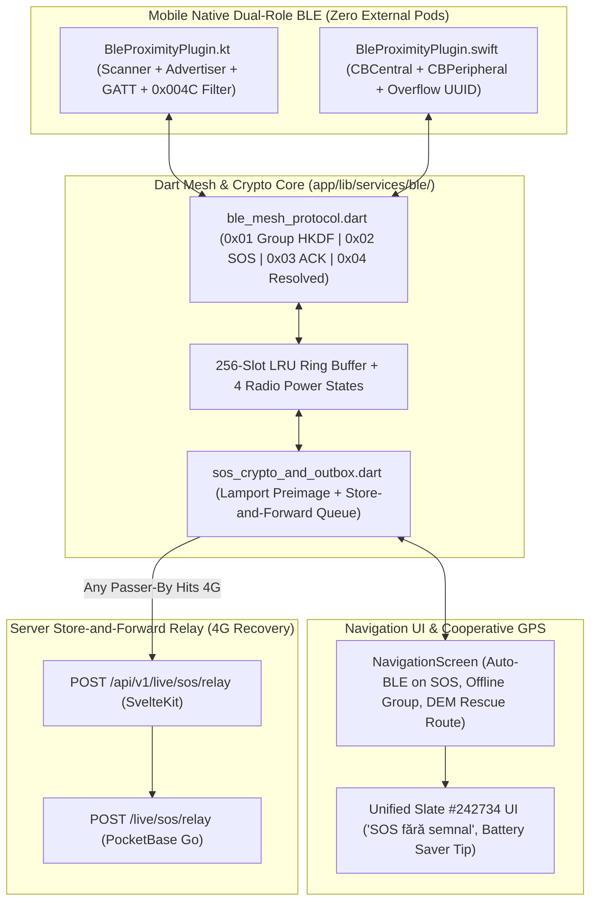

# SOS fără Semnal & Grup prin Bluetooth (BLE Multi-Hop Mesh + Store-and-Forward) — Plan de Implementare

> **For agentic workers:** REQUIRED SUB-SKILL: Use superpowers:subagent-driven-development to implement this plan task-by-task. Steps use checkbox (`- [ ]`) syntax for tracking.

**Goal:** Adăugarea transmisiei automate prin Bluetooth Low Energy (BLE Multi-Hop Mesh + *Store-and-Forward*) la apăsarea **SOS** și în modul **Grup** pe Android și iOS, astfel încât alertele SOS (cu ruta de salvare DEM, confirmare bidirecțională și preluare automată spre server prin telefoanele altor drumeți) și pozițiile grupului (inclusiv fuziunea GPS cooperativă) să funcționeze chiar și cu `0` semnal GSM pe munte.

**Architecture:** Arhitectură nativă zero-dependențe (`BleProximityPlugin.kt` pe Android API 26+ și `BleProximityPlugin.swift` pe iOS 15.0+ CoreBluetooth) conectată printr-un `MethodChannel`/`EventChannel` mockabil la motorul Dart `BleMeshEngine`. Folosește un protocol binar compact (`30–88 octeți`, 1 singur PDU GATT, până la 5 salturi multi-hop) cu criptare HKDF-SHA256 pe codul de grup pentru `PKT_GROUP_POS` și angajament criptografic *Lamport Preimage* (`sosClaimHash` / `sosClaimSecret`) pentru `PKT_SOS_ALERT` + `POST /api/v1/live/sos/relay`, garantând deduplicarea releelor multiple și protecția împotriva anulării neautorizate.

**Architecture Diagram:**



**Tech Stack:** Go 1.24 + PocketBase (`db/`), TypeScript + SvelteKit 5 (`web/`), Dart 3.13 + `package:crypto` (`3.0.7`) + Flutter 3.47 (`app/`), Kotlin `android.bluetooth.le.*` (`minSdk 26`), Swift 5 `CoreBluetooth` (`iOS 15.0+`).

**Spec:** [2026-11-18-offline-ble-sos-group-design.md](file:///Volumes/SSD%20extern/Proiecte/Maps/docs/superpowers/specs/2026-11-18-offline-ble-sos-group-design.md)

## Global Constraints

- **Zero dependențe native externe noi:** Nu se adaugă pachete CocoaPods/Gradle terțe în `pubspec.yaml` (evitând blocajele `[CP] Check Pods Manifest.lock` pe `macos-26` și conflictele `compileSdk 37`); se promovează doar `crypto: ^3.0.7` (deja rezolvat în `pubspec.lock`).
- **Terminologie naturală în română:** Nu se folosește nicăieri cuvântul `baliză` / `Baliză`; se folosesc exclusiv formulările aprobate: `SOS fără semnal`, `trimis prin Bluetooth`, `Alertă SOS în apropiere · prin Bluetooth`, `Grup prin Bluetooth`.
- **Fără dialoguri OS de împerechere Bluetooth:** Caracteristicile GATT folosesc permisiuni standard `READ` / `WRITE_WITHOUT_RESPONSE` / `NOTIFY` (fără `ENCRYPTED` / `MITM`), autentificarea făcându-se la nivel de pachet.
- **Compatibilitate Android ↔ iPhone blocat:** `BLUETOOTH_SCAN` în `AndroidManifest.xml` **nu** setează `neverForLocation`, iar scannerul Android înregistrează atât filtrul `ServiceUuid(7a4e0001-...)`, cât și filtrul Apple Overflow `ManufacturerData(0x004C, [0x01])`.

---

## Milestone 1: Backend & Proxy *Store-and-Forward* SOS Relay (`db/` + `web/`)

### Task 1: Migrație `sos_alerts` + `POST /live/sos/relay` & Lamport Ownership Claim în Go (`db/`)

**Files:**
- Create: [1792200000_add_sos_relay_fields.go](file:///Volumes/SSD%20extern/Proiecte/Maps/db/migrations/1792200000_add_sos_relay_fields.go)
- Create: [trail_live_sos_relay.go](file:///Volumes/SSD%20extern/Proiecte/Maps/db/routes/trail_live_sos_relay.go)
- Modify: [trail_live.go](file:///Volumes/SSD%20extern/Proiecte/Maps/db/routes/trail_live.go)
- Modify: [trail_live_groups.go](file:///Volumes/SSD%20extern/Proiecte/Maps/db/routes/trail_live_groups.go)
- Test: [trail_live_sos_relay_test.go](file:///Volumes/SSD%20extern/Proiecte/Maps/db/routes/trail_live_sos_relay_test.go)

**Interfaces:**
- `sos_alerts` primește câmpurile: `client_sos_id` (`TextField`, partial unique index `WHERE client_sos_id != ''`), `sos_claim_hash` (`TextField`, hidden), `last_packet_epoch` (`NumberField`), `relayed_by_hash` (`TextField`, hidden).
- `SosAlertDto` primește `ClientSosID string` (`json:"clientSosId,omitempty"`).
- `POST /live/sos/relay`:
  - Primește `{ clientSosId, sosClaimHash, status?, sosClaimSecret?, trailId, reason, message, requesterName, lat, lon, ele, packetEpochSec, hopCount }`.
  - La primul releu: creează `sos_alerts` cu `device_hash = ""` (`isMine: false` pentru salvator/trecător!), selectează `pushTargets` în `5 km` (excluzând `muleDeviceHash`), emite SSE `sos_update`, returnează `{ sos, pushTargets, created: true }`.
  - La relee ulterioare cu același `clientSosId`: deduplică idempotent (`created: false`, `pushTargets: []`); actualizează coordonatele doar dacă `packetEpochSec > last_packet_epoch` și deviația față de origine `<= 10 km`; închide cu `status = "resolved"` **exclusiv** dacă `SHA-256("trasee-sos-claim-v1:" + hexDecode(sosClaimSecret))[0..7]` coincide constant-time cu `sos_claim_hash` (`403` altfel!).
- `CreateSos` (`POST /live/sos`) și `UpdateSos` (`PATCH /live/sos/{id}`): acceptă opțional `clientSosId` și `sosClaimSecret` (32 hex) astfel încât victima care revine la 4G își revendică automat propriul rând (`device_hash = callerDeviceHash` -> `isMine: true`) fără a dubla alerta!
- `CreateGroup` (`POST /live/groups`): acceptă opțional `preferredCode` (`^[A-HJ-NP-Z2-9]{6}$`) pentru sincronizarea grupurilor create offline pe munte.

- [ ] **Step 1: Scrie testele Go în `db/routes/trail_live_sos_relay_test.go`**

Acoperă: (1) 3 trecători diferiți fac `POST /live/sos/relay` cu același `clientSosId` -> 1 singur record în `sos_alerts`, `created: true` doar la primul, `isMine: false` pentru toți trecătorii; (2) un atacator încearcă `status: "resolved"` fără preimaginea `sosClaimSecret` corectă -> `403 Forbidden`; (3) victima revine online cu `sosClaimSecret` -> revendică `isMine: true` și poate rezolva alerta; (4) `preferredCode` în `CreateGroup` unește doi membri care au creat același grup offline.

- [ ] **Step 2: Rulează `go test ./routes -run TestTrailLiveSosRelay -v` (Red)**
- [ ] **Step 3: Implementează `1792200000_add_sos_relay_fields.go`, `trail_live_sos_relay.go` și extensiile în `trail_live.go` + `trail_live_groups.go`**
- [ ] **Step 4: Verifică `test -z "$(gofmt -l .)" && go vet ./... && go test ./routes ./services/... ./migrations` (Green)**

---

### Task 2: Rute Proxy SvelteKit `/api/v1/live/sos/relay` & Actualizare Client Web (`web/`)

**Files:**
- Create: `web/src/routes/api/v1/live/sos/relay/+server.ts`
- Modify: [device_identity.ts](file:///Volumes/SSD%20extern/Proiecte/Maps/web/src/lib/server/live/device_identity.ts)
- Modify: `web/src/routes/api/v1/live/sos/+server.ts`
- Modify: `web/src/routes/api/v1/live/sos/[id]/+server.ts`
- Modify: `web/src/routes/api/v1/live/groups/+server.ts`
- Modify: [live_client.ts](file:///Volumes/SSD%20extern/Proiecte/Maps/web/src/lib/live/live_client.ts)
- Test: [live_api.test.ts](file:///Volumes/SSD%20extern/Proiecte/Maps/web/src/lib/server/live/live_api.test.ts)

- [ ] **Step 1: Scrie testele în `live_api.test.ts` pentru `POST /api/v1/live/sos/relay` (validare hex `clientSosId`/`sosClaimHash`, rate-limiter `sosRelay` `20 / 5m`, declanșare VAPID Web Push doar când `created === true`)**
- [ ] **Step 2: Implementează `sosRelay` în `device_identity.ts`, ruta `sos/relay/+server.ts` și forwardarea `clientSosId` / `sosClaimSecret` / `preferredCode`**
- [ ] **Step 3: Rulează `cd web && npx vitest run src/lib/server/live/live_api.test.ts src/lib/live/live_client.test.ts && npm run check` (Green)**

---

## Milestone 2: Protocolul Binar BLE Mesh, Criptografie & Puntea Nativă Android/iOS (`app/`)

### Task 3: Codec Binar BLE (`0x01..0x04`), HKDF-SHA256, LRU Deduplicator și `SosOutboxAndRelayStore` în Dart

**Files:**
- Modify: [pubspec.yaml](file:///Volumes/SSD%20extern/Proiecte/Maps/app/pubspec.yaml) *(adaugă explicit `crypto: ^3.0.7`, deja rezolvat în `pubspec.lock`)*
- Create: `app/lib/services/ble/ble_mesh_protocol.dart`
- Create: `app/lib/services/ble/sos_crypto_and_outbox.dart`
- Test: `app/test/services/ble_mesh_protocol_test.dart`

**Interfaces:**
- `BleMeshProtocol`:
  - Encode/decode binar exact pe octeți pentru `BleGroupPosPacket (0x01, 48B)`, `BleSosAlertPacket (0x02, 40..88B)`, `BleSosAckPacket (0x03, 30B)`, `BleSosResolvedPacket (0x04, 37B)` + împachetare/despachetare buffer GATT multi-frame (`<= 180B`).
  - `GroupBleCipher.fromGroupCode(String code)`: HKDF-SHA256 (`kEnc`, `kMac`), Encrypt-then-MAC + verificare constant-time.
  - `BlePacketDeduplicator` (256-slot ring buffer LRU cu *superseding* la `>= +30s` și *tombstone* 6h pe `PKT_SOS_RESOLVED` validat cu preimaginea `sosRevealToken`).
  - `decrementTtlForRelay(Uint8List rawFrame)` (modifică doar `byte[2]` fără a invalida MAC-ul/hash-ul!).
- `SosOriginCredentials` & `SosOutboxAndRelayStore`:
  - Generează și persistă în `wanderer_sos_relay_outbox.json`: `myPendingSos`, `relayQueue` (alerte SOS culese prin BLE de la alți drumeți în așteptarea semnalului 4G) și `pendingResponderAction`.

- [ ] **Step 1: Scrie testele unitare complete în `app/test/services/ble_mesh_protocol_test.dart`**

Acoperă: (a) roundtrip pe toți cei 4 tipuri de pachete + truncare UTF-8 sigură pe diacritice românești (`ăâîșț`); (b) respingerea decriptării cu alt cod de grup; (c) decrementare `ttlHops` pe 5 salturi păstrând MAC-ul valid și oprire la `ttlRemaining == 0`; (d) verificare *Lamport preimage* pe `PKT_SOS_RESOLVED` (respingere fals, acceptare + *tombstone* pe secretul autentic); (e) persistență și deduplicare în `SosOutboxAndRelayStore`.

- [ ] **Step 2: Implementează `ble_mesh_protocol.dart` și `sos_crypto_and_outbox.dart`**

---

### Task 4: Plugin Nativ Dual-Role BLE pe Android (`BleProximityPlugin.kt`)

**Files:**
- Create: `app/android/app/src/main/kotlin/com/openwanderer/wanderer/BleProximityPlugin.kt`
- Modify: [MainActivity.kt](file:///Volumes/SSD%20extern/Proiecte/Maps/app/android/app/src/main/kotlin/com/openwanderer/wanderer/MainActivity.kt)
- Modify: [AndroidManifest.xml](file:///Volumes/SSD%20extern/Proiecte/Maps/app/android/app/src/main/AndroidManifest.xml)

**Detalii de Implementare:**
- Permisiuni în `AndroidManifest.xml`: `bluetooth_le` (`required="false"`), `BLUETOOTH` + `BLUETOOTH_ADMIN` (`maxSdkVersion="30"`), `BLUETOOTH_SCAN` (**fără** `neverForLocation`!), `BLUETOOTH_ADVERTISE`, `BLUETOOTH_CONNECT`.
- `BleProximityPlugin` implementează `FlutterPlugin, ActivityAware, PluginRegistry.RequestPermissionsResultListener, MethodCallHandler, EventChannel.StreamHandler`:
  - Metode canal `com.openwanderer.wanderer/ble_proximity`: `getState`, `checkPermissions`, `requestPermissions`, `startDualRole(mode, syncDigest8B, syncBufferBytes)`, `updateLocalPayloads(mode, syncDigest8B, syncBufferBytes, pushFrameBytes?)`, `stopDualRole`.
  - Pornește `BluetoothGattServer` cu serviciul `7a4e0001-8c3b-4f2d-9e1a-5b6c7d8e9f00` (`CHAR_SYNC_READ` `READ` + `CHAR_MESH_INGRESS` `WRITE_NO_RESPONSE | NOTIFY`, permisiuni deschise fără pairing!).
  - Pornește `BluetoothLeAdvertiser` (cu `AdvertiseData` pe UUID-ul serviciului + `ScanResponse` cu cele 8 octeți `ServiceData` `0x7A4E`, adaptând puterea între `BALANCED` și `LOW_LATENCY / TX_POWER_HIGH` în modul `sos_emergency`).
  - Pornește `BluetoothLeScanner` cu cele **2 filtre hardware** (`ServiceUuid(7a4e0001-...)` + Apple Overflow `ManufacturerData(0x004C, [0x01])` cu cache negativ 15 min pentru non-Wanderer), conectându-se scurt GATT (`requestMtu(185)` -> `readCharacteristic(CHAR_SYNC_READ)` + `writeCharacteristic(CHAR_MESH_INGRESS)` când digest-ul diferă) și emițând pachetele decodate pe `EventChannel('com.openwanderer.wanderer/ble_proximity/events')`.

- [ ] **Step 1: Actualizează `AndroidManifest.xml` și `MainActivity.kt`**
- [ ] **Step 2: Implementează `BleProximityPlugin.kt` (verificând toate API-urile pentru `minSdk = 26` / `compileSdk = 37` și `@SuppressLint("MissingPermission")` după verificări explicite `checkSelfPermission`)**

---

### Task 5: Plugin Nativ Dual-Role BLE pe iOS (`BleProximityPlugin.swift`) + `BleMeshEngine` în Dart

**Files:**
- Create: `app/ios/Runner/BleProximityPlugin.swift`
- Modify: [AppDelegate.swift](file:///Volumes/SSD%20extern/Proiecte/Maps/app/ios/Runner/AppDelegate.swift)
- Modify: [project.pbxproj](file:///Volumes/SSD%20extern/Proiecte/Maps/app/ios/Runner.xcodeproj/project.pbxproj)
- Modify: [Info.plist](file:///Volumes/SSD%20extern/Proiecte/Maps/app/ios/Runner/Info.plist)
- Modify: `app/ios/Runner/ro.lproj/InfoPlist.strings` & `app/ios/Runner/en.lproj/InfoPlist.strings`
- Create: `app/lib/services/ble/ble_mesh_engine.dart`
- Test: `app/test/services/ble_mesh_engine_test.dart`

**Detalii de Implementare:**
- În `Info.plist`: adaugă `bluetooth-central` și `bluetooth-peripheral` în `UIBackgroundModes` + `NSBluetoothAlwaysUsageDescription` localizat în română (*„Wanderer folosește Bluetooth pentru a partaja poziția în grup și pentru a transmite alerte SOS fără semnal mobil către drumeții din apropiere.”*).
- În `BleProximityPlugin.swift`: inițializează *lazy* `CBCentralManager` și `CBPeripheralManager` doar la primul apel `requestPermissions` / `startDualRole` (niciodată la pornirea aplicației!); publică `CBMutableService` (`7a4e0001-...`) cu `CHAR_SYNC_READ` și `CHAR_MESH_INGRESS`, face advertising pe `[TRASEE_MESH_SERVICE_UUID]`, scanează cu `withServices: [TRASEE_MESH_SERVICE_UUID]`, menține abonarea `setNotifyValue(true, for: ingressChar)` pentru *keep-alive* cu ecranul blocat și trimite cadrele pe `EventChannel`.
- Înregistrează `BleProximityPlugin` în `AppDelegate.didInitializeImplicitFlutterEngine` și adaugă cele 4 intrări UUID ale fișierului `BleProximityPlugin.swift` în `Runner.xcodeproj/project.pbxproj` (`PBXBuildFile`, `PBXFileReference`, `PBXGroup`, `PBXSourcesBuildPhase`).
- Creează `BleMeshEngine` în Dart care orchestrează cele 4 stări radio (`idleOff`, `passiveTrailGuard`, `groupMeshNormal`, `sosEmergencyActive`), jitter-ul de retransmisie multi-hop (`80–350 ms` SOS, `250–800 ms` Grup) și mock-urile pentru `flutter test`.

- [ ] **Step 1: Actualizează `Info.plist`, `InfoPlist.strings`, `AppDelegate.swift`, `project.pbxproj` și creează `BleProximityPlugin.swift`**
- [ ] **Step 2: Implementează `ble_mesh_engine.dart` și testele cu canal mock în `ble_mesh_engine_test.dart`**

---

## Milestone 3: Integrare UI „SOS fără semnal” & „Grup prin Bluetooth”, CI & Deploy

### Task 6: Integrare Completă în `NavigationScreen`, `TrailLiveService`, `SosBannerAndDialog` și `GroupSheet` (`app/`)

**Files:**
- Modify: [trail_live_models.dart](file:///Volumes/SSD%20extern/Proiecte/Maps/app/lib/models/live/trail_live_models.dart)
- Modify: [trail_live_service.dart](file:///Volumes/SSD%20extern/Proiecte/Maps/app/lib/services/trail_live_service.dart)
- Modify: [sos_banner_and_dialog.dart](file:///Volumes/SSD%20extern/Proiecte/Maps/app/lib/components/navigation/sos_banner_and_dialog.dart)
- Modify: [group_sheet.dart](file:///Volumes/SSD%20extern/Proiecte/Maps/app/lib/components/navigation/group_sheet.dart)
- Modify: [navigation_screen.dart](file:///Volumes/SSD%20extern/Proiecte/Maps/app/lib/routes/navigation_screen.dart)
- Modify: [trail_live_models_test.dart](file:///Volumes/SSD%20extern/Proiecte/Maps/app/test/services/trail_live_models_test.dart)

**Schimbări Cheie:**
1. **Activare automată BLE la apăsarea SOS (`_onSosButtonPressed`)**:
   - Creează instant `localSos` cu `SosOriginCredentials.mint(...)`, cere permisiunea BLE dacă lipsește și pornește imediat `BleMeshEngine` în modul `sosEmergencyActive` (atât offline, cât și online ca plasă dublă de siguranță pentru văi ecranate!).
   - Dacă lipsește internetul, nu mai blochează/pierde alerta — setează `SosDeliveryState.bleOffline`, salvează în `SosOutboxAndRelayStore` și afișează `SOS fără semnal · trimis prin Bluetooth` + cardul calm de economisire a bateriei.
2. **Store-and-Forward automat & Confirmare Bidirecțională**:
   - Orice drumeț în navigație rulează `passiveTrailGuard`: la recepția `PKT_SOS_ALERT`, afișează `🆘 Alertă SOS în apropiere · prin Bluetooth`, sună notificarea locală, oferă ruta DEM offline (*„Pot să vin să ajut”* -> trimite `PKT_SOS_ACK` `comingToHelp` înapoi la victimă!) și salvează pachetul în `relayQueue`.
   - Când trecătorul are sau recapătă internet (`onlineStatusProvider` / heartbeat), urcă automat coada la `POST /live/sos/relay` și emite `PKT_SOS_ACK` (`uploadedToServer`) astfel încât victima vede *„Alerta ta a fost transmisă online prin telefonul unui drumeț din apropiere”*.
3. **Grup prin Bluetooth + Fuziune GPS Cooperativă**:
   - Permite crearea/intrarea în grup și fără internet (`isOfflineCreated: true`, sincronizat prin `preferredCode` la revenirea semnalului).
   - Pozițiile `PKT_GROUP_POS` decriptate se unifică după `memberId` în `_groupSession` (afișând badge-ul discret `#242734` `Prin Bluetooth`), proiectează `alongTrackM` local pe traseu și intră direct în `CooperativeGpsFusion` (cu `updatedAt` ancorat local pentru 0-hop, evitând erorile de ceas între telefoane offline).

- [ ] **Step 1: Extinde `trail_live_models.dart` și `trail_live_service.dart` (`relaySosPacket`, `preferredCode`, `SosDeliveryState`)**
- [ ] **Step 2: Actualizează UI-ul în `sos_banner_and_dialog.dart` și `group_sheet.dart` (texte naturale în română fără cuvântul „baliză”, identitate `#242734` Deep Slate & Sticlă Mată)**
- [ ] **Step 3: Conectează `BleMeshEngine` și `SosOutboxAndRelayStore` în `navigation_screen.dart` + adaugă teste widget/model în `trail_live_models_test.dart`**

---

### Task 7: Verificare Completă, Build CI (`App`, `Android APK Build`, `iOS IPA Build`) & Deploy pe `laptop`

- [ ] **Step 1: Rulează suita locală Go + Web**
  ```bash
  cd db && test -z "$(gofmt -l .)" && go vet ./... && go test ./routes ./services/... ./migrations
  cd ../web && npm run check && npx vitest run src/lib/server/live/ src/lib/live/ src/lib/navigation/ && npm run build
  ```
- [ ] **Step 2: Commit & Push pe `main`, apoi urmărește GitHub Actions**
  - Verifică trecerea pe verde pentru `Go`, `App` (`flutter analyze` + toate testele unitare/widget inclusiv BLE codec/engine/outbox), `Android APK Build` (compilare Kotlin + R8) și `iOS IPA Build` (compilare Swift CoreBluetooth pe `macos-26`).
- [ ] **Step 3: Deploy pe `laptop` (`wanderer-db`, `wanderer-web`, `.apk` și `.ipa`) + Smoke Test Live pe `/api/v1/live/sos/relay`**
