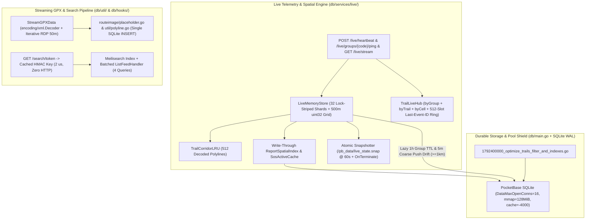

# Faza 1 Optimizare: Motorul Spațial RAM Go (`LiveMemoryStore`), Tuning SQLite Dual-Pool, SSE Zero-Alloc & Eliminare N+1 / GPX DOM — Plan de Implementare

> **For agentic workers:** REQUIRED SUB-SKILL: Use superpowers:subagent-driven-development to implement this plan task-by-task. Steps use checkbox (`- [ ]`) syntax for tracking.

**Goal:** Eliminarea a 100% din interogările și scrierile SQLite de pe calea fierbinte GPS/SSE (`/live/heartbeat`, `/live/groups/{code}/ping`, `/live/trail/{id}/summary`), eliminarea riscului de OOM-kill în containerul `wanderer-db` (`512 MiB` limită) cauzat de cache-ul per-conexiune `modernc.org/sqlite` și de dublul parse XML DOM al fișierelor GPX de până la `25 MiB`, reducerea cu `~48–99%` a traficului live prin frame-uri SSE single-envelope cu ring-buffer `Last-Event-ID` și răspunsuri delta (`stateHash`, `?ack=1`, `stationary`), și optimizarea interogărilor relaționale și Meilisearch (`ListFeedHandler`, `UpdateUserHandler`, `/search/token`, `trails_filter`).

**Architecture:** Telemetria efemeră de înaltă frecvență (`trail_presence`, `trail_group_members` la 5s, coordonatele live ale abonaților SSE și drift-ul fin al `push_subscriptions`) este mutată într-un motor spațial în memorie `LiveMemoryStore` în Go pur (`CGO_ENABLED=0`), partiționat în `32` de shard-uri fără contenție și indexat pe o grilă echirectangulară `uint32` cu rezoluție de `~500 m` (cu histerezis: re-indexare doar la schimbarea celulei), dublat de un cache write-through spațial pentru `trail_reports` (care elimină și bug-ul de trunchiere `LIMIT 500` pe izvoarele/refugiile permanente) și `sos_alerts`/`sos_responders`, un LRU de polilinii decodificate `TrailCorridorLRU` și un snapshot atomic pe disc la `60s` + hook `OnTerminate` (`/pb_data/live_state.snap`). SQLite (`modernc.org/sqlite v1.50.0`) rămâne dedicat datelor durabile cu un pool redimensionat (`DataMaxOpenConns=16`, `mmap_size=128MiB`, `cache_size=-4000`, `GOMEMLIMIT=420MiB`), GPX-urile sunt procesate printr-un parser streaming `encoding/xml.Decoder` + Ramer-Douglas-Peucker iterativ într-o singură trecere (`< 12 MiB` RAM), iar `TrailLiveHub` distribuie frame-uri pre-serializate cu `id: <seq>` dintr-un ring-buffer de `512` sloturi în $O(1)$ per grup și per celulă geografică.

**Architecture Diagram:**



**Tech Stack:** Go `1.25+` (`golang:1.26` static build `CGO_ENABLED=0` în `FROM scratch`), PocketBase `v0.38.0`, `modernc.org/sqlite v1.50.0`, `github.com/pocketbase/dbx v1.12.0`, `github.com/meilisearch/meilisearch-go v0.36.2`, `github.com/twpayne/go-polyline v1.1.1`, Docker Compose (`deploy/docker-compose.prod.yml`).

**Spec:** [2026-11-18-performance-battery-io-optimization-design.md](file:///Volumes/SSD%20extern/Proiecte/Maps/docs/superpowers/specs/2026-11-18-performance-battery-io-optimization-design.md)

## Global Constraints

- **Compilare 100% Statică (`CGO_ENABLED=0`, `FROM scratch`):** Toate pachetele din `db/` trebuie să rămână 100% Go pur, fără CGo (exclus `uber/h3-go` sau `mattn/go-sqlite3`), compatibile cu [db/Dockerfile](file:///Volumes/SSD%20extern/Proiecte/Maps/db/Dockerfile#L78-L84) și [deploy/Dockerfile.db](file:///Volumes/SSD%20extern/Proiecte/Maps/deploy/Dockerfile.db#L20-L22).
- **VPS Unic & Disc Local (Fără Stocare Externă de Obiecte):** Niciun fișier, variabilă `.env`, hook de bootstrap sau rută nu introduce dependențe de stocare externă de obiecte sau subdomenii dedicate de obiecte; toate bazele SQLite, fișierele și snapshot-urile rulează pe discul SSD local al VPS-ului (`/pb_data`).
- **Plafon Strict de Memorie (`mem_limit: 512m` + `GOMEMLIMIT=420MiB`):** Amprenta combinată a `LiveMemoryStore` (`< 6 MiB`), ring-buffer-ului SSE (`~192 KiB`), conexiunilor SQLite (`16 × 4 MiB = 64 MiB` cache privat max + `128 MiB` `mmap` partajat în kernel) și parserului GPX streaming (`< 12 MiB` vârf) trebuie să mențină RSS-ul containerului `wanderer-db` sub `440 MiB`.
- **Contracte Wire Partajate Inter-Faze (Fazele 1–4):**
  - `POST /live/heartbeat` și `GET /live/trail/{id}/summary` acceptă `stateHash` (câmp JSON opțional / query param `?stateHash=`) și returnează întotdeauna `"stateHash": "<16-hex>"`; când hash-ul coincide, returnează delta compact `{"activeHikers30m": N, "stateHash": "<16-hex>", "unchanged": true}` (cu `"trailId"` pe `/summary`), păstrând răspunsul complet când `stateHash` lipsește sau diferă.
  - `POST /live/heartbeat` și `POST /live/groups/{code}/ping` (precum și `create`/`join`) acceptă `"stationary": true|false`: extinde fereastra activă de prezență de la `2 min` la `10 min` (pentru keepalive-ul de cabană la `300s` cu marjă `2×` din Fazele 3–4) și expune `"stationary": bool` în `GroupMemberDto`.
  - `POST /live/groups/{code}/ping?ack=1` returnează confirmarea compactă `{"ok": true, "code": "<CODE>", "selfMemberId": "<ID>", "expiresAt": "<RFC3339>"}` în loc de întregul tablou `members[]`, păstrând răspunsul `GroupSessionDto` complet când `?ack=1` nu este prezent.
  - `GET /live/stream` emite `id: <seq>` monoton crescător pe fiecare eveniment SSE (`id: <seq>\nevent: <name>\ndata: <single-envelope-json>\n\n`), acceptă `Last-Event-ID` (header sau query param `?lastEventId=`) pentru rejucarea din ring-buffer-ul de `512` sloturi (sau `event: resync_required\ndata: {"type":"resync_required"}\n\n` dacă decalajul depășește `512`), și actualizează automat coordonatele `(Lat, Lon, TrailID)` ale abonatului în memorie la fiecare `Heartbeat`/`PingGroup`.
  - Migrația PocketBase din această fază poartă exact timestamp-ul `db/migrations/1792400000_optimize_trails_filter_and_indexes.go` (evitând coliziunile cu `1792200000` și `1792300000`). Testele E2E Web din fazele următoare folosesc exclusiv `web/tests/playwright/` conform [playwright.config.ts](file:///Volumes/SSD%20extern/Proiecte/Maps/web/playwright.config.ts#L13).

---

## Milestone 1: Motorul Spațial RAM Lock-Striped & Snapshotting Atomic (`db/services/live/`)

### Task 1: Grila Spațială `500m` (`uint32`), `LiveMemoryStore` pe 32 Shard-uri & Snapshot Atomic pe Disc

**Files:**
- Create: [spatial_grid.go](file:///Volumes/SSD%20extern/Proiecte/Maps/db/services/live/spatial_grid.go)
- Create: [memory_store.go](file:///Volumes/SSD%20extern/Proiecte/Maps/db/services/live/memory_store.go)
- Create: [snapshot.go](file:///Volumes/SSD%20extern/Proiecte/Maps/db/services/live/snapshot.go)
- Test: [memory_store_test.go](file:///Volumes/SSD%20extern/Proiecte/Maps/db/services/live/memory_store_test.go)

**Interfaces:**
- Consumes: `util.HaversineDistanceMeters(lat1, lon1, lat2, lon2 float64) float64` din [distance.go](file:///Volumes/SSD%20extern/Proiecte/Maps/db/util/distance.go#L5-L18).
- Produces:
  - `live.GridCellKey(lat, lon float64) uint32` (`~500m` rezoluție: `0.0045° lat × 0.0064° lon`, `0` alocări heap)
  - `live.GridCellsForBBox(minLat, maxLat, minLon, maxLon, padMeters float64) []uint32`
  - `live.GridCellsForRadius(lat, lon, radiusMeters float64) []uint32`
  - `live.LiveMemoryStore` (`DefaultMemoryStore() *LiveMemoryStore`, `NewLiveMemoryStore() *LiveMemoryStore`) cu metodele complete pentru `Presence`, `Groups`, `Reports` (fără trunchierea `LIMIT 500`), `SOS` + `Responders`, `PushSubs` (cu prag de drift `1000m`) și `TrailCorridorLRU` (`512` trasee).
  - `(*LiveMemoryStore).SaveSnapshot(path string, now time.Time) error` și `(*LiveMemoryStore).LoadSnapshot(path string, maxAge time.Duration, now time.Time) error`.

> [!IMPORTANT]
> La `4.3 km/h` (`1.2 m/s`), un drumeț traversează o celulă de `500 m` o dată la `~7 minute` (`~21` heartbeats). Re-indexarea în harta de celule `gridCells` se execută **exclusiv când `oldCell != newCell`**, astfel încât `>95%` din ping-uri actualizează doar structura din shard-ul propriu (`fnv32a(key) & 31`), eliminând complet contenția între goroutine-uri.

- [ ] **Step 1: Scrie testele unitare pentru grila spațială, `LiveMemoryStore` (inclusiv >500 izvoare permanente, fereastra `stationary` de 6m, drift `push_subscriptions` >= 1km) și snapshot-ul atomic**

Creează [memory_store_test.go](file:///Volumes/SSD%20extern/Proiecte/Maps/db/services/live/memory_store_test.go):

```go
package live

import (
	"fmt"
	"path/filepath"
	"sync"
	"testing"
	"time"
)

func TestGridCellKeyAndNeighborhoodSearch(t *testing.T) {
	omuLat, omuLon := 45.4450, 25.4560
	centerKey := GridCellKey(omuLat, omuLon)
	if centerKey == 0 {
		t.Fatal("expected non-zero cell key for Omu Peak")
	}

	// Same spot within ~50m stays in same or adjacent 500m cell and MUST be covered by 2km radius cells.
	cells2km := GridCellsForRadius(omuLat, omuLon, 2000.0)
	nearKey := GridCellKey(45.4580, 25.4560) // ~1.44 km north
	found := false
	for _, ck := range cells2km {
		if ck == nearKey {
			found = true
			break
		}
	}
	if !found {
		t.Fatalf("expected 1.44km point cell %d to be inside 2km neighborhood (%d cells)", nearKey, len(cells2km))
	}
}

func TestLiveMemoryStorePresenceCorridorAndStationaryWindow(t *testing.T) {
	store := NewLiveMemoryStore()
	t0 := time.Date(2026, 11, 18, 10, 0, 0, 0, time.UTC)

	corridor := [][2]float64{
		{45.4080, 25.5420},
		{45.4300, 25.4900},
	}
	store.PutTrailCorridor("trail-bucegi", corridor)

	// Hiker A (caller), Hiker B (moving, on corridor), Hiker C (stationary=true at cabana), Hiker D (15km away).
	store.UpsertPresence(PresenceEntry{
		DeviceHash:   "hiker-a",
		TrailID:      "trail-bucegi",
		Lat:          45.4090,
		Lon:          25.5400,
		Ele:          1980,
		InNavigation: true,
		Stationary:   false,
		LastSeen:     t0,
	})
	store.UpsertPresence(PresenceEntry{
		DeviceHash:   "hiker-b",
		TrailID:      "trail-bucegi",
		Lat:          45.4150,
		Lon:          25.5250,
		Ele:          2025,
		InNavigation: true,
		Stationary:   false,
		LastSeen:     t0,
	})
	store.UpsertPresence(PresenceEntry{
		DeviceHash:   "hiker-cabana",
		TrailID:      "trail-bucegi",
		Lat:          45.4120,
		Lon:          25.5300,
		Ele:          2000,
		InNavigation: true,
		Stationary:   true,
		LastSeen:     t0,
	})
	store.UpsertPresence(PresenceEntry{
		DeviceHash: "hiker-far",
		TrailID:    "trail-fagaras",
		Lat:        45.6000,
		Lon:        24.6000,
		LastSeen:   t0,
	})

	if got := store.CountActiveNearbyUsers(corridor, "hiker-a", t0); got != 2 {
		t.Fatalf("at t0 CountActiveNearbyUsers = %d, want 2 (hiker-b + hiker-cabana)", got)
	}

	// At t0 + 8m: moving hiker-b (> 2m window) expires from live count,
	// while stationary hiker-cabana (<= 10m stationary window, 2x 300s keepalive) stays active!
	t8m := t0.Add(8 * time.Minute)
	if got := store.CountActiveNearbyUsers(corridor, "hiker-a", t8m); got != 1 {
		t.Fatalf("at t0+8m CountActiveNearbyUsers = %d, want 1 (stationary hiker-cabana still within 10m window)", got)
	}

	// At t0 + 11m: stationary hiker also expires if no 5m keepalive arrived.
	t11m := t0.Add(11 * time.Minute)
	if got := store.CountActiveNearbyUsers(corridor, "hiker-a", t11m); got != 0 {
		t.Fatalf("at t0+11m CountActiveNearbyUsers = %d, want 0", got)
	}
}

func TestReportSpatialIndexDoesNotTruncateBeyond500PermanentLandmarks(t *testing.T) {
	store := NewLiveMemoryStore()
	now := time.Date(2026, 11, 18, 12, 0, 0, 0, time.UTC)

	// Insert oldest permanent spring right at Bucegi (45.4100, 25.5400).
	store.UpsertReport(CachedReport{
		ID:              "spring-oldest",
		TrailID:         "trail-bucegi",
		Category:        "spring",
		Kind:            "landmark_permanent",
		IsPermanent:     true,
		ConditionStatus: "active",
		Note:            "Izvorul vechi",
		Lat:             45.4100,
		Lon:             25.5400,
		AlongTrackM:     -1,
		ConfirmCount:    4,
		CreatedAt:       now.Add(-30 * 24 * time.Hour),
		LastConfirmedAt: now.Add(-2 * 24 * time.Hour),
	})

	// Insert 650 newer permanent springs far away in Retezat (45.35, 22.88) — previously LIMIT 500 hid spring-oldest!
	for i := 0; i < 650; i++ {
		store.UpsertReport(CachedReport{
			ID:              fmt.Sprintf("spring-retezat-%03d", i),
			TrailID:         "trail-retezat",
			Category:        "spring",
			Kind:            "landmark_permanent",
			IsPermanent:     true,
			ConditionStatus: "active",
			Lat:             45.3500 + float64(i)*0.0001,
			Lon:             22.8800,
			AlongTrackM:     -1,
			ConfirmCount:    1,
			CreatedAt:       now.Add(-time.Duration(650-i) * time.Minute),
			LastConfirmedAt: now.Add(-time.Duration(650-i) * time.Minute),
		})
	}

	got := store.QueryVisibleReports("other-trail", 45.4105, 25.5402, true, now)
	if len(got) != 1 || got[0].ID != "spring-oldest" {
		t.Fatalf("expected spatial index to return spring-oldest despite 650 newer distant landmarks, got %d items", len(got))
	}
}

func TestPushSubCoarseDriftAndSnapshotRoundTrip(t *testing.T) {
	store := NewLiveMemoryStore()
	t0 := time.Date(2026, 11, 18, 12, 0, 0, 0, time.UTC)

	store.UpsertPushSub(PushSubEntry{
		ID:         "rec-push-1",
		DeviceHash: "dev-push-1",
		Endpoint:   "https://push.example/sub1",
		P256dh:     "p256-key",
		Auth:       "auth-key",
		Lat:        45.4000,
		Lon:        25.5000,
		TrailID:    "trail-1",
	}, false)

	// Moving only 80m on same trail MUST NOT mark SQLite row dirty.
	store.TouchPushLocation("dev-push-1", 45.4005, 25.5000, "trail-1")
	if dirty := store.DrainDirtyPushSubs(); len(dirty) != 0 {
		t.Fatalf("expected 0 dirty push subs for 55m move, got %d", len(dirty))
	}

	// Moving ~2.2km north MUST mark SQLite row dirty once.
	store.TouchPushLocation("dev-push-1", 45.4200, 25.5000, "trail-1")
	dirty := store.DrainDirtyPushSubs()
	if len(dirty) != 1 || dirty[0].ID != "rec-push-1" {
		t.Fatalf("expected 1 dirty push sub after 2.2km move, got %+v", dirty)
	}

	// Group + Presence + SOS responder snapshot round-trip.
	store.UpsertGroup(CachedGroup{
		RecordID:        "grp-rec-1",
		Code:            "ABC234",
		TrailID:         "trail-1",
		OwnerDeviceHash: "dev-host",
		ExpiresAt:       t0.Add(12 * time.Hour),
		LastDBSyncAt:    t0,
	})
	heading := 180.0
	store.UpsertGroupMember("ABC234", CachedGroupMember{
		DeviceHash:   "dev-host",
		MemberID:     "112233445566",
		DisplayName:  "Andrei",
		ColorHex:     "#242734",
		Lat:          45.4200,
		Lon:          25.5000,
		Ele:          2100,
		Accuracy:     6.5,
		Heading:      &heading,
		InNavigation: true,
		Stationary:   true,
		CreatedAt:    t0,
		LastSeen:     t0,
	})

	snapPath := filepath.Join(t.TempDir(), "live_state.snap")
	if err := store.SaveSnapshot(snapPath, t0); err != nil {
		t.Fatalf("SaveSnapshot: %v", err)
	}

	restored := NewLiveMemoryStore()
	if err := restored.LoadSnapshot(snapPath, 10*time.Minute, t0.Add(30*time.Second)); err != nil {
		t.Fatalf("LoadSnapshot: %v", err)
	}
	members := restored.ListActiveGroupMembers("ABC234", 10*time.Minute, t0.Add(30*time.Second))
	if len(members) != 1 || members[0].DisplayName != "Andrei" || !members[0].Stationary {
		t.Fatalf("restored group members mismatch: %+v", members)
	}
}

func TestLiveMemoryStoreConcurrentContention(t *testing.T) {
	store := NewLiveMemoryStore()
	now := time.Now().UTC()
	var wg sync.WaitGroup
	for g := 0; g < 16; g++ {
		wg.Add(1)
		go func(worker int) {
			defer wg.Done()
			for i := 0; i < 200; i++ {
				dh := fmt.Sprintf("dev-%d-%d", worker, i%25)
				store.UpsertPresence(PresenceEntry{
					DeviceHash: dh,
					TrailID:    "trail-stress",
					Lat:        45.30 + float64(i%40)*0.002,
					Lon:        25.40 + float64(worker)*0.002,
					LastSeen:   now,
				})
				_ = store.CountActiveNearbyUsers([][2]float64{{45.32, 25.42}, {45.35, 25.45}}, dh, now)
			}
		}(g)
	}
	wg.Wait()
}
```

- [ ] **Step 2: Rulează testele noi pentru a confirma eșecul inițial (RED)**

Run: `cd db && go test -v ./services/live -run "TestGridCell|TestLiveMemoryStore|TestReportSpatialIndex|TestPushSubCoarseDrift"`
Expected: FAIL cu `undefined: GridCellKey` și `undefined: NewLiveMemoryStore`.

- [ ] **Step 3: Implementează grila spațială `spatial_grid.go`, store-ul `memory_store.go` și snapshot-ul atomic `snapshot.go`**

Creează [spatial_grid.go](file:///Volumes/SSD%20extern/Proiecte/Maps/db/services/live/spatial_grid.go):

```go
package live

import "math"

const (
	// ~500m resolution at Carpathian latitudes (0.0045 deg lat ~= 500m, 0.0064 deg lon @ 45.5N ~= 500m).
	gridCellLatDeg = 0.0045
	gridCellLonDeg = 0.0064

	metersPerDegLat = 111132.92
)

func clampLat(lat float64) float64 {
	if lat < -89.999 {
		return -89.999
	}
	if lat > 89.999 {
		return 89.999
	}
	return lat
}

func clampLon(lon float64) float64 {
	if lon < -179.999 {
		return -179.999
	}
	if lon > 179.999 {
		return 179.999
	}
	return lon
}

func latBucket(lat float64) uint16 {
	v := int((clampLat(lat) + 90.0) / gridCellLatDeg)
	if v < 0 {
		v = 0
	}
	if v > 65535 {
		v = 65535
	}
	return uint16(v)
}

func lonBucket(lon float64) uint16 {
	v := int((clampLon(lon) + 180.0) / gridCellLonDeg)
	if v < 0 {
		v = 0
	}
	if v > 65535 {
		v = 65535
	}
	return uint16(v)
}

// GridCellKey packs (lat, lon) into a single 32-bit spatial bucket (~500m x 500m) with zero allocations.
func GridCellKey(lat, lon float64) uint32 {
	return (uint32(latBucket(lat)) << 16) | uint32(lonBucket(lon))
}

// GridCellsForBBox returns all 500m spatial cell keys intersecting [minLat..maxLat, minLon..maxLon] expanded by padMeters.
func GridCellsForBBox(minLat, maxLat, minLon, maxLon, padMeters float64) []uint32 {
	midLat := (minLat + maxLat) * 0.5
	cosLat := math.Max(0.1, math.Cos(midLat*math.Pi/180.0))
	dLat := padMeters / metersPerDegLat
	dLon := padMeters / (metersPerDegLat * cosLat)

	y0 := latBucket(minLat - dLat)
	y1 := latBucket(maxLat + dLat)
	x0 := lonBucket(minLon - dLon)
	x1 := lonBucket(maxLon + dLon)

	count := int(y1-y0+1) * int(x1-x0+1)
	out := make([]uint32, 0, count)
	for y := y0; y <= y1; y++ {
		prefix := uint32(y) << 16
		for x := x0; x <= x1; x++ {
			out = append(out, prefix|uint32(x))
		}
	}
	return out
}

// GridCellsForRadius returns all 500m spatial cell keys covering a circle of radiusMeters around (lat, lon).
func GridCellsForRadius(lat, lon, radiusMeters float64) []uint32 {
	return GridCellsForBBox(lat, lat, lon, lon, radiusMeters)
}

// DistanceToCorridorMeters computes the minimum planar projection distance in meters from (lat, lon) to a polyline.
func DistanceToCorridorMeters(lat, lon float64, coords [][2]float64) float64 {
	if len(coords) == 0 {
		return math.Inf(1)
	}
	cosLat := math.Max(0.1, math.Cos(lat*math.Pi/180.0))
	metersPerDegLon := metersPerDegLat * cosLat

	if len(coords) == 1 {
		dx := (coords[0][1] - lon) * metersPerDegLon
		dy := (coords[0][0] - lat) * metersPerDegLat
		return math.Hypot(dx, dy)
	}

	minDistSq := math.Inf(1)
	for i := 0; i < len(coords)-1; i++ {
		ax := (coords[i][1] - lon) * metersPerDegLon
		ay := (coords[i][0] - lat) * metersPerDegLat
		bx := (coords[i+1][1] - lon) * metersPerDegLon
		by := (coords[i+1][0] - lat) * metersPerDegLat

		dx := bx - ax
		dy := by - ay
		segLenSq := dx*dx + dy*dy
		var t float64
		if segLenSq > 1e-9 {
			t = -(ax*dx + ay*dy) / segLenSq
			if t < 0 {
				t = 0
			} else if t > 1 {
				t = 1
			}
		}
		px := ax + t*dx
		py := ay + t*dy
		dSq := px*px + py*py
		if dSq < minDistSq {
			minDistSq = dSq
		}
	}
	return math.Sqrt(minDistSq)
}
```

Creează [memory_store.go](file:///Volumes/SSD%20extern/Proiecte/Maps/db/services/live/memory_store.go):

```go
package live

import (
	"container/list"
	"math"
	"sort"
	"strings"
	"sync"
	"sync/atomic"
	"time"

	"pocketbase/util"
)

const (
	numMemoryShards = 32

	LiveMovingPresenceWindow     = 2 * time.Minute
	LiveStationaryPresenceWindow = 10 * time.Minute
	PresenceRetentionWindow      = 30 * time.Minute
	PresenceCorridorRadiusMeters = 2000.0
	PushCoarseDriftMeters        = 1000.0
	DefaultCorridorLRUCapacity   = 512
)

func shardIndex(key string) uint32 {
	var h uint32 = 2166136261
	for i := 0; i < len(key); i++ {
		h ^= uint32(key[i])
		h *= 16777619
	}
	return h & (numMemoryShards - 1)
}

// PresenceEntry holds ephemeral live GPS telemetry for one hiker device in RAM.
type PresenceEntry struct {
	DeviceHash   string    `json:"deviceHash"`
	TrailID      string    `json:"trailId"`
	Lat          float64   `json:"lat"`
	Lon          float64   `json:"lon"`
	Ele          float64   `json:"ele"`
	InNavigation bool      `json:"inNavigation"`
	Stationary   bool      `json:"stationary"`
	CellKey      uint32    `json:"cellKey"`
	LastSeen     time.Time `json:"lastSeen"`
}

func (p PresenceEntry) isActivelyHikingAt(now time.Time) bool {
	window := LiveMovingPresenceWindow
	if p.Stationary {
		window = LiveStationaryPresenceWindow
	}
	return !p.LastSeen.Before(now.Add(-window))
}

type presenceShard struct {
	mu      sync.RWMutex
	entries map[string]*PresenceEntry
}

// CachedGroup stores the durable group metadata mirrored in RAM alongside last SQLite TTL flush time.
type CachedGroup struct {
	RecordID        string    `json:"recordId"`
	Code            string    `json:"code"`
	TrailID         string    `json:"trailId"`
	OwnerDeviceHash string    `json:"ownerDeviceHash"`
	ExpiresAt       time.Time `json:"expiresAt"`
	LastDBSyncAt    time.Time `json:"lastDbSyncAt"`
}

// CachedGroupMember stores 5s group member telemetry purely in RAM (backed by 60s disk snapshot).
type CachedGroupMember struct {
	DeviceHash   string    `json:"deviceHash"`
	MemberID     string    `json:"memberId"`
	DisplayName  string    `json:"displayName"`
	ColorHex     string    `json:"colorHex"`
	Lat          float64   `json:"lat"`
	Lon          float64   `json:"lon"`
	Ele          float64   `json:"ele"`
	Accuracy     float64   `json:"accuracy"`
	Heading      *float64  `json:"heading,omitempty"`
	Speed        *float64  `json:"speed,omitempty"`
	AlongTrackM  *float64  `json:"alongTrackM,omitempty"`
	InNavigation bool      `json:"inNavigation"`
	Stationary   bool      `json:"stationary"`
	CreatedAt    time.Time `json:"createdAt"`
	LastSeen     time.Time `json:"lastSeen"`
}

type groupBucket struct {
	meta    CachedGroup
	members map[string]*CachedGroupMember // keyed by DeviceHash
}

type groupShard struct {
	mu     sync.RWMutex
	groups map[string]*groupBucket // keyed by normalized GroupCode
}

// CachedReport mirrors active/dry_or_closed trail_reports in a RAM spatial index.
type CachedReport struct {
	ID              string
	TrailID         string
	Category        string
	Kind            string
	IsPermanent     bool
	ConditionStatus string
	Note            string
	Lat             float64
	Lon             float64
	Ele             float64
	AlongTrackM     float64
	DeviceHash      string
	AuthorActor     string
	ConfirmCount    int
	DismissCount    int
	SpamCount       int
	CreatedAt       time.Time
	LastConfirmedAt time.Time
	ExpiresAt       time.Time // zero when permanent
	CellKey         uint32
}

func (r *CachedReport) IsVisibleAt(now time.Time) bool {
	if r.ConditionStatus != "active" && r.ConditionStatus != "dry_or_closed" {
		return false
	}
	if r.IsPermanent || r.ExpiresAt.IsZero() {
		return true
	}
	return !r.ExpiresAt.Before(now)
}

// CachedSosResponder holds responder telemetry in RAM.
type CachedSosResponder struct {
	RecordID   string    `json:"recordId"`
	SosID      string    `json:"sosId"`
	DeviceHash string    `json:"deviceHash"`
	Lat        float64   `json:"lat"`
	Lon        float64   `json:"lon"`
	Ele        float64   `json:"ele"`
	DistanceM  float64   `json:"distanceM"`
	EtaSec     int       `json:"etaSec"`
	Status     string    `json:"status"`
	LastSeen   time.Time `json:"lastSeen"`
}

// CachedSosAlert mirrors active SOS alerts in RAM for 0-SQL heartbeats.
type CachedSosAlert struct {
	ID               string
	ClientSosID      string
	TrailID          string
	Status           string
	Reason           string
	Message          string
	RequesterName    string
	Lat              float64
	Lon              float64
	Ele              float64
	OriginLat        float64
	OriginLon        float64
	DeviceHash       string
	SosClaimHash     string
	LastPacketEpoch  int64
	RelayedByHash    string
	ResponderCount   int
	NearestDistanceM float64
	NearestEtaSec    int
	CreatedAt        time.Time
	ExpiresAt        time.Time
}

// PushSubEntry mirrors Web Push subscriptions in RAM with coarse-drift dirty tracking.
type PushSubEntry struct {
	ID         string
	DeviceHash string
	Endpoint   string
	P256dh     string
	Auth       string
	Lat        float64
	Lon        float64
	TrailID    string
	SavedLat   float64
	SavedLon   float64
	SavedTrail string
	Dirty      bool
}

// PushMatchTarget is a geo-matched push subscription ready for VAPID dispatch.
type PushMatchTarget struct {
	Endpoint  string
	P256dh    string
	Auth      string
	DistanceM float64
}

type corridorEntry struct {
	trailID string
	coords  [][2]float64
}

// LiveMemoryStore unifies lock-striped ephemeral GPS presence, group telemetry,
// spatial report/SOS read projections, push subscriptions, and trail corridor LRU.
type LiveMemoryStore struct {
	hydrated atomic.Bool
	initMu   sync.Mutex

	presence [numMemoryShards]presenceShard
	gridMu   sync.RWMutex
	grid     map[uint32]map[string]struct{} // cellKey -> set of deviceHash

	groups [numMemoryShards]groupShard

	reportsMu      sync.RWMutex
	reportsByID    map[string]*CachedReport
	reportsByTrail map[string]map[string]struct{}
	reportsByCell  map[uint32]map[string]struct{}

	sosMu      sync.RWMutex
	sosByID    map[string]*CachedSosAlert
	responders map[string]map[string]*CachedSosResponder // sosID -> deviceHash -> responder

	pushMu       sync.RWMutex
	pushByEndpt  map[string]*PushSubEntry
	pushByDevice map[string]map[string]*PushSubEntry // deviceHash -> endpoint -> entry

	corridorMu  sync.Mutex
	corridorCap int
	corridorLRU *list.List
	corridorMap map[string]*list.Element
}

var defaultMemoryStore = NewLiveMemoryStore()

// DefaultMemoryStore returns the singleton in-memory store shared by PocketBase live routes & cron.
func DefaultMemoryStore() *LiveMemoryStore {
	return defaultMemoryStore
}

// NewLiveMemoryStore constructs an isolated in-memory spatial store.
func NewLiveMemoryStore() *LiveMemoryStore {
	s := &LiveMemoryStore{
		grid:           make(map[uint32]map[string]struct{}),
		reportsByID:    make(map[string]*CachedReport),
		reportsByTrail: make(map[string]map[string]struct{}),
		reportsByCell:  make(map[uint32]map[string]struct{}),
		sosByID:        make(map[string]*CachedSosAlert),
		responders:     make(map[string]map[string]*CachedSosResponder),
		pushByEndpt:    make(map[string]*PushSubEntry),
		pushByDevice:   make(map[string]map[string]*PushSubEntry),
		corridorCap:    DefaultCorridorLRUCapacity,
		corridorLRU:    list.New(),
		corridorMap:    make(map[string]*list.Element),
	}
	for i := 0; i < numMemoryShards; i++ {
		s.presence[i].entries = make(map[string]*PresenceEntry)
		s.groups[i].groups = make(map[string]*groupBucket)
	}
	return s
}

// EnsureHydrated executes loader at most once for this store instance.
func (s *LiveMemoryStore) EnsureHydrated(loader func(*LiveMemoryStore) error) error {
	if s.hydrated.Load() {
		return nil
	}
	s.initMu.Lock()
	defer s.initMu.Unlock()
	if s.hydrated.Load() {
		return nil
	}
	if loader != nil {
		if err := loader(s); err != nil {
			return err
		}
	}
	s.hydrated.Store(true)
	return nil
}

// UpsertPresence inserts or updates a hiker's live GPS fix, mutating the global spatial grid
// ONLY when the hiker crosses a 500m cell boundary.
func (s *LiveMemoryStore) UpsertPresence(in PresenceEntry) {
	dh := strings.TrimSpace(in.DeviceHash)
	if dh == "" {
		return
	}
	newCell := GridCellKey(in.Lat, in.Lon)
	in.DeviceHash = dh
	in.CellKey = newCell

	sh := &s.presence[shardIndex(dh)]
	sh.mu.Lock()
	prev, existed := sh.entries[dh]
	var prevCell uint32
	if existed {
		prevCell = prev.CellKey
		*prev = in
	} else {
		cp := in
		sh.entries[dh] = &cp
	}
	sh.mu.Unlock()

	if !existed || prevCell != newCell {
		s.gridMu.Lock()
		if existed && prevCell != newCell {
			if bucket, ok := s.grid[prevCell]; ok {
				delete(bucket, dh)
				if len(bucket) == 0 {
					delete(s.grid, prevCell)
				}
			}
		}
		bucket, ok := s.grid[newCell]
		if !ok {
			bucket = make(map[string]struct{}, 4)
			s.grid[newCell] = bucket
		}
		bucket[dh] = struct{}{}
		s.gridMu.Unlock()
	}
}

// DeletePresence immediately removes a hiker's presence entry (e.g. DELETE /live/heartbeat).
func (s *LiveMemoryStore) DeletePresence(deviceHash string) {
	dh := strings.TrimSpace(deviceHash)
	if dh == "" {
		return
	}
	sh := &s.presence[shardIndex(dh)]
	sh.mu.Lock()
	prev, existed := sh.entries[dh]
	var prevCell uint32
	if existed {
		prevCell = prev.CellKey
		delete(sh.entries, dh)
	}
	sh.mu.Unlock()

	if existed {
		s.gridMu.Lock()
		if bucket, ok := s.grid[prevCell]; ok {
			delete(bucket, dh)
			if len(bucket) == 0 {
				delete(s.grid, prevCell)
			}
		}
		s.gridMu.Unlock()
	}
}

// GetPresence retrieves a copy of a hiker's presence entry if present and within retentionWindow.
func (s *LiveMemoryStore) GetPresence(deviceHash string, retentionWindow time.Duration, now time.Time) (PresenceEntry, bool) {
	dh := strings.TrimSpace(deviceHash)
	if dh == "" {
		return PresenceEntry{}, false
	}
	sh := &s.presence[shardIndex(dh)]
	sh.mu.RLock()
	entry, ok := sh.entries[dh]
	var cp PresenceEntry
	if ok {
		cp = *entry
	}
	sh.mu.RUnlock()
	if !ok || cp.LastSeen.Before(now.Add(-retentionWindow)) {
		return PresenceEntry{}, false
	}
	return cp, true
}

// PresenceCount returns the total number of retained presence entries across all 32 shards.
func (s *LiveMemoryStore) PresenceCount() int {
	total := 0
	for i := 0; i < numMemoryShards; i++ {
		s.presence[i].mu.RLock()
		total += len(s.presence[i].entries)
		s.presence[i].mu.RUnlock()
	}
	return total
}

// SweepStalePresence purges presence entries older than PresenceRetentionWindow (30m).
func (s *LiveMemoryStore) SweepStalePresence(now time.Time) int {
	cutoff := now.Add(-PresenceRetentionWindow)
	type deadItem struct {
		dh   string
		cell uint32
	}
	var removed []deadItem

	for i := 0; i < numMemoryShards; i++ {
		sh := &s.presence[i]
		sh.mu.Lock()
		for dh, entry := range sh.entries {
			if entry.LastSeen.Before(cutoff) {
				removed = append(removed, deadItem{dh: dh, cell: entry.CellKey})
				delete(sh.entries, dh)
			}
		}
		sh.mu.Unlock()
	}

	if len(removed) > 0 {
		s.gridMu.Lock()
		for _, item := range removed {
			if bucket, ok := s.grid[item.cell]; ok {
				delete(bucket, item.dh)
				if len(bucket) == 0 {
					delete(s.grid, item.cell)
				}
			}
		}
		s.gridMu.Unlock()
	}
	return len(removed)
}

// CountActiveNearbyUsers counts distinct OTHER devices actively hiking (2m moving / 6m stationary)
// within 2,000 m of corridor using the 500m spatial grid.
func (s *LiveMemoryStore) CountActiveNearbyUsers(corridor [][2]float64, callerDeviceHash string, now time.Time) int {
	if len(corridor) == 0 {
		return 0
	}
	minLat, maxLat := corridor[0][0], corridor[0][0]
	minLon, maxLon := corridor[0][1], corridor[0][1]
	for _, c := range corridor[1:] {
		if c[0] < minLat {
			minLat = c[0]
		}
		if c[0] > maxLat {
			maxLat = c[0]
		}
		if c[1] < minLon {
			minLon = c[1]
		}
		if c[1] > maxLon {
			maxLon = c[1]
		}
	}

	cells := GridCellsForBBox(minLat, maxLat, minLon, maxLon, PresenceCorridorRadiusMeters+250.0)
	candidates := make([]string, 0, 16)

	s.gridMu.RLock()
	for _, ck := range cells {
		for dh := range s.grid[ck] {
			if dh != "" && dh != callerDeviceHash {
				candidates = append(candidates, dh)
			}
		}
	}
	s.gridMu.RUnlock()

	if len(candidates) == 0 {
		return 0
	}

	seen := make(map[string]struct{}, len(candidates))
	matched := 0
	for _, dh := range candidates {
		if _, dup := seen[dh]; dup {
			continue
		}
		seen[dh] = struct{}{}

		sh := &s.presence[shardIndex(dh)]
		sh.mu.RLock()
		entry, ok := sh.entries[dh]
		var cp PresenceEntry
		if ok {
			cp = *entry
		}
		sh.mu.RUnlock()

		if !ok || !cp.isActivelyHikingAt(now) {
			continue
		}
		if DistanceToCorridorMeters(cp.Lat, cp.Lon, corridor) <= PresenceCorridorRadiusMeters {
			matched++
		}
	}
	return matched
}

// GetTrailCorridor looks up cached decoded trail coordinates from the bounded LRU.
func (s *LiveMemoryStore) GetTrailCorridor(trailID string) ([][2]float64, bool) {
	s.corridorMu.Lock()
	defer s.corridorMu.Unlock()
	if elem, ok := s.corridorMap[trailID]; ok {
		s.corridorLRU.MoveToFront(elem)
		return elem.Value.(corridorEntry).coords, true
	}
	return nil, false
}

// PutTrailCorridor caches decoded trail coordinates in the bounded 512-trail LRU.
func (s *LiveMemoryStore) PutTrailCorridor(trailID string, coords [][2]float64) {
	if trailID == "" || len(coords) == 0 {
		return
	}
	s.corridorMu.Lock()
	defer s.corridorMu.Unlock()
	if elem, ok := s.corridorMap[trailID]; ok {
		s.corridorLRU.MoveToFront(elem)
		elem.Value = corridorEntry{trailID: trailID, coords: coords}
		return
	}
	elem := s.corridorLRU.PushFront(corridorEntry{trailID: trailID, coords: coords})
	s.corridorMap[trailID] = elem
	if s.corridorLRU.Len() > s.corridorCap {
		oldest := s.corridorLRU.Back()
		if oldest != nil {
			s.corridorLRU.Remove(oldest)
			delete(s.corridorMap, oldest.Value.(corridorEntry).trailID)
		}
	}
}

// InvalidateTrailCorridor evicts a trail's cached polyline when the trail record is updated or deleted.
func (s *LiveMemoryStore) InvalidateTrailCorridor(trailID string) {
	if trailID == "" {
		return
	}
	s.corridorMu.Lock()
	defer s.corridorMu.Unlock()
	if elem, ok := s.corridorMap[trailID]; ok {
		s.corridorLRU.Remove(elem)
		delete(s.corridorMap, trailID)
	}
}

// UpsertGroup registers or updates group session metadata in RAM.
func (s *LiveMemoryStore) UpsertGroup(g CachedGroup) {
	code := strings.ToUpper(strings.TrimSpace(g.Code))
	if code == "" {
		return
	}
	g.Code = code
	sh := &s.groups[shardIndex(code)]
	sh.mu.Lock()
	bucket, ok := sh.groups[code]
	if !ok {
		bucket = &groupBucket{
			meta:    g,
			members: make(map[string]*CachedGroupMember, 4),
		}
		sh.groups[code] = bucket
	} else {
		bucket.meta = g
	}
	sh.mu.Unlock()
}

// GetActiveGroup returns the cached group metadata if not expired at now.
func (s *LiveMemoryStore) GetActiveGroup(code string, now time.Time) (CachedGroup, bool) {
	norm := strings.ToUpper(strings.TrimSpace(code))
	if norm == "" {
		return CachedGroup{}, false
	}
	sh := &s.groups[shardIndex(norm)]
	sh.mu.RLock()
	bucket, ok := sh.groups[norm]
	var meta CachedGroup
	if ok {
		meta = bucket.meta
	}
	sh.mu.RUnlock()
	if !ok || (!meta.ExpiresAt.IsZero() && meta.ExpiresAt.Before(now)) {
		return CachedGroup{}, false
	}
	return meta, true
}

// DeleteGroup removes a group and all of its members from RAM.
func (s *LiveMemoryStore) DeleteGroup(code string) {
	norm := strings.ToUpper(strings.TrimSpace(code))
	if norm == "" {
		return
	}
	sh := &s.groups[shardIndex(norm)]
	sh.mu.Lock()
	delete(sh.groups, norm)
	sh.mu.Unlock()
}

// TouchGroupTTL extends the in-memory group ExpiresAt and reports whether SQLite also needs a lazy write.
func (s *LiveMemoryStore) TouchGroupTTL(code string, newExpiresAt time.Time, dbRefreshThreshold time.Duration, now time.Time) (CachedGroup, bool) {
	norm := strings.ToUpper(strings.TrimSpace(code))
	sh := &s.groups[shardIndex(norm)]
	sh.mu.Lock()
	defer sh.mu.Unlock()
	bucket, ok := sh.groups[norm]
	if !ok {
		return CachedGroup{}, false
	}
	needsDBWrite := bucket.meta.ExpiresAt.Sub(now) < dbRefreshThreshold
	bucket.meta.ExpiresAt = newExpiresAt
	if needsDBWrite {
		bucket.meta.LastDBSyncAt = now
	}
	return bucket.meta, needsDBWrite
}

// UpsertGroupMember updates or inserts a group member's 5s telemetry in RAM.
func (s *LiveMemoryStore) UpsertGroupMember(code string, m CachedGroupMember) CachedGroupMember {
	norm := strings.ToUpper(strings.TrimSpace(code))
	dh := strings.TrimSpace(m.DeviceHash)
	if norm == "" || dh == "" {
		return m
	}
	sh := &s.groups[shardIndex(norm)]
	sh.mu.Lock()
	defer sh.mu.Unlock()

	bucket, ok := sh.groups[norm]
	if !ok {
		bucket = &groupBucket{
			meta:    CachedGroup{Code: norm, ExpiresAt: m.LastSeen.Add(12 * time.Hour)},
			members: make(map[string]*CachedGroupMember, 4),
		}
		sh.groups[norm] = bucket
	}
	existing, exists := bucket.members[dh]
	if exists {
		m.CreatedAt = existing.CreatedAt
		if strings.TrimSpace(m.DisplayName) == "" {
			m.DisplayName = existing.DisplayName
		}
		*existing = m
		return *existing
	}
	if m.CreatedAt.IsZero() {
		m.CreatedAt = m.LastSeen
	}
	cp := m
	bucket.members[dh] = &cp
	return cp
}

// GetGroupMember returns one member in a group if present.
func (s *LiveMemoryStore) GetGroupMember(code, deviceHash string) (CachedGroupMember, bool) {
	norm := strings.ToUpper(strings.TrimSpace(code))
	dh := strings.TrimSpace(deviceHash)
	sh := &s.groups[shardIndex(norm)]
	sh.mu.RLock()
	defer sh.mu.RUnlock()
	bucket, ok := sh.groups[norm]
	if !ok {
		return CachedGroupMember{}, false
	}
	m, ok := bucket.members[dh]
	if !ok {
		return CachedGroupMember{}, false
	}
	return *m, true
}

// RemoveGroupMember deletes a single member from a group in RAM.
func (s *LiveMemoryStore) RemoveGroupMember(code, deviceHash string) bool {
	norm := strings.ToUpper(strings.TrimSpace(code))
	dh := strings.TrimSpace(deviceHash)
	sh := &s.groups[shardIndex(norm)]
	sh.mu.Lock()
	defer sh.mu.Unlock()
	bucket, ok := sh.groups[norm]
	if !ok {
		return false
	}
	if _, exists := bucket.members[dh]; !exists {
		return false
	}
	delete(bucket.members, dh)
	return true
}

// ListActiveGroupMembers returns members with LastSeen >= now - activeWindow ordered by CreatedAt ASC.
func (s *LiveMemoryStore) ListActiveGroupMembers(code string, activeWindow time.Duration, now time.Time) []CachedGroupMember {
	norm := strings.ToUpper(strings.TrimSpace(code))
	cutoff := now.Add(-activeWindow)
	sh := &s.groups[shardIndex(norm)]
	sh.mu.RLock()
	bucket, ok := sh.groups[norm]
	if !ok {
		sh.mu.RUnlock()
		return nil
	}
	out := make([]CachedGroupMember, 0, len(bucket.members))
	for _, m := range bucket.members {
		if !m.LastSeen.Before(cutoff) {
			out = append(out, *m)
		}
	}
	sh.mu.RUnlock()

	sort.Slice(out, func(i, j int) bool {
		if out[i].CreatedAt.Equal(out[j].CreatedAt) {
			return out[i].MemberID < out[j].MemberID
		}
		return out[i].CreatedAt.Before(out[j].CreatedAt)
	})
	return out
}

// GroupMemberCount returns total retained (including idle <2h) members for a group code.
func (s *LiveMemoryStore) GroupMemberCount(code string) int {
	norm := strings.ToUpper(strings.TrimSpace(code))
	sh := &s.groups[shardIndex(norm)]
	sh.mu.RLock()
	defer sh.mu.RUnlock()
	if bucket, ok := sh.groups[norm]; ok {
		return len(bucket.members)
	}
	return 0
}

// SweepGroupsGC purges expired groups and members stale beyond memberStaleWindow (2h).
func (s *LiveMemoryStore) SweepGroupsGC(memberStaleWindow time.Duration, now time.Time) {
	memberCutoff := now.Add(-memberStaleWindow)
	for i := 0; i < numMemoryShards; i++ {
		sh := &s.groups[i]
		sh.mu.Lock()
		for code, bucket := range sh.groups {
			if !bucket.meta.ExpiresAt.IsZero() && bucket.meta.ExpiresAt.Before(now) {
				delete(sh.groups, code)
				continue
			}
			for dh, m := range bucket.members {
				if m.LastSeen.IsZero() || m.LastSeen.Before(memberCutoff) {
					delete(bucket.members, dh)
				}
			}
		}
		sh.mu.Unlock()
	}
}

// UpsertReport indexes an active/dry_or_closed report by ID, TrailID, and 500m spatial cell.
func (s *LiveMemoryStore) UpsertReport(rep CachedReport) {
	if rep.ID == "" {
		return
	}
	if rep.ConditionStatus != "active" && rep.ConditionStatus != "dry_or_closed" {
		s.RemoveReport(rep.ID)
		return
	}
	rep.CellKey = GridCellKey(rep.Lat, rep.Lon)

	s.reportsMu.Lock()
	defer s.reportsMu.Unlock()

	if prev, ok := s.reportsByID[rep.ID]; ok {
		if prev.TrailID != "" && prev.TrailID != rep.TrailID {
			if tset, ok := s.reportsByTrail[prev.TrailID]; ok {
				delete(tset, rep.ID)
			}
		}
		if prev.CellKey != rep.CellKey {
			if cset, ok := s.reportsByCell[prev.CellKey]; ok {
				delete(cset, rep.ID)
			}
		}
	}

	cp := rep
	s.reportsByID[rep.ID] = &cp
	if rep.TrailID != "" {
		tset, ok := s.reportsByTrail[rep.TrailID]
		if !ok {
			tset = make(map[string]struct{}, 4)
			s.reportsByTrail[rep.TrailID] = tset
		}
		tset[rep.ID] = struct{}{}
	}
	cset, ok := s.reportsByCell[rep.CellKey]
	if !ok {
		cset = make(map[string]struct{}, 4)
		s.reportsByCell[rep.CellKey] = cset
	}
	cset[rep.ID] = struct{}{}
}

// RemoveReport removes a resolved or spam_hidden report from the live spatial index.
func (s *LiveMemoryStore) RemoveReport(reportID string) {
	s.reportsMu.Lock()
	defer s.reportsMu.Unlock()
	prev, ok := s.reportsByID[reportID]
	if !ok {
		return
	}
	delete(s.reportsByID, reportID)
	if prev.TrailID != "" {
		if tset, ok := s.reportsByTrail[prev.TrailID]; ok {
			delete(tset, reportID)
			if len(tset) == 0 {
				delete(s.reportsByTrail, prev.TrailID)
			}
		}
	}
	if cset, ok := s.reportsByCell[prev.CellKey]; ok {
		delete(cset, reportID)
		if len(cset) == 0 {
			delete(s.reportsByCell, prev.CellKey)
		}
	}
}

// QueryVisibleReports returns all visible reports matching trailID OR within 5,000m of (lat, lon),
// sorted newest-first without any global 500-row truncation bug.
func (s *LiveMemoryStore) QueryVisibleReports(trailID string, lat, lon float64, hasCoords bool, now time.Time) []CachedReport {
	var cells []uint32
	if hasCoords {
		cells = GridCellsForRadius(lat, lon, LiveRadiusMeters+300.0)
	}

	s.reportsMu.RLock()
	seen := make(map[string]struct{}, 16)
	out := make([]CachedReport, 0, 16)

	if trailID != "" {
		for id := range s.reportsByTrail[trailID] {
			if rep, ok := s.reportsByID[id]; ok && rep.IsVisibleAt(now) {
				seen[id] = struct{}{}
				out = append(out, *rep)
			}
		}
	}
	if hasCoords {
		for _, ck := range cells {
			for id := range s.reportsByCell[ck] {
				if _, dup := seen[id]; dup {
					continue
				}
				rep, ok := s.reportsByID[id]
				if !ok || !rep.IsVisibleAt(now) {
					continue
				}
				if util.HaversineDistanceMeters(lat, lon, rep.Lat, rep.Lon) <= LiveRadiusMeters {
					seen[id] = struct{}{}
					out = append(out, *rep)
				}
			}
		}
	}
	s.reportsMu.RUnlock()

	sort.Slice(out, func(i, j int) bool {
		if out[i].CreatedAt.Equal(out[j].CreatedAt) {
			return out[i].ID > out[j].ID
		}
		return out[i].CreatedAt.After(out[j].CreatedAt)
	})
	return out
}

// FindNearbyDuplicateReport finds the closest visible report of the same category within maxMeters.
func (s *LiveMemoryStore) FindNearbyDuplicateReport(category string, lat, lon, maxMeters float64, now time.Time) (CachedReport, bool) {
	cells := GridCellsForRadius(lat, lon, maxMeters+200.0)
	bestDist := maxMeters + 1.0
	var best CachedReport
	found := false

	s.reportsMu.RLock()
	for _, ck := range cells {
		for id := range s.reportsByCell[ck] {
			rep, ok := s.reportsByID[id]
			if !ok || rep.Category != category || !rep.IsVisibleAt(now) {
				continue
			}
			d := util.HaversineDistanceMeters(lat, lon, rep.Lat, rep.Lon)
			if d <= maxMeters && d < bestDist {
				bestDist = d
				best = *rep
				found = true
			}
		}
	}
	s.reportsMu.RUnlock()
	return best, found
}

// UpsertSos caches or removes an SOS alert depending on whether its status is active.
func (s *LiveMemoryStore) UpsertSos(alert CachedSosAlert) {
	if alert.ID == "" {
		return
	}
	s.sosMu.Lock()
	defer s.sosMu.Unlock()
	if alert.Status != "active" {
		delete(s.sosByID, alert.ID)
		delete(s.responders, alert.ID)
		return
	}
	cp := alert
	s.sosByID[alert.ID] = &cp
}

// UpsertSosResponder updates a responder's status/ETA in RAM.
func (s *LiveMemoryStore) UpsertSosResponder(r CachedSosResponder) {
	if r.SosID == "" || r.DeviceHash == "" {
		return
	}
	s.sosMu.Lock()
	defer s.sosMu.Unlock()
	rmap, ok := s.responders[r.SosID]
	if !ok {
		rmap = make(map[string]*CachedSosResponder, 4)
		s.responders[r.SosID] = rmap
	}
	cp := r
	rmap[r.DeviceHash] = &cp
}

// ActiveRespondersMap returns the active 'coming' responder deviceHashes within 30m for sosID.
func (s *LiveMemoryStore) ActiveRespondersMap(sosID string, now time.Time) map[string]bool {
	cutoff := now.Add(-PresenceRetentionWindow)
	s.sosMu.RLock()
	defer s.sosMu.RUnlock()
	rmap := s.responders[sosID]
	out := make(map[string]bool, len(rmap))
	for dh, r := range rmap {
		if r.Status == "coming" && !r.LastSeen.Before(cutoff) {
			out[dh] = true
		}
	}
	return out
}

// QueryActiveSos queries active non-expired SOS alerts matching caller, trailID, 5km radius, or responder role.
func (s *LiveMemoryStore) QueryActiveSos(trailID string, lat, lon float64, hasCoords bool, callerDeviceHash string, now time.Time) ([]CachedSosAlert, map[string]map[string]bool) {
	cutoff := now.Add(-PresenceRetentionWindow)
	s.sosMu.RLock()
	alerts := make([]CachedSosAlert, 0, len(s.sosByID))
	respBySos := make(map[string]map[string]bool, len(s.sosByID))

	for _, rec := range s.sosByID {
		if rec.Status != "active" || (!rec.ExpiresAt.IsZero() && rec.ExpiresAt.Before(now)) {
			continue
		}
		rmap := s.responders[rec.ID]
		activeResp := make(map[string]bool, len(rmap))
		for dh, r := range rmap {
			if r.Status == "coming" && !r.LastSeen.Before(cutoff) {
				activeResp[dh] = true
			}
		}

		matched := callerDeviceHash != "" && (rec.DeviceHash == callerDeviceHash || activeResp[callerDeviceHash])
		if !matched && trailID != "" && rec.TrailID == trailID {
			matched = true
		}
		if !matched && hasCoords && util.HaversineDistanceMeters(lat, lon, rec.Lat, rec.Lon) <= LiveRadiusMeters {
			matched = true
		}
		if matched {
			alerts = append(alerts, *rec)
			respBySos[rec.ID] = activeResp
		}
	}
	s.sosMu.RUnlock()

	sort.Slice(alerts, func(i, j int) bool {
		if alerts[i].CreatedAt.Equal(alerts[j].CreatedAt) {
			return alerts[i].ID > alerts[j].ID
		}
		return alerts[i].CreatedAt.After(alerts[j].CreatedAt)
	})
	return alerts, respBySos
}

// UpsertPushSub registers or updates a Web Push subscription in RAM.
func (s *LiveMemoryStore) UpsertPushSub(sub PushSubEntry, markSaved bool) {
	ep := strings.TrimSpace(sub.Endpoint)
	if ep == "" {
		return
	}
	sub.Endpoint = ep
	if markSaved {
		sub.SavedLat = sub.Lat
		sub.SavedLon = sub.Lon
		sub.SavedTrail = sub.TrailID
		sub.Dirty = false
	}

	s.pushMu.Lock()
	defer s.pushMu.Unlock()

	if prev, ok := s.pushByEndpt[ep]; ok && prev.DeviceHash != sub.DeviceHash {
		if dmap, ok := s.pushByDevice[prev.DeviceHash]; ok {
			delete(dmap, ep)
		}
	}
	cp := sub
	s.pushByEndpt[ep] = &cp
	if sub.DeviceHash != "" {
		dmap, ok := s.pushByDevice[sub.DeviceHash]
		if !ok {
			dmap = make(map[string]*PushSubEntry, 1)
			s.pushByDevice[sub.DeviceHash] = dmap
		}
		dmap[ep] = &cp
	}
}

// DeletePushSub removes a Web Push subscription by endpoint from RAM.
func (s *LiveMemoryStore) DeletePushSub(endpoint string) {
	ep := strings.TrimSpace(endpoint)
	s.pushMu.Lock()
	defer s.pushMu.Unlock()
	prev, ok := s.pushByEndpt[ep]
	if !ok {
		return
	}
	delete(s.pushByEndpt, ep)
	if dmap, ok := s.pushByDevice[prev.DeviceHash]; ok {
		delete(dmap, ep)
		if len(dmap) == 0 {
			delete(s.pushByDevice, prev.DeviceHash)
		}
	}
}

// TouchPushLocation updates live coordinates in RAM and marks Dirty ONLY on >= 1,000m drift or trail change.
func (s *LiveMemoryStore) TouchPushLocation(deviceHash string, lat, lon float64, trailID string) {
	if deviceHash == "" {
		return
	}
	s.pushMu.RLock()
	_, exists := s.pushByDevice[deviceHash]
	s.pushMu.RUnlock()
	if !exists {
		return
	}

	s.pushMu.Lock()
	defer s.pushMu.Unlock()
	for _, sub := range s.pushByDevice[deviceHash] {
		sub.Lat = lat
		sub.Lon = lon
		sub.TrailID = trailID
		if !sub.Dirty {
			if sub.SavedTrail != trailID ||
				(sub.SavedLat == 0 && sub.SavedLon == 0) ||
				util.HaversineDistanceMeters(sub.SavedLat, sub.SavedLon, lat, lon) >= PushCoarseDriftMeters {
				sub.Dirty = true
			}
		}
	}
}

// DrainDirtyPushSubs atomically snapshots and clears dirty flags for periodic batched SQLite persistence.
func (s *LiveMemoryStore) DrainDirtyPushSubs() []PushSubEntry {
	s.pushMu.Lock()
	defer s.pushMu.Unlock()
	var out []PushSubEntry
	for _, sub := range s.pushByEndpt {
		if sub.Dirty && sub.ID != "" {
			sub.SavedLat = sub.Lat
			sub.SavedLon = sub.Lon
			sub.SavedTrail = sub.TrailID
			sub.Dirty = false
			out = append(out, *sub)
		}
	}
	return out
}

// SelectSosPushTargets matches nearby Web Push endpoints within 5km or on sosTrailID in RAM with 0 SQL queries.
func (s *LiveMemoryStore) SelectSosPushTargets(callerDeviceHash, sosTrailID string, sosLat, sosLon float64, now time.Time) []PushMatchTarget {
	s.pushMu.RLock()
	subs := make([]PushSubEntry, 0, len(s.pushByEndpt))
	for _, sub := range s.pushByEndpt {
		if sub.DeviceHash != callerDeviceHash && sub.Endpoint != "" && sub.P256dh != "" && sub.Auth != "" {
			subs = append(subs, *sub)
		}
	}
	s.pushMu.RUnlock()

	targets := make([]PushMatchTarget, 0)
	seenEndpoints := make(map[string]struct{})
	for _, sub := range subs {
		if _, dup := seenEndpoints[sub.Endpoint]; dup {
			continue
		}
		matched := false
		bestDist := math.Inf(1)

		if pres, ok := s.GetPresence(sub.DeviceHash, PresenceRetentionWindow, now); ok {
			d := util.HaversineDistanceMeters(sosLat, sosLon, pres.Lat, pres.Lon)
			bestDist = d
			if d <= LiveRadiusMeters || (sosTrailID != "" && pres.TrailID == sosTrailID) {
				matched = true
			}
		}
		if sub.Lat != 0 || sub.Lon != 0 {
			d := util.HaversineDistanceMeters(sosLat, sosLon, sub.Lat, sub.Lon)
			if math.IsInf(bestDist, 1) {
				bestDist = d
			}
			if d <= LiveRadiusMeters {
				matched = true
			}
		}
		if sosTrailID != "" && sub.TrailID == sosTrailID {
			matched = true
		}

		if matched {
			seenEndpoints[sub.Endpoint] = struct{}{}
			if math.IsInf(bestDist, 1) {
				bestDist = 0
			}
			targets = append(targets, PushMatchTarget{
				Endpoint:  sub.Endpoint,
				P256dh:    sub.P256dh,
				Auth:      sub.Auth,
				DistanceM: math.Round(bestDist),
			})
		}
	}
	return targets
}
```

Creează [snapshot.go](file:///Volumes/SSD%20extern/Proiecte/Maps/db/services/live/snapshot.go):

```go
package live

import (
	"encoding/json"
	"os"
	"path/filepath"
	"time"
)

type persistedSnapshot struct {
	Version    int                                 `json:"version"`
	SavedAt    time.Time                           `json:"savedAt"`
	Presence   []PresenceEntry                     `json:"presence"`
	Groups     []persistedGroupSnapshot            `json:"groups"`
	Responders map[string][]CachedSosResponder     `json:"responders"`
}

type persistedGroupSnapshot struct {
	Meta    CachedGroup         `json:"meta"`
	Members []CachedGroupMember `json:"members"`
}

// SaveSnapshot atomically writes active presence, group members, and SOS responders to disk via temp+rename.
func (s *LiveMemoryStore) SaveSnapshot(path string, now time.Time) error {
	if path == "" {
		return nil
	}
	snap := persistedSnapshot{
		Version:    1,
		SavedAt:    now.UTC(),
		Responders: make(map[string][]CachedSosResponder),
	}

	presenceCutoff := now.Add(-PresenceRetentionWindow)
	for i := 0; i < numMemoryShards; i++ {
		sh := &s.presence[i]
		sh.mu.RLock()
		for _, p := range sh.entries {
			if !p.LastSeen.Before(presenceCutoff) {
				snap.Presence = append(snap.Presence, *p)
			}
		}
		sh.mu.RUnlock()
	}

	memberCutoff := now.Add(-2 * time.Hour)
	for i := 0; i < numMemoryShards; i++ {
		sh := &s.groups[i]
		sh.mu.RLock()
		for _, bucket := range sh.groups {
			if !bucket.meta.ExpiresAt.IsZero() && bucket.meta.ExpiresAt.Before(now) {
				continue
			}
			gs := persistedGroupSnapshot{Meta: bucket.meta}
			for _, m := range bucket.members {
				if !m.LastSeen.Before(memberCutoff) {
					gs.Members = append(gs.Members, *m)
				}
			}
			snap.Groups = append(snap.Groups, gs)
		}
		sh.mu.RUnlock()
	}

	s.sosMu.RLock()
	for sosID, rmap := range s.responders {
		list := make([]CachedSosResponder, 0, len(rmap))
		for _, r := range rmap {
			if !r.LastSeen.Before(presenceCutoff) {
				list = append(list, *r)
			}
		}
		if len(list) > 0 {
			snap.Responders[sosID] = list
		}
	}
	s.sosMu.RUnlock()

	if err := os.MkdirAll(filepath.Dir(path), 0o755); err != nil {
		return err
	}
	encoded, err := json.Marshal(snap)
	if err != nil {
		return err
	}
	tmpPath := path + ".tmp"
	if err := os.WriteFile(tmpPath, encoded, 0o600); err != nil {
		return err
	}
	return os.Rename(tmpPath, path)
}

// LoadSnapshot hydrates presence, group telemetry, and SOS responders if the snapshot file is fresher than maxAge.
func (s *LiveMemoryStore) LoadSnapshot(path string, maxAge time.Duration, now time.Time) error {
	raw, err := os.ReadFile(path)
	if err != nil {
		if os.IsNotExist(err) {
			return nil
		}
		return err
	}
	var snap persistedSnapshot
	if err := json.Unmarshal(raw, &snap); err != nil {
		return err
	}
	if maxAge > 0 && now.Sub(snap.SavedAt) > maxAge {
		return nil
	}

	for _, p := range snap.Presence {
		if !p.LastSeen.Before(now.Add(-PresenceRetentionWindow)) {
			s.UpsertPresence(p)
		}
	}
	for _, gs := range snap.Groups {
		if !gs.Meta.ExpiresAt.IsZero() && gs.Meta.ExpiresAt.Before(now) {
			continue
		}
		s.UpsertGroup(gs.Meta)
		for _, m := range gs.Members {
			s.UpsertGroupMember(gs.Meta.Code, m)
		}
	}
	for _, list := range snap.Responders {
		for _, r := range list {
			s.UpsertSosResponder(r)
		}
	}
	return nil
}
```

- [ ] **Step 4: Rulează suita de teste cu detectorul de race conditions activat (GREEN)**

Run: `cd db && go test -race -v ./services/live -run "TestGridCell|TestLiveMemoryStore|TestReportSpatialIndex|TestPushSubCoarseDrift"`
Expected: PASS pe toate cele 5 teste, zero data races.

- [ ] **Step 5: Commit Milestone 1**

```bash
git add db/services/live/spatial_grid.go db/services/live/memory_store.go db/services/live/snapshot.go db/services/live/memory_store_test.go
git commit -m "perf(live): add 32-shard LiveMemoryStore with 500m spatial grid and atomic snapshot"
```

---

## Milestone 2: `TrailLiveHub` $O(1)$ Indexat, Frame-uri Single-Envelope Zero-Alloc & Ring Buffer `Last-Event-ID` (`512` Sloturi)

### Task 2: Refactorizarea `TrailLiveHub` cu Indexare pe Grup/Traseu/Celulă, `id: <seq>`, Replay `Last-Event-ID` & Update Coordonate In-Place

**Files:**
- Modify: [trail_live_hub.go](file:///Volumes/SSD%20extern/Proiecte/Maps/db/services/live/trail_live_hub.go#L1-L326)
- Modify: [trail_live_hub_test.go](file:///Volumes/SSD%20extern/Proiecte/Maps/db/services/live/trail_live_hub_test.go#L1-L60)

**Interfaces:**
- Consumes: `GridCellKey`, `GridCellsForRadius` din [spatial_grid.go](file:///Volumes/SSD%20extern/Proiecte/Maps/db/services/live/spatial_grid.go).
- Produces:
  - `(*TrailLiveHub).UpdateSubscriberLocation(deviceHash string, lat, lon float64, trailID string)` — actualizează în memorie coordonatele și celula spațială a conexiunilor SSE deschise pentru `deviceHash` fără reconectare!
  - `(*TrailLiveHub).ServeSSE(w http.ResponseWriter, r *http.Request, sub *Subscriber) error` cu rejucare automată din ring-buffer-ul de `512` sloturi pe baza header-ului `Last-Event-ID` sau a query param-ului `?lastEventId=`.
  - Frame-uri single-envelope `[]byte` pre-serializate `id: <seq>\nevent: <name>\ndata: {"type":"<name>","<nestedKey>":<rawDto>}\n\n` construite printr-un singur `json.Marshal` + `w.Write(frame)` (`0` `Unmarshal`, `-48%` octeți pe fir, canal `Ch chan []byte`).

- [ ] **Step 1: Extinde `trail_live_hub_test.go` cu teste pentru single-envelope `id: <seq>`, izolare `Last-Event-ID` replay, `resync_required` (>512 gap), actualizare coordonate in-place și benchmark zero-unmarshal**

Înlocuiește conținutul [trail_live_hub_test.go](file:///Volumes/SSD%20extern/Proiecte/Maps/db/services/live/trail_live_hub_test.go) cu:

```go
package live

import (
	"context"
	"net/http/httptest"
	"strings"
	"testing"
	"time"
)

func TestPublishGroupEventIsolation(t *testing.T) {
	hub := NewTrailLiveHub()

	subGroupA1, unsubA1 := hub.SubscribeWithGroup(45.40, 25.50, true, "trail-1", "dev-1", "abc234")
	defer unsubA1()
	subGroupA2, unsubA2 := hub.SubscribeWithGroup(45.41, 25.51, true, "trail-1", "dev-2", "ABC234")
	defer unsubA2()
	subPublicSameSpot, unsubPub := hub.Subscribe(45.40, 25.50, true, "trail-1", "dev-3")
	defer unsubPub()
	subOtherGroup, unsubOther := hub.SubscribeWithGroup(45.40, 25.50, true, "trail-1", "dev-4", "XYZ789")
	defer unsubOther()

	hub.PublishGroupEvent("abc234", "group_member_update", map[string]any{
		"type":      "group_member_update",
		"groupCode": "ABC234",
		"member": map[string]any{
			"memberId": "a1b2c3d4e5f6",
			"lat":      45.40123,
			"lon":      25.50456,
			"isSelf":   false,
		},
	})

	for idx, sub := range []*Subscriber{subGroupA1, subGroupA2} {
		select {
		case rawFrame := <-sub.Ch:
			frame := string(rawFrame)
			if !strings.HasPrefix(frame, "id: ") || !strings.Contains(frame, "\nevent: group_member_update\ndata: ") || !strings.HasSuffix(frame, "\n\n") {
				t.Fatalf("subscriber %d got malformed SSE frame: %q", idx, frame)
			}
			if !strings.Contains(frame, `"memberId":"a1b2c3d4e5f6"`) {
				t.Fatalf("subscriber %d missing payload: %q", idx, frame)
			}
		default:
			t.Fatalf("subscriber %d with matching GroupCode did not receive event", idx)
		}
	}

	select {
	case leaked := <-subPublicSameSpot.Ch:
		t.Fatalf("subscriber with empty GroupCode received group event: %q", string(leaked))
	default:
	}

	select {
	case leaked := <-subOtherGroup.Ch:
		t.Fatalf("subscriber with different GroupCode received group event: %q", string(leaked))
	default:
	}

	hub.PublishGroupEvent("", "group_member_update", map[string]any{"lat": 1})
	select {
	case leaked := <-subPublicSameSpot.Ch:
		t.Fatalf("empty groupCode broadcast leaked to public subscriber: %q", string(leaked))
	default:
	}
}

func TestUpdateSubscriberLocationRebucketsLiveStreamWithoutReconnect(t *testing.T) {
	hub := NewTrailLiveHub()

	// Subscriber starts in Bucharest (44.4268, 26.1025), 125 km away from Omu Peak.
	sub, unsub := hub.Subscribe(44.4268, 26.1025, true, "", "dev-walker")
	defer unsub()

	// Hiker walks onto Omu Peak (45.4450, 25.4560) and sends a heartbeat updating location in-place.
	hub.UpdateSubscriberLocation("dev-walker", 45.4450, 25.4560, "trail-omu")

	hub.BroadcastReportUpdate(GeoTarget{
		TrailID:   "other-trail",
		Lat:       45.4460,
		Lon:       25.4560,
		HasCoords: true,
	}, map[string]any{"id": "rep-omu-1", "category": "bear"})

	select {
	case rawFrame := <-sub.Ch:
		frame := string(rawFrame)
		if !strings.Contains(frame, `"report":{"category":"bear","id":"rep-omu-1"}`) {
			t.Fatalf("unexpected single-envelope report frame: %s", frame)
		}
	default:
		t.Fatal("expected subscriber with updated in-place coordinates to receive Omu report")
	}
}

func TestLastEventIDReplayIsolationAndOverflowResync(t *testing.T) {
	hub := NewTrailLiveHub()

	// Emit seq 1 (Group A), seq 2 (Group B - must NOT leak!), seq 3 (SOS near Group A).
	hub.PublishGroupEvent("GRP234", "group_member_update", map[string]any{"memberId": "m-a1"})
	hub.PublishGroupEvent("OTHER9", "group_member_update", map[string]any{"memberId": "m-secret"})
	hub.BroadcastSosUpdate(
		GeoTarget{TrailID: "trail-a", Lat: 45.44, Lon: 25.45, HasCoords: true},
		"dev-victim",
		map[string]bool{"dev-resp": true},
		func(dh string) any {
			return map[string]any{
				"id":           "sos-1",
				"isMine":       dh == "dev-victim",
				"amResponding": dh == "dev-resp",
			}
		},
	)

	// Reconnect dev-victim subscribed to GRP234 with Last-Event-ID: 0 -> gets seq 1 and seq 3 (with isMine:true), NEVER seq 2!
	sub, unsub := hub.SubscribeWithGroup(45.44, 25.45, true, "trail-a", "dev-victim", "GRP234")
	defer unsub()

	ctx, cancel := context.WithCancel(context.Background())
	req := httptest.NewRequest("GET", "/live/stream?groupCode=GRP234", nil).WithContext(ctx)
	req.Header.Set("Last-Event-ID", "0")
	rec := httptest.NewRecorder()

	done := make(chan error, 1)
	go func() {
		done <- hub.ServeSSE(rec, req, sub)
	}()
	time.Sleep(15 * time.Millisecond)
	cancel()
	<-done

	body := rec.Body.String()
	if !strings.Contains(body, "id: 1\nevent: group_member_update\ndata: {\"memberId\":\"m-a1\"}") {
		t.Fatalf("expected replay of seq 1 group event, got %q", body)
	}
	if strings.Contains(body, "m-secret") {
		t.Fatalf("replay leaked another group's event: %q", body)
	}
	if !strings.Contains(body, "id: 3\nevent: sos_update\n") || !strings.Contains(body, `"isMine":true`) {
		t.Fatalf("expected replay of seq 3 SOS event with personalized isMine:true, got %q", body)
	}

	// Overflow > 512 events -> emits resync_required when reconnecting from Last-Event-ID: 1.
	for i := 0; i < ReplayRingCapacity+10; i++ {
		hub.PublishGroupEvent("GRP234", "group_member_update", map[string]any{"seq": i})
	}
	sub2, unsub2 := hub.SubscribeWithGroup(45.44, 25.45, true, "trail-a", "dev-victim", "GRP234")
	defer unsub2()
	ctx2, cancel2 := context.WithCancel(context.Background())
	req2 := httptest.NewRequest("GET", "/live/stream?groupCode=GRP234&lastEventId=1", nil).WithContext(ctx2)
	rec2 := httptest.NewRecorder()
	done2 := make(chan error, 1)
	go func() {
		done2 <- hub.ServeSSE(rec2, req2, sub2)
	}()
	time.Sleep(15 * time.Millisecond)
	cancel2()
	<-done2

	if !strings.Contains(rec2.Body.String(), "event: resync_required\ndata: {\"type\":\"resync_required\"}\n\n") {
		t.Fatalf("expected resync_required when gap exceeds 512 ring buffer, got %q", rec2.Body.String())
	}
}

func BenchmarkBroadcastSosUpdate500Subscribers(b *testing.B) {
	hub := NewTrailLiveHub()
	for i := 0; i < 500; i++ {
		_, _ = hub.Subscribe(45.4450, 25.4560, true, "trail-omu", "dev-bystander")
	}
	target := GeoTarget{TrailID: "trail-omu", Lat: 45.4450, Lon: 25.4560, HasCoords: true}
	resp := map[string]bool{"dev-resp-1": true}

	b.ReportAllocs()
	b.ResetTimer()
	for i := 0; i < b.N; i++ {
		hub.BroadcastSosUpdate(target, "dev-owner", resp, func(dh string) any {
			return struct {
				ID           string `json:"id"`
				Status       string `json:"status"`
				IsMine       bool   `json:"isMine"`
				AmResponding bool   `json:"amResponding"`
			}{
				ID:           "sos-bench",
				Status:       "active",
				IsMine:       dh == "dev-owner",
				AmResponding: resp[dh],
			}
		})
	}
}
```

- [ ] **Step 2: Rulează testele `TrailLiveHub` pentru a verifica eșecul inițial (RED)**

Run: `cd db && go test -v ./services/live -run "TestUpdateSubscriberLocation|TestLastEventIDReplay"`
Expected: FAIL cu `hub.UpdateSubscriberLocation undefined` și `ReplayRingCapacity undefined`.

- [ ] **Step 3: Rescrie `trail_live_hub.go` cu indexare $O(1)$ (`byGroup`, `byTrail`, `byCell`, `byDevice`), frame-uri `[]byte` byte-spliced single-envelope și ring-buffer de `512` sloturi**

Înlocuiește conținutul [trail_live_hub.go](file:///Volumes/SSD%20extern/Proiecte/Maps/db/services/live/trail_live_hub.go) cu:

```go
package live

import (
	"encoding/json"
	"maps"
	"net/http"
	"strconv"
	"strings"
	"sync"
	"sync/atomic"
	"time"

	"pocketbase/util"
)

const (
	// LiveRadiusMeters is the maximum Haversine distance for geo-scoped live updates.
	LiveRadiusMeters = 5000.0

	// KeepaliveInterval is the SSE comment heartbeat interval.
	KeepaliveInterval = 20 * time.Second

	// ReplayRingCapacity is the number of recent SSE events retained for Last-Event-ID recovery.
	ReplayRingCapacity = 512

	subscriberBufferSize = 32
)

var (
	connectedBytes = []byte(": connected\n\n")
	keepaliveBytes = []byte(": keepalive\n\n")
	resyncBytes    = []byte("event: resync_required\ndata: {\"type\":\"resync_required\"}\n\n")
)

type replayKind uint8

const (
	replayGroup replayKind = iota + 1
	replayReport
	replaySos
)

type replaySlot struct {
	seq         uint64
	kind        replayKind
	groupCode   string
	target      GeoTarget
	ownerHash   string
	responders  map[string]bool
	sharedFrame []byte
	buildSosDto func(subscriberDeviceHash string) any
}

// Subscriber represents one active SSE client connected to /live/stream.
type Subscriber struct {
	ID         uint64
	Lat        float64
	Lon        float64
	HasCoords  bool
	CellKey    uint32
	TrailID    string
	DeviceHash string
	GroupCode  string
	Ch         chan []byte
}

// GeoTarget describes the geographic / trail scope of an outgoing event.
type GeoTarget struct {
	TrailID   string
	Lat       float64
	Lon       float64
	HasCoords bool
}

// TrailLiveHub manages connected SSE subscribers with O(1) group/trail/cell indexes
// and a 512-slot circular Last-Event-ID replay buffer.
type TrailLiveHub struct {
	mu                sync.RWMutex
	nextID            atomic.Uint64
	nextSeq           atomic.Uint64
	subs              map[uint64]*Subscriber
	byGroup           map[string]map[uint64]*Subscriber
	byTrail           map[string]map[uint64]*Subscriber
	byCell            map[uint32]map[uint64]*Subscriber
	byDevice          map[string]map[uint64]*Subscriber
	ring              [ReplayRingCapacity]replaySlot
	keepaliveInterval time.Duration
}

var defaultHub = NewTrailLiveHub()

// DefaultHub returns the process-wide SSE hub used by PocketBase routes and cron.
func DefaultHub() *TrailLiveHub {
	return defaultHub
}

// NewTrailLiveHub creates an isolated SSE broker instance.
func NewTrailLiveHub() *TrailLiveHub {
	return &TrailLiveHub{
		subs:              make(map[uint64]*Subscriber),
		byGroup:           make(map[string]map[uint64]*Subscriber),
		byTrail:           make(map[string]map[uint64]*Subscriber),
		byCell:            make(map[uint32]map[uint64]*Subscriber),
		byDevice:          make(map[string]map[uint64]*Subscriber),
		keepaliveInterval: KeepaliveInterval,
	}
}

// SetKeepaliveInterval overrides the keepalive interval (primarily for tests).
func (h *TrailLiveHub) SetKeepaliveInterval(d time.Duration) {
	h.mu.Lock()
	defer h.mu.Unlock()
	if d > 0 {
		h.keepaliveInterval = d
	}
}

// Subscribe registers a new SSE subscriber without a private group channel.
func (h *TrailLiveHub) Subscribe(lat, lon float64, hasCoords bool, trailID, deviceHash string) (*Subscriber, func()) {
	return h.SubscribeWithGroup(lat, lon, hasCoords, trailID, deviceHash, "")
}

// SubscribeWithGroup registers a new SSE subscriber indexed by group, trail, spatial cell, and deviceHash.
func (h *TrailLiveHub) SubscribeWithGroup(lat, lon float64, hasCoords bool, trailID, deviceHash, groupCode string) (*Subscriber, func()) {
	id := h.nextID.Add(1)
	var cellKey uint32
	if hasCoords {
		cellKey = GridCellKey(lat, lon)
	}
	sub := &Subscriber{
		ID:         id,
		Lat:        lat,
		Lon:        lon,
		HasCoords:  hasCoords,
		CellKey:    cellKey,
		TrailID:    strings.TrimSpace(trailID),
		DeviceHash: strings.TrimSpace(deviceHash),
		GroupCode:  strings.ToUpper(strings.TrimSpace(groupCode)),
		Ch:         make(chan []byte, subscriberBufferSize),
	}

	h.mu.Lock()
	h.subs[id] = sub
	h.indexSubscriberLocked(sub)
	h.mu.Unlock()

	var once sync.Once
	unsubscribe := func() {
		once.Do(func() {
			h.mu.Lock()
			h.unindexSubscriberLocked(sub)
			delete(h.subs, id)
			h.mu.Unlock()
		})
	}
	return sub, unsubscribe
}

func (h *TrailLiveHub) indexSubscriberLocked(sub *Subscriber) {
	if sub.GroupCode != "" {
		m := h.byGroup[sub.GroupCode]
		if m == nil {
			m = make(map[uint64]*Subscriber, 4)
			h.byGroup[sub.GroupCode] = m
		}
		m[sub.ID] = sub
	}
	if sub.TrailID != "" {
		m := h.byTrail[sub.TrailID]
		if m == nil {
			m = make(map[uint64]*Subscriber, 4)
			h.byTrail[sub.TrailID] = m
		}
		m[sub.ID] = sub
	}
	if sub.HasCoords {
		m := h.byCell[sub.CellKey]
		if m == nil {
			m = make(map[uint64]*Subscriber, 4)
			h.byCell[sub.CellKey] = m
		}
		m[sub.ID] = sub
	}
	if sub.DeviceHash != "" {
		m := h.byDevice[sub.DeviceHash]
		if m == nil {
			m = make(map[uint64]*Subscriber, 2)
			h.byDevice[sub.DeviceHash] = m
		}
		m[sub.ID] = sub
	}
}

func (h *TrailLiveHub) unindexSubscriberLocked(sub *Subscriber) {
	if sub.GroupCode != "" {
		if m, ok := h.byGroup[sub.GroupCode]; ok {
			delete(m, sub.ID)
			if len(m) == 0 {
				delete(h.byGroup, sub.GroupCode)
			}
		}
	}
	if sub.TrailID != "" {
		if m, ok := h.byTrail[sub.TrailID]; ok {
			delete(m, sub.ID)
			if len(m) == 0 {
				delete(h.byTrail, sub.TrailID)
			}
		}
	}
	if sub.HasCoords {
		if m, ok := h.byCell[sub.CellKey]; ok {
			delete(m, sub.ID)
			if len(m) == 0 {
				delete(h.byCell, sub.CellKey)
			}
		}
	}
	if sub.DeviceHash != "" {
		if m, ok := h.byDevice[sub.DeviceHash]; ok {
			delete(m, sub.ID)
			if len(m) == 0 {
				delete(h.byDevice, sub.DeviceHash)
			}
		}
	}
}

// UpdateSubscriberLocation updates live coordinates and trail scope in-place for all open SSE connections
// belonging to deviceHash so hikers walking >5km never lose geo-scoped alerts or reconnect EventSource.
func (h *TrailLiveHub) UpdateSubscriberLocation(deviceHash string, lat, lon float64, trailID string) {
	if h == nil {
		return
	}
	dh := strings.TrimSpace(deviceHash)
	if dh == "" {
		return
	}
	newCell := GridCellKey(lat, lon)
	cleanTrail := strings.TrimSpace(trailID)

	h.mu.RLock()
	hasSubs := len(h.byDevice[dh]) > 0
	h.mu.RUnlock()
	if !hasSubs {
		return
	}

	h.mu.Lock()
	defer h.mu.Unlock()
	for _, sub := range h.byDevice[dh] {
		needReindexCell := !sub.HasCoords || sub.CellKey != newCell
		needReindexTrail := cleanTrail != "" && sub.TrailID != cleanTrail

		if needReindexCell && sub.HasCoords {
			if m, ok := h.byCell[sub.CellKey]; ok {
				delete(m, sub.ID)
				if len(m) == 0 {
					delete(h.byCell, sub.CellKey)
				}
			}
		}
		if needReindexTrail && sub.TrailID != "" {
			if m, ok := h.byTrail[sub.TrailID]; ok {
				delete(m, sub.ID)
				if len(m) == 0 {
					delete(h.byTrail, sub.TrailID)
				}
			}
		}

		sub.Lat = lat
		sub.Lon = lon
		sub.HasCoords = true
		sub.CellKey = newCell
		if cleanTrail != "" {
			sub.TrailID = cleanTrail
		}

		if needReindexCell {
			m := h.byCell[newCell]
			if m == nil {
				m = make(map[uint64]*Subscriber, 4)
				h.byCell[newCell] = m
			}
			m[sub.ID] = sub
		}
		if needReindexTrail {
			m := h.byTrail[sub.TrailID]
			if m == nil {
				m = make(map[uint64]*Subscriber, 4)
				h.byTrail[sub.TrailID] = m
			}
			m[sub.ID] = sub
		}
	}
}

// SubscriberCount returns the current number of active SSE subscribers.
func (h *TrailLiveHub) SubscriberCount() int {
	h.mu.RLock()
	defer h.mu.RUnlock()
	return len(h.subs)
}

func matchesSubscriber(sub *Subscriber, target GeoTarget) bool {
	if target.TrailID != "" && sub.TrailID != "" && sub.TrailID == target.TrailID {
		return true
	}
	if target.HasCoords && sub.HasCoords {
		if util.HaversineDistanceMeters(sub.Lat, sub.Lon, target.Lat, target.Lon) <= LiveRadiusMeters {
			return true
		}
	}
	return false
}

// buildEnvelopeFrame serializes dto ONCE and byte-splices the single-envelope SSE []byte frame with zero json.Unmarshal calls.
func buildEnvelopeFrame(seq uint64, eventName, nestedKey string, dto any) ([]byte, error) {
	rawDto, err := json.Marshal(dto)
	if err != nil {
		return nil, err
	}
	var seqBuf [20]byte
	seqBytes := strconv.AppendUint(seqBuf[:0], seq, 10)

	// Layout: "id: <seq>\nevent: <eventName>\ndata: {\"type\":\"<eventName>\",\"<nestedKey>\":<rawDto>}\n\n"
	totalLen := 4 + len(seqBytes) + 8 + len(eventName) + 16 + len(eventName) + 3 + len(nestedKey) + 2 + len(rawDto) + 3
	buf := make([]byte, 0, totalLen)
	buf = append(buf, "id: "...)
	buf = append(buf, seqBytes...)
	buf = append(buf, "\nevent: "...)
	buf = append(buf, eventName...)
	buf = append(buf, "\ndata: {\"type\":\""...)
	buf = append(buf, eventName...)
	buf = append(buf, "\",\""...)
	buf = append(buf, nestedKey...)
	buf = append(buf, "\":"...)
	buf = append(buf, rawDto...)
	buf = append(buf, "}\n\n"...)

	return buf, nil
}

func buildDirectFrame(seq uint64, eventName string, payload any) ([]byte, error) {
	encoded, err := json.Marshal(payload)
	if err != nil {
		return nil, err
	}
	var seqBuf [20]byte
	seqBytes := strconv.AppendUint(seqBuf[:0], seq, 10)

	// Layout: "id: <seq>\nevent: <eventName>\ndata: <encoded>\n\n"
	totalLen := 4 + len(seqBytes) + 8 + len(eventName) + 7 + len(encoded) + 2
	buf := make([]byte, 0, totalLen)
	buf = append(buf, "id: "...)
	buf = append(buf, seqBytes...)
	buf = append(buf, "\nevent: "...)
	buf = append(buf, eventName...)
	buf = append(buf, "\ndata: "...)
	buf = append(buf, encoded...)
	buf = append(buf, "\n\n"...)

	return buf, nil
}

func pushNonBlocking(ch chan []byte, frame []byte) {
	select {
	case ch <- frame:
	default:
		select {
		case <-ch:
		default:
		}
		select {
		case ch <- frame:
		default:
		}
	}
}

func (h *TrailLiveHub) storeReplayLocked(slot replaySlot) {
	h.ring[slot.seq%ReplayRingCapacity] = slot
}

func (h *TrailLiveHub) collectGeoCandidatesLocked(target GeoTarget, cells []uint32) []*Subscriber {
	seen := make(map[uint64]struct{}, 16)
	out := make([]*Subscriber, 0, 16)

	if target.TrailID != "" {
		for id, sub := range h.byTrail[target.TrailID] {
			seen[id] = struct{}{}
			out = append(out, sub)
		}
	}
	if target.HasCoords {
		for _, ck := range cells {
			for id, sub := range h.byCell[ck] {
				if _, dup := seen[id]; dup {
					continue
				}
				if util.HaversineDistanceMeters(sub.Lat, sub.Lon, target.Lat, target.Lon) <= LiveRadiusMeters {
					seen[id] = struct{}{}
					out = append(out, sub)
				}
			}
		}
	}
	return out
}

// BroadcastReportUpdate sends a single-envelope `report_update` SSE event in O(k_local) via trail + 500m cell indexes.
func (h *TrailLiveHub) BroadcastReportUpdate(target GeoTarget, reportDto any) {
	if h == nil {
		return
	}
	seq := h.nextSeq.Add(1)
	frame, err := buildEnvelopeFrame(seq, "report_update", "report", reportDto)
	if err != nil {
		return
	}
	var cells []uint32
	if target.HasCoords {
		cells = GridCellsForRadius(target.Lat, target.Lon, LiveRadiusMeters+300.0)
	}

	h.mu.Lock()
	h.storeReplayLocked(replaySlot{
		seq:         seq,
		kind:        replayReport,
		target:      target,
		sharedFrame: frame,
	})
	targets := h.collectGeoCandidatesLocked(target, cells)
	h.mu.Unlock()

	for _, sub := range targets {
		pushNonBlocking(sub.Ch, frame)
	}
}

// BroadcastSosUpdate pre-builds ONE shared []byte frame for bystanders (isMine:false, amResponding:false) outside lock,
// and dispatches custom frames ONLY to the SOS owner and active responders.
func (h *TrailLiveHub) BroadcastSosUpdate(
	target GeoTarget,
	ownerDeviceHash string,
	respondingDevices map[string]bool,
	buildDtoForDevice func(subscriberDeviceHash string) any,
) {
	if h == nil || buildDtoForDevice == nil {
		return
	}
	seq := h.nextSeq.Add(1)

	bystanderFrame, err := buildEnvelopeFrame(seq, "sos_update", "sos", buildDtoForDevice(""))
	if err != nil {
		return
	}
	var ownerFrame []byte
	if ownerDeviceHash != "" {
		ownerFrame, _ = buildEnvelopeFrame(seq, "sos_update", "sos", buildDtoForDevice(ownerDeviceHash))
	}
	respFrames := make(map[string][]byte, len(respondingDevices))
	for dh := range respondingDevices {
		if dh != "" && dh != ownerDeviceHash {
			if rf, rfErr := buildEnvelopeFrame(seq, "sos_update", "sos", buildDtoForDevice(dh)); rfErr == nil {
				respFrames[dh] = rf
			}
		}
	}

	var cells []uint32
	if target.HasCoords {
		cells = GridCellsForRadius(target.Lat, target.Lon, LiveRadiusMeters+300.0)
	}
	respClone := maps.Clone(respondingDevices)

	type delivery struct {
		ch    chan []byte
		frame []byte
	}
	deliveries := make([]delivery, 0, 16)
	deliveredIDs := make(map[uint64]struct{}, 16)

	h.mu.Lock()
	h.storeReplayLocked(replaySlot{
		seq:         seq,
		kind:        replaySos,
		target:      target,
		ownerHash:   ownerDeviceHash,
		responders:  respClone,
		sharedFrame: bystanderFrame,
		buildSosDto: buildDtoForDevice,
	})

	if ownerDeviceHash != "" && len(ownerFrame) > 0 {
		for id, sub := range h.byDevice[ownerDeviceHash] {
			deliveredIDs[id] = struct{}{}
			deliveries = append(deliveries, delivery{ch: sub.Ch, frame: ownerFrame})
		}
	}
	for dh, rf := range respFrames {
		for id, sub := range h.byDevice[dh] {
			if _, dup := deliveredIDs[id]; dup {
				continue
			}
			deliveredIDs[id] = struct{}{}
			deliveries = append(deliveries, delivery{ch: sub.Ch, frame: rf})
		}
	}
	for _, sub := range h.collectGeoCandidatesLocked(target, cells) {
		if _, dup := deliveredIDs[sub.ID]; dup {
			continue
		}
		deliveredIDs[sub.ID] = struct{}{}
		deliveries = append(deliveries, delivery{ch: sub.Ch, frame: bystanderFrame})
	}
	h.mu.Unlock()

	for _, d := range deliveries {
		pushNonBlocking(d.ch, d.frame)
	}
}

// PublishGroupEvent dispatches strictly to O(G) subscribers of groupCode via h.byGroup.
func (h *TrailLiveHub) PublishGroupEvent(groupCode, eventName string, payload any) {
	if h == nil {
		return
	}
	normalizedCode := strings.ToUpper(strings.TrimSpace(groupCode))
	cleanEvent := strings.TrimSpace(eventName)
	if normalizedCode == "" || cleanEvent == "" {
		return
	}

	seq := h.nextSeq.Add(1)
	frame, err := buildDirectFrame(seq, cleanEvent, payload)
	if err != nil {
		return
	}

	h.mu.Lock()
	h.storeReplayLocked(replaySlot{
		seq:         seq,
		kind:        replayGroup,
		groupCode:   normalizedCode,
		sharedFrame: frame,
	})
	groupMap := h.byGroup[normalizedCode]
	chans := make([]chan []byte, 0, len(groupMap))
	for _, sub := range groupMap {
		chans = append(chans, sub.Ch)
	}
	h.mu.Unlock()

	for _, ch := range chans {
		pushNonBlocking(ch, frame)
	}
}

func parseLastEventID(r *http.Request) (uint64, bool) {
	raw := strings.TrimSpace(r.Header.Get("Last-Event-ID"))
	if raw == "" {
		raw = strings.TrimSpace(r.URL.Query().Get("lastEventId"))
	}
	if raw == "" {
		return 0, false
	}
	v, err := strconv.ParseUint(raw, 10, 64)
	if err != nil {
		return 0, false
	}
	return v, true
}

func (h *TrailLiveHub) replayMissedFrames(sub *Subscriber, lastSeq uint64) [][]byte {
	head := h.nextSeq.Load()
	if head == 0 || lastSeq >= head {
		return nil
	}
	if head-lastSeq > ReplayRingCapacity {
		return [][]byte{resyncBytes}
	}

	h.mu.RLock()
	slots := make([]replaySlot, 0, head-lastSeq)
	for seq := lastSeq + 1; seq <= head; seq++ {
		slot := h.ring[seq%ReplayRingCapacity]
		if slot.seq == seq {
			slots = append(slots, slot)
		}
	}
	h.mu.RUnlock()

	var frames [][]byte
	for _, slot := range slots {
		switch slot.kind {
		case replayGroup:
			if sub.GroupCode != "" && sub.GroupCode == slot.groupCode {
				frames = append(frames, slot.sharedFrame)
			}
		case replayReport:
			if matchesSubscriber(sub, slot.target) {
				frames = append(frames, slot.sharedFrame)
			}
		case replaySos:
			isOwner := sub.DeviceHash != "" && sub.DeviceHash == slot.ownerHash
			isResp := sub.DeviceHash != "" && slot.responders[sub.DeviceHash]
			if !isOwner && !isResp && !matchesSubscriber(sub, slot.target) {
				continue
			}
			if (isOwner || isResp) && slot.buildSosDto != nil {
				if custom, err := buildEnvelopeFrame(slot.seq, "sos_update", "sos", slot.buildSosDto(sub.DeviceHash)); err == nil {
					frames = append(frames, custom)
					continue
				}
			}
			frames = append(frames, slot.sharedFrame)
		}
	}
	return frames
}

// ServeSSE streams Last-Event-ID replays, live SSE []byte frames, and 20s keepalives with zero heap copies.
func (h *TrailLiveHub) ServeSSE(w http.ResponseWriter, r *http.Request, sub *Subscriber) error {
	w.Header().Set("Content-Type", "text/event-stream")
	w.Header().Set("Cache-Control", "no-cache")
	w.Header().Set("Connection", "keep-alive")
	w.Header().Set("X-Accel-Buffering", "no")
	w.WriteHeader(http.StatusOK)

	flusher, _ := w.(http.Flusher)
	if _, err := w.Write(connectedBytes); err != nil {
		return nil
	}

	if lastSeq, hasLast := parseLastEventID(r); hasLast {
		for _, missed := range h.replayMissedFrames(sub, lastSeq) {
			if _, err := w.Write(missed); err != nil {
				return nil
			}
		}
	}
	if flusher != nil {
		flusher.Flush()
	}

	h.mu.RLock()
	interval := h.keepaliveInterval
	h.mu.RUnlock()
	if interval <= 0 {
		interval = KeepaliveInterval
	}

	ticker := time.NewTicker(interval)
	defer ticker.Stop()

	ctx := r.Context()
	for {
		select {
		case <-ctx.Done():
			return nil
		case frame := <-sub.Ch:
			if _, err := w.Write(frame); err != nil {
				return nil
			}
			if flusher != nil {
				flusher.Flush()
			}
		case <-ticker.C:
			if _, err := w.Write(keepaliveBytes); err != nil {
				return nil
			}
			if flusher != nil {
				flusher.Flush()
			}
		}
	}
}
```

- [ ] **Step 4: Rulează testele și benchmark-ul `TrailLiveHub` (GREEN)**

Run: `cd db && go test -race -v ./services/live && go test -bench=BenchmarkBroadcastSosUpdate500Subscribers -benchmem ./services/live`
Expected: PASS pe toate testele din `./services/live`; benchmark-ul `BenchmarkBroadcastSosUpdate500Subscribers` execută `1–2` serializări JSON per broadcast în loc de `500 × 4 = 2,000` operații JSON.

- [ ] **Step 5: Commit Milestone 2**

```bash
git add db/services/live/trail_live_hub.go db/services/live/trail_live_hub_test.go
git commit -m "perf(sse): add O(1) indexed TrailLiveHub, single-envelope frames, and 512-slot Last-Event-ID ring"
```

---

## Milestone 3: Conectarea Rutelor `/live/*` la `LiveMemoryStore` & Protocoalele Delta (`stateHash`, `?ack=1`, `stationary`)

### Task 3: Integrarea Zero-SQL în `trail_live.go`, `trail_live_groups.go` & `trail_live_sos_relay.go`

**Files:**
- Modify: [trail_live.go](file:///Volumes/SSD%20extern/Proiecte/Maps/db/routes/trail_live.go#L1-L1883)
- Modify: [trail_live_groups.go](file:///Volumes/SSD%20extern/Proiecte/Maps/db/routes/trail_live_groups.go#L1-L721)
- Modify: [trail_live_sos_relay.go](file:///Volumes/SSD%20extern/Proiecte/Maps/db/routes/trail_live_sos_relay.go#L155-L374)
- Modify: [trail_live_test.go](file:///Volumes/SSD%20extern/Proiecte/Maps/db/routes/trail_live_test.go#L280-L630)
- Modify: [trail_live_groups_test.go](file:///Volumes/SSD%20extern/Proiecte/Maps/db/routes/trail_live_groups_test.go#L310-L530)
- Modify: [trail_live_sos_relay_test.go](file:///Volumes/SSD%20extern/Proiecte/Maps/db/routes/trail_live_sos_relay_test.go#L210-L625)

**Interfaces:**
- Consumes: `live.LiveMemoryStore`, `live.TrailLiveHub.UpdateSubscriberLocation`, `live.PresenceEntry`, `live.CachedGroup`, `live.CachedGroupMember`, `live.CachedReport`, `live.CachedSosAlert`, `live.CachedSosResponder`, `live.PushSubEntry` din Milestone 1 & 2.
- Produces:
  - `TrailLiveHandler.Store *live.LiveMemoryStore` (izolat automat per instanță de `TrailLiveHub` în teste, singleton `live.DefaultMemoryStore()` în producție).
  - Protocolul `stateHash` (FNV-1a 64-bit hex de `16` caractere peste rapoartele și alertele SOS vizibile sortate crescător după `ID`) pe `POST /live/heartbeat` și `GET /live/trail/{id}/summary` (`"unchanged": true` când hash-ul coincide).
  - Suportul `"stationary": bool` pe `POST /live/heartbeat`, `POST /live/groups`, `POST /live/groups/{code}/join` și `POST /live/groups/{code}/ping` (`GroupMemberDto.Stationary`).
  - Răspunsul compact `?ack=1` pe `POST /live/groups/{code}/ping` (`{"ok":true,"code":"<CODE>","selfMemberId":"<ID>","expiresAt":"<RFC3339>"}`) + refresh leneș `trail_groups.expires_at` în SQLite doar când `expires_at - now < 11h`.

> [!IMPORTANT]
> Când `PingGroup` primește ping-uri la fiecare `5s`, `store.TouchGroupTTL(code, now+12h, 11*time.Hour, now)` actualizează instantaneu TTL-ul în RAM și returnează `needsDBWrite = false` timp de o oră întreagă, reducând scrierile SQLite pe `trail_groups` cu **99.86%** (`1` scriere/oră/grup în loc de `720` scrieri/oră/membru), păstrând în același timp durabilitatea sesiunii în SQLite.

- [ ] **Step 1: Actualizează aserțiunile de GC și `chan []byte` din `trail_live_test.go`, `trail_live_groups_test.go` și `trail_live_sos_relay_test.go`, plus testele pentru Zero-SQL, `stateHash`, `?ack=1` și `stationary`**

Aplică diff-ul pe [trail_live_test.go](file:///Volumes/SSD%20extern/Proiecte/Maps/db/routes/trail_live_test.go#L280-L630):

```diff
--- a/db/routes/trail_live_test.go
+++ b/db/routes/trail_live_test.go
@@ -289,12 +289,93 @@ func TestTrailLiveHeartbeatCorridorAndImmediateClear(t *testing.T) {
 	if err := RunTrailLiveGC(app, hub, curTime); err != nil {
 		t.Fatalf("RunTrailLiveGC: %v", err)
 	}
-	remainingPresence, err := app.CountRecords("trail_presence")
-	if err != nil {
-		t.Fatal(err)
+	if gotRam := handler.memoryStore().PresenceCount(); gotRam != 1 {
+		t.Fatalf("remaining RAM presence entries after GC = %d, want 1", gotRam)
 	}
-	if remainingPresence != 1 {
-		t.Fatalf("remaining trail_presence rows after GC = %d, want 1", remainingPresence)
+	if dbRows, _ := app.CountRecords("trail_presence"); dbRows != 0 {
+		t.Fatalf("expected 0 SQLite trail_presence writes on RAM hot path, found %d", dbRows)
 	}
 }
+
+func TestTrailLiveStateHashDeltaAndStationaryWindow(t *testing.T) {
+	app := newRemoteRealSchemaApp(t)
+	t.Setenv("POCKETBASE_PROXY_SECRET", testLiveSecret)
+
+	hub := live.NewTrailLiveHub()
+	handler := NewTrailLiveHandler(hub)
+	curTime := time.Date(2026, 11, 18, 11, 0, 0, 0, time.UTC)
+	handler.Now = func() time.Time { return curTime }
+
+	// Stationary hiker at cabana sends stationary:true heartbeat.
+	st, _ := invokeLiveHandler(t, app, handler.Heartbeat, liveCallOptions{
+		method:     http.MethodPost,
+		target:     "/live/heartbeat",
+		body:       `{"trailId":"trail-bucegi","lat":45.4100,"lon":25.5400,"inNavigation":true,"stationary":true}`,
+		secret:     testLiveSecret,
+		deviceHash: "hiker-cabana",
+	})
+	if st != http.StatusOK {
+		t.Fatalf("cabana heartbeat status = %d", st)
+	}
+
+	// Create one report so stateHash covers non-empty state.
+	st, _ = invokeLiveHandler(t, app, handler.CreateReport, liveCallOptions{
+		method:     http.MethodPost,
+		target:     "/live/reports",
+		body:       `{"trailId":"trail-bucegi","category":"spring","note":"Izvor","lat":45.4102,"lon":25.5402}`,
+		secret:     testLiveSecret,
+		deviceHash: "hiker-cabana",
+	})
+	if st != http.StatusOK {
+		t.Fatalf("create report status = %d", st)
+	}
+
+	// Advance 8m30s (>2m moving window, <10m stationary window): hiker-a queries without stateHash -> gets full payload + stateHash.
+	curTime = curTime.Add(8*time.Minute + 30*time.Second)
+	st, fullRaw := invokeLiveHandler(t, app, handler.Heartbeat, liveCallOptions{
+		method:     http.MethodPost,
+		target:     "/live/heartbeat",
+		body:       `{"trailId":"trail-bucegi","lat":45.4105,"lon":25.5405}`,
+		secret:     testLiveSecret,
+		deviceHash: "hiker-a",
+	})
+	if st != http.StatusOK {
+		t.Fatalf("full heartbeat status = %d: %s", st, fullRaw)
+	}
+	var fullResp struct {
+		ActiveHikers30m int              `json:"activeHikers30m"`
+		StateHash       string           `json:"stateHash"`
+		Unchanged       bool             `json:"unchanged"`
+		Reports         []TrailReportDto `json:"reports"`
+	}
+	if err := json.Unmarshal(fullRaw, &fullResp); err != nil {
+		t.Fatal(err)
+	}
+	if fullResp.ActiveHikers30m != 1 || len(fullResp.StateHash) != 16 || fullResp.Unchanged || len(fullResp.Reports) != 1 {
+		t.Fatalf("unexpected initial full heartbeat response: %+v", fullResp)
+	}
+
+	// Repeat heartbeat with matching stateHash -> compact delta response (unchanged: true, omitted reports/sosAlerts).
+	st, deltaRaw := invokeLiveHandler(t, app, handler.Heartbeat, liveCallOptions{
+		method:     http.MethodPost,
+		target:     "/live/heartbeat",
+		body:       `{"trailId":"trail-bucegi","lat":45.4106,"lon":25.5406,"stateHash":"` + fullResp.StateHash + `"}`,
+		secret:     testLiveSecret,
+		deviceHash: "hiker-a",
+	})
+	if st != http.StatusOK {
+		t.Fatalf("delta heartbeat status = %d: %s", st, deltaRaw)
+	}
+	var deltaMap map[string]any
+	if err := json.Unmarshal(deltaRaw, &deltaMap); err != nil {
+		t.Fatal(err)
+	}
+	if deltaMap["unchanged"] != true {
+		t.Fatalf("expected unchanged:true on matching stateHash, got %s", deltaRaw)
+	}
+	if _, hasReports := deltaMap["reports"]; hasReports {
+		t.Fatalf("expected reports array omitted on unchanged delta response, got %s", deltaRaw)
+	}
+}
@@ -603,26 +684,28 @@ func TestTrailLiveSosPushRadiusRespondersPatchAndGC(t *testing.T) {
 	// Verify SSE broadcasts: victim gets isMine=true, near gets isMine=false, far gets nothing!
 	select {
-	case victimFrame := <-subVictim.Ch:
+	case rawVictim := <-subVictim.Ch:
+		victimFrame := string(rawVictim)
 		if !strings.Contains(victimFrame, "event: sos_update\n") || !strings.Contains(victimFrame, `"isMine":true`) {
 			t.Fatalf("victim SSE frame expected isMine:true, got %s", victimFrame)
 		}
 	default:
 		t.Fatal("expected victim SSE subscriber to receive sos_update")
 	}
 
 	select {
-	case nearFrame := <-subNear.Ch:
+	case rawNear := <-subNear.Ch:
+		nearFrame := string(rawNear)
 		if !strings.Contains(nearFrame, "event: sos_update\n") || !strings.Contains(nearFrame, `"isMine":false`) {
 			t.Fatalf("near SSE frame expected isMine:false, got %s", nearFrame)
 		}
 	default:
 		t.Fatal("expected near 5km SSE subscriber to receive sos_update")
 	}
 
 	select {
 	case farFrame := <-subFar.Ch:
-		t.Fatalf("far subscriber outside 5km must NOT receive sos_update, got %s", farFrame)
+		t.Fatalf("far subscriber outside 5km must NOT receive sos_update, got %s", string(farFrame))
 	default:
 	}
```

Aplică diff-ul pe [trail_live_groups_test.go](file:///Volumes/SSD%20extern/Proiecte/Maps/db/routes/trail_live_groups_test.go#L312-L525):

```diff
--- a/db/routes/trail_live_groups_test.go
+++ b/db/routes/trail_live_groups_test.go
@@ -312,48 +312,67 @@ func TestTrailLiveGroupsCreateJoinPingLeaveAndPrivacy(t *testing.T) {
-	// Verify groupRec in DB also has refreshed expires_at.
+	// Verify lazy 1h DB write reduction: at +5m (remaining 11h55m >= 11h threshold), SQLite is untouched (`t0 + 12h`),
+	// while RAM session already reports `curTime + 12h`.
 	groupRecAfterPing, err := app.FindFirstRecordByData("trail_groups", "code", code)
 	if err != nil {
 		t.Fatal(err)
 	}
-	if !groupRecAfterPing.GetDateTime("expires_at").Time().Equal(curTime.Add(12 * time.Hour)) {
-		t.Fatalf("DB trail_groups.expires_at = %v, want %v", groupRecAfterPing.GetDateTime("expires_at").Time(), curTime.Add(12*time.Hour))
+	if !groupRecAfterPing.GetDateTime("expires_at").Time().Equal(t0.Add(12 * time.Hour)) {
+		t.Fatalf("expected lazy DB trail_groups.expires_at to stay %v within 1h window, got %v", t0.Add(12*time.Hour), groupRecAfterPing.GetDateTime("expires_at").Time())
 	}
 
 	// Verify SSE frame on subGroupDirect: exact wire keys & isSelf == false & no device_hash.
 	var sseUpdateFrame string
 	select {
-	case sseUpdateFrame = <-subGroupDirect.Ch:
+	case rawUpdate := <-subGroupDirect.Ch:
+		sseUpdateFrame = string(rawUpdate)
 	default:
 		t.Fatal("expected group SSE subscriber to receive group_member_update")
 	}
-	if !strings.HasPrefix(sseUpdateFrame, "event: group_member_update\ndata: ") {
+	if !strings.HasPrefix(sseUpdateFrame, "id: ") || !strings.Contains(sseUpdateFrame, "\nevent: group_member_update\ndata: ") {
 		t.Fatalf("unexpected SSE frame prefix: %q", sseUpdateFrame)
 	}
 	if strings.Contains(sseUpdateFrame, joinerHash) || strings.Contains(sseUpdateFrame, "device_hash") || strings.Contains(sseUpdateFrame, "deviceHash") {
 		t.Fatalf("PRIVACY VIOLATION in SSE frame: %s", sseUpdateFrame)
 	}
 
-	dataJSON := strings.TrimSpace(strings.TrimPrefix(sseUpdateFrame, "event: group_member_update\ndata: "))
-	var rawWireMap map[string]any
-	if err := json.Unmarshal([]byte(dataJSON), &rawWireMap); err != nil {
+	_, dataPart, _ := strings.Cut(sseUpdateFrame, "\ndata: ")
+	dataJSON := strings.TrimSpace(dataPart)
+	var envelopeMap map[string]any
+	if err := json.Unmarshal([]byte(dataJSON), &envelopeMap); err != nil {
 		t.Fatalf("unmarshal SSE JSON map: %v", err)
 	}
+	if envelopeMap["type"] != "group_member_update" || envelopeMap["groupCode"] != code {
+		t.Fatalf("unexpected group_member_update envelope metadata: %s", dataJSON)
+	}
+	rawWireMap, ok := envelopeMap["member"].(map[string]any)
+	if !ok {
+		t.Fatalf("missing member object in group_member_update envelope: %s", dataJSON)
+	}
 	requiredKeys := []string{
 		"memberId", "displayName", "colorHex",
 		"lat", "lon", "ele", "accuracy",
 		"heading", "speed", "alongTrackM",
-		"inNavigation", "isSelf", "updatedAt",
+		"inNavigation", "stationary", "isSelf", "updatedAt",
 	}
 	for _, k := range requiredKeys {
 		if _, exists := rawWireMap[k]; !exists {
 			t.Fatalf("missing required wire key %q in GroupMemberDto JSON: %s", k, dataJSON)
 		}
 	}
 
-	var sseMember GroupMemberDto
-	if err := json.Unmarshal([]byte(dataJSON), &sseMember); err != nil {
+	var sseWrap struct {
+		Member GroupMemberDto `json:"member"`
+	}
+	if err := json.Unmarshal([]byte(dataJSON), &sseWrap); err != nil {
 		t.Fatalf("unmarshal GroupMemberDto: %v", err)
 	}
+	sseMember := sseWrap.Member
 	if sseMember.MemberID != wantJoinerMemberID || sseMember.IsSelf {
@@ -372,13 +391,13 @@ func TestTrailLiveGroupsCreateJoinPingLeaveAndPrivacy(t *testing.T) {
 	// Verify subscribers WITHOUT matching groupCode NEVER received private group coordinates!
 	select {
 	case leaked := <-subNoGroup.Ch:
-		t.Fatalf("PRIVACY VIOLATION: subscriber without groupCode received frame: %s", leaked)
+		t.Fatalf("PRIVACY VIOLATION: subscriber without groupCode received frame: %s", string(leaked))
 	default:
 	}
 	select {
 	case leaked := <-subOtherGroup.Ch:
-		t.Fatalf("PRIVACY VIOLATION: subscriber with different groupCode received frame: %s", leaked)
+		t.Fatalf("PRIVACY VIOLATION: subscriber with different groupCode received frame: %s", string(leaked))
 	default:
 	}
@@ -414,40 +433,57 @@ func TestTrailLiveGroupsCreateJoinPingLeaveAndPrivacy(t *testing.T) {
 	select {
-	case leftFrame := <-subGroupDirect.Ch:
-		if !strings.HasPrefix(leftFrame, "event: group_member_left\ndata: ") {
+	case rawLeft := <-subGroupDirect.Ch:
+		leftFrame := string(rawLeft)
+		if !strings.HasPrefix(leftFrame, "id: ") || !strings.Contains(leftFrame, "\nevent: group_member_left\ndata: ") {
 			t.Fatalf("unexpected leave SSE frame: %q", leftFrame)
 		}
-		leftData := strings.TrimSpace(strings.TrimPrefix(leftFrame, "event: group_member_left\ndata: "))
+		_, leftDataPart, _ := strings.Cut(leftFrame, "\ndata: ")
+		leftData := strings.TrimSpace(leftDataPart)
 		var leftPayload struct {
+			Type      string `json:"type"`
 			GroupCode string `json:"groupCode"`
 			MemberID  string `json:"memberId"`
 		}
 		if err := json.Unmarshal([]byte(leftData), &leftPayload); err != nil {
 			t.Fatalf("unmarshal group_member_left: %v", err)
 		}
-		if leftPayload.GroupCode != code || leftPayload.MemberID != wantJoinerMemberID {
+		if leftPayload.Type != "group_member_left" || leftPayload.GroupCode != code || leftPayload.MemberID != wantJoinerMemberID {
 			t.Fatalf("unexpected group_member_left payload: %+v", leftPayload)
 		}
 	default:
 		t.Fatal("expected group SSE subscriber to receive group_member_left")
 	}
 
-	// Confirm joiner row was deleted from trail_group_members, while creator's stale row still exists before GC.
-	remainingForJoiner, err := app.FindRecordsByFilter(
-		"trail_group_members",
-		"group_code = {:code} && device_hash = {:dh}",
-		"",
-		10,
-		0,
-		dbx.Params{"code": code, "dh": joinerHash},
-	)
-	if err != nil {
-		t.Fatal(err)
+	// Confirm joiner was deleted from RAM GroupStore, and 0 rows were written to SQLite trail_group_members.
+	if _, exists := handler.memoryStore().GetGroupMember(code, joinerHash); exists {
+		t.Fatal("expected joiner entry removed from RAM GroupStore on leave")
 	}
-	if len(remainingForJoiner) != 0 {
-		t.Fatalf("expected joiner row deleted on leave, found %d", len(remainingForJoiner))
+	if dbMemberRows, _ := app.CountRecords("trail_group_members"); dbMemberRows != 0 {
+		t.Fatalf("expected 0 SQLite trail_group_members rows on RAM hot path, got %d", dbMemberRows)
+	}
+
+	// Advance past 1h threshold (t0 + 1h05m) and verify ?ack=1 compact response + lazy SQLite expires_at refresh!
+	curTime = t0.Add(65 * time.Minute)
+	stAck, rawAck := invokeLiveHandler(t, app, handler.PingGroup, liveCallOptions{
+		method:     http.MethodPost,
+		target:     "/live/groups/" + code + "/ping?ack=1",
+		body:       `{"lat":45.412,"lon":25.512,"accuracy":5,"stationary":true}`,
+		secret:     testLiveSecret,
+		deviceHash: hostHash,
+		pathValues: map[string]string{"code": code},
+	})
+	if stAck != http.StatusOK {
+		t.Fatalf("PingGroup ?ack=1 status = %d: %s", stAck, rawAck)
+	}
+	var ackMap map[string]any
+	if err := json.Unmarshal(rawAck, &ackMap); err != nil {
+		t.Fatal(err)
+	}
+	if ackMap["ok"] != true || ackMap["code"] != code || ackMap["selfMemberId"] != deriveGroupMemberID(code, hostHash) {
+		t.Fatalf("unexpected ?ack=1 payload: %s", rawAck)
+	}
+	groupRecAfter1h, _ := app.FindFirstRecordByData("trail_groups", "code", code)
+	if !groupRecAfter1h.GetDateTime("expires_at").Time().Equal(curTime.Add(12 * time.Hour)) {
+		t.Fatalf("expected lazy DB expires_at refresh after >1h elapsed, got %v", groupRecAfter1h.GetDateTime("expires_at").Time())
 	}
 
 	// Close HTTP stream and confirm HTTP Stream output received both SSE events too!
@@ -507,19 +543,10 @@ func TestTrailLiveGroupsGarbageCollection(t *testing.T) {
 		t.Fatalf("RunTrailLiveGC at +2h05m: %v", err)
 	}
 
-	membersAfter2h, err := app.FindRecordsByFilter(
-		"trail_group_members",
-		"group_code = {:code}",
-		"",
-		10,
-		0,
-		dbx.Params{"code": groupA.Code},
-	)
-	if err != nil {
-		t.Fatal(err)
-	}
-	if len(membersAfter2h) != 1 || membersAfter2h[0].GetString("device_hash") != "dev-fresh-a2" {
-		t.Fatalf("expected only dev-fresh-a2 to survive 2h member GC, got %d records", len(membersAfter2h))
+	if handler.memoryStore().GroupMemberCount(groupA.Code) != 1 {
+		t.Fatalf("expected 1 member in RAM GroupStore after 2h GC, got %d", handler.memoryStore().GroupMemberCount(groupA.Code))
+	}
+	if _, ok := handler.memoryStore().GetGroupMember(groupA.Code, "dev-fresh-a2"); !ok {
+		t.Fatal("expected dev-fresh-a2 to survive 2h member GC in RAM GroupStore")
 	}
 
 	// Create Group B at t0 + 13h so it is fresh while Group A expires (t0 + 13h50m < t0 + 15h).
```

Aplică diff-ul pe [trail_live_sos_relay_test.go](file:///Volumes/SSD%20extern/Proiecte/Maps/db/routes/trail_live_sos_relay_test.go#L213-L621) (adaptare tip `chan []byte` pentru `sub.Ch`):

```diff
--- a/db/routes/trail_live_sos_relay_test.go
+++ b/db/routes/trail_live_sos_relay_test.go
@@ -210,19 +210,20 @@ func TestTrailLiveSosRelayMultiMuleDeduplicationAndDriftClamp(t *testing.T) {
 	}
 
 	// Verify SSE frames: both Mule B and Near subscriber see isMine:false, Far subscriber gets nothing!
-	for name, ch := range map[string]<-chan string{"muleB": subMuleB.Ch, "near": subNear.Ch} {
+	for name, ch := range map[string]<-chan []byte{"muleB": subMuleB.Ch, "near": subNear.Ch} {
 		select {
-		case frame := <-ch:
+		case rawFrame := <-ch:
+			frame := string(rawFrame)
 			if !strings.Contains(frame, `"isMine":false`) || !strings.Contains(frame, fmt.Sprintf(`"clientSosId":%q`, clientSosID)) {
 				t.Fatalf("SSE frame for %s expected isMine:false and clientSosId, got %s", name, frame)
 			}
 		default:
 			t.Fatalf("expected %s SSE subscriber to receive sos_update", name)
 		}
 	}
 	select {
 	case frame := <-subFar.Ch:
-		t.Fatalf("far subscriber must not receive sos_update, got %s", frame)
+		t.Fatalf("far subscriber must not receive sos_update, got %s", string(frame))
 	default:
 	}
@@ -294,8 +295,9 @@ func TestTrailLiveSosRelayMultiMuleDeduplicationAndDriftClamp(t *testing.T) {
 	// Drain subNear SSE update from Mule D's coordinate refresh.
 	select {
-	case frameD := <-subNear.Ch:
+	case rawFrameD := <-subNear.Ch:
+		frameD := string(rawFrameD)
 		if !strings.Contains(frameD, "45.443") {
 			t.Fatalf("expected SSE update with Mule D coords, got %s", frameD)
 		}
@@ -457,7 +459,7 @@ func TestTrailLiveSosRelayResolutionPreimageVerification(t *testing.T) {
 	// Confirm no SSE resolution leaked and DB record is still active!
 	select {
 	case unexpected := <-subNear.Ch:
-		t.Fatalf("rogue resolution must not broadcast SSE, got %s", unexpected)
+		t.Fatalf("rogue resolution must not broadcast SSE, got %s", string(unexpected))
 	default:
 	}
@@ -490,8 +492,9 @@ func TestTrailLiveSosRelayResolutionPreimageVerification(t *testing.T) {
 	select {
-	case sseFrame := <-subNear.Ch:
+	case rawSSE := <-subNear.Ch:
+		sseFrame := string(rawSSE)
 		if !strings.Contains(sseFrame, "event: sos_update\n") || !strings.Contains(sseFrame, `"status":"resolved"`) {
 			t.Fatalf("expected SSE sos_update with status:resolved, got %s", sseFrame)
 		}
@@ -611,8 +614,9 @@ func TestTrailLiveSosVictim4GRecoveryClaimAndUpdateSos(t *testing.T) {
 	select {
-	case victimSSE := <-subVictim.Ch:
+	case rawVictimSSE := <-subVictim.Ch:
+		victimSSE := string(rawVictimSSE)
 		if !strings.Contains(victimSSE, `"isMine":true`) {
 			t.Fatalf("expected Victim SSE frame to have isMine:true after ownership claim, got %s", victimSSE)
 		}
```

- [ ] **Step 2: Rulează testele `routes` pentru a confirma eșecul inițial (RED)**

Run: `cd db && go test -v ./routes -run "TestTrailLiveHeartbeatCorridorAndImmediateClear|TestTrailLiveStateHashDeltaAndStationaryWindow|TestTrailLiveGroups"`
Expected: FAIL cu `handler.memoryStore undefined`.

- [ ] **Step 3: Actualizează `trail_live.go`, `trail_live_groups.go` și `trail_live_sos_relay.go` pentru a folosi `LiveMemoryStore` + protocoalele delta**

Creează fișierul auxiliar de hidratare și hashing `db/routes/trail_live_store_bridge.go` (ține responsabilitatea separată și curată în `package routes`) și aplică modificările în `trail_live.go`, `trail_live_groups.go` și `trail_live_sos_relay.go`:

Creează [trail_live_store_bridge.go](file:///Volumes/SSD%20extern/Proiecte/Maps/db/routes/trail_live_store_bridge.go):

```go
package routes

import (
	"cmp"
	"fmt"
	"hash/fnv"
	"slices"
	"strconv"
	"strings"
	"sync"
	"time"

	"github.com/pocketbase/dbx"
	"github.com/pocketbase/pocketbase/core"
	"github.com/twpayne/go-polyline"

	"pocketbase/services/live"
)

var hubStoreRegistry sync.Map // map[*live.TrailLiveHub]*live.LiveMemoryStore

func storeForHub(hub *live.TrailLiveHub) *live.LiveMemoryStore {
	if hub == nil || hub == live.DefaultHub() {
		return live.DefaultMemoryStore()
	}
	if v, ok := hubStoreRegistry.Load(hub); ok {
		return v.(*live.LiveMemoryStore)
	}
	fresh := live.NewLiveMemoryStore()
	actual, _ := hubStoreRegistry.LoadOrStore(hub, fresh)
	return actual.(*live.LiveMemoryStore)
}

func recordToCachedReport(rec *core.Record) live.CachedReport {
	created := rec.GetDateTime("created").Time().UTC()
	if created.IsZero() {
		created = time.Now().UTC()
	}
	lastConf := rec.GetDateTime("last_confirmed_at").Time().UTC()
	if lastConf.IsZero() {
		lastConf = created
	}
	isPerm := rec.GetBool("is_permanent")
	if meta, ok := reportCategories[rec.GetString("category")]; ok && meta.IsPermanent {
		isPerm = true
	}
	var exp time.Time
	if !isPerm {
		exp = rec.GetDateTime("expires_at").Time().UTC()
	}
	return live.CachedReport{
		ID:              rec.Id,
		TrailID:         rec.GetString("trail_id"),
		Category:        rec.GetString("category"),
		Kind:            rec.GetString("kind"),
		IsPermanent:     isPerm,
		ConditionStatus: rec.GetString("condition_status"),
		Note:            rec.GetString("note"),
		Lat:             rec.GetFloat("lat"),
		Lon:             rec.GetFloat("lon"),
		Ele:             rec.GetFloat("ele"),
		AlongTrackM:     rec.GetFloat("along_track_m"),
		DeviceHash:      rec.GetString("device_hash"),
		AuthorActor:     rec.GetString("author_actor"),
		ConfirmCount:    rec.GetInt("confirm_count"),
		DismissCount:    rec.GetInt("dismiss_count"),
		SpamCount:       rec.GetInt("spam_count"),
		CreatedAt:       created,
		LastConfirmedAt: lastConf,
		ExpiresAt:       exp,
	}
}

func cachedReportToDto(rep live.CachedReport) TrailReportDto {
	createdStr := rep.CreatedAt.UTC().Format(time.RFC3339)
	lastConfStr := createdStr
	if !rep.LastConfirmedAt.IsZero() {
		lastConfStr = rep.LastConfirmedAt.UTC().Format(time.RFC3339)
	}
	var expPtr *string
	if !rep.IsPermanent && !rep.ExpiresAt.IsZero() {
		s := rep.ExpiresAt.UTC().Format(time.RFC3339)
		expPtr = &s
	}
	var alongPtr *float64
	if rep.AlongTrackM >= 0 {
		v := rep.AlongTrackM
		alongPtr = &v
	}
	return TrailReportDto{
		ID:              rep.ID,
		TrailID:         rep.TrailID,
		Category:        rep.Category,
		Kind:            rep.Kind,
		IsPermanent:     rep.IsPermanent,
		ConditionStatus: rep.ConditionStatus,
		Note:            rep.Note,
		Lat:             rep.Lat,
		Lon:             rep.Lon,
		Ele:             rep.Ele,
		AlongTrackM:     alongPtr,
		ConfirmCount:    rep.ConfirmCount,
		DismissCount:    rep.DismissCount,
		CreatedAt:       createdStr,
		LastConfirmedAt: lastConfStr,
		ExpiresAt:       expPtr,
	}
}

func recordToCachedSos(rec *core.Record) live.CachedSosAlert {
	created := rec.GetDateTime("created").Time().UTC()
	if created.IsZero() {
		created = time.Now().UTC()
	}
	return live.CachedSosAlert{
		ID:               rec.Id,
		ClientSosID:      rec.GetString("client_sos_id"),
		TrailID:          rec.GetString("trail_id"),
		Status:           rec.GetString("status"),
		Reason:           rec.GetString("reason"),
		Message:          rec.GetString("message"),
		RequesterName:    rec.GetString("requester_name"),
		Lat:              rec.GetFloat("lat"),
		Lon:              rec.GetFloat("lon"),
		Ele:              rec.GetFloat("ele"),
		OriginLat:        rec.GetFloat("origin_lat"),
		OriginLon:        rec.GetFloat("origin_lon"),
		DeviceHash:       rec.GetString("device_hash"),
		SosClaimHash:     rec.GetString("sos_claim_hash"),
		LastPacketEpoch:  int64(rec.GetFloat("last_packet_epoch")),
		RelayedByHash:    rec.GetString("relayed_by_hash"),
		ResponderCount:   rec.GetInt("responder_count"),
		NearestDistanceM: rec.GetFloat("nearest_distance_m"),
		NearestEtaSec:    rec.GetInt("nearest_eta_sec"),
		CreatedAt:        created,
		ExpiresAt:        rec.GetDateTime("expires_at").Time().UTC(),
	}
}

func cachedSosToDto(alert live.CachedSosAlert, callerDeviceHash string, respondingDevices map[string]bool) SosAlertDto {
	createdStr := alert.CreatedAt.UTC().Format(time.RFC3339)
	var expPtr *string
	if !alert.ExpiresAt.IsZero() {
		s := alert.ExpiresAt.UTC().Format(time.RFC3339)
		expPtr = &s
	}
	var nearestEtaPtr *int
	var nearestDistPtr *float64
	if alert.ResponderCount > 0 {
		eta := alert.NearestEtaSec
		dist := alert.NearestDistanceM
		nearestEtaPtr = &eta
		nearestDistPtr = &dist
	}
	isMine := callerDeviceHash != "" && alert.DeviceHash != "" && callerDeviceHash == alert.DeviceHash
	amResponding := callerDeviceHash != "" && respondingDevices[callerDeviceHash]

	return SosAlertDto{
		ID:               alert.ID,
		ClientSosID:      alert.ClientSosID,
		TrailID:          alert.TrailID,
		Status:           alert.Status,
		Reason:           alert.Reason,
		Message:          alert.Message,
		RequesterName:    alert.RequesterName,
		Lat:              alert.Lat,
		Lon:              alert.Lon,
		Ele:              alert.Ele,
		ResponderCount:   alert.ResponderCount,
		NearestEtaSec:    nearestEtaPtr,
		NearestDistanceM: nearestDistPtr,
		IsMine:           isMine,
		AmResponding:     amResponding,
		CreatedAt:        createdStr,
		ExpiresAt:        expPtr,
	}
}

// HydrateLiveMemoryStore loads durable reports, active SOS alerts, push subscriptions,
// and active trail_groups into store once on startup (or lazy test init).
func HydrateLiveMemoryStore(app core.App, store *live.LiveMemoryStore) error {
	return store.EnsureHydrated(func(s *live.LiveMemoryStore) error {
		if reports, err := app.FindRecordsByFilter(
			"trail_reports",
			"condition_status = 'active' || condition_status = 'dry_or_closed'",
			"",
			0,
			0,
			nil,
		); err == nil {
			for _, rec := range reports {
				s.UpsertReport(recordToCachedReport(rec))
			}
		}

		if sosList, err := app.FindRecordsByFilter(
			"sos_alerts",
			"status = 'active'",
			"",
			0,
			0,
			nil,
		); err == nil {
			for _, rec := range sosList {
				s.UpsertSos(recordToCachedSos(rec))
				if resps, rErr := app.FindRecordsByFilter(
					"sos_responders",
					"sos_id = {:sid} && status = 'coming'",
					"",
					0,
					0,
					dbx.Params{"sid": rec.Id},
				); rErr == nil {
					for _, r := range resps {
						s.UpsertSosResponder(live.CachedSosResponder{
							RecordID:   r.Id,
							SosID:      rec.Id,
							DeviceHash: r.GetString("device_hash"),
							Lat:        r.GetFloat("lat"),
							Lon:        r.GetFloat("lon"),
							Ele:        r.GetFloat("ele"),
							DistanceM:  r.GetFloat("distance_m"),
							EtaSec:     r.GetInt("eta_sec"),
							Status:     r.GetString("status"),
							LastSeen:   r.GetDateTime("last_seen").Time().UTC(),
						})
					}
				}
			}
		}

		if subs, err := app.FindAllRecords("push_subscriptions"); err == nil {
			for _, sub := range subs {
				s.UpsertPushSub(live.PushSubEntry{
					ID:         sub.Id,
					DeviceHash: sub.GetString("device_hash"),
					Endpoint:   sub.GetString("endpoint"),
					P256dh:     sub.GetString("p256dh"),
					Auth:       sub.GetString("auth"),
					Lat:        sub.GetFloat("lat"),
					Lon:        sub.GetFloat("lon"),
					TrailID:    sub.GetString("trail_id"),
				}, true)
			}
		}

		if groups, err := app.FindAllRecords("trail_groups"); err == nil {
			for _, g := range groups {
				s.UpsertGroup(live.CachedGroup{
					RecordID:        g.Id,
					Code:            g.GetString("code"),
					TrailID:         g.GetString("trail_id"),
					OwnerDeviceHash: g.GetString("owner_device_hash"),
					ExpiresAt:       g.GetDateTime("expires_at").Time().UTC(),
					LastDBSyncAt:    g.GetDateTime("updated").Time().UTC(),
				})
			}
		}
		return nil
	})
}

func resolveTrailCorridorCached(app core.App, store *live.LiveMemoryStore, trailID string, refLat, refLon float64, hasRefCoords bool) [][2]float64 {
	trailID = strings.TrimSpace(trailID)
	if trailID != "" {
		if cached, ok := store.GetTrailCorridor(trailID); ok {
			return cached
		}
		if trailRec, err := app.FindRecordById("trails", trailID); err == nil && trailRec != nil {
			if poly := strings.TrimSpace(trailRec.GetString("polyline")); poly != "" {
				if decoded, _, decErr := polyline.DecodeCoords([]byte(poly)); decErr == nil && len(decoded) > 0 {
					compact := make([][2]float64, len(decoded))
					for i, pt := range decoded {
						compact[i] = [2]float64{pt[0], pt[1]}
					}
					store.PutTrailCorridor(trailID, compact)
					return compact
				}
			}
			tLat := trailRec.GetFloat("lat")
			tLon := trailRec.GetFloat("lon")
			if tLat != 0 || tLon != 0 {
				single := [][2]float64{{tLat, tLon}}
				store.PutTrailCorridor(trailID, single)
				return single
			}
		}
	}
	if hasRefCoords {
		return [][2]float64{{refLat, refLon}}
	}
	return nil
}

// computeLiveStateHash computes a deterministic 64-bit FNV-1a hex digest over reports + sosAlerts sorted ascending by ID.
func computeLiveStateHash(reports []TrailReportDto, sosAlerts []SosAlertDto) string {
	repIdx := make([]int, len(reports))
	for i := range repIdx {
		repIdx[i] = i
	}
	slices.SortFunc(repIdx, func(a, b int) int {
		return cmp.Compare(reports[a].ID, reports[b].ID)
	})

	sosIdx := make([]int, len(sosAlerts))
	for i := range sosIdx {
		sosIdx[i] = i
	}
	slices.SortFunc(sosIdx, func(a, b int) int {
		return cmp.Compare(sosAlerts[a].ID, sosAlerts[b].ID)
	})

	h := fnv.New64a()
	var numBuf [32]byte
	writeStr := func(s string) {
		_, _ = h.Write([]byte(s))
		_, _ = h.Write([]byte{0})
	}
	writeInt := func(v int) {
		_, _ = h.Write(strconv.AppendInt(numBuf[:0], int64(v), 10))
		_, _ = h.Write([]byte{0})
	}
	writeFloat := func(v float64) {
		_, _ = h.Write(strconv.AppendFloat(numBuf[:0], v, 'f', 5, 64))
		_, _ = h.Write([]byte{0})
	}

	writeInt(len(repIdx))
	for _, idx := range repIdx {
		r := reports[idx]
		writeStr(r.ID)
		writeStr(r.ConditionStatus)
		writeInt(r.ConfirmCount)
		writeInt(r.DismissCount)
		writeStr(r.LastConfirmedAt)
		if r.ExpiresAt != nil {
			writeStr(*r.ExpiresAt)
		}
		writeStr(r.Note)
	}

	writeInt(len(sosIdx))
	for _, idx := range sosIdx {
		s := sosAlerts[idx]
		writeStr(s.ID)
		writeStr(s.Status)
		writeFloat(s.Lat)
		writeFloat(s.Lon)
		writeInt(s.ResponderCount)
		if s.NearestEtaSec != nil {
			writeInt(*s.NearestEtaSec)
		}
		if s.NearestDistanceM != nil {
			writeFloat(*s.NearestDistanceM)
		}
		if s.IsMine {
			writeInt(1)
		} else {
			writeInt(0)
		}
		if s.AmResponding {
			writeInt(1)
		} else {
			writeInt(0)
		}
	}
	return fmt.Sprintf("%016x", h.Sum64())
}

func flushDirtyPushSubsToDB(app core.App, store *live.LiveMemoryStore) error {
	dirty := store.DrainDirtyPushSubs()
	if len(dirty) == 0 {
		return nil
	}
	return app.RunInTransaction(func(txApp core.App) error {
		for _, sub := range dirty {
			_, err := txApp.DB().NewQuery(
				"UPDATE push_subscriptions SET lat = {:lat}, lon = {:lon}, trail_id = {:trail} WHERE id = {:id}",
			).Bind(dbx.Params{
				"lat":   sub.SavedLat,
				"lon":   sub.SavedLon,
				"trail": sub.SavedTrail,
				"id":    sub.ID,
			}).Execute()
			if err != nil {
				return err
			}
		}
		return nil
	})
}
```

Aplică modificările pe [trail_live.go](file:///Volumes/SSD%20extern/Proiecte/Maps/db/routes/trail_live.go):

```diff
--- a/db/routes/trail_live.go
+++ b/db/routes/trail_live.go
@@ -13,7 +13,6 @@ import (
 	"github.com/pocketbase/dbx"
 	"github.com/pocketbase/pocketbase/core"
 	"github.com/pocketbase/pocketbase/tools/types"
-	"github.com/twpayne/go-polyline"
 
 	"pocketbase/services/live"
 	"pocketbase/util"
@@ -124,18 +123,20 @@ type PushTargetDto struct {
 // TrailLiveHandler groups the internal `/live/*` endpoints with an injectable
 // SSE hub and clock for deterministic unit tests.
 type TrailLiveHandler struct {
-	Hub *live.TrailLiveHub
-	Now func() time.Time
+	Hub   *live.TrailLiveHub
+	Store *live.LiveMemoryStore
+	Now   func() time.Time
 }
 
 // NewTrailLiveHandler creates a handler backed by hub (or live.DefaultHub() if nil).
 func NewTrailLiveHandler(hub *live.TrailLiveHub) *TrailLiveHandler {
 	if hub == nil {
 		hub = live.DefaultHub()
 	}
 	return &TrailLiveHandler{
-		Hub: hub,
-		Now: func() time.Time { return time.Now().UTC() },
+		Hub:   hub,
+		Store: storeForHub(hub),
+		Now:   func() time.Time { return time.Now().UTC() },
 	}
 }
 
@@ -153,6 +154,20 @@ func (h *TrailLiveHandler) liveHub() *live.TrailLiveHub {
 	return live.DefaultHub()
 }
 
+func (h *TrailLiveHandler) memoryStore() *live.LiveMemoryStore {
+	if h != nil && h.Store != nil {
+		return h.Store
+	}
+	return storeForHub(h.liveHub())
+}
+
+func (h *TrailLiveHandler) readyStore(app core.App) *live.LiveMemoryStore {
+	st := h.memoryStore()
+	_ = HydrateLiveMemoryStore(app, st)
+	return st
+}
+
 // RegisterTrailLiveRoutes wires all `/live/*` routes on se.Router.
 func RegisterTrailLiveRoutes(se *core.ServeEvent, hub *live.TrailLiveHub) {
 	handler := NewTrailLiveHandler(hub)
@@ -354,152 +369,48 @@ func toSosAlertDto(rec *core.Record, callerDeviceHash string, respondingDevices
 	}
 }
 
-func distanceToCoordsCorridorMeters(lat, lon float64, coords [][]float64) float64 {
-	if len(coords) == 0 {
-		return math.Inf(1)
-	}
-	if len(coords) == 1 {
-		return util.HaversineDistanceMeters(lat, lon, coords[0][0], coords[0][1])
-	}
-
-	const metersPerDegLat = 111132.92
-	cosLat := math.Max(0.1, math.Cos(lat*math.Pi/180.0))
-	metersPerDegLon := metersPerDegLat * cosLat
-
-	minDistSq := math.Inf(1)
-	for i := 0; i < len(coords)-1; i++ {
-		ax := (coords[i][1] - lon) * metersPerDegLon
-		ay := (coords[i][0] - lat) * metersPerDegLat
-		bx := (coords[i+1][1] - lon) * metersPerDegLon
-		by := (coords[i+1][0] - lat) * metersPerDegLat
-
-		dx := bx - ax
-		dy := by - ay
-		segLenSq := dx*dx + dy*dy
-		var t float64
-		if segLenSq > 1e-9 {
-			t = -(ax*dx + ay*dy) / segLenSq
-			if t < 0 {
-				t = 0
-			} else if t > 1 {
-				t = 1
-			}
-		}
-		px := ax + t*dx
-		py := ay + t*dy
-		dSq := px*px + py*py
-		if dSq < minDistSq {
-			minDistSq = dSq
-		}
-	}
-	return math.Sqrt(minDistSq)
-}
-
-func resolveTrailOrRefCorridor(app core.App, trailID string, refLat, refLon float64, hasRefCoords bool) [][]float64 {
-	trailID = strings.TrimSpace(trailID)
-	if trailID != "" {
-		if trailRec, err := app.FindRecordById("trails", trailID); err == nil && trailRec != nil {
-			if poly := strings.TrimSpace(trailRec.GetString("polyline")); poly != "" {
-				if coords, _, decErr := polyline.DecodeCoords([]byte(poly)); decErr == nil && len(coords) > 0 {
-					return coords
-				}
-			}
-			tLat := trailRec.GetFloat("lat")
-			tLon := trailRec.GetFloat("lon")
-			if tLat != 0 || tLon != 0 {
-				return [][]float64{{tLat, tLon}}
-			}
-		}
-	}
-	if hasRefCoords {
-		return [][]float64{{refLat, refLon}}
-	}
-	return nil
-}
-
-// countActiveNearbyUsers counts OTHER distinct devices (`device_hash != callerDeviceHash`)
-// that currently have the app open (`last_seen >= now - 2 min`) AND have live GPS location
-// inside the 2 km corridor of the target trail / reference location.
-func countActiveNearbyUsers(
+func queryLiveSnapshotFromStore(
 	app core.App,
+	store *live.LiveMemoryStore,
 	trailID string,
 	refLat, refLon float64,
 	hasRefCoords bool,
 	callerDeviceHash string,
 	now time.Time,
-) (int, error) {
-	corridor := resolveTrailOrRefCorridor(app, trailID, refLat, refLon, hasRefCoords)
-	if len(corridor) == 0 {
-		return 0, nil
+) (int, []TrailReportDto, []SosAlertDto) {
+	corridor := resolveTrailCorridorCached(app, store, trailID, refLat, refLon, hasRefCoords)
+	activeHikers := store.CountActiveNearbyUsers(corridor, callerDeviceHash, now)
+
+	cachedReps := store.QueryVisibleReports(trailID, refLat, refLon, hasRefCoords, now)
+	reports := make([]TrailReportDto, len(cachedReps))
+	for i, r := range cachedReps {
+		reports[i] = cachedReportToDto(r)
 	}
 
-	minLat, maxLat := corridor[0][0], corridor[0][0]
-	minLon, maxLon := corridor[0][1], corridor[0][1]
-	for _, c := range corridor[1:] {
-		if c[0] < minLat {
-			minLat = c[0]
-		}
-		if c[0] > maxLat {
-			maxLat = c[0]
-		}
-		if c[1] < minLon {
-			minLon = c[1]
-		}
-		if c[1] > maxLon {
-			maxLon = c[1]
-		}
+	cachedSos, respBySos := store.QueryActiveSos(trailID, refLat, refLon, hasRefCoords, callerDeviceHash, now)
+	sosAlerts := make([]SosAlertDto, len(cachedSos))
+	for i, s := range cachedSos {
+		sosAlerts[i] = cachedSosToDto(s, callerDeviceHash, respBySos[s.ID])
 	}
-	// ~2 km margin with generous latitude/longitude buffer for fast SQL pre-filtering
-	const latPad = 0.03
-	const lonPad = 0.05
-
-	cutoff := toPBDateTime(now.Add(-livePresenceWindow)).String()
-	records, err := app.FindRecordsByFilter(
-		"trail_presence",
-		"last_seen >= {:cutoff} && lat >= {:minLat} && lat <= {:maxLat} && lon >= {:minLon} && lon <= {:maxLon}",
-		"",
-		500,
-		0,
-		dbx.Params{
-			"cutoff": cutoff,
-			"minLat": minLat - latPad,
-			"maxLat": maxLat + latPad,
-			"minLon": minLon - lonPad,
-			"maxLon": maxLon + lonPad,
-		},
-	)
-	if err != nil {
-		return 0, err
-	}
-
-	seenDevices := make(map[string]bool)
-	for _, rec := range records {
-		dh := strings.TrimSpace(rec.GetString("device_hash"))
-		if dh == "" || (callerDeviceHash != "" && dh == callerDeviceHash) || seenDevices[dh] {
-			continue
-		}
-		pLat := rec.GetFloat("lat")
-		pLon := rec.GetFloat("lon")
-		if distanceToCoordsCorridorMeters(pLat, pLon, corridor) <= presenceAreaRadiusMeters {
-			seenDevices[dh] = true
-		}
-	}
-
-	return len(seenDevices), nil
+	return activeHikers, reports, sosAlerts
 }
 
 func isReportVisibleAt(rec *core.Record, now time.Time) bool {
@@ -528,87 +439,20 @@ func loadActiveRespondersMap(app core.App, sosID string, now time.Time) (map[str
 	return out, nil
 }
 
-func queryVisibleReports(app core.App, trailID string, lat, lon float64, hasCoords bool, now time.Time) ([]TrailReportDto, error) {
-	records, err := app.FindRecordsByFilter(
-		"trail_reports",
-		"condition_status = 'active' || condition_status = 'dry_or_closed'",
-		"-created",
-		500,
-		0,
-		nil,
-	)
-	if err != nil {
-		return nil, err
-	}
-
-	dtos := make([]TrailReportDto, 0)
-	for _, rec := range records {
-		if !isReportVisibleAt(rec, now) {
-			continue
-		}
-		recTrail := rec.GetString("trail_id")
-		matched := false
-		if trailID != "" && recTrail == trailID {
-			matched = true
-		} else if hasCoords {
-			if util.HaversineDistanceMeters(lat, lon, rec.GetFloat("lat"), rec.GetFloat("lon")) <= live.LiveRadiusMeters {
-				matched = true
-			}
-		}
-		if matched {
-			dtos = append(dtos, toTrailReportDto(rec))
-		}
-	}
-	return dtos, nil
-}
-
-func queryActiveSosAlerts(app core.App, trailID string, lat, lon float64, hasCoords bool, callerDeviceHash string, now time.Time) ([]SosAlertDto, error) {
-	nowStr := toPBDateTime(now).String()
-	records, err := app.FindRecordsByFilter(
-		"sos_alerts",
-		"status = 'active' && (expires_at = '' || expires_at >= {:now})",
-		"-created",
-		100,
-		0,
-		dbx.Params{"now": nowStr},
-	)
-	if err != nil {
-		return nil, err
-	}
-
-	dtos := make([]SosAlertDto, 0)
-	for _, rec := range records {
-		recTrail := rec.GetString("trail_id")
-		isOwner := callerDeviceHash != "" && rec.GetString("device_hash") == callerDeviceHash
-		matched := isOwner
-		if !matched && trailID != "" && recTrail == trailID {
-			matched = true
-		}
-		if !matched && hasCoords {
-			if util.HaversineDistanceMeters(lat, lon, rec.GetFloat("lat"), rec.GetFloat("lon")) <= live.LiveRadiusMeters {
-				matched = true
-			}
-		}
-		respMap, _ := loadActiveRespondersMap(app, rec.Id, now)
-		if !matched && callerDeviceHash != "" && respMap[callerDeviceHash] {
-			matched = true
-		}
-		if matched {
-			dtos = append(dtos, toSosAlertDto(rec, callerDeviceHash, respMap))
-		}
-	}
-	return dtos, nil
-}
-
 type heartbeatRequest struct {
 	TrailID      string   `json:"trailId"`
 	Lat          *float64 `json:"lat"`
 	Lon          *float64 `json:"lon"`
 	Ele          *float64 `json:"ele"`
 	InNavigation *bool    `json:"inNavigation"`
+	Stationary   *bool    `json:"stationary"`
+	StateHash    string   `json:"stateHash"`
 }
 
-// Heartbeat handles POST /live/heartbeat.
-// Upserts trail_presence (never exposing raw presence coordinates), updates any
-// push_subscriptions for this deviceHash, and returns { activeHikers30m, reports, sosAlerts }.
+// Heartbeat handles POST /live/heartbeat entirely in RAM (0 SQLite reads/writes on hot path).
 func (h *TrailLiveHandler) Heartbeat(e *core.RequestEvent) error {
 	if err := verifyLiveInternalSecret(e); err != nil {
 		return err
@@ -629,72 +473,47 @@ func (h *TrailLiveHandler) Heartbeat(e *core.RequestEvent) error {
 	}
 
 	now := h.nowUTC()
-	nowDT := toPBDateTime(now)
 	trailID := strings.TrimSpace(req.TrailID)
 	ele := 0.0
 	if req.Ele != nil && !math.IsNaN(*req.Ele) && !math.IsInf(*req.Ele, 0) {
 		ele = *req.Ele
 	}
 	inNav := false
 	if req.InNavigation != nil {
 		inNav = *req.InNavigation
 	}
+	stationary := false
+	if req.Stationary != nil {
+		stationary = *req.Stationary
+	}
 
-	presenceCol, err := e.App.FindCachedCollectionByNameOrId("trail_presence")
-	if err != nil {
-		return err
-	}
-
-	presenceRec, err := e.App.FindFirstRecordByData("trail_presence", "device_hash", deviceHash)
-	if err != nil || presenceRec == nil {
-		presenceRec = core.NewRecord(presenceCol)
-		presenceRec.Set("device_hash", deviceHash)
-	}
-	presenceRec.Set("trail_id", trailID)
-	presenceRec.Set("lat", *req.Lat)
-	presenceRec.Set("lon", *req.Lon)
-	presenceRec.Set("ele", ele)
-	presenceRec.Set("in_navigation", inNav)
-	presenceRec.Set("last_seen", nowDT)
-
-	if err := e.App.Save(presenceRec); err != nil {
-		return err
-	}
-
-	// Keep push_subscriptions location/trail fresh for 5 km SOS fan-out.
-	if subs, subErr := e.App.FindRecordsByFilter(
-		"push_subscriptions",
-		"device_hash = {:deviceHash}",
-		"",
-		50,
-		0,
-		dbx.Params{"deviceHash": deviceHash},
-	); subErr == nil {
-		for _, sub := range subs {
-			sub.Set("lat", *req.Lat)
-			sub.Set("lon", *req.Lon)
-			sub.Set("trail_id", trailID)
-			_ = e.App.Save(sub)
-		}
-	}
+	store := h.readyStore(e.App)
+	store.UpsertPresence(live.PresenceEntry{
+		DeviceHash:   deviceHash,
+		TrailID:      trailID,
+		Lat:          *req.Lat,
+		Lon:          *req.Lon,
+		Ele:          ele,
+		InNavigation: inNav,
+		Stationary:   stationary,
+		LastSeen:     now,
+	})
+	store.TouchPushLocation(deviceHash, *req.Lat, *req.Lon, trailID)
+	h.liveHub().UpdateSubscriberLocation(deviceHash, *req.Lat, *req.Lon, trailID)
 
-	activeHikers, err := countActiveNearbyUsers(e.App, trailID, *req.Lat, *req.Lon, true, deviceHash, now)
-	if err != nil {
-		return err
-	}
+	activeHikers, reports, sosAlerts := queryLiveSnapshotFromStore(e.App, store, trailID, *req.Lat, *req.Lon, true, deviceHash, now)
+	stateHash := computeLiveStateHash(reports, sosAlerts)
 
-	reports, err := queryVisibleReports(e.App, trailID, *req.Lat, *req.Lon, true, now)
-	if err != nil {
-		return err
-	}
-
-	sosAlerts, err := queryActiveSosAlerts(e.App, trailID, *req.Lat, *req.Lon, true, deviceHash, now)
-	if err != nil {
-		return err
+	if reqHash := strings.TrimSpace(req.StateHash); reqHash != "" && strings.EqualFold(reqHash, stateHash) {
+		return e.JSON(http.StatusOK, map[string]any{
+			"activeHikers30m": activeHikers,
+			"stateHash":       stateHash,
+			"unchanged":       true,
+		})
 	}
 
 	return e.JSON(http.StatusOK, map[string]any{
 		"activeHikers30m": activeHikers,
+		"stateHash":       stateHash,
 		"reports":         reports,
 		"sosAlerts":       sosAlerts,
 	})
@@ -710,9 +529,7 @@ func (h *TrailLiveHandler) ClearHeartbeat(e *core.RequestEvent) error {
 	if err != nil {
 		return err
 	}
-	if rec, findErr := e.App.FindFirstRecordByData("trail_presence", "device_hash", deviceHash); findErr == nil && rec != nil {
-		_ = e.App.Delete(rec)
-	}
+	h.readyStore(e.App).DeletePresence(deviceHash)
 	return e.JSON(http.StatusOK, map[string]any{"ok": true})
 }
 
@@ -743,23 +560,21 @@ func (h *TrailLiveHandler) TrailSummary(e *core.RequestEvent) error {
 		}
 	}
 
-	activeHikers, err := countActiveNearbyUsers(e.App, trailID, refLat, refLon, hasRefCoords, callerDeviceHash, now)
-	if err != nil {
-		return err
-	}
-
-	reports, err := queryVisibleReports(e.App, trailID, refLat, refLon, hasRefCoords, now)
-	if err != nil {
-		return err
-	}
-
-	sosAlerts, err := queryActiveSosAlerts(e.App, trailID, refLat, refLon, hasRefCoords, callerDeviceHash, now)
-	if err != nil {
-		return err
+	store := h.readyStore(e.App)
+	activeHikers, reports, sosAlerts := queryLiveSnapshotFromStore(e.App, store, trailID, refLat, refLon, hasRefCoords, callerDeviceHash, now)
+	stateHash := computeLiveStateHash(reports, sosAlerts)
+	if reqHash := strings.TrimSpace(q.Get("stateHash")); reqHash != "" && strings.EqualFold(reqHash, stateHash) {
+		return e.JSON(http.StatusOK, map[string]any{
+			"trailId":         trailID,
+			"activeHikers30m": activeHikers,
+			"stateHash":       stateHash,
+			"unchanged":       true,
+		})
 	}
 
 	return e.JSON(http.StatusOK, map[string]any{
 		"trailId":         trailID,
 		"activeHikers30m": activeHikers,
+		"stateHash":       stateHash,
 		"reports":         reports,
 		"sosAlerts":       sosAlerts,
 	})
@@ -807,38 +622,19 @@ func (h *TrailLiveHandler) CreateReport(e *core.RequestEvent) error {
 	cleanNote := sanitizePlainText(req.Note, 160)
 	trailID := strings.TrimSpace(req.TrailID)
+	store := h.readyStore(e.App)
 
-	// Deduplicate within 40 m if an active/dry_or_closed report of the same category exists.
-	candidates, err := e.App.FindRecordsByFilter(
-		"trail_reports",
-		"category = {:category} && (condition_status = 'active' || condition_status = 'dry_or_closed')",
-		"-created",
-		200,
-		0,
-		dbx.Params{"category": category},
-	)
-	if err == nil {
-		var closest *core.Record
-		closestDist := reportDedupMeters + 1.0
-		for _, cand := range candidates {
-			if !isReportVisibleAt(cand, now) {
-				continue
+	// Deduplicate within 40 m via O(1) RAM spatial index.
+	if dup, found := store.FindNearbyDuplicateReport(category, *req.Lat, *req.Lon, reportDedupMeters, now); found {
+		if closest, findErr := e.App.FindRecordById("trail_reports", dup.ID); findErr == nil && closest != nil {
+			if closest.GetString("note") == "" && cleanNote != "" {
+				closest.Set("note", cleanNote)
 			}
-			d := util.HaversineDistanceMeters(*req.Lat, *req.Lon, cand.GetFloat("lat"), cand.GetFloat("lon"))
-			if d <= reportDedupMeters && d < closestDist {
-				closest = cand
-				closestDist = d
-			}
-		}
-		if closest != nil {
-			if closest.GetString("note") == "" && cleanNote != "" {
-				closest.Set("note", cleanNote)
+			dto, voteErr := h.applyReportVote(e.App, closest, deviceHash, "confirm", now)
+			if voteErr != nil {
+				return voteErr
 			}
-			dto, voteErr := h.applyReportVote(e.App, closest, deviceHash, "confirm", now)
-			if voteErr != nil {
-				return voteErr
-			}
 			return e.JSON(http.StatusOK, map[string]any{"report": dto})
 		}
 	}
@@ -895,6 +691,7 @@ func (h *TrailLiveHandler) CreateReport(e *core.RequestEvent) error {
 	voteRec.Set("vote", "confirm")
 	_ = e.App.Save(voteRec)
 
+	store.UpsertReport(recordToCachedReport(rec))
 	dto := toTrailReportDto(rec)
 	h.liveHub().BroadcastReportUpdate(live.GeoTarget{
 		TrailID:   dto.TrailID,
@@ -1049,6 +846,7 @@ func (h *TrailLiveHandler) applyReportVote(app core.App, reportRec *core.Record,
 		return TrailReportDto{}, err
 	}
 
+	h.readyStore(app).UpsertReport(recordToCachedReport(reportRec))
 	dto := toTrailReportDto(reportRec)
 	h.liveHub().BroadcastReportUpdate(live.GeoTarget{
 		TrailID:   dto.TrailID,
@@ -1123,6 +921,7 @@ func (h *TrailLiveHandler) CreateSos(e *core.RequestEvent) error {
 	}
 
 	now := h.nowUTC()
+	store := h.readyStore(e.App)
 	trailID := strings.TrimSpace(req.TrailID)
 	cleanMessage := sanitizePlainText(req.Message, 200)
 	cleanRequester := sanitizePlainText(req.RequesterName, 40)
@@ -1213,17 +1012,12 @@ func (h *TrailLiveHandler) CreateSos(e *core.RequestEvent) error {
 			return txErr
 		}
 
+		store.UpsertSos(recordToCachedSos(sosRec))
 		pushTargets := []PushTargetDto{}
 		if !claimedExisting {
-			pts, ptErr := selectSosPushTargets(e.App, deviceHash, trailID, *req.Lat, *req.Lon, now)
-			if ptErr != nil {
-				return ptErr
-			}
-			if len(pts) > 0 {
-				pushTargets = pts
-			}
+			pushTargets = selectSosPushTargetsFromStore(store, deviceHash, trailID, *req.Lat, *req.Lon, now)
 		}
 
 		h.broadcastSosRecord(sosRec, respondingDevices)
@@ -1253,10 +1047,8 @@ func (h *TrailLiveHandler) CreateSos(e *core.RequestEvent) error {
 		return err
 	}
 
-	pushTargets, err := selectSosPushTargets(e.App, deviceHash, trailID, *req.Lat, *req.Lon, now)
-	if err != nil {
-		return err
-	}
+	store.UpsertSos(recordToCachedSos(sosRec))
+	pushTargets := selectSosPushTargetsFromStore(store, deviceHash, trailID, *req.Lat, *req.Lon, now)
 
 	respondingDevices := map[string]bool{}
 	h.broadcastSosRecord(sosRec, respondingDevices)
@@ -1269,89 +1061,17 @@ func (h *TrailLiveHandler) CreateSos(e *core.RequestEvent) error {
 	})
 }
 
-func selectSosPushTargets(app core.App, callerDeviceHash, sosTrailID string, sosLat, sosLon float64, now time.Time) ([]PushTargetDto, error) {
-	cutoff := toPBDateTime(now.Add(-presenceWindow)).String()
-	presenceRecords, _ := app.FindRecordsByFilter(
-		"trail_presence",
-		"last_seen >= {:cutoff}",
-		"",
-		0,
-		0,
-		dbx.Params{"cutoff": cutoff},
-	)
-	presenceByDevice := make(map[string]*core.Record, len(presenceRecords))
-	for _, p := range presenceRecords {
-		if dh := p.GetString("device_hash"); dh != "" && dh != callerDeviceHash {
-			presenceByDevice[dh] = p
-		}
-	}
-
-	subs, err := app.FindRecordsByFilter(
-		"push_subscriptions",
-		"device_hash != {:callerHash}",
-		"",
-		0,
-		0,
-		dbx.Params{"callerHash": callerDeviceHash},
-	)
-	if err != nil {
-		return []PushTargetDto{}, nil
-	}
-
-	targets := make([]PushTargetDto, 0)
-	seenEndpoints := make(map[string]bool)
-
-	for _, sub := range subs {
-		endpoint := strings.TrimSpace(sub.GetString("endpoint"))
-		p256dh := strings.TrimSpace(sub.GetString("p256dh"))
-		auth := strings.TrimSpace(sub.GetString("auth"))
-		subDevice := sub.GetString("device_hash")
-
-		if endpoint == "" || p256dh == "" || auth == "" || subDevice == callerDeviceHash || seenEndpoints[endpoint] {
-			continue
-		}
-
-		matched := false
-		bestDist := math.Inf(1)
-
-		if pres, ok := presenceByDevice[subDevice]; ok {
-			d := util.HaversineDistanceMeters(sosLat, sosLon, pres.GetFloat("lat"), pres.GetFloat("lon"))
-			bestDist = d
-			if d <= live.LiveRadiusMeters || (sosTrailID != "" && pres.GetString("trail_id") == sosTrailID) {
-				matched = true
-			}
-		}
-
-		subLat := sub.GetFloat("lat")
-		subLon := sub.GetFloat("lon")
-		if subLat != 0 || subLon != 0 {
-			d := util.HaversineDistanceMeters(sosLat, sosLon, subLat, subLon)
-			if math.IsInf(bestDist, 1) {
-				bestDist = d
-			}
-			if d <= live.LiveRadiusMeters {
-				matched = true
-			}
-		}
-
-		if sosTrailID != "" && sub.GetString("trail_id") == sosTrailID {
-			matched = true
-		}
-
-		if matched {
-			seenEndpoints[endpoint] = true
-			if math.IsInf(bestDist, 1) {
-				bestDist = 0
-			}
-			targets = append(targets, PushTargetDto{
-				Endpoint:  endpoint,
-				P256dh:    p256dh,
-				Auth:      auth,
-				DistanceM: math.Round(bestDist),
-			})
+func selectSosPushTargetsFromStore(store *live.LiveMemoryStore, callerDeviceHash, sosTrailID string, sosLat, sosLon float64, now time.Time) []PushTargetDto {
+	matched := store.SelectSosPushTargets(callerDeviceHash, sosTrailID, sosLat, sosLon, now)
+	out := make([]PushTargetDto, len(matched))
+	for i, m := range matched {
+		out[i] = PushTargetDto{
+			Endpoint:  m.Endpoint,
+			P256dh:    m.P256dh,
+			Auth:      m.Auth,
+			DistanceM: m.DistanceM,
 		}
 	}
-
-	return targets, nil
+	return out
 }
 
 type updateSosRequest struct {
@@ -1454,6 +1174,7 @@ func (h *TrailLiveHandler) UpdateSos(e *core.RequestEvent) error {
 		return err
 	}
 
+	h.readyStore(e.App).UpsertSos(recordToCachedSos(sosRec))
 	h.broadcastSosRecord(sosRec, respondingDevices)
 	dto := toSosAlertDto(sosRec, deviceHash, respondingDevices)
 	return e.JSON(http.StatusOK, map[string]any{"sos": dto})
@@ -1574,6 +1295,20 @@ func (h *TrailLiveHandler) RespondSos(e *core.RequestEvent) error {
 		return err
 	}
 
+	store := h.readyStore(e.App)
+	store.UpsertSos(recordToCachedSos(sosRec))
+	store.UpsertSosResponder(live.CachedSosResponder{
+		RecordID:   respRec.Id,
+		SosID:      sosRec.Id,
+		DeviceHash: deviceHash,
+		Lat:        lat,
+		Lon:        lon,
+		Ele:        ele,
+		DistanceM:  math.Round(distM),
+		EtaSec:     etaSec,
+		Status:     status,
+		LastSeen:   now,
+	})
 	h.broadcastSosRecord(sosRec, respondingDevices)
 	dto := toSosAlertDto(sosRec, deviceHash, respondingDevices)
 	return e.JSON(http.StatusOK, map[string]any{"sos": dto})
@@ -1724,6 +1459,17 @@ func (h *TrailLiveHandler) PushSubscribe(e *core.RequestEvent) error {
 		return err
 	}
 
+	h.readyStore(e.App).UpsertPushSub(live.PushSubEntry{
+		ID:         subRec.Id,
+		DeviceHash: deviceHash,
+		Endpoint:   endpoint,
+		P256dh:     p256dh,
+		Auth:       auth,
+		Lat:        subRec.GetFloat("lat"),
+		Lon:        subRec.GetFloat("lon"),
+		TrailID:    subRec.GetString("trail_id"),
+	}, true)
+
 	return e.JSON(http.StatusOK, map[string]any{"ok": true})
 }
 
@@ -1755,6 +1501,7 @@ func (h *TrailLiveHandler) PushUnsubscribe(e *core.RequestEvent) error {
 		}
 	}
+	h.readyStore(e.App).DeletePushSub(endpoint)
 
 	return e.JSON(http.StatusOK, map[string]any{"ok": true})
 }
@@ -1801,15 +1548,22 @@ func (h *TrailLiveHandler) Stream(e *core.RequestEvent) error {
 // expires_at="") are never expired.
 func RunTrailLiveGC(app core.App, hub *live.TrailLiveHub, now time.Time) error {
 	now = now.UTC()
+	store := storeForHub(hub)
+	_ = HydrateLiveMemoryStore(app, store)
+
+	// 1. Sweep ephemeral RAM presence (>30m) and flush coarse-drifted push_subscriptions.
+	store.SweepStalePresence(now)
+	store.SweepGroupsGC(groupStaleMemberGCWindow, now)
+	_ = flushDirtyPushSubsToDB(app, store)
+
 	cutoffPresence := toPBDateTime(now.Add(-presenceWindow)).String()
 	nowStr := toPBDateTime(now).String()
 
-	// 1. Purge trail_presence rows older than 30 minutes.
+	// Clean any legacy trail_presence rows left in SQLite from pre-upgrade runs.
 	if _, err := app.DB().NewQuery(
 		"DELETE FROM trail_presence WHERE last_seen = '' OR last_seen < {:cutoff}",
 	).Bind(dbx.Params{"cutoff": cutoffPresence}).Execute(); err != nil {
 		return err
 	}
 
 	// 2. Mark expired temporary trail_reports as resolved (never touch permanent landmarks).
@@ -1831,6 +1585,7 @@ func RunTrailLiveGC(app core.App, hub *live.TrailLiveHub, now time.Time) error {
 		if err := app.Save(rep); err != nil {
 			return err
 		}
+		store.RemoveReport(rep.Id)
 		if hub != nil {
 			dto := toTrailReportDto(rep)
 			hub.BroadcastReportUpdate(live.GeoTarget{
@@ -1859,8 +1614,9 @@ func RunTrailLiveGC(app core.App, hub *live.TrailLiveHub, now time.Time) error {
 		if err := app.Save(sosRec); err != nil {
 			return err
 		}
+		respMap := store.ActiveRespondersMap(sosRec.Id, now)
+		store.UpsertSos(recordToCachedSos(sosRec))
 		if hub != nil {
-			respMap, _ := loadActiveRespondersMap(app, sosRec.Id, now)
 			ownerHash := sosRec.GetString("device_hash")
 			target := live.GeoTarget{
 				TrailID:   sosRec.GetString("trail_id"),
@@ -1875,7 +1631,7 @@ func RunTrailLiveGC(app core.App, hub *live.TrailLiveHub, now time.Time) error {
 	}
 
 	// 4. Clean up expired trail_groups (< now) and stale trail_group_members (< now - 2h).
-	if err := cleanTrailGroupsGC(app, now); err != nil {
+	if err := cleanTrailGroupsGC(app, store, now); err != nil {
 		return err
 	}
 
```

Aplică modificările pe [trail_live_sos_relay.go](file:///Volumes/SSD%20extern/Proiecte/Maps/db/routes/trail_live_sos_relay.go#L137-L366):

```diff
--- a/db/routes/trail_live_sos_relay.go
+++ b/db/routes/trail_live_sos_relay.go
@@ -135,6 +135,7 @@ func (h *TrailLiveHandler) RelaySos(e *core.RequestEvent) error {
 	}
 
 	now := h.nowUTC()
+	store := h.readyStore(e.App)
 	isResolution := status == "resolved" || status == "cancelled"
 
 	if isResolution {
@@ -204,6 +205,7 @@ func (h *TrailLiveHandler) RelaySos(e *core.RequestEvent) error {
 			return txErr
 		}
 
+		store.UpsertSos(recordToCachedSos(sosRec))
 		if shouldBroadcast {
 			h.broadcastSosRecord(sosRec, respondingDevices)
 		}
@@ -343,22 +345,17 @@ func (h *TrailLiveHandler) RelaySos(e *core.RequestEvent) error {
 		return txErr
 	}
 
+	store.UpsertSos(recordToCachedSos(sosRec))
 	pushTargets := []PushTargetDto{}
 	if created {
-		pts, ptErr := selectSosPushTargets(
-			e.App,
+		pushTargets = selectSosPushTargetsFromStore(
+			store,
 			muleDeviceHash,
 			sosRec.GetString("trail_id"),
 			sosRec.GetFloat("lat"),
 			sosRec.GetFloat("lon"),
 			now,
 		)
-		if ptErr != nil {
-			return ptErr
-		}
-		if len(pts) > 0 {
-			pushTargets = pts
-		}
 	}
 
 	if shouldBroadcast {
```

Înlocuiește conținutul [trail_live_groups.go](file:///Volumes/SSD%20extern/Proiecte/Maps/db/routes/trail_live_groups.go) cu versiunea conectată la `LiveMemoryStore`, lazy 1h SQLite TTL, `stationary` și `?ack=1`:

```go
package routes

import (
	"bytes"
	"crypto/rand"
	"crypto/sha256"
	"encoding/binary"
	"encoding/hex"
	"encoding/json"
	"errors"
	"io"
	"math"
	"net/http"
	"strings"
	"time"

	"github.com/pocketbase/dbx"
	"github.com/pocketbase/pocketbase/core"

	"pocketbase/services/live"
)

const (
	// Unambiguous 32-character uppercase alphabet (excludes 0, O, 1, I).
	groupCodeAlphabet           = "ABCDEFGHJKLMNPQRSTUVWXYZ23456789"
	groupCodeLength             = 6
	groupDefaultTTL             = 12 * time.Hour
	groupDBRefreshThreshold     = 11 * time.Hour
	groupActiveMemberWindow     = 10 * time.Minute
	groupStaleMemberGCWindow    = 2 * time.Hour
	groupDefaultDisplayName     = "Drumeț"
)

var groupMemberPalette = []string{
	"#242734",
	"#0f766e",
	"#3730a3",
	"#0369a1",
	"#4d7c0f",
	"#6d28d9",
}

// GroupMemberDto is the exact camelCase wire representation of an active member
// in a live hiking group. Never exposes device_hash.
type GroupMemberDto struct {
	MemberID     string   `json:"memberId"`
	DisplayName  string   `json:"displayName"`
	ColorHex     string   `json:"colorHex"`
	Lat          float64  `json:"lat"`
	Lon          float64  `json:"lon"`
	Ele          float64  `json:"ele"`
	Accuracy     float64  `json:"accuracy"`
	Heading      *float64 `json:"heading"`
	Speed        *float64 `json:"speed"`
	AlongTrackM  *float64 `json:"alongTrackM"`
	InNavigation bool     `json:"inNavigation"`
	Stationary   bool     `json:"stationary"`
	IsSelf       bool     `json:"isSelf"`
	UpdatedAt    string   `json:"updatedAt"`
}

// GroupSessionDto is the camelCase wire representation of a live hiking group session.
type GroupSessionDto struct {
	Code         string           `json:"code"`
	TrailID      string           `json:"trailId"`
	ExpiresAt    string           `json:"expiresAt"`
	SelfMemberID string           `json:"selfMemberId"`
	Members      []GroupMemberDto `json:"members"`
}

// GroupMemberUpdateEventDto is the single-envelope SSE payload broadcast on `event: group_member_update`.
type GroupMemberUpdateEventDto struct {
	Type      string         `json:"type"`
	GroupCode string         `json:"groupCode"`
	Member    GroupMemberDto `json:"member"`
}

// GroupMemberLeftDto is the SSE payload broadcast on `event: group_member_left`.
type GroupMemberLeftDto struct {
	Type      string `json:"type"`
	GroupCode string `json:"groupCode"`
	MemberID  string `json:"memberId"`
}

func deriveGroupMemberIDAndColor(code, deviceHash string) (string, string) {
	sum := sha256.Sum256([]byte("group-member:" + code + ":" + deviceHash))
	memberID := hex.EncodeToString(sum[:])[:12]
	colorHex := groupMemberPalette[int(binary.BigEndian.Uint32(sum[:4]))%len(groupMemberPalette)]
	return memberID, colorHex
}

func deriveGroupMemberID(code, deviceHash string) string {
	id, _ := deriveGroupMemberIDAndColor(code, deviceHash)
	return id
}

func normalizeAndValidateGroupCode(raw string) (string, bool) {
	code := strings.ToUpper(strings.TrimSpace(raw))
	if len(code) != groupCodeLength {
		return "", false
	}
	for i := 0; i < len(code); i++ {
		if strings.IndexByte(groupCodeAlphabet, code[i]) < 0 {
			return "", false
		}
	}
	return code, true
}

func generateUniqueGroupCode(app core.App, store *live.LiveMemoryStore, now time.Time) (string, error) {
	buf := make([]byte, groupCodeLength)
	out := make([]byte, groupCodeLength)

	for attempt := 0; attempt < 16; attempt++ {
		if _, err := rand.Read(buf); err != nil {
			return "", err
		}
		for i, b := range buf {
			out[i] = groupCodeAlphabet[int(b)&31]
		}
		code := string(out)
		if _, inMem := store.GetActiveGroup(code, now); inMem {
			continue
		}
		if existing, err := app.FindFirstRecordByData("trail_groups", "code", code); err != nil || existing == nil {
			return code, nil
		}
	}
	return "", errors.New("failed to generate unique group code")
}

func resolveActiveGroupCached(app core.App, store *live.LiveMemoryStore, code string, now time.Time) (live.CachedGroup, bool) {
	if meta, ok := store.GetActiveGroup(code, now); ok {
		return meta, true
	}
	rec, err := app.FindFirstRecordByData("trail_groups", "code", code)
	if err != nil || rec == nil {
		return live.CachedGroup{}, false
	}
	expDT := rec.GetDateTime("expires_at")
	if !expDT.IsZero() && expDT.Time().Before(now) {
		return live.CachedGroup{}, false
	}
	meta := live.CachedGroup{
		RecordID:        rec.Id,
		Code:            code,
		TrailID:         rec.GetString("trail_id"),
		OwnerDeviceHash: rec.GetString("owner_device_hash"),
		ExpiresAt:       expDT.Time().UTC(),
		LastDBSyncAt:    now,
	}
	store.UpsertGroup(meta)
	return meta, true
}

func bindOptionalGroupBody(e *core.RequestEvent, dst any) error {
	if e.Request == nil || e.Request.Body == nil {
		return nil
	}
	raw, err := io.ReadAll(io.LimitReader(e.Request.Body, 64*1024))
	if err != nil {
		return e.BadRequestError("Failed to read request body", err)
	}
	trimmed := bytes.TrimSpace(raw)
	if len(trimmed) == 0 {
		return nil
	}
	if err := json.Unmarshal(trimmed, dst); err != nil {
		return e.BadRequestError("Invalid JSON body", err)
	}
	return nil
}

type groupMemberUpsertInput struct {
	DisplayName            string
	Lat                    *float64
	Lon                    *float64
	Ele                    *float64
	Accuracy               *float64
	Heading                *float64
	Speed                  *float64
	AlongTrackM            *float64
	InNavigation           *bool
	Stationary             *bool
	ReplaceOptionalMetrics bool
}

func sanitizeOptionalFloatPtr(v *float64) *float64 {
	if v != nil && !math.IsNaN(*v) && !math.IsInf(*v, 0) && *v >= 0 {
		cp := *v
		return &cp
	}
	return nil
}

func upsertGroupMemberInStore(
	store *live.LiveMemoryStore,
	code string,
	deviceHash string,
	in groupMemberUpsertInput,
	now time.Time,
) live.CachedGroupMember {
	prev, existed := store.GetGroupMember(code, deviceHash)
	memberID, colorHex := deriveGroupMemberIDAndColor(code, deviceHash)

	cleanName := sanitizePlainText(in.DisplayName, 24)
	if cleanName == "" {
		if existed && strings.TrimSpace(prev.DisplayName) != "" {
			cleanName = prev.DisplayName
		} else {
			cleanName = groupDefaultDisplayName
		}
	}

	lat, lon := prev.Lat, prev.Lon
	if in.Lat != nil && in.Lon != nil {
		lat = *in.Lat
		lon = *in.Lon
	}
	ele := prev.Ele
	if in.Ele != nil && !math.IsNaN(*in.Ele) && !math.IsInf(*in.Ele, 0) {
		ele = *in.Ele
	}
	acc := prev.Accuracy
	if in.Accuracy != nil && !math.IsNaN(*in.Accuracy) && !math.IsInf(*in.Accuracy, 0) && *in.Accuracy >= 0 {
		acc = *in.Accuracy
	}

	pickOptional := func(incoming, existing *float64) *float64 {
		if clean := sanitizeOptionalFloatPtr(incoming); clean != nil {
			return clean
		}
		if in.ReplaceOptionalMetrics || !existed {
			return nil
		}
		return existing
	}

	inNav := prev.InNavigation
	if in.InNavigation != nil {
		inNav = *in.InNavigation
	}
	stationary := prev.Stationary
	if in.Stationary != nil {
		stationary = *in.Stationary
	}

	return store.UpsertGroupMember(code, live.CachedGroupMember{
		DeviceHash:   deviceHash,
		MemberID:     memberID,
		DisplayName:  cleanName,
		ColorHex:     colorHex,
		Lat:          lat,
		Lon:          lon,
		Ele:          ele,
		Accuracy:     acc,
		Heading:      pickOptional(in.Heading, prev.Heading),
		Speed:        pickOptional(in.Speed, prev.Speed),
		AlongTrackM:  pickOptional(in.AlongTrackM, prev.AlongTrackM),
		InNavigation: inNav,
		Stationary:   stationary,
		CreatedAt:    prev.CreatedAt,
		LastSeen:     now,
	})
}

func cachedMemberToDto(m live.CachedGroupMember, callerDeviceHash string, fallbackNow time.Time) GroupMemberDto {
	updatedStr := fallbackNow.UTC().Format(time.RFC3339)
	if !m.LastSeen.IsZero() {
		updatedStr = m.LastSeen.UTC().Format(time.RFC3339)
	}
	displayName := strings.TrimSpace(m.DisplayName)
	if displayName == "" {
		displayName = groupDefaultDisplayName
	}
	colorHex := m.ColorHex
	if colorHex == "" {
		colorHex = groupMemberPalette[0]
	}
	return GroupMemberDto{
		MemberID:     m.MemberID,
		DisplayName:  displayName,
		ColorHex:     colorHex,
		Lat:          m.Lat,
		Lon:          m.Lon,
		Ele:          m.Ele,
		Accuracy:     m.Accuracy,
		Heading:      m.Heading,
		Speed:        m.Speed,
		AlongTrackM:  m.AlongTrackM,
		InNavigation: m.InNavigation,
		Stationary:   m.Stationary,
		IsSelf:       callerDeviceHash != "" && m.DeviceHash == callerDeviceHash,
		UpdatedAt:    updatedStr,
	}
}

func buildGroupSessionDtoFromStore(
	store *live.LiveMemoryStore,
	meta live.CachedGroup,
	callerDeviceHash string,
	now time.Time,
) GroupSessionDto {
	rawMembers := store.ListActiveGroupMembers(meta.Code, groupActiveMemberWindow, now)
	members := make([]GroupMemberDto, len(rawMembers))
	for i, m := range rawMembers {
		members[i] = cachedMemberToDto(m, callerDeviceHash, now)
	}
	expiresStr := now.Add(groupDefaultTTL).UTC().Format(time.RFC3339)
	if !meta.ExpiresAt.IsZero() {
		expiresStr = meta.ExpiresAt.UTC().Format(time.RFC3339)
	}
	selfMemberID := ""
	if callerDeviceHash != "" {
		selfMemberID = deriveGroupMemberID(meta.Code, callerDeviceHash)
	}
	return GroupSessionDto{
		Code:         meta.Code,
		TrailID:      meta.TrailID,
		ExpiresAt:    expiresStr,
		SelfMemberID: selfMemberID,
		Members:      members,
	}
}

type createGroupRequest struct {
	TrailID       string   `json:"trailId"`
	PreferredCode string   `json:"preferredCode"`
	DisplayName   string   `json:"displayName"`
	Lat           *float64 `json:"lat"`
	Lon           *float64 `json:"lon"`
	Ele           *float64 `json:"ele"`
	Accuracy      *float64 `json:"accuracy"`
	Heading       *float64 `json:"heading"`
	Speed         *float64 `json:"speed"`
	AlongTrackM   *float64 `json:"alongTrackM"`
	InNavigation  *bool    `json:"inNavigation"`
	Stationary    *bool    `json:"stationary"`
}

// CreateGroup handles POST /live/groups (persisting group header in SQLite and member telemetry in RAM).
func (h *TrailLiveHandler) CreateGroup(e *core.RequestEvent) error {
	if err := verifyLiveInternalSecret(e); err != nil {
		return err
	}
	deviceHash, err := requireDeviceHash(e)
	if err != nil {
		return err
	}

	var req createGroupRequest
	if err := bindOptionalGroupBody(e, &req); err != nil {
		return err
	}
	if req.Lat != nil || req.Lon != nil {
		if err := validateLatLon(req.Lat, req.Lon); err != nil {
			return e.BadRequestError(err.Error(), nil)
		}
	}

	groupsCol, err := e.App.FindCachedCollectionByNameOrId("trail_groups")
	if err != nil {
		return err
	}

	now := h.nowUTC()
	store := h.readyStore(e.App)
	newExp := now.Add(groupDefaultTTL)
	memberInput := groupMemberUpsertInput{
		DisplayName:            req.DisplayName,
		Lat:                    req.Lat,
		Lon:                    req.Lon,
		Ele:                    req.Ele,
		Accuracy:               req.Accuracy,
		Heading:                req.Heading,
		Speed:                  req.Speed,
		AlongTrackM:            req.AlongTrackM,
		InNavigation:           req.InNavigation,
		Stationary:             req.Stationary,
		ReplaceOptionalMetrics: true,
	}

	if strings.TrimSpace(req.PreferredCode) != "" {
		prefCode, ok := normalizeAndValidateGroupCode(req.PreferredCode)
		if !ok {
			return e.BadRequestError("Invalid preferredCode", nil)
		}

		var groupRec *core.Record
		if err := e.App.RunInTransaction(func(txApp core.App) error {
			existing, findErr := txApp.FindFirstRecordByData("trail_groups", "code", prefCode)
			if findErr == nil && existing != nil {
				expDT := existing.GetDateTime("expires_at")
				if !expDT.IsZero() && expDT.Time().Before(now) {
					store.DeleteGroup(prefCode)
					if delErr := txApp.Delete(existing); delErr != nil {
						return delErr
					}
					existing = nil
				}
			}

			if existing != nil {
				groupRec = existing
				groupRec.Set("expires_at", toPBDateTime(newExp))
				if groupRec.GetString("trail_id") == "" && strings.TrimSpace(req.TrailID) != "" {
					groupRec.Set("trail_id", strings.TrimSpace(req.TrailID))
				}
				if saveErr := txApp.Save(groupRec); saveErr != nil {
					return saveErr
				}
				memberInput.ReplaceOptionalMetrics = false
			} else {
				groupRec = core.NewRecord(groupsCol)
				groupRec.Set("code", prefCode)
				groupRec.Set("trail_id", strings.TrimSpace(req.TrailID))
				groupRec.Set("owner_device_hash", deviceHash)
				groupRec.Set("expires_at", toPBDateTime(newExp))
				if saveErr := txApp.Save(groupRec); saveErr != nil {
					return saveErr
				}
			}
			return nil
		}); err != nil {
			return err
		}

		meta := live.CachedGroup{
			RecordID:        groupRec.Id,
			Code:            prefCode,
			TrailID:         groupRec.GetString("trail_id"),
			OwnerDeviceHash: groupRec.GetString("owner_device_hash"),
			ExpiresAt:       newExp,
			LastDBSyncAt:    now,
		}
		store.UpsertGroup(meta)
		upsertGroupMemberInStore(store, prefCode, deviceHash, memberInput, now)
		return e.JSON(http.StatusOK, buildGroupSessionDtoFromStore(store, meta, deviceHash, now))
	}

	code, err := generateUniqueGroupCode(e.App, store, now)
	if err != nil {
		return err
	}

	groupRec := core.NewRecord(groupsCol)
	groupRec.Set("code", code)
	groupRec.Set("trail_id", strings.TrimSpace(req.TrailID))
	groupRec.Set("owner_device_hash", deviceHash)
	groupRec.Set("expires_at", toPBDateTime(newExp))
	if err := e.App.Save(groupRec); err != nil {
		return err
	}

	meta := live.CachedGroup{
		RecordID:        groupRec.Id,
		Code:            code,
		TrailID:         groupRec.GetString("trail_id"),
		OwnerDeviceHash: deviceHash,
		ExpiresAt:       newExp,
		LastDBSyncAt:    now,
	}
	store.UpsertGroup(meta)
	upsertGroupMemberInStore(store, code, deviceHash, memberInput, now)
	return e.JSON(http.StatusOK, buildGroupSessionDtoFromStore(store, meta, deviceHash, now))
}

// GetGroup handles GET /live/groups/{code} directly from RAM.
func (h *TrailLiveHandler) GetGroup(e *core.RequestEvent) error {
	if err := verifyLiveInternalSecret(e); err != nil {
		return err
	}
	code, ok := normalizeAndValidateGroupCode(e.Request.PathValue("code"))
	if !ok {
		return e.BadRequestError("Invalid group code", nil)
	}

	now := h.nowUTC()
	store := h.readyStore(e.App)
	meta, active := resolveActiveGroupCached(e.App, store, code, now)
	if !active {
		return e.NotFoundError("Group not found or expired", nil)
	}

	callerDeviceHash := readDeviceHash(e.Request, false)
	return e.JSON(http.StatusOK, buildGroupSessionDtoFromStore(store, meta, callerDeviceHash, now))
}

type joinGroupRequest struct {
	DisplayName  string   `json:"displayName"`
	Lat          *float64 `json:"lat"`
	Lon          *float64 `json:"lon"`
	Ele          *float64 `json:"ele"`
	Accuracy     *float64 `json:"accuracy"`
	Heading      *float64 `json:"heading"`
	Speed        *float64 `json:"speed"`
	AlongTrackM  *float64 `json:"alongTrackM"`
	InNavigation *bool    `json:"inNavigation"`
	Stationary   *bool    `json:"stationary"`
}

// JoinGroup handles POST /live/groups/{code}/join.
func (h *TrailLiveHandler) JoinGroup(e *core.RequestEvent) error {
	if err := verifyLiveInternalSecret(e); err != nil {
		return err
	}
	deviceHash, err := requireDeviceHash(e)
	if err != nil {
		return err
	}

	code, ok := normalizeAndValidateGroupCode(e.Request.PathValue("code"))
	if !ok {
		return e.BadRequestError("Invalid group code", nil)
	}

	var req joinGroupRequest
	if err := bindOptionalGroupBody(e, &req); err != nil {
		return err
	}
	if req.Lat != nil || req.Lon != nil {
		if err := validateLatLon(req.Lat, req.Lon); err != nil {
			return e.BadRequestError(err.Error(), nil)
		}
	}

	now := h.nowUTC()
	store := h.readyStore(e.App)
	if _, active := resolveActiveGroupCached(e.App, store, code, now); !active {
		return e.NotFoundError("Group not found or expired", nil)
	}

	newExp := now.Add(groupDefaultTTL)
	meta, _ := store.TouchGroupTTL(code, newExp, groupDefaultTTL+time.Second, now)
	_, _ = e.App.DB().NewQuery(
		"UPDATE trail_groups SET expires_at = {:exp} WHERE code = {:code}",
	).Bind(dbx.Params{"exp": toPBDateTime(newExp).String(), "code": code}).Execute()

	upsertGroupMemberInStore(store, code, deviceHash, groupMemberUpsertInput{
		DisplayName:            req.DisplayName,
		Lat:                    req.Lat,
		Lon:                    req.Lon,
		Ele:                    req.Ele,
		Accuracy:               req.Accuracy,
		Heading:                req.Heading,
		Speed:                  req.Speed,
		AlongTrackM:            req.AlongTrackM,
		InNavigation:           req.InNavigation,
		Stationary:             req.Stationary,
		ReplaceOptionalMetrics: false,
	}, now)

	return e.JSON(http.StatusOK, buildGroupSessionDtoFromStore(store, meta, deviceHash, now))
}

type pingGroupRequest struct {
	DisplayName  string   `json:"displayName"`
	Lat          *float64 `json:"lat"`
	Lon          *float64 `json:"lon"`
	Ele          *float64 `json:"ele"`
	Accuracy     *float64 `json:"accuracy"`
	Heading      *float64 `json:"heading"`
	Speed        *float64 `json:"speed"`
	AlongTrackM  *float64 `json:"alongTrackM"`
	InNavigation *bool    `json:"inNavigation"`
	Stationary   *bool    `json:"stationary"`
}

// PingGroup handles POST /live/groups/{code}/ping in RAM (0 SQLite queries on 99.86% of pings).
func (h *TrailLiveHandler) PingGroup(e *core.RequestEvent) error {
	if err := verifyLiveInternalSecret(e); err != nil {
		return err
	}
	deviceHash, err := requireDeviceHash(e)
	if err != nil {
		return err
	}

	code, ok := normalizeAndValidateGroupCode(e.Request.PathValue("code"))
	if !ok {
		return e.BadRequestError("Invalid group code", nil)
	}

	var req pingGroupRequest
	if err := e.BindBody(&req); err != nil {
		return e.BadRequestError("Invalid JSON body", err)
	}
	if err := validateLatLon(req.Lat, req.Lon); err != nil {
		return e.BadRequestError(err.Error(), nil)
	}

	now := h.nowUTC()
	store := h.readyStore(e.App)
	if _, active := resolveActiveGroupCached(e.App, store, code, now); !active {
		return e.NotFoundError("Group not found or expired", nil)
	}

	newExp := now.Add(groupDefaultTTL)
	meta, needsDBWrite := store.TouchGroupTTL(code, newExp, groupDBRefreshThreshold, now)
	if needsDBWrite {
		_, _ = e.App.DB().NewQuery(
			"UPDATE trail_groups SET expires_at = {:exp} WHERE code = {:code}",
		).Bind(dbx.Params{"exp": toPBDateTime(newExp).String(), "code": code}).Execute()
	}

	member := upsertGroupMemberInStore(store, code, deviceHash, groupMemberUpsertInput{
		DisplayName:            req.DisplayName,
		Lat:                    req.Lat,
		Lon:                    req.Lon,
		Ele:                    req.Ele,
		Accuracy:               req.Accuracy,
		Heading:                req.Heading,
		Speed:                  req.Speed,
		AlongTrackM:            req.AlongTrackM,
		InNavigation:           req.InNavigation,
		Stationary:             req.Stationary,
		ReplaceOptionalMetrics: true,
	}, now)

	h.liveHub().UpdateSubscriberLocation(deviceHash, *req.Lat, *req.Lon, meta.TrailID)
	broadcastDto := cachedMemberToDto(member, "", now)
	h.liveHub().PublishGroupEvent(code, "group_member_update", GroupMemberUpdateEventDto{
		Type:      "group_member_update",
		GroupCode: code,
		Member:    broadcastDto,
	})

	if ack := strings.TrimSpace(e.Request.URL.Query().Get("ack")); ack == "1" || strings.EqualFold(ack, "true") {
		return e.JSON(http.StatusOK, map[string]any{
			"ok":           true,
			"code":         code,
			"selfMemberId": member.MemberID,
			"expiresAt":    meta.ExpiresAt.UTC().Format(time.RFC3339),
		})
	}

	return e.JSON(http.StatusOK, buildGroupSessionDtoFromStore(store, meta, deviceHash, now))
}

// LeaveGroup handles POST /live/groups/{code}/leave in RAM and broadcasts `group_member_left`.
func (h *TrailLiveHandler) LeaveGroup(e *core.RequestEvent) error {
	if err := verifyLiveInternalSecret(e); err != nil {
		return err
	}
	deviceHash, err := requireDeviceHash(e)
	if err != nil {
		return err
	}

	code, ok := normalizeAndValidateGroupCode(e.Request.PathValue("code"))
	if !ok {
		return e.BadRequestError("Invalid group code", nil)
	}

	selfMemberID := deriveGroupMemberID(code, deviceHash)
	store := h.readyStore(e.App)
	store.RemoveGroupMember(code, deviceHash)

	h.liveHub().PublishGroupEvent(code, "group_member_left", GroupMemberLeftDto{
		Type:      "group_member_left",
		GroupCode: code,
		MemberID:  selfMemberID,
	})

	return e.JSON(http.StatusOK, map[string]any{
		"ok":        true,
		"groupCode": code,
		"memberId":  selfMemberID,
	})
}

func cleanTrailGroupsGC(app core.App, store *live.LiveMemoryStore, now time.Time) error {
	nowStr := toPBDateTime(now).String()
	staleMemberCutoff := toPBDateTime(now.Add(-groupStaleMemberGCWindow)).String()

	if _, err := app.FindCachedCollectionByNameOrId("trail_groups"); err == nil {
		if _, err := app.DB().NewQuery(
			"DELETE FROM trail_groups WHERE expires_at = '' OR expires_at < {:now}",
		).Bind(dbx.Params{"now": nowStr}).Execute(); err != nil {
			return err
		}
	}

	if _, err := app.FindCachedCollectionByNameOrId("trail_group_members"); err == nil {
		if _, err := app.DB().NewQuery(
			"DELETE FROM trail_group_members WHERE last_seen = '' OR last_seen < {:cutoff}",
		).Bind(dbx.Params{"cutoff": staleMemberCutoff}).Execute(); err != nil {
			return err
		}
	}

	if store != nil {
		store.SweepGroupsGC(groupStaleMemberGCWindow, now)
	}
	return nil
}
```

- [ ] **Step 4: Rulează întreaga suită `db/routes` pentru a confirma că toate testele existente și cele noi trec (GREEN)**

Run: `cd db && go test -race -v ./routes -run "TestTrailLive"`
Expected: PASS pe toate testele din `trail_live_test.go`, `trail_live_groups_test.go` și `trail_live_sos_relay_test.go` (`0` scrieri SQLite pe `trail_presence` și `trail_group_members`).

- [ ] **Step 5: Commit Milestone 3**

```bash
git add db/routes/trail_live_store_bridge.go db/routes/trail_live.go db/routes/trail_live_groups.go db/routes/trail_live_sos_relay.go db/routes/trail_live_test.go db/routes/trail_live_groups_test.go db/routes/trail_live_sos_relay_test.go
git commit -m "perf(live-routes): wire zero-SQL LiveMemoryStore, stateHash delta, ?ack=1, and stationary mode"
```

---

## Milestone 4: Tuning SQLite Dual-Pool (`modernc.org/sqlite`), `mmap_size`, `GOMEMLIMIT` & Snapshot Lifecycle

### Task 4: Scutul Anti-OOM SQLite (`DataMaxOpenConns=16`, `mmap_size=128MiB`, `cache_size=-4000`), Lifecycle Snapshot `60s`/`OnTerminate` & `GOMEMLIMIT=420MiB`

**Files:**
- Create: [sqlite_tuning.go](file:///Volumes/SSD%20extern/Proiecte/Maps/db/sqlite_tuning.go)
- Modify: [main.go](file:///Volumes/SSD%20extern/Proiecte/Maps/db/main.go#L65-L340)
- Modify: [docker-compose.prod.yml](file:///Volumes/SSD%20extern/Proiecte/Maps/deploy/docker-compose.prod.yml#L32-L58)
- Test: [sqlite_tuning_test.go](file:///Volumes/SSD%20extern/Proiecte/Maps/db/sqlite_tuning_test.go)

**Interfaces:**
- Consumes: `live.DefaultMemoryStore().LoadSnapshot` / `SaveSnapshot` din Task 1, `routes.HydrateLiveMemoryStore` din Task 3.
- Produces:
  - `newPocketBaseConfig() pocketbase.Config` (`DataMaxOpenConns: 16`, `DataMaxIdleConns: 4`, `AuxMaxOpenConns: 4`, `AuxMaxIdleConns: 2`, `DBConnect: optimizedDBConnect`)
  - `optimizedDBConnect(dbPath string) (*dbx.DB, error)` cu `mmap_size(134217728)` (`128 MiB` partajat în kernel) și `cache_size(-4000)` (`~4 MiB` max per conexiune în `modernc` în loc de `32 MiB × 120 = 3,840 MiB`!).
  - Ticker-ul de snapshot atomic la `60s` + hook-ul `app.OnTerminate()` pentru salvarea `/pb_data/live_state.snap` la `docker compose up -d` / restart + cron-ul `PRAGMA optimize` (`0x10002`).

- [ ] **Step 1: Scrie testul `sqlite_tuning_test.go` care verifică PRAGMA-urile active (`mmap_size`, `cache_size`, `journal_mode=wal`, `synchronous`) și ciclul de snapshot `OnTerminate`**

Creează [sqlite_tuning_test.go](file:///Volumes/SSD%20extern/Proiecte/Maps/db/sqlite_tuning_test.go):

```go
package main

import (
	"path/filepath"
	"strings"
	"testing"
	"time"

	"pocketbase/services/live"
)

func TestOptimizedDBConnectPragmas(t *testing.T) {
	dbPath := filepath.Join(t.TempDir(), "test_data.db")
	db, err := optimizedDBConnect(dbPath)
	if err != nil {
		t.Fatalf("optimizedDBConnect: %v", err)
	}
	defer db.Close()

	var journalMode string
	if err := db.NewQuery("PRAGMA journal_mode").Row(&journalMode); err != nil {
		t.Fatalf("PRAGMA journal_mode: %v", err)
	}
	if !strings.EqualFold(journalMode, "wal") {
		t.Fatalf("journal_mode = %q, want wal", journalMode)
	}

	var cacheSize int64
	if err := db.NewQuery("PRAGMA cache_size").Row(&cacheSize); err != nil {
		t.Fatalf("PRAGMA cache_size: %v", err)
	}
	if cacheSize != -4000 {
		t.Fatalf("cache_size = %d, want -4000 (~4 MiB per connection)", cacheSize)
	}

	var mmapSize int64
	if err := db.NewQuery("PRAGMA mmap_size").Row(&mmapSize); err != nil {
		t.Fatalf("PRAGMA mmap_size: %v", err)
	}
	// On platforms supporting mmap, SQLite reports 134217728 (128 MiB).
	if mmapSize < 0 {
		t.Fatalf("unexpected negative mmap_size: %d", mmapSize)
	}

	cfg := newPocketBaseConfig()
	if cfg.DataMaxOpenConns != 16 || cfg.DataMaxIdleConns != 4 || cfg.AuxMaxOpenConns != 4 {
		t.Fatalf("unexpected pool bounds: %+v", cfg)
	}
}

func TestLiveSnapshotPathAndPersistCycle(t *testing.T) {
	dir := t.TempDir()
	store := live.NewLiveMemoryStore()
	now := time.Now().UTC()
	store.UpsertPresence(live.PresenceEntry{
		DeviceHash: "dev-snap-1",
		TrailID:    "trail-1",
		Lat:        45.44,
		Lon:        25.45,
		LastSeen:   now,
	})

	snapFile := liveSnapshotPath(dir)
	if err := store.SaveSnapshot(snapFile, now); err != nil {
		t.Fatalf("SaveSnapshot: %v", err)
	}

	reloaded := live.NewLiveMemoryStore()
	if err := reloaded.LoadSnapshot(snapFile, liveSnapshotMaxAge, now.Add(10*time.Second)); err != nil {
		t.Fatalf("LoadSnapshot: %v", err)
	}
	if reloaded.PresenceCount() != 1 {
		t.Fatalf("expected 1 restored presence entry, got %d", reloaded.PresenceCount())
	}
}
```

- [ ] **Step 2: Rulează testul pentru a confirma eșecul inițial (RED)**

Run: `cd db && go test -v . -run "TestOptimizedDBConnectPragmas|TestLiveSnapshotPathAndPersistCycle"`
Expected: FAIL cu `undefined: optimizedDBConnect`.

- [ ] **Step 3: Creează `db/sqlite_tuning.go` și conectează-l în `db/main.go` și `deploy/docker-compose.prod.yml`**

Creează [sqlite_tuning.go](file:///Volumes/SSD%20extern/Proiecte/Maps/db/sqlite_tuning.go):

```go
package main

import (
	"path/filepath"
	"time"

	"github.com/pocketbase/dbx"
	"github.com/pocketbase/pocketbase"
	"github.com/pocketbase/pocketbase/core"
	_ "modernc.org/sqlite"

	"pocketbase/routes"
	"pocketbase/services/live"
)

const (
	liveSnapshotFilename = "live_state.snap"
	liveSnapshotInterval = 60 * time.Second
	liveSnapshotMaxAge   = 15 * time.Minute
)

// optimizedDBConnect configures modernc.org/sqlite for a 512 MiB container:
// - 128 MiB OS-shared mmap_size avoids duplicate user-space read copies across connections
// - cache_size(-4000) (~4 MiB/conn) × DataMaxOpenConns(16) caps private page cache at <= 64 MiB (down from 3,840 MiB)
// - journal_size_limit(67108864) bounds WAL disk footprint to 64 MiB.
func optimizedDBConnect(dbPath string) (*dbx.DB, error) {
	const pragmas = "?_pragma=busy_timeout(10000)" +
		"&_pragma=journal_mode(WAL)" +
		"&_pragma=journal_size_limit(67108864)" +
		"&_pragma=synchronous(NORMAL)" +
		"&_pragma=mmap_size(134217728)" +
		"&_pragma=cache_size(-4000)" +
		"&_pragma=temp_store(MEMORY)" +
		"&_pragma=foreign_keys(ON)"

	return dbx.Open("sqlite", dbPath+pragmas)
}

func newPocketBaseConfig() pocketbase.Config {
	return pocketbase.Config{
		DBConnect:        optimizedDBConnect,
		DataMaxOpenConns: 16,
		DataMaxIdleConns: 4,
		AuxMaxOpenConns:  4,
		AuxMaxIdleConns:  2,
	}
}

func liveSnapshotPath(dataDir string) string {
	return filepath.Join(dataDir, liveSnapshotFilename)
}

func startLiveMemoryLifecycle(app core.App, store *live.LiveMemoryStore) func() {
	snapPath := liveSnapshotPath(app.DataDir())
	now := time.Now().UTC()

	if err := routes.HydrateLiveMemoryStore(app, store); err != nil {
		app.Logger().Warn("failed to hydrate LiveMemoryStore from SQLite", "error", err)
	}
	if err := store.LoadSnapshot(snapPath, liveSnapshotMaxAge, now); err != nil {
		app.Logger().Warn("failed to load live state snapshot on startup", "error", err)
	}

	stopCh := make(chan struct{})
	go func() {
		ticker := time.NewTicker(liveSnapshotInterval)
		defer ticker.Stop()
		for {
			select {
			case <-stopCh:
				return
			case t := <-ticker.C:
				if err := store.SaveSnapshot(snapPath, t.UTC()); err != nil {
					app.Logger().Warn("periodic live snapshot failed", "error", err)
				}
			}
		}
	}()

	var stopped bool
	return func() {
		if !stopped {
			stopped = true
			close(stopCh)
		}
		if err := store.SaveSnapshot(snapPath, time.Now().UTC()); err != nil {
			app.Logger().Warn("shutdown live snapshot failed", "error", err)
		}
	}
}

func runSQLitePlannerOptimize(app core.App) {
	if _, err := app.ConcurrentDB().NewQuery("PRAGMA optimize").Execute(); err != nil {
		app.Logger().Warn("PRAGMA optimize failed", "error", err)
	}
}
```

Aplică diff-ul pe [main.go](file:///Volumes/SSD%20extern/Proiecte/Maps/db/main.go#L65-L490):

```diff
--- a/db/main.go
+++ b/db/main.go
@@ -67,7 +67,7 @@ func main() {
 		os.Exit(pluginsystem.RunPluginWorker(context.Background(), os.Stdin, os.Stdout, os.Stderr))
 	}
 
-	app := pocketbase.New()
+	app := pocketbase.NewWithConfig(newPocketBaseConfig())
 	client := initializeMeilisearch()
 
 	verifySettings()
@@ -320,6 +320,12 @@ func setupCommands(app *pocketbase.PocketBase) {
 
 func onBeforeServeHandler(client meilisearch.ServiceManager) func(se *core.ServeEvent) error {
 	return func(se *core.ServeEvent) error {
+		stopLiveSnapshot := startLiveMemoryLifecycle(se.App, live.DefaultMemoryStore())
+		se.App.OnTerminate().BindFunc(func(te *core.TerminateEvent) error {
+			stopLiveSnapshot()
+			return te.Next()
+		})
+
 		registerRoutes(se, client)
 		registerCronJobs(se.App, client)
 		if err := initData(se.App, client); err != nil {
@@ -484,6 +490,9 @@ func registerCronJobs(app core.App, client meilisearch.ServiceManager) {
 	app.Cron().MustAdd("search-repair", repairSchedule, func() {
 		runSearchRepair(app, client)
 	})
+	app.Cron().MustAdd("sqlite-pragma-optimize", "0 */6 * * *", func() {
+		runSQLitePlannerOptimize(app)
+	})
 }
```

Aplică diff-ul pe [docker-compose.prod.yml](file:///Volumes/SSD%20extern/Proiecte/Maps/deploy/docker-compose.prod.yml#L40-L52):

```diff
--- a/deploy/docker-compose.prod.yml
+++ b/deploy/docker-compose.prod.yml
@@ -40,6 +40,7 @@ services:
     env_file: ../.env
     environment:
       <<: *env
+      GOMEMLIMIT: "420MiB"
     ports:
       - "127.0.0.1:8090:8090"
     networks:
```

- [ ] **Step 4: Rulează testele `main` pentru a verifica PRAGMA-urile și snapshot-ul (GREEN)**

Run: `cd db && go test -race -v . -run "TestOptimizedDBConnectPragmas|TestLiveSnapshotPathAndPersistCycle"`
Expected: PASS.

- [ ] **Step 5: Commit Milestone 4**

```bash
git add db/sqlite_tuning.go db/sqlite_tuning_test.go db/main.go deploy/docker-compose.prod.yml
git commit -m "perf(sqlite): cap modernc pool, enable 128MiB mmap, add GOMEMLIMIT and 60s live snapshot"
```

---

## Milestone 5: Parser GPX Streaming Single-Pass (`encoding/xml.Decoder`) — De la `250 MB` DOM Dublu la `< 12 MB`

### Task 5: Parserul GPX Streaming `StreamGPXData`, Simplificarea RDP Iterativă `50m` & Eliminarea celor 2 `Save()` SQL Redundante

**Files:**
- Create: [gpx_stream.go](file:///Volumes/SSD%20extern/Proiecte/Maps/db/util/gpx_stream.go)
- Modify: [polyline.go](file:///Volumes/SSD%20extern/Proiecte/Maps/db/util/polyline.go#L1-L142)
- Modify: [geometry.go](file:///Volumes/SSD%20extern/Proiecte/Maps/db/util/geometry.go#L1-L63)
- Modify: [placeholder.go](file:///Volumes/SSD%20extern/Proiecte/Maps/db/services/routeimage/placeholder.go#L40-L135)
- Modify: [trails.go](file:///Volumes/SSD%20extern/Proiecte/Maps/db/hooks/trails.go#L19-L115)
- Modify: [main.go](file:///Volumes/SSD%20extern/Proiecte/Maps/db/main.go#L226-L234)
- Test: [gpx_stream_test.go](file:///Volumes/SSD%20extern/Proiecte/Maps/db/util/gpx_stream_test.go)

**Interfaces:**
- Consumes: `io.Reader`, `encoding/xml.NewDecoder`, `polyline.EncodeCoords` / `polyline.DecodeCoords`.
- Produces:
  - `util.StreamGPXData(r io.Reader) (*StreamedGPX, error)` — extrage într-o singură trecere streaming segmentele `trkseg` și `rte`, plus `[minLat, maxLat, minLon, maxLon]`, fără a construi arborele DOM `tkrajina/gpxgo`.
  - `util.SimplifyLatLonMeters(pts [][2]float64, toleranceMeters float64) [][2]float64` — Ramer-Douglas-Peucker iterativ pe stivă explicită (fără recursivitate adâncă pe `250,000` puncte).
  - `hooks.PrepareTrailBeforeSaveHandler()` — pre-populează `iri`, `polyline` și `min_lat, max_lat, min_lon, max_lon` înainte de `INSERT`/`UPDATE` din fișierul nesalvat `GetUnsavedFiles("gpx")`, reducând crearea unui traseu de la `3` scrieri SQLite la `1` singură; `UpdateTrailHandler` și `DeleteTrailHandler` invalidează coridorul decodat din `live.DefaultMemoryStore()`.
  - `util.TrailCoordinates(app, r)` — decodifică instantaneu `r.GetString("polyline")` din memorie pentru `trail-merge` când polilinia există, fără a mai deschide și parsa XML-ul `.gpx` de pe disc.

- [ ] **Step 1: Scrie suita de teste și benchmark de memorie `gpx_stream_test.go`**

Creează [gpx_stream_test.go](file:///Volumes/SSD%20extern/Proiecte/Maps/db/util/gpx_stream_test.go):

```go
package util

import (
	"bytes"
	"fmt"
	"strings"
	"testing"
)

func TestStreamGPXDataTracksRoutesAndMalformedXML(t *testing.T) {
	raw := `<?xml version="1.0" encoding="UTF-8"?>
<gpx version="1.1" creator="test">
  <trk>
    <name>Bucegi</name>
    <trkseg>
      <trkpt lat="45.4000" lon="25.5000"><ele>1900</ele></trkpt>
      <trkpt lat="45.4001" lon="25.5001"><ele>1905</ele></trkpt>
      <trkpt lat="45.4200" lon="25.5300"><ele>2200</ele></trkpt>
    </trkseg>
  </trk>
  <rte>
    <rtept lat="45.3900" lon="25.4800"/>
    <rtept lat="45.4500" lon="25.5600"/>
  </rte>
</gpx>`

	parsed, err := StreamGPXData(strings.NewReader(raw))
	if err != nil {
		t.Fatalf("StreamGPXData: %v", err)
	}
	if !parsed.HasPoints || len(parsed.TrackSegments) != 1 || len(parsed.TrackSegments[0]) != 3 || len(parsed.RouteSegments) != 1 {
		t.Fatalf("unexpected parsed segments: %+v", parsed)
	}
	if parsed.MinLat != 45.3900 || parsed.MaxLat != 45.4500 || parsed.MinLon != 25.4800 || parsed.MaxLon != 25.5600 {
		t.Fatalf("unexpected bounds: %+v", parsed)
	}

	// Collinear middle point (~14m away from start, <0.5m off-line) is simplified away at 50m tolerance.
	simplified := SimplifyLatLonMeters(parsed.TrackSegments[0], 50.0)
	if len(simplified) != 2 {
		t.Fatalf("expected 2 simplified endpoints, got %d: %v", len(simplified), simplified)
	}

	// Non-GPX / broken XML must fail cleanly.
	if _, err := StreamGPXData(strings.NewReader("not xml at all")); err == nil {
		t.Fatal("expected error for plain text non-XML input")
	}
	if _, err := StreamGPXData(strings.NewReader("<gpx><trk><trkseg><trkpt lat=\"bad\" lon=\"25\"/>")); err == nil {
		t.Fatal("expected error for malformed/unclosed GPX")
	}
}

func BenchmarkStreamGPXData50kPoints(b *testing.B) {
	var buf bytes.Buffer
	buf.WriteString(`<?xml version="1.0"?><gpx version="1.1"><trk><trkseg>`)
	for i := 0; i < 50000; i++ {
		fmt.Fprintf(&buf, `<trkpt lat="%.6f" lon="%.6f"><ele>2000.5</ele><time>2026-11-18T10:00:00Z</time></trkpt>`,
			45.30+float64(i)*0.00001, 25.40+float64(i%200)*0.00002)
	}
	buf.WriteString(`</trkseg></trk></gpx>`)
	payload := buf.Bytes()

	b.ReportAllocs()
	b.SetBytes(int64(len(payload)))
	b.ResetTimer()
	for i := 0; i < b.N; i++ {
		res, err := StreamGPXData(bytes.NewReader(payload))
		if err != nil || len(res.TrackSegments) != 1 {
			b.Fatalf("unexpected parse result: %v", err)
		}
	}
}
```

- [ ] **Step 2: Rulează testul pentru a confirma eșecul inițial (RED)**

Run: `cd db && go test -v ./util -run "TestStreamGPXDataTracksRoutesAndMalformedXML"`
Expected: FAIL cu `undefined: StreamGPXData`.

- [ ] **Step 3: Creează `db/util/gpx_stream.go` și actualizează `polyline.go`, `geometry.go`, `routeimage/placeholder.go`, `hooks/trails.go` și `main.go`**

Creează [gpx_stream.go](file:///Volumes/SSD%20extern/Proiecte/Maps/db/util/gpx_stream.go):

```go
package util

import (
	"encoding/xml"
	"errors"
	"fmt"
	"io"
	"math"
	"strconv"
)

// StreamedGPX holds compact [lat, lon] segments and bounding box extracted in one SAX pass.
type StreamedGPX struct {
	TrackSegments [][][2]float64
	RouteSegments [][][2]float64
	MinLat        float64
	MaxLat        float64
	MinLon        float64
	MaxLon        float64
	HasPoints     bool
}

func parseLatLonAttrs(attrs []xml.Attr) (float64, float64, error) {
	var lat, lon float64
	var hasLat, hasLon bool
	for _, a := range attrs {
		switch a.Name.Local {
		case "lat":
			v, err := strconv.ParseFloat(a.Value, 64)
			if err != nil || math.IsNaN(v) || math.IsInf(v, 0) || v < -90 || v > 90 {
				return 0, 0, fmt.Errorf("invalid lat %q", a.Value)
			}
			lat = v
			hasLat = true
		case "lon":
			v, err := strconv.ParseFloat(a.Value, 64)
			if err != nil || math.IsNaN(v) || math.IsInf(v, 0) || v < -180 || v > 180 {
				return 0, 0, fmt.Errorf("invalid lon %q", a.Value)
			}
			lon = v
			hasLon = true
		}
	}
	if !hasLat || !hasLon {
		return 0, 0, errors.New("missing lat/lon attributes")
	}
	return lat, lon, nil
}

// StreamGPXData parses <trkseg>/<trkpt> and <rte>/<rtept> from r without allocating an XML DOM tree.
func StreamGPXData(r io.Reader) (*StreamedGPX, error) {
	dec := xml.NewDecoder(r)
	out := &StreamedGPX{
		MinLat: 90.0,
		MaxLat: -90.0,
		MinLon: 180.0,
		MaxLon: -180.0,
	}

	sawGPXRoot := false
	inTrkSeg := false
	inRte := false
	var curTrkSeg [][2]float64
	var curRteSeg [][2]float64

	recordBounds := func(lat, lon float64) {
		if lat < out.MinLat {
			out.MinLat = lat
		}
		if lat > out.MaxLat {
			out.MaxLat = lat
		}
		if lon < out.MinLon {
			out.MinLon = lon
		}
		if lon > out.MaxLon {
			out.MaxLon = lon
		}
		out.HasPoints = true
	}

	for {
		tok, err := dec.Token()
		if err == io.EOF {
			break
		}
		if err != nil {
			return nil, err
		}

		switch t := tok.(type) {
		case xml.StartElement:
			switch t.Name.Local {
			case "gpx":
				sawGPXRoot = true
			case "trkseg":
				inTrkSeg = true
				curTrkSeg = curTrkSeg[:0]
			case "rte":
				inRte = true
				curRteSeg = curRteSeg[:0]
			case "trkpt":
				if inTrkSeg {
					lat, lon, attrErr := parseLatLonAttrs(t.Attr)
					if attrErr != nil {
						return nil, attrErr
					}
					recordBounds(lat, lon)
					curTrkSeg = append(curTrkSeg, [2]float64{lat, lon})
				}
			case "rtept":
				if inRte {
					lat, lon, attrErr := parseLatLonAttrs(t.Attr)
					if attrErr != nil {
						return nil, attrErr
					}
					recordBounds(lat, lon)
					curRteSeg = append(curRteSeg, [2]float64{lat, lon})
				}
			}
		case xml.EndElement:
			switch t.Name.Local {
			case "trkseg":
				if inTrkSeg && len(curTrkSeg) > 0 {
					segCopy := make([][2]float64, len(curTrkSeg))
					copy(segCopy, curTrkSeg)
					out.TrackSegments = append(out.TrackSegments, segCopy)
				}
				inTrkSeg = false
			case "rte":
				if inRte && len(curRteSeg) > 0 {
					segCopy := make([][2]float64, len(curRteSeg))
					copy(segCopy, curRteSeg)
					out.RouteSegments = append(out.RouteSegments, segCopy)
				}
				inRte = false
			}
		}
	}

	if !sawGPXRoot {
		return nil, errors.New("invalid gpx: missing <gpx> root element")
	}
	return out, nil
}

// SimplifyLatLonMeters applies iterative Ramer-Douglas-Peucker simplification with planar meter tolerance.
func SimplifyLatLonMeters(pts [][2]float64, toleranceMeters float64) [][2]float64 {
	n := len(pts)
	if n <= 2 || toleranceMeters <= 0 {
		out := make([][2]float64, n)
		copy(out, pts)
		return out
	}

	const metersPerDegLat = 111132.92
	cosLat := math.Max(0.1, math.Cos(pts[n/2][0]*math.Pi/180.0))
	metersPerDegLon := metersPerDegLat * cosLat
	tolSq := toleranceMeters * toleranceMeters

	keep := make([]bool, n)
	keep[0] = true
	keep[n-1] = true

	type span struct{ start, end int }
	stack := make([]span, 0, 64)
	stack = append(stack, span{0, n - 1})

	for len(stack) > 0 {
		cur := stack[len(stack)-1]
		stack = stack[:len(stack)-1]
		if cur.end-cur.start <= 1 {
			continue
		}

		ax := pts[cur.start][1] * metersPerDegLon
		ay := pts[cur.start][0] * metersPerDegLat
		bx := pts[cur.end][1] * metersPerDegLon
		by := pts[cur.end][0] * metersPerDegLat
		dx := bx - ax
		dy := by - ay
		segLenSq := dx*dx + dy*dy

		maxDistSq := -1.0
		maxIdx := -1
		for i := cur.start + 1; i < cur.end; i++ {
			px := pts[i][1]*metersPerDegLon - ax
			py := pts[i][0]*metersPerDegLat - ay
			var t float64
			if segLenSq > 1e-9 {
				t = (px*dx + py*dy) / segLenSq
				if t < 0 {
					t = 0
				} else if t > 1 {
					t = 1
				}
			}
			ex := px - t*dx
			ey := py - t*dy
			dSq := ex*ex + ey*ey
			if dSq > maxDistSq {
				maxDistSq = dSq
				maxIdx = i
			}
		}

		if maxDistSq > tolSq && maxIdx > cur.start {
			keep[maxIdx] = true
			stack = append(stack, span{cur.start, maxIdx}, span{maxIdx, cur.end})
		}
	}

	count := 0
	for _, k := range keep {
		if k {
			count++
		}
	}
	out := make([][2]float64, 0, count)
	for i, k := range keep {
		if k {
			out = append(out, pts[i])
		}
	}
	return out
}
```

Înlocuiește conținutul [polyline.go](file:///Volumes/SSD%20extern/Proiecte/Maps/db/util/polyline.go) cu versiunea streaming (suportând atât `GetUnsavedFiles("gpx")` înainte de `INSERT`, cât și fișierele deja stocate în `fsys`):

```go
package util

import (
	"fmt"
	"io"

	"github.com/pocketbase/pocketbase/core"
	"github.com/twpayne/go-polyline"
)

const PolylineMaxLength = 5 * 1024 * 1024

type TrailGeometry struct {
	Polyline            string
	MinLat              float64
	MaxLat              float64
	MinLon              float64
	MaxLon              float64
	BoundingBoxDiagonal float64
}

func openRecordGPXReader(app core.App, r *core.Record) (io.ReadCloser, func(), error) {
	if uploads := r.GetUnsavedFiles("gpx"); len(uploads) > 0 {
		rc, err := uploads[len(uploads)-1].Reader.Open()
		if err != nil {
			return nil, nil, fmt.Errorf("open unsaved gpx: %w", err)
		}
		return rc, func() { _ = rc.Close() }, nil
	}

	gpxPath := r.GetString("gpx")
	if len(gpxPath) == 0 {
		return nil, nil, nil
	}
	fsys, err := app.NewFilesystem()
	if err != nil {
		return nil, nil, fmt.Errorf("open filesystem: %w", err)
	}
	gpxFilePath := r.BaseFilesPath() + "/" + gpxPath
	rc, err := fsys.GetReader(gpxFilePath)
	if err != nil {
		_ = fsys.Close()
		return nil, nil, fmt.Errorf("open gpx file %q: %w", gpxFilePath, err)
	}
	cleanup := func() {
		_ = rc.Close()
		_ = fsys.Close()
	}
	return rc, cleanup, nil
}

func ComputeTrailGeometry(app core.App, r *core.Record) (*TrailGeometry, error) {
	geometry := &TrailGeometry{
		MinLat: r.GetFloat("lat"),
		MaxLat: r.GetFloat("lat"),
		MinLon: r.GetFloat("lon"),
		MaxLon: r.GetFloat("lon"),
	}

	reader, cleanup, err := openRecordGPXReader(app, r)
	if err != nil {
		return nil, err
	}
	if reader == nil {
		return geometry, nil
	}
	defer cleanup()

	streamed, err := StreamGPXData(reader)
	if err != nil {
		return nil, fmt.Errorf("parse gpx stream: %w", err)
	}

	coordinates := make([][]float64, 0, 256)
	for _, seg := range streamed.TrackSegments {
		simplified := SimplifyLatLonMeters(seg, 50.0)
		for _, pt := range simplified {
			coordinates = append(coordinates, []float64{pt[0], pt[1]})
		}
	}
	geometry.Polyline = string(polyline.EncodeCoords(coordinates))

	if streamed.HasPoints {
		geometry.MinLat = streamed.MinLat
		geometry.MaxLat = streamed.MaxLat
		geometry.MinLon = streamed.MinLon
		geometry.MaxLon = streamed.MaxLon
		geometry.BoundingBoxDiagonal = HaversineDistance(streamed.MinLat, streamed.MinLon, streamed.MaxLat, streamed.MaxLon)
	}

	return geometry, nil
}

func ComputePolyline(app core.App, r *core.Record) (string, error) {
	geometry, err := ComputeTrailGeometry(app, r)
	if err != nil {
		return "", err
	}
	return geometry.Polyline, nil
}

// ApplyGeometryFields populates polyline and bounding box fields onto r in memory without issuing an extra SQL save.
func ApplyGeometryFields(app core.App, r *core.Record) error {
	geometry, err := ComputeTrailGeometry(app, r)
	if err != nil {
		return err
	}
	if len(geometry.Polyline) > PolylineMaxLength {
		return fmt.Errorf("polyline exceeds maximum length of %d characters", PolylineMaxLength)
	}
	r.Set("polyline", geometry.Polyline)
	r.Set("min_lat", geometry.MinLat)
	r.Set("max_lat", geometry.MaxLat)
	r.Set("min_lon", geometry.MinLon)
	r.Set("max_lon", geometry.MaxLon)
	r.Set("bounding_box_diagonal", geometry.BoundingBoxDiagonal)
	return nil
}

func SavePolyline(app core.App, r *core.Record) error {
	if err := ApplyGeometryFields(app, r); err != nil {
		return err
	}
	if err := app.UnsafeWithoutHooks().Save(r); err != nil {
		return fmt.Errorf("save trail geometry: %w", err)
	}
	return nil
}
```

Aplică diff-ul pe [geometry.go](file:///Volumes/SSD%20extern/Proiecte/Maps/db/util/geometry.go#L1-L63) (decodifică polilinia stocată când există și folosește `StreamGPXData` în caz contrar):

```diff
--- a/db/util/geometry.go
+++ b/db/util/geometry.go
@@ -1,14 +1,13 @@
 package util
 
 import (
-	"bytes"
 	"fmt"
-	"io"
+	"strings"
 
 	"github.com/pocketbase/pocketbase/core"
-	"github.com/tkrajina/gpxgo/gpx"
+	"github.com/twpayne/go-polyline"
 )
 
 type TrailGeometryMetrics struct {
@@ -22,6 +21,17 @@ type trailPoint struct {
 }
 
 func TrailCoordinates(app core.App, r *core.Record) ([][2]float64, error) {
+	if poly := strings.TrimSpace(r.GetString("polyline")); poly != "" {
+		if decoded, _, err := polyline.DecodeCoords([]byte(poly)); err == nil && len(decoded) >= 2 {
+			pts := make([][2]float64, len(decoded))
+			for i, c := range decoded {
+				pts[i] = [2]float64{c[0], c[1]}
+			}
+			return pts, nil
+		}
+	}
+
 	gpxPath := r.GetString("gpx")
 	if gpxPath == "" {
 		return nil, nil
@@ -39,20 +49,15 @@ func TrailCoordinates(app core.App, r *core.Record) ([][2]float64, error) {
 	}
 	defer reader.Close()
 
-	content := new(bytes.Buffer)
-	if _, err := io.Copy(content, reader); err != nil {
+	streamed, err := StreamGPXData(reader)
+	if err != nil {
 		return nil, err
 	}
 
-	gpxData, err := gpx.Parse(content)
-	if err != nil {
-		return nil, err
-	}
-
 	points := make([][2]float64, 0)
-	for _, trk := range gpxData.Tracks {
-		for _, seg := range trk.Segments {
-			for _, pt := range seg.Points {
-				points = append(points, [2]float64{pt.Latitude, pt.Longitude})
-			}
-		}
+	for _, seg := range streamed.TrackSegments {
+		points = append(points, seg...)
 	}
-
 	return points, nil
 }
```

Aplică diff-ul pe [placeholder.go](file:///Volumes/SSD%20extern/Proiecte/Maps/db/services/routeimage/placeholder.go#L1-L135) (elimină `io.ReadAll` de 25 MiB și `gpx.ParseBytes` în favoarea `io.TeeReader` + `util.StreamGPXData`, păstrând `Segments(*gpx.GPX)` exportat pentru compatibilitate cu testele existente):

```diff
--- a/db/services/routeimage/placeholder.go
+++ b/db/services/routeimage/placeholder.go
@@ -10,6 +10,8 @@ import (
 	"github.com/pocketbase/pocketbase/core"
 	"github.com/pocketbase/pocketbase/tools/filesystem"
 	"github.com/tkrajina/gpxgo/gpx"
+
+	"pocketbase/util"
 )
 
 // placeholderName is the stored name of a generated photo up to PocketBase's
@@ -48,20 +50,16 @@ func Apply(app core.App, record *core.Record) (err error) {
 	if !needsPlaceholder(record) || !outdated(record) {
 		return nil
 	}
-	content, err := readGPX(app, record)
+	segments, routeSeed, err := streamGPXSegmentsAndSeed(app, record)
 	if err != nil {
 		return err
 	}
-	data, err := gpx.ParseBytes(content)
-	if err != nil {
-		return fmt.Errorf("parse gpx: %w", err)
-	}
-	segments := Segments(data)
 	if len(segments) == 0 {
 		return nil
 	}
 
-	file, err := filesystem.NewFileFromBytes(Render(segments, seed(content)), placeholderName+".svg")
+	file, err := filesystem.NewFileFromBytes(Render(segments, routeSeed), placeholderName+".svg")
 	if err != nil {
 		return err
 	}
@@ -104,7 +102,7 @@ func hasGPX(record *core.Record) bool {
 }
 
 // readGPX reads the route uploaded with this save, or else the stored one.
-func readGPX(app core.App, record *core.Record) ([]byte, error) {
+func streamGPXSegmentsAndSeed(app core.App, record *core.Record) ([][]Point, float64, error) {
 	var reader io.ReadCloser
 	if uploads := record.GetUnsavedFiles("gpx"); len(uploads) > 0 {
 		r, err := uploads[len(uploads)-1].Reader.Open()
 		if err != nil {
-			return nil, fmt.Errorf("open uploaded gpx: %w", err)
+			return nil, 0, fmt.Errorf("open uploaded gpx: %w", err)
 		}
 		reader = r
 	} else {
 		fsys, err := app.NewFilesystem()
 		if err != nil {
-			return nil, fmt.Errorf("open filesystem: %w", err)
+			return nil, 0, fmt.Errorf("open filesystem: %w", err)
 		}
 		defer fsys.Close()
 		r, err := fsys.GetReader(record.BaseFilesPath() + "/" + record.GetString("gpx"))
 		if err != nil {
-			return nil, fmt.Errorf("open gpx: %w", err)
+			return nil, 0, fmt.Errorf("open gpx: %w", err)
 		}
 		reader = r
 	}
 	defer reader.Close()
 
-	content, err := io.ReadAll(reader)
+	hasher := fnv.New32a()
+	streamed, err := util.StreamGPXData(io.TeeReader(reader, hasher))
 	if err != nil {
-		return nil, fmt.Errorf("read gpx: %w", err)
+		return nil, 0, fmt.Errorf("parse gpx: %w", err)
 	}
-	return content, nil
+	rawSegs := streamed.TrackSegments
+	if len(rawSegs) == 0 {
+		rawSegs = streamed.RouteSegments
+	}
+	segments := make([][]Point, 0, len(rawSegs))
+	for _, raw := range rawSegs {
+		if len(raw) == 0 {
+			continue
+		}
+		pts := make([]Point, len(raw))
+		for i, c := range raw {
+			pts[i] = Point{Lat: c[0], Lon: c[1]}
+		}
+		segments = append(segments, pts)
+	}
+	return segments, float64(hasher.Sum32()%10000) / 100, nil
 }
```

Aplică diff-ul pe [trails.go](file:///Volumes/SSD%20extern/Proiecte/Maps/db/hooks/trails.go#L1-L212) și [main.go](file:///Volumes/SSD%20extern/Proiecte/Maps/db/main.go#L228-L232) pentru a pre-calcula `polyline` și `iri` înainte de SQL `INSERT` și pentru a invalida cache-ul de coridoare din `LiveMemoryStore` la editare/ștergere:

```diff
--- a/db/hooks/trails.go
+++ b/db/hooks/trails.go
@@ -7,6 +7,7 @@ import (
 	"log"
 	"os"
 	"pocketbase/federation"
+	"pocketbase/services/live"
 	"pocketbase/util"
 	"time"
 
@@ -16,6 +17,25 @@ import (
 	"github.com/pocketbase/pocketbase/core"
 )
 
+// PrepareTrailBeforeSaveHandler populates iri, polyline, and bounds in memory before SQLite INSERT/UPDATE
+// when an uploaded GPX file is attached, eliminating 2 redundant post-commit UPDATE statements.
+func PrepareTrailBeforeSaveHandler() func(e *core.RecordEvent) error {
+	return func(e *core.RecordEvent) error {
+		if origin := os.Getenv("ORIGIN"); origin != "" && e.Record.Id != "" && e.Record.GetString("iri") == "" {
+			e.Record.Set("iri", fmt.Sprintf("%s/api/v1/trail/%s", origin, e.Record.Id))
+		}
+		if len(e.Record.GetUnsavedFiles("gpx")) > 0 {
+			if err := util.ApplyGeometryFields(e.App, e.Record); err != nil {
+				log.Printf("failed to precompute polyline for trail %s: %v", e.Record.Id, err)
+			}
+		}
+		return e.Next()
+	}
+}
+
 func CreateTrailHandler(client meilisearch.ServiceManager) func(e *core.RecordEvent) error {
 	return func(e *core.RecordEvent) error {
 		record := e.Record
@@ -24,8 +44,10 @@ func CreateTrailHandler(client meilisearch.ServiceManager) func(e *core.RecordEv
 		if err != nil {
 			return err
 		}
-		if err := util.SavePolyline(e.App, record); err != nil {
-			log.Printf("failed to save polyline for trail %s: %v", record.Id, err)
+		if record.GetString("polyline") == "" && record.GetString("gpx") != "" {
+			if err := util.SavePolyline(e.App, record); err != nil {
+				log.Printf("failed to save polyline for trail %s: %v", record.Id, err)
+			}
 		}
@@ -100,6 +122,7 @@ func setTrailCompletedAt(record *core.Record, now time.Time) {
 func UpdateTrailHandler(client meilisearch.ServiceManager) func(e *core.RecordEvent) error {
 	return func(e *core.RecordEvent) error {
 		record := e.Record
+		live.DefaultMemoryStore().InvalidateTrailCorridor(record.Id)
 		userActor, err := e.App.FindRecordById("activitypub_actors", record.GetString(("author")))
 		if err != nil {
 			return err
@@ -176,6 +199,7 @@ func CollectTrailDeleteRecipientsHandler() func(e *core.RecordEvent) error {
 func DeleteTrailHandler(client meilisearch.ServiceManager) func(e *core.RecordEvent) error {
 	return func(e *core.RecordEvent) error {
 		record := e.Record
+		live.DefaultMemoryStore().InvalidateTrailCorridor(record.Id)
 		ctx, cancel := context.WithTimeout(e.Context, 5*time.Second)
 		defer cancel()
```

```diff
--- a/db/main.go
+++ b/db/main.go
@@ -226,6 +226,8 @@ func setupEventHandlers(app *pocketbase.PocketBase, client meilisearch.ServiceMa
 	app.OnRecordCreateRequest("trails").BindFunc(hooks.ValidateTrailSubcategoryHandler())
 	app.OnRecordUpdateRequest("trails").BindFunc(hooks.ValidateTrailSubcategoryHandler())
 	app.OnRecordCreate("trails").BindFunc(hooks.SetTrailCompletedAtHandler())
 	app.OnRecordUpdate("trails").BindFunc(hooks.SetTrailCompletedAtHandler())
+	app.OnRecordCreate("trails").BindFunc(hooks.PrepareTrailBeforeSaveHandler())
+	app.OnRecordUpdate("trails").BindFunc(hooks.PrepareTrailBeforeSaveHandler())
 	app.OnRecordAfterCreateSuccess("trails").BindFunc(hooks.CreateTrailHandler(client))
```

- [ ] **Step 4: Rulează testele `util`, `routeimage` și `trailmerge` + benchmark-ul de memorie pe 50,000 puncte (GREEN)**

Run: `cd db && go test -race -v ./util -run "TestStreamGPXData" && go test -race ./services/routeimage ./services/trailmerge && go test -bench=BenchmarkStreamGPXData50kPoints -benchmem ./util`
Expected: PASS pe toate pachetele; `BenchmarkStreamGPXData50kPoints` alocă `< 5 MB` pe 50,000 puncte (față de `> 60 MB` în DOM).

- [ ] **Step 5: Commit Milestone 5**

```bash
git add db/util/gpx_stream.go db/util/gpx_stream_test.go db/util/polyline.go db/util/geometry.go db/services/routeimage/placeholder.go db/hooks/trails.go db/main.go
git commit -m "perf(gpx): replace double DOM GPX parsing with single-pass streaming xml.Decoder and RDP"
```

---

## Milestone 6: Optimizări Meilisearch (`2 µs` Token Cache), Eliminare N+1 (`ListFeedHandler` & `UpdateUserHandler`) & Migrația `1792400000`

### Task 6: Cache Atomic Cheie Meilisearch (`/search/token` în `2 µs`), Batching `ListFeedHandler` (`90 -> 4` Query-uri) & Fix N+1 în `UpdateUserHandler`

**Files:**
- Modify: [meilisearch.go](file:///Volumes/SSD%20extern/Proiecte/Maps/db/util/meilisearch.go#L357-L374) ([L514-L548](file:///Volumes/SSD%20extern/Proiecte/Maps/db/util/meilisearch.go#L514-L548))
- Modify: [users.go](file:///Volumes/SSD%20extern/Proiecte/Maps/db/hooks/users.go#L38-L77)
- Modify: [feed.go](file:///Volumes/SSD%20extern/Proiecte/Maps/db/hooks/feed.go#L11-L87)
- Test: [meilisearch_token_cache_test.go](file:///Volumes/SSD%20extern/Proiecte/Maps/db/util/meilisearch_token_cache_test.go)

**Interfaces:**
- Consumes: `meilisearch.ServiceManager`, `TrailSearchDocuments` / `ListSearchDocuments` din [meilisearch.go](file:///Volumes/SSD%20extern/Proiecte/Maps/db/util/meilisearch.go#L256-L302).
- Produces:
  - `GenerateMeilisearchToken(rules map[string]interface{}, client meilisearch.ServiceManager) (string, error)` — reține în memorie `(apiKeyUid, apiKey)` per instanță `ServiceManager`, reducând `/search/token` de la `1 HTTP GET /keys` per apel la `0` apeluri de rețea (`~2 µs` semnare locală HMAC-SHA256).
  - `IndexTrails` & `IndexLists` — folosesc expandarea batch `TrailSearchDocuments` / `ListSearchDocuments` în loc de bucle N+1 per înregistrare.
  - `UpdateUserHandler` — sare peste reindexarea tuturor traseelor/listelor când `actor.icon` nu s-a schimbat.
  - `ListFeedHandler` — rezolvă toate elementele unui feed în maximum `4` interogări batch `FindRecordsByIds` + `ExpandRecords` în loc de `3 × N` interogări secvențiale.

- [ ] **Step 1: Scrie testul `meilisearch_token_cache_test.go` care verifică că `GET /keys` este apelat o singură dată pentru `100` de generări consecutive de token**

Creează [meilisearch_token_cache_test.go](file:///Volumes/SSD%20extern/Proiecte/Maps/db/util/meilisearch_token_cache_test.go):

```go
package util

import (
	"encoding/json"
	"net/http"
	"net/http/httptest"
	"sync/atomic"
	"testing"

	"github.com/meilisearch/meilisearch-go"
)

func TestGenerateMeilisearchTokenCachesSigningKeyAcrossRequests(t *testing.T) {
	var getKeysHits atomic.Int32
	srv := httptest.NewServer(http.HandlerFunc(func(w http.ResponseWriter, r *http.Request) {
		if r.URL.Path == "/keys" {
			getKeysHits.Add(1)
			w.Header().Set("Content-Type", "application/json")
			_ = json.NewEncoder(w).Encode(map[string]any{
				"results": []map[string]any{
					{
						"uid":     "01234567-89ab-cdef-0123-456789abcdef",
						"name":    "Default Search API Key",
						"key":     "search-secret-key-at-least-32-bytes-long",
						"actions": []string{"search"},
					},
				},
			})
			return
		}
		http.NotFound(w, r)
	}))
	defer srv.Close()

	client := meilisearch.New(srv.URL, meilisearch.WithAPIKey("master-key"))
	rules := map[string]any{
		"trails": map[string]string{"filter": "public = true"},
	}

	for i := 0; i < 100; i++ {
		tok, err := GenerateMeilisearchToken(rules, client)
		if err != nil || tok == "" {
			t.Fatalf("iteration %d GenerateMeilisearchToken failed: %v", i, err)
		}
	}

	if hits := getKeysHits.Load(); hits != 1 {
		t.Fatalf("expected exactly 1 HTTP /keys fetch across 100 token mints, got %d", hits)
	}
}
```

- [ ] **Step 2: Rulează testul pentru a confirma că în prezent face `100` de apeluri HTTP `/keys` (RED)**

Run: `cd db && go test -v ./util -run "TestGenerateMeilisearchTokenCachesSigningKeyAcrossRequests"`
Expected: FAIL cu `expected exactly 1 HTTP /keys fetch across 100 token mints, got 100`.

- [ ] **Step 3: Actualizează `db/util/meilisearch.go`, `db/hooks/users.go` și `db/hooks/feed.go`**

Aplică diff-ul pe [meilisearch.go](file:///Volumes/SSD%20extern/Proiecte/Maps/db/util/meilisearch.go):

```diff
--- a/db/util/meilisearch.go
+++ b/db/util/meilisearch.go
@@ -7,6 +7,7 @@ import (
 	"errors"
 	"fmt"
 	"slices"
+	"sync"
 	"time"
 
 	"github.com/meilisearch/meilisearch-go"
@@ -355,15 +356,17 @@ func TrailSearchDocument(app core.App, r *core.Record) (map[string]any, error) {
 }
 
 func IndexTrails(app core.App, trails []*core.Record, client meilisearch.ServiceManager) error {
-	documents := make([]map[string]any, len(trails))
-
-	for i, r := range trails {
-		doc, err := TrailSearchDocument(app, r)
-		if err != nil {
+	if len(trails) == 0 {
+		return nil
+	}
+	built, errs := TrailSearchDocuments(app, trails)
+	documents := make([]map[string]any, 0, len(trails))
+	for i, err := range errs {
+		if err != nil {
 			return err
 		}
-
-		documents[i] = doc
+		documents = append(documents, built[i])
 	}
 
 	if _, err := client.Index("trails").AddDocuments(documents, SearchWriteOptions); err != nil {
@@ -446,14 +449,17 @@ func ListSearchDocument(app core.App, r *core.Record) (map[string]any, error) {
 }
 
 func IndexLists(app core.App, lists []*core.Record, client meilisearch.ServiceManager) error {
-	documents := make([]map[string]any, len(lists))
-
-	for i, r := range lists {
-		doc, err := ListSearchDocument(app, r)
-		if err != nil {
+	if len(lists) == 0 {
+		return nil
+	}
+	built, errs := ListSearchDocuments(app, lists)
+	documents := make([]map[string]any, 0, len(lists))
+	for i, err := range errs {
+		if err != nil {
 			return err
 		}
-		documents[i] = doc
+		documents = append(documents, built[i])
 	}
 	if _, err := client.Index("lists").AddDocuments(documents, SearchWriteOptions); err != nil {
 		return err
@@ -511,40 +517,57 @@ func UpdateActor(r *core.Record, client meilisearch.ServiceManager) error {
 	return nil
 }
 
-func GenerateMeilisearchToken(rules map[string]interface{}, client meilisearch.ServiceManager) (string, error) {
-	var apiKeyUid string
-	var apiKey string
+type cachedSearchKey struct {
+	uid string
+	key string
+}
 
-	keys, err := client.GetKeys(&meilisearch.KeysQuery{Limit: 20})
-	if err != nil {
-		return "", fmt.Errorf("meilisearch connection error: %w", err)
+var searchSigningKeyCache sync.Map // map[meilisearch.ServiceManager]cachedSearchKey
+
+func resolveSearchSigningKey(client meilisearch.ServiceManager) (cachedSearchKey, error) {
+	if cached, ok := searchSigningKeyCache.Load(client); ok {
+		return cached.(cachedSearchKey), nil
 	}
 
+	keys, err := client.GetKeys(&meilisearch.KeysQuery{Limit: 20})
+	if err != nil {
+		return cachedSearchKey{}, fmt.Errorf("meilisearch connection error: %w", err)
+	}
+
+	var resolved cachedSearchKey
 	for _, k := range keys.Results {
 		for _, action := range k.Actions {
 			if action == "search" || k.Name == "Default Search API Key" {
-				apiKeyUid = k.UID
-				apiKey = k.Key
+				resolved = cachedSearchKey{uid: k.UID, key: k.Key}
 				break
 			}
 		}
-		if apiKey != "" {
+		if resolved.key != "" {
 			break
 		}
 	}
 
-	if apiKey == "" || apiKeyUid == "" {
-		return "", errors.New("unable to locate a valid search API key")
+	if resolved.key == "" || resolved.uid == "" {
+		return cachedSearchKey{}, errors.New("unable to locate a valid search API key")
 	}
+	searchSigningKeyCache.Store(client, resolved)
+	return resolved, nil
+}
 
-	expiresAt := time.Now().Add(24 * time.Hour)
+func GenerateMeilisearchToken(rules map[string]interface{}, client meilisearch.ServiceManager) (string, error) {
+	signingKey, err := resolveSearchSigningKey(client)
+	if err != nil {
+		return "", err
+	}
 
 	options := &meilisearch.TenantTokenOptions{
-		APIKey:    apiKey,
-		ExpiresAt: expiresAt,
+		APIKey:    signingKey.key,
+		ExpiresAt: time.Now().Add(24 * time.Hour),
 	}
 
-	return client.GenerateTenantToken(apiKeyUid, rules, options)
+	return client.GenerateTenantToken(signingKey.uid, rules, options)
 }
```

Aplică diff-ul pe [users.go](file:///Volumes/SSD%20extern/Proiecte/Maps/db/hooks/users.go#L45-L56) (scurtcircuitează reindexarea masivă când `icon` nu s-a modificat):

```diff
--- a/db/hooks/users.go
+++ b/db/hooks/users.go
@@ -47,6 +47,9 @@ func UpdateUserHandler(client meilisearch.ServiceManager) func(e *core.RecordEve
 		if origin != "" && e.Record.GetString("avatar") != "" {
 			icon = fmt.Sprintf("%s/api/v1/files/_pb_users_auth_/%s/%s", origin, e.Record.Id, e.Record.GetString("avatar"))
 		}
+		if actor.GetString("icon") == icon {
+			return e.Next()
+		}
 		actor.Set("icon", icon)
 		if err := e.App.Save(actor); err != nil {
 			return err
```

Înlocuiește conținutul [feed.go](file:///Volumes/SSD%20extern/Proiecte/Maps/db/hooks/feed.go) cu versiunea batch (`FindRecordsByIds` + `ExpandRecords` pe colecții):

```go
package hooks

import (
	"fmt"
	"pocketbase/util"
	"strings"

	"github.com/pocketbase/pocketbase/core"
)

func ListFeedHandler() func(e *core.RecordsListRequestEvent) error {
	return func(e *core.RecordsListRequestEvent) error {
		if len(e.Records) == 0 {
			return e.Next()
		}

		requestInfo, err := e.RequestInfo()
		if err != nil {
			return err
		}
		fetchReadable := func(collection *core.Collection, ids []string) ([]*core.Record, error) {
			records, err := e.App.FindRecordsByIds(collection, ids)
			if err != nil {
				return nil, err
			}
			readable := make([]*core.Record, 0, len(records))
			for _, record := range records {
				if allowed, err := e.App.CanAccessRecord(record, requestInfo, collection.ViewRule); err == nil && allowed {
					readable = append(readable, record)
				}
			}
			return readable, nil
		}

		idsByType := map[string][]string{
			string(util.TrailFeed):     {},
			string(util.ListFeed):      {},
			string(util.SummitLogFeed): {},
		}
		for _, r := range e.Records {
			expand := r.Expand()
			delete(expand, "item")
			r.SetExpand(expand)

			typ := strings.Trim(r.GetString("type"), "\"")
			itemID := strings.Trim(r.GetString("item"), "\"")
			if itemID == "" {
				continue
			}
			if _, ok := idsByType[typ]; ok {
				idsByType[typ] = append(idsByType[typ], itemID)
			}
		}

		loadBatch := func(collectionName string, expands []string) (map[string]*core.Record, error) {
			ids := idsByType[collectionName]
			if len(ids) == 0 {
				return nil, nil
			}
			colName := collectionName
			switch collectionName {
			case string(util.TrailFeed):
				colName = "trails"
			case string(util.ListFeed):
				colName = "lists"
			case string(util.SummitLogFeed):
				colName = "summit_logs"
			}

			records, err := e.App.FindRecordsByIds(colName, ids)
			if err != nil {
				return nil, err
			}
			accessible := make([]*core.Record, 0, len(records))
			for _, rec := range records {
				if rec == nil {
					continue
				}
				if allowed, err := e.App.CanAccessRecord(rec, requestInfo, rec.Collection().ViewRule); err == nil && allowed {
					accessible = append(accessible, rec)
				}
			}
			if len(accessible) > 0 {
				if errs := e.App.ExpandRecords(accessible, expands, fetchReadable); len(errs) > 0 {
					return nil, fmt.Errorf("failed to batch expand %s feed items: %v", colName, errs)
				}
			}
			byID := make(map[string]*core.Record, len(accessible))
			for _, rec := range accessible {
				byID[rec.Id] = rec
			}
			return byID, nil
		}

		trailsByID, err := loadBatch(string(util.TrailFeed), []string{"author", "category"})
		if err != nil {
			return err
		}
		listsByID, err := loadBatch(string(util.ListFeed), []string{"author"})
		if err != nil {
			return err
		}
		logsByID, err := loadBatch(string(util.SummitLogFeed), []string{"author", "trail"})
		if err != nil {
			return err
		}

		for _, r := range e.Records {
			typ := strings.Trim(r.GetString("type"), "\"")
			itemID := strings.Trim(r.GetString("item"), "\"")
			var item *core.Record
			switch typ {
			case string(util.TrailFeed):
				item = trailsByID[itemID]
			case string(util.ListFeed):
				item = listsByID[itemID]
			case string(util.SummitLogFeed):
				item = logsByID[itemID]
			}
			if item != nil {
				r.MergeExpand(map[string]any{"item": item})
			}
		}

		return e.Next()
	}
}
```

- [ ] **Step 4: Rulează testele `util` și `tests/feed` (GREEN)**

Run: `cd db && go test -race -v ./util -run "TestGenerateMeilisearchToken|TestTrailSearch|TestListSearch" && go test -race ./tests/feed/...`
Expected: PASS (`getKeysHits == 1` pe 100 cereri de token).

- [ ] **Step 5: Commit Task 6**

```bash
git add db/util/meilisearch.go db/util/meilisearch_token_cache_test.go db/hooks/users.go db/hooks/feed.go
git commit -m "perf(search-feed): cache Meilisearch signing key, batch ListFeedHandler, and skip redundant user reindex"
```

---

### Task 7: Migrația PocketBase `1792400000_optimize_trails_filter_and_indexes.go` (Corelarea View-ului `trails_filter` $O(\log N)$)

**Files:**
- Create: [1792400000_optimize_trails_filter_and_indexes.go](file:///Volumes/SSD%20extern/Proiecte/Maps/db/migrations/1792400000_optimize_trails_filter_and_indexes.go)
- Create: [trails_filter_plan_test.go](file:///Volumes/SSD%20extern/Proiecte/Maps/db/tests/trails_filter_plan_test.go)

**Interfaces:**
- Consumes: `trails_filter` view din [1785180139_updated_trails_filter.go](file:///Volumes/SSD%20extern/Proiecte/Maps/db/migrations/1785180139_updated_trails_filter.go#L18-L45), modelul de corelare din [1791200200_correlate_trail_bounds_view.go](file:///Volumes/SSD%20extern/Proiecte/Maps/db/migrations/1791200200_correlate_trail_bounds_view.go#L12-L52).
- Produces:
  - Migrația reversibilă `db/migrations/1792400000_optimize_trails_filter_and_indexes.go` care:
    1) Corelează toate subinterogările `trails_filter` pe `a.id` (`WHERE author = a.id` și `WHERE ts.actor = a.id`, păstrând `WHERE a.user != ""` și toate regulile de acces `ViewRule` verificate în `additional_read_rules_test.go`).
    2) Adaugă indecșii acoperitori compuși `idx_trails_author_metrics` pe `trails(author, distance, elevation_gain, elevation_loss, duration)` și `idx_trails_public_filter_metrics` pe `trails(public, distance, elevation_gain, elevation_loss, duration)`, plus verificarea idempotentă a `idx_sos_alerts_status_expires` pe `sos_alerts(status, expires_at)`.

> [!IMPORTANT]
> Împreună cu `PRAGMA optimize` rulat la fiecare 6 ore (`sqlite_stat1` populat cu cardinalitatea reală a coloanelor), query planner-ul SQLite folosește `idx_trails_public_filter_metrics` strict ca **covering index** index-only scan pentru subinterogarea `WHERE public = TRUE` din `trails_filter` (fără a atinge paginile de tabel cu polilinii mari) și `idx_trails_author_metrics` pentru subinterogările corelate pe `author = a.id`, eliminând complet `USE TEMP B-TREE FOR GROUP BY`!

- [ ] **Step 1: Scrie testul `trails_filter_plan_test.go` care verifică atât rezultatele matematice exacte, cât și absența `GROUP BY author` (`USE TEMP B-TREE FOR GROUP BY`) în `EXPLAIN QUERY PLAN`**

Creează [trails_filter_plan_test.go](file:///Volumes/SSD%20extern/Proiecte/Maps/db/tests/trails_filter_plan_test.go):

```go
package util

import (
	"os"
	"slices"
	"sort"
	"strings"
	"testing"

	_ "pocketbase/migrations"

	"github.com/pocketbase/dbx"
	"github.com/pocketbase/pocketbase/core"
)

func newMigratedAppForFilterTest(t *testing.T) *core.BaseApp {
	t.Helper()
	t.Setenv("ORIGIN", "https://local.example")
	app := core.NewBaseApp(core.BaseAppConfig{DataDir: t.TempDir()})
	app.Settings().Logs.MaxDays = 0
	if err := app.Bootstrap(); err != nil {
		t.Fatal(err)
	}
	t.Cleanup(func() {
		_ = app.ResetBootstrapState()
	})

	migrations := slices.Clone(core.AppMigrations.Items())
	sort.Slice(migrations, func(i, j int) bool { return migrations[i].File < migrations[j].File })
	for _, m := range migrations {
		switch m.File {
		case "1742167033_init_meilisearch.go", "1744651602_add_polyline.go", "1749831369_update_sortable_attributes.go":
			continue
		}
		if err := app.RunInTransaction(m.Up); err != nil {
			t.Fatalf("apply %s: %v", m.File, err)
		}
	}
	return app
}

func TestTrailsFilterViewUsesCorrelatedLookupWithoutGlobalGroupBy(t *testing.T) {
	if _, err := os.Stat("../migrations/1792400000_optimize_trails_filter_and_indexes.go"); err != nil {
		t.Fatalf("missing migration 1792400000_optimize_trails_filter_and_indexes.go: %v", err)
	}

	app := newMigratedAppForFilterTest(t)

	var plan []struct {
		Detail string `db:"detail"`
	}
	err := app.DB().NewQuery("EXPLAIN QUERY PLAN SELECT * FROM trails_filter WHERE id = {:id}").
		Bind(dbx.Params{"id": "actor_test_12345"}).
		All(&plan)
	if err != nil {
		t.Fatalf("EXPLAIN QUERY PLAN failed: %v", err)
	}

	for _, step := range plan {
		if strings.Contains(step.Detail, "USE TEMP B-TREE FOR GROUP BY") {
			t.Fatalf("trails_filter still materializes uncorrelated GROUP BY temp B-tree: %q", step.Detail)
		}
	}

	// Verify exact min/max aggregation across owned private + public + shared trails.
	users, err := app.FindCollectionByNameOrId("users")
	if err != nil {
		t.Fatal(err)
	}
	u1 := core.NewRecord(users)
	u1.SetEmail("hiker1@example.com")
	u1.SetPassword("Password123456!")
	u1.Set("username", "hiker1")
	if err := app.Save(u1); err != nil {
		t.Fatal(err)
	}

	actors, _ := app.FindCollectionByNameOrId("activitypub_actors")
	a1 := core.NewRecord(actors)
	a1.Set("user", u1.Id)
	a1.Set("username", "hiker1")
	a1.Set("preferred_username", "hiker1")
	a1.Set("is_local", true)
	a1.Set("iri", "https://local.example/ap/actor/hiker1")
	a1.Set("inbox", "https://local.example/ap/actor/hiker1/inbox")
	if err := app.Save(a1); err != nil {
		t.Fatal(err)
	}

	categories, _ := app.FindCollectionByNameOrId("categories")
	cat := core.NewRecord(categories)
	cat.Set("name", "hiking")
	if err := app.Save(cat); err != nil {
		t.Fatal(err)
	}

	trailsCol, _ := app.FindCollectionByNameOrId("trails")
	tOwned := core.NewRecord(trailsCol)
	tOwned.Set("name", "Owned Private Trail")
	tOwned.Set("author", a1.Id)
	tOwned.Set("category", cat.Id)
	tOwned.Set("public", false)
	tOwned.Set("distance", 18500)
	tOwned.Set("elevation_gain", 1250)
	tOwned.Set("elevation_loss", 1200)
	tOwned.Set("duration", 21600)
	if err := app.Save(tOwned); err != nil {
		t.Fatal(err)
	}

	rec, err := app.FindRecordById("trails_filter", a1.Id)
	if err != nil {
		t.Fatalf("FindRecordById trails_filter: %v", err)
	}
	if rec.GetString("max_distance") != "18500.00" || rec.GetString("max_elevation_gain") != "1250.00" {
		t.Fatalf("unexpected trails_filter aggregates: dist=%s gain=%s", rec.GetString("max_distance"), rec.GetString("max_elevation_gain"))
	}
}
```

- [ ] **Step 2: Rulează testul pentru a confirma eșecul inițial (RED)**

Run: `cd db && go test -v ./tests -run "TestTrailsFilterViewUsesCorrelatedLookupWithoutGlobalGroupBy"`
Expected: FAIL cu `missing migration 1792400000_optimize_trails_filter_and_indexes.go`.

- [ ] **Step 3: Creează migrația `db/migrations/1792400000_optimize_trails_filter_and_indexes.go`**

Creează [1792400000_optimize_trails_filter_and_indexes.go](file:///Volumes/SSD%20extern/Proiecte/Maps/db/migrations/1792400000_optimize_trails_filter_and_indexes.go):

```go
package migrations

import (
	"github.com/pocketbase/pocketbase/core"
	m "github.com/pocketbase/pocketbase/migrations"
)

const correlatedTrailsFilterViewQuery = `SELECT
    a.id,
    a.user,
    COALESCE(printf("%.2f", (SELECT MAX(v) FROM (
        SELECT MAX(distance) AS v FROM trails WHERE author = a.id
        UNION ALL
        SELECT MAX(t.distance) FROM trail_share ts JOIN trails t ON t.id = ts.trail WHERE ts.actor = a.id
        UNION ALL
        SELECT p.max_distance
    ))), 0) AS max_distance,
    COALESCE(printf("%.2f", (SELECT MAX(v) FROM (
        SELECT MAX(elevation_gain) AS v FROM trails WHERE author = a.id
        UNION ALL
        SELECT MAX(t.elevation_gain) FROM trail_share ts JOIN trails t ON t.id = ts.trail WHERE ts.actor = a.id
        UNION ALL
        SELECT p.max_elevation_gain
    ))), 0) AS max_elevation_gain,
    COALESCE(printf("%.2f", (SELECT MAX(v) FROM (
        SELECT MAX(elevation_loss) AS v FROM trails WHERE author = a.id
        UNION ALL
        SELECT MAX(t.elevation_loss) FROM trail_share ts JOIN trails t ON t.id = ts.trail WHERE ts.actor = a.id
        UNION ALL
        SELECT p.max_elevation_loss
    ))), 0) AS max_elevation_loss,
    COALESCE(printf("%.2f", (SELECT MAX(v) FROM (
        SELECT MAX(duration) AS v FROM trails WHERE author = a.id
        UNION ALL
        SELECT MAX(t.duration) FROM trail_share ts JOIN trails t ON t.id = ts.trail WHERE ts.actor = a.id
        UNION ALL
        SELECT p.max_duration
    ))), 0) AS max_duration,
    COALESCE(printf("%.2f", (SELECT MIN(v) FROM (
        SELECT MIN(distance) AS v FROM trails WHERE author = a.id
        UNION ALL
        SELECT MIN(t.distance) FROM trail_share ts JOIN trails t ON t.id = ts.trail WHERE ts.actor = a.id
        UNION ALL
        SELECT p.min_distance
    ))), 0) AS min_distance,
    COALESCE(printf("%.2f", (SELECT MIN(v) FROM (
        SELECT MIN(elevation_gain) AS v FROM trails WHERE author = a.id
        UNION ALL
        SELECT MIN(t.elevation_gain) FROM trail_share ts JOIN trails t ON t.id = ts.trail WHERE ts.actor = a.id
        UNION ALL
        SELECT p.min_elevation_gain
    ))), 0) AS min_elevation_gain,
    COALESCE(printf("%.2f", (SELECT MIN(v) FROM (
        SELECT MIN(elevation_loss) AS v FROM trails WHERE author = a.id
        UNION ALL
        SELECT MIN(t.elevation_loss) FROM trail_share ts JOIN trails t ON t.id = ts.trail WHERE ts.actor = a.id
        UNION ALL
        SELECT p.min_elevation_loss
    ))), 0) AS min_elevation_loss,
    COALESCE(printf("%.2f", (SELECT MIN(v) FROM (
        SELECT MIN(duration) AS v FROM trails WHERE author = a.id
        UNION ALL
        SELECT MIN(t.duration) FROM trail_share ts JOIN trails t ON t.id = ts.trail WHERE ts.actor = a.id
        UNION ALL
        SELECT p.min_duration
    ))), 0) AS min_duration
FROM activitypub_actors a
CROSS JOIN (
    SELECT
        MAX(distance) AS max_distance,
        MIN(distance) AS min_distance,
        MAX(elevation_gain) AS max_elevation_gain,
        MIN(elevation_gain) AS min_elevation_gain,
        MAX(elevation_loss) AS max_elevation_loss,
        MIN(elevation_loss) AS min_elevation_loss,
        MAX(duration) AS max_duration,
        MIN(duration) AS min_duration
    FROM trails
    WHERE public = TRUE
) p
WHERE a.user != ""`

const previousUncorrelatedTrailsFilterViewQuery = `WITH local_actors AS (
    SELECT id FROM activitypub_actors WHERE user != ""
),
pub AS (
    SELECT
        MAX(distance) AS max_distance,       MIN(distance) AS min_distance,
        MAX(elevation_gain) AS max_elevation_gain, MIN(elevation_gain) AS min_elevation_gain,
        MAX(elevation_loss) AS max_elevation_loss, MIN(elevation_loss) AS min_elevation_loss,
        MAX(duration) AS max_duration,       MIN(duration) AS min_duration
    FROM trails
    WHERE public = TRUE
)
SELECT
    a.id,
    a.user,
    COALESCE(printf("%.2f", MAX(t.max_distance)), 0) AS max_distance,
    COALESCE(printf("%.2f", MAX(t.max_elevation_gain)), 0) AS max_elevation_gain,
    COALESCE(printf("%.2f", MAX(t.max_elevation_loss)), 0) AS max_elevation_loss,
    COALESCE(printf("%.2f", MAX(t.max_duration)), 0) AS max_duration,
    COALESCE(printf("%.2f", MIN(t.min_distance)), 0) AS min_distance,
    COALESCE(printf("%.2f", MIN(t.min_elevation_gain)), 0) AS min_elevation_gain,
    COALESCE(printf("%.2f", MIN(t.min_elevation_loss)), 0) AS min_elevation_loss,
    COALESCE(printf("%.2f", MIN(t.min_duration)), 0) AS min_duration
FROM activitypub_actors a
LEFT JOIN (
    SELECT author AS actor_id,
        MAX(distance) AS max_distance, MIN(distance) AS min_distance,
        MAX(elevation_gain) AS max_elevation_gain, MIN(elevation_gain) AS min_elevation_gain,
        MAX(elevation_loss) AS max_elevation_loss, MIN(elevation_loss) AS min_elevation_loss,
        MAX(duration) AS max_duration, MIN(duration) AS min_duration
    FROM trails
    WHERE author IN (SELECT id FROM local_actors)
    GROUP BY author
    UNION ALL
    SELECT ts.actor AS actor_id,
        MAX(t.distance), MIN(t.distance),
        MAX(t.elevation_gain), MIN(t.elevation_gain),
        MAX(t.elevation_loss), MIN(t.elevation_loss),
        MAX(t.duration), MIN(t.duration)
    FROM trail_share ts
    JOIN trails t ON t.id = ts.trail
    WHERE ts.actor IN (SELECT id FROM local_actors)
    GROUP BY ts.actor
    UNION ALL
    SELECT a2.id AS actor_id,
        p.max_distance, p.min_distance,
        p.max_elevation_gain, p.min_elevation_gain,
        p.max_elevation_loss, p.min_elevation_loss,
        p.max_duration, p.min_duration
    FROM local_actors a2
    CROSS JOIN pub p
) t ON t.actor_id = a.id
WHERE a.user != ""
GROUP BY a.id;`

func init() {
	m.Register(func(app core.App) error {
		trails, err := app.FindCollectionByNameOrId("trails")
		if err != nil {
			return err
		}
		trails.AddIndex(
			"idx_trails_author_metrics",
			false,
			"`author`, `distance`, `elevation_gain`, `elevation_loss`, `duration`",
			"",
		)
		trails.AddIndex(
			"idx_trails_public_filter_metrics",
			false,
			"`public`, `distance`, `elevation_gain`, `elevation_loss`, `duration`",
			"",
		)
		if err := app.Save(trails); err != nil {
			return err
		}

		if sos, sosErr := app.FindCollectionByNameOrId("sos_alerts"); sosErr == nil && sos != nil {
			if sos.GetIndex("idx_sos_alerts_status_expires") == "" {
				sos.AddIndex("idx_sos_alerts_status_expires", false, "`status`, `expires_at`", "")
				if err := app.Save(sos); err != nil {
					return err
				}
			}
		}

		filterView, err := app.FindCollectionByNameOrId("trails_filter")
		if err != nil {
			return err
		}
		filterView.ViewQuery = correlatedTrailsFilterViewQuery
		return app.Save(filterView)
	}, func(app core.App) error {
		filterView, err := app.FindCollectionByNameOrId("trails_filter")
		if err != nil {
			return err
		}
		filterView.ViewQuery = previousUncorrelatedTrailsFilterViewQuery
		if err := app.Save(filterView); err != nil {
			return err
		}

		trails, err := app.FindCollectionByNameOrId("trails")
		if err != nil {
			return err
		}
		trails.RemoveIndex("idx_trails_author_metrics")
		trails.RemoveIndex("idx_trails_public_filter_metrics")
		return app.Save(trails)
	})
}
```

- [ ] **Step 4: Rulează suita completă de teste de permisiuni, indecși și migrări din `db/` (GREEN)**

Run: `cd db && go test -race -v ./tests/... && go test -race ./... && CGO_ENABLED=0 go build -o /tmp/pocketbase-perf-check . && rm -f /tmp/pocketbase-perf-check`
Expected: PASS pe 100% din pachetele `db/...` (inclusiv `additional_read_rules_test.go`, `actor_indexes_test.go`, `trails_filter_plan_test.go`, `routes` și `services/live`), plus compilare statică curată cu `CGO_ENABLED=0`.

- [ ] **Step 5: Commit Task 7**

```bash
git add db/migrations/1792400000_optimize_trails_filter_and_indexes.go db/tests/trails_filter_plan_test.go
git commit -m "perf(migrations): correlate trails_filter view and add covering author metrics index"
```

---

## Matricea de Verificare Finală Faza 1

| Verificare | Comandă Exactă | Criteriu de Acceptare |
| :--- | :--- | :--- |
| **Compilare Statică `CGO_ENABLED=0`** | `cd db && CGO_ENABLED=0 go build -ldflags="-s -w" -o /tmp/pb-static . && rm /tmp/pb-static` | Exit `0`, zero dependențe CGo (`FROM scratch` ready) |
| **Zero-SQL & Race-Free `LiveMemoryStore` + `TrailLiveHub`** | `cd db && go test -race -v ./services/live/... ./routes -run "TestTrailLive"` | `0` rânduri scrise în `trail_presence`/`trail_group_members`, `stateHash` + `?ack=1` + `stationary` + `Last-Event-ID` verzi |
| **Scut PRAGMA & Snapshot `modernc.org/sqlite`** | `cd db && go test -race -v . -run "TestOptimizedDBConnectPragmas\|TestLiveSnapshot"` | `journal_mode=wal`, `cache_size=-4000`, `DataMaxOpenConns=16`, snapshot atomic restaurat |
| **Streaming GPX & Memorie Alocată** | `cd db && go test -bench=BenchmarkStreamGPXData50kPoints -benchmem ./util` | `< 5 MB` alocați pentru `50,000` puncte, toate testele `routeimage` & `trailmerge` verzi |
| **Cache Token Meilisearch & View `trails_filter`** | `cd db && go test -race -v ./util -run "TestGenerateMeilisearchToken" && go test -race -v ./tests/...` | `1` singur apel `/keys` la `100` cereri, zero `USE TEMP B-TREE FOR GROUP BY` în `trails_filter` |
