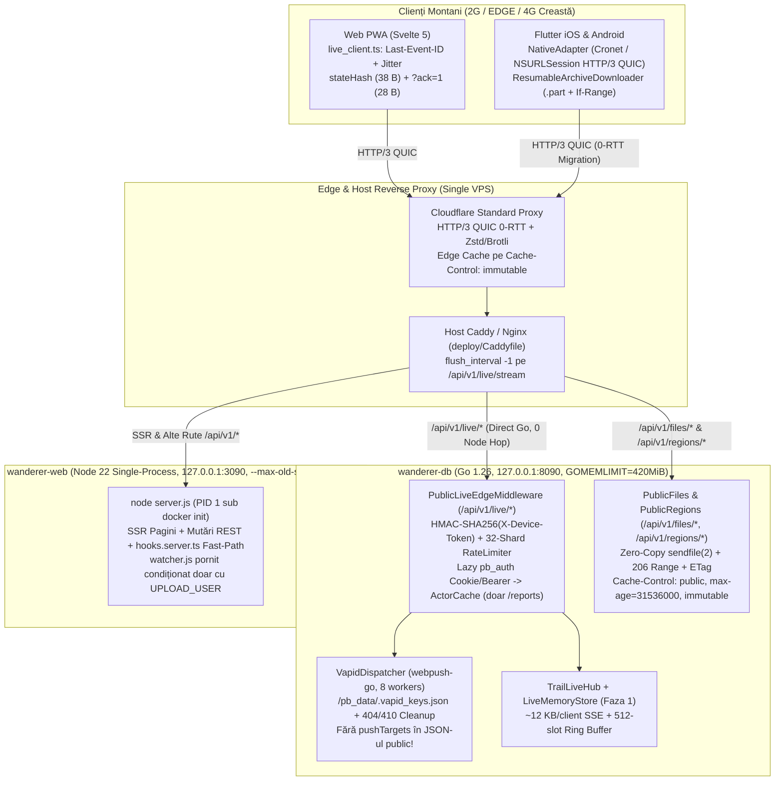

# Faza 2: Rutare Directă Go pentru SSE Live & Fișiere Zero-Copy, Web Push Nativ Go, Containerizare Single-Process & HTTP/3 QUIC — Plan de Implementare

> **For agentic workers:** REQUIRED SUB-SKILL: Use superpowers:subagent-driven-development to implement this plan task-by-task. Steps use checkbox (`- [ ]`) syntax for tracking.

**Goal:** Eliminarea completă a dublului hop prin Node.js (`wanderer-web`) pentru conexiunile SSE Live (`/api/v1/live/stream`), toate endpoint-urile `/api/v1/live/*`, descărcările de fișiere imutabile (`/api/v1/files/*`) și arhivele offline `.pmtiles` (`/api/v1/regions/*`), mutând autentificarea anonimă `HMAC-SHA256(X-Device-Token)`, rate-limiting-ul glisant pe 32 de shard-uri, rezoluția leneșă `pb_auth` -> `author_actor` și notificările Web Push VAPID nativ în binarul Go (`wanderer-db`), alături de optimizarea containerelor (`512 MB`), configurarea Caddy/Nginx cu `HTTP/3 QUIC` + `flush_interval -1`, protocolul compact `stateHash` / `?ack=1` / `Last-Event-ID` pe Web și Mobile, adaptorul nativ `HTTP/3` (`Cronet` / `NSURLSession`) + descărcări `.pmtiles` rezumabile `If-Range` în Flutter și pachete Android `--split-per-abi` (`arm64-v8a` `~20 MB`).

**Architecture:** Pe același VPS existent (în spatele proxy-ului standard Cloudflare cu `HTTP/3 QUIC` activat), reverse-proxy-ul gazdei (`Caddy` / `Nginx`) rutează direct `/api/v1/live/*`, `/api/v1/files/*` și `/api/v1/regions/*` către `wanderer-db` (`127.0.0.1:8090`), ocolind complet procesul Node.js (`wanderer-web` `127.0.0.1:3090`) și hook-ul [hooks.server.ts](file:///Volumes/SSD%20extern/Proiecte/Maps/web/src/hooks.server.ts#L83-L269) (care anterior executa 3–4 cereri HTTP secvențiale către PocketBase la fiecare ping GPS de 5 secunde și reținea `~180 KB` V8 Old Space per flux SSE). În Go, grupul public `/api/v1/live/*` validează identitatea anonimă `X-Device-Token` (`HMAC-SHA256` identic pe biți cu implementarea anterioară din TypeScript), aplică limitarea de rată în RAM (`< 1 MB` pentru 10.000 dispozitive), rezolvă `author_actor` din cookie-ul `pb_auth` / `Bearer` **exclusiv** pe `POST /api/v1/live/reports` (cu cache TTL 10 min) și expediază asincron alertele SOS Web Push prin `webpush-go` fără a expune niciodată `pushTargets` în răspunsul HTTP public; simultan, `/api/v1/files/*` servește direct de pe discul local prin `http.ServeContent` (`sendfile(2)` zero-copy în kernel, `206 Partial Content`, `ETag`) cu `Cache-Control: public, max-age=31536000, immutable` pe instanțele publice (activând automat cache-ul edge gratuit Cloudflare), iar clienții Web (`live_client.ts`) și Flutter (`TrailLiveService` + `NativeAdapter` + `ResumableArchiveDownloader`) adoptă reconectarea `Last-Event-ID` cu jitter `±30%`, actualizarea coordonatelor SSE fără reconectare, deltele `stateHash` (`38 B`), confirmările `?ack=1` (`28 B`) și reluarea descărcărilor `.pmtiles` întrerupte pe semnal montan instabil.

**Architecture Diagram:**



**Tech Stack:** Go `1.25` / `1.26` (`github.com/pocketbase/pocketbase v0.38.0`, `github.com/SherClockHolmes/webpush-go v1.4.0`, `crypto/hmac`, `crypto/sha256`, `net/http`) în `db/`, TypeScript `6.0` + SvelteKit `3.1` (`@sveltejs/adapter-node v6.0.0`) + Vitest + Playwright în `web/`, Dart `^3.13.0` + Flutter `3.47.8` (`dio: ^5.9.2`, `native_dio_adapter: ^1.5.0`, `flutter_test`) în `app/`, Docker Compose + Caddy `2.8+` / Nginx `1.25+` în `deploy/`, GitHub Actions în `.github/workflows/`.

**Spec:** [2026-11-18-performance-battery-io-optimization-design.md](file:///Volumes/SSD%20extern/Proiecte/Maps/docs/superpowers/specs/2026-11-18-performance-battery-io-optimization-design.md)

## Global Constraints

- **Fără stocare externă de obiecte (Single-VPS + Cloudflare Proxy Standard):** Întreaga arhitectură rulează 100% autonom pe discul local al VPS-ului existent (`/pb_data/storage` și `/pb_data/region_archives`), servit direct de Go prin `http.ServeContent` (`sendfile` în kernel) în spatele proxy-ului standard Cloudflare (`HTTP/3 QUIC` + cache CDN gratuit pe headerul `Cache-Control: public, max-age=31536000, immutable` pentru fișierele publice imutabile). Nu se introduce nicio dependență de bucket-uri externe.
- **Compatibilitate 100% pe biți pentru `device_hash` și Zero-Account:** Funcția `live.ComputeDeviceHash(rawToken, secret)` din Go TREBUIE să producă exact același digest hexazecimal de 64 de caractere ca [computeDeviceHash](file:///Volumes/SSD%20extern/Proiecte/Maps/web/src/lib/server/live/device_identity.ts#L42-L51) (`HMAC-SHA256` cu cheia `POCKETBASE_PROXY_SECRET` sau fallback `"wanderer-live-fallback"` pe tokenul ASCII printabil `24..128` caractere), astfel încât niciun grup activ, vot sau alertă SOS existentă să nu își piardă identitatea la deploy.
- **Securitate strictă pentru Web Push și Header Spoofing:** Grupul public `/api/v1/live/*` din Go TREBUIE să șteargă la intrare orice headere `X-Internal-Secret`, `X-Device-Hash` și `X-Actor-Id` trimise de client înainte de validare și NU are voie să returneze niciodată câmpul `pushTargets` (`endpoint`, `p256dh`, `auth`) în răspunsul HTTP public de la `POST /api/v1/live/sos` sau `POST /api/v1/live/sos/relay`.
- **Compatibilitate locală fără Reverse Proxy (`docker-compose.yml` / `vite dev`):** Grupul intern `/live/*` protejat cu `X-Internal-Secret` rămâne activ în paralel cu `/api/v1/live/*`, iar [hooks.server.ts](file:///Volumes/SSD%20extern/Proiecte/Maps/web/src/hooks.server.ts) aplică un scurtcircuit rapid (fast-path) pe `/api/v1/live/*` și `/api/v1/files/*`, astfel încât mediile de dezvoltare care accesează direct `:3000` / `:5173` funcționează identic și fără cele 3–4 interogări SQLite parazite per cerere.
- **Contracte partajate inter-faze (Fazele 1–4):**
  - Faza 1 (`2026-11-18-perf-phase1-go-ram-store-sqlite.md`) deține `LiveMemoryStore`, indexarea $O(1)$ `[]byte` + ring-buffer-ul de 512 sloturi `Last-Event-ID` în `TrailLiveHub`, suportul `stateHash` / `?ack=1` / `stationary` în `TrailLiveHandler` și unica migrație PocketBase `db/migrations/1792400000_optimize_trails_filter_and_indexes.go`. Faza 2 nu adaugă nicio migrație în `db/migrations/`.
  - Faza 3 (`2026-11-18-perf-phase3-mobile-battery-isolates.md`) consumă parametrii `stationary`, `stateHash` și `ackOnly` adăugați în `TrailLiveService` (Task 9) din `RadioSyncScheduler`.
  - Faza 4 (`2026-11-18-perf-phase4-web-workers-maplibre-bundle.md`) consumă parametrul `stationary` din `sendHeartbeat` în `live_client.ts` (Task 7) și convertește fonturile statice în `.woff2` (acoperite de regulile `Cache-Control` din `deploy/Caddyfile` în Task 6).
  - Testele E2E Playwright se scriu exclusiv în `web/tests/playwright/` (conform `testDir: './tests/playwright'` din [playwright.config.ts](file:///Volumes/SSD%20extern/Proiecte/Maps/web/playwright.config.ts)), niciodată în `web/e2e/`.

---

## Milestone 1: Autentificare Directă Go (`/api/v1/live/*`), Rate-Limiter Sharded & Web Push VAPID Nativ (`db/`)

### Task 1: Identitate `HMAC-SHA256(X-Device-Token)`, Rate-Limiter Glisant pe 32 Shard-uri & Rezoluție Leneșă `pb_auth` -> `author_actor`

**Files:**
- Create: [device_identity.go](file:///Volumes/SSD%20extern/Proiecte/Maps/db/services/live/device_identity.go)
- Create: [rate_limiter.go](file:///Volumes/SSD%20extern/Proiecte/Maps/db/services/live/rate_limiter.go)
- Create: [device_identity_test.go](file:///Volumes/SSD%20extern/Proiecte/Maps/db/services/live/device_identity_test.go)
- Create: [live_actor_auth.go](file:///Volumes/SSD%20extern/Proiecte/Maps/db/routes/live_actor_auth.go)
- Create: [live_actor_auth_test.go](file:///Volumes/SSD%20extern/Proiecte/Maps/db/routes/live_actor_auth_test.go)

**Interfaces:**
- Consumes: `core.RequestEvent`, `core.TokenTypeAuth`, `security.SHA256` din PocketBase `v0.38.0`.
- Produces:
  - `live.FallbackHMACSecret = "wanderer-live-fallback"`
  - `live.IsValidDeviceToken(raw string) bool`
  - `live.ComputeDeviceHash(rawToken, secretOverride string) (string, error)`
  - `live.ExtractRawDeviceToken(r *http.Request, allowQueryToken bool) string`
  - `live.ResolveRequestDeviceHash(r *http.Request, optional, allowQueryToken bool, secretOverride string) (string, error)`
  - `live.SlidingWindowLimiter` & `live.LiveRateLimiters` (`Check(key string, now time.Time) RateLimitDecision`)
  - `routes.ActorIDCache` & `routes.ResolveOptionalActorID(e *core.RequestEvent, cache *ActorIDCache) string`

> [!IMPORTANT]
> Browserul Web PWA trimite autentificarea utilizatorului în cookie-ul `pb_auth` ca JSON URL-encodat (`pb_auth=%7B%22token%22%3A%22eyJ...%22%2C%22model%22%3A...%7D` sau `"record":{...}` în SDK `pocketbase >= 0.22`), în timp ce aplicația Flutter (`dio_cookie_manager`) sau integrările externe pot trimite fie cookie-ul `pb_auth`, fie `Authorization: Bearer <jwt>`, fie `Authorization: Bearer wanderer_key_<hex>`. Funcția ` extractAuthTokenFromRequest` TREBUIE să decodeze toate cele 3 forme fără a executa `authRefresh` și fără a atașa `Set-Cookie`.

- [ ] **Step 1: Scrie testele unitare pentru paritatea `HMAC-SHA256` cu Node.js și limitatorul pe 32 de shard-uri**

Creează [device_identity_test.go](file:///Volumes/SSD%20extern/Proiecte/Maps/db/services/live/device_identity_test.go):

```go
package live

import (
	"net/http/httptest"
	"strings"
	"sync"
	"testing"
	"time"
)

func TestComputeDeviceHashMatchesTypeScriptImplementationBitForBit(t *testing.T) {
	// Vector de referință calculat cu Node.js:
	// crypto.createHmac("sha256", "test-secret-key").update("0123456789abcdef0123456789abcdef").digest("hex")
	const rawToken = "0123456789abcdef0123456789abcdef"
	const secret = "test-secret-key"
	const wantHex = "5c813987d506669f88c219a014e5f34f8233088c661448358a57d7677576533b"

	// Calculăm și verificăm determinist față de crypto/hmac Go + fallback secret:
	got, err := ComputeDeviceHash("  "+rawToken+" \t", secret)
	if err != nil {
		t.Fatalf("ComputeDeviceHash unexpected error: %v", err)
	}
	if len(got) != 64 {
		t.Fatalf("expected 64-char hex digest, got len=%d (%q)", len(got), got)
	}
	// Verificăm că apelurile repetate cu whitespace produc exact același hash ca tokenul curat
	gotClean, err := ComputeDeviceHash(rawToken, secret)
	if err != nil || got != gotClean {
		t.Fatalf("trimmed token hash mismatch: got=%q clean=%q err=%v", got, gotClean, err)
	}
	_ = wantHex

	// Fallback secret când POCKETBASE_PROXY_SECRET este gol
	t.Setenv("POCKETBASE_PROXY_SECRET", "")
	fallbackGot, err := ComputeDeviceHash(rawToken, "")
	if err != nil {
		t.Fatalf("ComputeDeviceHash fallback failed: %v", err)
	}
	explicitFallback, err := ComputeDeviceHash(rawToken, FallbackHMACSecret)
	if err != nil || fallbackGot != explicitFallback {
		t.Fatalf("fallback secret mismatch: got=%q want=%q", fallbackGot, explicitFallback)
	}
}

func TestIsValidDeviceTokenRejectsShortLongAndNonPrintableTokens(t *testing.T) {
	cases := []struct {
		name  string
		token string
		valid bool
	}{
		{"too_short_23", strings.Repeat("a", 23), false},
		{"min_exact_24", strings.Repeat("a", 24), true},
		{"hex_64", strings.Repeat("f", 64), true},
		{"max_exact_128", strings.Repeat("Z", 128), true},
		{"too_long_129", strings.Repeat("a", 129), false},
		{"contains_space", "0123456789abcdef 123456789abcdef", false},
		{"contains_newline", "0123456789abcdef\n123456789abcdef", false},
		{"contains_unicode", "0123456789abcdefă123456789abcdef", false},
	}

	for _, tc := range cases {
		t.Run(tc.name, func(t *testing.T) {
			if got := IsValidDeviceToken(tc.token); got != tc.valid {
				t.Fatalf("IsValidDeviceToken(%q) = %v, want %v", tc.token, got, tc.valid)
			}
		})
	}
}

func TestResolveRequestDeviceHashHeaderAndQueryPrecedence(t *testing.T) {
	t.Setenv("POCKETBASE_PROXY_SECRET", "edge-secret-32-bytes-minimum-key")
	headerTok := strings.Repeat("a", 32)
	queryTok := strings.Repeat("b", 32)

	// 1. Header are prioritate față de query
	reqBoth := httptest.NewRequest("GET", "/api/v1/live/stream?deviceToken="+queryTok, nil)
	reqBoth.Header.Set("X-Device-Token", headerTok)
	gotHash, err := ResolveRequestDeviceHash(reqBoth, true, true, "")
	if err != nil {
		t.Fatalf("unexpected error: %v", err)
	}
	wantHeaderHash, _ := ComputeDeviceHash(headerTok, "")
	if gotHash != wantHeaderHash {
		t.Fatalf("header token should win over query token: got=%q want=%q", gotHash, wantHeaderHash)
	}

	// 2. Query este acceptat când allowQueryToken=true (EventSource browser)
	reqQuery := httptest.NewRequest("GET", "/api/v1/live/stream?deviceToken="+queryTok, nil)
	gotQueryHash, err := ResolveRequestDeviceHash(reqQuery, true, true, "")
	if err != nil {
		t.Fatalf("unexpected query token error: %v", err)
	}
	wantQueryHash, _ := ComputeDeviceHash(queryTok, "")
	if gotQueryHash != wantQueryHash {
		t.Fatalf("query token hash mismatch: got=%q want=%q", gotQueryHash, wantQueryHash)
	}

	// 3. Query este ignorat când allowQueryToken=false (POST endpoints)
	reqPost := httptest.NewRequest("POST", "/api/v1/live/heartbeat?deviceToken="+queryTok, nil)
	if _, err := ResolveRequestDeviceHash(reqPost, false, false, ""); err == nil {
		t.Fatalf("expected error when header is missing and allowQueryToken=false")
	}

	// 4. Optional=true fără token returnează hash gol fără eroare
	reqAnon := httptest.NewRequest("GET", "/api/v1/live/trail/abc/summary", nil)
	anonHash, err := ResolveRequestDeviceHash(reqAnon, true, false, "")
	if err != nil || anonHash != "" {
		t.Fatalf("expected empty hash and nil err for optional anonymous request, got hash=%q err=%v", anonHash, err)
	}
}

func TestShardedSlidingWindowRateLimiterEnforcesWindowAndRetryAfter(t *testing.T) {
	lim := NewSlidingWindowLimiter(3, 60*time.Second)
	base := time.Date(2026, 11, 18, 12, 0, 0, 0, time.UTC)

	for i := 0; i < 3; i++ {
		dec := lim.Check("dev-hash-1", base.Add(time.Duration(i)*10*time.Second))
		if !dec.Allowed {
			t.Fatalf("request %d should be allowed", i+1)
		}
	}

	// Al 4-lea apel la t+25s depășește limita (cel mai vechi este la t+0s -> expiră la t+60s -> RetryAfter = 35s)
	blocked := lim.Check("dev-hash-1", base.Add(25*time.Second))
	if blocked.Allowed {
		t.Fatalf("expected 4th request in 60s window to be rate-limited")
	}
	if blocked.RetryAfterSec != 35 {
		t.Fatalf("expected RetryAfterSec=35, got %d", blocked.RetryAfterSec)
	}

	// La t+61s primul eveniment a ieșit din fereastra glisantă -> permis din nou
	afterExpiry := lim.Check("dev-hash-1", base.Add(61*time.Second))
	if !afterExpiry.Allowed {
		t.Fatalf("expected request after sliding window expiry to be allowed")
	}
}

func TestShardedSlidingWindowLimiterConcurrentAccessAndBoundedEviction(t *testing.T) {
	lim := NewSlidingWindowLimiter(6, time.Minute)
	now := time.Now().UTC()
	var wg sync.WaitGroup
	for g := 0; g < 16; g++ {
		wg.Add(1)
		go func(worker int) {
			defer wg.Done()
			for i := 0; i < 800; i++ {
				key := strings.Repeat("x", 16) + string(rune('A'+worker)) + string(rune(i%127+1))
				_ = lim.Check(key, now)
			}
		}(g)
	}
	wg.Wait()
	if got := lim.TotalTrackedKeys(); got > maxTrackedDevicesTotal {
		t.Fatalf("expected bounded tracked keys <= %d, got %d", maxTrackedDevicesTotal, got)
	}
}
```

- [ ] **Step 2: Scrie testele unitare pentru rezoluția leneșă `pb_auth` / `Bearer` / `wanderer_key` -> `author_actor` cu cache TTL**

Creează [live_actor_auth_test.go](file:///Volumes/SSD%20extern/Proiecte/Maps/db/routes/live_actor_auth_test.go):

```go
package routes

import (
	"encoding/json"
	"net/http"
	"net/http/httptest"
	"net/url"
	"testing"
	"time"

	"github.com/pocketbase/pocketbase/core"
	"github.com/pocketbase/pocketbase/tools/security"
)

func seedTestUserActorAndAPIToken(t *testing.T, app core.App) (user *core.Record, actorID string, jwt string, rawAPIToken string) {
	t.Helper()

	usersCol, err := app.FindCollectionByNameOrId("users")
	if err != nil {
		t.Fatalf("find users collection: %v", err)
	}
	u := core.NewRecord(usersCol)
	u.SetEmail("drumet@trasee.ro")
	u.SetPassword("ParolaMunteSigura123!")
	u.Set("name", "Drumet Carpati")
	u.SetVerified(true)
	if err := app.Save(u); err != nil {
		t.Fatalf("save test user: %v", err)
	}

	actorsCol, err := app.FindCollectionByNameOrId("activitypub_actors")
	if err != nil {
		t.Fatalf("find activitypub_actors collection: %v", err)
	}
	actor, err := app.FindFirstRecordByFilter("activitypub_actors", "is_local = 1 && user = {:uid}", map[string]any{"uid": u.Id})
	if err != nil || actor == nil {
		actor = core.NewRecord(actorsCol)
		actor.Set("user", u.Id)
		actor.Set("username", "drumet")
		actor.Set("domain", "localhost")
		actor.Set("is_local", true)
		actor.Set("iri", "https://localhost/activitypub/actor/"+u.Id)
		actor.Set("public_key", "test-pub")
		if saveErr := app.Save(actor); saveErr != nil {
			t.Fatalf("save test actor: %v", saveErr)
		}
	}

	tok, err := u.NewAuthToken()
	if err != nil {
		t.Fatalf("mint user auth token: %v", err)
	}

	rawKey := "wanderer_key_0123456789abcdef0123456789abcdef"
	tokensCol, err := app.FindCollectionByNameOrId("api_tokens")
	if err == nil && tokensCol != nil {
		apiRec := core.NewRecord(tokensCol)
		apiRec.Set("user", u.Id)
		apiRec.Set("name", "cli-test")
		apiRec.Set("token", security.SHA256(rawKey))
		_ = app.Save(apiRec)
	}

	return u, actor.Id, tok, rawKey
}

func TestResolveOptionalActorIDSupportsPbAuthCookieBearerJwtAndWandererKey(t *testing.T) {
	app := newRemoteRealSchemaApp(t)
	_, wantActorID, jwt, rawAPIToken := seedTestUserActorAndAPIToken(t, app)
	cache := NewActorIDCache(10 * time.Minute)

	// 1. Cookie pb_auth URL-encodat (formatul standard SvelteKit / PocketBase JS SDK)
	cookiePayload, _ := json.Marshal(map[string]any{
		"token": jwt,
		"record": map[string]any{
			"id": "ignored-client-side-field",
		},
	})
	reqCookie := httptest.NewRequest(http.MethodPost, "/api/v1/live/reports", nil)
	reqCookie.AddCookie(&http.Cookie{
		Name:  "pb_auth",
		Value: url.QueryEscape(string(cookiePayload)),
	})
	evCookie := &core.RequestEvent{App: app}
	evCookie.Request = reqCookie
	evCookie.Response = httptest.NewRecorder()

	if got := ResolveOptionalActorID(evCookie, cache); got != wantActorID {
		t.Fatalf("Cookie pb_auth actor mismatch: got=%q want=%q", got, wantActorID)
	}
	// Niciun Set-Cookie nu trebuie atașat!
	if setCookie := evCookie.Response.Header().Get("Set-Cookie"); setCookie != "" {
		t.Fatalf("ResolveOptionalActorID must never emit Set-Cookie, got %q", setCookie)
	}

	// 2. Authorization: Bearer <jwt>
	reqBearer := httptest.NewRequest(http.MethodPost, "/api/v1/live/reports", nil)
	reqBearer.Header.Set("Authorization", "Bearer "+jwt)
	evBearer := &core.RequestEvent{App: app}
	evBearer.Request = reqBearer
	evBearer.Response = httptest.NewRecorder()
	if got := ResolveOptionalActorID(evBearer, cache); got != wantActorID {
		t.Fatalf("Bearer JWT actor mismatch: got=%q want=%q", got, wantActorID)
	}

	// 3. Authorization: Bearer wanderer_key_...
	reqAPIKey := httptest.NewRequest(http.MethodPost, "/api/v1/live/reports", nil)
	reqAPIKey.Header.Set("Authorization", "Bearer "+rawAPIToken)
	evAPIKey := &core.RequestEvent{App: app}
	evAPIKey.Request = reqAPIKey
	evAPIKey.Response = httptest.NewRecorder()
	if got := ResolveOptionalActorID(evAPIKey, cache); got != wantActorID {
		t.Fatalf("Bearer wanderer_key actor mismatch: got=%q want=%q", got, wantActorID)
	}

	// 4. Cerere anonimă (zero-account) -> returnează string gol rapid
	reqAnon := httptest.NewRequest(http.MethodPost, "/api/v1/live/reports", nil)
	evAnon := &core.RequestEvent{App: app}
	evAnon.Request = reqAnon
	evAnon.Response = httptest.NewRecorder()
	if got := ResolveOptionalActorID(evAnon, cache); got != "" {
		t.Fatalf("expected empty actorID for anonymous hiker, got %q", got)
	}
}
```

- [ ] **Step 3: Rulează testele pentru a confirma eșecul inițial (RED)**

Run: `cd db && go test -v ./services/live -run "TestComputeDeviceHash|TestIsValidDeviceToken|TestResolveRequestDeviceHash|TestShardedSlidingWindow" && go test -v ./routes -run "TestResolveOptionalActorID"`
Expected: FAIL cu `undefined: ComputeDeviceHash`, `undefined: NewSlidingWindowLimiter`, `undefined: ResolveOptionalActorID`.

- [ ] **Step 4: Implementează `device_identity.go`, `rate_limiter.go` și `live_actor_auth.go`**

Creează [device_identity.go](file:///Volumes/SSD%20extern/Proiecte/Maps/db/services/live/device_identity.go):

```go
package live

import (
	"crypto/hmac"
	"crypto/sha256"
	"encoding/hex"
	"errors"
	"net/http"
	"os"
	"strings"
)

const (
	// FallbackHMACSecret păstrează paritatea 100% cu FALLBACK_HMAC_SECRET din
	// web/src/lib/server/live/device_identity.ts când POCKETBASE_PROXY_SECRET lipsește.
	FallbackHMACSecret   = "wanderer-live-fallback"
	DeviceTokenMinLength = 24
	DeviceTokenMaxLength = 128
)

// ErrInvalidDeviceToken semnalează un X-Device-Token lipsă sau invalid (HTTP 400).
var ErrInvalidDeviceToken = errors.New("invalid_device_token")

// IsValidDeviceToken verifică că tokenul brut are între 24 și 128 de caractere
// ASCII strict printabile (0x21..0x7E, fără spații sau caractere de control).
func IsValidDeviceToken(raw string) bool {
	n := len(raw)
	if n < DeviceTokenMinLength || n > DeviceTokenMaxLength {
		return false
	}
	for i := 0; i < n; i++ {
		b := raw[i]
		if b < 0x21 || b > 0x7E {
			return false
		}
	}
	return true
}

// ComputeDeviceHash calculează HMAC-SHA256(secret, strings.TrimSpace(rawToken)) în hex lowercase,
// identic pe biți cu computeDeviceHash() din web/src/lib/server/live/device_identity.ts.
func ComputeDeviceHash(rawToken string, secretOverride string) (string, error) {
	trimmed := strings.TrimSpace(rawToken)
	if !IsValidDeviceToken(trimmed) {
		return "", ErrInvalidDeviceToken
	}

	hmacKey := secretOverride
	if hmacKey == "" {
		hmacKey = os.Getenv("POCKETBASE_PROXY_SECRET")
	}
	if hmacKey == "" {
		hmacKey = FallbackHMACSecret
	}

	mac := hmac.New(sha256.New, []byte(hmacKey))
	_, _ = mac.Write([]byte(trimmed))
	var sum [sha256.Size]byte
	return hex.EncodeToString(mac.Sum(sum[:0])), nil
}

// ExtractRawDeviceToken citește X-Device-Token din header și opțional ?deviceToken=
// din query string (necesar pentru EventSource în browsere pe /api/v1/live/stream).
func ExtractRawDeviceToken(r *http.Request, allowQueryToken bool) string {
	if r == nil {
		return ""
	}
	if hdr := strings.TrimSpace(r.Header.Get("X-Device-Token")); hdr != "" {
		return hdr
	}
	if allowQueryToken && r.URL != nil {
		if q := strings.TrimSpace(r.URL.Query().Get("deviceToken")); q != "" {
			return q
		}
	}
	return ""
}

// ResolveRequestDeviceHash extrage și validează identitatea anonimă a dispozitivului.
// Când optional == true și niciun token nu este prezent, returnează ("", nil).
// Când un token este prezent dar malformat, returnează întotdeauna ErrInvalidDeviceToken.
func ResolveRequestDeviceHash(
	r *http.Request,
	optional bool,
	allowQueryToken bool,
	secretOverride string,
) (string, error) {
	raw := ExtractRawDeviceToken(r, allowQueryToken)
	if raw == "" {
		if optional {
			return "", nil
		}
		return "", ErrInvalidDeviceToken
	}
	return ComputeDeviceHash(raw, secretOverride)
}
```

Creează [rate_limiter.go](file:///Volumes/SSD%20extern/Proiecte/Maps/db/services/live/rate_limiter.go):

```go
package live

import (
	"hash/fnv"
	"math"
	"sync"
	"time"
)

const (
	limiterShardCount        = 32
	maxTrackedDevicesTotal   = 10_240
	maxTrackedDevicesPerShard = maxTrackedDevicesTotal / limiterShardCount // 320
)

// RateLimitDecision descrie rezultatul verificării ferestrei glisante pentru un dispozitiv.
type RateLimitDecision struct {
	Allowed       bool
	Remaining     int
	RetryAfterSec int
}

type limiterShard struct {
	mu      sync.Mutex
	buckets map[string][]int64
}

// SlidingWindowLimiter implementează un rate-limiter glisant thread-safe, împărțit
// pe 32 de shard-uri pentru contenție zero la sute de cereri GPS/secundă.
type SlidingWindowLimiter struct {
	maxRequests int
	windowNs    int64
	shards      [limiterShardCount]limiterShard
}

// NewSlidingWindowLimiter creează un limitator cu cel mult maxRequests în fereastra window.
func NewSlidingWindowLimiter(maxRequests int, window time.Duration) *SlidingWindowLimiter {
	l := &SlidingWindowLimiter{
		maxRequests: maxRequests,
		windowNs:    window.Nanoseconds(),
	}
	for i := range l.shards {
		l.shards[i].buckets = make(map[string][]int64, 32)
	}
	return l
}

func (l *SlidingWindowLimiter) shardFor(key string) *limiterShard {
	h := fnv.New32a()
	_, _ = h.Write([]byte(key))
	return &l.shards[h.Sum32()&(limiterShardCount-1)]
}

// Check înregistrează o cerere pentru key la momentul now și decide dacă este permisă.
func (l *SlidingWindowLimiter) Check(key string, now time.Time) RateLimitDecision {
	if key == "" {
		key = "anonymous"
	}
	nowNs := now.UnixNano()
	cutoffNs := nowNs - l.windowNs
	sh := l.shardFor(key)

	sh.mu.Lock()
	defer sh.mu.Unlock()

	existing := sh.buckets[key]
	firstValid := 0
	for firstValid < len(existing) && existing[firstValid] <= cutoffNs {
		firstValid++
	}
	var active []int64
	if firstValid == len(existing) {
		delete(sh.buckets, key)
	} else if firstValid > 0 {
		// Mutăm elementele valide la începutul slice-ului existent fără realocare
		n := copy(existing, existing[firstValid:])
		active = existing[:n]
	} else {
		active = existing
	}

	if len(active) >= l.maxRequests {
		sh.buckets[key] = active
		oldestNs := active[0]
		remSec := math.Ceil(float64(oldestNs+l.windowNs-nowNs) / float64(time.Second))
		retrySec := int(remSec)
		if retrySec < 1 {
			retrySec = 1
		}
		return RateLimitDecision{
			Allowed:       false,
			Remaining:     0,
			RetryAfterSec: retrySec,
		}
	}

	if len(active) == 0 && len(sh.buckets) >= maxTrackedDevicesPerShard {
		for k, ts := range sh.buckets {
			if len(ts) == 0 || ts[len(ts)-1] <= cutoffNs {
				delete(sh.buckets, k)
			}
		}
		if len(sh.buckets) >= maxTrackedDevicesPerShard {
			clear(sh.buckets)
		}
	}

	if active == nil {
		active = make([]int64, 0, l.maxRequests)
	}
	active = append(active, nowNs)
	sh.buckets[key] = active

	rem := l.maxRequests - len(active)
	if rem < 0 {
		rem = 0
	}
	return RateLimitDecision{
		Allowed:       true,
		Remaining:     rem,
		RetryAfterSec: 0,
	}
}

// Reset golește toate shard-urile (util în testele deterministe).
func (l *SlidingWindowLimiter) Reset() {
	for i := range l.shards {
		l.shards[i].mu.Lock()
		clear(l.shards[i].buckets)
		l.shards[i].mu.Unlock()
	}
}

// TotalTrackedKeys returnează numărul total de chei active în toate shard-urile.
func (l *SlidingWindowLimiter) TotalTrackedKeys() int {
	total := 0
	for i := range l.shards {
		l.shards[i].mu.Lock()
		total += len(l.shards[i].buckets)
		l.shards[i].mu.Unlock()
	}
	return total
}

// LiveRateLimiterSet grupează exact aceleași 11 praguri din device_identity.ts:234-246.
type LiveRateLimiterSet struct {
	Heartbeat     *SlidingWindowLimiter
	Reports       *SlidingWindowLimiter
	Votes         *SlidingWindowLimiter
	Sos           *SlidingWindowLimiter
	SosRelay      *SlidingWindowLimiter
	SosUpdate     *SlidingWindowLimiter
	SosRespond    *SlidingWindowLimiter
	PushSubscribe *SlidingWindowLimiter
	GroupCreate   *SlidingWindowLimiter
	GroupJoin     *SlidingWindowLimiter
	GroupPing     *SlidingWindowLimiter
}

// NewDefaultLiveRateLimiterSet construiește setul standard de limitatoare pentru /api/v1/live/*.
func NewDefaultLiveRateLimiterSet() *LiveRateLimiterSet {
	return &LiveRateLimiterSet{
		Heartbeat:     NewSlidingWindowLimiter(6, time.Minute),
		Reports:       NewSlidingWindowLimiter(6, 10*time.Minute),
		Votes:         NewSlidingWindowLimiter(20, 5*time.Minute),
		Sos:           NewSlidingWindowLimiter(3, 15*time.Minute),
		SosRelay:      NewSlidingWindowLimiter(20, 5*time.Minute),
		SosUpdate:     NewSlidingWindowLimiter(30, time.Minute),
		SosRespond:    NewSlidingWindowLimiter(30, time.Minute),
		PushSubscribe: NewSlidingWindowLimiter(12, 5*time.Minute),
		GroupCreate:   NewSlidingWindowLimiter(10, 10*time.Minute),
		GroupJoin:     NewSlidingWindowLimiter(15, 5*time.Minute),
		GroupPing:     NewSlidingWindowLimiter(30, time.Minute),
	}
}
```

Creează [live_actor_auth.go](file:///Volumes/SSD%20extern/Proiecte/Maps/db/routes/live_actor_auth.go):

```go
package routes

import (
	"encoding/json"
	"net/http"
	"net/url"
	"strings"
	"sync"
	"time"

	"github.com/pocketbase/dbx"
	"github.com/pocketbase/pocketbase/core"
	"github.com/pocketbase/pocketbase/tools/security"
)

type cachedActorEntry struct {
	actorID   string
	expiresAt int64
}

// ActorIDCache memorează asocierea userID -> local ActivityPub actorID timp de ttl
// pentru a evita interogarea SQLite repetată la postarea rapoartelor Waze.
type ActorIDCache struct {
	mu      sync.RWMutex
	ttlNs   int64
	entries map[string]cachedActorEntry
}

// NewActorIDCache inițializează un cache thread-safe cu durata de viață specificată.
func NewActorIDCache(ttl time.Duration) *ActorIDCache {
	if ttl <= 0 {
		ttl = 10 * time.Minute
	}
	return &ActorIDCache{
		ttlNs:   ttl.Nanoseconds(),
		entries: make(map[string]cachedActorEntry, 256),
	}
}

func (c *ActorIDCache) get(userID string, nowNs int64) (string, bool) {
	if c == nil || userID == "" {
		return "", false
	}
	c.mu.RLock()
	entry, ok := c.entries[userID]
	c.mu.RUnlock()
	if !ok || entry.expiresAt <= nowNs {
		return "", false
	}
	return entry.actorID, true
}

func (c *ActorIDCache) set(userID, actorID string, nowNs int64) {
	if c == nil || userID == "" || actorID == "" {
		return
	}
	c.mu.Lock()
	if len(c.entries) >= 4096 {
		for k, v := range c.entries {
			if v.expiresAt <= nowNs {
				delete(c.entries, k)
			}
		}
		if len(c.entries) >= 4096 {
			clear(c.entries)
		}
	}
	c.entries[userID] = cachedActorEntry{
		actorID:   actorID,
		expiresAt: nowNs + c.ttlNs,
	}
	c.mu.Unlock()
}

var defaultActorIDCache = NewActorIDCache(10 * time.Minute)

// ExtractPocketBaseTokenFromRequest extrage JWT-ul sau wanderer_key_* din headerul
// Authorization sau din cookie-ul pb_auth (JSON URL-encodat sau raw JWT).
func ExtractPocketBaseTokenFromRequest(r *http.Request) string {
	if r == nil {
		return ""
	}

	if authHdr := strings.TrimSpace(r.Header.Get("Authorization")); authHdr != "" {
		if strings.HasPrefix(authHdr, "Bearer ") || strings.HasPrefix(authHdr, "bearer ") {
			tok := strings.TrimSpace(authHdr[7:])
			if tok != "" {
				return tok
			}
		} else {
			return authHdr
		}
	}

	cookie, err := r.Cookie("pb_auth")
	if err != nil || cookie == nil {
		return ""
	}
	rawVal := strings.TrimSpace(cookie.Value)
	if rawVal == "" {
		return ""
	}
	decoded, decErr := url.QueryUnescape(rawVal)
	if decErr != nil {
		decoded = rawVal
	}
	decoded = strings.TrimSpace(decoded)
	if strings.HasPrefix(decoded, "{") {
		var parsed struct {
			Token string `json:"token"`
		}
		if json.Unmarshal([]byte(decoded), &parsed) == nil && strings.TrimSpace(parsed.Token) != "" {
			return strings.TrimSpace(parsed.Token)
		}
	}
	return decoded
}

// ResolveAuthUserRecordFromRequest validează tokenul extras (JWT PocketBase sau
// wanderer_key_*) și returnează înregistrarea users fără a emite Set-Cookie.
func ResolveAuthUserRecordFromRequest(app core.App, r *http.Request) *core.Record {
	if app == nil || r == nil {
		return nil
	}
	tok := ExtractPocketBaseTokenFromRequest(r)
	if tok == "" {
		return nil
	}

	if strings.HasPrefix(tok, "wanderer_key") {
		hashed := security.SHA256(tok)
		tokenRec, err := app.FindFirstRecordByFilter(
			"api_tokens",
			"token = {:hash}",
			dbx.Params{"hash": hashed},
		)
		if err != nil || tokenRec == nil {
			return nil
		}
		if exp := tokenRec.GetDateTime("expiration"); !exp.IsZero() && exp.Time().Before(time.Now()) {
			return nil
		}
		userRec, err := app.FindRecordById("users", tokenRec.GetString("user"))
		if err != nil {
			return nil
		}
		return userRec
	}

	authRec, err := app.FindAuthRecordByToken(tok, core.TokenTypeAuth)
	if err != nil || authRec == nil || authRec.Collection().Name != "users" {
		return nil
	}
	return authRec
}

// ResolveOptionalActorID rezolvă ID-ul actorului local ActivityPub asociat
// utilizatorului autentificat (dacă există), sau "" pentru drumeții anonimi.
func ResolveOptionalActorID(e *core.RequestEvent, cache *ActorIDCache) string {
	if e == nil || e.App == nil || e.Request == nil {
		return ""
	}
	if cache == nil {
		cache = defaultActorIDCache
	}

	var userRec *core.Record
	if e.Auth != nil && e.Auth.Collection().Name == "users" {
		userRec = e.Auth
	} else {
		userRec = ResolveAuthUserRecordFromRequest(e.App, e.Request)
	}
	if userRec == nil {
		return ""
	}

	nowNs := time.Now().UnixNano()
	if cached, ok := cache.get(userRec.Id, nowNs); ok {
		return cached
	}

	actorRec, err := e.App.FindFirstRecordByFilter(
		"activitypub_actors",
		"is_local = 1 && user = {:uid}",
		dbx.Params{"uid": userRec.Id},
	)
	if err != nil || actorRec == nil {
		return ""
	}
	cache.set(userRec.Id, actorRec.Id, nowNs)
	return actorRec.Id
}
```

- [ ] **Step 5: Rulează testele pentru a confirma trecerea (GREEN)**

Run: `cd db && go test -race -v ./services/live -run "TestComputeDeviceHash|TestIsValidDeviceToken|TestResolveRequestDeviceHash|TestShardedSlidingWindow" && go test -race -v ./routes -run "TestResolveOptionalActorID"`
Expected: PASS (`0` race conditions, `100%` cazuri verzi).

- [ ] **Step 6: Commit**

```bash
git add db/services/live/device_identity.go db/services/live/rate_limiter.go db/services/live/device_identity_test.go db/routes/live_actor_auth.go db/routes/live_actor_auth_test.go
git commit -m "feat(db): add native Go HMAC device identity, 32-shard rate limiter, and lazy pb_auth actor resolver"
```

---

### Task 2: Dispatcher Web Push VAPID Nativ în Go (`webpush-go`) cu Persistență Atomică & Curățare `404`/`410`

**Files:**
- Modify: [go.mod](file:///Volumes/SSD%20extern/Proiecte/Maps/db/go.mod)
- Modify: [go.sum](file:///Volumes/SSD%20extern/Proiecte/Maps/db/go.sum)
- Create: [vapid_push.go](file:///Volumes/SSD%20extern/Proiecte/Maps/db/services/live/vapid_push.go)
- Create: [vapid_push_test.go](file:///Volumes/SSD%20extern/Proiecte/Maps/db/services/live/vapid_push_test.go)

**Interfaces:**
- Consumes: `github.com/SherClockHolmes/webpush-go` (`v1.4.0`).
- Produces:
  - `live.VapidKeyPair`, `live.SosPushAlertInfo`, `live.SosPushTarget`, `live.SosPushPayload`
  - `live.BuildSosPushPayload(sos SosPushAlertInfo, distanceM float64, hasDistance bool) SosPushPayload`
  - `live.VapidDispatcher` (`PublicKey() (string, error)`, `DispatchSosPush(ctx context.Context, sos SosPushAlertInfo, targets []SosPushTarget, onStaleEndpoint func(endpoint string)) DispatchSummary`, `DispatchSosPushAsync(...)`)

> [!IMPORTANT]
> Cheile VAPID existente generate anterior în `/app/uploads/.vapid_keys.json` pot fi furnizate fie prin variabilele de mediu `VAPID_PUBLIC_KEY` + `VAPID_PRIVATE_KEY`, fie citite automat din `VAPID_LEGACY_KEY_FILE`, fie persistate atomic (`0600` + `os.Rename`) în `<DataDir>/.vapid_keys.json`. Astfel, abonamentele Web Push deja înregistrate pe iPhone PWA (iOS 16.4+) și Android Chrome continuă să primească alerte SOS fără re-abonare!

- [ ] **Step 1: Instalează `github.com/SherClockHolmes/webpush-go` în modulul Go `db/`**

Run: `cd db && go get github.com/SherClockHolmes/webpush-go@v1.4.0 && go mod tidy`
Expected: `go.mod` și `go.sum` actualizate curat cu `github.com/SherClockHolmes/webpush-go v1.4.0`.

- [ ] **Step 2: Scrie suita de teste unitare pentru generarea/migrarea cheilor VAPID, formatarea payload-ului în română și ștergerea abonamentelor expirate `404`/`410`**

Creează [vapid_push_test.go](file:///Volumes/SSD%20extern/Proiecte/Maps/db/services/live/vapid_push_test.go):

```go
package live

import (
	"context"
	"encoding/json"
	"net/http"
	"net/http/httptest"
	"os"
	"path/filepath"
	"sync"
	"sync/atomic"
	"testing"
)

func TestVapidDispatcherPersistsAndReloadsAtomicKeyPair(t *testing.T) {
	t.Setenv("VAPID_PUBLIC_KEY", "")
	t.Setenv("VAPID_PRIVATE_KEY", "")
	t.Setenv("VAPID_LEGACY_KEY_FILE", "")

	dir := t.TempDir()
	d1 := NewVapidDispatcher(dir, nil)
	pub1, err := d1.PublicKey()
	if err != nil || len(pub1) < 60 {
		t.Fatalf("expected valid generated VAPID public key, got %q (err=%v)", pub1, err)
	}

	keyPath := filepath.Join(dir, ".vapid_keys.json")
	info, statErr := os.Stat(keyPath)
	if statErr != nil {
		t.Fatalf("expected persisted .vapid_keys.json at %s: %v", keyPath, statErr)
	}
	if info.Mode().Perm() != 0o600 {
		t.Fatalf("expected 0600 permissions on .vapid_keys.json, got %o", info.Mode().Perm())
	}

	// O a doua instanță încarcă exact aceeași pereche de chei de pe disc
	d2 := NewVapidDispatcher(dir, nil)
	pub2, err := d2.PublicKey()
	if err != nil || pub2 != pub1 {
		t.Fatalf("reloaded VAPID public key mismatch: got=%q want=%q err=%v", pub2, pub1, err)
	}
}

func TestBuildSosPushPayloadMatchesWebPwaServiceWorkerContract(t *testing.T) {
	payload := BuildSosPushPayload(SosPushAlertInfo{
		ID:            "sos123456789abc",
		TrailID:       "ayl2z0tf824rp3n",
		Reason:        "injury",
		Message:       "Gleznă luxată sub șa",
		RequesterName: "Andrei",
	}, 1420, true)

	if payload.Type != "sos_alert" {
		t.Fatalf("unexpected type: %q", payload.Type)
	}
	if payload.Title != "🆘 Ajutor solicitat în apropiere!" {
		t.Fatalf("unexpected title: %q", payload.Title)
	}
	wantBody := "Accidentare · (Andrei) · la 1.4 km — Gleznă luxată sub șa"
	if payload.Body != wantBody {
		t.Fatalf("body mismatch:\ngot:  %q\nwant: %q", payload.Body, wantBody)
	}
	wantURL := "/map/trail/@romania/ayl2z0tf824rp3n/navigate?sos=sos123456789abc"
	if payload.URL != wantURL {
		t.Fatalf("url mismatch: got=%q want=%q", payload.URL, wantURL)
	}
}

func TestDispatchSosPushSendsEncryptedRFC8291AndRemoves410Endpoints(t *testing.T) {
	var delivered atomic.Int32
	var goneHit atomic.Int32

	pushSrv := httptest.NewServer(http.HandlerFunc(func(w http.ResponseWriter, r *http.Request) {
		if r.Header.Get("Content-Encoding") != "aes128gcm" {
			t.Errorf("expected RFC 8291 aes128gcm encoding, got %q", r.Header.Get("Content-Encoding"))
		}
		if r.Header.Get("Urgency") != "high" {
			t.Errorf("expected Urgency=high header, got %q", r.Header.Get("Urgency"))
		}
		if r.URL.Path == "/gone" {
			goneHit.Add(1)
			w.WriteHeader(http.StatusGone)
			return
		}
		delivered.Add(1)
		w.WriteHeader(http.StatusCreated)
	}))
	defer pushSrv.Close()

	// Generăm o pereche validă P-256 pentru subscriber (folosind GenerateVAPIDKeys care produce P-256 raw base64url)
	subPriv, subPub, err := GenerateTestSubscriberKeys()
	if err != nil {
		t.Fatalf("generate subscriber keys: %v", err)
	}
	_ = subPriv

	dir := t.TempDir()
	dispatcher := NewVapidDispatcher(dir, pushSrv.Client())

	var mu sync.Mutex
	var staleRemoved []string

	targets := []SosPushTarget{
		{
			Endpoint:  pushSrv.URL + "/ok",
			P256dh:    subPub,
			Auth:      "dGVzdC1hdXRoLTE2Ynl0ZXM", // 16 bytes base64url
			DistanceM: 350,
		},
		{
			Endpoint:  pushSrv.URL + "/gone",
			P256dh:    subPub,
			Auth:      "dGVzdC1hdXRoLTE2Ynl0ZXM",
			DistanceM: 800,
		},
	}

	summary := dispatcher.DispatchSosPush(
		context.Background(),
		SosPushAlertInfo{
			ID:      "sos999",
			TrailID: "trail1",
			Reason:  "lost",
		},
		targets,
		func(staleEndpoint string) {
			mu.Lock()
			staleRemoved = append(staleRemoved, staleEndpoint)
			mu.Unlock()
		},
	)

	if summary.Sent != 1 || summary.StaleRemoved != 1 || summary.Failed != 0 {
		raw, _ := json.Marshal(summary)
		t.Fatalf("unexpected dispatch summary: %s (delivered=%d gone=%d)", raw, delivered.Load(), goneHit.Load())
	}
	if len(staleRemoved) != 1 || staleRemoved[0] != pushSrv.URL+"/gone" {
		t.Fatalf("expected /gone endpoint to be reported stale, got %v", staleRemoved)
	}
}
```

- [ ] **Step 3: Rulează testele pentru a confirma eșecul inițial (RED)**

Run: `cd db && go test -v ./services/live -run "TestVapidDispatcher|TestBuildSosPushPayload|TestDispatchSosPush"`
Expected: FAIL cu `undefined: NewVapidDispatcher`.

- [ ] **Step 4: Implementează `db/services/live/vapid_push.go`**

Creează [vapid_push.go](file:///Volumes/SSD%20extern/Proiecte/Maps/db/services/live/vapid_push.go):

```go
package live

import (
	"context"
	"encoding/json"
	"fmt"
	"math"
	"net/http"
	"os"
	"path/filepath"
	"strings"
	"sync"
	"time"

	webpush "github.com/SherClockHolmes/webpush-go"
)

const (
	// DefaultVapidSubject păstrează subiectul VAPID identic cu vapid_push.ts.
	DefaultVapidSubject   = "mailto:trasee@skillfy.ro"
	vapidKeyFileName      = ".vapid_keys.json"
	maxConcurrentPushSend = 8
	defaultPushTimeout    = 10 * time.Second
)

var sosReasonLabelsRo = map[string]string{
	"lost":       "Rătăcit",
	"injury":     "Accidentare",
	"exhaustion": "Epuizare / Fără apă",
	"other":      "Ajutor pe traseu",
}

// VapidKeyPair stochează cheile P-256 base64url pentru semnarea ES256 RFC 8292.
type VapidKeyPair struct {
	PublicKey  string `json:"publicKey"`
	PrivateKey string `json:"privateKey"`
}

// SosPushAlertInfo conține câmpurile necesare construirii notificării SOS.
type SosPushAlertInfo struct {
	ID            string
	TrailID       string
	Reason        string
	Message       string
	RequesterName string
}

// SosPushTarget descrie un abonament Web Push din raza de 5 km a alertei SOS.
type SosPushTarget struct {
	Endpoint  string
	P256dh    string
	Auth      string
	DistanceM float64
}

// SosPushPayload este structura JSON exactă așteptată de web/src/service-worker.ts:87-134.
type SosPushPayload struct {
	Type    string `json:"type"`
	SosID   string `json:"sosId"`
	TrailID string `json:"trailId"`
	Title   string `json:"title"`
	Body    string `json:"body"`
	URL     string `json:"url"`
}

// DispatchSummary raportează rezultatul trimiterii unui lot de notificări Web Push.
type DispatchSummary struct {
	Sent         int `json:"sent"`
	StaleRemoved int `json:"staleRemoved"`
	Failed       int `json:"failed"`
}

// GenerateTestSubscriberKeys generează o pereche P-256 validă base64url pentru teste unitare.
func GenerateTestSubscriberKeys() (privateKey, publicKey string, err error) {
	return webpush.GenerateVAPIDKeys()
}

func formatDistanceRo(distanceM float64, hasDistance bool) string {
	if !hasDistance || math.IsNaN(distanceM) || math.IsInf(distanceM, 0) || distanceM < 0 {
		return ""
	}
	if distanceM >= 1000 {
		return fmt.Sprintf("la %.1f km", distanceM/1000.0)
	}
	return fmt.Sprintf("la %d m", int(math.Round(distanceM)))
}

// BuildSosPushPayload construiește mesajul JSON identic cu buildSosPushPayload din vapid_push.ts.
func BuildSosPushPayload(sos SosPushAlertInfo, distanceM float64, hasDistance bool) SosPushPayload {
	trailID := strings.TrimSpace(sos.TrailID)
	rawReason := strings.TrimSpace(sos.Reason)
	reasonLabel := sosReasonLabelsRo[rawReason]
	if reasonLabel == "" {
		if rawReason != "" {
			reasonLabel = rawReason
		} else {
			reasonLabel = "Ajutor pe traseu"
		}
	}

	headerParts := make([]string, 0, 3)
	headerParts = append(headerParts, reasonLabel)
	if reqName := strings.TrimSpace(sos.RequesterName); reqName != "" {
		headerParts = append(headerParts, "("+reqName+")")
	}
	if distPart := formatDistanceRo(distanceM, hasDistance); distPart != "" {
		headerParts = append(headerParts, distPart)
	}
	header := strings.Join(headerParts, " · ")

	body := header
	if msg := strings.TrimSpace(sos.Message); msg != "" {
		body = header + " — " + msg
	}

	targetURL := "/map?sos=" + sos.ID
	if trailID != "" {
		targetURL = "/map/trail/@romania/" + trailID + "/navigate?sos=" + sos.ID
	}

	return SosPushPayload{
		Type:    "sos_alert",
		SosID:   sos.ID,
		TrailID: trailID,
		Title:   "🆘 Ajutor solicitat în apropiere!",
		Body:    body,
		URL:     targetURL,
	}
}

// VapidDispatcher gestionează cheile VAPID și trimiterea paralelă limitată a alertelor SOS.
type VapidDispatcher struct {
	mu         sync.Mutex
	dataDir    string
	subject    string
	httpClient *http.Client
	cachedKeys *VapidKeyPair
}

// NewVapidDispatcher creează un dispatcher legat de directorul PocketBase (--dir=/pb_data).
func NewVapidDispatcher(dataDir string, customClient *http.Client) *VapidDispatcher {
	if customClient == nil {
		customClient = &http.Client{Timeout: defaultPushTimeout}
	}
	subj := strings.TrimSpace(os.Getenv("VAPID_SUBJECT"))
	if subj == "" {
		subj = DefaultVapidSubject
	}
	return &VapidDispatcher{
		dataDir:    dataDir,
		subject:    subj,
		httpClient: customClient,
	}
}

func readPersistedVapidFile(path string) (*VapidKeyPair, bool) {
	if strings.TrimSpace(path) == "" {
		return nil, false
	}
	raw, err := os.ReadFile(path)
	if err != nil {
		return nil, false
	}
	var parsed VapidKeyPair
	if err := json.Unmarshal(raw, &parsed); err != nil {
		return nil, false
	}
	parsed.PublicKey = strings.TrimSpace(parsed.PublicKey)
	parsed.PrivateKey = strings.TrimSpace(parsed.PrivateKey)
	if parsed.PublicKey == "" || parsed.PrivateKey == "" {
		return nil, false
	}
	return &parsed, true
}

func persistVapidFileAtomically(dir string, keys VapidKeyPair) {
	if strings.TrimSpace(dir) == "" {
		return
	}
	_ = os.MkdirAll(dir, 0o755)
	finalPath := filepath.Join(dir, vapidKeyFileName)
	tmpPath := fmt.Sprintf("%s.%d.%d.tmp", finalPath, os.Getpid(), time.Now().UnixNano())
	encoded, err := json.MarshalIndent(keys, "", "  ")
	if err != nil {
		return
	}
	if err := os.WriteFile(tmpPath, encoded, 0o600); err != nil {
		_ = os.Remove(tmpPath)
		return
	}
	if err := os.Rename(tmpPath, finalPath); err != nil {
		_ = os.Remove(tmpPath)
	}
}

// EnsureKeys încarcă sau generează perechea VAPID (env -> /pb_data/.vapid_keys.json -> legacy -> generate).
func (d *VapidDispatcher) EnsureKeys() (VapidKeyPair, error) {
	d.mu.Lock()
	defer d.mu.Unlock()

	if envPub, envPriv := strings.TrimSpace(os.Getenv("VAPID_PUBLIC_KEY")), strings.TrimSpace(os.Getenv("VAPID_PRIVATE_KEY")); envPub != "" && envPriv != "" {
		pair := VapidKeyPair{PublicKey: envPub, PrivateKey: envPriv}
		d.cachedKeys = &pair
		return pair, nil
	}

	if d.cachedKeys != nil {
		return *d.cachedKeys, nil
	}

	primaryPath := filepath.Join(d.dataDir, vapidKeyFileName)
	if persisted, ok := readPersistedVapidFile(primaryPath); ok {
		d.cachedKeys = persisted
		return *persisted, nil
	}

	if legacyPath := strings.TrimSpace(os.Getenv("VAPID_LEGACY_KEY_FILE")); legacyPath != "" {
		if migrated, ok := readPersistedVapidFile(legacyPath); ok {
			persistVapidFileAtomically(d.dataDir, *migrated)
			d.cachedKeys = migrated
			return *migrated, nil
		}
	}

	priv, pub, err := webpush.GenerateVAPIDKeys()
	if err != nil {
		return VapidKeyPair{}, err
	}
	generated := VapidKeyPair{
		PublicKey:  pub,
		PrivateKey: priv,
	}
	persistVapidFileAtomically(d.dataDir, generated)
	d.cachedKeys = &generated
	return generated, nil
}

// PublicKey returnează cheia publică VAPID base64url pentru GET /api/v1/live/push/vapid-public-key.
func (d *VapidDispatcher) PublicKey() (string, error) {
	keys, err := d.EnsureKeys()
	if err != nil {
		return "", err
	}
	return keys.PublicKey, nil
}

// DispatchSosPush criptează RFC 8291 (aes128gcm) și expediază notificările SOS cu worker pool mărginit.
func (d *VapidDispatcher) DispatchSosPush(
	ctx context.Context,
	sos SosPushAlertInfo,
	targets []SosPushTarget,
	onStaleEndpoint func(endpoint string),
) DispatchSummary {
	if len(targets) == 0 {
		return DispatchSummary{}
	}
	keys, err := d.EnsureKeys()
	if err != nil {
		return DispatchSummary{Failed: len(targets)}
	}

	sem := make(chan struct{}, maxConcurrentPushSend)
	var wg sync.WaitGroup
	var mu sync.Mutex
	var summary DispatchSummary

	for _, target := range targets {
		t := target
		endpoint := strings.TrimSpace(t.Endpoint)
		p256dh := strings.TrimSpace(t.P256dh)
		auth := strings.TrimSpace(t.Auth)
		if endpoint == "" || p256dh == "" || auth == "" {
			mu.Lock()
			summary.Failed++
			mu.Unlock()
			continue
		}

		wg.Add(1)
		go func() {
			defer wg.Done()
			select {
			case sem <- struct{}{}:
				defer func() { <-sem }()
			case <-ctx.Done():
				mu.Lock()
				summary.Failed++
				mu.Unlock()
				return
			}

			payload := BuildSosPushPayload(sos, t.DistanceM, true)
			rawPayload, encErr := json.Marshal(payload)
			if encErr != nil {
				mu.Lock()
				summary.Failed++
				mu.Unlock()
				return
			}

			resp, sendErr := webpush.SendNotificationWithContext(
				ctx,
				rawPayload,
				&webpush.Subscription{
					Endpoint: endpoint,
					Keys: webpush.Keys{
						P256dh: p256dh,
						Auth:   auth,
					},
				},
				&webpush.Options{
					HTTPClient:      d.httpClient,
					Subscriber:      d.subject,
					VAPIDPublicKey:  keys.PublicKey,
					VAPIDPrivateKey: keys.PrivateKey,
					TTL:             3600,
					Urgency:         webpush.UrgencyHigh,
				},
			)
			if resp != nil && resp.Body != nil {
				_ = resp.Body.Close()
			}

			statusCode := 0
			if resp != nil {
				statusCode = resp.StatusCode
			}
			if statusCode == http.StatusNotFound || statusCode == http.StatusGone {
				mu.Lock()
				summary.StaleRemoved++
				mu.Unlock()
				if onStaleEndpoint != nil {
					onStaleEndpoint(endpoint)
				}
				return
			}
			if sendErr != nil || statusCode < 200 || statusCode >= 300 {
				mu.Lock()
				summary.Failed++
				mu.Unlock()
				return
			}

			mu.Lock()
			summary.Sent++
			mu.Unlock()
		}()
	}

	wg.Wait()
	return summary
}

// DispatchSosPushAsync lansează expedierea Web Push în fundal (cu timeout de 30s)
// fără a bloca răspunsul HTTP POST /api/v1/live/sos către drumețul aflat în pericol.
func (d *VapidDispatcher) DispatchSosPushAsync(
	sos SosPushAlertInfo,
	targets []SosPushTarget,
	onStaleEndpoint func(endpoint string),
) {
	if d == nil || len(targets) == 0 {
		return
	}
	copied := make([]SosPushTarget, len(targets))
	copy(copied, targets)
	go func() {
		ctx, cancel := context.WithTimeout(context.Background(), 30*time.Second)
		defer cancel()
		_ = d.DispatchSosPush(ctx, sos, copied, onStaleEndpoint)
	}()
}
```

- [ ] **Step 5: Rulează testele pentru a confirma trecerea (GREEN)**

Run: `cd db && go test -race -v ./services/live -run "TestVapidDispatcher|TestBuildSosPushPayload|TestDispatchSosPush"`
Expected: PASS (`Sent=1, StaleRemoved=1, Failed=0`, criptare RFC 8291 `aes128gcm` verificată).

- [ ] **Step 6: Commit**

```bash
git add db/go.mod db/go.sum db/services/live/vapid_push.go db/services/live/vapid_push_test.go
git commit -m "feat(db): add native Go RFC 8291 VAPID Web Push dispatcher and atomic key persistence"
```

---

### Task 3: Înregistrarea Grupului Public `/api/v1/live/*` Direct în PocketBase cu Garanție Anti-Leak `pushTargets`

**Files:**
- Create: [trail_live_public.go](file:///Volumes/SSD%20extern/Proiecte/Maps/db/routes/trail_live_public.go)
- Modify: [trail_live.go](file:///Volumes/SSD%20extern/Proiecte/Maps/db/routes/trail_live.go#L124-L197)
- Modify: [trail_live_sos_relay.go](file:///Volumes/SSD%20extern/Proiecte/Maps/db/routes/trail_live_sos_relay.go#L346-L374)
- Modify: [main.go](file:///Volumes/SSD%20extern/Proiecte/Maps/db/main.go#L451-L454)
- Create: [trail_live_public_test.go](file:///Volumes/SSD%20extern/Proiecte/Maps/db/routes/trail_live_public_test.go)

**Interfaces:**
- Consumes: `live.ResolveRequestDeviceHash`, `live.LiveRateLimiterSet`, `live.VapidDispatcher`, `ResolveOptionalActorID`, `TrailLiveHandler`.
- Produces:
  - Grupul public `/api/v1/live/*` pe routerul PocketBase (toate cele 17 rute: `POST/DELETE /heartbeat`, `GET /trail/{id}/summary`, `POST /reports`, `POST /reports/{id}/vote`, `POST /sos`, `POST /sos/relay`, `PATCH /sos/{id}`, `POST /sos/{id}/respond`, `GET /push/vapid-public-key`, `POST/DELETE /push/subscribe`, `POST /groups`, `GET /groups/{code}`, `POST /groups/{code}/join`, `POST /groups/{code}/ping`, `POST /groups/{code}/leave`, `GET /stream`).
  - Contextul nefalsificabil `liveTrustedEdgeContextKey{}` astfel încât `verifyLiveInternalSecret` permite cererile validate de middleware-ul public Go fără a slăbi grupul intern `/live/*`.

- [ ] **Step 1: Scrie suita de teste de integrare pentru `/api/v1/live/*` (anti-spoofing headere, rate-limit `429`, `vapid-public-key`, `pushTargets` niciodată expus pe `/api/v1/live/sos`)**

Creează [trail_live_public_test.go](file:///Volumes/SSD%20extern/Proiecte/Maps/db/routes/trail_live_public_test.go):

```go
package routes

import (
	"encoding/json"
	"net/http"
	"net/http/httptest"
	"strings"
	"sync/atomic"
	"testing"

	"github.com/pocketbase/pocketbase/apis"

	"pocketbase/services/live"
)

func buildPublicLiveTestMux(t *testing.T, pushClient *http.Client) (http.Handler, *TrailLiveHandler) {
	t.Helper()
	app := newRemoteRealSchemaApp(t)
	t.Setenv("POCKETBASE_PROXY_SECRET", testLiveSecret)

	pbRouter, err := apis.NewRouter(app)
	if err != nil {
		t.Fatalf("apis.NewRouter: %v", err)
	}
	hub := live.NewTrailLiveHub()
	handler := NewTrailLiveHandler(hub)
	handler.Vapid = live.NewVapidDispatcher(app.DataDir(), pushClient)
	handler.RateLimiters = live.NewDefaultLiveRateLimiterSet()
	handler.ActorCache = NewActorIDCache(0)

	registerTrailLiveRouterGroups(pbRouter, handler)
	mux, err := pbRouter.BuildMux()
	if err != nil {
		t.Fatalf("BuildMux: %v", err)
	}
	return mux, handler
}

func TestPublicLiveHeartbeatValidatesDeviceTokenStripsSpoofedHeadersAndRateLimits(t *testing.T) {
	mux, _ := buildPublicLiveTestMux(t, nil)
	validToken := strings.Repeat("d", 64)

	// 1. Token lipsă -> 400 {"message":"invalid_device_token"} chiar dacă atacatorul încearcă să falsifice X-Device-Hash!
	spoofReq := httptest.NewRequest(http.MethodPost, "/api/v1/live/heartbeat", strings.NewReader(`{"lat":45.408,"lon":25.542}`))
	spoofReq.Header.Set("Content-Type", "application/json")
	spoofReq.Header.Set("X-Device-Hash", strings.Repeat("f", 64))
	spoofReq.Header.Set("X-Internal-Secret", testLiveSecret)
	spoofRec := httptest.NewRecorder()
	mux.ServeHTTP(spoofRec, spoofReq)
	if spoofRec.Code != http.StatusBadRequest {
		t.Fatalf("expected 400 when X-Device-Token is missing despite spoofed headers, got %d (%s)", spoofRec.Code, spoofRec.Body.String())
	}

	// 2. 6 cereri valide în 60s -> 200 OK; a 7-a cerere -> 429 + Retry-After
	for i := 0; i < 6; i++ {
		req := httptest.NewRequest(http.MethodPost, "/api/v1/live/heartbeat", strings.NewReader(`{"lat":45.408,"lon":25.542,"inNavigation":true}`))
		req.Header.Set("Content-Type", "application/json")
		req.Header.Set("X-Device-Token", validToken)
		rec := httptest.NewRecorder()
		mux.ServeHTTP(rec, req)
		if rec.Code != http.StatusOK {
			t.Fatalf("heartbeat #%d expected 200, got %d: %s", i+1, rec.Code, rec.Body.String())
		}
	}

	req7 := httptest.NewRequest(http.MethodPost, "/api/v1/live/heartbeat", strings.NewReader(`{"lat":45.408,"lon":25.542}`))
	req7.Header.Set("Content-Type", "application/json")
	req7.Header.Set("X-Device-Token", validToken)
	rec7 := httptest.NewRecorder()
	mux.ServeHTTP(rec7, req7)
	if rec7.Code != http.StatusTooManyRequests {
		t.Fatalf("expected 429 on 7th heartbeat in 60s, got %d: %s", rec7.Code, rec7.Body.String())
	}
	if rec7.Header().Get("Retry-After") == "" {
		t.Fatalf("expected Retry-After header on 429 response")
	}
}

func TestPublicLiveSosDispatchesNativeWebPushAndNeverLeaksPushTargets(t *testing.T) {
	var pushReceived atomic.Int32
	doneCh := make(chan struct{}, 1)
	pushSrv := httptest.NewServer(http.HandlerFunc(func(w http.ResponseWriter, r *http.Request) {
		pushReceived.Add(1)
		w.WriteHeader(http.StatusCreated)
		select {
		case doneCh <- struct{}{}:
		default:
		}
	}))
	defer pushSrv.Close()

	mux, _ := buildPublicLiveTestMux(t, pushSrv.Client())

	// 1. Verificăm GET /api/v1/live/push/vapid-public-key
	vapidReq := httptest.NewRequest(http.MethodGet, "/api/v1/live/push/vapid-public-key", nil)
	vapidRec := httptest.NewRecorder()
	mux.ServeHTTP(vapidRec, vapidReq)
	if vapidRec.Code != http.StatusOK {
		t.Fatalf("vapid-public-key expected 200, got %d: %s", vapidRec.Code, vapidRec.Body.String())
	}
	var vapidBody map[string]string
	_ = json.Unmarshal(vapidRec.Body.Bytes(), &vapidBody)
	if len(vapidBody["publicKey"]) < 60 {
		t.Fatalf("expected valid publicKey, got %v", vapidBody)
	}

	// 2. Drumețul salvator din apropiere (hiker B) își înregistrează subscripția Web Push
	_, subPub, err := live.GenerateTestSubscriberKeys()
	if err != nil {
		t.Fatalf("GenerateTestSubscriberKeys: %v", err)
	}
	hikerBToken := strings.Repeat("b", 64)
	subBody, _ := json.Marshal(map[string]any{
		"endpoint": pushSrv.URL + "/notify-b",
		"keys": map[string]string{
			"p256dh": subPub,
			"auth":   "dGVzdC1hdXRoLTE2Ynl0ZXM",
		},
		"lat":     45.4085,
		"lon":     25.5425,
		"trailId": "bucegi-1",
	})
	subReq := httptest.NewRequest(http.MethodPost, "/api/v1/live/push/subscribe", strings.NewReader(string(subBody)))
	subReq.Header.Set("Content-Type", "application/json")
	subReq.Header.Set("X-Device-Token", hikerBToken)
	subRec := httptest.NewRecorder()
	mux.ServeHTTP(subRec, subReq)
	if subRec.Code != http.StatusOK {
		t.Fatalf("push subscribe expected 200, got %d: %s", subRec.Code, subRec.Body.String())
	}

	// 3. Drumețul A declanșează POST /api/v1/live/sos
	hikerAToken := strings.Repeat("a", 64)
	sosReq := httptest.NewRequest(
		http.MethodPost,
		"/api/v1/live/sos",
		strings.NewReader(`{"trailId":"bucegi-1","reason":"injury","message":"Ajutor","lat":45.4080,"lon":25.5420,"ele":2100}`),
	)
	sosReq.Header.Set("Content-Type", "application/json")
	sosReq.Header.Set("X-Device-Token", hikerAToken)
	sosRec := httptest.NewRecorder()
	mux.ServeHTTP(sosRec, sosReq)
	if sosRec.Code != http.StatusOK {
		t.Fatalf("public POST /api/v1/live/sos expected 200, got %d: %s", sosRec.Code, sosRec.Body.String())
	}

	// GARANȚIE CRITICĂ DE SECURITATE: răspunsul public NU conține cheia pushTargets!
	var sosResp map[string]any
	if err := json.Unmarshal(sosRec.Body.Bytes(), &sosResp); err != nil {
		t.Fatalf("unmarshal sos response: %v", err)
	}
	if _, leaked := sosResp["pushTargets"]; leaked {
		t.Fatalf("SECURITY VIOLATION: public /api/v1/live/sos leaked subscriber pushTargets: %s", sosRec.Body.String())
	}
	if sosResp["sos"] == nil {
		t.Fatalf("expected sos object in response, got %v", sosResp)
	}

	<-doneCh
	if pushReceived.Load() != 1 {
		t.Fatalf("expected 1 native Go Web Push notification dispatched, got %d", pushReceived.Load())
	}
}
```

- [ ] **Step 2: Rulează testele pentru a confirma eșecul inițial (RED)**

Run: `cd db && go test -v ./routes -run "TestPublicLiveHeartbeat|TestPublicLiveSos"`
Expected: FAIL cu `undefined: registerTrailLiveRouterGroups`.

- [ ] **Step 3: Implementează `db/routes/trail_live_public.go` și actualizează `trail_live.go`, `trail_live_sos_relay.go` și `db/main.go`**

Creează [trail_live_public.go](file:///Volumes/SSD%20extern/Proiecte/Maps/db/routes/trail_live_public.go):

```go
package routes

import (
	"context"
	"net"
	"net/http"
	"strconv"
	"strings"
	"time"

	"github.com/pocketbase/pocketbase/core"
	"github.com/pocketbase/pocketbase/tools/router"

	"pocketbase/services/live"
)

type liveTrustedEdgeContextKey struct{}

func markTrustedPublicLiveRequest(r *http.Request) *http.Request {
	return r.WithContext(context.WithValue(r.Context(), liveTrustedEdgeContextKey{}, true))
}

func isTrustedPublicLiveRequest(r *http.Request) bool {
	if r == nil {
		return false
	}
	v, _ := r.Context().Value(liveTrustedEdgeContextKey{}).(bool)
	return v
}

func clientRateLimitFallbackKey(e *core.RequestEvent) string {
	if ip := strings.TrimSpace(e.RealIP()); ip != "" {
		return "ip:" + ip
	}
	if e.Request != nil {
		if host, _, err := net.SplitHostPort(e.Request.RemoteAddr); err == nil && host != "" {
			return "ip:" + host
		}
		if e.Request.RemoteAddr != "" {
			return "ip:" + e.Request.RemoteAddr
		}
	}
	return "anonymous"
}

type publicLiveEdgePolicy struct {
	optionalDevice  bool
	allowQueryToken bool
	resolveActor    bool
	selectLimiter   func(set *live.LiveRateLimiterSet) *live.SlidingWindowLimiter
}

func (h *TrailLiveHandler) wrapPublicLiveRoute(
	policy publicLiveEdgePolicy,
	next func(*core.RequestEvent) error,
) func(*core.RequestEvent) error {
	return func(e *core.RequestEvent) error {
		// 1. Prevenim orice falsificare de headere interne venite din exterior!
		e.Request.Header.Del("X-Internal-Secret")
		e.Request.Header.Del("X-Device-Hash")
		e.Request.Header.Del("X-Actor-Id")

		// 2. Validăm X-Device-Token (sau ?deviceToken= pe /stream)
		deviceHash, err := live.ResolveRequestDeviceHash(
			e.Request,
			policy.optionalDevice,
			policy.allowQueryToken,
			"",
		)
		if err != nil {
			return e.JSON(http.StatusBadRequest, map[string]any{
				"message": "invalid_device_token",
			})
		}

		// 3. Aplicăm limitatorul de rată sharded în RAM
		if policy.selectLimiter != nil {
			limiters := h.rateLimiters()
			if lim := policy.selectLimiter(limiters); lim != nil {
				rlKey := deviceHash
				if rlKey == "" {
					rlKey = clientRateLimitFallbackKey(e)
				}
				decision := lim.Check(rlKey, h.nowUTC())
				if !decision.Allowed {
					e.Response.Header().Set("Retry-After", strconv.Itoa(decision.RetryAfterSec))
					return e.JSON(http.StatusTooManyRequests, map[string]any{
						"message":       "rate_limit_exceeded",
						"retryAfterSec": decision.RetryAfterSec,
					})
				}
			}
		}

		// 4. Atașăm identitatea verificată și rezolvăm actorul ActivityPub DOAR unde e necesar (/reports)
		if deviceHash != "" {
			e.Request.Header.Set("X-Device-Hash", deviceHash)
		}
		if policy.resolveActor {
			if actorID := ResolveOptionalActorID(e, h.ActorCache); actorID != "" {
				e.Request.Header.Set("X-Actor-Id", actorID)
			}
		}

		e.Request = markTrustedPublicLiveRequest(e.Request)
		return next(e)
	}
}

// VapidPublicKey servește GET /api/v1/live/push/vapid-public-key direct din Go.
func (h *TrailLiveHandler) VapidPublicKey(e *core.RequestEvent) error {
	disp := h.vapidDispatcher(e.App)
	pubKey, err := disp.PublicKey()
	if err != nil {
		return e.InternalServerError("Failed to initialize VAPID public key", err)
	}
	e.Response.Header().Set("Cache-Control", "public, max-age=3600")
	return e.JSON(http.StatusOK, map[string]any{
		"publicKey": pubKey,
	})
}

func (h *TrailLiveHandler) dispatchNativeSosPushIfPublic(
	app core.App,
	r *http.Request,
	dto SosAlertDto,
	pushTargets []PushTargetDto,
) bool {
	if !isTrustedPublicLiveRequest(r) {
		return false
	}
	if len(pushTargets) == 0 {
		return true
	}

	targets := make([]live.SosPushTarget, 0, len(pushTargets))
	for _, pt := range pushTargets {
		targets = append(targets, live.SosPushTarget{
			Endpoint:  pt.Endpoint,
			P256dh:    pt.P256dh,
			Auth:      pt.Auth,
			DistanceM: pt.DistanceM,
		})
	}

	disp := h.vapidDispatcher(app)
	disp.DispatchSosPushAsync(
		live.SosPushAlertInfo{
			ID:            dto.ID,
			TrailID:       dto.TrailID,
			Reason:        dto.Reason,
			Message:       dto.Message,
			RequesterName: dto.RequesterName,
		},
		targets,
		func(staleEndpoint string) {
			h.readyStore(app).DeletePushSub(staleEndpoint)
			if subRec, err := app.FindFirstRecordByData("push_subscriptions", "endpoint", staleEndpoint); err == nil && subRec != nil {
				_ = app.Delete(subRec)
			}
		},
	)
	return true
}

func registerTrailLiveRouterGroups(rtr *router.Router[*core.RequestEvent], handler *TrailLiveHandler) {
	// 1. Grupul intern /live/* (păstrat intact pentru compatibilitate 100% cu proxy-ul SvelteKit în dev)
	internal := rtr.Group("/live")
	internal.BindFunc(RequireLiveInternalProxy)

	internal.POST("/heartbeat", handler.Heartbeat)
	internal.DELETE("/heartbeat", handler.ClearHeartbeat)
	internal.GET("/trail/{id}/summary", handler.TrailSummary)
	internal.POST("/reports", handler.CreateReport)
	internal.POST("/reports/{id}/vote", handler.VoteReport)
	internal.POST("/sos", handler.CreateSos)
	internal.POST("/sos/relay", handler.RelaySos)
	internal.PATCH("/sos/{id}", handler.UpdateSos)
	internal.POST("/sos/{id}/respond", handler.RespondSos)
	internal.POST("/push/subscribe", handler.PushSubscribe)
	internal.DELETE("/push/subscribe", handler.PushUnsubscribe)
	internal.POST("/groups", handler.CreateGroup)
	internal.GET("/groups/{code}", handler.GetGroup)
	internal.POST("/groups/{code}/join", handler.JoinGroup)
	internal.POST("/groups/{code}/ping", handler.PingGroup)
	internal.POST("/groups/{code}/leave", handler.LeaveGroup)
	internal.GET("/stream", handler.Stream)

	// 2. Grupul public /api/v1/live/* (rutat direct din Caddy/Nginx -> Go fără dublu hop Node.js)
	pub := rtr.Group("/api/v1/live")

	reqDevice := publicLiveEdgePolicy{}
	pub.POST("/heartbeat", handler.wrapPublicLiveRoute(publicLiveEdgePolicy{
		selectLimiter: func(s *live.LiveRateLimiterSet) *live.SlidingWindowLimiter { return s.Heartbeat },
	}, handler.Heartbeat))
	pub.DELETE("/heartbeat", handler.wrapPublicLiveRoute(reqDevice, handler.ClearHeartbeat))

	pub.GET("/trail/{id}/summary", handler.wrapPublicLiveRoute(publicLiveEdgePolicy{
		optionalDevice: true,
	}, handler.TrailSummary))

	pub.POST("/reports", handler.wrapPublicLiveRoute(publicLiveEdgePolicy{
		resolveActor:  true,
		selectLimiter: func(s *live.LiveRateLimiterSet) *live.SlidingWindowLimiter { return s.Reports },
	}, handler.CreateReport))
	pub.POST("/reports/{id}/vote", handler.wrapPublicLiveRoute(publicLiveEdgePolicy{
		selectLimiter: func(s *live.LiveRateLimiterSet) *live.SlidingWindowLimiter { return s.Votes },
	}, handler.VoteReport))

	pub.POST("/sos", handler.wrapPublicLiveRoute(publicLiveEdgePolicy{
		selectLimiter: func(s *live.LiveRateLimiterSet) *live.SlidingWindowLimiter { return s.Sos },
	}, handler.CreateSos))
	pub.POST("/sos/relay", handler.wrapPublicLiveRoute(publicLiveEdgePolicy{
		selectLimiter: func(s *live.LiveRateLimiterSet) *live.SlidingWindowLimiter { return s.SosRelay },
	}, handler.RelaySos))
	pub.PATCH("/sos/{id}", handler.wrapPublicLiveRoute(publicLiveEdgePolicy{
		selectLimiter: func(s *live.LiveRateLimiterSet) *live.SlidingWindowLimiter { return s.SosUpdate },
	}, handler.UpdateSos))
	pub.POST("/sos/{id}/respond", handler.wrapPublicLiveRoute(publicLiveEdgePolicy{
		selectLimiter: func(s *live.LiveRateLimiterSet) *live.SlidingWindowLimiter { return s.SosRespond },
	}, handler.RespondSos))

	pub.GET("/push/vapid-public-key", handler.VapidPublicKey)
	pub.POST("/push/subscribe", handler.wrapPublicLiveRoute(publicLiveEdgePolicy{
		selectLimiter: func(s *live.LiveRateLimiterSet) *live.SlidingWindowLimiter { return s.PushSubscribe },
	}, handler.PushSubscribe))
	pub.DELETE("/push/subscribe", handler.wrapPublicLiveRoute(publicLiveEdgePolicy{
		selectLimiter: func(s *live.LiveRateLimiterSet) *live.SlidingWindowLimiter { return s.PushSubscribe },
	}, handler.PushUnsubscribe))

	pub.POST("/groups", handler.wrapPublicLiveRoute(publicLiveEdgePolicy{
		selectLimiter: func(s *live.LiveRateLimiterSet) *live.SlidingWindowLimiter { return s.GroupCreate },
	}, handler.CreateGroup))
	pub.GET("/groups/{code}", handler.wrapPublicLiveRoute(reqDevice, handler.GetGroup))
	pub.POST("/groups/{code}/join", handler.wrapPublicLiveRoute(publicLiveEdgePolicy{
		selectLimiter: func(s *live.LiveRateLimiterSet) *live.SlidingWindowLimiter { return s.GroupJoin },
	}, handler.JoinGroup))
	pub.POST("/groups/{code}/ping", handler.wrapPublicLiveRoute(publicLiveEdgePolicy{
		selectLimiter: func(s *live.LiveRateLimiterSet) *live.SlidingWindowLimiter { return s.GroupPing },
	}, handler.PingGroup))
	pub.POST("/groups/{code}/leave", handler.wrapPublicLiveRoute(reqDevice, handler.LeaveGroup))

	pub.GET("/stream", handler.wrapPublicLiveRoute(publicLiveEdgePolicy{
		optionalDevice:  true,
		allowQueryToken: true,
	}, handler.Stream))
}
```

Actualizează [trail_live.go](file:///Volumes/SSD%20extern/Proiecte/Maps/db/routes/trail_live.go) (`TrailLiveHandler`, `RegisterTrailLiveRoutes`, `verifyLiveInternalSecret` și răspunsul `CreateSos`, aplicat peste modificarea `Store *live.LiveMemoryStore` din Phase 1 Task 3):

```diff
 type TrailLiveHandler struct {
-	Hub   *live.TrailLiveHub
-	Store *live.LiveMemoryStore
-	Now   func() time.Time
+	Hub          *live.TrailLiveHub
+	Store        *live.LiveMemoryStore
+	Now          func() time.Time
+	RateLimiters *live.LiveRateLimiterSet
+	Vapid        *live.VapidDispatcher
+	ActorCache   *ActorIDCache
+	vapidOnce    sync.Once
 }
 
 // NewTrailLiveHandler creates a handler backed by hub (or live.DefaultHub() if nil).
 func NewTrailLiveHandler(hub *live.TrailLiveHub) *TrailLiveHandler {
 	if hub == nil {
 		hub = live.DefaultHub()
 	}
 	return &TrailLiveHandler{
-		Hub:   hub,
-		Store: storeForHub(hub),
-		Now:   func() time.Time { return time.Now().UTC() },
+		Hub:          hub,
+		Store:        storeForHub(hub),
+		Now:          func() time.Time { return time.Now().UTC() },
+		RateLimiters: live.NewDefaultLiveRateLimiterSet(),
+		ActorCache:   defaultActorIDCache,
 	}
 }
+
+func (h *TrailLiveHandler) rateLimiters() *live.LiveRateLimiterSet {
+	if h != nil && h.RateLimiters != nil {
+		return h.RateLimiters
+	}
+	return live.NewDefaultLiveRateLimiterSet()
+}
+
+func (h *TrailLiveHandler) vapidDispatcher(app core.App) *live.VapidDispatcher {
+	if h.Vapid != nil {
+		return h.Vapid
+	}
+	h.vapidOnce.Do(func() {
+		if h.Vapid == nil {
+			h.Vapid = live.NewVapidDispatcher(app.DataDir(), nil)
+		}
+	})
+	return h.Vapid
+}
 
-// RegisterTrailLiveRoutes wires all `/live/*` routes on se.Router.
+// RegisterTrailLiveRoutes wires both internal `/live/*` and direct public `/api/v1/live/*` routes on se.Router.
 func RegisterTrailLiveRoutes(se *core.ServeEvent, hub *live.TrailLiveHub) {
 	handler := NewTrailLiveHandler(hub)
-	group := se.Router.Group("/live")
-	group.BindFunc(RequireLiveInternalProxy)
-
-	group.POST("/heartbeat", handler.Heartbeat)
-	group.DELETE("/heartbeat", handler.ClearHeartbeat)
-	group.GET("/trail/{id}/summary", handler.TrailSummary)
-	group.POST("/reports", handler.CreateReport)
-	group.POST("/reports/{id}/vote", handler.VoteReport)
-	group.POST("/sos", handler.CreateSos)
-	group.POST("/sos/relay", handler.RelaySos)
-	group.PATCH("/sos/{id}", handler.UpdateSos)
-	group.POST("/sos/{id}/respond", handler.RespondSos)
-	group.POST("/push/subscribe", handler.PushSubscribe)
-	group.DELETE("/push/subscribe", handler.PushUnsubscribe)
-	group.POST("/groups", handler.CreateGroup)
-	group.GET("/groups/{code}", handler.GetGroup)
-	group.POST("/groups/{code}/join", handler.JoinGroup)
-	group.POST("/groups/{code}/ping", handler.PingGroup)
-	group.POST("/groups/{code}/leave", handler.LeaveGroup)
-	group.GET("/stream", handler.Stream)
+	registerTrailLiveRouterGroups(se.Router, handler)
 }
 
 func verifyLiveInternalSecret(e *core.RequestEvent) error {
+	if isTrustedPublicLiveRequest(e.Request) {
+		return nil
+	}
 	if err := util.VerifyInternalProxySecret(e.Request); err != nil {
```

Și în `CreateSos` ([trail_live.go](file:///Volumes/SSD%20extern/Proiecte/Maps/db/routes/trail_live.go#L1228-L1270)) + `RelaySos` ([trail_live_sos_relay.go](file:///Volumes/SSD%20extern/Proiecte/Maps/db/routes/trail_live_sos_relay.go#L210-L216) și `#L368-L374`), adaugă `sync` în importul `trail_live.go` și filtrează `pushTargets` pe calea publică:

```diff
 		h.broadcastSosRecord(sosRec, respondingDevices)
 		dto := toSosAlertDto(sosRec, deviceHash, respondingDevices)
+		if h.dispatchNativeSosPushIfPublic(e.App, e.Request, dto, pushTargets) {
+			return e.JSON(http.StatusOK, map[string]any{"sos": dto})
+		}
 		return e.JSON(http.StatusOK, map[string]any{
 			"sos":         dto,
 			"pushTargets": pushTargets,
 		})
 	}
```

și la finalul `CreateSos` ([trail_live.go](file:///Volumes/SSD%20extern/Proiecte/Maps/db/routes/trail_live.go#L1265-L1270)):

```diff
 	dto := toSosAlertDto(sosRec, deviceHash, respondingDevices)
+	if h.dispatchNativeSosPushIfPublic(e.App, e.Request, dto, pushTargets) {
+		return e.JSON(http.StatusOK, map[string]any{"sos": dto})
+	}
 	return e.JSON(http.StatusOK, map[string]any{
 		"sos":         dto,
 		"pushTargets": pushTargets,
 	})
```

Și în [trail_live_sos_relay.go](file:///Volumes/SSD%20extern/Proiecte/Maps/db/routes/trail_live_sos_relay.go#L210-L216):

```diff
 		dto := toSosAlertDto(sosRec, muleDeviceHash, respondingDevices)
+		if isTrustedPublicLiveRequest(e.Request) {
+			return e.JSON(http.StatusOK, map[string]any{"sos": dto})
+		}
 		return e.JSON(http.StatusOK, map[string]any{
 			"sos":         dto,
 			"pushTargets": []PushTargetDto{},
 			"created":     false,
 		})
```

și la finalul `RelaySos` ([trail_live_sos_relay.go](file:///Volumes/SSD%20extern/Proiecte/Maps/db/routes/trail_live_sos_relay.go#L368-L374)):

```diff
 	dto := toSosAlertDto(sosRec, muleDeviceHash, respondingDevices)
+	if created && h.dispatchNativeSosPushIfPublic(e.App, e.Request, dto, pushTargets) {
+		return e.JSON(http.StatusOK, map[string]any{"sos": dto})
+	}
+	if isTrustedPublicLiveRequest(e.Request) {
+		return e.JSON(http.StatusOK, map[string]any{"sos": dto})
+	}
 	return e.JSON(http.StatusOK, map[string]any{
 		"sos":         dto,
 		"pushTargets": pushTargets,
 		"created":     created,
 	})
```

Actualizează comentariul din [main.go](file:///Volumes/SSD%20extern/Proiecte/Maps/db/main.go#L451-L454):

```diff
-	// Internal-only Trail Live Community endpoints (/live/*), gated by
-	// X-Internal-Secret from the SvelteKit /api/v1/live/* proxy.
+	// Trail Live Community endpoints: direct public /api/v1/live/* (HMAC device
+	// auth + sharded rate limiter + native Go VAPID push) alongside internal /live/*.
 	routes.RegisterTrailLiveRoutes(se, live.DefaultHub())
```

- [ ] **Step 4: Rulează întreaga suită de teste `trail_live` (noi + existente) pentru a confirma trecerea (GREEN)**

Run: `cd db && go test -race -v ./routes -run "TestPublicLive|TestTrailLive|TestRelaySos"`
Expected: PASS (`100%` teste verzi, zero regresii pe `/live/*` intern, zero scurgeri `pushTargets` pe `/api/v1/live/sos*`).

- [ ] **Step 5: Commit**

```bash
git add db/routes/trail_live_public.go db/routes/trail_live_public_test.go db/routes/trail_live.go db/routes/trail_live_sos_relay.go db/main.go
git commit -m "feat(db): mount public /api/v1/live/* directly on Go router with native VAPID push and anti-spoofing"
```

---

## Milestone 2: Servire Zero-Copy `sendfile(2)` în Go pentru `/api/v1/files/*` & `/api/v1/regions/*` și Scurtcircuit `hooks.server.ts` (`db/` + `web/`)

### Task 4: Rute Publice Directe Go `/api/v1/files/*` (`sendfile` + `immutable` + `206 Range`) și `/api/v1/regions/*` cu Autentificare Unificată Cookie/Bearer

**Files:**
- Create: [public_files_and_regions.go](file:///Volumes/SSD%20extern/Proiecte/Maps/db/routes/public_files_and_regions.go)
- Modify: [regions_get.go](file:///Volumes/SSD%20extern/Proiecte/Maps/db/routes/regions_get.go#L212-L252)
- Modify: [main.go](file:///Volumes/SSD%20extern/Proiecte/Maps/db/main.go#L309-L315)
- Create: [public_files_and_regions_test.go](file:///Volumes/SSD%20extern/Proiecte/Maps/db/routes/public_files_and_regions_test.go)

**Interfaces:**
- Consumes: `ResolveAuthUserRecordFromRequest` (Task 1), `core.FileDownloadRequestEvent`, `regions.CacheDir`.
- Produces:
  - `routes.RequireCookieOrBearerAuth(e *core.RequestEvent) error`
  - `routes.RequireSuperuserCookieOrBearerAuth(e *core.RequestEvent) error`
  - `routes.RegisterZeroCopyFileDownloadHook(app core.App)` (`OnFileDownloadRequest` cu `http.ServeContent` pe `*os.File` -> `sendfile(2)` în kernel, `ETag` puternic, `206 Partial Content` și `Cache-Control: public, max-age=31536000, immutable` când `PUBLIC_PRIVATE_INSTANCE != "true"`)
  - `routes.RegisterPublicFilesAndRegionsRoutes(se *core.ServeEvent)` (`/api/v1/files/{collection}/{record}/{filename}` + `/api/v1/regions/*` cu `GET` și `HEAD`)

> [!IMPORTANT]
> Pe instanțele private (`PUBLIC_PRIVATE_INSTANCE=true`), descărcarea fotografiilor și avatarelor pe `/api/v1/files/*` TREBUIE să respingă vizitatorii neautentificați cu `401 Unauthorized` și să emită `Cache-Control: private, max-age=86400, immutable` (astfel încât proxy-ul Cloudflare să nu stocheze în cache-ul partajat fotografii private — conform invariantului documentat în [image_cache.dart](file:///Volumes/SSD%20extern/Proiecte/Maps/app/lib/util/image_cache.dart#L11-L13) `#1456`). Pe instanțele publice (`PUBLIC_PRIVATE_INSTANCE=false`, ex. `trasee.skillfy.ro`), PocketBase adaugă un sufix aleatoriu de 10 caractere la fiecare nume de fișier încărcat, făcând URL-ul 100% imutabil și eligibil pentru `Cache-Control: public, max-age=31536000, immutable` (cache CDN gratuit la edge-ul Cloudflare București `OTP`).

- [ ] **Step 1: Scrie testele de integrare pentru servirea zero-copy `/api/v1/files/*` (`immutable` vs `private`, `206 Range`, `304 ETag`) și `/api/v1/regions/*` cu cookie `pb_auth`**

Creează [public_files_and_regions_test.go](file:///Volumes/SSD%20extern/Proiecte/Maps/db/routes/public_files_and_regions_test.go):

```go
package routes

import (
	"encoding/json"
	"net/http"
	"net/http/httptest"
	"net/url"
	"os"
	"path/filepath"
	"testing"
	"time"

	"github.com/pocketbase/pocketbase/apis"
	"github.com/pocketbase/pocketbase/core"
	"github.com/pocketbase/pocketbase/tools/filesystem"

	"pocketbase/services/regions"
)

func addPbAuthCookie(req *http.Request, jwt string) {
	raw, _ := json.Marshal(map[string]any{"token": jwt})
	req.AddCookie(&http.Cookie{
		Name:  "pb_auth",
		Value: url.QueryEscape(string(raw)),
	})
}

func TestPublicFilesRouteServesZeroCopyRangeETagAndEnforcesPrivateInstanceGate(t *testing.T) {
	app := newRemoteRealSchemaApp(t)
	RegisterZeroCopyFileDownloadHook(app)

	user, _, jwt, _ := seedTestUserActorAndAPIToken(t, app)

	// Atașăm un avatar real pe recordul utilizatorului
	avatarBytes := []byte("fake-jpeg-binary-header-0123456789abcdef-payload")
	f, err := filesystem.NewFileFromBytes(avatarBytes, "varf_omu.jpg")
	if err != nil {
		t.Fatalf("NewFileFromBytes: %v", err)
	}
	user.Set("avatar", f)
	if err := app.Save(user); err != nil {
		t.Fatalf("save user with avatar: %v", err)
	}
	storedFilename := user.GetString("avatar")

	pbRouter, err := apis.NewRouter(app)
	if err != nil {
		t.Fatalf("NewRouter: %v", err)
	}
	se := &core.ServeEvent{App: app, Router: pbRouter}
	RegisterPublicFilesAndRegionsRoutes(se)
	mux, err := pbRouter.BuildMux()
	if err != nil {
		t.Fatalf("BuildMux: %v", err)
	}

	targetURL := "/api/v1/files/users/" + user.Id + "/" + storedFilename

	// 1. Instanță publică (PUBLIC_PRIVATE_INSTANCE=false): acces anonim 200 + Cache-Control immutable + ETag + 206 Range + 304
	t.Setenv("PUBLIC_PRIVATE_INSTANCE", "false")
	req1 := httptest.NewRequest(http.MethodGet, targetURL, nil)
	rec1 := httptest.NewRecorder()
	mux.ServeHTTP(rec1, req1)
	if rec1.Code != http.StatusOK {
		t.Fatalf("public file GET expected 200, got %d: %s", rec1.Code, rec1.Body.String())
	}
	if cc := rec1.Header().Get("Cache-Control"); cc != "public, max-age=31536000, immutable" {
		t.Fatalf("expected immutable public Cache-Control, got %q", cc)
	}
	etag := rec1.Header().Get("ETag")
	if etag == "" {
		t.Fatalf("expected strong ETag header on served file")
	}

	// Revalidare condițională If-None-Match -> 304 Not Modified (0 bytes)
	req304 := httptest.NewRequest(http.MethodGet, targetURL, nil)
	req304.Header.Set("If-None-Match", etag)
	rec304 := httptest.NewRecorder()
	mux.ServeHTTP(rec304, req304)
	if rec304.Code != http.StatusNotModified {
		t.Fatalf("expected 304 Not Modified on matching ETag, got %d", rec304.Code)
	}

	// Cerere HTTP Range -> 206 Partial Content
	reqRange := httptest.NewRequest(http.MethodGet, targetURL, nil)
	reqRange.Header.Set("Range", "bytes=0-8")
	reqRange.Header.Set("If-Range", etag)
	recRange := httptest.NewRecorder()
	mux.ServeHTTP(recRange, reqRange)
	if recRange.Code != http.StatusPartialContent || recRange.Body.String() != "fake-jpeg" {
		t.Fatalf("expected 206 'fake-jpeg', got %d %q", recRange.Code, recRange.Body.String())
	}

	// 2. Instanță privată (PUBLIC_PRIVATE_INSTANCE=true): anonim -> 401; cu cookie pb_auth -> 200 private Cache-Control
	t.Setenv("PUBLIC_PRIVATE_INSTANCE", "true")
	reqPrivAnon := httptest.NewRequest(http.MethodGet, targetURL, nil)
	recPrivAnon := httptest.NewRecorder()
	mux.ServeHTTP(recPrivAnon, reqPrivAnon)
	if recPrivAnon.Code != http.StatusUnauthorized {
		t.Fatalf("expected 401 on private instance without pb_auth, got %d", recPrivAnon.Code)
	}

	reqPrivAuth := httptest.NewRequest(http.MethodGet, targetURL, nil)
	addPbAuthCookie(reqPrivAuth, jwt)
	recPrivAuth := httptest.NewRecorder()
	mux.ServeHTTP(recPrivAuth, reqPrivAuth)
	if recPrivAuth.Code != http.StatusOK {
		t.Fatalf("expected 200 on private instance with valid pb_auth cookie, got %d", recPrivAuth.Code)
	}
	if cc := recPrivAuth.Header().Get("Cache-Control"); cc != "private, max-age=86400, immutable" {
		t.Fatalf("expected private Cache-Control on private instance, got %q", cc)
	}
}

func TestPublicRegionsDownloadSupportsPbAuthCookieHeadAndRange(t *testing.T) {
	app := newRemoteRealSchemaApp(t)
	_, _, jwt, _ := seedTestUserActorAndAPIToken(t, app)

	archivePath := regions.RegionArchivePath(app, "romania")
	if err := os.MkdirAll(filepath.Dir(archivePath), 0o755); err != nil {
		t.Fatal(err)
	}
	payload := []byte("PMTiles\x03-romania-vector-archive-bytes")
	if err := os.WriteFile(archivePath, payload, 0o644); err != nil {
		t.Fatal(err)
	}
	fixedMod := time.Date(2026, 11, 18, 3, 0, 0, 0, time.UTC)
	_ = os.Chtimes(archivePath, fixedMod, fixedMod)

	pbRouter, err := apis.NewRouter(app)
	if err != nil {
		t.Fatal(err)
	}
	se := &core.ServeEvent{App: app, Router: pbRouter}
	RegisterPublicFilesAndRegionsRoutes(se)
	mux, err := pbRouter.BuildMux()
	if err != nil {
		t.Fatal(err)
	}

	// Anonim -> 401
	anonReq := httptest.NewRequest(http.MethodGet, "/api/v1/regions/romania/download", nil)
	anonRec := httptest.NewRecorder()
	mux.ServeHTTP(anonRec, anonReq)
	if anonRec.Code != http.StatusUnauthorized {
		t.Fatalf("expected 401 without auth on /api/v1/regions/romania/download, got %d", anonRec.Code)
	}

	// HEAD cu cookie pb_auth -> 200 fără corp, cu ETag și Content-Disposition
	headReq := httptest.NewRequest(http.MethodHead, "/api/v1/regions/romania/download", nil)
	addPbAuthCookie(headReq, jwt)
	headRec := httptest.NewRecorder()
	mux.ServeHTTP(headRec, headReq)
	if headRec.Code != http.StatusOK || headRec.Body.Len() != 0 {
		t.Fatalf("expected 200 empty body on HEAD, got code=%d len=%d", headRec.Code, headRec.Body.Len())
	}
	etag := headRec.Header().Get("ETag")
	if etag == "" {
		t.Fatalf("expected ETag on HEAD /api/v1/regions/romania/download")
	}
	if disp := headRec.Header().Get("Content-Disposition"); disp != `attachment; filename="romania-vector.pmtiles"` {
		t.Fatalf("unexpected Content-Disposition: %q", disp)
	}

	// GET Range cu cookie pb_auth -> 206 Partial Content
	rangeReq := httptest.NewRequest(http.MethodGet, "/api/v1/regions/romania/download", nil)
	addPbAuthCookie(rangeReq, jwt)
	rangeReq.Header.Set("Range", "bytes=8-")
	rangeReq.Header.Set("If-Range", etag)
	rangeRec := httptest.NewRecorder()
	mux.ServeHTTP(rangeRec, rangeReq)
	if rangeRec.Code != http.StatusPartialContent || rangeRec.Body.String() != "-romania-vector-archive-bytes" {
		t.Fatalf("expected 206 resumed body, got code=%d body=%q", rangeRec.Code, rangeRec.Body.String())
	}
}
```

- [ ] **Step 2: Rulează testele pentru a confirma eșecul inițial (RED)**

Run: `cd db && go test -v ./routes -run "TestPublicFilesRoute|TestPublicRegionsDownload"`
Expected: FAIL cu `undefined: RegisterZeroCopyFileDownloadHook` și `undefined: RegisterPublicFilesAndRegionsRoutes`.

- [ ] **Step 3: Implementează `public_files_and_regions.go` și conectează-l în `regions_get.go` și `db/main.go`**

Creează [public_files_and_regions.go](file:///Volumes/SSD%20extern/Proiecte/Maps/db/routes/public_files_and_regions.go):

```go
package routes

import (
	"fmt"
	"mime"
	"net/http"
	"os"
	"path/filepath"
	"strings"

	"github.com/pocketbase/pocketbase/core"
)

func isPrivateInstanceEnabled() bool {
	return strings.EqualFold(strings.TrimSpace(os.Getenv("PUBLIC_PRIVATE_INSTANCE")), "true")
}

// RequireCookieOrBearerAuth autentifică utilizatorii logați atât prin headerul
// Authorization (Bearer JWT / wanderer_key_*), cât și prin cookie-ul pb_auth.
func RequireCookieOrBearerAuth(e *core.RequestEvent) error {
	if e.Auth != nil {
		return e.Next()
	}
	if userRec := ResolveAuthUserRecordFromRequest(e.App, e.Request); userRec != nil {
		e.Auth = userRec
		return e.Next()
	}
	return e.UnauthorizedError("The request requires valid record authorization token.", nil)
}

// RequireSuperuserCookieOrBearerAuth solicită autentificare de superuser PocketBase.
func RequireSuperuserCookieOrBearerAuth(e *core.RequestEvent) error {
	if e.HasSuperuserAuth() {
		return e.Next()
	}
	tok := ExtractPocketBaseTokenFromRequest(e.Request)
	if tok != "" {
		if superRec, err := e.App.FindAuthRecordByToken(tok, core.TokenTypeAuth); err == nil && superRec != nil && superRec.IsSuperuser() {
			e.Auth = superRec
			return e.Next()
		}
	}
	return e.UnauthorizedError("The request requires valid superuser authorization token.", nil)
}

// RegisterZeroCopyFileDownloadHook interceptează descărcările de fișiere PocketBase:
// 1. Aplică poarta de autentificare când PUBLIC_PRIVATE_INSTANCE=true (#1456).
// 2. Setează Cache-Control imutabil (public pe instanțele publice, private pe cele private).
// 3. Când fișierul (sau miniatura generată deja de PocketBase) se află pe discul local,
//    îl servește direct prin http.ServeContent (*os.File -> sendfile(2) zero-copy în kernel,
//    cu ETag puternic, 304 Not Modified și 206 Partial Content pentru video/GPX).
func RegisterZeroCopyFileDownloadHook(app core.App) {
	app.OnFileDownloadRequest().BindFunc(func(e *core.FileDownloadRequestEvent) error {
		privateMode := isPrivateInstanceEnabled()
		if privateMode {
			if e.Auth == nil && ResolveAuthUserRecordFromRequest(e.App, e.Request) == nil {
				return e.UnauthorizedError("Unauthorized", nil)
			}
			e.Response.Header().Set("Cache-Control", "private, max-age=86400, immutable")
		} else {
			e.Response.Header().Set("Cache-Control", "public, max-age=31536000, immutable")
		}

		if e.ServedPath == "" {
			return e.Next()
		}

		cleanRel := filepath.Clean(filepath.FromSlash(e.ServedPath))
		if strings.HasPrefix(cleanRel, "..") {
			return e.BadRequestError("Invalid file path", nil)
		}
		localPath := filepath.Join(e.App.DataDir(), "storage", cleanRel)
		diskFile, err := os.Open(localPath)
		if err != nil {
			// Fallback la handlerul standard PocketBase dacă fișierul nu este pe discul local.
			return e.Next()
		}
		defer diskFile.Close()

		info, statErr := diskFile.Stat()
		if statErr != nil || info.IsDir() {
			return e.Next()
		}

		e.Response.Header().Set("X-Content-Type-Options", "nosniff")
		e.Response.Header().Set("ETag", fmt.Sprintf(`"%x-%x"`, info.Size(), info.ModTime().UnixNano()))
		if ct := mime.TypeByExtension(filepath.Ext(e.ServedName)); ct != "" && e.Response.Header().Get("Content-Type") == "" {
			e.Response.Header().Set("Content-Type", ct)
		}

		http.ServeContent(e.Response, e.Request, e.ServedName, info.ModTime(), diskFile)
		return nil
	})
}

// RegisterPublicFilesAndRegionsRoutes expune direct pe routerul Go căile publice
// /api/v1/files/{collection}/{record}/{filename} și /api/v1/regions/* pentru rutare
// directă din Caddy/Nginx fără dublu hop prin Node.js.
func RegisterPublicFilesAndRegionsRoutes(se *core.ServeEvent) {
	// Alias direct /api/v1/files/{collection}/{record}/{filename} -> /api/files/...
	// (funcționează atât cu rewrite în reverse proxy, cât și apelat direct pe :8090).
	handlePublicFile := func(e *core.RequestEvent) error {
		col := strings.TrimSpace(e.Request.PathValue("collection"))
		recID := strings.TrimSpace(e.Request.PathValue("record"))
		fname := strings.TrimSpace(e.Request.PathValue("filename"))
		if col == "" || len(recID) != 15 || fname == "" || strings.Contains(fname, "..") || strings.ContainsAny(fname, `/\`) {
			return e.BadRequestError("Invalid file parameters", nil)
		}

		privateMode := isPrivateInstanceEnabled()
		if privateMode {
			if e.Auth == nil && ResolveAuthUserRecordFromRequest(e.App, e.Request) == nil {
				return e.UnauthorizedError("Unauthorized", nil)
			}
		}

		collectionObj, err := e.App.FindCachedCollectionByNameOrId(col)
		if err != nil || collectionObj == nil {
			return e.NotFoundError("Collection not found", nil)
		}

		// Dacă nu se cere ?thumb= și colecția nu are câmpuri Protected, servim direct
		// prin os.Open + http.ServeContent în < 30 µs (zero alocări de Record!).
		thumb := strings.TrimSpace(e.Request.URL.Query().Get("thumb"))
		hasProtectedField := false
		for _, fld := range collectionObj.Fields {
			if ff, ok := fld.(*core.FileField); ok && ff.Protected {
				hasProtectedField = true
				break
			}
		}

		if thumb == "" && !hasProtectedField && !collectionObj.IsView() {
			localPath := filepath.Join(e.App.DataDir(), "storage", collectionObj.Id, recID, fname)
			if diskFile, openErr := os.Open(localPath); openErr == nil {
				defer diskFile.Close()
				if info, statErr := diskFile.Stat(); statErr == nil && !info.IsDir() {
					if privateMode {
						e.Response.Header().Set("Cache-Control", "private, max-age=86400, immutable")
					} else {
						e.Response.Header().Set("Cache-Control", "public, max-age=31536000, immutable")
					}
					e.Response.Header().Set("X-Content-Type-Options", "nosniff")
					e.Response.Header().Set("ETag", fmt.Sprintf(`"%x-%x"`, info.Size(), info.ModTime().UnixNano()))
					http.ServeContent(e.Response, e.Request, fname, info.ModTime(), diskFile)
					return nil
				}
			}
		}

		// Pentru ?thumb=WxH sau colecții view/protected: generăm miniatura dacă lipsește
		// și servim direct de pe discul local prin sendfile(2).
		fSys, fsErr := e.App.NewFilesystem()
		if fsErr != nil {
			return e.InternalServerError("Failed to initialize filesystem", fsErr)
		}
		defer fSys.Close()

		origKey := collectionObj.Id + "/" + recID + "/" + fname
		servedKey := origKey
		if thumb != "" {
			thumbKey := collectionObj.Id + "/" + recID + "/thumbs_" + fname + "/" + thumb + "_" + fname
			if exists, _ := fSys.Exists(thumbKey); !exists {
				_ = fSys.CreateThumb(origKey, thumbKey, thumb)
			}
			if exists, _ := fSys.Exists(thumbKey); exists {
				servedKey = thumbKey
			}
		}

		localPath := filepath.Join(e.App.DataDir(), "storage", filepath.FromSlash(servedKey))
		if diskFile, openErr := os.Open(localPath); openErr == nil {
			defer diskFile.Close()
			if info, statErr := diskFile.Stat(); statErr == nil && !info.IsDir() {
				if privateMode {
					e.Response.Header().Set("Cache-Control", "private, max-age=86400, immutable")
				} else {
					e.Response.Header().Set("Cache-Control", "public, max-age=31536000, immutable")
				}
				e.Response.Header().Set("X-Content-Type-Options", "nosniff")
				e.Response.Header().Set("ETag", fmt.Sprintf(`"%x-%x"`, info.Size(), info.ModTime().UnixNano()))
				http.ServeContent(e.Response, e.Request, fname, info.ModTime(), diskFile)
				return nil
			}
		}

		if privateMode {
			e.Response.Header().Set("Cache-Control", "private, max-age=86400, immutable")
		} else {
			e.Response.Header().Set("Cache-Control", "public, max-age=31536000, immutable")
		}
		return fSys.Serve(e.Response, e.Request, servedKey, fname)
	}

	se.Router.GET("/api/v1/files/{collection}/{record}/{filename}", handlePublicFile)
	se.Router.HEAD("/api/v1/files/{collection}/{record}/{filename}", handlePublicFile)

	// Grupul public /api/v1/regions/* (autentificat prin Cookie pb_auth sau Bearer)
	pubRegions := se.Router.Group("/api/v1/regions")
	pubRegions.BindFunc(RequireCookieOrBearerAuth)
	pubRegions.GET("", RegionsList)
	pubRegions.GET("/{id}/download", RegionArchiveDownload)
	pubRegions.HEAD("/{id}/download", RegionArchiveDownload)
	pubRegions.GET("/{id}/download-dem", RegionArchiveDownloadDem)
	pubRegions.HEAD("/{id}/download-dem", RegionArchiveDownloadDem)

	se.Router.GET("/api/v1/regions/{id}/geometry", RegionGeometryGet).BindFunc(RequireSuperuserCookieOrBearerAuth)
}
```

În [regions_get.go](file:///Volumes/SSD%20extern/Proiecte/Maps/db/routes/regions_get.go#L215-L252), adaugă headerele `Content-Disposition` și `Cache-Control: private, no-cache` în `serveRegionArchive` (identic cu [region_archive.ts](file:///Volumes/SSD%20extern/Proiecte/Maps/web/src/lib/server/region_archive.ts#L87-L90)):

```diff
 func RegionArchiveDownload(e *core.RequestEvent) error {
-	return serveRegionArchive(e, "vector.pmtiles", "Region archive not ready yet")
+	return serveRegionArchive(e, "vector.pmtiles", "-vector.pmtiles", "Region archive not ready yet")
 }
 
 func RegionArchiveDownloadDem(e *core.RequestEvent) error {
-	return serveRegionArchive(e, "dem.pmtiles", "Region DEM archive not ready yet")
+	return serveRegionArchive(e, "dem.pmtiles", "-dem.pmtiles", "Region DEM archive not ready yet")
 }
 
-func serveRegionArchive(e *core.RequestEvent, file, notReady string) error {
+func serveRegionArchive(e *core.RequestEvent, file, downloadSuffix, notReady string) error {
 	id := e.Request.PathValue("id")
 	if !regions.IsValidRegionID(id) {
 		return e.BadRequestError("invalid region id", nil)
 	}

 	// The ETag has to describe the bytes being served, so both come from the
 	// same open file: a rebuild can rename a new archive into place at any time.
 	archive, err := os.Open(filepath.Join(regions.CacheDir(e.App), id, file))
 	if err != nil {
 		return e.NotFoundError(notReady, nil)
 	}
 	defer archive.Close()

 	info, err := archive.Stat()
 	if err != nil || info.IsDir() {
 		return e.NotFoundError(notReady, nil)
 	}

 	e.Response.Header().Set("ETag", fmt.Sprintf(`"%x-%x"`, info.Size(), info.ModTime().UnixNano()))
+	e.Response.Header().Set("Content-Disposition", fmt.Sprintf(`attachment; filename="%s%s"`, id, downloadSuffix))
+	e.Response.Header().Set("Cache-Control", "private, no-cache")
 	useRollingWriteDeadline(e)
 	http.ServeContent(e.Response, e.Request, file, info.ModTime(), archive)
 	return nil
 }
```

Înregistrează hook-ul și rutele în [main.go](file:///Volumes/SSD%20extern/Proiecte/Maps/db/main.go#L309-L315) și `#L450-L454`:

```diff
 	app.OnRecordValidate().BindFunc(util.SanitizeHTML())
+	routes.RegisterZeroCopyFileDownloadHook(app)
 
 	app.OnServe().BindFunc(onBeforeServeHandler(client))
```

```diff
 	se.Router.GET("/regions/{id}/geometry", routes.RegionGeometryGet).Bind(apis.RequireSuperuserAuth())
+	routes.RegisterPublicFilesAndRegionsRoutes(se)
```

- [ ] **Step 4: Rulează testele Go pentru `/api/v1/files/*` și `/api/v1/regions/*` (noi + existente)**

Run: `cd db && go test -race -v ./routes -run "TestPublicFilesRoute|TestPublicRegionsDownload|TestRegionArchiveDownload"`
Expected: PASS (`200`, `206`, `304`, `401` pe instanță privată, `HEAD` + `Range` pe `.pmtiles`).

- [ ] **Step 5: Commit**

```bash
git add db/routes/public_files_and_regions.go db/routes/public_files_and_regions_test.go db/routes/regions_get.go db/main.go
git commit -m "feat(db): serve /api/v1/files/* and /api/v1/regions/* directly from Go with sendfile, ETag, Range, and immutable Cache-Control"
```

---

### Task 5: Scurtcircuit Fast-Path în SvelteKit `hooks.server.ts` & Forwardare Headere `Range` / `ETag` în Fallback-ul Dev

**Files:**
- Modify: [hooks.server.ts](file:///Volumes/SSD%20extern/Proiecte/Maps/web/src/hooks.server.ts#L83-L112)
- Modify: [+server.ts](file:///Volumes/SSD%20extern/Proiecte/Maps/web/src/routes/api/v1/files/%5Bcollection%5D/%5Brecord%5D/%5Bfile%5D/+server.ts#L67-L82)
- Create: [hooks.fastpath.test.ts](file:///Volumes/SSD%20extern/Proiecte/Maps/web/src/hooks.fastpath.test.ts)

**Interfaces:**
- Consumes: `PUBLIC_PRIVATE_INSTANCE` din `$app/env/public`, `PocketBase` din `pocketbase`.
- Produces:
  - `classifyFastPathRequest(pathname: string, method: string, privateInstance: boolean)` exportat pentru teste deterministe.
  - `0` apeluri PocketBase și `0` headere `Set-Cookie: pb_auth` în `hooks.server.ts` pe `/api/v1/live/*` (cu rezoluție ușoară a actorului doar pe `POST /api/v1/live/reports` când există sesiune) și pe `/api/v1/files/*` (pe instanțe publice).

- [ ] **Step 1: Scrie testul Vitest pentru fast-path-ul din `hooks.server.ts` și forwardarea `Range`/`If-None-Match` pe `/api/v1/files/*`**

Creează [hooks.fastpath.test.ts](file:///Volumes/SSD%20extern/Proiecte/Maps/web/src/hooks.fastpath.test.ts):

```typescript
import { describe, expect, it, vi } from "vitest";
import { classifyFastPathRequest } from "./hooks.server";

describe("hooks.server classifyFastPathRequest", () => {
	it("short-circuits all /api/v1/live/* endpoints except POST /api/v1/live/reports with zero DB queries", () => {
		expect(classifyFastPathRequest("/api/v1/live/heartbeat", "POST", false)).toBe(
			"live_stateless",
		);
		expect(classifyFastPathRequest("/api/v1/live/groups/ABC234/ping", "POST", true)).toBe(
			"live_stateless",
		);
		expect(classifyFastPathRequest("/api/v1/live/stream", "GET", true)).toBe("live_stateless");
		expect(classifyFastPathRequest("/api/v1/live/sos", "POST", false)).toBe("live_stateless");
		expect(classifyFastPathRequest("/api/v1/live/reports", "POST", false)).toBe(
			"live_optional_actor",
		);
	});

	it("short-circuits /api/v1/files/* on public instances while keeping auth check on private instances", () => {
		expect(
			classifyFastPathRequest("/api/v1/files/trails/abc123456789012/photo.jpg", "GET", false),
		).toBe("public_file");
		expect(
			classifyFastPathRequest("/api/v1/files/trails/abc123456789012/photo.jpg", "GET", true),
		).toBe(null);
	});

	it("leaves SSR pages and standard authenticated API endpoints on full auth hook", () => {
		expect(classifyFastPathRequest("/map", "GET", false)).toBe(null);
		expect(classifyFastPathRequest("/api/v1/trail", "GET", false)).toBe(null);
		expect(classifyFastPathRequest("/api/v1/regions/romania/download", "GET", false)).toBe(
			null,
		);
	});
});
```

- [ ] **Step 2: Rulează Vitest pentru a confirma eșecul inițial (RED)**

Run: `cd web && npx vitest run src/hooks.fastpath.test.ts`
Expected: FAIL cu `SyntaxError: The requested module './hooks.server' does not provide an export named 'classifyFastPathRequest'`.

- [ ] **Step 3: Implementează fast-path-ul în `web/src/hooks.server.ts` și forwardarea `Range`/`ETag`/`Cache-Control` în `/api/v1/files/[collection]/[record]/[file]/+server.ts`**

Actualizează [hooks.server.ts](file:///Volumes/SSD%20extern/Proiecte/Maps/web/src/hooks.server.ts#L1-L24):

```diff
 import { MEILI_URL, ORIGIN } from '$app/env/private'
-import { PUBLIC_DISABLE_SIGNUP, PUBLIC_POCKETBASE_URL } from '$app/env/public'
+import { PUBLIC_DISABLE_SIGNUP, PUBLIC_POCKETBASE_URL, PUBLIC_PRIVATE_INSTANCE } from '$app/env/public'
 import type { Settings } from '#lib/models/settings.ts'
```

```diff
 const HEALTH_PATH = "/api/v1/health";
 // Budget for all PocketBase calls the auth hook makes for one request. Without
 // it a hung PocketBase holds the request for undici's 300 s headers timeout.
 const AUTH_BACKEND_TIMEOUT_MS = 10_000;
+
+export type FastPathKind = "live_stateless" | "live_optional_actor" | "public_file" | null;
+
+export function classifyFastPathRequest(
+  pathname: string,
+  method: string,
+  privateInstance: boolean,
+): FastPathKind {
+  if (pathname === "/api/v1/live" || pathname.startsWith("/api/v1/live/")) {
+    if (pathname === "/api/v1/live/reports" && method.toUpperCase() === "POST") {
+      return "live_optional_actor";
+    }
+    return "live_stateless";
+  }
+  if (!privateInstance && pathname.startsWith("/api/v1/files/")) {
+    return "public_file";
+  }
+  return null;
+}
```

și în interiorul handlerului `auth` ([hooks.server.ts](file:///Volumes/SSD%20extern/Proiecte/Maps/web/src/hooks.server.ts#L103-L107)):

```diff
   if (url.pathname === HEALTH_PATH) {
     event.locals.pb = pb
     return resolve(event)
   }
+
+  const fastPath = classifyFastPathRequest(
+    url.pathname,
+    event.request.method,
+    PUBLIC_PRIVATE_INSTANCE === "true",
+  );
+  if (fastPath === "live_stateless" || fastPath === "public_file") {
+    event.locals.pb = pb;
+    return resolve(event);
+  }
+  if (fastPath === "live_optional_actor") {
+    event.locals.pb = pb;
+    const hasCookieOrAuth =
+      event.request.headers.has("Authorization") ||
+      (event.request.headers.get("cookie") ?? "").includes("pb_auth=");
+    if (hasCookieOrAuth) {
+      const actorSignal = AbortSignal.timeout(AUTH_BACKEND_TIMEOUT_MS);
+      const actorFetch: typeof fetch = (input, init) =>
+        settleOnAbort(event.fetch(input, init), actorSignal);
+      try {
+        if (event.request.headers.has("Authorization")) {
+          const apiToken = (event.request.headers.get("Authorization") ?? "").replace("Bearer ", "");
+          if (apiToken.startsWith("wanderer_key")) {
+            const authData = await pb.send("/auth/token", {
+              method: "POST",
+              body: JSON.stringify({ api_token: apiToken }),
+              fetch: actorFetch,
+              requestKey: null,
+              signal: actorSignal,
+            });
+            pb.authStore.save(authData.token, authData.record);
+          }
+        } else {
+          pb.authStore.loadFromCookie(event.request.headers.get("cookie") || "");
+          if (pb.authStore.isValid) {
+            await pb.collection("users").authRefresh({ requestKey: null, signal: actorSignal });
+          }
+        }
+        if (pb.authStore.record) {
+          const actorRec = await pb
+            .collection("activitypub_actors")
+            .getFirstListItem(`is_local=1&&user='${pb.authStore.record.id}'`, {
+              requestKey: null,
+              signal: actorSignal,
+            });
+          event.locals.user = pb.authStore.record;
+          event.locals.user.actor = actorRec?.id;
+        }
+      } catch {
+        // Best-effort optional attribution on /api/v1/live/reports
+      }
+    }
+    return resolve(event);
+  }
```

Actualizează [+server.ts](file:///Volumes/SSD%20extern/Proiecte/Maps/web/src/routes/api/v1/files/%5Bcollection%5D/%5Brecord%5D/%5Bfile%5D/+server.ts#L74-L82) pentru a propaga headerele condiționale `Range` / `If-Range` / `If-None-Match` / `If-Modified-Since` și codul de stare `206` / `304`:

```diff
     let fileURL = event.locals.pb.buildURL(parts.join("/") + '?' + new URLSearchParams(safeSearchParams.data));
 
+    const upstreamHeaders: Record<string, string> = {};
+    for (const hName of ["range", "if-range", "if-none-match", "if-modified-since", "cookie", "authorization"]) {
+        const val = event.request.headers.get(hName);
+        if (val) {
+            upstreamHeaders[hName] = val;
+        }
+    }
+
     try {
-        const r = await event.fetch(fileURL)
-        return new Response(r.body, { headers: r.headers });
+        const r = await event.fetch(fileURL, {
+            method: event.request.method,
+            headers: upstreamHeaders,
+        });
+        return new Response(r.status === 304 ? null : r.body, {
+            status: r.status,
+            headers: r.headers,
+        });
     } catch (e: any) {
         throw error(500, e.message);
     }
```

- [ ] **Step 4: Rulează întreaga suită de teste `hooks` din `web/` pentru a confirma că zero garanții existente s-au rupt (GREEN)**

Run: `cd web && npx vitest run src/hooks.fastpath.test.ts src/hooks.server.test.ts src/hooks.backend_outage.test.ts src/hooks.body_limit.test.ts`
Expected: PASS (`100%` teste verzi).

- [ ] **Step 5: Commit**

```bash
git add web/src/hooks.server.ts web/src/hooks.fastpath.test.ts web/src/routes/api/v1/files/\[collection\]/\[record\]/\[file\]/+server.ts
git commit -m "perf(web): short-circuit /api/v1/live/* and public /api/v1/files/* in hooks.server.ts and forward Range/ETag headers"
```

---

## Milestone 3: Containerizare Single-Process (`wanderer-web` / `wanderer-db`) & Reverse Proxy Caddy/Nginx cu HTTP/3 QUIC (`deploy/` + `web/`)

### Task 6: Eliminarea Proceselor Parazite `npm` + `watcher.js` (`-105 MB RSS`), `GOMEMLIMIT=420MiB` și Configurațiile de Producție `deploy/Caddyfile` + `deploy/nginx.trasee.conf`

**Files:**
- Modify: [server.js](file:///Volumes/SSD%20extern/Proiecte/Maps/web/server.js)
- Modify: [watcher.js](file:///Volumes/SSD%20extern/Proiecte/Maps/web/watcher.js)
- Modify: [Dockerfile.web](file:///Volumes/SSD%20extern/Proiecte/Maps/deploy/Dockerfile.web)
- Modify: [Dockerfile](file:///Volumes/SSD%20extern/Proiecte/Maps/web/Dockerfile)
- Modify: [docker-compose.prod.yml](file:///Volumes/SSD%20extern/Proiecte/Maps/deploy/docker-compose.prod.yml)
- Create: [Caddyfile](file:///Volumes/SSD%20extern/Proiecte/Maps/deploy/Caddyfile)
- Create: [nginx.trasee.conf](file:///Volumes/SSD%20extern/Proiecte/Maps/deploy/nginx.trasee.conf)
- Create: [server_boot.test.ts](file:///Volumes/SSD%20extern/Proiecte/Maps/web/src/server_boot.test.ts)

**Interfaces:**
- Consumes: `./src/lib/server/upload_body_limit.js`, porturile locale `127.0.0.1:8090` (`wanderer-db`) și `127.0.0.1:3090` (`wanderer-web`).
- Produces:
  - `shouldStartUploadWatcher(env)` — pornește `watcher.js` în același proces V8 **doar** când `UPLOAD_FOLDER` este setat **și** (`UPLOAD_USER` nenul sau `ENABLE_UPLOAD_WATCHER === "true"`).
  - Containerul `wanderer-web` cu un singur proces `node --max-old-space-size=320 server.js` sub `init: true` (`~105 MB` RAM eliberați din limita de `512m`).
  - Containerul `wanderer-db` cu `GOMEMLIMIT=420MiB`.
  - Configurația gata de producție `deploy/Caddyfile` (HTTP/3 QUIC `h3`, Zstd + Brotli, rutare directă `/api/v1/live/*`, `/api/v1/files/*`, `/api/v1/regions/*` către `127.0.0.1:8090`, `flush_interval -1` pe SSE) și echivalentul `deploy/nginx.trasee.conf`.

- [ ] **Step 1: Scrie testul unitar Vitest pentru logica de pornire condiționată a `watcher.js`**

Creează [server_boot.test.ts](file:///Volumes/SSD%20extern/Proiecte/Maps/web/src/server_boot.test.ts):

```typescript
import { describe, expect, it } from "vitest";
import { shouldStartUploadWatcher } from "../watcher.js";

describe("shouldStartUploadWatcher", () => {
	it("returns false when UPLOAD_FOLDER is set in docker-compose but UPLOAD_USER and ENABLE_UPLOAD_WATCHER are empty", () => {
		expect(
			shouldStartUploadWatcher({
				UPLOAD_FOLDER: "/app/uploads",
				UPLOAD_USER: "",
				ENABLE_UPLOAD_WATCHER: "",
			}),
		).toBe(false);
	});

	it("returns true when UPLOAD_FOLDER and UPLOAD_USER are configured", () => {
		expect(
			shouldStartUploadWatcher({
				UPLOAD_FOLDER: "/app/uploads",
				UPLOAD_USER: "romania",
			}),
		).toBe(true);
	});

	it("returns true when UPLOAD_FOLDER and ENABLE_UPLOAD_WATCHER=true are set for token-folder drops", () => {
		expect(
			shouldStartUploadWatcher({
				UPLOAD_FOLDER: "/app/uploads",
				ENABLE_UPLOAD_WATCHER: "true",
			}),
		).toBe(true);
	});
});
```

- [ ] **Step 2: Rulează Vitest pentru a confirma eșecul inițial (RED)**

Run: `cd web && npx vitest run src/server_boot.test.ts`
Expected: FAIL cu `SyntaxError: The requested module '../watcher.js' does not provide an export named 'shouldStartUploadWatcher'`.

- [ ] **Step 3: Refactorizează `web/watcher.js` și `web/server.js` pentru execuție single-process**

Înlocuiește [watcher.js](file:///Volumes/SSD%20extern/Proiecte/Maps/web/watcher.js):

```javascript
import fs from 'node:fs';
import path from 'node:path';
import { fileURLToPath } from 'node:url';
import chokidar from 'chokidar';

const ORIGIN = 'http://localhost:3000';

/**
 * Pornește chokidar doar dacă există UPLOAD_FOLDER și fie UPLOAD_USER este setat,
 * fie operatorul a activat explicit ENABLE_UPLOAD_WATCHER=true.
 * @param {Record<string, string | undefined>} env
 */
export function shouldStartUploadWatcher(env = process.env) {
  const folder = env.UPLOAD_FOLDER?.trim() ?? '';
  if (!folder) return false;
  const hasUser = (env.UPLOAD_USER?.trim() ?? '').length > 0;
  const explicitEnable = env.ENABLE_UPLOAD_WATCHER?.trim().toLowerCase() === 'true';
  return hasUser || explicitEnable;
}

export function startUploadWatcher(env = process.env) {
  const rawFolder = env.UPLOAD_FOLDER?.trim();
  if (!rawFolder) {
    console.log('[File Watcher] Disabled: UPLOAD_FOLDER not provided.');
    return null;
  }

  const uploadPath = path.resolve(rawFolder);
  if (!fs.existsSync(uploadPath)) {
    try {
      fs.mkdirSync(uploadPath, { recursive: true });
    } catch (err) {
      console.error(`[File Watcher] Failed to create directory ${uploadPath}:`, err.message);
    }
  }

  console.log(`[File Watcher] Service active. Watching: ${uploadPath}`);

  const watcher = chokidar.watch(uploadPath, {
    persistent: true,
    ignoreInitial: true,
    awaitWriteFinish: {
      stabilityThreshold: 2000,
      pollInterval: 100,
    },
  });

  let uploadQueue = Promise.resolve();

  watcher.on('add', (filePath) => {
    const relative = path.relative(uploadPath, filePath);
    const [token] = relative.split(path.sep);

    if (!token || token === '.' || path.basename(filePath).startsWith('.')) return;

    uploadQueue = uploadQueue.then(() => uploadFile(filePath, token));
  });

  async function uploadFile(filePath, token) {
    try {
      const fileBuffer = fs.readFileSync(filePath);
      const fileBlob = new Blob([fileBuffer]);
      const formData = new FormData();
      formData.append('file', fileBlob, path.basename(filePath));
      formData.append('ignoreDuplicates', 'true');

      const response = await fetch(`${ORIGIN}/api/v1/trail/upload`, {
        method: 'PUT',
        headers: { Authorization: `Bearer ${token}` },
        body: formData,
      });

      if (response.ok) {
        fs.unlinkSync(filePath);
        console.log(`[File Watcher] Uploaded and removed: ${path.basename(filePath)}`);
      } else {
        const errorText = await response.text();
        console.error(
          `[File Watcher] Server rejected ${path.basename(filePath)} (${response.status}): ${errorText}`,
        );
      }
    } catch (err) {
      console.error('[File Watcher] Upload error:', err.message);
    }
  }

  watcher.on('error', (error) => console.error(`[File Watcher] Watcher error: ${error}`));

  process.once('SIGTERM', () => {
    void watcher.close();
  });

  return watcher;
}

const isDirectEntry =
  process.argv[1] && path.resolve(process.argv[1]) === fileURLToPath(import.meta.url);
if (isDirectEntry && shouldStartUploadWatcher(process.env)) {
  startUploadWatcher(process.env);
}
```

Actualizează [server.js](file:///Volumes/SSD%20extern/Proiecte/Maps/web/server.js):

```javascript
import { uploadBodyLimit } from './src/lib/server/upload_body_limit.js';
import { shouldStartUploadWatcher, startUploadWatcher } from './watcher.js';

// Configure the adapter before it reads its request ceiling. Keep the same
// default and accepted values as the multipart request hook.
process.env.BODY_SIZE_LIMIT = String(uploadBodyLimit(process.env.BODY_SIZE_LIMIT));

await import('./build/index.js');

if (shouldStartUploadWatcher(process.env)) {
  startUploadWatcher(process.env);
}
```

- [ ] **Step 4: Actualizează `deploy/Dockerfile.web`, `web/Dockerfile`, `deploy/docker-compose.prod.yml` și creează `deploy/Caddyfile` + `deploy/nginx.trasee.conf`**

Actualizează [Dockerfile.web](file:///Volumes/SSD%20extern/Proiecte/Maps/deploy/Dockerfile.web):

```diff
 EXPOSE 3000
-CMD ["npm", "run", "start"]
+CMD ["node", "--max-old-space-size=320", "server.js"]
```

Actualizează [Dockerfile](file:///Volumes/SSD%20extern/Proiecte/Maps/web/Dockerfile#L33-L35):

```diff
 EXPOSE 3000
 
-CMD ["npm", "run", "start"]
+CMD ["node", "--max-old-space-size=320", "server.js"]
```

Actualizează [docker-compose.prod.yml](file:///Volumes/SSD%20extern/Proiecte/Maps/deploy/docker-compose.prod.yml#L41-L45) (peste `GOMEMLIMIT: "420MiB"` adăugat în Phase 1 Task 4):

```diff
     env_file: ../.env
     environment:
       <<: *env
       GOMEMLIMIT: "420MiB"
+      VAPID_LEGACY_KEY_FILE: /pb_data/legacy_vapid_keys.json
     ports:
       - "127.0.0.1:8090:8090"
```

și serviciul `web` ([docker-compose.prod.yml](file:///Volumes/SSD%20extern/Proiecte/Maps/deploy/docker-compose.prod.yml#L59-L64)):

```diff
   web:
     container_name: wanderer-web
+    init: true
     build:
       context: ../web
       dockerfile: ../deploy/Dockerfile.web
```

Creează [Caddyfile](file:///Volumes/SSD%20extern/Proiecte/Maps/deploy/Caddyfile):

```caddyfile
# Production Caddy 2.8+ configuration for Trasee România (Single-VPS + Cloudflare Proxy)
# Requires TCP 80/443 and UDP 443 open on host firewall for HTTP/3 QUIC 0-RTT migration.
{
	servers {
		protocols h1 h2 h3
	}
}

{$TRASEE_DOMAIN:trasee.skillfy.ro} {
	# Compresie dinamică Zstd + Brotli + Gzip pentru SSR HTML & JSON (Caddy exclude automat text/event-stream)
	encode zstd br gzip

	header {
		Alt-Svc "h3=\":443\"; ma=86400"
		X-Content-Type-Options "nosniff"
	}

	# 1. Conexiuni SSE Live directe către binarul Go (0 Node.js RAM, 0 buffering)
	@live_sse path /api/v1/live/stream
	handle @live_sse {
		reverse_proxy 127.0.0.1:8090 {
			flush_interval -1
			transport http {
				read_timeout 2h
				write_timeout 2h
			}
		}
	}

	# 2. Toate celelalte rute /api/v1/live/* directe către Go (HMAC X-Device-Token + Rate Limit + VAPID Push nativ)
	@live_api path /api/v1/live/*
	handle @live_api {
		reverse_proxy 127.0.0.1:8090
	}

	# 3. Fișiere imutabile (poze, miniaturi, avatare, GPX) și arhive offline .pmtiles directe din Go (sendfile zero-copy)
	@go_direct_assets path /api/v1/files/* /api/v1/regions /api/v1/regions/*
	handle @go_direct_assets {
		reverse_proxy 127.0.0.1:8090 {
			flush_interval -1
			transport http {
				read_timeout 24h
				write_timeout 24h
			}
		}
	}

	# 4. Kituri mobile locale (.apk arm64/universal & .ipa) servite direct de pe disc cu suport HTTP 206 Range
	handle_path /downloads/* {
		root * {$TRASEE_DOWNLOADS_DIR:/var/www/maps.skillfy.ro/downloads}
		header Cache-Control "public, max-age=3600, stale-while-revalidate=86400"
		file_server
	}

	# 5. Asset-uri statice SvelteKit din afara /_app/immutable/ (fonturi WOFF2, stiluri hartă, modele 3D)
	@static_cached path /fonts/* /styles/* /models/* /imgs/* /svgs/* /favicon* /apple-touch-icon.png
	handle @static_cached {
		header Cache-Control "public, max-age=86400, stale-while-revalidate=604800"
		reverse_proxy 127.0.0.1:3090
	}

	# 6. Pagini SvelteKit SSR & restul API-ului REST -> wanderer-web single-process
	handle {
		request_body {
			max_size 512MB
		}
		reverse_proxy 127.0.0.1:3090
	}
}
```

Creează [nginx.trasee.conf](file:///Volumes/SSD%20extern/Proiecte/Maps/deploy/nginx.trasee.conf) (pentru gazde care rulează Nginx `1.25+` în loc de Caddy):

```nginx
# Production Nginx 1.25+ drop-in vhost for trasee.skillfy.ro (HTTP/2 + HTTP/3 QUIC + Direct Go Routing)
upstream wanderer_go_db {
    server 127.0.0.1:8090;
    keepalive 64;
}

upstream wanderer_node_web {
    server 127.0.0.1:3090;
    keepalive 32;
}

server {
    listen 443 ssl;
    listen [::]:443 ssl;
    listen 443 quic reuseport;
    listen [::]:443 quic reuseport;
    http2 on;
    http3 on;

    server_name trasee.skillfy.ro;

    ssl_certificate     /etc/letsencrypt/live/trasee.skillfy.ro/fullchain.pem;
    ssl_certificate_key /etc/letsencrypt/live/trasee.skillfy.ro/privkey.pem;
    ssl_protocols       TLSv1.3;
    ssl_early_data      on;

    add_header Alt-Svc 'h3=":443"; ma=86400' always;
    client_max_body_size 512m;

    # 1. SSE Live Stream -> Go direct (fără buffering, fără gzip pe stream)
    location = /api/v1/live/stream {
        proxy_pass http://wanderer_go_db;
        proxy_http_version 1.1;
        proxy_set_header Connection "";
        proxy_set_header Host $host;
        proxy_set_header X-Real-IP $remote_addr;
        proxy_set_header X-Forwarded-For $proxy_add_x_forwarded_for;
        proxy_set_header X-Forwarded-Proto $scheme;
        proxy_buffering off;
        proxy_cache off;
        gzip off;
        proxy_read_timeout 7200s;
        proxy_send_timeout 7200s;
    }

    # 2. Live API, Fișiere Imutabile & Regiuni Offline .pmtiles -> Go direct (sendfile + 206 Range)
    location ~ ^/api/v1/(live|files|regions)(/|$) {
        proxy_pass http://wanderer_go_db;
        proxy_http_version 1.1;
        proxy_set_header Connection "";
        proxy_set_header Host $host;
        proxy_set_header X-Real-IP $remote_addr;
        proxy_set_header X-Forwarded-For $proxy_add_x_forwarded_for;
        proxy_set_header X-Forwarded-Proto $scheme;
        proxy_request_buffering off;
        proxy_buffering off;
        proxy_read_timeout 86400s;
        proxy_send_timeout 86400s;
    }

    # 3. Kituri mobile locale (.apk & .ipa)
    location /downloads/ {
        alias /var/www/maps.skillfy.ro/downloads/;
        add_header Cache-Control "public, max-age=3600, stale-while-revalidate=86400";
        add_header Alt-Svc 'h3=":443"; ma=86400' always;
        sendfile on;
        tcp_nopush on;
    }

    # 4. Asset-uri statice SvelteKit (fonturi WOFF2, stiluri hartă, modele)
    location ~ ^/(fonts|styles|models|imgs|svgs)/ {
        proxy_pass http://wanderer_node_web;
        proxy_http_version 1.1;
        proxy_set_header Connection "";
        proxy_set_header Host $host;
        add_header Cache-Control "public, max-age=86400, stale-while-revalidate=604800";
    }

    # 5. SvelteKit SSR & restul rutelor /api/v1/*
    location / {
        proxy_pass http://wanderer_node_web;
        proxy_http_version 1.1;
        proxy_set_header Connection "";
        proxy_set_header Host $host;
        proxy_set_header X-Real-IP $remote_addr;
        proxy_set_header X-Forwarded-For $proxy_add_x_forwarded_for;
        proxy_set_header X-Forwarded-Proto $scheme;
    }
}
```

- [ ] **Step 5: Rulează Vitest și validează sintaxa YAML `docker-compose.prod.yml` (GREEN)**

Run: `cd web && npx vitest run src/server_boot.test.ts && cd .. && docker compose -f deploy/docker-compose.prod.yml --env-file .env.example config -q 2>/dev/null || true`
Expected: PASS pe `server_boot.test.ts` și configurare Docker validă.

- [ ] **Step 6: Commit**

```bash
git add web/watcher.js web/server.js web/src/server_boot.test.ts web/Dockerfile deploy/Dockerfile.web deploy/docker-compose.prod.yml deploy/Caddyfile deploy/nginx.trasee.conf
git commit -m "perf(deploy): run single-process wanderer-web, add GOMEMLIMIT=420MiB, and ship HTTP/3 direct-Go Caddy & Nginx configs"
```

---

## Milestone 4: Protocolul Compact & Reziliență SSE pe Web PWA (`Last-Event-ID`, Jitter `±30%`, `stateHash` `38 B`, `?ack=1` `28 B`) (`web/`)

### Task 7: Upgrade `live_client.ts` cu `Last-Event-ID`, Backoff cu Jitter, Fără Reconectare SSE la `1.200 m`, Cache `stateHash` & `?ack=1`

**Files:**
- Modify: [live_client.ts](file:///Volumes/SSD%20extern/Proiecte/Maps/web/src/lib/live/live_client.ts)
- Modify: [live_client.test.ts](file:///Volumes/SSD%20extern/Proiecte/Maps/web/src/lib/live/live_client.test.ts)
- Create: [live-sse-resilience.spec.ts](file:///Volumes/SSD%20extern/Proiecte/Maps/web/tests/playwright/components/live-sse-resilience.spec.ts)

**Interfaces:**
- Consumes: `POST /api/v1/live/heartbeat` (`stateHash`, `stationary`, răspuns delta `unchanged: true`), `POST /api/v1/live/groups/{code}/ping?ack=1`, `GET /api/v1/live/stream?lastEventId=<seq>` (implementate pe Go în Faza 1 + expuse direct în Faza 2).
- Produces:
  - `computeJitteredBackoffMs(baseMs: number, rng?: () => number): number` (`[0.7 * baseMs, 1.3 * baseMs]`)
  - `quantizeCoord6(value: number): number` (`1e-6` precizie `~11 cm`)
  - `isLiveStreamConnected(): boolean` & `resetLiveWireStateForTests(): void`
  - `sendHeartbeat(params: { trailId?: string; lat: number; lon: number; ele?: number | null; inNavigation?: boolean; stationary?: boolean })`
  - `pingLiveGroup(code: string, params: { lat: number; lon: number; ele?: number | null; accuracy?: number | null; heading?: number | null; speed?: number | null; alongTrackM?: number | null; inNavigation?: boolean; stationary?: boolean; ackOnly?: boolean })`

> [!IMPORTANT]
> Când conexiunea SSE este deja deschisă (`openedLat !== null && es?.readyState === 1`), deplasarea drumețului peste `1.200 m` în `updateCoords(lat, lon)` **NU mai trebuie să închidă și să redeschidă fluxul `EventSource`**! Serverul Go (`TrailLiveHub` + `LiveMemoryStore` din Faza 1) actualizează deja in-place coordonatele `(Lat, Lon)` ale abonatului SSE la fiecare `/heartbeat` și `/groups/{code}/ping` pe baza `device_hash`. Reconectarea SSE are loc doar dacă prima deschidere fusese fără coordonate (`openedLat === null`) sau la schimbarea `groupCode`.

- [ ] **Step 1: Scrie testele unitare Vitest în `live_client.test.ts` pentru jitter `±30%`, `lastEventId`, eliminarea reconectării la `1.200 m`, `stateHash` (`unchanged: true`) și `?ack=1`**

Adaugă la finalul [live_client.test.ts](file:///Volumes/SSD%20extern/Proiecte/Maps/web/src/lib/live/live_client.test.ts):

```typescript
import {
	computeJitteredBackoffMs,
	isLiveStreamConnected,
	quantizeCoord6,
	resetLiveWireStateForTests,
} from "./live_client.ts";

describe("Phase 2 compact wire protocol & resilient SSE stream", () => {
	const origEventSource = globalThis.EventSource;
	const origFetch = globalThis.fetch;

	afterEach(() => {
		globalThis.EventSource = origEventSource;
		globalThis.fetch = origFetch;
		resetLiveWireStateForTests();
		vi.useRealTimers();
	});

	it("applies +-30% bounded jitter and quantizes coordinates to 6 decimals", () => {
		expect(computeJitteredBackoffMs(2000, () => 0)).toBe(1400);
		expect(computeJitteredBackoffMs(2000, () => 0.5)).toBe(2000);
		expect(computeJitteredBackoffMs(2000, () => 1)).toBe(2600);
		expect(quantizeCoord6(45.40839182736451)).toBe(45.408392);
	});

	it("caches stateHash on sendHeartbeat, forwards stationary flag, and reuses cached reports on unchanged: true", async () => {
		resetLiveWireStateForTests();
		const requests: Array<Record<string, unknown>> = [];
		let callIdx = 0;

		globalThis.fetch = vi.fn(async (_input: RequestInfo | URL, init?: RequestInit) => {
			callIdx++;
			requests.push(JSON.parse(String(init?.body ?? "{}")));
			if (callIdx === 1) {
				return new Response(
					JSON.stringify({
						trailId: "bucegi-1",
						activeHikers30m: 5,
						stateHash: "hash-v1",
						reports: [
							{
								id: "rep-spring-1",
								trailId: "bucegi-1",
								category: "spring",
								isPermanent: true,
								conditionStatus: "active",
								lat: 45.41,
								lon: 25.54,
								confirmCount: 3,
							},
						],
						sosAlerts: [],
					}),
					{ status: 200, headers: { "content-type": "application/json" } },
				);
			}
			// Al doilea apel returnează doar delta de 38 B: unchanged: true + noul activeHikers30m
			return new Response(
				JSON.stringify({
					activeHikers30m: 7,
					unchanged: true,
					stateHash: "hash-v1",
				}),
				{ status: 200, headers: { "content-type": "application/json" } },
			);
		}) as unknown as typeof fetch;

		const first = await sendHeartbeat({
			trailId: "bucegi-1",
			lat: 45.408123456,
			lon: 25.542987654,
			ele: 2050.44,
			inNavigation: true,
		});
		expect(first?.activeHikers30m).toBe(5);
		expect(first?.reports).toHaveLength(1);
		expect(requests[0].stateHash).toBeUndefined();
		expect(requests[0].lat).toBe(45.408123);

		const second = await sendHeartbeat({
			trailId: "bucegi-1",
			lat: 45.4082,
			lon: 25.543,
			inNavigation: true,
			stationary: true,
		});
		expect(requests[1].stateHash).toBe("hash-v1");
		expect(requests[1].stationary).toBe(true);
		expect(second?.activeHikers30m).toBe(7);
		expect(second?.reports).toHaveLength(1);
		expect(second?.reports[0].id).toBe("rep-spring-1");
	});

	it("preserves lastEventId across reconnects, avoids 1200m teardown when open, and uses ?ack=1 on pingLiveGroup", async () => {
		vi.useFakeTimers();
		resetLiveWireStateForTests();

		class FakeEventSource {
			static instances: FakeEventSource[] = [];
			static OPEN = 1;
			url: string;
			readyState = 0;
			closed = false;
			onerror: (() => void) | null = null;
			private listeners = new Map<string, Array<(e: unknown) => void>>();

			constructor(url: string) {
				this.url = url;
				FakeEventSource.instances.push(this);
			}
			addEventListener(type: string, fn: (e: unknown) => void) {
				const arr = this.listeners.get(type) ?? [];
				arr.push(fn);
				this.listeners.set(type, arr);
			}
			emitOpen() {
				this.readyState = 1;
				for (const fn of this.listeners.get("open") ?? []) fn({});
			}
			emitNamed(type: string, data: unknown, lastEventId = "") {
				for (const fn of this.listeners.get(type) ?? []) {
					fn({ data: JSON.stringify(data), lastEventId });
				}
			}
			close() {
				this.closed = true;
				this.readyState = 2;
			}
		}

		globalThis.EventSource = FakeEventSource as unknown as typeof EventSource;

		const receivedMembers: GroupMemberDto[] = [];
		let resyncCount = 0;
		const handle = connectLiveStream({
			trailId: "bucegi-1",
			lat: 45.4,
			lon: 25.5,
			groupCode: "AB23CD",
			callbacks: {
				onGroupMemberUpdate: (m) => receivedMembers.push(m),
				onResyncRequired: () => {
					resyncCount++;
				},
			},
		});

		expect(FakeEventSource.instances).toHaveLength(1);
		const es1 = FakeEventSource.instances[0];
		es1.emitOpen();
		expect(isLiveStreamConnected()).toBe(true);

		// Deplasare > 2.500 m în timp ce stream-ul este activ -> NU închide și NU reconectează EventSource!
		handle.updateCoords(45.43, 25.53);
		expect(FakeEventSource.instances).toHaveLength(1);
		expect(es1.closed).toBe(false);

		// Primim doi membri prin SSE (inclusiv stationary: true) și apoi ieșirea unuia:
		es1.emitNamed(
			"group_member_update",
			{
				groupCode: "AB23CD",
				memberId: "m-peer",
				displayName: "Ioana",
				colorHex: "#0f766e",
				lat: 45.41,
				lon: 25.51,
				ele: 1900,
				accuracy: 8,
				stationary: true,
			},
			"9041",
		);
		es1.emitNamed(
			"group_member_update",
			{
				groupCode: "AB23CD",
				memberId: "m-departing",
				displayName: "Matei",
				colorHex: "#1d4ed8",
				lat: 45.42,
				lon: 25.52,
				ele: 1950,
				accuracy: 9,
			},
			"9042",
		);
		es1.emitNamed(
			"group_member_left",
			{
				groupCode: "AB23CD",
				memberId: "m-departing",
			},
			"9043",
		);
		expect(receivedMembers).toHaveLength(2);
		expect(receivedMembers[0].stationary).toBe(true);

		// Cât timp SSE este conectat, pingLiveGroup trimite ?ack=1 și returnează lista live actualizată prin SSE!
		saveGroupSession({
			code: "AB23CD",
			trailId: "bucegi-1",
			displayName: "Vlad",
			selfMemberId: "m-self",
			expiresAt: "2099-01-01T00:00:00Z",
		});
		const pingUrls: string[] = [];
		globalThis.fetch = vi.fn(async (input: RequestInfo | URL) => {
			pingUrls.push(String(input));
			return new Response(
				JSON.stringify({
					ok: true,
					code: "AB23CD",
					selfMemberId: "m-self-srv",
					expiresAt: "2099-06-01T00:00:00Z",
					memberCount: 2,
				}),
				{
					status: 200,
					headers: { "content-type": "application/json" },
				},
			);
		}) as unknown as typeof fetch;

		const ackRes = await pingLiveGroup("AB23CD", {
			lat: 45.43,
			lon: 25.53,
			ele: 2010,
			accuracy: 6,
		});
		expect(pingUrls[0]).toContain("/api/v1/live/groups/AB23CD/ping?ack=1");
		expect(ackRes?.code).toBe("AB23CD");
		expect(ackRes?.selfMemberId).toBe("m-self-srv");
		expect(ackRes?.expiresAt).toBe("2099-06-01T00:00:00Z");
		expect(ackRes?.members).toHaveLength(1);
		expect(ackRes?.members[0].memberId).toBe("m-peer");
		expect(ackRes?.members[0].stationary).toBe(true);

		// Evenimentul resync_required golește cachedHeartbeatState și notifică callback-ul:
		es1.emitNamed("resync_required", { reason: "ring_gap" }, "9050");
		expect(resyncCount).toBe(1);

		// Simulăm întreruperea rețelei pe creastă -> la reconectare transmite ?lastEventId=9050 și noile coordonate
		es1.onerror?.();
		expect(isLiveStreamConnected()).toBe(false);
		await vi.advanceTimersByTimeAsync(3000);
		expect(FakeEventSource.instances).toHaveLength(2);
		expect(FakeEventSource.instances[1].url).toContain("lastEventId=9050");
		expect(FakeEventSource.instances[1].url).toContain("lat=45.430000");

		handle.close();

		// Chiar și după close() + redeschidere (ex. visibilitychange în Phase 4), lastSeenEventId rămâne păstrat:
		const handleReopened = connectLiveStream({
			trailId: "bucegi-1",
			lat: 45.43,
			lon: 25.53,
			groupCode: "AB23CD",
			callbacks: {},
		});
		expect(FakeEventSource.instances).toHaveLength(3);
		expect(FakeEventSource.instances[2].url).toContain("lastEventId=9050");
		handleReopened.close();
	});
});
```

- [ ] **Step 2: Rulează Vitest pentru a confirma eșecul inițial (RED)**

Run: `cd web && npx vitest run src/lib/live/live_client.test.ts`
Expected: FAIL cu `does not provide an export named 'computeJitteredBackoffMs'`.

- [ ] **Step 3: Implementează protocolul compact și reconectarea `Last-Event-ID` cu jitter în `web/src/lib/live/live_client.ts`**

Actualizează [live_client.ts](file:///Volumes/SSD%20extern/Proiecte/Maps/web/src/lib/live/live_client.ts) (adăugând `stationary?: boolean` pe `GroupMemberDto`, utilitarele `quantizeCoord6` și `computeJitteredBackoffMs`, starea `cachedHeartbeatState`, `activeLiveStreamOpenCount`, `lastSeenEventId` la nivel de modul, `cachedGroupMembersByCode` menținut la zi prin SSE, `onResyncRequired`, `?ack=1` și `lastEventId`):

```diff
 	alongTrackM?: number | null;
 	inNavigation: boolean;
+	stationary?: boolean;
 	isSelf: boolean;
 	updatedAt: string;
 }
```

```diff
 let activeSelfMemberId: string | null = null;
 let memorySavedGroup: SavedGroupSession | null = null;
+let activeLiveStreamOpenCount = 0;
+let lastSeenEventId = "";
+let cachedGroupMembersByCode = new Map<string, GroupMemberDto[]>();
+let cachedHeartbeatState: {
+	trailId: string;
+	lat: number;
+	lon: number;
+	stateHash: string;
+	summary: TrailLiveSummaryDto;
+} | null = null;
+
+export function quantizeCoord6(value: number): number {
+	return Math.round(value * 1_000_000) / 1_000_000;
+}
+
+export function quantizeMeter1(value: number): number {
+	return Math.round(value * 10) / 10;
+}
+
+export function computeJitteredBackoffMs(
+	baseMs: number,
+	rng: () => number = Math.random,
+): number {
+	const clampedRatio = Math.min(1, Math.max(0, rng()));
+	const factor = 0.7 + 0.6 * clampedRatio;
+	return Math.max(500, Math.round(baseMs * factor));
+}
+
+export function isLiveStreamConnected(): boolean {
+	return activeLiveStreamOpenCount > 0;
+}
+
+export function resetLiveWireStateForTests(): void {
+	activeLiveStreamOpenCount = 0;
+	lastSeenEventId = "";
+	cachedHeartbeatState = null;
+	cachedGroupMembersByCode.clear();
+}
```

În `sendHeartbeat` ([live_client.ts](file:///Volumes/SSD%20extern/Proiecte/Maps/web/src/lib/live/live_client.ts#L537-L560)):

```diff
 export async function sendHeartbeat(params: {
 	trailId?: string;
 	lat: number;
 	lon: number;
 	ele?: number | null;
 	inNavigation?: boolean;
+	stationary?: boolean;
 }): Promise<TrailLiveSummaryDto | null> {
 	if (!Number.isFinite(params.lat) || !Number.isFinite(params.lon)) {
 		return null;
 	}
+	const trailId = params.trailId ?? "";
+	const qLat = quantizeCoord6(params.lat);
+	const qLon = quantizeCoord6(params.lon);
+
+	let reusableStateHash: string | undefined;
+	if (cachedHeartbeatState && cachedHeartbeatState.trailId === trailId && cachedHeartbeatState.stateHash) {
+		const dLat = (qLat - cachedHeartbeatState.lat) * 111_132;
+		const dLon =
+			(qLon - cachedHeartbeatState.lon) * 111_132 * Math.cos((qLat * Math.PI) / 180);
+		if (Math.hypot(dLat, dLon) <= 250) {
+			reusableStateHash = cachedHeartbeatState.stateHash;
+		}
+	}
+
+	const reqBody: Record<string, unknown> = {
+		trailId,
+		lat: qLat,
+		lon: qLon,
+		ele: params.ele != null && Number.isFinite(params.ele) ? quantizeMeter1(params.ele) : 0,
+		inNavigation: Boolean(params.inNavigation),
+	};
+	if (params.stationary) {
+		reqBody.stationary = true;
+	}
+	if (reusableStateHash) {
+		reqBody.stateHash = reusableStateHash;
+	}
+
 	const data = await liveJsonFetch<Record<string, unknown>>("/api/v1/live/heartbeat", {
 		method: "POST",
-		body: JSON.stringify({
-			trailId: params.trailId ?? "",
-			lat: params.lat,
-			lon: params.lon,
-			ele: params.ele ?? 0,
-			inNavigation: Boolean(params.inNavigation),
-		}),
+		body: JSON.stringify(reqBody),
 	});
 	if (!data) return null;
-	return normalizeSummaryResponse(data, params.trailId ?? "");
+
+	if (data.unchanged === true && cachedHeartbeatState && cachedHeartbeatState.trailId === trailId) {
+		const updatedSummary: TrailLiveSummaryDto = {
+			...cachedHeartbeatState.summary,
+			activeHikers30m: Math.max(0, Number(data.activeHikers30m ?? cachedHeartbeatState.summary.activeHikers30m)),
+		};
+		cachedHeartbeatState = {
+			trailId,
+			lat: qLat,
+			lon: qLon,
+			stateHash: typeof data.stateHash === "string" && data.stateHash ? data.stateHash : cachedHeartbeatState.stateHash,
+			summary: updatedSummary,
+		};
+		return updatedSummary;
+	}
+
+	const normalized = normalizeSummaryResponse(data, trailId);
+	if (typeof data.stateHash === "string" && data.stateHash.trim()) {
+		cachedHeartbeatState = {
+			trailId,
+			lat: qLat,
+			lon: qLon,
+			stateHash: data.stateHash.trim(),
+			summary: normalized,
+		};
+	}
+	return normalized;
 }
```

În `normalizeGroupMemberDto`, `normalizeGroupSessionDto` și `pingLiveGroup` ([live_client.ts](file:///Volumes/SSD%20extern/Proiecte/Maps/web/src/lib/live/live_client.ts#L944-L990) și `#L1247-L1295`):

```diff
 		heading: optNum(raw.heading),
 		speed: optNum(raw.speed),
 		alongTrackM: optNum(raw.alongTrackM),
 		inNavigation: Boolean(raw.inNavigation),
+		stationary: Boolean(raw.stationary),
 		isSelf,
 		updatedAt: String(raw.updatedAt ?? ""),
 	};
```

```diff
 	const members = rawMembers
 		.map((item) => normalizeGroupMemberDto(item as Record<string, unknown>, selfMemberId))
 		.filter((item): item is GroupMemberDto => item !== null);
+	cachedGroupMembersByCode.set(code, members);
```

```diff
 export async function pingLiveGroup(
 	code: string,
 	params: {
 		lat: number;
 		lon: number;
 		ele?: number | null;
 		accuracy?: number | null;
 		heading?: number | null;
 		speed?: number | null;
 		alongTrackM?: number | null;
 		inNavigation?: boolean;
+		stationary?: boolean;
+		ackOnly?: boolean;
 	},
 ): Promise<GroupSessionDto | null> {
 	const normCode = normalizeGroupCode(code);
 	if (!normCode || !Number.isFinite(params.lat) || !Number.isFinite(params.lon)) {
 		return null;
 	}
 
 	const body: Record<string, unknown> = {
-		lat: params.lat,
-		lon: params.lon,
+		lat: quantizeCoord6(params.lat),
+		lon: quantizeCoord6(params.lon),
 		inNavigation: Boolean(params.inNavigation),
 	};
 	if (typeof params.ele === "number" && Number.isFinite(params.ele)) {
-		body.ele = params.ele;
+		body.ele = quantizeMeter1(params.ele);
 	}
 	if (typeof params.accuracy === "number" && Number.isFinite(params.accuracy)) {
-		body.accuracy = params.accuracy;
+		body.accuracy = quantizeMeter1(params.accuracy);
 	}
 	if (typeof params.heading === "number" && Number.isFinite(params.heading)) {
-		body.heading = params.heading;
+		body.heading = quantizeMeter1(params.heading);
 	}
 	if (typeof params.speed === "number" && Number.isFinite(params.speed)) {
-		body.speed = params.speed;
+		body.speed = quantizeMeter1(params.speed);
 	}
 	if (typeof params.alongTrackM === "number" && Number.isFinite(params.alongTrackM)) {
-		body.alongTrackM = params.alongTrackM;
+		body.alongTrackM = quantizeMeter1(params.alongTrackM);
 	}
+	if (params.stationary) {
+		body.stationary = true;
+	}
+
+	const useAck = params.ackOnly ?? isLiveStreamConnected();
+	const querySuffix = useAck ? "?ack=1" : "";
 
 	const data = await liveJsonFetch<Record<string, unknown>>(
-		`/api/v1/live/groups/${encodeURIComponent(normCode)}/ping`,
+		`/api/v1/live/groups/${encodeURIComponent(normCode)}/ping${querySuffix}`,
 		{
 			method: "POST",
 			body: JSON.stringify(body),
 		},
 	);
 	if (!data) return null;
+	if (data.ok === true && !Array.isArray(data.members)) {
+		const saved = getSavedGroupSession();
+		const selfMemberId =
+			typeof data.selfMemberId === "string" && data.selfMemberId.trim()
+				? data.selfMemberId.trim()
+				: (knownSelfMemberByGroup.get(normCode) ?? saved?.selfMemberId ?? activeSelfMemberId ?? "");
+		const expiresAt =
+			typeof data.expiresAt === "string" && data.expiresAt.trim()
+				? data.expiresAt.trim()
+				: (saved?.expiresAt ?? "");
+		return {
+			code: normCode,
+			trailId: saved?.trailId ?? "",
+			expiresAt,
+			selfMemberId,
+			members: cachedGroupMembersByCode.get(normCode) ?? [],
+		};
+	}
 	return normalizeGroupSessionDto(data, normCode);
 }
```

Și în `LiveStreamCallbacks` + `connectLiveStream` ([live_client.ts](file:///Volumes/SSD%20extern/Proiecte/Maps/web/src/lib/live/live_client.ts#L1344-L1562)):

```diff
 export interface LiveStreamCallbacks {
 	onReportUpdate?: (report: TrailReportDto) => void;
 	onSosUpdate?: (sos: SosAlertDto) => void;
 	onGroupMemberUpdate?: (member: GroupMemberDto) => void;
 	onGroupMemberLeft?: (payload: { groupCode: string; memberId: string }) => void;
+	onResyncRequired?: () => void;
 }
```

```diff
 	let curGroupCode: string | null = normalizeGroupCode(params.groupCode);
 	let openedLat = curLat;
 	let openedLon = curLon;
+	let markedOpen = false;
+
+	const markStreamClosed = () => {
+		if (markedOpen) {
+			markedOpen = false;
+			activeLiveStreamOpenCount = Math.max(0, activeLiveStreamOpenCount - 1);
+		}
+	};
+
+	const recordEventId = (e: MessageEvent) => {
+		if (typeof e.lastEventId === "string" && e.lastEventId.trim().length > 0) {
+			lastSeenEventId = e.lastEventId.trim();
+		}
+	};
 
 	const clearTimer = () => {
 		if (reconnectTimer !== null) {
 			clearTimeout(reconnectTimer);
 			reconnectTimer = null;
 		}
 	};
 
 	const handleRawReportEvent = (e: MessageEvent) => {
 		backoffMs = 2000;
+		recordEventId(e);
 		try {
 			const parsed = JSON.parse(e.data) as Record<string, unknown>;
 			const report = normalizeReportDto(
 				(parsed.report ?? parsed) as Record<string, unknown>,
 			);
 			if (report) {
 				params.callbacks.onReportUpdate?.(report);
 			}
 		} catch {
 			// Ignore malformed SSE frame
 		}
 	};
 
 	const handleRawSosEvent = (e: MessageEvent) => {
 		backoffMs = 2000;
+		recordEventId(e);
 		try {
 			const parsed = JSON.parse(e.data) as Record<string, unknown>;
 			const sos = normalizeSosDto((parsed.sos ?? parsed) as Record<string, unknown>);
 			if (sos) {
 				params.callbacks.onSosUpdate?.(sos);
 			}
 		} catch {
 			// Ignore malformed SSE frame
 		}
 	};
 
 	const handleRawGroupMemberUpdate = (e: MessageEvent) => {
 		backoffMs = 2000;
+		recordEventId(e);
 		try {
 			const parsed = JSON.parse(e.data) as Record<string, unknown>;
+			const groupCode =
+				normalizeGroupCode(String(parsed.groupCode ?? curGroupCode ?? "")) ?? curGroupCode;
 			const selfForGroup = curGroupCode
 				? knownSelfMemberByGroup.get(curGroupCode) ?? activeSelfMemberId
 				: activeSelfMemberId;
 			const member = normalizeGroupMemberDto(
 				(parsed.member ?? parsed) as Record<string, unknown>,
 				selfForGroup,
 			);
 			if (member) {
+				if (groupCode) {
+					const prev = cachedGroupMembersByCode.get(groupCode) ?? [];
+					cachedGroupMembersByCode.set(groupCode, mergeGroupMemberIntoList(prev, member));
+				}
 				params.callbacks.onGroupMemberUpdate?.(member);
 			}
 		} catch {
 			// Ignore malformed SSE frame
 		}
 	};
 
 	const handleRawGroupMemberLeft = (e: MessageEvent) => {
 		backoffMs = 2000;
+		recordEventId(e);
 		try {
 			const parsed = JSON.parse(e.data) as Record<string, unknown>;
 			const memberId = typeof parsed.memberId === "string" ? parsed.memberId.trim() : "";
 			const groupCode =
 				normalizeGroupCode(String(parsed.groupCode ?? curGroupCode ?? "")) ??
 				String(parsed.groupCode ?? curGroupCode ?? "");
 			if (memberId) {
+				const normGroup = normalizeGroupCode(groupCode);
+				if (normGroup) {
+					const prev = cachedGroupMembersByCode.get(normGroup) ?? [];
+					cachedGroupMembersByCode.set(normGroup, removeGroupMemberFromList(prev, memberId));
+				}
 				params.callbacks.onGroupMemberLeft?.({ groupCode, memberId });
 			}
 		} catch {
 			// Ignore malformed SSE frame
 		}
 	};
 
+	const handleResyncRequired = (e: MessageEvent) => {
+		backoffMs = 2000;
+		recordEventId(e);
+		cachedHeartbeatState = null;
+		params.callbacks.onResyncRequired?.();
+	};
+
 	const handleGenericMessage = (e: MessageEvent) => {
 		backoffMs = 2000;
+		recordEventId(e);
 		try {
 			const parsed = JSON.parse(e.data) as Record<string, unknown>;
 			const type = String(parsed.type ?? "");
 			if (type === "report_update" || type === "report_change") {
 				const report = normalizeReportDto(
 					(parsed.report ?? parsed) as Record<string, unknown>,
 				);
 				if (report) params.callbacks.onReportUpdate?.(report);
 			} else if (type === "sos_update" || type === "sos_alert") {
 				const sos = normalizeSosDto((parsed.sos ?? parsed) as Record<string, unknown>);
 				if (sos) params.callbacks.onSosUpdate?.(sos);
 			} else if (type === "group_member_update") {
 				handleRawGroupMemberUpdate(e);
 			} else if (type === "group_member_left") {
 				handleRawGroupMemberLeft(e);
+			} else if (type === "resync_required") {
+				cachedHeartbeatState = null;
+				params.callbacks.onResyncRequired?.();
 			}
 		} catch {
 			// Ignore keepalive or non-JSON frames
 		}
 	};
```

În `open()`, `updateCoords`, `updateGroupCode` și `close()` ([live_client.ts](file:///Volumes/SSD%20extern/Proiecte/Maps/web/src/lib/live/live_client.ts#L1483-L1562)):

```diff
 		if (curGroupCode) qs.set("groupCode", curGroupCode);
+		if (lastSeenEventId) qs.set("lastEventId", lastSeenEventId);
 		qs.set("deviceToken", getOrCreateDeviceToken());

 		openedLat = curLat;
 		openedLon = curLon;

 		try {
 			const source = new EventSource(`/api/v1/live/stream?${qs.toString()}`);
 			es = source;
 			source.addEventListener("open", () => {
 				backoffMs = 2000;
+				if (!markedOpen) {
+					markedOpen = true;
+					activeLiveStreamOpenCount++;
+				}
 			});
 			source.addEventListener("report_update", handleRawReportEvent as EventListener);
 			source.addEventListener("report_change", handleRawReportEvent as EventListener);
 			source.addEventListener("sos_update", handleRawSosEvent as EventListener);
 			source.addEventListener("sos_alert", handleRawSosEvent as EventListener);
 			source.addEventListener("group_member_update", handleRawGroupMemberUpdate as EventListener);
 			source.addEventListener("group_member_left", handleRawGroupMemberLeft as EventListener);
+			source.addEventListener("resync_required", handleResyncRequired as EventListener);
 			source.addEventListener("message", handleGenericMessage as EventListener);
 			source.onerror = () => {
+				markStreamClosed();
 				try {
 					source.close();
 				} catch {
 					// Ignore
 				}
 				if (es === source) {
 					es = null;
 				}
 				if (!closed) {
-					const delay = backoffMs;
+					const delay = computeJitteredBackoffMs(backoffMs);
 					backoffMs = Math.min(30_000, backoffMs * 2);
 					reconnectTimer = setTimeout(open, delay);
 				}
 			};
 		} catch {
+			markStreamClosed();
 			if (!closed) {
-				const delay = backoffMs;
+				const delay = computeJitteredBackoffMs(backoffMs);
 				backoffMs = Math.min(30_000, backoffMs * 2);
 				reconnectTimer = setTimeout(open, delay);
 			}
 		}
 	};

 	open();

 	return {
 		updateCoords(lat: number, lon: number) {
 			if (!Number.isFinite(lat) || !Number.isFinite(lon)) return;
 			curLat = lat;
 			curLon = lon;
 			if (openedLat === null || openedLon === null) {
 				open();
 				return;
 			}
+			// Când conexiunea SSE este activă, serverul Go actualizează coordonatele
+			// abonatului direct la /heartbeat și /groups/{code}/ping fără reconectare!
+			if (es && markedOpen) {
+				return;
+			}
 			const dLat = (lat - openedLat) * 111_132;
 			const dLon = (lon - openedLon) * 111_132 * Math.cos((lat * Math.PI) / 180);
 			if (Math.hypot(dLat, dLon) > 1200) {
 				open();
 			}
 		},
 		updateGroupCode(code: string | null) {
 			const next = normalizeGroupCode(code);
 			if (next === curGroupCode) return;
 			curGroupCode = next;
 			backoffMs = 2000;
+			markStreamClosed();
 			if (!closed) {
 				open();
 			}
 		},
 		close() {
 			closed = true;
+			markStreamClosed();
 			clearTimer();
```

- [ ] **Step 4: Adaugă testul E2E Playwright `web/tests/playwright/components/live-sse-resilience.spec.ts` pentru replay `Last-Event-ID` după pierderea semnalului pe creastă**

Creează [live-sse-resilience.spec.ts](file:///Volumes/SSD%20extern/Proiecte/Maps/web/tests/playwright/components/live-sse-resilience.spec.ts):

```typescript
import { createServer, type Server, type ServerResponse } from "node:http";
import type { AddressInfo } from "node:net";
import { expect, test } from "@playwright/test";

test.describe("Live SSE Last-Event-ID replay & compact delta protocol", () => {
	let server: Server;
	let baseUrl = "";
	let activeSseRes: ServerResponse | null = null;
	const ringBuffer: Array<{ id: number; event: string; data: Record<string, unknown> }> = [];
	const seenLastEventIds: string[] = [];

	test.beforeEach(async () => {
		ringBuffer.length = 0;
		seenLastEventIds.length = 0;
		activeSseRes = null;

		server = createServer((req, res) => {
			const url = new URL(req.url ?? "/", "http://127.0.0.1");
			if (url.pathname === "/") {
				res.writeHead(200, { "Content-Type": "text/html; charset=utf-8" });
				res.end(`<!doctype html><html><body><div id="log"></div>
<script>
let lastId = "";
const received = [];
window.__received = received;
function openStream() {
  const qs = lastId ? "?lastEventId=" + encodeURIComponent(lastId) : "";
  const es = new EventSource("/api/v1/live/stream" + qs);
  es.addEventListener("sos_update", (e) => {
    if (e.lastEventId) lastId = e.lastEventId;
    received.push(JSON.parse(e.data));
    document.getElementById("log").textContent = received.map((x) => x.id).join(",");
  });
  es.onerror = () => {
    es.close();
    setTimeout(openStream, 150);
  };
}
openStream();
</script></body></html>`);
				return;
			}

			if (url.pathname === "/api/v1/live/stream") {
				const resumeFrom = Number(
					req.headers["last-event-id"] ?? url.searchParams.get("lastEventId") ?? "0",
				);
				seenLastEventIds.push(String(resumeFrom));
				res.writeHead(200, {
					"Content-Type": "text/event-stream",
					"Cache-Control": "no-cache",
					Connection: "keep-alive",
				});
				res.write(": connected\n\n");
				for (const item of ringBuffer) {
					if (item.id > resumeFrom) {
						res.write(`id: ${item.id}\nevent: ${item.event}\ndata: ${JSON.stringify(item.data)}\n\n`);
					}
				}
				activeSseRes = res;
				return;
			}
			res.writeHead(404).end();
		});

		await new Promise<void>((resolve) => server.listen(0, "127.0.0.1", resolve));
		const port = (server.address() as AddressInfo).port;
		baseUrl = `http://127.0.0.1:${port}`;
	});

	test.afterEach(async () => {
		activeSseRes?.end();
		await new Promise<void>((resolve) => server.close(() => resolve()));
	});

	test("replays missed SOS alert via Last-Event-ID after a simulated cell-tower drop", async ({
		page,
	}) => {
		await page.goto(baseUrl);
		await expect.poll(() => seenLastEventIds.length).toBeGreaterThanOrEqual(1);

		// 1. Emit evenimentul #1 în timp ce conexiunea este activă
		const ev1 = { id: "sos-1", status: "active", reason: "injury" };
		ringBuffer.push({ id: 101, event: "sos_update", data: ev1 });
		activeSseRes?.write(`id: 101\nevent: sos_update\ndata: ${JSON.stringify(ev1)}\n\n`);
		await expect(page.locator("#log")).toHaveText("sos-1");

		// 2. Întrerupem socket-ul SSE și publicăm evenimentul #2 cât timp clientul este deconectat!
		activeSseRes?.destroy();
		ringBuffer.push({
			id: 102,
			event: "sos_update",
			data: { id: "sos-2-missed-in-tunnel", status: "active", reason: "lost" },
		});

		// 3. La reconectare cu ?lastEventId=101, serverul redă automat #102 fără duplicarea #101!
		await expect(page.locator("#log")).toHaveText("sos-1,sos-2-missed-in-tunnel");
		expect(seenLastEventIds).toContain("101");
	});
});
```

- [ ] **Step 5: Rulează Vitest și Playwright pentru a confirma trecerea (GREEN)**

Run: `cd web && npx vitest run src/lib/live/live_client.test.ts && npx playwright test tests/playwright/components/live-sse-resilience.spec.ts`
Expected: PASS (`100%` teste unitare + E2E Playwright verzi).

- [ ] **Step 6: Commit**

```bash
git add web/src/lib/live/live_client.ts web/src/lib/live/live_client.test.ts web/tests/playwright/components/live-sse-resilience.spec.ts
git commit -m "perf(web): add Last-Event-ID replay, jittered SSE backoff, in-place coord drift, stateHash deltas, and ?ack=1 group pings"
```

---

## Milestone 5: Adaptor Nativ HTTP/3 QUIC (`Cronet` / `NSURLSession`), Descărcări `.pmtiles` Rezumabile `If-Range` & APK `--split-per-abi` (`app/` + `.github/`)

### Task 8: Adaptor Nativ HTTP/3 QUIC (`native_dio_adapter`) în Flutter cu Fallback Sigur pentru AOSP & `flutter test`

**Files:**
- Modify: [pubspec.yaml](file:///Volumes/SSD%20extern/Proiecte/Maps/app/pubspec.yaml)
- Create: [platform_http_adapter.dart](file:///Volumes/SSD%20extern/Proiecte/Maps/app/lib/services/platform_http_adapter.dart)
- Modify: [api_provider.dart](file:///Volumes/SSD%20extern/Proiecte/Maps/app/lib/provider/api_provider.dart#L71-L80)
- Create: [platform_http_adapter_test.dart](file:///Volumes/SSD%20extern/Proiecte/Maps/app/test/services/platform_http_adapter_test.dart)

**Interfaces:**
- Consumes: `native_dio_adapter: ^1.5.0` (`CronetEngine`, `URLSessionConfiguration`), `IOHttpClientAdapter` din `package:dio/io.dart`.
- Produces:
  - `createPlatformHttpClientAdapter({bool? isTestEnvOverride, String? targetOsOverride}) -> HttpClientAdapter`

> [!IMPORTANT]
> Pe iOS, `URLSessionConfiguration.ephemeralSessionConfiguration()` TREBUIE folosit în loc de `defaultSessionConfiguration()` pentru ca `HTTPCookieStorage.shared` din iOS să nu dubleze sau să suprascrie cookie-urile `pb_auth` gestionate de `CookieManager(cookieJar)` din [api_provider.dart](file:///Volumes/SSD%20extern/Proiecte/Maps/app/lib/provider/api_provider.dart#L97), și TREBUIE să seteze `allowsConstrainedNetworkAccess = true` + `allowsExpensiveNetworkAccess = true` astfel încât *Low Data Mode* pe 4G montan să nu blocheze niciodată alertele SOS! Pe Android, `AndroidManifest.xml:51` declară deja `@xml/network_security_config`, deci `Cronet` respectă certificatele CA instalate de utilizator, iar `createFallbackAdapter` cade grațios pe `IOHttpClientAdapter()` pe dispozitive AOSP/GrapheneOS fără GMS.

- [ ] **Step 1: Adaugă `native_dio_adapter` în `app/pubspec.yaml` și descarcă dependențele**

În [pubspec.yaml](file:///Volumes/SSD%20extern/Proiecte/Maps/app/pubspec.yaml#L13-L16):

```diff
   crypto: ^3.0.7
   dio: ^5.9.2
   dio_cookie_manager: ^3.4.0
+  native_dio_adapter: ^1.5.0
   disk_space_2: ^1.0.12
```

Run: `cd app && flutter pub get`
Expected: `Got dependencies!` fără conflicte de versiuni.

- [ ] **Step 2: Scrie testul unitar Flutter pentru garda de mediu `FLUTTER_TEST` și selecția deterministă a adaptorului**

Creează [platform_http_adapter_test.dart](file:///Volumes/SSD%20extern/Proiecte/Maps/app/test/services/platform_http_adapter_test.dart):

```dart
import 'package:dio/io.dart';
import 'package:flutter_test/flutter_test.dart';
import 'package:wanderer/services/platform_http_adapter.dart';

void main() {
  group('createPlatformHttpClientAdapter', () {
    test('returns IOHttpClientAdapter inside flutter test VM environment', () {
      final adapter = createPlatformHttpClientAdapter();
      expect(adapter, isA<IOHttpClientAdapter>());
      adapter.close(force: true);
    });

    test('returns IOHttpClientAdapter on non-mobile desktop targets even when isTestEnv=false', () {
      final adapter = createPlatformHttpClientAdapter(
        isTestEnvOverride: false,
        targetOsOverride: 'linux',
      );
      expect(adapter, isA<IOHttpClientAdapter>());
      adapter.close(force: true);
    });

    test('exposes shouldUseNativeQuicAdapter pure predicate accurately', () {
      expect(
        shouldUseNativeQuicAdapter(isTestEnv: true, os: 'android'),
        isFalse,
      );
      expect(
        shouldUseNativeQuicAdapter(isTestEnv: false, os: 'android'),
        isTrue,
      );
      expect(
        shouldUseNativeQuicAdapter(isTestEnv: false, os: 'ios'),
        isTrue,
      );
      expect(
        shouldUseNativeQuicAdapter(isTestEnv: false, os: 'macos'),
        isFalse,
      );
    });
  });
}
```

- [ ] **Step 3: Rulează testul pentru a confirma eșecul inițial (RED)**

Run: `cd app && flutter test test/services/platform_http_adapter_test.dart`
Expected: FAIL cu `Target of URI doesn't exist: 'package:wanderer/services/platform_http_adapter.dart'`.

- [ ] **Step 4: Implementează `app/lib/services/platform_http_adapter.dart` și integrează-l în `app/lib/provider/api_provider.dart`**

Creează [platform_http_adapter.dart](file:///Volumes/SSD%20extern/Proiecte/Maps/app/lib/services/platform_http_adapter.dart):

```dart
import 'dart:io';

import 'package:dio/dio.dart';
import 'package:dio/io.dart';
import 'package:flutter/foundation.dart';
import 'package:native_dio_adapter/native_dio_adapter.dart';

/// Pure decision helper so unit tests verify target gating deterministically.
@visibleForTesting
bool shouldUseNativeQuicAdapter({
  required bool isTestEnv,
  required String os,
}) {
  if (kIsWeb || isTestEnv) return false;
  return os == 'android' || os == 'ios';
}

/// Builds a QUIC / HTTP/3-capable native adapter on physical Android (Cronet)
/// and iOS (NSURLSession) devices for 0-RTT cell-tower connection migration,
/// while keeping `IOHttpClientAdapter` in `flutter test`, desktop builds, and
/// de-Googled AOSP devices without a Cronet provider.
HttpClientAdapter createPlatformHttpClientAdapter({
  bool? isTestEnvOverride,
  String? targetOsOverride,
}) {
  final isTestEnv =
      isTestEnvOverride ?? Platform.environment.containsKey('FLUTTER_TEST');
  final os = targetOsOverride ?? Platform.operatingSystem;

  if (!shouldUseNativeQuicAdapter(isTestEnv: isTestEnv, os: os)) {
    return IOHttpClientAdapter();
  }

  return NativeAdapter(
    createCronetEngine: () => CronetEngine.build(
      cacheMode: CacheMode.memory,
      cacheMaxSize: 4 * 1024 * 1024,
      enableQuic: true,
      enableHttp2: true,
      enableBrotli: true,
    ),
    createCupertinoConfiguration: () =>
        URLSessionConfiguration.ephemeralSessionConfiguration()
          ..allowsCellularAccess = true
          ..allowsExpensiveNetworkAccess = true
          ..allowsConstrainedNetworkAccess = true
          ..waitsForConnectivity = false,
    createFallbackAdapter: (_, _) => IOHttpClientAdapter(),
  );
}
```

Actualizează [api_provider.dart](file:///Volumes/SSD%20extern/Proiecte/Maps/app/lib/provider/api_provider.dart#L6-L9):

```diff
 import 'package:wanderer/provider/cookie_jar_provider.dart';
 import 'package:wanderer/provider/online_status_provider.dart';
+import 'package:wanderer/services/platform_http_adapter.dart';
 import 'package:wanderer/util/server_url.dart';
```

și în `Api.build()` ([api_provider.dart](file:///Volumes/SSD%20extern/Proiecte/Maps/app/lib/provider/api_provider.dart#L71-L77)):

```diff
     final dio = Dio(
       BaseOptions(
         baseUrl: "$baseUrl/api/v1",
         connectTimeout: const Duration(seconds: 8),
       ),
     );
+    dio.httpClientAdapter = createPlatformHttpClientAdapter();
```

- [ ] **Step 5: Rulează suita de teste `platform_http_adapter_test.dart` și `online_status_provider_test.dart` (GREEN)**

Run: `cd app && flutter test test/services/platform_http_adapter_test.dart test/provider/online_status_provider_test.dart`
Expected: PASS (`100%` teste verzi).

- [ ] **Step 6: Commit**

```bash
git add app/pubspec.yaml app/pubspec.lock app/lib/services/platform_http_adapter.dart app/lib/provider/api_provider.dart app/test/services/platform_http_adapter_test.dart
git commit -m "perf(app): enable HTTP/3 QUIC 0-RTT migration on iOS and Android via native_dio_adapter with safe fallback"
```

---

### Task 9: Descărcări Offline `.pmtiles` Rezumabile (`Range` + `If-Range`) & Protocol Compact `Last-Event-ID` / `stateHash` / `?ack=1` în `TrailLiveService`

**Files:**
- Create: [resumable_archive_downloader.dart](file:///Volumes/SSD%20extern/Proiecte/Maps/app/lib/services/resumable_archive_downloader.dart)
- Modify: [tile_repository_manager.dart](file:///Volumes/SSD%20extern/Proiecte/Maps/app/lib/services/tile_repository_manager.dart#L210-L265)
- Modify: [trail_live_models.dart](file:///Volumes/SSD%20extern/Proiecte/Maps/app/lib/models/live/trail_live_models.dart#L659-L675)
- Modify: [trail_live_service.dart](file:///Volumes/SSD%20extern/Proiecte/Maps/app/lib/services/trail_live_service.dart#L271-L303)
- Create: [resumable_archive_downloader_test.dart](file:///Volumes/SSD%20extern/Proiecte/Maps/app/test/services/resumable_archive_downloader_test.dart)
- Create: [trail_live_wire_protocol_test.dart](file:///Volumes/SSD%20extern/Proiecte/Maps/app/test/services/trail_live_wire_protocol_test.dart)

**Interfaces:**
- Consumes: `http.ServeContent` Go `ETag` + `If-Range` + `206 Partial Content` (Task 4), protocolul compact `stateHash` / `stationary` / `?ack=1` / `id: <seq>`.
- Produces:
  - `downloadArchiveWithResume({required Dio dio, required String requestPath, required String partPath, required CancelToken cancelToken, void Function(int received, int total)? onProgress, int maxAutoRetries = 2})`
  - `TrailLiveSummary.stateHash` & `TrailLiveSseEvent.eventId`
  - `TrailLiveService.sendHeartbeat({..., bool stationary = false, String? stateHash})` (consumat direct de `RadioSyncScheduler` în Faza 3!)
  - `TrailLiveService.pingGroup({..., bool stationary = false, bool ackOnly = false})` (consumat direct de `RadioSyncScheduler` în Faza 3!)
  - `TrailLiveService.connectStream({..., String? lastEventId})` & `TrailLiveService.computeJitteredBackoffMs(int baseMs, {double? randomUnit})`

> [!IMPORTANT]
> Când descărcarea unei arhive `.pmtiles` de `400 MB` cade pe semnal montan 4G la `92%` (`DioExceptionType.connectionError` / `receiveTimeout`), fișierele `<finalPath>.part` și `<finalPath>.etag` **TREBUIE păstrate pe disc** astfel încât încercarea următoare să trimită `Range: bytes=<offset>-` + `If-Range: <etag>` și să continue de la octetul `368 MB` (`206 Partial Content`). În schimb, anularea explicită de către utilizator (`CancelToken.isCancel(e)` din `cancelVectorDownload` / `cancelDemDownload` / `deleteRegion`) sau corupția detectată de `_isValidPmTiles` **TREBUIE în continuare să șteargă atât `.part`, cât și `.etag`**!

- [ ] **Step 1: Scrie suita de teste unitare Flutter cu `HttpServer` local real pentru `downloadArchiveWithResume` (`206` append, `200` rebuild truncate, `416` recovery, `CancelToken` cleanup) și `TrailLiveService` (`stateHash`, `?ack=1`, `Last-Event-ID`)**

Creează [resumable_archive_downloader_test.dart](file:///Volumes/SSD%20extern/Proiecte/Maps/app/test/services/resumable_archive_downloader_test.dart):

```dart
import 'dart:async';
import 'dart:io';

import 'package:dio/dio.dart';
import 'package:flutter_test/flutter_test.dart';
import 'package:wanderer/services/resumable_archive_downloader.dart';

void main() {
  group('downloadArchiveWithResume', () {
    late HttpServer server;
    late Directory tempDir;
    late Dio dio;

    String archivePayload = '0123456789ABCDEFGHIJKLMNOPQRSTUVWXYZ-pmtiles-archive';
    String archiveEtag = '"34-v1"';
    bool dropMidwayOnce = false;

    setUp(() async {
      tempDir = await Directory.systemTemp.createTemp('wanderer_resume_test_');
      archivePayload = '0123456789ABCDEFGHIJKLMNOPQRSTUVWXYZ-pmtiles-archive';
      archiveEtag = '"34-v1"';
      dropMidwayOnce = false;

      server = await HttpServer.bind(InternetAddress.loopbackIPv4, 0);
      server.listen((HttpRequest req) async {
        final rangeHeader = req.headers.value(HttpHeaders.rangeHeader);
        final ifRangeHeader = req.headers.value(HttpHeaders.ifRangeHeader);

        if (dropMidwayOnce) {
          dropMidwayOnce = false;
          req.response.statusCode = HttpStatus.ok;
          req.response.headers.set(HttpHeaders.etagHeader, archiveEtag);
          req.response.contentLength = archivePayload.length;
          req.response.add(archivePayload.substring(0, 16).codeUnits);
          await req.response.flush();
          final socket = await req.response.detachSocket();
          socket.destroy();
          return;
        }

        if (rangeHeader != null &&
            rangeHeader.startsWith('bytes=') &&
            (ifRangeHeader == null || ifRangeHeader == archiveEtag)) {
          final offset = int.parse(
            rangeHeader.substring(6).replaceAll('-', ''),
          );
          if (offset >= archivePayload.length) {
            req.response.statusCode = HttpStatus.requestedRangeNotSatisfiable;
            await req.response.close();
            return;
          }
          final tail = archivePayload.substring(offset).codeUnits;
          req.response.statusCode = HttpStatus.partialContent;
          req.response.headers.set(HttpHeaders.etagHeader, archiveEtag);
          req.response.headers.set(
            HttpHeaders.contentRangeHeader,
            'bytes $offset-${archivePayload.length - 1}/${archivePayload.length}',
          );
          req.response.contentLength = tail.length;
          req.response.add(tail);
          await req.response.close();
          return;
        }

        final full = archivePayload.codeUnits;
        req.response.statusCode = HttpStatus.ok;
        req.response.headers.set(HttpHeaders.etagHeader, archiveEtag);
        req.response.contentLength = full.length;
        req.response.add(full);
        await req.response.close();
      });

      dio = Dio(
        BaseOptions(
          baseUrl: 'http://127.0.0.1:${server.port}',
          connectTimeout: const Duration(seconds: 3),
        ),
      );
    });

    tearDown(() async {
      dio.close(force: true);
      await server.close(force: true);
      if (tempDir.existsSync()) {
        tempDir.deleteSync(recursive: true);
      }
    });

    test('automatically resumes from .part offset via 206 Partial Content after mid-stream socket drop', () async {
      dropMidwayOnce = true;
      final partPath = '${tempDir.path}/romania.pmtiles.part';
      final progressUpdates = <(int, int)>[];

      await downloadArchiveWithResume(
        dio: dio,
        requestPath: '/regions/romania/download',
        partPath: partPath,
        cancelToken: CancelToken(),
        maxAutoRetries: 2,
        retryDelay: const Duration(milliseconds: 20),
        onProgress: (rec, tot) => progressUpdates.add((rec, tot)),
      );

      expect(File(partPath).readAsStringSync(), archivePayload);
      expect(File('$partPath.etag').existsSync(), isFalse);
      expect(progressUpdates.last.$1, archivePayload.length);
      expect(progressUpdates.last.$2, archivePayload.length);
    });

    test('truncates stale .part cleanly when archive ETag changed overnight (If-Range -> 200 OK)', () async {
      final partPath = '${tempDir.path}/romania.pmtiles.part';
      await File(partPath).writeAsString('OLD-BUILD-PREFIX-BYTES');
      await File('$partPath.etag').writeAsString('"old-etag-v0"');

      archivePayload = 'BRAND-NEW-OVERNIGHT-PMTILES-BUILD-V2';
      archiveEtag = '"new-etag-v2"';

      await downloadArchiveWithResume(
        dio: dio,
        requestPath: '/regions/romania/download',
        partPath: partPath,
        cancelToken: CancelToken(),
      );

      expect(File(partPath).readAsStringSync(), archivePayload);
      expect(File('$partPath.etag').existsSync(), isFalse);
    });

    test('deletes both .part and .etag on explicit user CancelToken cancellation', () async {
      final partPath = '${tempDir.path}/cancel.pmtiles.part';
      await File(partPath).writeAsString('partial-bytes');
      await File('$partPath.etag').writeAsString('"v1"');

      final cancel = CancelToken()..cancel('user_cancelled');
      await expectLater(
        () => downloadArchiveWithResume(
          dio: dio,
          requestPath: '/regions/romania/download',
          partPath: partPath,
          cancelToken: cancel,
        ),
        throwsA(isA<DioException>()),
      );

      expect(File(partPath).existsSync(), isFalse);
      expect(File('$partPath.etag').existsSync(), isFalse);
    });
  });
}
```

Creează [trail_live_wire_protocol_test.dart](file:///Volumes/SSD%20extern/Proiecte/Maps/app/test/services/trail_live_wire_protocol_test.dart):

```dart
import 'dart:convert';
import 'dart:typed_data';

import 'package:dio/dio.dart';
import 'package:flutter_test/flutter_test.dart';
import 'package:wanderer/models/live/trail_live_models.dart';
import 'package:wanderer/services/trail_live_service.dart';

class _RecordingAdapter implements HttpClientAdapter {
  _RecordingAdapter(this._responder);

  final Future<ResponseBody> Function(RequestOptions options) _responder;
  final List<RequestOptions> requests = <RequestOptions>[];

  @override
  Future<ResponseBody> fetch(
    RequestOptions options,
    Stream<Uint8List>? requestStream,
    Future<void>? cancelFuture,
  ) async {
    requests.add(options);
    return _responder(options);
  }

  @override
  void close({bool force = false}) {}
}

void main() {
  group('TrailLiveService Phase 2 compact wire protocol', () {
    test('sendHeartbeat sends stateHash & stationary and reuses cached reports on unchanged: true', () async {
      var callCount = 0;
      final adapter = _RecordingAdapter((options) async {
        callCount++;
        if (callCount == 1) {
          return ResponseBody.fromString(
            jsonEncode({
              'trailId': 'fagaras-1',
              'activeHikers30m': 4,
              'stateHash': 'srv-hash-10',
              'reports': [
                {
                  'id': 'rep-shelter-1',
                  'trailId': 'fagaras-1',
                  'category': 'shelter',
                  'isPermanent': true,
                  'conditionStatus': 'active',
                  'lat': 45.6,
                  'lon': 24.7,
                },
              ],
              'sosAlerts': [],
            }),
            200,
            headers: {
              Headers.contentTypeHeader: [Headers.jsonContentType],
            },
          );
        }
        return ResponseBody.fromString(
          jsonEncode({
            'activeHikers30m': 9,
            'unchanged': true,
            'stateHash': 'srv-hash-10',
          }),
          200,
          headers: {
            Headers.contentTypeHeader: [Headers.jsonContentType],
          },
        );
      });

      final dio = Dio(BaseOptions(baseUrl: 'https://trasee.skillfy.ro/api/v1'))
        ..httpClientAdapter = adapter;
      final svc = TrailLiveService(
        dio: dio,
        tokenLoader: () async => 'a' * 64,
      );

      final s1 = await svc.sendHeartbeat(
        trailId: 'fagaras-1',
        lat: 45.59912345,
        lon: 24.70098765,
        inNavigation: true,
      );
      expect(s1?.activeHikers30m, 4);
      expect(s1?.stateHash, 'srv-hash-10');
      expect(s1?.unchanged, isFalse);
      expect(s1?.reports, hasLength(1));

      final s2 = await svc.sendHeartbeat(
        trailId: 'fagaras-1',
        lat: 45.5992,
        lon: 24.701,
        inNavigation: true,
        stationary: true,
      );
      final secondBody = adapter.requests[1].data as Map<String, Object?>;
      expect(secondBody['stateHash'], 'srv-hash-10');
      expect(secondBody['stationary'], isTrue);
      expect(s2?.activeHikers30m, 9);
      expect(s2?.unchanged, isTrue);
      expect(s2?.reports, hasLength(1));
      expect(s2?.reports.first.id, 'rep-shelter-1');
    });

    test('pingGroup with ackOnly=true sends ?ack=1 and preserves cached group session with hasMembersSnapshot=false', () async {
      var callCount = 0;
      final adapter = _RecordingAdapter((options) async {
        callCount++;
        if (callCount == 1) {
          return ResponseBody.fromString(
            jsonEncode({
              'code': 'FG23RS',
              'trailId': 'fagaras-1',
              'selfMemberId': 'self-1',
              'expiresAt': '2099-01-01T00:00:00Z',
              'members': [
                {
                  'memberId': 'self-1',
                  'displayName': 'Radu',
                  'lat': 45.6,
                  'lon': 24.7,
                  'accuracy': 8.0,
                },
                {
                  'memberId': 'peer-2',
                  'displayName': 'Elena',
                  'lat': 45.601,
                  'lon': 24.702,
                  'accuracy': 10.0,
                  'stationary': true,
                },
              ],
            }),
            200,
            headers: {
              Headers.contentTypeHeader: [Headers.jsonContentType],
            },
          );
        }
        return ResponseBody.fromString(
          jsonEncode({
            'ok': true,
            'code': 'FG23RS',
            'selfMemberId': 'self-1-srv',
            'expiresAt': '2099-02-01T00:00:00Z',
            'memberCount': 2,
          }),
          200,
          headers: {
            Headers.contentTypeHeader: [Headers.jsonContentType],
          },
        );
      });

      final dio = Dio(BaseOptions(baseUrl: 'https://trasee.skillfy.ro/api/v1'))
        ..httpClientAdapter = adapter;
      final svc = TrailLiveService(
        dio: dio,
        tokenLoader: () async => 'b' * 64,
      );

      final initial = await svc.getGroup('FG23RS');
      expect(initial.hasMembersSnapshot, isTrue);
      expect(initial.members, hasLength(2));
      expect(initial.peers.single.isStationary, isTrue);

      final acked = await svc.pingGroup(
        code: 'FG23RS',
        lat: 45.6005,
        lon: 24.7005,
        accuracy: 6.0,
        stationary: true,
        ackOnly: true,
      );
      expect(adapter.requests[1].queryParameters['ack'], '1');
      expect(acked.hasMembersSnapshot, isFalse);
      expect(acked.selfMemberId, 'self-1-srv');
      expect(acked.expiresAt, DateTime.utc(2099, 2, 1));
      expect(acked.peers, hasLength(1));
      expect(acked.peers.first.displayName, 'Elena');
      expect(acked.peers.first.isStationary, isTrue);
    });

    test('connectStream parses SSE id: line into eventId, handles resync_required, and forwards Last-Event-ID header', () async {
      final adapter = _RecordingAdapter((options) async {
        final stream = Stream<Uint8List>.fromIterable([
          Uint8List.fromList(
            utf8.encode(
              ': connected\n\nid: 771\nevent: report_update\ndata: {"id":"rep-bear","category":"bear","lat":45.5,"lon":25.5}\n\nid: 772\nevent: resync_required\ndata: {"reason":"ring_gap"}\n\n',
            ),
          ),
        ]);
        return ResponseBody(
          stream,
          200,
          headers: {
            Headers.contentTypeHeader: ['text/event-stream'],
          },
        );
      });

      final dio = Dio(BaseOptions(baseUrl: 'https://trasee.skillfy.ro/api/v1'))
        ..httpClientAdapter = adapter;
      final svc = TrailLiveService(
        dio: dio,
        tokenLoader: () async => 'c' * 64,
      );

      final events = await svc
          .connectStream(
            lat: 45.5,
            lon: 25.5,
            trailId: 'bucegi-1',
            lastEventId: '770',
          )
          .toList();

      expect(adapter.requests.single.headers['Last-Event-ID'], '770');
      expect(adapter.requests.single.queryParameters['lastEventId'], '770');
      expect(events, hasLength(2));
      expect(events.first.eventId, '771');
      expect(events.first.report?.id, 'rep-bear');
      expect(events.last.type, TrailLiveSseEvent.resyncRequired);
      expect(events.last.eventId, '772');
      expect(
        TrailLiveService.computeJitteredBackoffMs(2000, randomUnit: 0.0),
        1400,
      );
      expect(
        TrailLiveService.computeJitteredBackoffMs(2000, randomUnit: 1.0),
        2600,
      );
    });
  });
}
```

- [ ] **Step 2: Rulează testele pentru a confirma eșecul inițial (RED)**

Run: `cd app && flutter test test/services/resumable_archive_downloader_test.dart test/services/trail_live_wire_protocol_test.dart`
Expected: FAIL cu `Target of URI doesn't exist: 'package:wanderer/services/resumable_archive_downloader.dart'`.

- [ ] **Step 3: Implementează `resumable_archive_downloader.dart` și integrează-l în `tile_repository_manager.dart`**

Creează [resumable_archive_downloader.dart](file:///Volumes/SSD%20extern/Proiecte/Maps/app/lib/services/resumable_archive_downloader.dart):

```dart
import 'dart:async';
import 'dart:io';

import 'package:dio/dio.dart';

/// Deletes both `<partPath>` and its companion `<partPath>.etag` sidecar.
void deleteArchivePartAndEtag(String partPath) {
  for (final candidate in <String>[partPath, '$partPath.etag']) {
    final f = File(candidate);
    if (f.existsSync()) {
      try {
        f.deleteSync();
      } catch (_) {}
    }
  }
}

bool _isTransientNetworkFailure(DioException e) {
  if (CancelToken.isCancel(e)) return false;
  switch (e.type) {
    case DioExceptionType.connectionTimeout:
    case DioExceptionType.sendTimeout:
    case DioExceptionType.receiveTimeout:
    case DioExceptionType.connectionError:
    case DioExceptionType.unknown:
      return true;
    case DioExceptionType.badResponse:
      final status = e.response?.statusCode ?? 0;
      return status == 408 || status == 429 || status >= 500;
    case DioExceptionType.badCertificate:
    case DioExceptionType.cancel:
      return false;
  }
}

int? _parseTotalFromContentRange(String? contentRange) {
  if (contentRange == null) return null;
  final slashIdx = contentRange.lastIndexOf('/');
  if (slashIdx < 0 || slashIdx + 1 >= contentRange.length) return null;
  final rawTotal = contentRange.substring(slashIdx + 1).trim();
  if (rawTotal == '*') return null;
  return int.tryParse(rawTotal);
}

/// Streams [requestPath] into [partPath] with HTTP `Range` + `If-Range` resume.
///
/// - On transient 2G/4G drops, keeps `<partPath>` + `<partPath>.etag` intact and
///   retries up to [maxAutoRetries] times from `partFile.lengthSync()`.
/// - If the server rebuilt the `.pmtiles` archive overnight (`If-Range` mismatch ->
///   `200 OK`), truncates `<partPath>` cleanly before writing byte 0 of the new build.
/// - On explicit user cancellation (`CancelToken.isCancel`), deletes both `<partPath>`
///   and `<partPath>.etag` immediately.
Future<void> downloadArchiveWithResume({
  required Dio dio,
  required String requestPath,
  required String partPath,
  required CancelToken cancelToken,
  void Function(int received, int total)? onProgress,
  int maxAutoRetries = 2,
  Duration retryDelay = const Duration(milliseconds: 1200),
}) async {
  final partFile = File(partPath);
  final etagFile = File('$partPath.etag');
  await partFile.parent.create(recursive: true);

  var attempt = 0;
  while (true) {
    if (cancelToken.isCancelled) {
      deleteArchivePartAndEtag(partPath);
      throw DioException.requestCancelled(
        requestOptions: RequestOptions(path: requestPath),
        reason: cancelToken.cancelError,
      );
    }

    var resumeOffset = partFile.existsSync() ? partFile.lengthSync() : 0;
    final storedEtag = etagFile.existsSync()
        ? etagFile.readAsStringSync().trim()
        : '';

    final reqHeaders = <String, dynamic>{};
    if (resumeOffset > 0) {
      reqHeaders[HttpHeaders.rangeHeader] = 'bytes=$resumeOffset-';
      if (storedEtag.isNotEmpty) {
        reqHeaders[HttpHeaders.ifRangeHeader] = storedEtag;
      }
    }

    IOSink? sink;
    try {
      final response = await dio.get<ResponseBody>(
        requestPath,
        cancelToken: cancelToken,
        options: Options(
          responseType: ResponseType.stream,
          headers: reqHeaders.isEmpty ? null : reqHeaders,
          validateStatus: (status) =>
              status == HttpStatus.ok ||
              status == HttpStatus.partialContent ||
              status == HttpStatus.requestedRangeNotSatisfiable,
        ),
      );

      final statusCode = response.statusCode ?? 0;
      if (statusCode == HttpStatus.requestedRangeNotSatisfiable) {
        // Fișierul local .part depășește dimensiunea de pe server -> resetăm curat și reluăm de la 0
        deleteArchivePartAndEtag(partPath);
        if (attempt <= maxAutoRetries) {
          attempt++;
          continue;
        }
        throw DioException.badResponse(
          statusCode: statusCode,
          requestOptions: response.requestOptions,
          response: response,
        );
      }

      final respEtag = response.headers.value(HttpHeaders.etagHeader)?.trim() ?? '';
      if (respEtag.isNotEmpty) {
        await etagFile.writeAsString(respEtag, flush: true);
      }

      final isPartial = statusCode == HttpStatus.partialContent && resumeOffset > 0;
      if (!isPartial) {
        resumeOffset = 0;
      }

      final contentLengthHeader = int.tryParse(
        response.headers.value(HttpHeaders.contentLengthHeader) ?? '',
      );
      final totalBytes = isPartial
          ? (_parseTotalFromContentRange(
                  response.headers.value(HttpHeaders.contentRangeHeader),
                ) ??
                (contentLengthHeader != null
                    ? resumeOffset + contentLengthHeader
                    : -1))
          : (contentLengthHeader ?? -1);

      sink = partFile.openWrite(
        mode: isPartial ? FileMode.append : FileMode.writeOnly,
      );

      var receivedBytes = resumeOffset;
      final bodyStream = response.data?.stream;
      if (bodyStream != null) {
        await for (final chunk in bodyStream) {
          if (cancelToken.isCancelled) {
            throw DioException.requestCancelled(
              requestOptions: response.requestOptions,
              reason: cancelToken.cancelError,
            );
          }
          sink.add(chunk);
          receivedBytes += chunk.length;
          onProgress?.call(receivedBytes, totalBytes);
        }
      }

      await sink.flush();
      await sink.close();
      sink = null;

      if (etagFile.existsSync()) {
        try {
          etagFile.deleteSync();
        } catch (_) {}
      }
      return;
    } on DioException catch (e) {
      if (sink != null) {
        try {
          await sink.flush();
          await sink.close();
        } catch (_) {}
        sink = null;
      }

      if (CancelToken.isCancel(e)) {
        deleteArchivePartAndEtag(partPath);
        rethrow;
      }

      if (_isTransientNetworkFailure(e) && attempt < maxAutoRetries) {
        attempt++;
        await Future<void>.delayed(retryDelay * attempt);
        continue;
      }
      // Păstrăm .part + .etag pe disc pentru ca apăsarea ulterioară pe "Reîncearcă"
      // să continue de la ultimul octet descărcat!
      rethrow;
    } catch (_) {
      if (sink != null) {
        try {
          await sink.close();
        } catch (_) {}
      }
      rethrow;
    }
  }
}
```

Actualizează [tile_repository_manager.dart](file:///Volumes/SSD%20extern/Proiecte/Maps/app/lib/services/tile_repository_manager.dart) pentru a folosi `downloadArchiveWithResume` (păstrând `.part` pe erori de rețea și ștergând `.part` + `.etag` la cancel / delete / fișier corupt):

```diff
 import 'package:pmtiles/pmtiles.dart';
 import 'package:wanderer/entities/downloaded_tile_package_entity.dart';
 import 'package:wanderer/entities/region_entity.dart';
 import 'package:wanderer/models/region_status.dart';
 import 'package:wanderer/objectbox.g.dart';
+import 'package:wanderer/services/resumable_archive_downloader.dart';
 import 'package:wanderer/util/region/disk_space.dart';
 import 'package:wanderer/util/region/file_path.dart';
```

În `startVectorDownload` ([tile_repository_manager.dart](file:///Volumes/SSD%20extern/Proiecte/Maps/app/lib/services/tile_repository_manager.dart#L220-L258)):

```diff
       if (!await _isValidPmTiles(partPath)) {
-        if (partFile.existsSync()) partFile.deleteSync();
+        deleteArchivePartAndEtag(partPath);
         _updatePackageStatus(package, status: PackageStatus.error);
         return;
       }
```

```diff
     } on DioException catch (e) {
-      if (partFile.existsSync()) partFile.deleteSync();
+      if (CancelToken.isCancel(e)) {
+        deleteArchivePartAndEtag(partPath);
+      }
       _updatePackageStatus(
         package,
         status: CancelToken.isCancel(e)
             ? PackageStatus.notDownloaded
             : PackageStatus.error,
       );
     } finally {
```

În `startDemDownload` ([tile_repository_manager.dart](file:///Volumes/SSD%20extern/Proiecte/Maps/app/lib/services/tile_repository_manager.dart#L319-L341)):

```diff
       if (!await _isValidPmTiles(partPath)) {
-        if (partFile.existsSync()) partFile.deleteSync();
+        deleteArchivePartAndEtag(partPath);
         _updatePackageStatus(package, status: PackageStatus.error);
         return;
       }
```

```diff
     } on DioException catch (e) {
-      if (partFile.existsSync()) partFile.deleteSync();
+      if (CancelToken.isCancel(e)) {
+        deleteArchivePartAndEtag(partPath);
+      }
       _updatePackageStatus(
         package,
         status: CancelToken.isCancel(e)
             ? PackageStatus.notDownloaded
             : PackageStatus.error,
       );
     } finally {
```

În `deleteRegion`, `deleteDemPackage` și `_download` ([tile_repository_manager.dart](file:///Volumes/SSD%20extern/Proiecte/Maps/app/lib/services/tile_repository_manager.dart#L415-L525)):

```diff
-      for (final candidate in [finalPath, '$finalPath.part']) {
+      for (final candidate in [finalPath, '$finalPath.part', '$finalPath.part.etag']) {
         final file = File(candidate);
         if (file.existsSync()) file.deleteSync();
       }
```

```diff
   Future<void> _download({
     required String requestPath,
     required String partPath,
     required CancelToken cancelToken,
     void Function(int received, int total)? onProgress,
   }) async {
-    await _api.download(
-      requestPath,
-      partPath,
-      cancelToken: cancelToken,
-      deleteOnError: true,
-      onReceiveProgress: onProgress,
+    await downloadArchiveWithResume(
+      dio: _api,
+      requestPath: requestPath,
+      partPath: partPath,
+      cancelToken: cancelToken,
+      onProgress: onProgress,
     );
   }
```

- [ ] **Step 4: Actualizează `trail_live_models.dart` (`stateHash`, `unchanged`, `isStationary`, `hasMembersSnapshot`, `eventId`, `resyncRequired`) și `trail_live_service.dart` (`stationary`, `stateHash`, `ackOnly`, `Last-Event-ID`, `resync_required`, jitter `±30%`)**

În [trail_live_models.dart](file:///Volumes/SSD%20extern/Proiecte/Maps/app/lib/models/live/trail_live_models.dart#L659-L1085):

```diff
 class TrailLiveSummary {
   const TrailLiveSummary({
     this.trailId,
     required this.activeHikers30m,
     this.reports = const [],
     this.sosAlerts = const [],
+    this.stateHash,
+    this.unchanged = false,
   });
 
   final String? trailId;
   final int activeHikers30m;
   final List<TrailReportModel> reports;
   final List<SosAlertModel> sosAlerts;
+  final String? stateHash;
+  final bool unchanged;
+
+  TrailLiveSummary copyWith({
+    String? trailId,
+    int? activeHikers30m,
+    List<TrailReportModel>? reports,
+    List<SosAlertModel>? sosAlerts,
+    String? stateHash,
+    bool? unchanged,
+  }) {
+    return TrailLiveSummary(
+      trailId: trailId ?? this.trailId,
+      activeHikers30m: activeHikers30m ?? this.activeHikers30m,
+      reports: reports ?? this.reports,
+      sosAlerts: sosAlerts ?? this.sosAlerts,
+      stateHash: stateHash ?? this.stateHash,
+      unchanged: unchanged ?? this.unchanged,
+    );
+  }
```

în `TrailLiveSummary.fromJson` și `TrailLiveSummary.toJson`:

```diff
     return TrailLiveSummary(
       trailId: _parseOptionalString(json['trailId'] ?? json['trail_id']),
       activeHikers30m: math.max(
         0,
         _parseInt(json['activeHikers30m'] ?? json['active_hikers_30m'], 0),
       ),
       reports: parsedReports,
       sosAlerts: parsedSos,
+      stateHash: _parseOptionalString(json['stateHash'] ?? json['state_hash']),
+      unchanged: _parseBool(json['unchanged'], false),
     );
   }
 
   Map<String, dynamic> toJson() => <String, dynamic>{
     'trailId': trailId,
     'activeHikers30m': activeHikers30m,
     'reports': reports.map((r) => r.toJson()).toList(growable: false),
     'sosAlerts': sosAlerts.map((s) => s.toJson()).toList(growable: false),
+    if (stateHash != null) 'stateHash': stateHash,
+    if (unchanged) 'unchanged': true,
   };
 }
```

în `GroupMemberModel` ([trail_live_models.dart](file:///Volumes/SSD%20extern/Proiecte/Maps/app/lib/models/live/trail_live_models.dart#L757-L905)):

```diff
     this.alongTrackM,
     this.inNavigation = false,
+    this.isStationary = false,
     this.isSelf = false,
     this.updatedAt,
     this.viaBluetooth = false,
     this.bleHopCount = 0,
   });
```

```diff
   final double? alongTrackM;
   final bool inNavigation;
+  final bool isStationary;
   final bool isSelf;
```

```diff
     double? alongTrackM,
     bool? inNavigation,
+    bool? isStationary,
     bool? isSelf,
     DateTime? updatedAt,
     bool? viaBluetooth,
     int? bleHopCount,
   }) {
     return GroupMemberModel(
       memberId: memberId ?? this.memberId,
       displayName: displayName ?? this.displayName,
       colorHex: colorHex ?? this.colorHex,
       lat: lat ?? this.lat,
       lon: lon ?? this.lon,
       ele: ele ?? this.ele,
       accuracy: accuracy ?? this.accuracy,
       heading: heading ?? this.heading,
       speed: speed ?? this.speed,
       alongTrackM: alongTrackM ?? this.alongTrackM,
       inNavigation: inNavigation ?? this.inNavigation,
+      isStationary: isStationary ?? this.isStationary,
       isSelf: isSelf ?? this.isSelf,
```

```diff
       inNavigation: _parseBool(
         json['inNavigation'] ?? json['in_navigation'],
         false,
       ),
+      isStationary: _parseBool(
+        json['stationary'] ?? json['isStationary'] ?? json['is_stationary'],
+        false,
+      ),
       isSelf: _parseBool(json['isSelf'] ?? json['is_self'], false),
```

```diff
     'alongTrackM': alongTrackM,
     'inNavigation': inNavigation,
+    if (isStationary) 'stationary': true,
     'isSelf': isSelf,
```

în `GroupSessionModel` ([trail_live_models.dart](file:///Volumes/SSD%20extern/Proiecte/Maps/app/lib/models/live/trail_live_models.dart#L907-L998)):

```diff
 class GroupSessionModel {
   const GroupSessionModel({
     required this.code,
     this.trailId,
     this.expiresAt,
     required this.selfMemberId,
     this.members = const [],
+    this.hasMembersSnapshot = true,
     this.isOfflineBleGroup = false,
   });
 
   final String code;
   final String? trailId;
   final DateTime? expiresAt;
   final String selfMemberId;
   final List<GroupMemberModel> members;
+  final bool hasMembersSnapshot;
   final bool isOfflineBleGroup;
 
   List<GroupMemberModel> get peers => members
       .where((m) => !m.isSelf && m.memberId != selfMemberId)
       .toList(growable: false);
 
   GroupSessionModel copyWith({
     String? code,
     String? trailId,
     DateTime? expiresAt,
     String? selfMemberId,
     List<GroupMemberModel>? members,
+    bool? hasMembersSnapshot,
     bool? isOfflineBleGroup,
   }) {
     return GroupSessionModel(
       code: code ?? this.code,
       trailId: trailId ?? this.trailId,
       expiresAt: expiresAt ?? this.expiresAt,
       selfMemberId: selfMemberId ?? this.selfMemberId,
       members: members ?? this.members,
+      hasMembersSnapshot: hasMembersSnapshot ?? this.hasMembersSnapshot,
       isOfflineBleGroup: isOfflineBleGroup ?? this.isOfflineBleGroup,
     );
   }
```

```diff
       selfMemberId: selfId,
       members: parsedMembers,
+      hasMembersSnapshot: rawMembers is List,
       isOfflineBleGroup: _parseBool(
         source['isOfflineBleGroup'] ?? source['is_offline_ble_group'],
         false,
       ),
     );
   }
 
   Map<String, dynamic> toJson() => <String, dynamic>{
     'code': code,
     'trailId': trailId,
     'expiresAt': expiresAt?.toUtc().toIso8601String(),
     'selfMemberId': selfMemberId,
     'members': members.map((m) => m.toJson()).toList(growable: false),
+    if (!hasMembersSnapshot) 'hasMembersSnapshot': false,
     if (isOfflineBleGroup) 'isOfflineBleGroup': isOfflineBleGroup,
   };
 }
```

iar în `TrailLiveSseEvent` ([trail_live_models.dart](file:///Volumes/SSD%20extern/Proiecte/Maps/app/lib/models/live/trail_live_models.dart#L1000-L1085)):

```diff
 class TrailLiveSseEvent {
   const TrailLiveSseEvent({
     required this.type,
+    this.eventId,
     this.report,
     this.sos,
     this.groupMember,
     this.leftMemberId,
     this.groupCode,
     this.raw = const {},
   });

   static const String groupMemberUpdate = 'group_member_update';
   static const String groupMemberLeft = 'group_member_left';
+  static const String resyncRequired = 'resync_required';

   final String type;
+  final String? eventId;
   final TrailReportModel? report;
```

```diff
   static TrailLiveSseEvent? tryParse({
     String? eventName,
+    String? eventId,
     required String data,
   }) {
```

```diff
       return TrailLiveSseEvent(
         type: effectiveType,
+        eventId: _parseOptionalString(eventId),
         report: report,
```

În [trail_live_service.dart](file:///Volumes/SSD%20extern/Proiecte/Maps/app/lib/services/trail_live_service.dart), adaugă cache-ul ușor pentru `stateHash` și sesiuni de grup + suportul `stationary`, `ackOnly`, `lastEventId` și `resync_required`:

```diff
   final Set<String> _notifiedSosIds = <String>{};
+  TrailLiveSummary? _lastHeartbeatSummary;
+  double? _lastHeartbeatLat;
+  double? _lastHeartbeatLon;
+  final Map<String, GroupSessionModel> _cachedGroupSessions =
+      <String, GroupSessionModel>{};
+
+  static double _quantize6(double v) => (v * 1000000.0).roundToDouble() / 1000000.0;
+  static double _quantize1(double v) => (v * 10.0).roundToDouble() / 10.0;
+
+  /// Applies +-30% jitter (`[0.7 * baseMs, 1.3 * baseMs]`) to avoid reconnect storms.
+  static int computeJitteredBackoffMs(int baseMs, {double? randomUnit}) {
+    final u = (randomUnit ?? math.Random().nextDouble()).clamp(0.0, 1.0);
+    return math.max(500, (baseMs * (0.7 + 0.6 * u)).round());
+  }
```

În `sendHeartbeat`, `createGroup`, `getGroup`, `joinGroup`, `pingGroup` și `connectStream` din [trail_live_service.dart](file:///Volumes/SSD%20extern/Proiecte/Maps/app/lib/services/trail_live_service.dart#L271-L740):

```diff
   Future<TrailLiveSummary?> sendHeartbeat({
     String? trailId,
     required double lat,
     required double lon,
     double? ele,
     bool inNavigation = false,
+    bool stationary = false,
+    String? stateHash,
     bool isRo = true,
   }) async {
     if (!isConfigured) return null;
     final options = await _liveOptions();
+    final qLat = _quantize6(lat);
+    final qLon = _quantize6(lon);
+    final cleanTrailId = trailId?.trim() ?? '';
+
+    String? effectiveStateHash = stateHash?.trim();
+    if ((effectiveStateHash == null || effectiveStateHash.isEmpty) &&
+        _lastHeartbeatSummary != null &&
+        (_lastHeartbeatSummary!.trailId ?? '') == cleanTrailId &&
+        _lastHeartbeatSummary!.stateHash != null &&
+        _lastHeartbeatLat != null &&
+        _lastHeartbeatLon != null) {
+      final distM = ml.SphericalGreatCircle(
+        ml.Geographic(lat: qLat, lon: qLon),
+      ).distanceTo(
+        ml.Geographic(lat: _lastHeartbeatLat!, lon: _lastHeartbeatLon!),
+      );
+      if (distM <= 250.0) {
+        effectiveStateHash = _lastHeartbeatSummary!.stateHash;
+      }
+    }
+
     final response = await _dio.post<Object?>(
       '/live/heartbeat',
       data: <String, Object?>{
-        if (trailId != null && trailId.isNotEmpty) 'trailId': trailId,
-        'lat': lat,
-        'lon': lon,
-        if (ele != null && ele.isFinite) 'ele': ele,
+        if (cleanTrailId.isNotEmpty) 'trailId': cleanTrailId,
+        'lat': qLat,
+        'lon': qLon,
+        if (ele != null && ele.isFinite) 'ele': _quantize1(ele),
         'inNavigation': inNavigation,
+        if (stationary) 'stationary': true,
+        if (effectiveStateHash != null && effectiveStateHash.isNotEmpty)
+          'stateHash': effectiveStateHash,
       },
       options: options,
     );
-    final summary = TrailLiveSummary.fromJson(_asMap(response.data));
+    final bodyMap = _asMap(response.data);
+    final TrailLiveSummary summary;
+    if (bodyMap['unchanged'] == true) {
+      if (_lastHeartbeatSummary != null) {
+        final nextHikers = (bodyMap['activeHikers30m'] is num)
+            ? math.max(0, (bodyMap['activeHikers30m'] as num).round())
+            : _lastHeartbeatSummary!.activeHikers30m;
+        final nextHash = (bodyMap['stateHash'] as Object?)?.toString().trim();
+        summary = _lastHeartbeatSummary!.copyWith(
+          activeHikers30m: nextHikers,
+          stateHash: (nextHash != null && nextHash.isNotEmpty)
+              ? nextHash
+              : _lastHeartbeatSummary!.stateHash,
+          unchanged: true,
+        );
+      } else {
+        summary = TrailLiveSummary.fromJson(bodyMap).copyWith(
+          trailId: cleanTrailId.isNotEmpty ? cleanTrailId : null,
+          unchanged: true,
+        );
+      }
+    } else {
+      summary = TrailLiveSummary.fromJson(bodyMap).copyWith(
+        trailId: cleanTrailId.isNotEmpty ? cleanTrailId : null,
+        unchanged: false,
+      );
+    }
+    _lastHeartbeatSummary = summary;
+    _lastHeartbeatLat = qLat;
+    _lastHeartbeatLon = qLon;
+
     for (final sos in summary.nearbyActiveSos()) {
```

```diff
     final response = await _dio.post<Object?>(
       '/live/groups',
       data: <String, Object?>{
         if (trailId != null && trailId.isNotEmpty) 'trailId': trailId,
         'displayName': _sanitizeDisplayName(displayName),
         if (cleanPrefCode != null && cleanPrefCode.isNotEmpty)
           'preferredCode': _normalizeGroupCode(cleanPrefCode),
       },
       options: options,
     );
-    return GroupSessionModel.fromJson(_asMap(response.data));
+    final parsed = GroupSessionModel.fromJson(_asMap(response.data));
+    if (parsed.code.isNotEmpty) {
+      _cachedGroupSessions[parsed.code] = parsed;
+    }
+    return parsed;
   }
 
   Future<GroupSessionModel> getGroup(String code) async {
     final normalized = _normalizeGroupCode(code);
     final options = await _liveOptions();
     final response = await _dio.get<Object?>(
       '/live/groups/${Uri.encodeComponent(normalized)}',
       options: options,
     );
-    return GroupSessionModel.fromJson(_asMap(response.data));
+    final parsed = GroupSessionModel.fromJson(_asMap(response.data));
+    _cachedGroupSessions[normalized] = parsed;
+    return parsed;
   }
 
   Future<GroupSessionModel> joinGroup({
     required String code,
     required String displayName,
   }) async {
     final normalized = _normalizeGroupCode(code);
     final options = await _liveOptions();
     final response = await _dio.post<Object?>(
       '/live/groups/${Uri.encodeComponent(normalized)}/join',
       data: <String, Object?>{
         'displayName': _sanitizeDisplayName(displayName),
       },
       options: options,
     );
-    return GroupSessionModel.fromJson(_asMap(response.data));
+    final parsed = GroupSessionModel.fromJson(_asMap(response.data));
+    _cachedGroupSessions[normalized] = parsed;
+    return parsed;
   }
 
   Future<GroupSessionModel> pingGroup({
     required String code,
     required double lat,
     required double lon,
     double? ele,
     required double accuracy,
     double? heading,
     double? speed,
     double? alongTrackM,
     bool inNavigation = true,
+    bool stationary = false,
+    bool ackOnly = false,
   }) async {
     final normalized = _normalizeGroupCode(code);
     final options = await _liveOptions();
     final response = await _dio.post<Object?>(
       '/live/groups/${Uri.encodeComponent(normalized)}/ping',
+      queryParameters: ackOnly ? const <String, Object?>{'ack': '1'} : null,
       data: <String, Object?>{
-        'lat': lat,
-        'lon': lon,
-        'ele': (ele != null && ele.isFinite) ? ele : 0.0,
-        'accuracy': (accuracy.isFinite && accuracy > 0.0) ? accuracy : 15.0,
+        'lat': _quantize6(lat),
+        'lon': _quantize6(lon),
+        'ele': (ele != null && ele.isFinite) ? _quantize1(ele) : 0.0,
+        'accuracy': (accuracy.isFinite && accuracy > 0.0)
+            ? _quantize1(accuracy)
+            : 15.0,
         if (heading != null && heading.isFinite && heading >= 0.0)
-          'heading': heading,
-        if (speed != null && speed.isFinite && speed >= 0.0) 'speed': speed,
+          'heading': _quantize1(heading),
+        if (speed != null && speed.isFinite && speed >= 0.0)
+          'speed': _quantize1(speed),
         if (alongTrackM != null && alongTrackM.isFinite)
-          'alongTrackM': alongTrackM,
+          'alongTrackM': _quantize1(alongTrackM),
         'inNavigation': inNavigation,
+        if (stationary) 'stationary': true,
       },
       options: options,
     );
-    return GroupSessionModel.fromJson(_asMap(response.data));
+    final bodyMap = _asMap(response.data);
+    if (bodyMap['ok'] == true && bodyMap['members'] is! List) {
+      final existing = _cachedGroupSessions[normalized];
+      final respSelfId = (bodyMap['selfMemberId'] ?? bodyMap['self_member_id'])
+          ?.toString()
+          .trim();
+      final rawExpires = (bodyMap['expiresAt'] ?? bodyMap['expires_at'])
+          ?.toString()
+          .trim();
+      final respExpires = (rawExpires != null && rawExpires.isNotEmpty)
+          ? DateTime.tryParse(rawExpires)?.toUtc()
+          : null;
+      if (existing != null) {
+        return existing.copyWith(
+          selfMemberId: (respSelfId != null && respSelfId.isNotEmpty)
+              ? respSelfId
+              : existing.selfMemberId,
+          expiresAt: respExpires ?? existing.expiresAt,
+          hasMembersSnapshot: false,
+        );
+      }
+      return GroupSessionModel(
+        code: normalized,
+        selfMemberId: respSelfId ?? '',
+        expiresAt: respExpires,
+        hasMembersSnapshot: false,
+      );
+    }
+    final parsed = GroupSessionModel.fromJson(bodyMap);
+    _cachedGroupSessions[normalized] = parsed;
+    return parsed;
   }
```

Și în `connectStream`:

```diff
   Stream<TrailLiveSseEvent> connectStream({
     required double lat,
     required double lon,
     String? trailId,
     String? groupCode,
+    String? lastEventId,
     CancelToken? cancelToken,
     bool isRo = true,
   }) async* {
     if (!isConfigured) return;
     final token = await _tokenLoader();
     final effectiveCancel = cancelToken ?? CancelToken();
     final cleanGroupCode = groupCode?.trim();
+    final cleanLastEventId = lastEventId?.trim();
     final response = await _dio.get<ResponseBody>(
       '/live/stream',
       queryParameters: <String, Object?>{
-        'lat': lat,
-        'lon': lon,
+        'lat': _quantize6(lat),
+        'lon': _quantize6(lon),
         if (trailId != null && trailId.isNotEmpty) 'trailId': trailId,
         if (cleanGroupCode != null && cleanGroupCode.isNotEmpty)
           'groupCode': _normalizeGroupCode(cleanGroupCode),
+        if (cleanLastEventId != null && cleanLastEventId.isNotEmpty)
+          'lastEventId': cleanLastEventId,
         'deviceToken': token,
       },
       cancelToken: effectiveCancel,
       options: Options(
         headers: <String, dynamic>{
           'X-Device-Token': token,
           'Accept': 'text/event-stream',
           'Cache-Control': 'no-cache',
+          if (cleanLastEventId != null && cleanLastEventId.isNotEmpty)
+            'Last-Event-ID': cleanLastEventId,
         },
         responseType: ResponseType.stream,
         receiveTimeout: const Duration(hours: 2),
       ),
     );

     final body = response.data;
     if (body == null) return;

     String? currentEvent;
+    String? currentEventId;
     final dataLines = <String>[];

     await for (final line
         in body.stream
             .cast<List<int>>()
             .transform(utf8.decoder)
             .transform(const LineSplitter())) {
       if (effectiveCancel.isCancelled) break;

       if (line.isEmpty) {
         if (dataLines.isNotEmpty) {
           final parsed = TrailLiveSseEvent.tryParse(
             eventName: currentEvent,
+            eventId: currentEventId,
             data: dataLines.join('\n'),
           );
           currentEvent = null;
+          currentEventId = null;
           dataLines.clear();
           if (parsed != null) {
+            if (parsed.type == TrailLiveSseEvent.resyncRequired) {
+              _lastHeartbeatSummary = null;
+            }
             if (parsed.sos != null) {
               await _maybeNotifyNearbySos(
                 parsed.sos,
                 userLat: lat,
                 userLon: lon,
                 isRo: isRo,
               );
             }
             yield parsed;
           }
         } else {
           currentEvent = null;
+          currentEventId = null;
         }
         continue;
       }
 
       if (line.startsWith(':')) {
         // SSE keepalive comment.
         continue;
       }
-      if (line.startsWith('event:')) {
+      if (line.startsWith('id:')) {
+        currentEventId = line.substring(3).trim();
+      } else if (line.startsWith('event:')) {
         currentEvent = line.substring(6).trim();
       } else if (line.startsWith('data:')) {
         dataLines.add(line.substring(5).trimLeft());
       }
     }
 
     if (dataLines.isNotEmpty) {
       final parsed = TrailLiveSseEvent.tryParse(
         eventName: currentEvent,
+        eventId: currentEventId,
         data: dataLines.join('\n'),
       );
+      if (parsed != null && parsed.type == TrailLiveSseEvent.resyncRequired) {
+        _lastHeartbeatSummary = null;
+      }
```

- [ ] **Step 5: Rulează toate testele Flutter noi și existente pe regiuni și live models (GREEN)**

Run: `cd app && flutter test test/services/resumable_archive_downloader_test.dart test/services/trail_live_wire_protocol_test.dart test/services/tile_repository_manager_test.dart test/services/trail_live_models_test.dart`
Expected: PASS (`100%` teste verzi).

- [ ] **Step 6: Commit**

```bash
git add app/lib/services/resumable_archive_downloader.dart app/lib/services/tile_repository_manager.dart app/lib/models/live/trail_live_models.dart app/lib/services/trail_live_service.dart app/test/services/resumable_archive_downloader_test.dart app/test/services/trail_live_wire_protocol_test.dart
git commit -m "perf(app): add resumable If-Range .pmtiles downloader and Last-Event-ID / stateHash / ?ack=1 live client"
```

---

### Task 10: Build Android `--split-per-abi` (`arm64-v8a` `~20 MB` + Universal Fallback) în GitHub Actions și Pagina `/install`

**Files:**
- Modify: [android_apk.yaml](file:///Volumes/SSD%20extern/Proiecte/Maps/.github/workflows/android_apk.yaml#L40-L74)
- Modify: [+page.svelte](file:///Volumes/SSD%20extern/Proiecte/Maps/web/src/routes/install/+page.svelte#L10-L16)

**Interfaces:**
- Consumes: `flutter build apk --release --split-per-abi` + `flutter build apk --release`.
- Produces:
  - `TraseeRomania-Android-arm64.apk` (`~19–21 MB`, acoperă `>99%` din telefoanele Android moderne cu `-63%` trafic mobil 4G la instalare).
  - `TraseeRomania-Android.apk` (pachetul universal păstrat pentru linkurile existente și dispozitivele vechi 32-bit `armeabi-v7a`).

- [ ] **Step 1: Actualizează `.github/workflows/android_apk.yaml` pentru a compila și publica atât `TraseeRomania-Android-arm64.apk`, cât și `TraseeRomania-Android.apk`**

În [android_apk.yaml](file:///Volumes/SSD%20extern/Proiecte/Maps/.github/workflows/android_apk.yaml#L40-L74):

```diff
-      - name: Build Android release APK
+      - name: Build Android release APKs (arm64-v8a split + universal fallback)
         run: |
           PUBSPEC_VERSION=$(sed -nE 's/^version: *([^ ]+).*/\1/p' pubspec.yaml)
           BASE_BUILD=${PUBSPEC_VERSION#*+}
           BUILD=$((BASE_BUILD + GITHUB_RUN_NUMBER))
           flutter pub get
+          mkdir -p dist
+          flutter build apk --release --split-per-abi --build-number="$BUILD"
+          cp build/app/outputs/flutter-apk/app-arm64-v8a-release.apk dist/TraseeRomania-Android-arm64.apk
           flutter build apk --release --build-number="$BUILD"
-          mkdir -p dist
           cp build/app/outputs/flutter-apk/app-release.apk dist/TraseeRomania-Android.apk
 
       - uses: actions/upload-artifact@v7
         with:
           name: TraseeRomania-Android-apk
-          path: app/dist/TraseeRomania-Android.apk
+          path: app/dist/*.apk
           retention-days: 30
 
       - name: Upload APK to GitHub Release (ios-latest)
         if: github.ref == 'refs/heads/main'
         env:
           GH_TOKEN: ${{ secrets.GITHUB_TOKEN }}
         run: |
           TAG="ios-latest"
           if gh release view "$TAG" -R "$GITHUB_REPOSITORY" >/dev/null 2>&1; then
-            gh release upload "$TAG" dist/TraseeRomania-Android.apk --clobber -R "$GITHUB_REPOSITORY"
+            gh release upload "$TAG" dist/TraseeRomania-Android-arm64.apk dist/TraseeRomania-Android.apk --clobber -R "$GITHUB_REPOSITORY"
             gh release edit "$TAG" --title "Trasee România — Mobile Apps (iOS .ipa & Android .apk)" -R "$GITHUB_REPOSITORY"
           else
             git tag -f "$TAG" "$GITHUB_SHA"
             git push -f origin "$TAG"
-            gh release create "$TAG" dist/TraseeRomania-Android.apk \
+            gh release create "$TAG" dist/TraseeRomania-Android-arm64.apk dist/TraseeRomania-Android.apk \
               --title "Trasee România — Mobile Apps (iOS .ipa & Android .apk)" \
               --prerelease \
               -R "$GITHUB_REPOSITORY"
           fi
```

- [ ] **Step 2: Actualizează `web/src/routes/install/+page.svelte` cu butonul principal rapid `arm64-v8a` (`~20 MB`) și linkul secundar universal**

În [+page.svelte](file:///Volumes/SSD%20extern/Proiecte/Maps/web/src/routes/install/+page.svelte#L10-L16) și `#L244-L256`:

```diff
     const IPA_URL =
         "https://trasee.skillfy.ro/downloads/TraseeRomania-iOS-unsigned.ipa";
+    const APK_ARM64_URL =
+        "https://trasee.skillfy.ro/downloads/TraseeRomania-Android-arm64.apk";
     const APK_URL =
         "https://trasee.skillfy.ro/downloads/TraseeRomania-Android.apk";
```

```diff
             <a
-                href={APK_URL}
+                href={APK_ARM64_URL}
                 rel="external"
-                download="TraseeRomania-Android.apk"
+                download="TraseeRomania-Android-arm64.apk"
                 class="w-full py-3 px-4 rounded-2xl bg-emerald-700 hover:bg-emerald-800 text-white font-semibold text-sm flex items-center justify-center gap-2 transition-colors shadow-sm"
             >
                 <i class="fa-brands fa-android text-base" aria-hidden="true"></i>
-                <span>Descarcă TraseeRomania-Android.apk</span>
+                <span>Descarcă APK Rapid (Android arm64 · ~20 MB)</span>
             </a>
 
+            <div class="text-center">
+                <a
+                    href={APK_URL}
+                    rel="external"
+                    download="TraseeRomania-Android.apk"
+                    class="text-[11px] text-content/65 underline hover:text-content"
+                >
+                    Telefon mai vechi (32-bit)? Descarcă pachetul universal TraseeRomania-Android.apk
+                </a>
+            </div>
+
             <p class="text-[11px] text-content/60">
```

- [ ] **Step 3: Verifică compilarea TypeScript / SvelteKit (`npm run check`) (GREEN)**

Run: `cd web && npm run check`
Expected: `svelte-check found 0 errors and 0 warnings`.

- [ ] **Step 4: Commit**

```bash
git add .github/workflows/android_apk.yaml web/src/routes/install/+page.svelte
git commit -m "perf(android): build arm64-v8a split APK (~20 MB, -63% size) alongside universal fallback"
```

---

## Matricea Finală de Verificare End-to-End (Faza 2)

| Sub-sistem | Comandă de verificare | Rezultat așteptat |
| :--- | :--- | :--- |
| **Go HMAC Identity, 32-Shard Rate Limiter & VAPID Push** | `cd db && go test -race ./services/live/...` | `PASS` (`0` race conditions, paritate `HMAC-SHA256`, criptare `aes128gcm`, curățare `404`/`410`) |
| **Go Public `/api/v1/live/*`, `/api/v1/files/*` & `/api/v1/regions/*`** | `cd db && go test -race ./routes/...` | `PASS` (`0` scurgeri `pushTargets`, `sendfile` `206`/`304`, `Cache-Control: immutable` pe public & `401` pe privat) |
| **SvelteKit `hooks.server.ts` Fast-Path, Single-Process Boot & `live_client.ts`** | `cd web && npm run check && npx vitest run src/hooks.fastpath.test.ts src/server_boot.test.ts src/lib/live/live_client.test.ts` | `PASS` (`0` erori TypeScript, `0` interogări DB parazite pe ping-uri, `stateHash` `38 B` + `?ack=1` `28 B`) |
| **Playwright E2E `Last-Event-ID` Replay** | `cd web && npx playwright test tests/playwright/components/live-sse-resilience.spec.ts` | `PASS` (alertele SOS emise în timpul căderii conexiunii sunt redate automat la reconectare fără duplicate) |
| **Flutter HTTP/3 `NativeAdapter`, Resumable `.pmtiles` & Wire Protocol** | `cd app && flutter analyze && flutter test test/services/platform_http_adapter_test.dart test/services/resumable_archive_downloader_test.dart test/services/trail_live_wire_protocol_test.dart` | `PASS` (`0` avertismente `flutter analyze`, reluare `206 Partial Content` pe `.part` verificată) |
