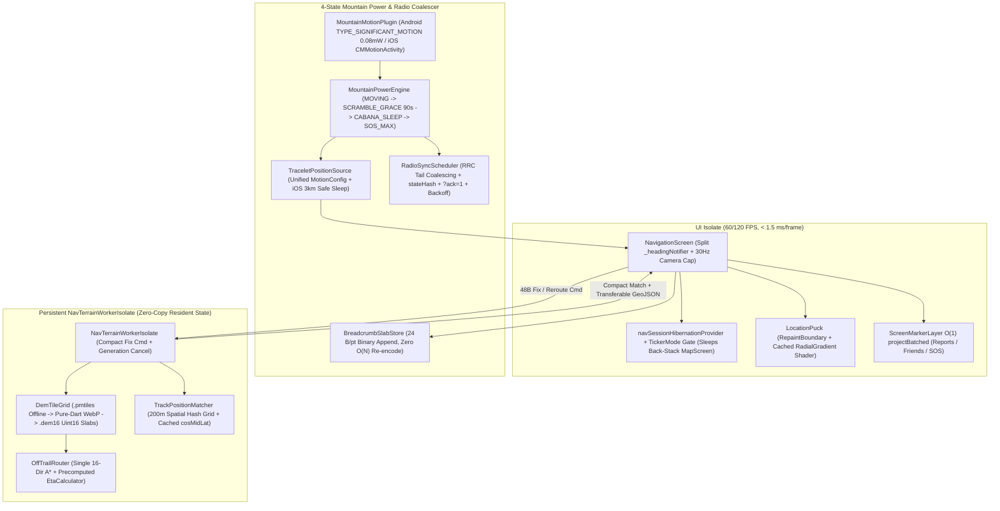

# Faza 3: Economie Adaptivă de Baterie pe Munte („Stationary Sleep”), Coalescență Radio & Isolate Dedicat 60/120 FPS (Mobile Flutter) — Plan de Implementare

> **For agentic workers:** REQUIRED SUB-SKILL: Use superpowers:subagent-driven-development to implement this plan task-by-task. Steps use checkbox (`- [ ]`) syntax for tracking.

**Goal:** Reducerea consumului total de baterie al aplicației mobile Flutter (`app/` iOS & Android) cu **38–55%** pe ture montane de 8–12 ore în Carpați (frig, pădure densă, semnal GSM slab/inexistent) și eliminarea completă a blocajelor pe firul UI (`0` frame drops la `60/120 FPS`) în timpul rerutării A* pe teren, decodării DEM, salvării track-ului și parsării fișierelor GPX/KML/KMZ/FIT.

**Architecture:** Arhitectura acționează coordonat pe patru paliere măsurate în codul curent: (1) **Hibernarea rutelor acoperite & chirurgia UI** (`navSessionHibernationProvider` + `TickerMode` eliberează dublul GPS `Geolocator`, dubla busolă `50ms`, clobber-ul `inNavigation: false` și suprafața nativă OpenGL `MapLibreMap` din back-stack; `_headingNotifier` decuplează rotația conului la `15 Hz` de reproiectarea `WidgetLayer` și cache-uiește `RadialGradient` `Shader`, iar markerele comunitare trec pe `ScreenMarkerLayer` cu proiecție afină $O(1)$); (2) **Motorul Montan cu 4 Stări (`MountainPowerEngine` + `MountainMotionPlugin`)** detectează repausul real la cabană/popas (`> 90s`) combinând deplasarea GNSS cu varianța benzii pașilor (`0.8–3.2 Hz`) și comută pe trezire hardware cu **zero permisiuni Health** (`Sensor.TYPE_SIGNIFICANT_MOTION` `~0.08 mW` pe Android fără `ACTIVITY_RECOGNITION`; `CMMotionActivityManager` + `DesiredAccuracy.lowest` / `kCLLocationAccuracyThreeKilometers` pe iOS pentru a păstra vie aserțiunea `UIBackgroundModes: location` fără cipul GNSS), cu repornire `< 500 ms` la primii pași, **Mod Expediție** opțional și **override obligatoriu de precizie maximă la SOS activ**; (3) **Coalescența Radio RRC Tail-Aware (`RadioSyncScheduler`) & Persistența Binară `24 B/pt` (`BreadcrumbSlabStore`)** unifică timer-ele necoordonate (`6s` group ping, `30s` heartbeat, `20s` SOS outbox) într-un singur scheduler adaptiv (`stateHash` delta `38 B`, `?ack=1` slim ping, `stationary: true` la `300s`, `Last-Event-ID` SSE replay și backoff exponențial în zone fără semnal) și înlocuiește re-encodarea $O(N)$ la `10s` cu append binar $O(\Delta k)$; (4) **Isolate-ul Dedicat Persistent `NavTerrainWorkerIsolate`** păstrează rezidente în memorie tile-urile DEM `Uint16` (`0.20 m` rezoluție verticală pe intervalul `-1000 m .. +12.106,8 m`, `.dem16` `512 KB/tile` pe disc + citire directă din `.pmtiles` offline, decodate pure-Dart cu `package:image` fără GPU readback) și geometria flat `Float64List` indexată într-o grilă spațială de `200 m`, rulând matching-ul `1 Hz` (`< 0.03 ms`) și rerutarea 16-dir A* + Chaikin (cu fixarea dublului apel sincron A*) cu mesaje compacte și anulare cooperativă prin `generation`.

**Architecture Diagram:**



**Tech Stack:** Dart `^3.13.0`, Flutter (`Impeller` + `FlutterGPU`), `flutter_riverpod: ^3.3.1`, `tracelet: ^3.8.8`, `geolocator: ^14.0.0`, `flutter_rotation_sensor: ^0.2.0`, `maplibre: 0.3.7`, `objectbox: 6.0.0-preview.5`, `pmtiles: ^1.2.0`, `image: ^4.8.0` (deja rezolvat în `pubspec.lock`), `archive: ^4.0.9` (deja rezolvat în `pubspec.lock`), Kotlin (`SensorManager`, `TYPE_SIGNIFICANT_MOTION`, `BatteryManager`) pe Android, Swift (`CoreMotion`, `CMMotionActivityManager`, `ProcessInfo`) pe iOS.

**Spec:** [2026-11-18-performance-battery-io-optimization-design.md](file:///Volumes/SSD%20extern/Proiecte/Maps/docs/superpowers/specs/2026-11-18-performance-battery-io-optimization-design.md)

## Global Constraints

- **Infrastructură Single-VPS & Local-First (Fără Object-Storage Extern):** Toate resursele online (tile-uri DEM de fallback, API `/api/v1/live/*`, fișiere trasee) sunt deservite direct de infrastructura existentă single-VPS (Go `http.ServeContent` + proxy standard HTTP/3 QUIC) și local prin `TileProxyServer` / `.pmtiles`. Nu se introduce niciun serviciu extern de object-storage.
- **Zero `ACTIVITY_RECOGNITION` pe Android (Fără Declarație Google Play Health Apps):** `android.permission.ACTIVITY_RECOGNITION` rămâne eliminată cu `tools:node="remove"` în [AndroidManifest.xml](file:///Volumes/SSD%20extern/Proiecte/Maps/app/android/app/src/main/AndroidManifest.xml#L43-L45). Detecția mișcării și trezirea din `STATIONARY_CABANA_SLEEP` pe Android folosesc exclusiv `Sensor.TYPE_ACCELEROMETER` (`SENSOR_DELAY_NORMAL`, fără permisiuni) și `Sensor.TYPE_SIGNIFICANT_MOTION` (senzor hardware wake-up pe DSP `~0.08 mW`, fără permisiuni).
- **Prevenirea suspendării fatale în background pe iOS:** În starea `stationaryCabanaSleep` pe iOS, aplicația **NU** apelează niciodată `Tracelet.stop()` sau `stopUpdatingLocation()` în timp ce ecranul este blocat (ceea ce ar revoca aserțiunea `UIBackgroundModes: location` în `~10 s` și ar îngheța procesul). În schimb, menține sesiunea nativă deschisă cu `DesiredAccuracy.lowest` (`kCLLocationAccuracyThreeKilometers` + `distanceFilter: 500.0`, `0 mW` RF satelit GNSS) și repornește `DesiredAccuracy.high` instantaneu la evenimentul `CMMotionActivityManager` (`NSMotionUsageDescription` existent în [Info.plist](file:///Volumes/SSD%20extern/Proiecte/Maps/app/ios/Runner/Info.plist#L128-L129)).
- **Override obligatoriu de siguranță la SOS activ:** Orice alertă SOS activă proprie (`_myActiveSos.value != null`) sau răspuns activ la un SOS din apropiere (`_activeRespondingSos() != null`) dezactivează imediat `stationaryCabanaSleep` și `expeditionBatteryMode`, forțând `DesiredAccuracy.high`, `distanceFilter: 2.0 m` și sincronizare radio prioritară.
- **Contracte Wire Inter-Faze (aliniate cu Fazele 1, 2 și 4):**
  - `POST /api/v1/live/heartbeat` acceptă `stationary: bool` și `stateHash: String?`, returnând `{ "unchanged": true, "stateHash": "..." }` (`38 B`) când starea locală nu s-a schimbat.
  - `POST /api/v1/live/groups/{code}/ping` acceptă query-ul `?ack=1` (când stream-ul SSE este conectat activ) și câmpul JSON `stationary: bool`.
  - `GET /api/v1/live/stream` primește header-ul `Last-Event-ID: <seq>` la reconectare pentru replay din ring-buffer-ul de 512 sloturi din Go.
- **Compatibilitate `LocalSettingsEntity` & `DemTileGrid`:** `LocalSettingsEntity` adaugă `bool expeditionBatteryMode = false` ca parametru opțional cu valoare implicită (compatibil cu câmpurile de straturi din planurile Salvamont/Solar/Satelit), iar `DemTileGrid` păstrează intacte semnăturile `sampleElevation`, `prefetchCorridor`, `latLonToTile` și `putTileRgbaForTest`, reparând totodată substituția `{z}` pentru proxy-ul loopback.

---

## Milestone 1: Hibernarea Rutelor din Back-Stack & Chirurgia UI 60/120 FPS

### Task 1: Hibernarea Rutelor Acoperite (`navSessionHibernationProvider` + `TickerMode` Gate pe `MapScreen` și Straturile de Locație)

**Files:**
- Create: [nav_session_hibernation_provider.dart](file:///Volumes/SSD%20extern/Proiecte/Maps/app/lib/provider/nav_session_hibernation_provider.dart)
- Modify: [location_marker_layer.dart](file:///Volumes/SSD%20extern/Proiecte/Maps/app/lib/components/map/location_marker_layer.dart#L196-L215)
- Modify: [center_on_location_button.dart](file:///Volumes/SSD%20extern/Proiecte/Maps/app/lib/components/map/center_on_location_button.dart#L26-L36)
- Modify: [location_follow_controller.dart](file:///Volumes/SSD%20extern/Proiecte/Maps/app/lib/components/map/location_follow_controller.dart#L199-L215)
- Modify: [map_screen.dart](file:///Volumes/SSD%20extern/Proiecte/Maps/app/lib/routes/map_screen.dart#L505-L535)
- Test: [nav_session_hibernation_test.dart](file:///Volumes/SSD%20extern/Proiecte/Maps/app/test/provider/nav_session_hibernation_test.dart)

**Interfaces:**
- Consumes: `liveLocationProvider` ([foreground_position_stream_provider.dart](file:///Volumes/SSD%20extern/Proiecte/Maps/app/lib/provider/foreground_position_stream_provider.dart#L70-L76)), `liveCompassProvider` ([compass_heading_stream_provider.dart](file:///Volumes/SSD%20extern/Proiecte/Maps/app/lib/provider/compass_heading_stream_provider.dart#L48-L54)).
- Produces:
  - `navSessionHibernationProvider` (`NotifierProvider<NavSessionHibernation, bool>`) cu metodele `enterNavigationSession()` / `exitNavigationSession()` (numărătoare de referințe sigură la tranziții `pushReplacement`).
  - `shouldAcquireForegroundMapSensors(BuildContext context, WidgetRef ref) -> bool`.

> [!IMPORTANT]
> Când utilizatorul navighează `/map` -> `/trail/:id` -> `/trail/:id/navigate`, `MapScreen` rămâne montat în `ShellRoute` (`maintainState: true`). Fără poarta `TickerMode.of(context) && !isHibernating`, `MapScreen` ține deschis al doilea receptor GPS (`Geolocator`), trimite `POST /live/heartbeat` cu `inNavigation: false` la fiecare `45 s`, suprascrie `RotationSensor.samplingPeriod = 50ms` (`20 Hz`) și păstrează vie o a doua suprafață OpenGL/Vulkan `MapLibreMap` (`80–140 MB` RAM).

- [ ] **Step 1: Scrie testul widget pentru eliberarea senzorilor pe rute acoperite și în timpul hibernării navigației**

Creează [nav_session_hibernation_test.dart](file:///Volumes/SSD%20extern/Proiecte/Maps/app/test/provider/nav_session_hibernation_test.dart):

```dart
import 'dart:async';

import 'package:flutter/material.dart';
import 'package:flutter_riverpod/flutter_riverpod.dart';
import 'package:flutter_test/flutter_test.dart';
import 'package:wanderer/components/map/center_on_location_button.dart';
import 'package:wanderer/components/map/location_marker_layer.dart';
import 'package:wanderer/i18n/app_localizations.dart';
import 'package:wanderer/provider/compass_heading_stream_provider.dart';
import 'package:wanderer/provider/foreground_position_stream_provider.dart';
import 'package:wanderer/provider/nav_session_hibernation_provider.dart';

class _SpyForegroundPositionStream extends ForegroundPositionStream {
  int acquireCalls = 0;
  int releaseCalls = 0;
  final _ctrl = StreamController<LocationMarkerPosition?>.broadcast();

  @override
  Stream<LocationMarkerPosition?> build() {
    replaying = _ctrl.stream;
    ref.onDispose(_ctrl.close);
    return _ctrl.stream;
  }

  @override
  void acquire() {
    acquireCalls++;
  }

  @override
  void release() {
    releaseCalls++;
  }
}

class _SpyCompassStream extends CompassHeadingStream {
  int acquireCalls = 0;
  int releaseCalls = 0;
  final _ctrl = StreamController<CompassHeadingReading?>.broadcast();

  @override
  Stream<CompassHeadingReading?> build() {
    replaying = _ctrl.stream;
    ref.onDispose(_ctrl.close);
    return _ctrl.stream;
  }

  @override
  void acquire() {
    acquireCalls++;
  }

  @override
  void release() {
    releaseCalls++;
  }
}

void main() {
  testWidgets(
    'LocationMarkerLayer and CenterOnLocationButton release GPS and compass when covered by pushed route or hibernated',
    (tester) async {
      final gpsSpy = _SpyForegroundPositionStream();
      final compassSpy = _SpyCompassStream();

      await tester.pumpWidget(
        ProviderScope(
          overrides: [
            foregroundPositionStreamProvider.overrideWith(() => gpsSpy),
            compassHeadingStreamProvider.overrideWith(() => compassSpy),
          ],
          child: MaterialApp(
            localizationsDelegates: AppLocalizations.localizationsDelegates,
            supportedLocales: AppLocalizations.supportedLocales,
            home: Builder(
              builder: (context) => Scaffold(
                body: Column(
                  children: [
                    const LocationMarkerLayer(),
                    CenterOnLocationButton(onPressed: (_) {}),
                    ElevatedButton(
                      onPressed: () {
                        Navigator.of(context).push(
                          MaterialPageRoute<void>(
                            builder: (_) => const Scaffold(
                              body: Text('Top Navigation Route'),
                            ),
                          ),
                        );
                      },
                      child: const Text('Push Route'),
                    ),
                  ],
                ),
              ),
            ),
          ),
        ),
      );
      await tester.pumpAndSettle();

      expect(gpsSpy.acquireCalls, 1);
      expect(compassSpy.acquireCalls, 1);
      expect(gpsSpy.releaseCalls, 0);

      // Push an opaque route on top -> TickerMode becomes false on home route.
      await tester.tap(find.text('Push Route'));
      await tester.pumpAndSettle();

      expect(gpsSpy.releaseCalls, 1);
      expect(compassSpy.releaseCalls, 1);

      // Pop back -> sensors re-acquire cleanly.
      Navigator.of(tester.element(find.text('Top Navigation Route'))).pop();
      await tester.pumpAndSettle();

      expect(gpsSpy.acquireCalls, 2);
      expect(compassSpy.acquireCalls, 2);
    },
  );

  test('NavSessionHibernation reference-counts overlapping sessions safely', () {
    final container = ProviderContainer();
    addTearDown(container.dispose);

    final notifier = container.read(navSessionHibernationProvider.notifier);
    expect(container.read(navSessionHibernationProvider), isFalse);

    notifier.enterNavigationSession();
    expect(container.read(navSessionHibernationProvider), isTrue);

    notifier.enterNavigationSession();
    notifier.exitNavigationSession();
    expect(container.read(navSessionHibernationProvider), isTrue);

    notifier.exitNavigationSession();
    expect(container.read(navSessionHibernationProvider), isFalse);
  });
}
```

- [ ] **Step 2: Rulează testul pentru a verifica eșecul inițial (RED)**

Run: `cd app && flutter test test/provider/nav_session_hibernation_test.dart`
Expected: FAIL cu `Target of URI doesn't exist: 'package:wanderer/provider/nav_session_hibernation_provider.dart'`.

- [ ] **Step 3: Implementează `nav_session_hibernation_provider.dart` și porțile `shouldAcquireForegroundMapSensors`**

Creează [nav_session_hibernation_provider.dart](file:///Volumes/SSD%20extern/Proiecte/Maps/app/lib/provider/nav_session_hibernation_provider.dart):

```dart
import 'package:flutter/widgets.dart';
import 'package:flutter_riverpod/flutter_riverpod.dart';

/// Reference-counted flag indicating at least one full-screen [NavigationScreen]
/// (turn-by-turn or GPS recording) is currently mounted.
///
/// While `true`, background map tabs (`MapScreen`) release their duplicate
/// foreground `Geolocator` stream, `50ms` `RotationSensor` subscription, and
/// Hybrid-Composition native `MapLibreMap` OpenGL surface.
final navSessionHibernationProvider =
    NotifierProvider<NavSessionHibernation, bool>(NavSessionHibernation.new);

class NavSessionHibernation extends Notifier<bool> {
  int _activeSessions = 0;

  @override
  bool build() => false;

  void enterNavigationSession() {
    _activeSessions++;
    if (!state) {
      state = true;
    }
  }

  void exitNavigationSession() {
    if (_activeSessions > 0) {
      _activeSessions--;
    }
    if (_activeSessions == 0 && state) {
      state = false;
    }
  }
}

/// Returns `true` only when the enclosing route is visibly active
/// (`TickerMode.of(context) == true`) AND no [NavigationScreen] owns the
/// dedicated tracking pipeline.
bool shouldAcquireForegroundMapSensors(BuildContext context, WidgetRef ref) {
  final tickersEnabled = TickerMode.of(context);
  final hibernating = ref.watch(navSessionHibernationProvider);
  return tickersEnabled && !hibernating;
}
```

Actualizează [location_marker_layer.dart](file:///Volumes/SSD%20extern/Proiecte/Maps/app/lib/components/map/location_marker_layer.dart#L1-L215):

```diff
 import 'package:wanderer/provider/compass_heading_stream_provider.dart';
 import 'package:wanderer/provider/foreground_position_stream_provider.dart';
+import 'package:wanderer/provider/nav_session_hibernation_provider.dart';
 import 'package:wanderer/util/map/heading_math.dart';
```

```diff
   @override
   Widget build(BuildContext context) {
+    if (!shouldAcquireForegroundMapSensors(context, ref)) {
+      return const SizedBox.shrink();
+    }
     final controller = ml.MapController.maybeOf(context);
     final camera = ml.MapCamera.maybeOf(context);
     final cameraBearing = camera?.bearing ?? 0.0;
```

Actualizează [center_on_location_button.dart](file:///Volumes/SSD%20extern/Proiecte/Maps/app/lib/components/map/center_on_location_button.dart#L8-L35):

```diff
 import 'package:wanderer/provider/compass_heading_stream_provider.dart';
 import 'package:wanderer/provider/foreground_position_stream_provider.dart';
 import 'package:wanderer/provider/location_tracking_mode_provider.dart';
+import 'package:wanderer/provider/nav_session_hibernation_provider.dart';
```

```diff
   @override
   Widget build(BuildContext context, WidgetRef ref) {
+    if (!shouldAcquireForegroundMapSensors(context, ref)) {
+      return const SizedBox.shrink();
+    }
     final posStream = ref.watch(liveLocationProvider);
     final compassStream = ref.watch(liveCompassProvider);
```

Actualizează [location_follow_controller.dart](file:///Volumes/SSD%20extern/Proiecte/Maps/app/lib/components/map/location_follow_controller.dart#L1-L215):

```diff
 import 'package:wanderer/provider/compass_heading_stream_provider.dart';
 import 'package:wanderer/provider/foreground_position_stream_provider.dart';
 import 'package:wanderer/provider/location_tracking_mode_provider.dart';
+import 'package:wanderer/provider/nav_session_hibernation_provider.dart';
 import 'package:wanderer/util/map/heading_math.dart';
```

```diff
   void _bindStreams() {
+    if (!shouldAcquireForegroundMapSensors(context, ref)) {
+      _posSub?.cancel();
+      _posSub = null;
+      _boundPosStream = null;
+      _compassSub?.cancel();
+      _compassSub = null;
+      _boundCompassStream = null;
+      if (_ticker.isTicking) _ticker.stop();
+      return;
+    }
     final posStream = ref.watch(liveLocationProvider);
     final compassStream = ref.watch(liveCompassProvider);
```

Actualizează [map_screen.dart](file:///Volumes/SSD%20extern/Proiecte/Maps/app/lib/routes/map_screen.dart#L32-L42) ([L505-L532](file:///Volumes/SSD%20extern/Proiecte/Maps/app/lib/routes/map_screen.dart#L505-L532) și [L1183-L1190](file:///Volumes/SSD%20extern/Proiecte/Maps/app/lib/routes/map_screen.dart#L1183-L1190)) pentru a demonta temporar `TrailCollectionMap` (`hc` OpenGL) și a opri `liveLocationProvider` din panoul de locație când `NavigationScreen` este activă:

```diff
 import 'package:wanderer/provider/foreground_position_stream_provider.dart';
 import 'package:wanderer/provider/local_settings_provider.dart';
 import 'package:wanderer/provider/location_tracking_mode_provider.dart';
 import 'package:wanderer/provider/map_camera_provider.dart';
 import 'package:wanderer/provider/map_style_json_provider.dart';
 import 'package:wanderer/provider/map_style_sources_provider.dart';
+import 'package:wanderer/provider/nav_session_hibernation_provider.dart';
 import 'package:wanderer/provider/online_status_provider.dart';
```

```diff
+    final isNavHibernating = ref.watch(navSessionHibernationProvider);
+    if (isNavHibernating && _controller != null) {
+      _controller = null;
+      _initialSearchDone = false;
+    }
+
     return Stack(
       children: [
         if (!isOnline)
           Container(
             color: Theme.of(context).colorScheme.surface,
             child: WandererOfflineState(
               title: AppLocalizations.of(context)!.offline_title,
               body: AppLocalizations.of(context)!.offline_map_body,
               retryLabel: AppLocalizations.of(context)!.offline_try_again,
               onRetry: _retryOnline,
             ),
           )
+        else if (isNavHibernating)
+          ColoredBox(color: Theme.of(context).colorScheme.surface)
         else
           // Offstage, not removed: the native map and its camera stay alive,
```

```diff
                 // Omitted rather than showing a placeholder while there is
                 // no fix (permission denied, GPS still searching).
-                StreamBuilder<LocationMarkerPosition?>(
-                  stream: ref.watch(liveLocationProvider),
+                if (shouldAcquireForegroundMapSensors(context, ref))
+                  StreamBuilder<LocationMarkerPosition?>(
+                    stream: ref.watch(liveLocationProvider),
```

- [ ] **Step 4: Rulează testul pentru a confirma trecerea (GREEN)**

Run: `cd app && flutter test test/provider/nav_session_hibernation_test.dart`
Expected: PASS (`All tests passed!`).

- [ ] **Step 5: Commit**

```bash
git add app/lib/provider/nav_session_hibernation_provider.dart \
  app/lib/components/map/location_marker_layer.dart \
  app/lib/components/map/center_on_location_button.dart \
  app/lib/components/map/location_follow_controller.dart \
  app/lib/routes/map_screen.dart \
  app/test/provider/nav_session_hibernation_test.dart
git commit -m "perf(app): hibernate covered map sensors and GL surface during active navigation"
```

---

### Task 2: Politica Adaptivă a Busolei (`CompassRatePolicy`), Cache `Shader` în `LocationPuck`, Decuplarea `_headingNotifier` & `ScreenMarkerLayer` $O(1)$

**Files:**
- Create: [compass_rate_policy.dart](file:///Volumes/SSD%20extern/Proiecte/Maps/app/lib/util/map/compass_rate_policy.dart)
- Modify: [location_marker_layer.dart](file:///Volumes/SSD%20extern/Proiecte/Maps/app/lib/components/map/location_marker_layer.dart#L14-L120)
- Test: [compass_rate_policy_test.dart](file:///Volumes/SSD%20extern/Proiecte/Maps/app/test/util/map/compass_rate_policy_test.dart)

**Interfaces:**
- Consumes: `shortestAngleDelta`, `normalizeHeading` din [heading_math.dart](file:///Volumes/SSD%20extern/Proiecte/Maps/app/lib/util/map/heading_math.dart).
- Produces:
  - `CompassRateConfig` (`samplingPeriod`, `deadbandDeg`, `sensorEnabled`) + `resolveCompassRatePolicy({required bool uiVisible, required bool headingUp, required bool isStationary, required bool expeditionMode})`.
  - `CameraPushThrottle` (`shouldPushCameraFrame(Duration elapsed, {Duration minInterval = const Duration(milliseconds: 33)})` — plafon `30 Hz` pentru tween-ul de `200 ms` pe ecrane ProMotion `120 Hz`).
  - `LocationPuck.headingListenable` (`ValueListenable<double?>?`) + `RepaintBoundary` pe conul rotativ + cache static de `Shader` în `_FlashlightConePainter`.

- [ ] **Step 1: Scrie testele unitare și widget pentru politica busolei, throttle-ul camerei la 30 Hz și reconstrucția izolată `LocationPuck`**

Creează [compass_rate_policy_test.dart](file:///Volumes/SSD%20extern/Proiecte/Maps/app/test/util/map/compass_rate_policy_test.dart):

```dart
import 'package:flutter/material.dart';
import 'package:flutter_test/flutter_test.dart';
import 'package:wanderer/components/map/location_marker_layer.dart';
import 'package:wanderer/util/map/compass_rate_policy.dart';

void main() {
  group('resolveCompassRatePolicy', () {
    test('disables rotation sensor completely when UI hidden or stationary', () {
      final hidden = resolveCompassRatePolicy(
        uiVisible: false,
        headingUp: true,
        isStationary: false,
        expeditionMode: false,
      );
      expect(hidden.sensorEnabled, isFalse);

      final stationary = resolveCompassRatePolicy(
        uiVisible: true,
        headingUp: true,
        isStationary: true,
        expeditionMode: false,
      );
      expect(stationary.sensorEnabled, isFalse);
    });

    test('uses 66ms / 0.3 deg in headingUp and steps down to 200ms / 1.5 deg in northUp', () {
      final headingUp = resolveCompassRatePolicy(
        uiVisible: true,
        headingUp: true,
        isStationary: false,
        expeditionMode: false,
      );
      expect(headingUp.sensorEnabled, isTrue);
      expect(headingUp.samplingPeriod, const Duration(milliseconds: 66));
      expect(headingUp.deadbandDeg, 0.3);

      final northUp = resolveCompassRatePolicy(
        uiVisible: true,
        headingUp: false,
        isStationary: false,
        expeditionMode: false,
      );
      expect(northUp.sensorEnabled, isTrue);
      expect(northUp.samplingPeriod, const Duration(milliseconds: 200));
      expect(northUp.deadbandDeg, 1.5);
    });

    test('uses 250ms / 2.5 deg in expedition mode when headingUp', () {
      final exp = resolveCompassRatePolicy(
        uiVisible: true,
        headingUp: true,
        isStationary: false,
        expeditionMode: true,
      );
      expect(exp.sensorEnabled, isTrue);
      expect(exp.samplingPeriod, const Duration(milliseconds: 250));
      expect(exp.deadbandDeg, 2.5);
    });
  });

  group('CameraPushThrottle', () {
    test('caps 120Hz animation frames (8.3ms) down to ~30Hz (33ms) while always allowing final frame', () {
      final throttle = CameraPushThrottle();
      expect(throttle.shouldPush(const Duration(milliseconds: 0)), isTrue);
      expect(throttle.shouldPush(const Duration(milliseconds: 8)), isFalse);
      expect(throttle.shouldPush(const Duration(milliseconds: 16)), isFalse);
      expect(throttle.shouldPush(const Duration(milliseconds: 25)), isFalse);
      expect(throttle.shouldPush(const Duration(milliseconds: 34)), isTrue);
      expect(
        throttle.shouldPush(const Duration(milliseconds: 40), isFinalFrame: true),
        isTrue,
      );
    });
  });

  testWidgets('LocationPuck rotates cone via headingListenable without rebuilding parent tree', (tester) async {
    var parentBuilds = 0;
    final headingNotifier = ValueNotifier<double?>(15.0);
    addTearDown(headingNotifier.dispose);

    await tester.pumpWidget(
      MaterialApp(
        home: StatefulBuilder(
          builder: (context, _) {
            parentBuilds++;
            return LocationPuck(
              size: 96,
              dotSize: 20,
              headingListenable: headingNotifier,
              headingAccuracy: 10.0,
            );
          },
        ),
      ),
    );

    expect(parentBuilds, 1);
    expect(find.byKey(const ValueKey('gmaps-heading-cone')), findsOneWidget);

    headingNotifier.value = 95.0;
    await tester.pump();

    expect(parentBuilds, 1);
  });
}
```

- [ ] **Step 2: Rulează testul pentru a verifica eșecul inițial (RED)**

Run: `cd app && flutter test test/util/map/compass_rate_policy_test.dart`
Expected: FAIL cu `Target of URI doesn't exist: 'package:wanderer/util/map/compass_rate_policy.dart'`.

- [ ] **Step 3: Implementează `compass_rate_policy.dart` și optimizează `LocationPuck` + `_FlashlightConePainter`**

Creează [compass_rate_policy.dart](file:///Volumes/SSD%20extern/Proiecte/Maps/app/lib/util/map/compass_rate_policy.dart):

```dart
class CompassRateConfig {
  const CompassRateConfig({
    required this.sensorEnabled,
    required this.samplingPeriod,
    required this.deadbandDeg,
  });

  final bool sensorEnabled;
  final Duration samplingPeriod;
  final double deadbandDeg;

  static const CompassRateConfig disabled = CompassRateConfig(
    sensorEnabled: false,
    samplingPeriod: Duration(milliseconds: 250),
    deadbandDeg: 5.0,
  );

  @override
  bool operator ==(Object other) =>
      other is CompassRateConfig &&
      other.sensorEnabled == sensorEnabled &&
      other.samplingPeriod == samplingPeriod &&
      other.deadbandDeg == deadbandDeg;

  @override
  int get hashCode => Object.hash(sensorEnabled, samplingPeriod, deadbandDeg);
}

/// Resolves the optimal IMU magnetometer/gyroscope cadence for the current
/// navigation visibility, camera mode, motion state, and battery saver setting.
CompassRateConfig resolveCompassRatePolicy({
  required bool uiVisible,
  required bool headingUp,
  required bool isStationary,
  required bool expeditionMode,
}) {
  if (!uiVisible || isStationary) {
    return CompassRateConfig.disabled;
  }
  if (expeditionMode) {
    if (!headingUp) {
      return CompassRateConfig.disabled;
    }
    return const CompassRateConfig(
      sensorEnabled: true,
      samplingPeriod: Duration(milliseconds: 250),
      deadbandDeg: 2.5,
    );
  }
  if (headingUp) {
    return const CompassRateConfig(
      sensorEnabled: true,
      samplingPeriod: Duration(milliseconds: 66),
      deadbandDeg: 0.3,
    );
  }
  return const CompassRateConfig(
    sensorEnabled: true,
    samplingPeriod: Duration(milliseconds: 200),
    deadbandDeg: 1.5,
  );
}

/// Caps platform-channel `moveCamera` updates during position tweens to ~30 Hz
/// on 120 Hz ProMotion / LTPO displays while guaranteeing the final frame lands.
class CameraPushThrottle {
  CameraPushThrottle({
    this.minInterval = const Duration(milliseconds: 33),
  });

  final Duration minInterval;
  Duration? _lastPushed;

  void reset() => _lastPushed = null;

  bool shouldPush(Duration elapsed, {bool isFinalFrame = false}) {
    if (isFinalFrame) {
      _lastPushed = elapsed;
      return true;
    }
    final prev = _lastPushed;
    if (prev == null || (elapsed - prev) >= minInterval || elapsed < prev) {
      _lastPushed = elapsed;
      return true;
    }
    return false;
  }
}
```

Actualizează [location_marker_layer.dart](file:///Volumes/SSD%20extern/Proiecte/Maps/app/lib/components/map/location_marker_layer.dart#L1-L121) pentru a adăuga `headingListenable`, `RepaintBoundary` și cache-ul de `Shader`:

```diff
 import 'dart:math' as math;
 
+import 'package:flutter/foundation.dart' show ValueListenable;
 import 'package:flutter/material.dart';
```

```diff
 class LocationPuck extends StatelessWidget {
   const LocationPuck({
     super.key,
     this.size = 88,
     this.dotSize = 18,
     this.heading,
+    this.headingListenable,
     this.headingAccuracy,
     this.showHeading = true,
   });
 
   /// Overall bounding box (matches the enclosing [ml.Marker]'s size) — also
   /// the cone's canvas when [showHeading] is on.
   final double size;
 
   /// Diameter of the static dot.
   final double dotSize;
 
   final double? heading;
+  final ValueListenable<double?>? headingListenable;
   final double? headingAccuracy;
 
   /// Whether to draw the heading flashlight cone at all.
   final bool showHeading;
 
+  Widget _buildCone(double? resolvedHeading, double halfAngleDeg) {
+    final hasValidHeading =
+        showHeading &&
+        resolvedHeading != null &&
+        resolvedHeading.isFinite &&
+        resolvedHeading >= 0 &&
+        size > dotSize;
+    if (!hasValidHeading) {
+      return const SizedBox.shrink();
+    }
+    return RepaintBoundary(
+      child: Transform.rotate(
+        key: const ValueKey('gmaps-heading-cone'),
+        angle: resolvedHeading * math.pi / 180.0,
+        child: CustomPaint(
+          size: Size(size, size),
+          painter: _FlashlightConePainter(halfAngleDeg: halfAngleDeg),
+        ),
+      ),
+    );
+  }
+
   @override
   Widget build(BuildContext context) {
-    final hasValidHeading =
-        showHeading && heading != null && heading!.isFinite && heading! >= 0;
     final halfAngleDeg = coneHalfAngleFromAccuracy(headingAccuracy);
+    final listenable = headingListenable;
 
     return IgnorePointer(
       child: SizedBox(
         width: size,
         height: size,
         child: Stack(
           alignment: Alignment.center,
           children: [
-            if (hasValidHeading && size > dotSize)
-              Transform.rotate(
-                key: const ValueKey('gmaps-heading-cone'),
-                angle: heading! * math.pi / 180.0,
-                child: CustomPaint(
-                  size: Size(size, size),
-                  painter: _FlashlightConePainter(
-                    halfAngleDeg: halfAngleDeg,
-                  ),
-                ),
-              ),
+            if (listenable != null)
+              ValueListenableBuilder<double?>(
+                valueListenable: listenable,
+                builder: (context, liveHeading, _) =>
+                    _buildCone(liveHeading, halfAngleDeg),
+              )
+            else
+              _buildCone(heading, halfAngleDeg),
-            Container(
+            RepaintBoundary(
+              child: Container(
-              width: dotSize,
-              height: dotSize,
-              decoration: BoxDecoration(
-                color: kGoogleMapsBlue,
-                shape: BoxShape.circle,
-                border: Border.all(color: Colors.white, width: 3),
-                boxShadow: [
-                  BoxShadow(
-                    color: Colors.black.withValues(alpha: .35),
-                    blurRadius: 4,
-                    offset: const Offset(0, 1),
-                  ),
-                ],
+                width: dotSize,
+                height: dotSize,
+                decoration: BoxDecoration(
+                  color: kGoogleMapsBlue,
+                  shape: BoxShape.circle,
+                  border: Border.all(color: Colors.white, width: 3),
+                  boxShadow: [
+                    BoxShadow(
+                      color: Colors.black.withValues(alpha: .35),
+                      blurRadius: 4,
+                      offset: const Offset(0, 1),
+                    ),
+                  ],
+                ),
               ),
             ),
           ],
         ),
       ),
     );
   }
 }
 
 class _FlashlightConePainter extends CustomPainter {
   const _FlashlightConePainter({required this.halfAngleDeg});
 
   final double halfAngleDeg;
 
+  static double? _cachedRadius;
+  static Shader? _cachedShader;
+
+  static Shader _shaderForRadius(double radius) {
+    if (_cachedShader != null && _cachedRadius == radius) {
+      return _cachedShader!;
+    }
+    final rect = Rect.fromCircle(center: Offset(radius, radius), radius: radius);
+    _cachedRadius = radius;
+    _cachedShader = RadialGradient(
+      colors: [
+        kGoogleMapsBlue.withValues(alpha: 0.72),
+        kGoogleMapsBlue.withValues(alpha: 0.34),
+        kGoogleMapsBlue.withValues(alpha: 0.0),
+      ],
+      stops: const [0.18, 0.62, 1.0],
+    ).createShader(rect);
+    return _cachedShader!;
+  }
+
   @override
   void paint(Canvas canvas, Size size) {
     final radius = size.width / 2;
     if (radius <= 0) return;
     final center = Offset(radius, size.height / 2);
     final sweepRadians = (halfAngleDeg * 2) * math.pi / 180.0;
     // -pi/2 is straight up (North = 0 deg)
     final startAngle = -math.pi / 2 - sweepRadians / 2;
 
     final rect = Rect.fromCircle(center: center, radius: radius);
-    final paint = Paint()
-      ..shader = RadialGradient(
-        colors: [
-          kGoogleMapsBlue.withValues(alpha: 0.72),
-          kGoogleMapsBlue.withValues(alpha: 0.34),
-          kGoogleMapsBlue.withValues(alpha: 0.0),
-        ],
-        stops: const [0.18, 0.62, 1.0],
-      ).createShader(rect);
+    final paint = Paint()..shader = _shaderForRadius(radius);
 
     final path = Path()
       ..moveTo(center.dx, center.dy)
       ..arcTo(rect, startAngle, sweepRadians, false)
       ..close();
 
     canvas.drawPath(path, paint);
   }
```

- [ ] **Step 4: Rulează testele pentru a confirma trecerea (GREEN)**

Run: `cd app && flutter test test/util/map/compass_rate_policy_test.dart test/components/map/location_puck_test.dart`
Expected: PASS.

- [ ] **Step 5: Commit**

```bash
git add app/lib/util/map/compass_rate_policy.dart \
  app/lib/components/map/location_marker_layer.dart \
  app/test/util/map/compass_rate_policy_test.dart
git commit -m "perf(app): decouple heading cone listenable, cache radial shader, and add compass/camera rate policy"
```

---

## Milestone 2: Motorul Montan cu 4 Stări („Stationary Sleep” > 90s), Wake Hardware fără `ACTIVITY_RECOGNITION` & Modul Expediție + Override SOS

### Task 3: Pluginul Nativ `MountainMotionPlugin` (Android `TYPE_SIGNIFICANT_MOTION` + Accelerometru fără Permisiuni & iOS `CMMotionActivityManager` + Baterie)

**Files:**
- Create: [MountainMotionPlugin.kt](file:///Volumes/SSD%20extern/Proiecte/Maps/app/android/app/src/main/kotlin/com/openwanderer/wanderer/MountainMotionPlugin.kt)
- Create: [MountainMotionPlugin.swift](file:///Volumes/SSD%20extern/Proiecte/Maps/app/ios/Runner/MountainMotionPlugin.swift)
- Modify: [MainActivity.kt](file:///Volumes/SSD%20extern/Proiecte/Maps/app/android/app/src/main/kotlin/com/openwanderer/wanderer/MainActivity.kt#L39-L45)
- Modify: [AppDelegate.swift](file:///Volumes/SSD%20extern/Proiecte/Maps/app/ios/Runner/AppDelegate.swift#L13-L18)
- Create: [mountain_motion_channel.dart](file:///Volumes/SSD%20extern/Proiecte/Maps/app/lib/services/power/mountain_motion_channel.dart)
- Test: [mountain_motion_channel_test.dart](file:///Volumes/SSD%20extern/Proiecte/Maps/app/test/services/power/mountain_motion_channel_test.dart)

**Interfaces:**
- Consumes: `MethodChannel('com.openwanderer.wanderer/mountain_motion')`, `EventChannel('com.openwanderer.wanderer/mountain_motion/events')`.
- Produces:
  - `MountainMotionEvent` (`kind`: `'step_wake' | 'motion_sample' | 'battery'`, `stepBandVariance`, `isMovingHardware`, `batteryPercent`, `osLowPowerMode`).
  - `MountainMotionChannel` (`startStepMonitoring()`, `armStationaryWakeTrigger()`, `stop()`, `getBatterySnapshot()`, `events`).

> [!NOTE]
> Pe Android, `Sensor.TYPE_SIGNIFICANT_MOTION` este un senzor hardware `wake-up` (`isWakeUpSensor == true`) rulat în DSP-ul Sensor Hub la `~0.08 mW` care trezește procesorul chiar și din `Doze` profund **fără `ACTIVITY_RECOGNITION`**. În timp ce drumețul merge, `TYPE_ACCELEROMETER` la `SENSOR_DELAY_NORMAL` cu `maxReportLatencyUs = 5_000_000` (`5 s` hardware FIFO batching) măsoară varianța magnitudinii liniare $\|a\| - g$; odată intrat în `stationaryCabanaSleep`, accelerometrul continuu este oprit complet și rămâne armat doar `TYPE_SIGNIFICANT_MOTION` (`0%` CPU wakeups!).

- [ ] **Step 1: Scrie testul unitar pentru `MountainMotionChannel` (codificarea metodelor native și parsarea fluxului de evenimente)**

Creează [mountain_motion_channel_test.dart](file:///Volumes/SSD%20extern/Proiecte/Maps/app/test/services/power/mountain_motion_channel_test.dart):

```dart
import 'dart:async';

import 'package:flutter/services.dart';
import 'package:flutter_test/flutter_test.dart';
import 'package:wanderer/services/power/mountain_motion_channel.dart';

void main() {
  TestWidgetsFlutterBinding.ensureInitialized();

  test('MountainMotionChannel invokes native modes and parses wake/variance/battery events', () async {
    final calls = <String>[];
    const methodChannel = MethodChannel('com.openwanderer.wanderer/mountain_motion_test');

    TestDefaultBinaryMessengerBinding.instance.defaultBinaryMessenger
        .setMockMethodCallHandler(methodChannel, (call) async {
      calls.add(call.method);
      if (call.method == 'getBatterySnapshot') {
        return <String, Object?>{
          'batteryPercent': 18,
          'osLowPowerMode': true,
        };
      }
      return true;
    });
    addTearDown(() {
      TestDefaultBinaryMessengerBinding.instance.defaultBinaryMessenger
          .setMockMethodCallHandler(methodChannel, null);
    });

    final rawEvents = StreamController<Object?>.broadcast();
    addTearDown(rawEvents.close);

    final bridge = MountainMotionChannel(
      methodChannel: methodChannel,
      eventStreamOverride: rawEvents.stream,
      isSupportedPlatformOverride: true,
    );
    addTearDown(bridge.dispose);

    final received = <MountainMotionEvent>[];
    final sub = bridge.events.listen(received.add);
    addTearDown(sub.cancel);

    await bridge.startStepMonitoring();
    await bridge.armStationaryWakeTrigger();
    final battery = await bridge.getBatterySnapshot();

    expect(calls, ['startStepMonitoring', 'armStationaryWakeTrigger', 'getBatterySnapshot']);
    expect(battery.batteryPercent, 18);
    expect(battery.osLowPowerMode, isTrue);

    rawEvents.add(<String, Object?>{
      'kind': 'motion_sample',
      'stepBandVariance': 0.004,
      'isMovingHardware': false,
    });
    rawEvents.add(<String, Object?>{
      'kind': 'step_wake',
      'stepBandVariance': 1.45,
      'isMovingHardware': true,
    });
    await Future<void>.delayed(Duration.zero);

    expect(received, hasLength(2));
    expect(received[0].kind, MountainMotionEventKind.motionSample);
    expect(received[0].isMovingHardware, isFalse);
    expect(received[1].kind, MountainMotionEventKind.stepWake);
    expect(received[1].isMovingHardware, isTrue);
  });
}
```

- [ ] **Step 2: Rulează testul pentru a verifica eșecul inițial (RED)**

Run: `cd app && flutter test test/services/power/mountain_motion_channel_test.dart`
Expected: FAIL cu `Target of URI doesn't exist: 'package:wanderer/services/power/mountain_motion_channel.dart'`.

- [ ] **Step 3: Implementează `MountainMotionPlugin.kt`, `MountainMotionPlugin.swift`, înregistrarea în `MainActivity.kt` / `AppDelegate.swift` și `mountain_motion_channel.dart`**

Creează [MountainMotionPlugin.kt](file:///Volumes/SSD%20extern/Proiecte/Maps/app/android/app/src/main/kotlin/com/openwanderer/wanderer/MountainMotionPlugin.kt):

```kotlin
package com.openwanderer.wanderer

import android.content.Context
import android.hardware.Sensor
import android.hardware.SensorEvent
import android.hardware.SensorEventListener
import android.hardware.SensorManager
import android.hardware.TriggerEvent
import android.hardware.TriggerEventListener
import android.os.BatteryManager
import android.os.Handler
import android.os.Looper
import android.os.PowerManager
import android.os.SystemClock
import io.flutter.embedding.engine.plugins.FlutterPlugin
import io.flutter.plugin.common.EventChannel
import io.flutter.plugin.common.MethodCall
import io.flutter.plugin.common.MethodChannel
import kotlin.math.sqrt

/**
 * Permissionless hardware motion & battery telemetry plugin for Adaptive Mountain
 * Battery Saver ("Stationary Sleep").
 *
 * Uses ONLY `Sensor.TYPE_ACCELEROMETER` (batched 5s FIFO) while moving and
 * `Sensor.TYPE_SIGNIFICANT_MOTION` (0.08 mW DSP wake-up trigger) while asleep —
 * requiring ZERO `ACTIVITY_RECOGNITION` or Google Play Health declarations.
 */
class MountainMotionPlugin :
    FlutterPlugin,
    MethodChannel.MethodCallHandler,
    EventChannel.StreamHandler,
    SensorEventListener {

    private var appContext: Context? = null
    private var sensorManager: SensorManager? = null
    private var accelSensor: Sensor? = null
    private var significantMotionSensor: Sensor? = null

    private var methodChannel: MethodChannel? = null
    private var eventChannel: EventChannel? = null
    @Volatile
    private var eventSink: EventChannel.EventSink? = null

    private val mainHandler = Handler(Looper.getMainLooper())
    private var accelRegistered = false
    private var sigMotionArmed = false
    private var wakeSentinelMode = false

    private val linearMagWindow = DoubleArray(WINDOW_CAPACITY)
    private var windowCount = 0
    private var windowWriteIdx = 0
    private var gravityEst = SensorManager.GRAVITY_EARTH.toDouble()
    private var lastSampleEmitElapsedMs = 0L
    private var consecutiveImpactSamples = 0

    private val significantTriggerListener = object : TriggerEventListener() {
        override fun onTrigger(event: TriggerEvent?) {
            sigMotionArmed = false
            emitOnMain(
                mapOf(
                    "kind" to "step_wake",
                    "stepBandVariance" to 1.5,
                    "isMovingHardware" to true,
                ),
            )
            // Transition back to batched step-variance monitoring after wake.
            startStepMonitoringInternal()
        }
    }

    override fun onAttachedToEngine(binding: FlutterPlugin.FlutterPluginBinding) {
        val ctx = binding.applicationContext
        appContext = ctx
        val sm = ctx.getSystemService(Context.SENSOR_SERVICE) as? SensorManager
        sensorManager = sm
        accelSensor = sm?.getDefaultSensor(Sensor.TYPE_ACCELEROMETER)
        significantMotionSensor = sm?.getDefaultSensor(Sensor.TYPE_SIGNIFICANT_MOTION)

        methodChannel = MethodChannel(binding.binaryMessenger, METHOD_CHANNEL).also {
            it.setMethodCallHandler(this)
        }
        eventChannel = EventChannel(binding.binaryMessenger, EVENT_CHANNEL).also {
            it.setStreamHandler(this)
        }
    }

    override fun onDetachedFromEngine(binding: FlutterPlugin.FlutterPluginBinding) {
        stopAllInternal()
        methodChannel?.setMethodCallHandler(null)
        methodChannel = null
        eventChannel?.setStreamHandler(null)
        eventChannel = null
        eventSink = null
        sensorManager = null
        appContext = null
    }

    override fun onListen(arguments: Any?, events: EventChannel.EventSink?) {
        eventSink = events
    }

    override fun onCancel(arguments: Any?) {
        eventSink = null
    }

    override fun onMethodCall(call: MethodCall, result: MethodChannel.Result) {
        when (call.method) {
            "startStepMonitoring" -> {
                val ok = startStepMonitoringInternal()
                result.success(ok)
            }
            "armStationaryWakeTrigger" -> {
                val ok = armStationaryWakeInternal()
                result.success(ok)
            }
            "stop" -> {
                stopAllInternal()
                result.success(true)
            }
            "getBatterySnapshot" -> {
                result.success(readBatterySnapshot())
            }
            else -> result.notImplemented()
        }
    }

    private fun startStepMonitoringInternal(): Boolean {
        val sm = sensorManager ?: return false
        cancelSignificantMotionSafe(sm)
        wakeSentinelMode = false
        resetWindow()
        val accel = accelSensor ?: return false
        if (!accelRegistered) {
            accelRegistered = sm.registerListener(
                this,
                accel,
                SensorManager.SENSOR_DELAY_NORMAL,
                BATCH_REPORT_LATENCY_US,
            )
        }
        return accelRegistered
    }

    private fun armStationaryWakeInternal(): Boolean {
        val sm = sensorManager ?: return false
        val sig = significantMotionSensor
        if (sig != null) {
            // Unregister continuous accelerometer so AP CPU can enter deep suspend;
            // DSP wake-up sensor triggers significantTriggerListener on walking motion.
            unregisterAccelSafe(sm)
            if (!sigMotionArmed) {
                sigMotionArmed = sm.requestTriggerSensor(significantTriggerListener, sig)
            }
            if (sigMotionArmed) {
                return true
            }
        }
        // Fallback for rare devices without TYPE_SIGNIFICANT_MOTION: keep low-rate
        // accelerometer in instant-wake sentinel mode.
        wakeSentinelMode = true
        consecutiveImpactSamples = 0
        val accel = accelSensor ?: return false
        if (!accelRegistered) {
            accelRegistered = sm.registerListener(
                this,
                accel,
                SensorManager.SENSOR_DELAY_NORMAL,
            )
        }
        return accelRegistered
    }

    private fun stopAllInternal() {
        val sm = sensorManager
        if (sm != null) {
            unregisterAccelSafe(sm)
            cancelSignificantMotionSafe(sm)
        }
        wakeSentinelMode = false
        resetWindow()
    }

    private fun unregisterAccelSafe(sm: SensorManager) {
        if (accelRegistered) {
            runCatching { sm.unregisterListener(this) }
            accelRegistered = false
        }
    }

    private fun cancelSignificantMotionSafe(sm: SensorManager) {
        val sig = significantMotionSensor
        if (sigMotionArmed && sig != null) {
            runCatching { sm.cancelTriggerSensor(significantTriggerListener, sig) }
        }
        sigMotionArmed = false
    }

    private fun resetWindow() {
        windowCount = 0
        windowWriteIdx = 0
        consecutiveImpactSamples = 0
    }

    override fun onSensorChanged(event: SensorEvent?) {
        if (event?.sensor?.type != Sensor.TYPE_ACCELEROMETER || event.values.size < 3) return
        val ax = event.values[0].toDouble()
        val ay = event.values[1].toDouble()
        val az = event.values[2].toDouble()
        val mag = sqrt(ax * ax + ay * ay + az * az)

        // Low-pass gravity filter + high-pass footstep linear acceleration residual.
        gravityEst = 0.9 * gravityEst + 0.1 * mag
        val linear = mag - gravityEst

        if (wakeSentinelMode) {
            if (kotlin.math.abs(linear) >= FOOTSTEP_WAKE_ACCEL_MPS2) {
                consecutiveImpactSamples++
                if (consecutiveImpactSamples >= 2) {
                    wakeSentinelMode = false
                    consecutiveImpactSamples = 0
                    emitOnMain(
                        mapOf(
                            "kind" to "step_wake",
                            "stepBandVariance" to (linear * linear),
                            "isMovingHardware" to true,
                        ),
                    )
                }
            } else {
                consecutiveImpactSamples = 0
            }
            return
        }

        linearMagWindow[windowWriteIdx] = linear
        windowWriteIdx = (windowWriteIdx + 1) % WINDOW_CAPACITY
        if (windowCount < WINDOW_CAPACITY) windowCount++

        val nowElapsed = SystemClock.elapsedRealtime()
        if (windowCount >= 10 && nowElapsed - lastSampleEmitElapsedMs >= SAMPLE_EMIT_INTERVAL_MS) {
            lastSampleEmitElapsedMs = nowElapsed
            val variance = computeVariance()
            val moving = variance >= MOVING_VARIANCE_THRESHOLD
            emitOnMain(
                mapOf(
                    "kind" to "motion_sample",
                    "stepBandVariance" to variance,
                    "isMovingHardware" to moving,
                ),
            )
        }
    }

    override fun onAccuracyChanged(sensor: Sensor?, accuracy: Int) = Unit

    private fun computeVariance(): Double {
        val n = windowCount
        if (n <= 1) return 0.0
        var sum = 0.0
        for (i in 0 until n) sum += linearMagWindow[i]
        val mean = sum / n
        var sq = 0.0
        for (i in 0 until n) {
            val d = linearMagWindow[i] - mean
            sq += d * d
        }
        return sq / n
    }

    private fun readBatterySnapshot(): Map<String, Any> {
        val ctx = appContext
        val bm = ctx?.getSystemService(Context.BATTERY_SERVICE) as? BatteryManager
        val pm = ctx?.getSystemService(Context.POWER_SERVICE) as? PowerManager
        val pct = bm?.getIntProperty(BatteryManager.BATTERY_PROPERTY_CAPACITY)
            ?.takeIf { it in 0..100 } ?: 100
        val lowPower = pm?.isPowerSaveMode == true
        return mapOf(
            "batteryPercent" to pct,
            "osLowPowerMode" to lowPower,
        )
    }

    private fun emitOnMain(payload: Map<String, Any>) {
        if (Looper.myLooper() == Looper.getMainLooper()) {
            eventSink?.success(payload)
        } else {
            mainHandler.post { eventSink?.success(payload) }
        }
    }

    companion object {
        private const val METHOD_CHANNEL = "com.openwanderer.wanderer/mountain_motion"
        private const val EVENT_CHANNEL = "com.openwanderer.wanderer/mountain_motion/events"
        private const val BATCH_REPORT_LATENCY_US = 5_000_000 // 5s hardware sensor FIFO batch
        private const val SAMPLE_EMIT_INTERVAL_MS = 4_000L
        private const val WINDOW_CAPACITY = 25 // ~5s at SENSOR_DELAY_NORMAL (~5 Hz)
        private const val MOVING_VARIANCE_THRESHOLD = 0.035 // m^2/s^4
        private const val FOOTSTEP_WAKE_ACCEL_MPS2 = 1.15 // m/s^2
    }
}
```

Creează [MountainMotionPlugin.swift](file:///Volumes/SSD%20extern/Proiecte/Maps/app/ios/Runner/MountainMotionPlugin.swift):

```swift
import CoreMotion
import Flutter
import UIKit

/// Hardware CoreMotion (`CMMotionActivityManager`) + battery/Low-Power-Mode bridge
/// for Wanderer's 4-State Mountain Power Engine.
///
/// Uses `NSMotionUsageDescription` already declared in `Info.plist`. On iOS,
/// `CMMotionActivityManager` runs on the M-series motion coprocessor (< 0.2 mW)
/// and delivers immediate walking/running/cycling wake callbacks while the app
/// holds its low-power 3km CoreLocation background assertion.
public final class MountainMotionPlugin: NSObject, FlutterPlugin, FlutterStreamHandler {
  private static let methodChannelName = "com.openwanderer.wanderer/mountain_motion"
  private static let eventChannelName = "com.openwanderer.wanderer/mountain_motion/events"

  private let activityManager = CMMotionActivityManager()
  private let motionQueue: OperationQueue = {
    let q = OperationQueue()
    q.name = "com.openwanderer.wanderer.mountain_motion"
    q.maxConcurrentOperationCount = 1
    q.qualityOfService = .utility
    return q
  }()

  private var eventSink: FlutterEventSink?
  private var monitoring = false
  private var armedForWake = false

  public static func register(with registrar: FlutterPluginRegistrar) {
    let instance = MountainMotionPlugin()
    let methodChannel = FlutterMethodChannel(
      name: methodChannelName,
      binaryMessenger: registrar.messenger()
    )
    let eventChannel = FlutterEventChannel(
      name: eventChannelName,
      binaryMessenger: registrar.messenger()
    )
    registrar.addMethodCallDelegate(instance, channel: methodChannel)
    eventChannel.setStreamHandler(instance)
    UIDevice.current.isBatteryMonitoringEnabled = true
  }

  public func onListen(
    withArguments arguments: Any?,
    eventSink events: @escaping FlutterEventSink
  ) -> FlutterError? {
    self.eventSink = events
    return nil
  }

  public func onCancel(withArguments arguments: Any?) -> FlutterError? {
    self.eventSink = nil
    return nil
  }

  public func handle(_ call: FlutterMethodCall, result: @escaping FlutterResult) {
    switch call.method {
    case "startStepMonitoring":
      armedForWake = false
      let ok = ensureActivityUpdatesStarted()
      result(ok)

    case "armStationaryWakeTrigger":
      armedForWake = true
      let ok = ensureActivityUpdatesStarted()
      result(ok)

    case "stop":
      stopInternal()
      result(true)

    case "getBatterySnapshot":
      result(readBatterySnapshot())

    default:
      result(FlutterMethodNotImplemented)
    }
  }

  private func ensureActivityUpdatesStarted() -> Bool {
    guard CMMotionActivityManager.isActivityAvailable() else {
      return false
    }
    if monitoring {
      return true
    }
    monitoring = true
    activityManager.startActivityUpdates(to: motionQueue) { [weak self] activity in
      guard let self = self, let activity = activity else { return }
      let activeLocomotion = activity.walking || activity.running || activity.cycling
      let stationary = activity.stationary && !activeLocomotion
      if self.armedForWake && activeLocomotion && activity.confidence != .low {
        self.armedForWake = false
        self.emitOnMain([
          "kind": "step_wake",
          "stepBandVariance": 1.5,
          "isMovingHardware": true,
        ])
        return
      }
      self.emitOnMain([
        "kind": "motion_sample",
        "stepBandVariance": stationary ? 0.002 : (activeLocomotion ? 0.85 : 0.08),
        "isMovingHardware": !stationary,
      ])
    }
    return true
  }

  private func stopInternal() {
    if monitoring {
      activityManager.stopActivityUpdates()
      monitoring = false
    }
    armedForWake = false
  }

  private func readBatterySnapshot() -> [String: Any] {
    UIDevice.current.isBatteryMonitoringEnabled = true
    let rawLevel = UIDevice.current.batteryLevel
    let pct = rawLevel >= 0 ? Int((rawLevel * 100.0).rounded()) : 100
    let lowPower = ProcessInfo.processInfo.isLowPowerModeEnabled
    return [
      "batteryPercent": min(100, max(0, pct)),
      "osLowPowerMode": lowPower,
    ]
  }

  private func emitOnMain(_ payload: [String: Any]) {
    DispatchQueue.main.async { [weak self] in
      self?.eventSink?(payload)
    }
  }
}
```

Actualizează [MainActivity.kt](file:///Volumes/SSD%20extern/Proiecte/Maps/app/android/app/src/main/kotlin/com/openwanderer/wanderer/MainActivity.kt#L39-L46):

```diff
     override fun configureFlutterEngine(flutterEngine: FlutterEngine) {
         super.configureFlutterEngine(flutterEngine)
 
         flutterEngine.plugins.add(BleProximityPlugin())
+        flutterEngine.plugins.add(MountainMotionPlugin())
```

Actualizează [AppDelegate.swift](file:///Volumes/SSD%20extern/Proiecte/Maps/app/ios/Runner/AppDelegate.swift#L13-L19):

```diff
   func didInitializeImplicitFlutterEngine(_ engineBridge: FlutterImplicitEngineBridge) {
     GeneratedPluginRegistrant.register(with: engineBridge.pluginRegistry)
     if let registrar = engineBridge.pluginRegistry.registrar(forPlugin: "BleProximityPlugin") {
       BleProximityPlugin.register(with: registrar)
     }
+    if let motionRegistrar = engineBridge.pluginRegistry.registrar(forPlugin: "MountainMotionPlugin") {
+      MountainMotionPlugin.register(with: motionRegistrar)
+    }
   }
```

Creează [mountain_motion_channel.dart](file:///Volumes/SSD%20extern/Proiecte/Maps/app/lib/services/power/mountain_motion_channel.dart):

```dart
import 'dart:async';
import 'dart:io' show Platform;

import 'package:flutter/foundation.dart' show kIsWeb;
import 'package:flutter/services.dart';

enum MountainMotionEventKind { motionSample, stepWake, battery }

class MountainMotionEvent {
  const MountainMotionEvent({
    required this.kind,
    this.stepBandVariance = 0.0,
    this.isMovingHardware = true,
    this.batteryPercent,
    this.osLowPowerMode,
  });

  final MountainMotionEventKind kind;
  final double stepBandVariance;
  final bool isMovingHardware;
  final int? batteryPercent;
  final bool? osLowPowerMode;
}

class MountainBatterySnapshot {
  const MountainBatterySnapshot({
    required this.batteryPercent,
    required this.osLowPowerMode,
  });

  final int batteryPercent;
  final bool osLowPowerMode;

  static const MountainBatterySnapshot full = MountainBatterySnapshot(
    batteryPercent: 100,
    osLowPowerMode: false,
  );
}

class MountainMotionChannel {
  MountainMotionChannel({
    MethodChannel methodChannel = const MethodChannel(
      'com.openwanderer.wanderer/mountain_motion',
    ),
    EventChannel eventChannel = const EventChannel(
      'com.openwanderer.wanderer/mountain_motion/events',
    ),
    Stream<Object?>? eventStreamOverride,
    bool? isSupportedPlatformOverride,
  }) : _methodChannel = methodChannel,
       _eventChannel = eventChannel,
       _eventStreamOverride = eventStreamOverride,
       _isSupported =
           isSupportedPlatformOverride ??
           (!kIsWeb && (Platform.isAndroid || Platform.isIOS));

  final MethodChannel _methodChannel;
  final EventChannel _eventChannel;
  final Stream<Object?>? _eventStreamOverride;
  final bool _isSupported;

  final StreamController<MountainMotionEvent> _controller =
      StreamController<MountainMotionEvent>.broadcast();
  StreamSubscription<Object?>? _sub;
  bool _disposed = false;

  bool get isSupported => _isSupported;
  Stream<MountainMotionEvent> get events => _controller.stream;

  void _ensureListening() {
    if (_sub != null || !_isSupported || _disposed) return;
    final rawStream =
        _eventStreamOverride ?? _eventChannel.receiveBroadcastStream();
    _sub = rawStream.listen(_onRawEvent, onError: (_) {});
  }

  void _onRawEvent(Object? raw) {
    if (_disposed || _controller.isClosed || raw is! Map) return;
    final kindStr = raw['kind']?.toString() ?? 'motion_sample';
    final kind = switch (kindStr) {
      'step_wake' => MountainMotionEventKind.stepWake,
      'battery' => MountainMotionEventKind.battery,
      _ => MountainMotionEventKind.motionSample,
    };
    final variance = (raw['stepBandVariance'] as num?)?.toDouble() ?? 0.0;
    final moving = raw['isMovingHardware'] == true;
    final bat = (raw['batteryPercent'] as num?)?.toInt();
    final lowPower = raw['osLowPowerMode'] as bool?;

    _controller.add(
      MountainMotionEvent(
        kind: kind,
        stepBandVariance: variance.isFinite ? variance : 0.0,
        isMovingHardware: moving,
        batteryPercent: bat,
        osLowPowerMode: lowPower,
      ),
    );
  }

  Future<bool> startStepMonitoring() async {
    if (!_isSupported || _disposed) return false;
    _ensureListening();
    try {
      final ok = await _methodChannel
          .invokeMethod<bool>('startStepMonitoring')
          .timeout(const Duration(seconds: 3));
      return ok ?? false;
    } on MissingPluginException {
      return false;
    } catch (_) {
      return false;
    }
  }

  Future<bool> armStationaryWakeTrigger() async {
    if (!_isSupported || _disposed) return false;
    _ensureListening();
    try {
      final ok = await _methodChannel
          .invokeMethod<bool>('armStationaryWakeTrigger')
          .timeout(const Duration(seconds: 3));
      return ok ?? false;
    } on MissingPluginException {
      return false;
    } catch (_) {
      return false;
    }
  }

  Future<MountainBatterySnapshot> getBatterySnapshot() async {
    if (!_isSupported || _disposed) return MountainBatterySnapshot.full;
    try {
      final map = await _methodChannel
          .invokeMethod<Map<Object?, Object?>>('getBatterySnapshot')
          .timeout(const Duration(seconds: 2));
      if (map == null) return MountainBatterySnapshot.full;
      final pct = (map['batteryPercent'] as num?)?.toInt() ?? 100;
      final lowPower = map['osLowPowerMode'] == true;
      return MountainBatterySnapshot(
        batteryPercent: pct.clamp(0, 100),
        osLowPowerMode: lowPower,
      );
    } on MissingPluginException {
      return MountainBatterySnapshot.full;
    } catch (_) {
      return MountainBatterySnapshot.full;
    }
  }

  Future<void> stop() async {
    if (!_isSupported) return;
    try {
      await _methodChannel
          .invokeMethod<void>('stop')
          .timeout(const Duration(seconds: 2));
    } catch (_) {}
  }

  Future<void> dispose() async {
    _disposed = true;
    await _sub?.cancel();
    _sub = null;
    await stop();
    await _controller.close();
  }
}
```

- [ ] **Step 4: Rulează testul pentru a confirma trecerea (GREEN)**

Run: `cd app && flutter test test/services/power/mountain_motion_channel_test.dart`
Expected: PASS.

- [ ] **Step 5: Commit**

```bash
git add app/android/app/src/main/kotlin/com/openwanderer/wanderer/MountainMotionPlugin.kt \
  app/android/app/src/main/kotlin/com/openwanderer/wanderer/MainActivity.kt \
  app/ios/Runner/MountainMotionPlugin.swift \
  app/ios/Runner/AppDelegate.swift \
  app/lib/services/power/mountain_motion_channel.dart \
  app/test/services/power/mountain_motion_channel_test.dart
git commit -m "feat(app): add permissionless native MountainMotionPlugin for Android DSP wake and iOS CoreMotion"
```

---

### Task 4: Motorul Montan cu 4 Stări `MountainPowerEngine` (`> 90s` Stationary Sleep + Expediție + Override SOS) & Fixarea `TraceletPositionSource`

**Files:**
- Modify: [local_settings_entity.dart](file:///Volumes/SSD%20extern/Proiecte/Maps/app/lib/entities/local_settings_entity.dart#L48-L59)
- Modify: [local_settings_provider.dart](file:///Volumes/SSD%20extern/Proiecte/Maps/app/lib/provider/local_settings_provider.dart#L35-L64)
- Create: [mountain_power_engine.dart](file:///Volumes/SSD%20extern/Proiecte/Maps/app/lib/services/power/mountain_power_engine.dart)
- Modify: [tracelet_position_source.dart](file:///Volumes/SSD%20extern/Proiecte/Maps/app/lib/services/tracelet_position_source.dart#L56-L175)
- Test: [mountain_power_engine_test.dart](file:///Volumes/SSD%20extern/Proiecte/Maps/app/test/services/power/mountain_power_engine_test.dart)

**Interfaces:**
- Consumes: `MountainMotionChannel`, `TraceletPositionSource`, `LocalSettingsEntity`.
- Produces:
  - `LocalSettingsEntity.expeditionBatteryMode` (`bool`), `LocalSettingsNotifier.setExpeditionBatteryMode(bool)`, `expeditionBatteryModeProvider`.
  - `MountainPowerState` (`movingActive`, `scrambleGrace`, `stationaryCabanaSleep`, `expeditionMoving`, `sosEmergencyMax`).
  - `MountainGpsTier` (`sosMax2m`, `foreground3m`, `background5m`, `expedition12m`, `stationarySleep`).
  - `MountainPowerEngine` (gestionează tranzițiile deterministe `0..90s` `scrambleGrace`, `> 90s` `stationaryCabanaSleep`, trezirea instantanee la `stepWake`, auto-activarea `expeditionMoving` sub `15%` baterie / OS Low Power Mode și override-ul imediat `sosEmergencyMax`).
  - `TraceletPositionSource.applyGpsTier(MountainGpsTier tier)` + fixarea `_backgroundConfig()` cu același `_pedestrianMotionConfig` ca foreground-ul!

- [ ] **Step 1: Scrie suita de teste TDD pentru `MountainPowerEngine` (90s prag cabană, scramble grace, wake instantaneu, SOS override și iOS/Android `TraceletPositionSource` tier config)**

Creează [mountain_power_engine_test.dart](file:///Volumes/SSD%20extern/Proiecte/Maps/app/test/services/power/mountain_power_engine_test.dart):

```dart
import 'package:flutter/foundation.dart' show TargetPlatform;
import 'package:flutter_test/flutter_test.dart';
import 'package:tracelet/tracelet.dart' as tl;
import 'package:wanderer/services/power/mountain_motion_channel.dart';
import 'package:wanderer/services/power/mountain_power_engine.dart';
import 'package:wanderer/services/tracelet_position_source.dart';

void main() {
  group('MountainPowerEngine state transitions', () {
    test('stays in scrambleGrace under 90s stillness and enters stationaryCabanaSleep after 90s', () {
      var now = DateTime.utc(2026, 11, 18, 10, 0, 0);
      final states = <MountainPowerState>[];
      final tiers = <MountainGpsTier>[];

      final engine = MountainPowerEngine(
        clock: () => now,
        onStateChanged: states.add,
        onGpsTierChanged: tiers.add,
      );
      addTearDown(engine.dispose);

      // Initial walking fix at Bușteni (1.3 m/s).
      engine.ingestGpsFix(lat: 45.4100, lon: 25.5300, speedMps: 1.3, accuracyM: 6.0);
      expect(engine.state, MountainPowerState.movingActive);
      expect(engine.isStatsFrozen, isFalse);

      // Hiker stops on steep scramble / cairn: speed 0.1 m/s + hardware still.
      now = now.add(const Duration(seconds: 20));
      engine.ingestMotionEvent(
        const MountainMotionEvent(
          kind: MountainMotionEventKind.motionSample,
          stepBandVariance: 0.004,
          isMovingHardware: false,
        ),
      );
      engine.ingestGpsFix(lat: 45.41001, lon: 25.53001, speedMps: 0.05, accuracyM: 7.0);

      // At 20s (< 90s): scrambleGrace keeps GPS high-accuracy warm, freezes stopwatch after 15s!
      expect(engine.state, MountainPowerState.scrambleGrace);
      expect(engine.gpsTier, MountainGpsTier.foreground3m);
      expect(engine.isStatsFrozen, isTrue);

      // At 65s: still in scrambleGrace (not sleeping yet).
      now = now.add(const Duration(seconds: 45));
      engine.evaluateTick();
      expect(engine.state, MountainPowerState.scrambleGrace);

      // At 95s (> 90s): transitions to stationaryCabanaSleep!
      now = now.add(const Duration(seconds: 30));
      engine.evaluateTick();
      expect(engine.state, MountainPowerState.stationaryCabanaSleep);
      expect(engine.gpsTier, MountainGpsTier.stationarySleep);
      expect(engine.isStationarySleep, isTrue);

      // Instant step_wake (< 500ms) restores foreground3m immediately!
      now = now.add(const Duration(seconds: 1));
      engine.ingestMotionEvent(
        const MountainMotionEvent(
          kind: MountainMotionEventKind.stepWake,
          stepBandVariance: 1.4,
          isMovingHardware: true,
        ),
      );
      expect(engine.state, MountainPowerState.movingActive);
      expect(engine.gpsTier, MountainGpsTier.foreground3m);
      expect(engine.isStationarySleep, isFalse);
    });

    test('mandatory SOS override preempts stationaryCabanaSleep and expeditionBatteryMode immediately', () {
      var now = DateTime.utc(2026, 11, 18, 12, 0, 0);
      final engine = MountainPowerEngine(clock: () => now);
      addTearDown(engine.dispose);

      engine.setExpeditionMode(true);
      engine.ingestGpsFix(lat: 45.4100, lon: 25.5300, speedMps: 0.0, accuracyM: 8.0);
      engine.ingestMotionEvent(
        const MountainMotionEvent(
          kind: MountainMotionEventKind.motionSample,
          stepBandVariance: 0.002,
          isMovingHardware: false,
        ),
      );
      now = now.add(const Duration(seconds: 100));
      engine.evaluateTick();
      expect(engine.state, MountainPowerState.stationaryCabanaSleep);

      // Trigger SOS -> forces sosEmergencyMax + sosMax2m regardless of stillness or expedition mode!
      engine.setSosActive(true);
      expect(engine.state, MountainPowerState.sosEmergencyMax);
      expect(engine.gpsTier, MountainGpsTier.sosMax2m);
      expect(engine.isStationarySleep, isFalse);

      // Resolve SOS -> returns cleanly to expeditionMoving.
      engine.setSosActive(false);
      expect(engine.state, MountainPowerState.expeditionMoving);
      expect(engine.gpsTier, MountainGpsTier.expedition12m);
    });

    test('auto-enables expedition GPS tier when battery <= 15% or OS Low Power Mode is on', () {
      final engine = MountainPowerEngine();
      addTearDown(engine.dispose);

      engine.ingestBatterySnapshot(
        const MountainBatterySnapshot(batteryPercent: 14, osLowPowerMode: false),
      );
      expect(engine.effectiveExpeditionMode, isTrue);
      expect(engine.gpsTier, MountainGpsTier.expedition12m);
    });
  });

  group('TraceletPositionSource config builders', () {
    test('background5m preserves identical pedestrian MotionConfig and stationarySleep uses platform-safe low power', () {
      final fg = TraceletPositionSource.buildConfigForTier(
        tier: MountainGpsTier.foreground3m,
        notificationTitle: 'Wanderer',
        notificationText: 'Navigating',
        platform: TargetPlatform.android,
      );
      final bg = TraceletPositionSource.buildConfigForTier(
        tier: MountainGpsTier.background5m,
        notificationTitle: 'Wanderer',
        notificationText: 'Navigating',
        platform: TargetPlatform.android,
      );
      expect(bg.motion.disableMotionActivityUpdates, isTrue);
      expect(bg.motion.speedMovingThreshold, fg.motion.speedMovingThreshold);
      expect(bg.geo.distanceFilter, 5.0);

      // iOS stationary sleep keeps CLLocationManager alive at DesiredAccuracy.lowest (3km, 0mW GNSS)
      final iosSleep = TraceletPositionSource.buildConfigForTier(
        tier: MountainGpsTier.stationarySleep,
        notificationTitle: 'Wanderer',
        notificationText: 'Navigating',
        platform: TargetPlatform.iOS,
      );
      expect(iosSleep.geo.desiredAccuracy, tl.DesiredAccuracy.lowest);
      expect(iosSleep.geo.distanceFilter, 500.0);

      // Android stationary sleep uses 300s periodic low-power fallback while DSP wake trigger is armed
      final androidSleep = TraceletPositionSource.buildConfigForTier(
        tier: MountainGpsTier.stationarySleep,
        notificationTitle: 'Wanderer',
        notificationText: 'Navigating',
        platform: TargetPlatform.android,
      );
      expect(androidSleep.geo.desiredAccuracy, tl.DesiredAccuracy.low);
      expect(androidSleep.geo.distanceFilter, 250.0);
    });
  });
}
```

- [ ] **Step 2: Rulează testul pentru a verifica eșecul inițial (RED)**

Run: `cd app && flutter test test/services/power/mountain_power_engine_test.dart`
Expected: FAIL cu `Target of URI doesn't exist: 'package:wanderer/services/power/mountain_power_engine.dart'`.

- [ ] **Step 3: Actualizează `LocalSettingsEntity` + `LocalSettingsNotifier`, creează `mountain_power_engine.dart` și actualizează `tracelet_position_source.dart`**

Actualizează [local_settings_entity.dart](file:///Volumes/SSD%20extern/Proiecte/Maps/app/lib/entities/local_settings_entity.dart#L48-L59) (apoi regenerează binding-ul ObjectBox cu `dart run build_runner build --delete-conflicting-outputs`):

```diff
   String recentServersJson;
 
+  /// Optional "Mod Expediție" battery saver (`12m` GPS distance filter,
+  /// `250ms` compass only in heading-up, `30 FPS` cap, wider radio coalescing).
+  bool expeditionBatteryMode;
+
   LocalSettingsEntity({
     this.themeMode = 'system',
     this.backgroundLocationAsked = false,
     this.tileProxyPort = 0,
     this.tileProxySecret = '',
     this.mapStyleSourcesJson = '',
     this.demTileTemplate = '',
     this.recentServersJson = '',
+    this.expeditionBatteryMode = false,
   });
 }
```

Actualizează [local_settings_provider.dart](file:///Volumes/SSD%20extern/Proiecte/Maps/app/lib/provider/local_settings_provider.dart#L34-L64):

```diff
     _box.put(entity);
     ref.invalidateSelf();
   }
 
+  Future<void> setExpeditionBatteryMode(bool enabled) async {
+    final entity = _box.getAll().firstOrNull ?? LocalSettingsEntity();
+    if (entity.expeditionBatteryMode == enabled) return;
+    entity.expeditionBatteryMode = enabled;
+    _box.put(entity);
+    ref.invalidateSelf();
+  }
+
   String _modeToString(ThemeMode mode) => switch (mode) {
```

```diff
 @Riverpod(keepAlive: true)
 String unit(Ref ref) {
   final settings = ref.watch(settingsProvider);
   return settings?.unit ?? 'metric';
 }
+
+final expeditionBatteryModeProvider = Provider<bool>((ref) {
+  return ref.watch(
+    localSettingsProvider.select((s) => s.expeditionBatteryMode),
+  );
+});
```

Creează [mountain_power_engine.dart](file:///Volumes/SSD%20extern/Proiecte/Maps/app/lib/services/power/mountain_power_engine.dart):

```dart
import 'package:maplibre/maplibre.dart' as ml;
import 'package:wanderer/services/power/mountain_motion_channel.dart';

enum MountainPowerState {
  movingActive,
  scrambleGrace,
  stationaryCabanaSleep,
  expeditionMoving,
  sosEmergencyMax,
}

enum MountainGpsTier {
  sosMax2m,
  foreground3m,
  background5m,
  expedition12m,
  stationarySleep,
}

/// 4-State Mountain Power State Machine coordinating GNSS accuracy/distanceFilter,
/// hardware accelerometer/DSP step-wake gating, Expedition Mode, and mandatory
/// SOS max-precision preemption.
class MountainPowerEngine {
  MountainPowerEngine({
    DateTime Function()? clock,
    this.stationarySleepThreshold = const Duration(seconds: 90),
    this.statsFreezeGrace = const Duration(seconds: 15),
    this.stationaryAnchorRadiusMeters = 8.5,
    this.movingSpeedThresholdMps = 0.4,
    this.autoExpeditionBatteryPercent = 15,
    this.onStateChanged,
    this.onGpsTierChanged,
  }) : _clock = clock ?? DateTime.now;

  final DateTime Function() _clock;
  final Duration stationarySleepThreshold;
  final Duration statsFreezeGrace;
  final double stationaryAnchorRadiusMeters;
  final double movingSpeedThresholdMps;
  final int autoExpeditionBatteryPercent;
  final void Function(MountainPowerState state)? onStateChanged;
  final void Function(MountainGpsTier tier)? onGpsTierChanged;

  MountainPowerState _state = MountainPowerState.movingActive;
  MountainGpsTier _gpsTier = MountainGpsTier.foreground3m;

  bool _uiForeground = true;
  bool _userExpeditionMode = false;
  bool _lowBatteryAutoExpedition = false;
  bool _sosActive = false;

  bool _hardwareMoving = true;
  DateTime? _stillSince;
  ml.Geographic? _stillAnchorPos;
  bool _disposed = false;

  MountainPowerState get state => _state;
  MountainGpsTier get gpsTier => _gpsTier;
  bool get isStationarySleep =>
      _state == MountainPowerState.stationaryCabanaSleep && !_sosActive;
  bool get effectiveExpeditionMode =>
      !_sosActive && (_userExpeditionMode || _lowBatteryAutoExpedition);

  /// True once the hiker has been genuinely motionless for at least
  /// [statsFreezeGrace] (`15s`), freezing moving-time & jitter accumulation
  /// even before the `90s` deep GNSS sleep engages.
  bool get isStatsFrozen {
    if (_sosActive) return false;
    if (_state == MountainPowerState.stationaryCabanaSleep) return true;
    final since = _stillSince;
    if (since == null) return false;
    return _clock().difference(since) >= statsFreezeGrace;
  }

  void setUiForeground(bool foreground) {
    if (_disposed || _uiForeground == foreground) return;
    _uiForeground = foreground;
    _recompute();
  }

  void setExpeditionMode(bool enabled) {
    if (_disposed || _userExpeditionMode == enabled) return;
    _userExpeditionMode = enabled;
    _recompute();
  }

  /// Mandatory safety preemption: active own SOS or responding to a nearby SOS
  /// immediately forces maximum 2m GPS precision and disables stationary sleep.
  void setSosActive(bool active) {
    if (_disposed || _sosActive == active) return;
    _sosActive = active;
    if (active) {
      _stillSince = null;
      _stillAnchorPos = null;
    }
    _recompute();
  }

  void ingestBatterySnapshot(MountainBatterySnapshot snapshot) {
    if (_disposed) return;
    final shouldAuto =
        snapshot.osLowPowerMode ||
        snapshot.batteryPercent <= autoExpeditionBatteryPercent;
    if (_lowBatteryAutoExpedition == shouldAuto) return;
    _lowBatteryAutoExpedition = shouldAuto;
    _recompute();
  }

  void ingestMotionEvent(MountainMotionEvent event) {
    if (_disposed) return;
    if (event.kind == MountainMotionEventKind.stepWake) {
      _hardwareMoving = true;
      _stillSince = null;
      _stillAnchorPos = null;
      _recompute();
      return;
    }
    if (event.kind == MountainMotionEventKind.battery &&
        event.batteryPercent != null) {
      ingestBatterySnapshot(
        MountainBatterySnapshot(
          batteryPercent: event.batteryPercent!,
          osLowPowerMode: event.osLowPowerMode ?? false,
        ),
      );
      return;
    }

    final now = _clock();
    _hardwareMoving = event.isMovingHardware;
    if (event.isMovingHardware) {
      _stillSince = null;
      _stillAnchorPos = null;
    } else {
      _stillSince ??= now;
    }
    _recompute(now: now);
  }

  void ingestGpsFix({
    required double lat,
    required double lon,
    required double speedMps,
    required double accuracyM,
  }) {
    if (_disposed || !lat.isFinite || !lon.isFinite) return;
    final now = _clock();
    final pos = ml.Geographic(lat: lat, lon: lon);
    final cleanSpeed = speedMps.isFinite && speedMps >= 0 ? speedMps : 0.0;

    // Guard against indoor cabană multipath spikes: if hardware IMU explicitly
    // reports motionless and fix accuracy is mediocre (> 14m), require real
    // net displacement past the anchor radius before breaking stillness.
    final likelyMultipathSpike = !_hardwareMoving && accuracyM > 14.0;
    final speedSaysMoving =
        cleanSpeed >= movingSpeedThresholdMps && !likelyMultipathSpike;

    final anchor = _stillAnchorPos;
    final effectiveAnchorRadius = accuracyM.isFinite && accuracyM > 8.0
        ? (stationaryAnchorRadiusMeters + 0.35 * accuracyM).clamp(8.5, 22.0)
        : stationaryAnchorRadiusMeters;
    final displacedFromAnchor =
        anchor != null &&
        ml.SphericalGreatCircle(anchor).distanceTo(pos) > effectiveAnchorRadius;

    if (speedSaysMoving || displacedFromAnchor) {
      _stillSince = null;
      _stillAnchorPos = null;
      _hardwareMoving = true;
    } else {
      _stillSince ??= now;
      _stillAnchorPos ??= pos;
    }
    _recompute(now: now);
  }

  void evaluateTick() {
    if (_disposed) return;
    _recompute(now: _clock());
  }

  void _recompute({DateTime? now}) {
    final ts = now ?? _clock();
    final MountainPowerState nextState;
    final MountainGpsTier nextTier;

    if (_sosActive) {
      nextState = MountainPowerState.sosEmergencyMax;
      nextTier = MountainGpsTier.sosMax2m;
    } else {
      final stillElapsed =
          _stillSince == null ? Duration.zero : ts.difference(_stillSince!);
      if (_stillSince != null && stillElapsed >= stationarySleepThreshold) {
        nextState = MountainPowerState.stationaryCabanaSleep;
        nextTier = MountainGpsTier.stationarySleep;
      } else if (_stillSince != null && stillElapsed > Duration.zero) {
        nextState = MountainPowerState.scrambleGrace;
        nextTier = _movingTier();
      } else if (effectiveExpeditionMode) {
        nextState = MountainPowerState.expeditionMoving;
        nextTier = MountainGpsTier.expedition12m;
      } else {
        nextState = MountainPowerState.movingActive;
        nextTier = _movingTier();
      }
    }

    final stateChanged = nextState != _state;
    final tierChanged = nextTier != _gpsTier;
    _state = nextState;
    _gpsTier = nextTier;

    if (tierChanged) {
      onGpsTierChanged?.call(nextTier);
    }
    if (stateChanged) {
      onStateChanged?.call(nextState);
    }
  }

  MountainGpsTier _movingTier() {
    if (effectiveExpeditionMode) return MountainGpsTier.expedition12m;
    return _uiForeground
        ? MountainGpsTier.foreground3m
        : MountainGpsTier.background5m;
  }

  void dispose() {
    _disposed = true;
  }
}
```

Actualizează [tracelet_position_source.dart](file:///Volumes/SSD%20extern/Proiecte/Maps/app/lib/services/tracelet_position_source.dart#L1-L276) pentru a unifica `_pedestrianMotionConfig` între foreground și background și a expune `buildConfigForTier` + `applyGpsTier`:

```diff
 import 'dart:async';
 import 'dart:io' show Platform;
 
+import 'package:flutter/foundation.dart'
+    show TargetPlatform, defaultTargetPlatform, visibleForTesting;
 import 'package:flutter_local_notifications/flutter_local_notifications.dart';
 import 'package:geolocator/geolocator.dart' as geo;
 import 'package:tracelet/tracelet.dart' as tl;
 import 'package:wanderer/provider/foreground_position_stream_provider.dart'
     show LocationMarkerPosition;
+import 'package:wanderer/services/power/mountain_power_engine.dart'
+    show MountainGpsTier;
```

```diff
   String? _notificationTitle;
   String? _notificationText;
 
   /// Profile last applied via [setForeground], so [setNotificationText] can
   /// re-apply the *current* one instead of demoting a backgrounded session
   /// back to continuous tracking.
   bool _foreground = true;
+  MountainGpsTier _currentTier = MountainGpsTier.foreground3m;
```

```diff
+  /// Unified pedestrian motion block shared across ALL tiers so screen-lock
+  /// (`setForeground(false)`) never swaps `motion:` keys or drops
+  /// `disableMotionActivityUpdates: true` on Android (where
+  /// `ACTIVITY_RECOGNITION` is stripped from `AndroidManifest.xml`).
+  static const _pedestrianMotionConfig = tl.MotionConfig(
+    disableMotionActivityUpdates: true,
+    motionDetectionMode: tl.MotionDetectionMode.speed,
+    speedMovingThreshold: 0.4,
+    speedStationaryDelay: 90,
+    stationaryTrackingMode: tl.StationaryTrackingMode.periodic,
+    stationaryPeriodicInterval: 300,
+    stationaryPeriodicAccuracy: tl.DesiredAccuracy.low,
+  );
+
+  @visibleForTesting
+  static tl.Config buildConfigForTier({
+    required MountainGpsTier tier,
+    required String notificationTitle,
+    required String notificationText,
+    TargetPlatform? platform,
+  }) {
+    final effPlatform = platform ?? defaultTargetPlatform;
+    final base = tl.Config.highAccuracy();
+    final (tl.DesiredAccuracy accuracy, double distanceFilter) = switch (tier) {
+      MountainGpsTier.sosMax2m => (tl.DesiredAccuracy.high, 2.0),
+      MountainGpsTier.foreground3m => (tl.DesiredAccuracy.high, 3.0),
+      MountainGpsTier.background5m => (tl.DesiredAccuracy.high, 5.0),
+      MountainGpsTier.expedition12m => (tl.DesiredAccuracy.high, 12.0),
+      // CRITICAL OS SAFETY:
+      // - iOS: `DesiredAccuracy.lowest` (~3km cell/Wi-Fi, 500m filter) consumes
+      //   0 mW GNSS satellite RF while keeping the `UIBackgroundModes: location`
+      //   runtime assertion alive so CoreMotion can wake GPS in <500ms!
+      // - Android: `DesiredAccuracy.low` (250m filter) parks high-power GNSS
+      //   while keeping warm ephemeris until `TYPE_SIGNIFICANT_MOTION` fires.
+      MountainGpsTier.stationarySleep =>
+        effPlatform == TargetPlatform.iOS
+            ? (tl.DesiredAccuracy.lowest, 500.0)
+            : (tl.DesiredAccuracy.low, 250.0),
+    };
+
+    return base.copyWith(
+      geo: base.geo.copyWith(
+        desiredAccuracy: accuracy,
+        distanceFilter: distanceFilter,
+        enableDeadReckoning: false,
+        filter: _locationFilter,
+      ),
+      motion: _pedestrianMotionConfig,
+      app: const tl.AppConfig(stopOnTerminate: false),
+      android: base.android.copyWith(
+        foregroundService: _foregroundServiceConfigFor(
+          notificationTitle,
+          notificationText,
+        ),
+      ),
+    );
+  }
+
   static tl.Config _foregroundConfigFor(
     String notificationTitle,
     String notificationText,
-  ) => tl.Config.highAccuracy().copyWith(
-    geo: tl.Config.highAccuracy().geo.copyWith(
-      distanceFilter: 3.0,
-      enableDeadReckoning: false,
-      filter: _locationFilter,
-    ),
-    // No `MotionConfig.copyWith` exists, so this is fully specified. Tuned for
-    // walking pace rather than tracelet's vehicle-oriented defaults. On
-    // `stationary` the engine drops to low-power periodic fixes and resumes
-    // continuous tracking on its own, so no config swap covers that dimension.
-    motion: const tl.MotionConfig(
-      // The pedometer path needs ACTIVITY_RECOGNITION, stripped from the
-      // merged manifest, so ask for location-based detection outright.
-      disableMotionActivityUpdates: true,
-      motionDetectionMode: tl.MotionDetectionMode.speed,
-      speedMovingThreshold: 0.4, // m/s (~1.5 km/h) — slow walking still moves
-      speedStationaryDelay: 10, // seconds below threshold before stationary
-      stationaryTrackingMode: tl.StationaryTrackingMode.periodic,
-      stationaryPeriodicInterval: 20, // seconds between fixes while stopped
-      stationaryPeriodicAccuracy: tl.DesiredAccuracy.medium,
-    ),
-    app: const tl.AppConfig(stopOnTerminate: false),
-    android: tl.Config.highAccuracy().android.copyWith(
-      foregroundService: _foregroundServiceConfigFor(
-        notificationTitle,
-        notificationText,
-      ),
-    ),
+  ) => buildConfigForTier(
+    tier: MountainGpsTier.foreground3m,
+    notificationTitle: notificationTitle,
+    notificationText: notificationText,
   );
 
-  tl.Config _backgroundConfig() => tl.Config.balanced().copyWith(
-    geo: tl.Config.balanced().geo.copyWith(
-      desiredAccuracy: tl.DesiredAccuracy.high,
-      distanceFilter: 5.0,
-      filter: _locationFilter,
-    ),
-    app: const tl.AppConfig(stopOnTerminate: false),
-    android: tl.Config.balanced().android.copyWith(
-      foregroundService: _foregroundServiceConfig(),
-    ),
+  tl.Config _activeConfig() => buildConfigForTier(
+    tier: _currentTier,
+    notificationTitle: _notificationTitle!,
+    notificationText: _notificationText!,
   );
```

```diff
   Future<void> setForeground(bool foreground) async {
     _foreground = foreground;
-    await tl.Tracelet.setConfig(
-      foreground ? _foregroundConfig() : _backgroundConfig(),
+    if (_currentTier == MountainGpsTier.foreground3m ||
+        _currentTier == MountainGpsTier.background5m) {
+      await applyGpsTier(
+        foreground ? MountainGpsTier.foreground3m : MountainGpsTier.background5m,
+      );
+    }
+  }
+
+  /// Applies [tier] idempotently — skips native `setConfig` when unchanged so
+  /// brief screen peeks never restart the native location pipeline needlessly.
+  Future<void> applyGpsTier(MountainGpsTier tier) async {
+    if (_currentTier == tier) return;
+    _currentTier = tier;
+    if (_locationSub == null ||
+        _notificationTitle == null ||
+        _notificationText == null) {
+      return;
+    }
+    await tl.Tracelet.setConfig(_activeConfig());
   }
 
   Future<void> setNotificationText(String text) async {
     if (_locationSub == null || _notificationText == text) return;
     _notificationText = text;
-    await tl.Tracelet.setConfig(
-      _foreground ? _foregroundConfig() : _backgroundConfig(),
-    );
+    await tl.Tracelet.setConfig(_activeConfig());
   }
```

- [ ] **Step 4: Regenerate ObjectBox/Riverpod code și rulează testele (GREEN)**

Run: `cd app && dart run build_runner build --delete-conflicting-outputs && flutter test test/services/power/mountain_power_engine_test.dart test/services/tracelet_position_source_test.dart`
Expected: PASS.

- [ ] **Step 5: Commit**

```bash
git add app/lib/entities/local_settings_entity.dart \
  app/lib/objectbox.g.dart \
  app/lib/objectbox-model.json \
  app/lib/provider/local_settings_provider.dart \
  app/lib/provider/local_settings_provider.g.dart \
  app/lib/services/power/mountain_power_engine.dart \
  app/lib/services/tracelet_position_source.dart \
  app/test/services/power/mountain_power_engine_test.dart
git commit -m "feat(app): add 4-state MountainPowerEngine, Expedition Mode, and safe iOS/Android stationary sleep"
```


---

## Milestone 3: Coalescing RRC Tail Radio, Protocolul Wire Partajat (`stationary`, `stateHash`, `?ack=1`, `Last-Event-ID`) & Persistență Binară `24 B/pt`

### Task 5: `RadioSyncScheduler` (Coalescing RRC Tail, Integrarea Contractelor Wire din Faza 2 & Eliminarea Furtunii Offline `6s`)

**Files:**
- Create: [radio_sync_scheduler.dart](file:///Volumes/SSD%20extern/Proiecte/Maps/app/lib/services/power/radio_sync_scheduler.dart)
- Test: [radio_sync_scheduler_test.dart](file:///Volumes/SSD%20extern/Proiecte/Maps/app/test/services/power/radio_sync_scheduler_test.dart)

**Interfaces:**
- Consumes (livrate de Faza 2 Task 9 în [trail_live_models.dart](file:///Volumes/SSD%20extern/Proiecte/Maps/app/lib/models/live/trail_live_models.dart) și [trail_live_service.dart](file:///Volumes/SSD%20extern/Proiecte/Maps/app/lib/services/trail_live_service.dart)):
  - `TrailLiveSummary.unchanged`, `TrailLiveSummary.stateHash` și `TrailLiveService.sendHeartbeat(..., {bool stationary, String? stateHash})`.
  - `GroupMemberModel.isStationary`, `GroupSessionModel.hasMembersSnapshot` și `TrailLiveService.pingGroup(..., {bool stationary, bool ackOnly})`.
  - `TrailLiveSseEvent.eventId`, `TrailLiveSseEvent.resyncRequired` și `TrailLiveService.connectStream(..., {String? lastEventId})`.
  - `Dio`, `MountainPowerState`, `onlineStatusProvider`.
- Produces:
  - `RadioBurstContext` & `RadioSyncScheduler`: unifică cele 3 timere independente (`6s` group ping, `20s` SOS outbox, `30s` live heartbeat) într-o singură fereastră RRC_CONNECTED (`15s` fg grup / `30s` bg grup / `60s` fg solo / `180s` bg solo / `300s` stationary sleep, `10s` la SOS activ), cu backoff exponențial cu jitter în zonele fără semnal (`15s -> 30s -> 60s -> 180s`) și calculul backoff-ului SSE (`nextSseReconnectDelay`).

- [ ] **Step 1: Scrie testul TDD pentru contractele wire (`stateHash`/`unchanged`, `?ack=1`, `Last-Event-ID`) și `RadioSyncScheduler`**

Creează [radio_sync_scheduler_test.dart](file:///Volumes/SSD%20extern/Proiecte/Maps/app/test/services/power/radio_sync_scheduler_test.dart):

```dart
import 'dart:async';
import 'dart:convert';
import 'dart:typed_data';

import 'package:dio/dio.dart';
import 'package:flutter_test/flutter_test.dart';
import 'package:wanderer/models/live/trail_live_models.dart';
import 'package:wanderer/services/power/radio_sync_scheduler.dart';
import 'package:wanderer/services/trail_live_service.dart';

class _RecordingAdapter implements HttpClientAdapter {
  _RecordingAdapter(this._handler);

  final FutureOr<ResponseBody> Function(RequestOptions options) _handler;
  final List<RequestOptions> requests = <RequestOptions>[];

  @override
  Future<ResponseBody> fetch(
    RequestOptions options,
    Stream<Uint8List>? requestStream,
    Future<void>? cancelFuture,
  ) async {
    requests.add(options);
    return _handler(options);
  }

  @override
  void close({bool force = false}) {}
}

void main() {
  group('TrailLiveService shared wire protocol', () {
    test('sendHeartbeat sends stationary + stateHash and preserves unchanged delta response', () async {
      final adapter = _RecordingAdapter((options) {
        return ResponseBody.fromString(
          jsonEncode(<String, Object?>{
            'unchanged': true,
            'stateHash': 'h_abc123',
          }),
          200,
          headers: <String, List<String>>{
            Headers.contentTypeHeader: <String>['application/json'],
          },
        );
      });
      final dio = Dio(BaseOptions(baseUrl: 'https://wanderer.example/api/v1'))
        ..httpClientAdapter = adapter;
      final service = TrailLiveService(
        dio: dio,
        tokenLoader: () async => 'a' * 64,
      );

      final res = await service.sendHeartbeat(
        trailId: 'trail_bucegi',
        lat: 45.4081,
        lon: 25.4742,
        ele: 2025.0,
        inNavigation: true,
        stationary: true,
        stateHash: 'h_abc123',
      );

      expect(res, isNotNull);
      expect(res!.unchanged, isTrue);
      expect(res.stateHash, 'h_abc123');

      final sentBody = adapter.requests.single.data as Map<String, Object?>;
      expect(sentBody['stationary'], isTrue);
      expect(sentBody['stateHash'], 'h_abc123');
    });

    test('pingGroup sends ?ack=1 + stationary and flags hasMembersSnapshot=false on {ok:true}', () async {
      final adapter = _RecordingAdapter((options) {
        return ResponseBody.fromString(
          jsonEncode(<String, Object?>{'ok': true}),
          200,
          headers: <String, List<String>>{
            Headers.contentTypeHeader: <String>['application/json'],
          },
        );
      });
      final dio = Dio(BaseOptions(baseUrl: 'https://wanderer.example/api/v1'))
        ..httpClientAdapter = adapter;
      final service = TrailLiveService(
        dio: dio,
        tokenLoader: () async => 'b' * 64,
      );

      final session = await service.pingGroup(
        code: 'caban1',
        lat: 45.41,
        lon: 25.48,
        accuracy: 8.0,
        ackOnly: true,
        stationary: true,
      );

      expect(adapter.requests.single.queryParameters['ack'], '1');
      final body = adapter.requests.single.data as Map<String, Object?>;
      expect(body['stationary'], isTrue);
      expect(session.hasMembersSnapshot, isFalse);
      expect(session.code, 'CABAN1');
    });

    test('connectStream forwards Last-Event-ID header and parses id: sequence lines', () async {
      final adapter = _RecordingAdapter((options) {
        const ssePayload =
            'id: 42\n'
            'event: group_member_update\n'
            'data: {"member":{"memberId":"m2","displayName":"Ana","lat":45.42,"lon":25.49,"stationary":true}}\n\n';
        return ResponseBody(
          Stream<Uint8List>.fromIterable(<Uint8List>[
            Uint8List.fromList(utf8.encode(ssePayload)),
          ]),
          200,
          headers: <String, List<String>>{
            Headers.contentTypeHeader: <String>['text/event-stream'],
          },
        );
      });
      final dio = Dio(BaseOptions(baseUrl: 'https://wanderer.example/api/v1'))
        ..httpClientAdapter = adapter;
      final service = TrailLiveService(
        dio: dio,
        tokenLoader: () async => 'c' * 64,
      );

      final events = await service
          .connectStream(
            lat: 45.41,
            lon: 25.48,
            groupCode: 'caban1',
            lastEventId: '41',
          )
          .toList();

      expect(adapter.requests.single.headers['Last-Event-ID'], '41');
      expect(events, hasLength(1));
      expect(events.single.eventId, '42');
      expect(events.single.groupMember?.isStationary, isTrue);
    });
  });

  group('RadioSyncScheduler RRC coalescing & dead-zone backoff', () {
    test('selects 15s fg group, 30s bg group, 60s fg solo, 180s bg solo, 300s stationary', () {
      expect(
        RadioSyncScheduler.computeBaseInterval(
          sosActive: false,
          isStationary: false,
          hasActiveGroup: true,
          uiForeground: true,
          expeditionMode: false,
        ),
        const Duration(seconds: 15),
      );
      expect(
        RadioSyncScheduler.computeBaseInterval(
          sosActive: false,
          isStationary: false,
          hasActiveGroup: true,
          uiForeground: false,
          expeditionMode: false,
        ),
        const Duration(seconds: 30),
      );
      expect(
        RadioSyncScheduler.computeBaseInterval(
          sosActive: false,
          isStationary: false,
          hasActiveGroup: false,
          uiForeground: true,
          expeditionMode: false,
        ),
        const Duration(seconds: 60),
      );
      expect(
        RadioSyncScheduler.computeBaseInterval(
          sosActive: false,
          isStationary: false,
          hasActiveGroup: false,
          uiForeground: false,
          expeditionMode: false,
        ),
        const Duration(seconds: 180),
      );
      expect(
        RadioSyncScheduler.computeBaseInterval(
          sosActive: false,
          isStationary: true,
          hasActiveGroup: true,
          uiForeground: true,
          expeditionMode: false,
        ),
        const Duration(seconds: 300),
      );
      expect(
        RadioSyncScheduler.computeBaseInterval(
          sosActive: true,
          isStationary: true,
          hasActiveGroup: false,
          uiForeground: false,
          expeditionMode: true,
        ),
        const Duration(seconds: 10),
      );
    });

    test('backs off exponentially in dead zone instead of hammering every 6s and flushes immediately on SOS', () async {
      final firedReasons = <String>[];
      final scheduler = RadioSyncScheduler(
        jitterFactor: 0.0,
        onCoalescedBurst: (ctx) async {
          firedReasons.add(ctx.reason);
          return false; // simulate offline failure
        },
      );
      addTearDown(scheduler.dispose);

      expect(scheduler.offlineProbeDelayForFailure(1), const Duration(seconds: 15));
      expect(scheduler.offlineProbeDelayForFailure(2), const Duration(seconds: 30));
      expect(scheduler.offlineProbeDelayForFailure(3), const Duration(seconds: 60));
      expect(scheduler.offlineProbeDelayForFailure(4), const Duration(seconds: 180));
      expect(scheduler.offlineProbeDelayForFailure(9), const Duration(seconds: 180));

      await scheduler.triggerImmediateBurst(reason: 'sos_emergency');
      expect(firedReasons, contains('sos_emergency'));
    });
  });
}
```

- [ ] **Step 2: Rulează testul pentru a confirma eșecul inițial (RED)**

Run: `cd app && flutter test test/services/power/radio_sync_scheduler_test.dart`
Expected: FAIL cu `Target of URI doesn't exist: 'package:wanderer/services/power/radio_sync_scheduler.dart'`.

- [ ] **Step 3: Creează `radio_sync_scheduler.dart` (consumând contractele `TrailLiveService` & `trail_live_models.dart` din Faza 2 Task 9)**

Creează [radio_sync_scheduler.dart](file:///Volumes/SSD%20extern/Proiecte/Maps/app/lib/services/power/radio_sync_scheduler.dart):

```dart
import 'dart:async';
import 'dart:math' as math;

class RadioBurstContext {
  const RadioBurstContext({
    required this.reason,
    required this.isStationary,
    required this.sosActive,
    required this.includeHeartbeat,
  });

  final String reason;
  final bool isStationary;
  final bool sosActive;
  final bool includeHeartbeat;
}

/// Coalesces all `/api/v1/live/*` HTTP traffic (group ping, trail heartbeat,
/// and SOS/relay outbox flush) into a single cellular RRC_CONNECTED window,
/// eliminating 7–12s LTE/3G tail energy waste between uncoordinated timers and
/// replacing the 6s offline group connect storm with jittered backoff.
class RadioSyncScheduler {
  RadioSyncScheduler({
    required this.onCoalescedBurst,
    DateTime Function()? clock,
    math.Random? random,
    this.jitterFactor = 0.15,
  }) : _clock = clock ?? DateTime.now,
       _rng = random ?? math.Random();

  final Future<bool> Function(RadioBurstContext context) onCoalescedBurst;
  final DateTime Function() _clock;
  final math.Random _rng;
  final double jitterFactor;

  Timer? _timer;
  bool _started = false;
  bool _disposed = false;
  bool _inFlight = false;

  bool _isOnline = true;
  bool _uiForeground = true;
  bool _hasActiveGroup = false;
  bool _isStationary = false;
  bool _expeditionMode = false;
  bool _sosActive = false;

  int _consecutiveFailures = 0;
  DateTime? _lastHeartbeatAt;

  static Duration computeBaseInterval({
    required bool sosActive,
    required bool isStationary,
    required bool hasActiveGroup,
    required bool uiForeground,
    required bool expeditionMode,
  }) {
    if (sosActive) return const Duration(seconds: 10);
    if (isStationary) return const Duration(seconds: 300);
    if (hasActiveGroup) {
      return (uiForeground && !expeditionMode)
          ? const Duration(seconds: 15)
          : const Duration(seconds: 30);
    }
    return (uiForeground && !expeditionMode)
        ? const Duration(seconds: 60)
        : const Duration(seconds: 180);
  }

  Duration offlineProbeDelayForFailure(int failureCount) {
    final baseSec = switch (failureCount) {
      <= 1 => 15,
      2 => 30,
      3 => 60,
      _ => 180,
    };
    return _applyJitter(Duration(seconds: baseSec));
  }

  Duration nextSseReconnectDelay(int failureCount) {
    final baseSec = switch (failureCount) {
      <= 1 => 3,
      2 => 8,
      3 => 20,
      4 => 45,
      _ => 90,
    };
    return _applyJitter(Duration(seconds: baseSec));
  }

  Duration _applyJitter(Duration base) {
    if (jitterFactor <= 0.0) return base;
    final delta = (2.0 * _rng.nextDouble() - 1.0) * jitterFactor;
    final ms = (base.inMilliseconds * (1.0 + delta)).round();
    return Duration(milliseconds: math.max(1000, ms));
  }

  void start() {
    if (_disposed || _started) return;
    _started = true;
    _scheduleNext();
  }

  void stop() {
    _started = false;
    _timer?.cancel();
    _timer = null;
  }

  void updateState({
    bool? isOnline,
    bool? uiForeground,
    bool? hasActiveGroup,
    bool? isStationary,
    bool? expeditionMode,
    bool? sosActive,
  }) {
    if (_disposed) return;
    final wasOffline = !_isOnline;
    final wasStationary = _isStationary;
    final wasSos = _sosActive;

    if (isOnline != null) _isOnline = isOnline;
    if (uiForeground != null) _uiForeground = uiForeground;
    if (hasActiveGroup != null) _hasActiveGroup = hasActiveGroup;
    if (isStationary != null) _isStationary = isStationary;
    if (expeditionMode != null) _expeditionMode = expeditionMode;
    if (sosActive != null) _sosActive = sosActive;

    if (!_started) return;

    if ((wasOffline && _isOnline) || (!wasSos && _sosActive)) {
      _consecutiveFailures = 0;
      unawaited(
        triggerImmediateBurst(
          reason: _sosActive ? 'sos_preempt' : 'online_restored',
        ),
      );
      return;
    }

    // Entering or leaving Stationary Sleep sends one immediate status sync so
    // group peers see the hiker's cabană rest badge before the 300s sleep.
    if (wasStationary != _isStationary && _isOnline) {
      unawaited(
        triggerImmediateBurst(
          reason: _isStationary ? 'enter_stationary' : 'exit_stationary',
          forceHeartbeat: true,
        ),
      );
      return;
    }

    _scheduleNext();
  }

  Future<void> triggerImmediateBurst({
    required String reason,
    bool forceHeartbeat = false,
  }) async {
    if (_disposed) return;
    _timer?.cancel();
    _timer = null;
    await _runBurst(reason: reason, forceHeartbeat: forceHeartbeat);
    if (_started && !_disposed) {
      _scheduleNext();
    }
  }

  void _scheduleNext() {
    _timer?.cancel();
    _timer = null;
    if (!_started || _disposed) return;

    if (!_isOnline && !_sosActive) {
      // Zero periodic polling when OS reports no network interface; we still
      // arm a conservative 180s probe only if an offline BLE group exists.
      if (!_hasActiveGroup) return;
      _timer = Timer(offlineProbeDelayForFailure(4), () {
        unawaited(_onTimerFired());
      });
      return;
    }

    final Duration delay;
    if (_consecutiveFailures > 0 && !_sosActive) {
      delay = offlineProbeDelayForFailure(_consecutiveFailures);
    } else {
      delay = _applyJitter(
        computeBaseInterval(
          sosActive: _sosActive,
          isStationary: _isStationary,
          hasActiveGroup: _hasActiveGroup,
          uiForeground: _uiForeground,
          expeditionMode: _expeditionMode,
        ),
      );
    }

    _timer = Timer(delay, () {
      unawaited(_onTimerFired());
    });
  }

  Future<void> _onTimerFired() async {
    await _runBurst(reason: 'scheduled');
    if (_started && !_disposed) {
      _scheduleNext();
    }
  }

  Future<void> _runBurst({
    required String reason,
    bool forceHeartbeat = false,
  }) async {
    if (_disposed || _inFlight) return;
    _inFlight = true;
    try {
      final now = _clock();
      final minHbGap = _isStationary
          ? const Duration(seconds: 280)
          : (_uiForeground
                ? const Duration(seconds: 55)
                : const Duration(seconds: 170));
      final includeHb =
          forceHeartbeat ||
          _lastHeartbeatAt == null ||
          now.difference(_lastHeartbeatAt!) >= minHbGap;

      final ok = await onCoalescedBurst(
        RadioBurstContext(
          reason: reason,
          isStationary: _isStationary,
          sosActive: _sosActive,
          includeHeartbeat: includeHb,
        ),
      );
      if (ok) {
        _consecutiveFailures = 0;
        if (includeHb) {
          _lastHeartbeatAt = now;
        }
      } else {
        _consecutiveFailures = math.min(10, _consecutiveFailures + 1);
      }
    } catch (_) {
      _consecutiveFailures = math.min(10, _consecutiveFailures + 1);
    } finally {
      _inFlight = false;
    }
  }

  void dispose() {
    _disposed = true;
    stop();
  }
}
```

- [ ] **Step 4: Rulează testele pentru a confirma trecerea (GREEN)**

Run: `cd app && flutter test test/services/power/radio_sync_scheduler_test.dart`
Expected: PASS.

- [ ] **Step 5: Commit**

```bash
git add app/lib/services/power/radio_sync_scheduler.dart \
  app/test/services/power/radio_sync_scheduler_test.dart
git commit -m "feat(app): add RRC-coalesced RadioSyncScheduler with dead-zone exponential backoff"
```

---

### Task 6: `BreadcrumbSlabStore` (`24 B/pt` Append-Only Binar) & Integrare `session_gap_backfill.dart`

**Files:**
- Create: [breadcrumb_slab_store.dart](file:///Volumes/SSD%20extern/Proiecte/Maps/app/lib/store/breadcrumb_slab_store.dart)
- Modify: [session_gap_backfill.dart](file:///Volumes/SSD%20extern/Proiecte/Maps/app/lib/services/session_gap_backfill.dart#L48-L184)
- Test: [breadcrumb_slab_store_test.dart](file:///Volumes/SSD%20extern/Proiecte/Maps/app/test/store/breadcrumb_slab_store_test.dart)

**Interfaces:**
- Consumes: `Wpt` (`package:gpx`), `ActiveNavigationEntity`, `tl.Location` (`package:tracelet`).
- Produces:
  - `BreadcrumbSlabStore`: fișier binar append-only `<ApplicationSupportDirectory>/active_breadcrumb_v1.bin` cu înregistrări fixe de `24 bytes` (`[Float64 lat, Float64 lon, Float32 ele, Uint32 epochSecUtc]` little-endian), trunchiere atomică la multiplu de `24` la deschidere (`crash-safe tail recovery`), append incremental $O(\Delta k)$ (`appendFromBreadcrumb`) și citire completă în `< 2 ms` pentru `30.000` puncte (`720 KB`).
  - `backfillSessionGap(..., {BreadcrumbSlabStore? slabStore})`: citește și completează direct slab-ul binar când este prezent, menținând compatibilitatea 100% cu rândurile legacy `breadcrumbPolyline`.

- [ ] **Step 1: Scrie testul TDD pentru `BreadcrumbSlabStore` (round-trip `24 B/pt`, recuperare coadă coruptă la pană de curent, append $O(\Delta k)$ și `backfillSessionGap`)**

Creează [breadcrumb_slab_store_test.dart](file:///Volumes/SSD%20extern/Proiecte/Maps/app/test/store/breadcrumb_slab_store_test.dart):

```dart
import 'dart:io';
import 'dart:typed_data';

import 'package:flutter_test/flutter_test.dart';
import 'package:gpx/gpx.dart';
import 'package:wanderer/store/breadcrumb_slab_store.dart';

void main() {
  late Directory tempDir;

  setUp(() async {
    tempDir = await Directory.systemTemp.createTemp('breadcrumb_slab_test_');
  });

  tearDown(() async {
    if (await tempDir.exists()) {
      await tempDir.delete(recursive: true);
    }
  });

  test('appends only new points in 24-byte records and round-trips elevation/timestamps', () async {
    final store = BreadcrumbSlabStore.forDirectory(tempDir);
    final pts = <Wpt>[
      Wpt(
        lat: 45.408123,
        lon: 25.474219,
        ele: 2025.4,
        time: DateTime.utc(2026, 11, 18, 9, 0, 10),
      ),
      Wpt(
        lat: 45.408550,
        lon: 25.474800,
        ele: null, // missing altitude -> NaN sentinel
        time: DateTime.utc(2026, 11, 18, 9, 0, 15),
      ),
    ];

    final firstWrite = store.appendFromBreadcrumb(pts);
    expect(firstWrite, 2);
    expect(File(store.filePath).lengthSync(), 48);

    // Calling again with unchanged breadcrumb writes 0 bytes!
    expect(store.appendFromBreadcrumb(pts), 0);
    expect(File(store.filePath).lengthSync(), 48);

    // Appending 1 new fix writes exactly 24 bytes (total 72 bytes).
    pts.add(
      Wpt(
        lat: 45.409001,
        lon: 25.475102,
        ele: 2031.0,
        time: DateTime.utc(2026, 11, 18, 9, 0, 22),
      ),
    );
    expect(store.appendFromBreadcrumb(pts), 1);
    expect(File(store.filePath).lengthSync(), 72);

    // Cold-start reopen recovers all 3 points accurately.
    final reopened = BreadcrumbSlabStore.forDirectory(tempDir);
    final loaded = reopened.readAllWaypoints();
    expect(loaded, hasLength(3));
    expect(loaded[0].lat, closeTo(45.408123, 1e-9));
    expect(loaded[0].lon, closeTo(25.474219, 1e-9));
    expect(loaded[0].ele, closeTo(2025.4, 0.05));
    expect(loaded[0].time, DateTime.utc(2026, 11, 18, 9, 0, 10));
    expect(loaded[1].ele, isNull);
    expect(loaded[2].ele, closeTo(2031.0, 0.05));
  });

  test('truncates partial trailing bytes after mid-write OS crash without losing prefix', () async {
    final store = BreadcrumbSlabStore.forDirectory(tempDir);
    store.appendFromBreadcrumb(<Wpt>[
      Wpt(
        lat: 45.5001,
        lon: 25.5502,
        ele: 1650.0,
        time: DateTime.utc(2026, 11, 18, 11, 30, 0),
      ),
    ]);
    // Simulate a torn write of 11 stray bytes at power loss.
    File(store.filePath).writeAsBytesSync(
      Uint8List(11),
      mode: FileMode.append,
      flush: true,
    );
    expect(File(store.filePath).lengthSync(), 35);

    final recovered = BreadcrumbSlabStore.forDirectory(tempDir);
    final loaded = recovered.readAllWaypoints();
    expect(File(recovered.filePath).lengthSync(), 24);
    expect(loaded, hasLength(1));
    expect(loaded.single.lat, closeTo(45.5001, 1e-9));
  });
}
```

- [ ] **Step 2: Rulează testul pentru a verifica eșecul inițial (RED)**

Run: `cd app && flutter test test/store/breadcrumb_slab_store_test.dart`
Expected: FAIL cu `Target of URI doesn't exist: 'package:wanderer/store/breadcrumb_slab_store.dart'`.

- [ ] **Step 3: Creează `breadcrumb_slab_store.dart` și integrează-l în `session_gap_backfill.dart`**

Creează [breadcrumb_slab_store.dart](file:///Volumes/SSD%20extern/Proiecte/Maps/app/lib/store/breadcrumb_slab_store.dart):

```dart
import 'dart:io';
import 'dart:typed_data';

import 'package:gpx/gpx.dart';
import 'package:path/path.dart' as p;

/// Crash-safe, $O(\Delta k)$ append-only binary store for the active session's
/// GPS breadcrumb (`active_breadcrumb_v1.bin`).
///
/// Layout per point (`24 bytes`, little-endian):
/// - `0..7`   (`Float64`): latitude
/// - `8..15`  (`Float64`): longitude
/// - `16..19` (`Float32`): elevation in metres (`double.nan` when absent)
/// - `20..23` (`Uint32`):  UTC epoch seconds (`0` when absent)
///
/// Replaces the 10-second full-track `PolylineUtil.encode` + 3× `.toList()`
/// allocations in `NavigationScreen._persistNow`, reducing an 8-hour recording
/// checkpoint from rewriting 28,800 points to appending 24–120 bytes.
class BreadcrumbSlabStore {
  BreadcrumbSlabStore._(this.filePath) {
    _sanitizeAndSyncCursor();
  }

  factory BreadcrumbSlabStore.forDirectory(Directory dir) {
    if (!dir.existsSync()) {
      dir.createSync(recursive: true);
    }
    return BreadcrumbSlabStore._(p.join(dir.path, fileName));
  }

  static const String fileName = 'active_breadcrumb_v1.bin';
  static const int recordBytes = 24;

  final String filePath;
  int _persistedCount = 0;

  int get persistedCount => _persistedCount;

  void _sanitizeAndSyncCursor() {
    try {
      final file = File(filePath);
      if (!file.existsSync()) {
        _persistedCount = 0;
        return;
      }
      final len = file.lengthSync();
      final rem = len % recordBytes;
      if (rem != 0) {
        final raf = file.openSync(mode: FileMode.append);
        try {
          raf.truncateSync(len - rem);
        } finally {
          raf.closeSync();
        }
      }
      _persistedCount = (len - rem) ~/ recordBytes;
    } catch (_) {
      _persistedCount = 0;
    }
  }

  /// Appends only `breadcrumb[_persistedCount .. breadcrumb.length - 1]` to
  /// disk. Returns the number of newly appended points.
  int appendFromBreadcrumb(List<Wpt> breadcrumb) {
    if (breadcrumb.isEmpty) return 0;
    if (breadcrumb.length < _persistedCount) {
      // Session was reset without calling clear() — rewrite cleanly.
      clear();
    }
    final delta = breadcrumb.length - _persistedCount;
    if (delta <= 0) return 0;

    final bytes = Uint8List(delta * recordBytes);
    final bd = ByteData.sublistView(bytes);
    var writeCount = 0;

    for (var i = _persistedCount; i < breadcrumb.length; i++) {
      final wpt = breadcrumb[i];
      final lat = wpt.lat;
      final lon = wpt.lon;
      if (lat == null || lon == null || !lat.isFinite || !lon.isFinite) {
        continue;
      }
      final base = writeCount * recordBytes;
      bd.setFloat64(base, lat, Endian.little);
      bd.setFloat64(base + 8, lon, Endian.little);
      final ele = wpt.ele;
      bd.setFloat32(
        base + 16,
        (ele != null && ele.isFinite) ? ele : double.nan,
        Endian.little,
      );
      final sec = wpt.time == null
          ? 0
          : (wpt.time!.toUtc().millisecondsSinceEpoch ~/ 1000).clamp(
              0,
              0xFFFFFFFF,
            );
      bd.setUint32(base + 20, sec, Endian.little);
      writeCount++;
    }

    if (writeCount == 0) {
      _persistedCount = breadcrumb.length;
      return 0;
    }

    try {
      final slice = writeCount == delta
          ? bytes
          : Uint8List.sublistView(bytes, 0, writeCount * recordBytes);
      File(filePath).writeAsBytesSync(
        slice,
        mode: FileMode.append,
        flush: false,
      );
      _persistedCount = breadcrumb.length;
      return writeCount;
    } catch (_) {
      return 0;
    }
  }

  /// Reads all persisted `24-byte` records back into [Wpt] models.
  List<Wpt> readAllWaypoints() {
    try {
      final file = File(filePath);
      if (!file.existsSync()) return const <Wpt>[];
      _sanitizeAndSyncCursor();
      final bytes = file.readAsBytesSync();
      final count = bytes.length ~/ recordBytes;
      if (count == 0) return const <Wpt>[];

      final bd = ByteData.sublistView(bytes);
      final out = <Wpt>[];
      for (var i = 0; i < count; i++) {
        final base = i * recordBytes;
        final lat = bd.getFloat64(base, Endian.little);
        final lon = bd.getFloat64(base + 8, Endian.little);
        if (!lat.isFinite || !lon.isFinite) continue;
        final rawEle = bd.getFloat32(base + 16, Endian.little);
        final sec = bd.getUint32(base + 20, Endian.little);
        out.add(
          Wpt(
            lat: lat,
            lon: lon,
            ele: rawEle.isFinite ? rawEle : null,
            time: sec > 0
                ? DateTime.fromMillisecondsSinceEpoch(sec * 1000, isUtc: true)
                : null,
          ),
        );
      }
      _persistedCount = count;
      return out;
    } catch (_) {
      return const <Wpt>[];
    }
  }

  void clear() {
    _persistedCount = 0;
    try {
      final file = File(filePath);
      if (file.existsSync()) {
        file.deleteSync();
      }
    } catch (_) {}
  }
}
```

Actualizează [session_gap_backfill.dart](file:///Volumes/SSD%20extern/Proiecte/Maps/app/lib/services/session_gap_backfill.dart#L1-L184) astfel încât la cold-start să citească din `BreadcrumbSlabStore` când există (cu fallback transparent la `row.breadcrumbPolyline` pentru sesiunile vechi) și să adauge punctele recuperate direct în slab:

```diff
  import 'package:flutter/foundation.dart' show visibleForTesting;
  import 'package:geolocator/geolocator.dart' as geo;
+ import 'package:gpx/gpx.dart' show Wpt;
  import 'package:maplibre/maplibre.dart' as ml;
  import 'package:tracelet/tracelet.dart' as tl;
  import 'package:wanderer/entities/active_navigation_entity.dart';
  import 'package:wanderer/provider/navigation_stats_provider.dart'
      show NavigationStatsNotifier;
  import 'package:wanderer/services/tracelet_position_source.dart'
      show hasUsableAltitude;
+ import 'package:wanderer/store/breadcrumb_slab_store.dart';
  import 'package:wanderer/util/geo/polyline.dart';
```

```diff
  Future<int> backfillSessionGap(
    ActiveNavigationEntity row, {
    required Future<void> Function() ensureTraceletReady,
+   BreadcrumbSlabStore? slabStore,
    @visibleForTesting Future<List<tl.Location>> Function()? readStoredLocations,
  }) async {
    // Paused sessions accumulate nothing live, so they must not backfill either.
    if (row.isPaused) return 0;
  
+   final slabWaypoints = slabStore?.readAllWaypoints() ?? const <Wpt>[];
    final timestamps = row.timestampsUtc;
    final polyline = row.breadcrumbPolyline;
-   // Without a last timestamp there is no gap boundary to splice from, and
-   // without a breadcrumb there is nothing to splice onto.
-   if (timestamps == null || timestamps.isEmpty) return 0;
-   if (polyline == null || polyline.isEmpty) return 0;
- 
-   final lastMs = timestamps.last;
+   final bool usingSlab = slabWaypoints.isNotEmpty;
+   if (!usingSlab) {
+     if (timestamps == null || timestamps.isEmpty) return 0;
+     if (polyline == null || polyline.isEmpty) return 0;
+   }
+ 
+   final lastMs = usingSlab
+       ? (slabWaypoints.last.time?.toUtc().millisecondsSinceEpoch ?? 0)
+       : timestamps!.last;
    if (lastMs <= 0) return 0;
```

```diff
-   final existing = PolylineUtil.decode(polyline);
+   final existing = usingSlab
+       ? slabWaypoints
+             .map((w) => ml.Geographic(lat: w.lat!, lon: w.lon!))
+             .toList()
+       : PolylineUtil.decode(polyline!);
    if (existing.isEmpty) return 0;
  
-   final elevations = List<double>.from(row.elevations ?? const <double>[]);
+   final elevations = usingSlab
+       ? slabWaypoints.map((w) => w.ele ?? 0.0).toList()
+       : List<double>.from(row.elevations ?? const <double>[]);
    final points = List<ml.Geographic>.from(existing);
-   final times = List<int>.from(timestamps);
+   final times = usingSlab
+       ? slabWaypoints
+             .map((w) => w.time?.toUtc().millisecondsSinceEpoch ?? lastMs)
+             .toList()
+       : List<int>.from(timestamps!);
+   final appendedSlabWpts = <Wpt>[...slabWaypoints];
```

```diff
      points.add(here);
      // 0.0 for an unusable reading, matching what _persistNow writes for a
      // breadcrumb point whose Wpt carries no `ele`.
      elevations.add(usable ? c.altitude : 0.0);
      times.add(ms);
+     if (slabStore != null) {
+       appendedSlabWpts.add(
+         Wpt(
+           lat: here.lat,
+           lon: here.lon,
+           ele: usable ? c.altitude : null,
+           time: time.toUtc(),
+         ),
+       );
+     }
      added++;
    }
  
    if (added == 0) return 0;
  
-   row.breadcrumbPolyline = PolylineUtil.encode(points);
-   row.elevations = elevations;
-   row.timestampsUtc = times;
+   if (slabStore != null && usingSlab) {
+     slabStore.appendFromBreadcrumb(appendedSlabWpts);
+   } else {
+     row.breadcrumbPolyline = PolylineUtil.encode(points);
+     row.elevations = elevations;
+     row.timestampsUtc = times;
+   }
    row.distanceMeters += distance;
```

- [ ] **Step 4: Rulează testele pentru `BreadcrumbSlabStore` și `session_gap_backfill` (GREEN)**

Run: `cd app && flutter test test/store/breadcrumb_slab_store_test.dart test/services/session_gap_backfill_test.dart`
Expected: PASS.

- [ ] **Step 5: Commit**

```bash
git add app/lib/store/breadcrumb_slab_store.dart \
  app/lib/services/session_gap_backfill.dart \
  app/test/store/breadcrumb_slab_store_test.dart
git commit -m "perf(app): replace O(N) 10s polyline re-encoding with 24B/pt append-only BreadcrumbSlabStore"
```

---

## Milestone 4: `.dem16` Slabs + Offline `.pmtiles`, Grilă Spațială `200m`, Persistent `NavTerrainWorkerIsolate` & Parsare Offline GPX/KML/KMZ/FIT

### Task 7: `DemTileGrid` (`.dem16` `Uint16` Slabs + Offline `.pmtiles` + Pure-Dart WebP), Grilă Spațială `200m` în `TrackPositionMatcher` & Eliminarea Dublului A* în `OffTrailRouter`

**Files:**
- Modify: [pubspec.yaml](file:///Volumes/SSD%20extern/Proiecte/Maps/app/pubspec.yaml#L9-L68)
- Modify: [dem_tile_grid.dart](file:///Volumes/SSD%20extern/Proiecte/Maps/app/lib/util/navigation/dem_tile_grid.dart#L1-L313)
- Modify: [track_position_matcher.dart](file:///Volumes/SSD%20extern/Proiecte/Maps/app/lib/util/route/track_position_matcher.dart#L36-L381)
- Modify: [off_trail_router.dart](file:///Volumes/SSD%20extern/Proiecte/Maps/app/lib/util/navigation/off_trail_router.dart#L196-L788)
- Test: [dem_slab_and_spatial_matcher_test.dart](file:///Volumes/SSD%20extern/Proiecte/Maps/app/test/util/navigation/dem_slab_and_spatial_matcher_test.dart)

**Interfaces:**
- Consumes: `package:image/image.dart` (`4.8.0` deja în `pubspec.lock`), `package:archive/archive.dart` (`4.0.9` deja în `pubspec.lock`), `package:pmtiles/pmtiles.dart`.
- Produces:
  - `DemTileGrid`: zero `dart:ui` (`ui.instantiateImageCodec` eliminat complet — 100% compatibil cu `Isolate` de background!), decodare pure-Dart `img.decodeImage`, stocare `Uint16List` (`0.2m` precizie verticală pe intervalul `-1000.0 m .. +12.106,8 m`, `0xFFFF` sentinel void = `512 KB/tile`, LRU cap `48`), cache binar persistent `.dem16` în `ApplicationSupportDirectory` (`< 0.4 ms` reload fără re-decodare WebP), citire directă din arhivele `.pmtiles` DEM offline (`demArchivePaths`), fix `{z}` în URL template și metodele partajate `webMercatorRowCellSizeMeters`, `getDecodedTile`, `ensureTileLoaded`, `samplePixelStitched`, `prefetchRadius`.
  - `TrackPositionMatcher`: vectori precalculați (`_segCosMidLat`, `_segAbX`, `_segAbY`, `_segLenSq`) + index spațial `200m × 200m` `Map<int, Int32List>`, reducând `_globalNearest` de la `30.000` apeluri `math.cos()`/s la `< 20` segmente vecine (`< 0.03 ms`).
  - `OffTrailRouter.compute` (`precomputedEta`, `isCancelled`) + `OffTrailRouter.computeHybridWithValhalla` (`precomputedLocalResult` — elimină rularea dublă sincronă a A*-ului la fiecare rerutare!).

- [ ] **Step 1: Scrie testele TDD pentru `.dem16` `Uint16` slabs, grila spațială `200m` și eliminarea dublului A***

Creează [dem_slab_and_spatial_matcher_test.dart](file:///Volumes/SSD%20extern/Proiecte/Maps/app/test/util/navigation/dem_slab_and_spatial_matcher_test.dart):

```dart
import 'dart:io';
import 'dart:math' as math;
import 'dart:typed_data';

import 'package:dio/dio.dart';
import 'package:flutter_test/flutter_test.dart';
import 'package:image/image.dart' as img;
import 'package:maplibre/maplibre.dart';
import 'package:wanderer/util/navigation/dem_tile_grid.dart';
import 'package:wanderer/util/navigation/eta_calculator.dart';
import 'package:wanderer/util/navigation/off_trail_router.dart';
import 'package:wanderer/util/route/track_position_matcher.dart';

class _UrlCaptureAdapter implements HttpClientAdapter {
  _UrlCaptureAdapter(this.pngBytes);

  final Uint8List pngBytes;
  final List<String> requestedUrls = <String>[];

  @override
  Future<ResponseBody> fetch(
    RequestOptions options,
    Stream<Uint8List>? requestStream,
    Future<void>? cancelFuture,
  ) async {
    requestedUrls.add(options.uri.toString());
    return ResponseBody.fromBytes(
      pngBytes,
      200,
      headers: <String, List<String>>{
        Headers.contentTypeHeader: <String>['image/png'],
      },
    );
  }

  @override
  void close({bool force = false}) {}
}

Uint8List _encodeTerrariumPng(int size, double elevationMeters) {
  // Terrarium: ele = (R * 256 + G + B / 256) - 32768
  final shifted = elevationMeters + 32768.0;
  final r = (shifted ~/ 256).clamp(0, 255);
  final rem = shifted - r * 256.0;
  final g = rem.floor().clamp(0, 255);
  final b = ((rem - g) * 256.0).round().clamp(0, 255);

  final image = img.Image(width: size, height: size, numChannels: 4);
  for (var y = 0; y < size; y++) {
    for (var x = 0; x < size; x++) {
      image.setPixelRgba(x, y, r, g, b, 255);
    }
  }
  return Uint8List.fromList(img.encodePng(image));
}

void main() {
  group('DemTileGrid pure-Dart Uint16 .dem16 slab cache', () {
    late Directory cacheDir;

    setUp(() async {
      cacheDir = await Directory.systemTemp.createTemp('dem16_cache_test_');
    });

    tearDown(() async {
      if (await cacheDir.exists()) {
        await cacheDir.delete(recursive: true);
      }
    });

    test('substitutes {z}/{x}/{y}, decodes pure-Dart PNG/WebP without dart:ui, and reloads .dem16 slab offline', () async {
      // Moldoveanu Peak: 2544.0 m (also verify > 3277 m Mont Blanc 4808.4 m range!)
      final pngBytes = _encodeTerrariumPng(16, 4808.4);
      final adapter = _UrlCaptureAdapter(pngBytes);
      final dio = Dio()..httpClientAdapter = adapter;

      final grid = DemTileGrid(
        dio: dio,
        tileUrlTemplate: 'https://tiles.example.org/dem/{z}/{x}/{y}.png',
        cacheRootProvider: () async => cacheDir,
      );

      final t = DemTileGrid.latLonToTile(45.5995, 24.7362);
      await grid.ensureTileLoaded(t.x, t.y);

      expect(
        adapter.requestedUrls.single,
        'https://tiles.example.org/dem/12/${t.x}/${t.y}.png',
      );
      expect(grid.sampleElevation(45.5995, 24.7362), closeTo(4808.4, 0.25));

      // Second instance with failing network reads straight from .dem16 binary slab!
      final offlineDio = Dio()
        ..httpClientAdapter = _UrlCaptureAdapter(Uint8List(0));
      final secondGrid = DemTileGrid(
        dio: offlineDio,
        tileUrlTemplate: 'https://tiles.example.org/dem/{z}/{x}/{y}.png',
        cacheRootProvider: () async => cacheDir,
      );
      await secondGrid.ensureTileLoaded(t.x, t.y);
      expect(offlineDio.httpClientAdapter, isNotNull);
      expect(
        (offlineDio.httpClientAdapter as _UrlCaptureAdapter).requestedUrls,
        isEmpty,
      );
      expect(secondGrid.sampleElevation(45.5995, 24.7362), closeTo(4808.4, 0.25));
    });
  });

  group('TrackPositionMatcher 200m spatial index parity', () {
    test('matches exact nearest segment on a 4,000-point winding Carpathian ridge track', () {
      final shape = <Geographic>[];
      final cum = <double>[];
      var dist = 0.0;
      for (var i = 0; i < 4000; i++) {
        final lat = 45.35 + i * 0.00012 + 0.0008 * math.sin(i * 0.07);
        final lon = 25.45 + i * 0.00015 + 0.0008 * math.cos(i * 0.05);
        final pt = Geographic(lat: lat, lon: lon);
        if (shape.isNotEmpty) {
          dist += SphericalGreatCircle(shape.last).distanceTo(pt);
        }
        shape.add(pt);
        cum.add(dist);
      }

      final matcher = TrackPositionMatcher(
        shape: shape,
        cumulativeMeters: cum,
      );

      // Query 45m off segment ~2150.
      final target = shape[2150];
      final query = Geographic(lat: target.lat + 0.0004, lon: target.lon - 0.0002);
      final detail = matcher.matchDetailed(query, accuracy: 8.0);
      expect(detail, isNotNull);
      expect((detail!.segmentIndex - 2150).abs(), lessThanOrEqualTo(5));
      expect(detail.crossTrackMeters, inInclusiveRange(30.0, 65.0));
    });
  });

  group('OffTrailRouter single-A* precomputedLocalResult & cooperative cancel', () {
    test('reuses precomputedLocalResult without re-invoking sampler and honors isCancelled', () async {
      var sampleCount = 0;
      double? countingSampler(double lat, double lon) {
        sampleCount++;
        return 1400.0;
      }

      final trail = <NavTrackPoint>[
        const NavTrackPoint(lat: 45.4000, lon: 25.4500, ele: 1400, distanceM: 0, gradePct: 0),
        const NavTrackPoint(lat: 45.4100, lon: 25.4500, ele: 1420, distanceM: 1113, gradePct: 1.8),
      ];
      final eta = EtaCalculator.fromPoints(trail);
      const userPos = Geographic(lat: 45.4020, lon: 25.4520);

      // Cancelled run aborts early and returns null.
      final cancelled = OffTrailRouter.compute(
        userPos: userPos,
        trailPoints: trail,
        lastAlongTrackM: 100.0,
        sampler: countingSampler,
        precomputedEta: eta,
        isCancelled: () => true,
      );
      expect(cancelled, isNull);

      sampleCount = 0;
      final local = OffTrailRouter.compute(
        userPos: userPos,
        trailPoints: trail,
        lastAlongTrackM: 100.0,
        sampler: countingSampler,
        precomputedEta: eta,
      );
      expect(local, isNotNull);
      final samplesAfterLocal = sampleCount;
      expect(samplesAfterLocal, greaterThan(0));

      // Hybrid fallback with unconfigured Dio + precomputedLocalResult does ZERO extra DEM samples!
      final unconfiguredDio = Dio(BaseOptions(baseUrl: 'https://unconfigured.invalid'));
      final hybrid = await OffTrailRouter.computeHybridWithValhalla(
        dio: unconfiguredDio,
        userPos: userPos,
        trailPoints: trail,
        lastAlongTrackM: 100.0,
        sampler: countingSampler,
        precomputedLocalResult: local,
      );
      expect(identical(hybrid, local), isTrue);
      expect(sampleCount, samplesAfterLocal);
    });
  });
}
```

- [ ] **Step 2: Rulează testul pentru a confirma eșecul inițial (RED)**

Run: `cd app && flutter test test/util/navigation/dem_slab_and_spatial_matcher_test.dart`
Expected: FAIL (lipsă import `package:image`, lipsă `ensureTileLoaded`, `precomputedEta`, `precomputedLocalResult`).

- [ ] **Step 3: Promovează `image` + `archive` în `pubspec.yaml` și actualizează `dem_tile_grid.dart`, `track_position_matcher.dart`, `off_trail_router.dart`**

Actualizează [pubspec.yaml](file:///Volumes/SSD%20extern/Proiecte/Maps/app/pubspec.yaml#L9-L45) (ambele pachete sunt deja rezolvate în `pubspec.lock` la `archive: 4.0.9` și `image: 4.8.0`):

```diff
  dependencies:
+   archive: ^4.0.9
    collection: ^1.19.1
```

```diff
    gpx: ^2.3.0
    html: ^0.15.6
+   image: ^4.8.0
    image_picker: ^1.2.2
```

Înlocuiește integral [dem_tile_grid.dart](file:///Volumes/SSD%20extern/Proiecte/Maps/app/lib/util/navigation/dem_tile_grid.dart) cu implementarea pure-Dart `Uint16List` `.dem16` + `.pmtiles` offline (zero `dart:ui`):

```dart
import 'dart:io';
import 'dart:math' as math;
import 'dart:typed_data';

import 'package:dio/dio.dart';
import 'package:image/image.dart' as img;
import 'package:maplibre/maplibre.dart' show Geographic;
import 'package:path/path.dart' as p;
import 'package:path_provider/path_provider.dart';
import 'package:pmtiles/pmtiles.dart';

/// Compact 16-bit quantized elevation tile (`512 KB` for `512×512`, half the
/// memory of `Float32List` or `RGBA8888`).
///
/// Encoding: `u16 = ((eleMeters + 1000.0) * 5.0).round().clamp(0, 65534)`
/// (`0.20 m` vertical resolution across `-1,000.0 m .. +12,106.8 m`, covering
/// Dead Sea to Mount Everest; `0xFFFF` = transparent/void sentinel).
class _DecodedDemTile {
  const _DecodedDemTile({
    required this.width,
    required this.height,
    required this.quantizedU16,
  });

  static const int voidSentinel = 0xFFFF;
  static const int slabMagic = 0x36314D44; // 'DM16' little-endian

  final int width;
  final int height;
  final Uint16List quantizedU16;

  static int encodeElevation(double meters) =>
      ((meters + 1000.0) * 5.0).round().clamp(0, 65534);

  static double decodeElevation(int u16) => u16 * 0.2 - 1000.0;

  factory _DecodedDemTile.fromRgbaBytes({
    required int width,
    required int height,
    required Uint8List rgba,
  }) {
    final count = width * height;
    final slab = Uint16List(count);
    for (var i = 0; i < count; i++) {
      final offset = i * 4;
      if (offset + 3 >= rgba.length || rgba[offset + 3] == 0) {
        slab[i] = voidSentinel;
        continue;
      }
      final r = rgba[offset];
      final g = rgba[offset + 1];
      final b = rgba[offset + 2];
      final meters = (r * 256.0 + g + b / 256.0) - 32768.0;
      slab[i] = encodeElevation(meters);
    }
    return _DecodedDemTile(width: width, height: height, quantizedU16: slab);
  }

  Uint8List toBinarySlabBytes() {
    final payloadBytes = quantizedU16.length * 2;
    final out = Uint8List(8 + payloadBytes);
    final bd = ByteData.sublistView(out);
    bd.setUint32(0, slabMagic, Endian.little);
    bd.setUint16(4, width, Endian.little);
    bd.setUint16(6, height, Endian.little);
    for (var i = 0; i < quantizedU16.length; i++) {
      bd.setUint16(8 + i * 2, quantizedU16[i], Endian.little);
    }
    return out;
  }

  static _DecodedDemTile? fromBinarySlabBytes(Uint8List bytes) {
    if (bytes.length < 8) return null;
    final bd = ByteData.sublistView(bytes);
    if (bd.getUint32(0, Endian.little) != slabMagic) return null;
    final w = bd.getUint16(4, Endian.little);
    final h = bd.getUint16(6, Endian.little);
    final count = w * h;
    if (w <= 0 || h <= 0 || bytes.length != 8 + count * 2) return null;

    final slab = Uint16List(count);
    for (var i = 0; i < count; i++) {
      slab[i] = bd.getUint16(8 + i * 2, Endian.little);
    }
    return _DecodedDemTile(width: w, height: h, quantizedU16: slab);
  }

  double? pixelElevation(int px, int py) {
    if (width <= 0 || height <= 0) return null;
    final cx = px.clamp(0, width - 1);
    final cy = py.clamp(0, height - 1);
    final idx = cy * width + cx;
    if (idx < 0 || idx >= quantizedU16.length) return null;
    final raw = quantizedU16[idx];
    if (raw == voidSentinel) return null;
    return decodeElevation(raw);
  }

  double? sampleBilinear(double u, double v) {
    if (width <= 0 || height <= 0) return null;
    final fx = (u.clamp(0.0, 1.0)) * (width - 1);
    final fy = (v.clamp(0.0, 1.0)) * (height - 1);
    final x0 = fx.floor().clamp(0, width - 1);
    final y0 = fy.floor().clamp(0, height - 1);
    final x1 = math.min(x0 + 1, width - 1);
    final y1 = math.min(y0 + 1, height - 1);
    final dx = fx - x0;
    final dy = fy - y0;

    final e00 = pixelElevation(x0, y0);
    final e10 = pixelElevation(x1, y0);
    final e01 = pixelElevation(x0, y1);
    final e11 = pixelElevation(x1, y1);

    if (e00 != null && e10 != null && e01 != null && e11 != null) {
      final top = e00 * (1.0 - dx) + e10 * dx;
      final bottom = e01 * (1.0 - dx) + e11 * dx;
      return top * (1.0 - dy) + bottom * dy;
    }
    return e00 ?? e10 ?? e01 ?? e11;
  }
}

/// Pure-Dart, isolate-safe zoom-12 Terrarium DEM tile grid backed by:
/// 1. Local offline `.pmtiles` DEM archives ([demArchivePaths]),
/// 2. Pre-decoded `.dem16` `Uint16List` binary slabs on disk (`< 0.4 ms` load),
/// 3. Remote `{z}/{x}/{y}` WebP/PNG tiles decoded via `package:image` (zero
///    `dart:ui` GPU texture upload/readback).
class DemTileGrid {
  DemTileGrid({
    Dio? dio,
    double? Function(double lat, double lon)? customSampler,
    this.tileUrlTemplate = 'https://tiles.mapterhorn.com/{z}/{x}/{y}.webp',
    Future<Directory> Function()? cacheRootProvider,
    List<String> demArchivePaths = const <String>[],
  }) : _dio =
           dio ??
           Dio(
             BaseOptions(
               connectTimeout: const Duration(seconds: 8),
               receiveTimeout: const Duration(seconds: 10),
             ),
           ),
       _customSampler = customSampler,
       _cacheRootProvider =
           cacheRootProvider ?? getApplicationSupportDirectory,
       _demArchivePaths = List<String>.from(demArchivePaths);

  static const int zoom = 12;
  static const int maxPrefetchTiles = 9;
  static const int maxCachedTiles = 48;
  static const int _gridSize = 1 << zoom;

  final Dio _dio;
  final String tileUrlTemplate;
  final Future<Directory> Function() _cacheRootProvider;
  double? Function(double lat, double lon)? _customSampler;
  List<String> _demArchivePaths;

  final Map<(int, int), _DecodedDemTile> _tiles = {};
  final Set<(int, int)> _failedTiles = {};
  final Map<(int, int), Future<void>> _inFlight = {};
  final Map<String, PmTilesArchive> _openArchives = {};

  static double webMercatorRowCellSizeMeters(
    int z,
    int tileY,
    int row,
    int tileSize,
  ) {
    final numTiles = 1 << z;
    final yNorm = (tileY + (row + 0.5) / tileSize) / numTiles;
    final arg = math.pi * (1.0 - 2.0 * yNorm);
    final sinhVal = 0.5 * (math.exp(arg) - math.exp(-arg));
    final latRad = math.atan(sinhVal);
    return (2.0 * math.pi * 6378137.0 * math.cos(latRad)) /
        (tileSize * numTiles);
  }

  void setCustomSampler(double? Function(double lat, double lon)? sampler) {
    _customSampler = sampler;
  }

  void setDemArchivePaths(List<String> paths) {
    _demArchivePaths = List<String>.from(paths);
    _failedTiles.clear();
  }

  void putTileRgbaForTest(
    int x,
    int y, {
    required int width,
    required int height,
    required Uint8List rgba,
  }) {
    _storeTile(
      (x, y),
      _DecodedDemTile.fromRgbaBytes(width: width, height: height, rgba: rgba),
    );
  }

  void _storeTile((int, int) key, _DecodedDemTile tile) {
    _tiles.remove(key);
    _tiles[key] = tile;
    while (_tiles.length > maxCachedTiles) {
      _tiles.remove(_tiles.keys.first);
    }
  }

  ({int width, int height, double? Function(int px, int py) pixel})?
  getDecodedTile(int x, int y) {
    if (y < 0 || y >= _gridSize) return null;
    final wx = ((x % _gridSize) + _gridSize) % _gridSize;
    final key = (wx, y);
    final hit = _tiles.remove(key);
    if (hit == null) return null;
    _tiles[key] = hit;
    return (width: hit.width, height: hit.height, pixel: hit.pixelElevation);
  }

  static ({int x, int y, double u, double v}) latLonToTile(
    double lat,
    double lon,
  ) {
    final clampedLat = lat.clamp(-85.05112878, 85.05112878);
    final latRad = clampedLat * math.pi / 180.0;
    final normLon = ((lon + 180.0) / 360.0).clamp(0.0, 0.9999999);
    final fx = normLon * _gridSize;
    final mercY =
        (1.0 - math.log(math.tan(latRad) + 1.0 / math.cos(latRad)) / math.pi) /
        2.0;
    final fy = mercY.clamp(0.0, 0.9999999) * _gridSize;
    final tx = fx.floor().clamp(0, _gridSize - 1);
    final ty = fy.floor().clamp(0, _gridSize - 1);
    return (
      x: tx,
      y: ty,
      u: (fx - tx).clamp(0.0, 1.0),
      v: (fy - ty).clamp(0.0, 1.0),
    );
  }

  Future<void> ensureTileLoaded(int x, int y) {
    if (y < 0 || y >= _gridSize) return Future.value();
    final wx = ((x % _gridSize) + _gridSize) % _gridSize;
    return _ensureTileLoaded(wx, y);
  }

  double? samplePixelStitched(int baseX, int baseY, int localX, int localY) {
    final primary = _tiles[(baseX, baseY)];
    if (primary == null) return null;
    final w = primary.width;
    final h = primary.height;
    var tx = baseX;
    var ty = baseY;
    var lx = localX;
    var ly = localY;
    if (lx < 0) {
      tx = ((tx - 1) % _gridSize + _gridSize) % _gridSize;
      lx += w;
    } else if (lx >= w) {
      tx = (tx + 1) % _gridSize;
      lx -= w;
    }
    if (ly < 0) {
      ty -= 1;
      ly += h;
    } else if (ly >= h) {
      ty += 1;
      ly -= h;
    }
    final neighbor = (tx == baseX && ty == baseY) ? primary : _tiles[(tx, ty)];
    if (neighbor != null &&
        lx >= 0 &&
        lx < neighbor.width &&
        ly >= 0 &&
        ly < neighbor.height) {
      return neighbor.pixelElevation(lx, ly);
    }
    return primary.pixelElevation(localX, localY);
  }

  Future<void> prefetchRadius(
    double lat,
    double lon, {
    double radiusMeters = 20000.0,
    int maxTiles = 36,
  }) async {
    if (_customSampler != null || !lat.isFinite || !lon.isFinite) return;
    final safeR = radiusMeters.clamp(500.0, 40000.0);
    final dLat = safeR / 111320.0;
    final dLon =
        safeR / (111320.0 * math.max(0.1, math.cos(lat * math.pi / 180.0)));
    final center = latLonToTile(lat, lon);
    final nw = latLonToTile(lat + dLat, lon - dLon);
    final se = latLonToTile(lat - dLat, lon + dLon);

    final candidates = <(int, int)>[];
    for (var y = nw.y; y <= se.y; y++) {
      for (var x = nw.x; x <= se.x; x++) {
        if (x >= 0 && x < _gridSize && y >= 0 && y < _gridSize) {
          candidates.add((x, y));
        }
      }
    }
    candidates.sort((a, b) {
      final da =
          (a.$1 - center.x) * (a.$1 - center.x) +
          (a.$2 - center.y) * (a.$2 - center.y);
      final db =
          (b.$1 - center.x) * (b.$1 - center.x) +
          (b.$2 - center.y) * (b.$2 - center.y);
      return da.compareTo(db);
    });
    final capped = candidates.take(maxTiles).toList(growable: false);
    await Future.wait(capped.map((t) => _ensureTileLoaded(t.$1, t.$2)));
  }

  Future<void> prefetchCorridor(
    List<Geographic> points, {
    double bufferMeters = 1000.0,
  }) async {
    if (_customSampler != null || points.isEmpty) return;

    final targets = <(int, int)>[];
    final seen = <(int, int)>{};

    void addTile(int x, int y) {
      if (targets.length >= maxPrefetchTiles) return;
      if (x < 0 || x >= _gridSize || y < 0 || y >= _gridSize) return;
      final key = (x, y);
      if (seen.add(key)) targets.add(key);
    }

    final step = math.max(1, (points.length / 24).floor());
    for (var i = 0; i < points.length; i += step) {
      final t = latLonToTile(points[i].lat, points[i].lon);
      addTile(t.x, t.y);
      if (targets.length >= maxPrefetchTiles) break;
    }
    if (targets.length < maxPrefetchTiles) {
      final last = latLonToTile(points.last.lat, points.last.lon);
      addTile(last.x, last.y);
    }

    if (targets.length < maxPrefetchTiles) {
      var minLat = double.infinity;
      var maxLat = double.negativeInfinity;
      var minLon = double.infinity;
      var maxLon = double.negativeInfinity;
      for (final pt in points) {
        if (pt.lat < minLat) minLat = pt.lat;
        if (pt.lat > maxLat) maxLat = pt.lat;
        if (pt.lon < minLon) minLon = pt.lon;
        if (pt.lon > maxLon) maxLon = pt.lon;
      }
      final midLatRad = ((minLat + maxLat) / 2.0) * math.pi / 180.0;
      final dLat = bufferMeters / 111320.0;
      final dLon =
          bufferMeters / (111320.0 * math.max(0.1, math.cos(midLatRad)));
      final nw = latLonToTile(maxLat + dLat, minLon - dLon);
      final se = latLonToTile(minLat - dLat, maxLon + dLon);

      for (var y = nw.y; y <= se.y; y++) {
        for (var x = nw.x; x <= se.x; x++) {
          addTile(x, y);
          if (targets.length >= maxPrefetchTiles) break;
        }
        if (targets.length >= maxPrefetchTiles) break;
      }
    }

    await Future.wait(targets.map((t) => _ensureTileLoaded(t.$1, t.$2)));
  }

  double? sampleElevation(double lat, double lon) {
    final custom = _customSampler;
    if (custom != null) return custom(lat, lon);
    if (!lat.isFinite || !lon.isFinite) return null;

    final tileCoords = latLonToTile(lat, lon);
    final key = (tileCoords.x, tileCoords.y);
    final tile = _tiles.remove(key);
    if (tile == null) return null;
    _tiles[key] = tile;
    return tile.sampleBilinear(tileCoords.u, tileCoords.v);
  }

  Future<void> _ensureTileLoaded(int x, int y) {
    final key = (x, y);
    if (_tiles.containsKey(key) || _failedTiles.contains(key)) {
      return Future.value();
    }
    final existing = _inFlight[key];
    if (existing != null) return existing;

    final future = _loadTile(x, y).whenComplete(() {
      _inFlight.remove(key);
    });
    _inFlight[key] = future;
    return future;
  }

  Future<void> _loadTile(int x, int y) async {
    final key = (x, y);
    try {
      final cacheDir = await _cacheDir();
      final slabFile = cacheDir == null
          ? null
          : File(p.join(cacheDir.path, '${zoom}_${x}_$y.dem16'));

      // 1. Zero-decode binary .dem16 slab hit (< 0.4 ms).
      if (slabFile != null && await slabFile.exists()) {
        try {
          final slabBytes = await slabFile.readAsBytes();
          final decoded = _DecodedDemTile.fromBinarySlabBytes(slabBytes);
          if (decoded != null) {
            _storeTile(key, decoded);
            return;
          }
        } catch (_) {}
      }

      // 2. Local downloaded DEM .pmtiles archive hit (100% offline!).
      final archiveBytes = await _readFromOfflinePmTiles(x, y);
      if (archiveBytes != null && archiveBytes.isNotEmpty) {
        final decoded = _decodeImagePureDart(archiveBytes);
        if (decoded != null) {
          _storeTile(key, decoded);
          await _persistSlabBestEffort(slabFile, decoded);
          return;
        }
      }

      // 3. Remote HTTP {z}/{x}/{y} fetch + pure-Dart decode + .dem16 slab write.
      final url = tileUrlTemplate
          .replaceAll('{z}', zoom.toString())
          .replaceAll('{x}', x.toString())
          .replaceAll('{y}', y.toString());
      final response = await _dio.get<List<int>>(
        url,
        options: Options(responseType: ResponseType.bytes),
      );
      final raw = response.data;
      if (raw == null || raw.isEmpty) {
        _failedTiles.add(key);
        return;
      }
      final bytes = raw is Uint8List ? raw : Uint8List.fromList(raw);
      final decoded = _decodeImagePureDart(bytes);
      if (decoded == null) {
        _failedTiles.add(key);
        return;
      }
      _storeTile(key, decoded);
      await _persistSlabBestEffort(slabFile, decoded);
    } catch (_) {
      _failedTiles.add(key);
    }
  }

  Future<Uint8List?> _readFromOfflinePmTiles(int x, int y) async {
    if (_demArchivePaths.isEmpty) return null;
    final tileId = ZXY(zoom, x, y).toTileId();
    for (final path in _demArchivePaths) {
      try {
        var archive = _openArchives[path];
        if (archive == null) {
          final f = File(path);
          if (!f.existsSync()) continue;
          archive = await PmTilesArchive.fromFile(f);
          _openArchives[path] = archive;
        }
        final tile = await archive.tile(tileId);
        final raw = tile.bytes();
        if (raw.isNotEmpty) {
          return raw is Uint8List ? raw : Uint8List.fromList(raw);
        }
      } on TileNotFoundException {
        continue;
      } catch (_) {
        continue;
      }
    }
    return null;
  }

  Future<void> _persistSlabBestEffort(
    File? slabFile,
    _DecodedDemTile tile,
  ) async {
    if (slabFile == null) return;
    try {
      await slabFile.writeAsBytes(tile.toBinarySlabBytes(), flush: false);
    } catch (_) {}
  }

  Future<Directory?> _cacheDir() async {
    try {
      final root = await _cacheRootProvider();
      final dir = Directory(p.join(root.path, 'wanderer_dem_v2'));
      if (!await dir.exists()) {
        await dir.create(recursive: true);
      }
      return dir;
    } catch (_) {
      return null;
    }
  }

  static _DecodedDemTile? _decodeImagePureDart(Uint8List bytes) {
    try {
      final decoded = img.decodeImage(bytes);
      if (decoded == null || decoded.width <= 0 || decoded.height <= 0) {
        return null;
      }
      final w = decoded.width;
      final h = decoded.height;
      final hasAlpha = decoded.numChannels >= 4;
      final slab = Uint16List(w * h);

      var idx = 0;
      for (var y = 0; y < h; y++) {
        for (var x = 0; x < w; x++) {
          final pxl = decoded.getPixel(x, y);
          if (hasAlpha && pxl.a == 0) {
            slab[idx++] = _DecodedDemTile.voidSentinel;
            continue;
          }
          final meters =
              (pxl.r * 256.0 + pxl.g + pxl.b / 256.0) - 32768.0;
          slab[idx++] = _DecodedDemTile.encodeElevation(meters);
        }
      }
      return _DecodedDemTile(width: w, height: h, quantizedU16: slab);
    } catch (_) {
      return null;
    }
  }

  Future<void> closeArchives() async {
    for (final a in _openArchives.values) {
      try {
        await a.close();
      } catch (_) {}
    }
    _openArchives.clear();
  }
}
```

Actualizează [track_position_matcher.dart](file:///Volumes/SSD%20extern/Proiecte/Maps/app/lib/util/route/track_position_matcher.dart#L1-L381) pentru a precalcula vectorii planari pe segment și grila spațială `200m × 200m`:

```diff
  import 'dart:math' as math;
+ import 'dart:typed_data';
  
  import 'package:maplibre/maplibre.dart';
  import 'package:wanderer/util/route/map_matcher.dart';
```

```diff
        _shape = shape,
        _cumulative = cumulativeMeters,
        _matcher = RouteMapMatcher(
          shape: shape,
          shapeCumulativeMeters: cumulativeMeters,
-       );
+       ) {
+   _buildSpatialIndex();
+ }
  
    final List<Geographic> _shape;
    final List<double> _cumulative;
    final RouteMapMatcher _matcher;
+ 
+   static const double _kMetersPerDegree = 111320.0;
+   static const double _kGridCellMeters = 200.0;
+ 
+   double _originLat = 0.0;
+   double _originLon = 0.0;
+   double _originCosLat = 1.0;
+   late Float64List _segCosMidLat;
+   late Float64List _segAbX;
+   late Float64List _segAbY;
+   late Float64List _segLenSq;
+   final Map<int, Int32List> _spatialBuckets = <int, Int32List>{};
+ 
+   static int _packCell(int cx, int cy) => ((cx & 0xFFFFF) << 20) | (cy & 0xFFFFF);
+ 
+   int _lonToCellX(double lon) =>
+       (((lon - _originLon) * _kMetersPerDegree * _originCosLat) /
+               _kGridCellMeters)
+           .floor();
+ 
+   int _latToCellY(double lat) =>
+       (((lat - _originLat) * _kMetersPerDegree) / _kGridCellMeters).floor();
+ 
+   void _buildSpatialIndex() {
+     final segCount = math.max(0, _shape.length - 1);
+     _segCosMidLat = Float64List(segCount);
+     _segAbX = Float64List(segCount);
+     _segAbY = Float64List(segCount);
+     _segLenSq = Float64List(segCount);
+     if (segCount == 0) return;
+ 
+     _originLat = _shape.first.lat;
+     _originLon = _shape.first.lon;
+     _originCosLat = math.max(
+       0.1,
+       math.cos(_originLat * math.pi / 180.0),
+     );
+ 
+     final tempBuckets = <int, List<int>>{};
+     for (var i = 0; i < segCount; i++) {
+       final a = _shape[i];
+       final b = _shape[i + 1];
+       final cosMid = math.cos(((a.lat + b.lat) * 0.5) * math.pi / 180.0);
+       final abX = (b.lon - a.lon) * _kMetersPerDegree * cosMid;
+       final abY = (b.lat - a.lat) * _kMetersPerDegree;
+       _segCosMidLat[i] = cosMid;
+       _segAbX[i] = abX;
+       _segAbY[i] = abY;
+       _segLenSq[i] = abX * abX + abY * abY;
+ 
+       final cx0 = _lonToCellX(math.min(a.lon, b.lon));
+       final cx1 = _lonToCellX(math.max(a.lon, b.lon));
+       final cy0 = _latToCellY(math.min(a.lat, b.lat));
+       final cy1 = _latToCellY(math.max(a.lat, b.lat));
+       for (var cy = cy0; cy <= cy1; cy++) {
+         for (var cx = cx0; cx <= cx1; cx++) {
+           (tempBuckets[_packCell(cx, cy)] ??= <int>[]).add(i);
+         }
+       }
+     }
+     tempBuckets.forEach((key, list) {
+       _spatialBuckets[key] = Int32List.fromList(list);
+     });
+   }
```

```diff
    ({double alongTrackMeters, int segmentIndex, Geographic point})?
    _nearestInWindow(Geographic pos, double minAlong, double maxAlong) {
      if (maxAlong < minAlong || _shape.length < 2) return null;
-     const metersPerDegree = 111320.0;
      var bestApproxSq = double.infinity;
      var bestSeg = -1;
      var bestT = 0.0;
  
      for (var i = 0; i < _shape.length - 1; i++) {
        final segStart = _cumulative[i];
        final segEnd = _cumulative[i + 1];
        if (segEnd < minAlong || segStart > maxAlong) continue;
  
        final segLen = segEnd - segStart;
        final a = _shape[i];
-       final b = _shape[i + 1];
-       final midLatRad = ((a.lat + b.lat) / 2.0) * math.pi / 180.0;
-       final cosMidLat = math.cos(midLatRad);
- 
-       final abX = (b.lon - a.lon) * metersPerDegree * cosMidLat;
-       final abY = (b.lat - a.lat) * metersPerDegree;
-       final apX = (pos.lon - a.lon) * metersPerDegree * cosMidLat;
-       final apY = (pos.lat - a.lat) * metersPerDegree;
- 
-       final segLenSq = abX * abX + abY * abY;
+       final cosMidLat = _segCosMidLat[i];
+       final abX = _segAbX[i];
+       final abY = _segAbY[i];
+       final segLenSq = _segLenSq[i];
+       final apX = (pos.lon - a.lon) * _kMetersPerDegree * cosMidLat;
+       final apY = (pos.lat - a.lat) * _kMetersPerDegree;
```

```diff
    ({
      double crossTrackMeters,
      double alongTrackMeters,
      int segmentIndex,
      Geographic point,
    })
    _globalNearest(Geographic pos) {
-     const metersPerDegree = 111320.0;
      var bestApproxSq = double.infinity;
      var bestSeg = 0;
      var bestT = 0.0;
- 
-     for (var i = 0; i < _shape.length - 1; i++) {
-       final a = _shape[i];
-       final b = _shape[i + 1];
-       final midLatRad = ((a.lat + b.lat) / 2.0) * math.pi / 180.0;
-       final cosMidLat = math.cos(midLatRad);
- 
-       final abX = (b.lon - a.lon) * metersPerDegree * cosMidLat;
-       final abY = (b.lat - a.lat) * metersPerDegree;
-       final apX = (pos.lon - a.lon) * metersPerDegree * cosMidLat;
-       final apY = (pos.lat - a.lat) * metersPerDegree;
- 
-       final segLenSq = abX * abX + abY * abY;
+     var inspectedAny = false;
+ 
+     void evaluateSegment(int i) {
+       final a = _shape[i];
+       final cosMidLat = _segCosMidLat[i];
+       final abX = _segAbX[i];
+       final abY = _segAbY[i];
+       final segLenSq = _segLenSq[i];
+       final apX = (pos.lon - a.lon) * _kMetersPerDegree * cosMidLat;
+       final apY = (pos.lat - a.lat) * _kMetersPerDegree;
        final t = segLenSq <= 0.0
            ? 0.0
            : ((apX * abX + apY * abY) / segLenSq).clamp(0.0, 1.0);
- 
        final footX = apX - t * abX;
        final footY = apY - t * abY;
        final dSq = footX * footX + footY * footY;
        if (dSq < bestApproxSq) {
          bestApproxSq = dSq;
          bestSeg = i;
          bestT = t;
        }
      }
+ 
+     final qx = _lonToCellX(pos.lon);
+     final qy = _latToCellY(pos.lat);
+ 
+     // Fast path 1: 3x3 cells (600m x 600m) covers all on-trail & near-off-trail fixes.
+     for (var dy = -1; dy <= 1; dy++) {
+       for (var dx = -1; dx <= 1; dx++) {
+         final bucket = _spatialBuckets[_packCell(qx + dx, qy + dy)];
+         if (bucket == null) continue;
+         inspectedAny = true;
+         for (var k = 0; k < bucket.length; k++) {
+           evaluateSegment(bucket[k]);
+         }
+       }
+     }
+ 
+     // If a closer segment could theoretically sit just outside the 1-cell margin,
+     // or if 3x3 had no segments, expand once to 16-cell radius (3.2 km) before
+     // falling back to the precomputed linear scan (> 3 km Calm Preview Mode).
+     if (!inspectedAny || bestApproxSq > (_kGridCellMeters * _kGridCellMeters)) {
+       for (var dy = -16; dy <= 16; dy++) {
+         for (var dx = -16; dx <= 16; dx++) {
+           if (dx >= -1 && dx <= 1 && dy >= -1 && dy <= 1) continue;
+           final bucket = _spatialBuckets[_packCell(qx + dx, qy + dy)];
+           if (bucket == null) continue;
+           inspectedAny = true;
+           for (var k = 0; k < bucket.length; k++) {
+             evaluateSegment(bucket[k]);
+           }
+         }
+       }
+     }
+ 
+     if (!inspectedAny) {
+       for (var i = 0; i < _shape.length - 1; i++) {
+         evaluateSegment(i);
+       }
+     }
```

Actualizează [off_trail_router.dart](file:///Volumes/SSD%20extern/Proiecte/Maps/app/lib/util/navigation/off_trail_router.dart#L196-L788) pentru `precomputedEta`, `isCancelled` cooperativ și `precomputedLocalResult`:

```diff
    static OffTrailRerouteResult? compute({
      required Geographic userPos,
      double? userEleM,
      required List<NavTrackPoint> trailPoints,
      required double lastAlongTrackM,
      required ElevationSampler sampler,
      OffTrailMode mode = OffTrailMode.minClimb,
      String localeCode = 'ro',
      bool isCycling = false,
      List<List<Geographic>> obstacles = const [],
+     EtaCalculator? precomputedEta,
+     bool Function()? isCancelled,
    }) {
      if (trailPoints.length < 2 ||
          !userPos.lat.isFinite ||
          !userPos.lon.isFinite) {
        return null;
      }
+     if (isCancelled != null && isCancelled()) return null;
```

```diff
-     final etaCalc = EtaCalculator.fromPoints(trailPoints, isCycling: isCycling);
+     final etaCalc =
+         precomputedEta ??
+         EtaCalculator.fromPoints(trailPoints, isCycling: isCycling);
```

```diff
+     var popIterations = 0;
      while (!openHeap.isEmpty) {
+       if ((++popIterations & 63) == 0 &&
+           isCancelled != null &&
+           isCancelled()) {
+         return null;
+       }
        final curr = openHeap.pop();
```

```diff
    static Future<OffTrailRerouteResult?> computeHybridWithValhalla({
      required Dio? dio,
      required Geographic userPos,
      double? userEleM,
      required List<NavTrackPoint> trailPoints,
      required double lastAlongTrackM,
      required ElevationSampler sampler,
      OffTrailMode mode = OffTrailMode.minClimb,
      String localeCode = 'ro',
      bool isCycling = false,
      List<List<Geographic>> obstacles = const [],
      CancelToken? cancelToken,
+     OffTrailRerouteResult? precomputedLocalResult,
+     EtaCalculator? precomputedEta,
    }) async {
-     final localResult = compute(
-       userPos: userPos,
-       userEleM: userEleM,
-       trailPoints: trailPoints,
-       lastAlongTrackM: lastAlongTrackM,
-       sampler: sampler,
-       mode: mode,
-       localeCode: localeCode,
-       isCycling: isCycling,
-       obstacles: obstacles,
-     );
+     final localResult =
+         precomputedLocalResult ??
+         compute(
+           userPos: userPos,
+           userEleM: userEleM,
+           trailPoints: trailPoints,
+           lastAlongTrackM: lastAlongTrackM,
+           sampler: sampler,
+           mode: mode,
+           localeCode: localeCode,
+           isCycling: isCycling,
+           obstacles: obstacles,
+           precomputedEta: precomputedEta,
+         );
      if (localResult == null || dio == null) {
        return localResult;
      }
```

- [ ] **Step 4: Rulează testele `DemTileGrid`, `TrackPositionMatcher` și `OffTrailRouter` (GREEN)**

Run: `cd app && flutter pub get && flutter test test/util/navigation/dem_slab_and_spatial_matcher_test.dart test/util/navigation/off_trail_router_test.dart`
Expected: PASS.

- [ ] **Step 5: Commit**

```bash
git add app/pubspec.yaml \
  app/lib/util/navigation/dem_tile_grid.dart \
  app/lib/util/route/track_position_matcher.dart \
  app/lib/util/navigation/off_trail_router.dart \
  app/test/util/navigation/dem_slab_and_spatial_matcher_test.dart
git commit -m "perf(app): add pure-Dart Uint16 .dem16 slabs + offline pmtiles, 200m spatial matcher, and single-A* rerouting"
```


---

### Task 8: Isolate Persistent `NavTerrainWorkerIsolate` & Integrarea Completă în `NavigationScreen` + `main.dart`

**Files:**
- Create: [nav_terrain_worker_isolate.dart](file:///Volumes/SSD%20extern/Proiecte/Maps/app/lib/services/navigation/nav_terrain_worker_isolate.dart)
- Modify: [breadcrumb_slab_store.dart](file:///Volumes/SSD%20extern/Proiecte/Maps/app/lib/store/breadcrumb_slab_store.dart#L1-L20)
- Modify: [main.dart](file:///Volumes/SSD%20extern/Proiecte/Maps/app/lib/main.dart#L70-L89)
- Modify: [navigation_screen.dart](file:///Volumes/SSD%20extern/Proiecte/Maps/app/lib/routes/navigation_screen.dart#L525-L6077)
- Test: [nav_terrain_worker_isolate_test.dart](file:///Volumes/SSD%20extern/Proiecte/Maps/app/test/services/navigation/nav_terrain_worker_isolate_test.dart)

**Interfaces:**
- Consumes: `DemTileGrid` (`.dem16` + `.pmtiles`), `TrackPositionMatcher` (`200m` grid), `OffTrailRouter` (`precomputedEta`, `isCancelled`, `precomputedLocalResult`), `EtaCalculator`, `MountainMotionChannel`, `MountainPowerEngine`, `RadioSyncScheduler`, `BreadcrumbSlabStore`, `CompassRatePolicy`, `CameraPushThrottle`, `ScreenMarkerLayer`, `navSessionHibernationProvider`.
- Produces:
  - `NavTerrainWorkerIsolate`: un singur `Isolate` persistent per sesiune de navigare care păstrează rezident în RAM `List<NavTrackPoint>`, `TrackPositionMatcher`, `EtaCalculator` și `DemTileGrid` (`Uint16List` `.dem16`), procesând fiecare fix GPS prin mesaje primitive de `< 80 B` și rulând A* + Chaikin + Valhalla hybrid + serializare GeoJSON UTF-8 (`TransferableTypedData`) complet în afara firului UI (`0.0 ms` blocare frame la `60/120 FPS`), cu anulare cooperativă prin `generation` monoton.
  - Integrarea end-to-end în `NavigationScreen` + `main.dart`, inclusiv chip-ul **„Popas activ · Economie GPS”** și comutatorul rapid **„Mod Expediție”** în `_buildNavigationContextStrip`.

- [ ] **Step 1: Scrie testul TDD pentru `NavTerrainWorkerIsolate` (matching rezident, rerutare A* cu GeoJSON zero-copy și anularea generațiilor depășite)**

Creează [nav_terrain_worker_isolate_test.dart](file:///Volumes/SSD%20extern/Proiecte/Maps/app/test/services/navigation/nav_terrain_worker_isolate_test.dart):

```dart
import 'dart:convert';
import 'dart:io';

import 'package:flutter_test/flutter_test.dart';
import 'package:maplibre/maplibre.dart';
import 'package:wanderer/services/navigation/nav_terrain_worker_isolate.dart';
import 'package:wanderer/util/navigation/eta_calculator.dart';
import 'package:wanderer/util/navigation/off_trail_router.dart';

void main() {
  late Directory tempCacheDir;

  setUp(() async {
    tempCacheDir = await Directory.systemTemp.createTemp('nav_worker_iso_test_');
  });

  tearDown(() async {
    if (await tempCacheDir.exists()) {
      await tempCacheDir.delete(recursive: true);
    }
  });

  test('persistent worker isolate matches on-trail fixes, computes off-trail A* + GeoJSON, and drops stale generations', () async {
    final trail = <NavTrackPoint>[
      for (var i = 0; i <= 40; i++)
        NavTrackPoint(
          lat: 45.4000 + i * 0.0005,
          lon: 25.4600,
          ele: 1500.0 + i * 4.0,
          distanceM: i * 55.66,
          gradePct: 7.2,
        ),
    ];

    final worker = await NavTerrainWorkerIsolate.spawn(
      trailPoints: trail,
      isCycling: false,
      localeCode: 'ro',
      demTileUrlTemplate: 'https://unconfigured.invalid/{z}/{x}/{y}.webp',
      cacheRootPath: tempCacheDir.path,
      demArchivePaths: const <String>[],
    );
    addTearDown(worker.dispose);

    // 1. On-trail fix ~278 m along track.
    final onTrail = await worker.matchFix(
      lat: 45.4025,
      lon: 25.46005,
      heading: 0.0,
      headingAccuracy: 10.0,
      speed: 1.2,
      accuracy: 6.0,
      recordProgress: true,
      nowMs: DateTime.utc(2026, 11, 18, 10, 0, 0).millisecondsSinceEpoch,
    );
    expect(onTrail, isNotNull);
    expect(onTrail!.detail.isOffTrail, isFalse);
    expect(onTrail.detail.alongTrackMeters, closeTo(278.3, 18.0));
    expect(onTrail.eta, isNotNull);

    // 2. Rapidly fire two reroute generations; latest generation produces valid
    //    reroute + UTF-8 GeoJSON LineString bytes transferred via TransferableTypedData.
    final staleFuture = worker.computeReroute(
      generation: 1,
      userPos: const Geographic(lat: 45.4030, lon: 25.4622),
      userEleM: 1520.0,
      alongTrackM: 280.0,
      mode: OffTrailMode.minClimb,
      localeCode: 'ro',
      tryValhalla: false,
    );
    final freshFuture = worker.computeReroute(
      generation: 2,
      userPos: const Geographic(lat: 45.4035, lon: 25.4625),
      userEleM: 1525.0,
      alongTrackM: 320.0,
      mode: OffTrailMode.shortestSafe,
      localeCode: 'ro',
      tryValhalla: false,
    );

    final results = await Future.wait([staleFuture, freshFuture]);
    final fresh = results[1];
    expect(fresh, isNotNull);
    expect(fresh!.generation, 2);
    expect(fresh.result.points.length, greaterThanOrEqualTo(2));
    expect(fresh.geoJsonString, isNotEmpty);

    final decodedGeoJson = jsonDecode(fresh.geoJsonString) as Map<String, dynamic>;
    expect(decodedGeoJson['type'], 'FeatureCollection');
    expect((decodedGeoJson['features'] as List), isNotEmpty);
  });
}
```

- [ ] **Step 2: Rulează testul pentru a confirma eșecul inițial (RED)**

Run: `cd app && flutter test test/services/navigation/nav_terrain_worker_isolate_test.dart`
Expected: FAIL cu `Target of URI doesn't exist: 'package:wanderer/services/navigation/nav_terrain_worker_isolate.dart'`.

- [ ] **Step 3: Creează `nav_terrain_worker_isolate.dart` și conectează toate componentele în `breadcrumb_slab_store.dart`, `main.dart` și `navigation_screen.dart`**

Creează [nav_terrain_worker_isolate.dart](file:///Volumes/SSD%20extern/Proiecte/Maps/app/lib/services/navigation/nav_terrain_worker_isolate.dart):

```dart
import 'dart:async';
import 'dart:convert';
import 'dart:io';
import 'dart:isolate';
import 'dart:typed_data';

import 'package:dio/dio.dart';
import 'package:maplibre/maplibre.dart';
import 'package:wanderer/util/navigation/dem_tile_grid.dart';
import 'package:wanderer/util/navigation/eta_calculator.dart';
import 'package:wanderer/util/navigation/off_trail_router.dart';
import 'package:wanderer/util/route/track_position_matcher.dart';

class WorkerMatchResponse {
  const WorkerMatchResponse({required this.detail, required this.eta});

  final TrackMatchDetail detail;
  final EtaEstimate? eta;
}

class WorkerRerouteResponse {
  const WorkerRerouteResponse({
    required this.generation,
    required this.isHybrid,
    required this.result,
    required this.geoJsonString,
    required this.eta,
  });

  final int generation;
  final bool isHybrid;
  final OffTrailRerouteResult result;
  final String geoJsonString;
  final EtaEstimate? eta;
}

/// Persistent background worker isolate holding resident trail geometry,
/// [TrackPositionMatcher] (`200m` spatial hash), [EtaCalculator], and
/// [DemTileGrid] (`.dem16` `Uint16` slabs + offline `.pmtiles`) for zero-jank
/// 60/120 FPS navigation.
class NavTerrainWorkerIsolate {
  NavTerrainWorkerIsolate._({
    required Isolate isolate,
    required ReceivePort receivePort,
    required SendPort workerPort,
    this.onHybridRerouteReady,
  }) : _isolate = isolate,
       _receivePort = receivePort,
       _workerPort = workerPort {
    _sub = _receivePort.listen(_handleWorkerMessage);
  }

  final Isolate _isolate;
  final ReceivePort _receivePort;
  final SendPort _workerPort;
  final void Function(WorkerRerouteResponse hybrid)? onHybridRerouteReady;

  StreamSubscription<Object?>? _sub;
  final Map<int, Completer<Object?>> _pending = <int, Completer<Object?>>{};
  int _nextReqId = 1;
  bool _disposed = false;

  bool get isDisposed => _disposed;

  static Future<NavTerrainWorkerIsolate> spawn({
    required List<NavTrackPoint> trailPoints,
    required bool isCycling,
    required String localeCode,
    required String demTileUrlTemplate,
    required String cacheRootPath,
    required List<String> demArchivePaths,
    String? apiBaseUrl,
    String? deviceToken,
    void Function(WorkerRerouteResponse hybrid)? onHybridRerouteReady,
  }) async {
    final handshake = ReceivePort();
    final packed = Float64List(trailPoints.length * 5);
    for (var i = 0; i < trailPoints.length; i++) {
      final p = trailPoints[i];
      final base = i * 5;
      packed[base] = p.lat;
      packed[base + 1] = p.lon;
      packed[base + 2] = p.ele;
      packed[base + 3] = p.distanceM;
      packed[base + 4] = p.gradePct;
    }

    final isolate = await Isolate.spawn<_WorkerInitPayload>(
      _terrainWorkerEntryPoint,
      _WorkerInitPayload(
        replyPort: handshake.sendPort,
        packedTrail: TransferableTypedData.fromList(<TypedData>[packed]),
        pointCount: trailPoints.length,
        isCycling: isCycling,
        localeCode: localeCode,
        demTileUrlTemplate: demTileUrlTemplate,
        cacheRootPath: cacheRootPath,
        demArchivePaths: List<String>.from(demArchivePaths),
        apiBaseUrl: apiBaseUrl,
        deviceToken: deviceToken,
      ),
      debugName: 'NavTerrainWorkerIsolate',
    );

    final workerPort = await handshake.first as SendPort;
    handshake.close();

    final runtimePort = ReceivePort();
    workerPort.send(<Object?>[0, 'bind', runtimePort.sendPort]);

    return NavTerrainWorkerIsolate._(
      isolate: isolate,
      receivePort: runtimePort,
      workerPort: workerPort,
      onHybridRerouteReady: onHybridRerouteReady,
    );
  }

  void _handleWorkerMessage(Object? raw) {
    if (_disposed || raw is! List || raw.length < 2) return;
    final id = raw[0] as int;
    final kind = raw[1] as String;

    if (kind == 'hybrid_push') {
      final parsed = _decodeReroutePayload(raw);
      if (parsed != null) {
        onHybridRerouteReady?.call(parsed);
      }
      return;
    }

    final completer = _pending.remove(id);
    if (completer == null || completer.isCompleted) return;

    switch (kind) {
      case 'match_ok':
        completer.complete(_decodeMatchPayload(raw));
      case 'reroute_ok':
        completer.complete(_decodeReroutePayload(raw));
      case 'ack':
      case 'null':
        completer.complete(null);
      case 'err':
        completer.complete(null);
    }
  }

  Future<WorkerMatchResponse?> matchFix({
    required double lat,
    required double lon,
    double? heading,
    double? headingAccuracy,
    double? speed,
    double? accuracy,
    required bool recordProgress,
    required int nowMs,
    OffTrailRerouteResult? activeOffTrail,
  }) async {
    if (_disposed) return null;
    final reqId = _nextReqId++;
    final completer = Completer<Object?>();
    _pending[reqId] = completer;

    _workerPort.send(<Object?>[
      reqId,
      'match',
      lat,
      lon,
      heading,
      headingAccuracy,
      speed,
      accuracy,
      recordProgress,
      nowMs,
      activeOffTrail?.distanceM,
      activeOffTrail?.estimatedSeconds,
      activeOffTrail?.ascentM,
      activeOffTrail?.rejoinAlongTrackM,
    ]);
    final res = await completer.future;
    return res is WorkerMatchResponse ? res : null;
  }

  Future<WorkerRerouteResponse?> computeReroute({
    required int generation,
    required Geographic userPos,
    double? userEleM,
    required double alongTrackM,
    required OffTrailMode mode,
    required String localeCode,
    required bool tryValhalla,
  }) async {
    if (_disposed) return null;
    final reqId = _nextReqId++;
    final completer = Completer<Object?>();
    _pending[reqId] = completer;

    _workerPort.send(<Object?>[
      reqId,
      'reroute',
      generation,
      userPos.lat,
      userPos.lon,
      userEleM,
      alongTrackM,
      mode.index,
      localeCode,
      tryValhalla,
    ]);
    final res = await completer.future;
    return res is WorkerRerouteResponse ? res : null;
  }

  Future<void> prefetchCorridor(List<Geographic> corridorPoints) async {
    if (_disposed || corridorPoints.isEmpty) return;
    final reqId = _nextReqId++;
    final completer = Completer<Object?>();
    _pending[reqId] = completer;

    final flat = Float64List(corridorPoints.length * 2);
    for (var i = 0; i < corridorPoints.length; i++) {
      flat[i * 2] = corridorPoints[i].lat;
      flat[i * 2 + 1] = corridorPoints[i].lon;
    }
    _workerPort.send(<Object?>[
      reqId,
      'prefetch',
      TransferableTypedData.fromList(<TypedData>[flat]),
    ]);
    await completer.future;
  }

  void cancelActiveReroutes(int newGeneration) {
    if (_disposed) return;
    _workerPort.send(<Object?>[0, 'cancel_reroute', newGeneration]);
  }

  Future<void> dispose() async {
    if (_disposed) return;
    _disposed = true;
    try {
      _workerPort.send(<Object?>[0, 'dispose']);
    } catch (_) {}
    for (final c in _pending.values) {
      if (!c.isCompleted) c.complete(null);
    }
    _pending.clear();
    await _sub?.cancel();
    _receivePort.close();
    _isolate.kill(priority: Isolate.beforeNextEvent);
  }

  static WorkerMatchResponse? _decodeMatchPayload(List<Object?> raw) {
    if (raw.length < 10) return null;
    final detail = TrackMatchDetail(
      isOffTrail: raw[2] as bool,
      alongTrackMeters: raw[3] as double,
      crossTrackMeters: raw[4] as double,
      matchedPoint: Geographic(lat: raw[5] as double, lon: raw[6] as double),
      segmentIndex: raw[7] as int,
      consecutiveOffTrailFixes: raw[8] as int,
    );
    final etaRaw = raw[9] as List<Object?>?;
    final eta = etaRaw == null ? null : _decodeEta(etaRaw);
    return WorkerMatchResponse(detail: detail, eta: eta);
  }

  static WorkerRerouteResponse? _decodeReroutePayload(List<Object?> raw) {
    if (raw.length < 18) return null;
    final gen = raw[2] as int;
    final isHybrid = raw[3] as bool;
    final mode = OffTrailMode.values[raw[4] as int];
    final packedPts = (raw[5] as TransferableTypedData)
        .materialize()
        .asFloat64List();
    final pts = <OffTrailPoint>[];
    for (var i = 0; i + 4 < packedPts.length; i += 5) {
      pts.add(
        OffTrailPoint(
          lat: packedPts[i],
          lon: packedPts[i + 1],
          ele: packedPts[i + 2],
          distanceM: packedPts[i + 3],
          gradePct: packedPts[i + 4],
        ),
      );
    }
    final result = OffTrailRerouteResult(
      mode: mode,
      points: pts,
      rejoinPoint: Geographic(lat: raw[6] as double, lon: raw[7] as double),
      rejoinAlongTrackM: raw[8] as double,
      rejoinEleM: raw[9] as double,
      distanceM: raw[10] as double,
      estimatedSeconds: raw[11] as int,
      ascentM: raw[12] as double,
      descentM: raw[13] as double,
      maxSlopeDeg: raw[14] as double,
      avoidedSteepHazard: raw[15] as bool,
      initialBearingDeg: raw[16] as double,
      instruction: raw[17] as String,
      slopeAdvice: raw[18] as String,
    );
    final geoBytes = (raw[19] as TransferableTypedData)
        .materialize()
        .asUint8List();
    final etaRaw = raw[20] as List<Object?>?;
    return WorkerRerouteResponse(
      generation: gen,
      isHybrid: isHybrid,
      result: result,
      geoJsonString: utf8.decode(geoBytes),
      eta: etaRaw == null ? null : _decodeEta(etaRaw),
    );
  }

  static EtaEstimate _decodeEta(List<Object?> e) {
    final arrivalMs = e[3] as int?;
    return EtaEstimate(
      remainingDistanceM: e[0] as double,
      remainingAscentM: e[1] as double,
      remainingDescentM: e[2] as double,
      remainingDuration: Duration(seconds: e[4] as int),
      estimatedArrival: arrivalMs == null
          ? DateTime.fromMillisecondsSinceEpoch(0)
          : DateTime.fromMillisecondsSinceEpoch(arrivalMs),
      paceFactor: e[5] as double,
      isPersonalized: e[6] as bool,
    );
  }
}

class _WorkerInitPayload {
  const _WorkerInitPayload({
    required this.replyPort,
    required this.packedTrail,
    required this.pointCount,
    required this.isCycling,
    required this.localeCode,
    required this.demTileUrlTemplate,
    required this.cacheRootPath,
    required this.demArchivePaths,
    this.apiBaseUrl,
    this.deviceToken,
  });

  final SendPort replyPort;
  final TransferableTypedData packedTrail;
  final int pointCount;
  final bool isCycling;
  final String localeCode;
  final String demTileUrlTemplate;
  final String cacheRootPath;
  final List<String> demArchivePaths;
  final String? apiBaseUrl;
  final String? deviceToken;
}

void _terrainWorkerEntryPoint(_WorkerInitPayload init) {
  final port = ReceivePort();
  init.replyPort.send(port.sendPort);

  final rawDoubles = init.packedTrail.materialize().asFloat64List();
  final trailPoints = List<NavTrackPoint>.generate(init.pointCount, (i) {
    final base = i * 5;
    return NavTrackPoint(
      lat: rawDoubles[base],
      lon: rawDoubles[base + 1],
      ele: rawDoubles[base + 2],
      distanceM: rawDoubles[base + 3],
      gradePct: rawDoubles[base + 4],
    );
  }, growable: false);

  final shape = List<Geographic>.generate(
    trailPoints.length,
    (i) => Geographic(lat: trailPoints[i].lat, lon: trailPoints[i].lon),
    growable: false,
  );
  final cumulative = List<double>.generate(
    trailPoints.length,
    (i) => trailPoints[i].distanceM,
    growable: false,
  );

  final matcher = TrackPositionMatcher(
    shape: shape,
    cumulativeMeters: cumulative,
  );
  final etaCalc = EtaCalculator.fromPoints(
    trailPoints,
    isCycling: init.isCycling,
  );
  final demGrid = DemTileGrid(
    tileUrlTemplate: init.demTileUrlTemplate,
    cacheRootProvider: () async => Directory(init.cacheRootPath),
    demArchivePaths: init.demArchivePaths,
  );

  final Dio? valhallaDio =
      (init.apiBaseUrl != null && init.apiBaseUrl!.isNotEmpty)
      ? Dio(
          BaseOptions(
            baseUrl: init.apiBaseUrl!,
            headers: <String, dynamic>{
              if (init.deviceToken != null && init.deviceToken!.isNotEmpty)
                'X-Device-Token': init.deviceToken,
            },
          ),
        )
      : null;

  SendPort? mainPort;
  var latestGen = 0;
  CancelToken? activeValhallaCancel;

  List<Object?> encodeEta(EtaEstimate e) => <Object?>[
    e.remainingDistanceM,
    e.remainingAscentM,
    e.remainingDescentM,
    e.estimatedArrival.millisecondsSinceEpoch,
    e.remainingDuration.inSeconds,
    e.paceFactor,
    e.isPersonalized,
  ];

  List<Object?> encodeReroute(
    int reqId,
    String tag,
    int gen,
    bool isHybrid,
    OffTrailRerouteResult r,
    EtaEstimate? eta,
  ) {
    final packedPts = Float64List(r.points.length * 5);
    for (var i = 0; i < r.points.length; i++) {
      final p = r.points[i];
      final b = i * 5;
      packedPts[b] = p.lat;
      packedPts[b + 1] = p.lon;
      packedPts[b + 2] = p.ele;
      packedPts[b + 3] = p.distanceM;
      packedPts[b + 4] = p.gradePct;
    }
    final geoJsonMap = <String, Object?>{
      'type': 'FeatureCollection',
      'features': r.points.length < 2
          ? const <Object?>[]
          : <Object?>[
              <String, Object?>{
                'type': 'Feature',
                'properties': <String, Object?>{
                  'avoidedCliff': r.avoidedSteepHazard,
                },
                'geometry': <String, Object?>{
                  'type': 'LineString',
                  'coordinates': <List<double>>[
                    for (final p in r.points) <double>[p.lon, p.lat],
                  ],
                },
              },
            ],
    };
    final geoBytes = Uint8List.fromList(utf8.encode(jsonEncode(geoJsonMap)));
    return <Object?>[
      reqId,
      tag,
      gen,
      isHybrid,
      r.mode.index,
      TransferableTypedData.fromList(<TypedData>[packedPts]),
      r.rejoinPoint.lat,
      r.rejoinPoint.lon,
      r.rejoinAlongTrackM,
      r.rejoinEleM,
      r.distanceM,
      r.estimatedSeconds,
      r.ascentM,
      r.descentM,
      r.maxSlopeDeg,
      r.avoidedSteepHazard,
      r.initialBearingDeg,
      r.instruction,
      r.slopeAdvice,
      TransferableTypedData.fromList(<TypedData>[geoBytes]),
      eta == null ? null : encodeEta(eta),
    ];
  }

  port.listen((Object? raw) async {
    if (raw is! List || raw.length < 2) return;
    final reqId = raw[0] as int;
    final cmd = raw[1] as String;

    if (cmd == 'bind') {
      mainPort = raw[2] as SendPort;
      return;
    }
    if (cmd == 'cancel_reroute') {
      final gen = raw[2] as int;
      if (gen > latestGen) latestGen = gen;
      activeValhallaCancel?.cancel('superseded');
      activeValhallaCancel = null;
      return;
    }
    if (cmd == 'dispose') {
      activeValhallaCancel?.cancel('dispose');
      await demGrid.closeArchives();
      port.close();
      return;
    }

    final out = mainPort;
    if (out == null) return;

    try {
      if (cmd == 'match') {
        final pos = Geographic(lat: raw[2] as double, lon: raw[3] as double);
        final detail = matcher.matchDetailed(
          pos,
          heading: raw[4] as double?,
          headingAccuracy: raw[5] as double?,
          speed: raw[6] as double?,
          accuracy: raw[7] as double?,
        );
        if (detail == null) {
          out.send(<Object?>[reqId, 'null']);
          return;
        }
        final recordProgress = raw[8] as bool;
        final now = DateTime.fromMillisecondsSinceEpoch(raw[9] as int);
        if (recordProgress && !detail.isOffTrail) {
          etaCalc.recordProgress(detail.alongTrackMeters, now);
        }
        final eta = etaCalc.compute(
          detail.alongTrackMeters,
          now: now,
          offTrailDistanceM: raw[10] as double?,
          offTrailDurationSec: raw[11] as int?,
          offTrailAscentM: raw[12] as double?,
          rejoinAlongTrackM: raw[13] as double?,
        );
        out.send(<Object?>[
          reqId,
          'match_ok',
          detail.isOffTrail,
          detail.alongTrackMeters,
          detail.crossTrackMeters,
          detail.matchedPoint.lat,
          detail.matchedPoint.lon,
          detail.segmentIndex,
          detail.consecutiveOffTrailFixes,
          encodeEta(eta),
        ]);
        return;
      }

      if (cmd == 'prefetch') {
        final flat = (raw[2] as TransferableTypedData)
            .materialize()
            .asFloat64List();
        final pts = <Geographic>[];
        for (var i = 0; i + 1 < flat.length; i += 2) {
          pts.add(Geographic(lat: flat[i], lon: flat[i + 1]));
        }
        await demGrid.prefetchCorridor(pts);
        out.send(<Object?>[reqId, 'ack']);
        return;
      }

      if (cmd == 'reroute') {
        final gen = raw[2] as int;
        if (gen < latestGen) {
          out.send(<Object?>[reqId, 'null']);
          return;
        }
        latestGen = gen;
        activeValhallaCancel?.cancel('superseded');
        activeValhallaCancel = null;

        final userPos = Geographic(
          lat: raw[3] as double,
          lon: raw[4] as double,
        );
        final userEleM = raw[5] as double?;
        final alongM = raw[6] as double;
        final mode = OffTrailMode.values[raw[7] as int];
        final locale = raw[8] as String;
        final tryValhalla = raw[9] as bool;

        if (demGrid.sampleElevation(userPos.lat, userPos.lon) == null) {
          await demGrid.prefetchCorridor(<Geographic>[userPos]);
        }
        if (gen < latestGen) {
          out.send(<Object?>[reqId, 'null']);
          return;
        }

        final local = OffTrailRouter.compute(
          userPos: userPos,
          userEleM: userEleM,
          trailPoints: trailPoints,
          lastAlongTrackM: alongM,
          sampler: demGrid.sampleElevation,
          mode: mode,
          localeCode: locale,
          isCycling: init.isCycling,
          precomputedEta: etaCalc,
          isCancelled: () => gen < latestGen,
        );
        if (local == null || gen < latestGen) {
          out.send(<Object?>[reqId, 'null']);
          return;
        }

        final localEta = etaCalc.compute(
          alongM,
          offTrailDistanceM: local.distanceM,
          offTrailDurationSec: local.estimatedSeconds,
          offTrailAscentM: local.ascentM,
          rejoinAlongTrackM: local.rejoinAlongTrackM,
        );
        out.send(encodeReroute(reqId, 'reroute_ok', gen, false, local, localEta));

        if (tryValhalla && valhallaDio != null && gen == latestGen) {
          final token = CancelToken();
          activeValhallaCancel = token;
          final hybrid = await OffTrailRouter.computeHybridWithValhalla(
            dio: valhallaDio,
            userPos: userPos,
            userEleM: userEleM,
            trailPoints: trailPoints,
            lastAlongTrackM: alongM,
            sampler: demGrid.sampleElevation,
            mode: mode,
            localeCode: locale,
            isCycling: init.isCycling,
            cancelToken: token,
            precomputedLocalResult: local,
            precomputedEta: etaCalc,
          );
          if (hybrid != null &&
              !identical(hybrid, local) &&
              gen == latestGen) {
            final hybridEta = etaCalc.compute(
              alongM,
              offTrailDistanceM: hybrid.distanceM,
              offTrailDurationSec: hybrid.estimatedSeconds,
              offTrailAscentM: hybrid.ascentM,
              rejoinAlongTrackM: hybrid.rejoinAlongTrackM,
            );
            out.send(
              encodeReroute(0, 'hybrid_push', gen, true, hybrid, hybridEta),
            );
          }
        }
      }
    } catch (_) {
      out.send(<Object?>[reqId, 'err']);
    }
  });
}
```

Expune `breadcrumbSlabStoreProvider` în [breadcrumb_slab_store.dart](file:///Volumes/SSD%20extern/Proiecte/Maps/app/lib/store/breadcrumb_slab_store.dart#L1-L15):

```diff
  import 'dart:io';
  import 'dart:typed_data';
  
+ import 'package:flutter_riverpod/flutter_riverpod.dart';
  import 'package:gpx/gpx.dart';
  import 'package:path/path.dart' as p;
+ 
+ final breadcrumbSlabStoreProvider = Provider<BreadcrumbSlabStore?>(
+   (ref) => null,
+ );
```

Conectează `BreadcrumbSlabStore` în [main.dart](file:///Volumes/SSD%20extern/Proiecte/Maps/app/lib/main.dart#L70-L89) și în apelurile `backfillSessionGap` (`L529`, `L548`):

```diff
+ import 'package:wanderer/store/breadcrumb_slab_store.dart';
```

```diff
+   final appSupportDir = await getApplicationSupportDirectory();
+   final breadcrumbSlabStore = BreadcrumbSlabStore.forDirectory(appSupportDir);
    runApp(
      ProviderScope(
        retry: _providerRetry,
        overrides: [
          objectBoxProvider.overrideWithValue(store),
          tileProxyBaseUrlProvider.overrideWithValue(proxyServer.baseUrl),
          cookieJarProvider.overrideWithValue(jar),
+         breadcrumbSlabStoreProvider.overrideWithValue(breadcrumbSlabStore),
        ],
        child: MainApp(),
      ),
    );
```

```diff
      await backfillSessionGap(
        row,
        ensureTraceletReady: _readyTraceletForBackfill,
+       slabStore: ref.read(breadcrumbSlabStoreProvider),
      );
```

Actualizează [navigation_screen.dart](file:///Volumes/SSD%20extern/Proiecte/Maps/app/lib/routes/navigation_screen.dart) pentru a conecta toate cele 8 componente de baterie și 60/120 FPS:

```diff
+ import 'package:flutter/foundation.dart' show ValueListenable;
+ import 'package:path_provider/path_provider.dart';
+ import 'package:wanderer/components/map/screen_marker_layer.dart';
+ import 'package:wanderer/entities/region_entity.dart';
+ import 'package:wanderer/provider/local_settings_provider.dart'
+     show expeditionBatteryModeProvider, localSettingsProvider;
+ import 'package:wanderer/provider/nav_session_hibernation_provider.dart';
+ import 'package:wanderer/services/navigation/nav_terrain_worker_isolate.dart';
+ import 'package:wanderer/services/power/mountain_motion_channel.dart';
+ import 'package:wanderer/services/power/mountain_power_engine.dart';
+ import 'package:wanderer/services/power/radio_sync_scheduler.dart';
+ import 'package:wanderer/store/breadcrumb_slab_store.dart';
+ import 'package:wanderer/util/map/compass_rate_policy.dart';
```

1. **Câmpuri de stare noi în `_NavigationScreenState`** (separarea `_headingNotifier` de `_currentPosition`, `CameraPushThrottle`, `CompassRateConfig`, `MountainMotionChannel`, `MountainPowerEngine`, `RadioSyncScheduler`, `BreadcrumbSlabStore`, `NavTerrainWorkerIsolate`, `_lastHeartbeatStateHash`, `_lastLiveSseEventId`, `_sseFailureCount`):

```dart
  final ValueNotifier<double?> _headingNotifier = ValueNotifier<double?>(null);
  final ValueNotifier<MountainPowerState> _powerStateNotifier =
      ValueNotifier<MountainPowerState>(MountainPowerState.movingActive);
  final CameraPushThrottle _cameraPushThrottle = CameraPushThrottle();
  CompassRateConfig _compassRateCfg = CompassRateConfig.disabled;

  late final MountainMotionChannel _motionChannel;
  late final MountainPowerEngine _powerEngine;
  StreamSubscription<MountainMotionEvent>? _motionSub;
  Timer? _powerWatchdogTimer;

  late final RadioSyncScheduler _radioScheduler;
  String? _lastHeartbeatStateHash;
  String? _lastLiveSseEventId;
  int _sseFailureCount = 0;

  BreadcrumbSlabStore? _breadcrumbSlab;
  int _lastPersistedPointCount = -1;
  int _lastPersistedElapsedSec = -1;
  bool _lastPersistedPaused = false;

  NavTerrainWorkerIsolate? _terrainWorker;
  ProviderContainer? _hibernationContainer;
  Duration? _appliedCompassPeriod;
```

2. **Inițializare în `initState()`** (`L532–L698` — activare `enterNavigationSession()`, restaurare din `BreadcrumbSlabStore`, pornire `MountainMotionChannel` + `MountainPowerEngine` + SOS override listeners, înlocuire `_liveHeartbeatTimer` + `_groupPingTimer` + `_sosOutboxFlushTimer` cu `RadioSyncScheduler`):

```dart
    _hibernationContainer = ProviderScope.containerOf(context, listen: false);
    Future.microtask(() {
      if (mounted) {
        ref
            .read(navSessionHibernationProvider.notifier)
            .enterNavigationSession();
      }
    });

    _breadcrumbSlab = ref.read(breadcrumbSlabStoreProvider);
    final slabPts = _breadcrumbSlab?.readAllWaypoints() ?? const <Wpt>[];
    if (resumeSession != null && slabPts.isNotEmpty) {
      _resumeBreadcrumb = slabPts;
    } else if (resumeSession == null) {
      _breadcrumbSlab?.clear();
    }

    _motionChannel = MountainMotionChannel();
    _powerEngine = MountainPowerEngine(
      onStateChanged: (nextState) {
        _powerStateNotifier.value = nextState;
        _statsNotifier.setStationary(_powerEngine.isStatsFrozen);
        _syncCompassSamplingRate();
        _syncCoasterTimer();
        _radioScheduler.updateState(
          isStationary: _powerEngine.isStationarySleep,
          expeditionMode: _powerEngine.effectiveExpeditionMode,
          sosActive: nextState == MountainPowerState.sosEmergencyMax,
        );
        if (nextState == MountainPowerState.stationaryCabanaSleep) {
          unawaited(_motionChannel.armStationaryWakeTrigger());
        } else {
          unawaited(_motionChannel.startStepMonitoring());
        }
      },
      onGpsTierChanged: (tier) {
        unawaited(_positionSource.applyGpsTier(tier));
      },
    );
    _powerEngine.setExpeditionMode(ref.read(expeditionBatteryModeProvider));
    ref.listenManual(expeditionBatteryModeProvider, (_, enabled) {
      _powerEngine.setExpeditionMode(enabled);
      _syncCompassSamplingRate();
      _radioScheduler.updateState(
        expeditionMode: _powerEngine.effectiveExpeditionMode,
      );
    });
    _myActiveSos.addListener(_syncSosPowerOverride);
    _nearbySosAlerts.addListener(_syncSosPowerOverride);

    _motionSub = _motionChannel.events.listen(_powerEngine.ingestMotionEvent);
    unawaited(_motionChannel.startStepMonitoring());
    _powerWatchdogTimer = Timer.periodic(const Duration(seconds: 15), (_) {
      _powerEngine.evaluateTick();
      unawaited(
        _motionChannel.getBatterySnapshot().then(
          _powerEngine.ingestBatterySnapshot,
        ),
      );
    });

    _radioScheduler = RadioSyncScheduler(
      onCoalescedBurst: _executeCoalescedRadioBurst,
    );
    _radioScheduler.updateState(
      isOnline: ref.read(onlineStatusProvider),
      uiForeground: _uiVisible,
      hasActiveGroup: _groupSession.value != null,
      isStationary: false,
      expeditionMode: _powerEngine.effectiveExpeditionMode,
      sosActive: false,
    );
    _radioScheduler.start();

    ref.listenManual(onlineStatusProvider, (prev, next) {
      _radioScheduler.updateState(isOnline: next);
      if (next && prev == false && _uiVisible) {
        final curFix = _currentGeoFix();
        if (curFix != null && _firstHeartbeatSent) {
          _connectLiveSse(curFix);
        }
      }
    });
```

3. **Burst radio coalesced + SSE `Last-Event-ID` / `resync_required` cu backoff + protecție dead-zone** (înlocuiește `_sendLiveHeartbeatTick`, `_sendGroupPingTick`, `_syncGroupPingTimer`, `_connectLiveSse`, `_handleLiveSseEvent`, `_scheduleLiveSseReconnect` și mărește intervalul BLE `PKT_GROUP_POS` la `120s` în `stationaryCabanaSleep`):

```dart
  void _syncSosPowerOverride() {
    final sosEmergency =
        _myActiveSos.value != null || _activeRespondingSos() != null;
    _powerEngine.setSosActive(sosEmergency);
  }

  Future<bool> _executeCoalescedRadioBurst(RadioBurstContext ctx) async {
    final service = _liveService;
    if (service == null || !service.isConfigured) return false;
    if (!ref.read(onlineStatusProvider) && !ctx.sosActive) return false;

    var anySucceeded = false;
    final tasks = <Future<void>>[];

    tasks.add(
      _flushSosOutboxAndRelayQueue().then((_) {
        anySucceeded = true;
      }).catchError((Object _) {}),
    );

    final session = _groupSession.value;
    final pos = _currentGeoFix();
    if (session != null && !session.isOfflineBleGroup && pos != null) {
      final rawSelf = _lastRawSelfFix;
      final acc = rawSelf?.accuracy ?? (_animAccuracy > 0 ? _animAccuracy : 15.0);
      final sseLive = _liveSseSub != null && _uiVisible;
      tasks.add(
        service
            .pingGroup(
              code: session.code,
              lat: rawSelf?.lat ?? pos.lat,
              lon: rawSelf?.lon ?? pos.lon,
              ele: _lastKnownAltitudeM,
              accuracy: acc,
              heading: _lastRawHeading ?? _smoothedHeading,
              speed: _lastRawSpeed,
              alongTrackM: _lastMatchedAlongTrackM,
              inNavigation: true,
              stationary: ctx.isStationary,
              ackOnly: sseLive,
            )
            .then((updated) {
              anySucceeded = true;
              if (!mounted) return;
              final cur = _groupSession.value;
              if (cur == null || cur.code != updated.code) return;
              if (!updated.hasMembersSnapshot) return; // ?ack=1 fast 200 OK
              final nextSelfId = updated.selfMemberId.isNotEmpty
                  ? updated.selfMemberId
                  : cur.selfMemberId;
              _groupSession.value = cur.copyWith(
                selfMemberId: nextSelfId,
                expiresAt: updated.expiresAt ?? cur.expiresAt,
                members: _mergeGroupMembersWithBle(
                  serverMembers: updated.members,
                  selfMemberId: nextSelfId,
                ),
              );
            })
            .catchError((Object _) {}),
      );
    }

    if (ctx.includeHeartbeat && pos != null) {
      tasks.add(
        service
            .sendHeartbeat(
              trailId: widget.isRecording || widget.id.isEmpty ? null : widget.id,
              lat: pos.lat,
              lon: pos.lon,
              ele: _lastKnownAltitudeM,
              inNavigation: true,
              stationary: ctx.isStationary,
              stateHash: _lastHeartbeatStateHash,
              isRo: _isRo,
            )
            .then((summary) {
              anySucceeded = true;
              if (!mounted || summary == null) return;
              if (summary.stateHash != null && summary.stateHash!.isNotEmpty) {
                _lastHeartbeatStateHash = summary.stateHash;
              }
              if (summary.unchanged) {
                _activeHikers30m.value = summary.activeHikers30m;
              } else {
                _applyLiveSummary(summary);
              }
            })
            .catchError((Object _) {}),
      );
    }

    await Future.wait(tasks);
    return anySucceeded;
  }

  void _syncGroupPingTimer() {
    final session = _groupSession.value;
    _configureBleForActiveGroup(session);
    if (session == null) {
      _selectedGroupMember.value = null;
      _lastCoLocatedPeerIds = <String>{};
    }
    _radioScheduler.updateState(hasActiveGroup: session != null);
    if (session != null && !session.isOfflineBleGroup) {
      unawaited(
        _radioScheduler.triggerImmediateBurst(reason: 'group_session_changed'),
      );
    }
    final pos = _currentGeoFix();
    if (pos != null && _uiVisible) {
      _connectLiveSse(pos);
    }
  }
```

Actualizează `_onLiveCommunityFix`, `_connectLiveSse`, `_scheduleLiveSseReconnect` și `_handleLiveSseEvent` (`L1354–L1660`):

```diff
-       if ((movedBleM >= 5.0 && elapsedBleMs >= 3000) ||
-           elapsedBleMs >= 15000) {
+       final stationaryBleMs =
+           _powerEngine.isStationarySleep ? 120000 : 15000;
+       if ((movedBleM >= 5.0 && elapsedBleMs >= 3000) ||
+           elapsedBleMs >= stationaryBleMs) {
```

```diff
    void _connectLiveSse(ml.Geographic pos) {
      final service = _liveService;
      if (service == null || !service.isConfigured || !_uiVisible) return;
+     if (!ref.read(onlineStatusProvider)) return;
      _disconnectLiveSse();
      unawaited(_flushSosOutboxAndRelayQueue());
      final cancelToken = CancelToken();
      _liveSseCancelToken = cancelToken;
      _liveSseSub = service
          .connectStream(
            lat: pos.lat,
            lon: pos.lon,
            trailId: widget.isRecording || widget.id.isEmpty ? null : widget.id,
            groupCode: _groupSession.value?.code,
+           lastEventId: _lastLiveSseEventId,
            cancelToken: cancelToken,
            isRo: _isRo,
          )
          .listen(
            _handleLiveSseEvent,
            onError: (Object _) => _scheduleLiveSseReconnect(),
            onDone: _scheduleLiveSseReconnect,
          );
    }
```

```diff
    void _scheduleLiveSseReconnect() {
      if (!mounted || !_uiVisible) return;
+     if (!ref.read(onlineStatusProvider)) return;
      if (_liveSseReconnectTimer?.isActive ?? false) return;
-     _liveSseReconnectTimer = Timer(const Duration(seconds: 10), () {
+     final delay = _radioScheduler.nextSseReconnectDelay(++_sseFailureCount);
+     _liveSseReconnectTimer = Timer(delay, () {
        if (!mounted || !_uiVisible) return;
        final pos = _currentGeoFix();
        if (pos != null) {
          _connectLiveSse(pos);
        }
      });
    }
```

```diff
    void _handleLiveSseEvent(TrailLiveSseEvent event) {
      if (!mounted) return;
+     if (event.eventId != null && event.eventId!.isNotEmpty) {
+       _lastLiveSseEventId = event.eventId;
+       _sseFailureCount = 0;
+     }
+     if (event.type == TrailLiveSseEvent.resyncRequired) {
+       _lastHeartbeatStateHash = null;
+       unawaited(
+         _radioScheduler.triggerImmediateBurst(
+           reason: 'sse_resync',
+           forceHeartbeat: true,
+         ),
+       );
+       final session = _groupSession.value;
+       final service = _liveService;
+       if (session != null &&
+           !session.isOfflineBleGroup &&
+           service != null &&
+           service.isConfigured) {
+         unawaited(
+           service.getGroup(session.code).then((fresh) {
+             if (!mounted) return;
+             final cur = _groupSession.value;
+             if (cur == null || cur.code != fresh.code) return;
+             _groupSession.value = cur.copyWith(
+               members: _mergeGroupMembersWithBle(
+                 serverMembers: fresh.members,
+                 selfMemberId: cur.selfMemberId,
+               ),
+             );
+           }).catchError((Object _) {}),
+         );
+       }
+       return;
+     }
      final now = DateTime.now();
```

4. **Lansarea `NavTerrainWorkerIsolate` în `_initTrailNavigation` (`L816–L846`) și delegarea `_recomputeOffTrailReroute` + `_applyWorkerRerouteResponse`**:

```dart
    final localDemArchives = <String>[
      for (final r in _store.box<RegionEntity>().getAll())
        if (r.demPackage.target?.localFilePath != null)
          r.demPackage.target!.localFilePath!,
    ];
    _demGrid.setDemArchivePaths(localDemArchives);

    unawaited(() async {
      final supportDir = await getApplicationSupportDirectory();
      final token = await _resolveDeviceToken();
      if (!mounted) return;
      final apiUrl = ref.read(apiProvider).options.baseUrl;
      final worker = await NavTerrainWorkerIsolate.spawn(
        trailPoints: navPoints,
        isCycling: isCycling,
        localeCode: _localeCode,
        demTileUrlTemplate: _demGrid.tileUrlTemplate,
        cacheRootPath: supportDir.path,
        demArchivePaths: localDemArchives,
        apiBaseUrl: apiUrl.contains('unconfigured') ? null : apiUrl,
        deviceToken: token,
        onHybridRerouteReady: (hybrid) {
          if (!mounted ||
              hybrid.generation != _rerouteGeneration ||
              _farPreviewDistanceM.value != null) {
            return;
          }
          _applyWorkerRerouteResponse(hybrid);
        },
      );
      if (!mounted) {
        await worker.dispose();
        return;
      }
      _terrainWorker = worker;
      await worker.prefetchCorridor(
        navPoints.map((p) => p.geographic).toList(growable: false),
      );
    }());
```

```dart
  void _applyWorkerRerouteResponse(WorkerRerouteResponse resp) {
    final alongM = _lastMatchedAlongTrackM ?? 0.0;
    _lastRerouteCalcMode = resp.result.mode;
    _lastRerouteCalcAt = DateTime.now();
    _offTrailNotifier.value = resp.result;
    _offTrailChartSpots.value = _buildOffTrailChartSpots(alongM, resp.result);
    if (resp.eta != null) {
      _etaNotifier.value = resp.eta;
    }
    if (_uiVisible) {
      final style = _controller?.style ?? _loadedStyle;
      style
          ?.updateGeoJsonSource(
            id: 'off-trail-reroute',
            data: resp.geoJsonString,
          )
          .catchError((Object _) {});
    }
  }

  void _recomputeOffTrailReroute(ml.Geographic userPos, double alongTrackM) {
    if (_navTrackPoints.length < 2) return;
    _valhallaRerouteCancelToken?.cancel('superseded');
    _valhallaRerouteCancelToken = null;
    final myGen = ++_rerouteGeneration;
    _lastRerouteCalcPos = userPos;
    _lastRerouteCalcMode = _offTrailMode;
    _lastRerouteCalcAt = DateTime.now();

    final worker = _terrainWorker;
    final tryValhalla =
        ref.read(onlineStatusProvider) && (_liveService?.isConfigured ?? false);
    if (worker != null && !worker.isDisposed) {
      unawaited(
        worker
            .computeReroute(
              generation: myGen,
              userPos: userPos,
              userEleM: _lastKnownAltitudeM,
              alongTrackM: alongTrackM,
              mode: _offTrailMode,
              localeCode: _localeCode,
              tryValhalla: tryValhalla,
            )
            .then((resp) {
              if (!mounted ||
                  resp == null ||
                  myGen != _rerouteGeneration ||
                  _farPreviewDistanceM.value != null) {
                return;
              }
              _applyWorkerRerouteResponse(resp);
            }),
      );
      return;
    }

    // Synchronous fallback only during the first ~40ms before worker spawn resolves.
    final localReroute = OffTrailRouter.compute(
      userPos: userPos,
      userEleM: _lastKnownAltitudeM,
      trailPoints: _navTrackPoints,
      lastAlongTrackM: alongTrackM,
      sampler: _demGrid.sampleElevation,
      mode: _offTrailMode,
      localeCode: _localeCode,
      isCycling: _etaCalculator?.isCycling ?? false,
      precomputedEta: _etaCalculator,
    );
    _applyRerouteResult(localReroute, userPos, alongTrackM);
  }
```

5. **Separarea busolei (`resolveCompassRatePolicy` + `_headingNotifier`) și `CameraPushThrottle` (`30 Hz`)** (`L3170–L3379`):

```dart
  void _syncCompassSamplingRate() {
    final rateCfg = resolveCompassRatePolicy(
      uiVisible: _uiVisible,
      headingUp: _headingUp,
      isStationary: _powerEngine.isStationarySleep,
      expeditionMode: _powerEngine.effectiveExpeditionMode,
    );
    _compassRateCfg = rateCfg;
    final desired = rateCfg.sensorEnabled ? rateCfg.samplingPeriod : null;
    if (desired == _appliedCompassPeriod &&
        (desired == null) == (_headingSub == null)) {
      return;
    }
    _appliedCompassPeriod = desired;
    _headingSub?.cancel();
    _headingSub = null;

    if (desired != null && RotationSensor.isPlatformSupported) {
      RotationSensor.samplingPeriod = desired;
      RotationSensor.coordinateSystem = CoordinateSystem.display();
      _headingSub = RotationSensor.orientationStream.listen(
        (event) => _onHeading(event.eulerAngles.azimuth * 180 / pi),
        onError: (Object error) {
          debugPrint('NavigationScreen: heading sensor error — $error');
        },
      );
    }
    _syncBearingFollowTicker();
  }

  void _onHeading(double rawDegrees) {
    final normalized = rawDegrees % 360 + (rawDegrees < 0 ? 360 : 0);
    final previous = _smoothedHeading;
    _smoothedHeading = previous == null
        ? normalized
        : _lerpBearing(previous, normalized, _kHeadingSmoothingAlpha);
    if (previous != null &&
        _bearingDelta(previous, _smoothedHeading!).abs() <
            _compassRateCfg.deadbandDeg) {
      return;
    }
    // Updates ONLY the isolated LocationPuck cone — zero ml.WidgetLayer rebuild!
    _headingNotifier.value = _smoothedHeading;
  }

  void _pushCamera({bool force = false}) {
    if (!_followEnabled) return;
    final lat = _lastLat;
    final lon = _lastLon;
    if (lat == null || lon == null) return;
    final nowElapsed = Duration(
      microseconds: DateTime.now().microsecondsSinceEpoch,
    );
    if (!_cameraPushThrottle.shouldPush(nowElapsed, isFinalFrame: force)) {
      return;
    }
    _controller?.moveCamera(
      center: ml.Geographic(lat: lat, lon: lon),
      bearing: _mapBearing,
    );
  }
```

6. **Oprirea `_coasterTimer` când `!_uiVisible || _frozen`, persistență $O(\Delta k)$ în `_persistNow` (`L3490`) și curățare completă în `dispose()` (`L3421`)**:

```dart
  void _syncCoasterTimer() {
    if (widget.isRecording) return;
    final shouldTick = _uiVisible && !_frozen && !_powerEngine.isStationarySleep;
    if (shouldTick && _coasterTimer == null) {
      _coasterTimer = Timer.periodic(
        const Duration(seconds: 1),
        (_) => _onCoasterTick(),
      );
    } else if (!shouldTick && _coasterTimer != null) {
      _coasterTimer?.cancel();
      _coasterTimer = null;
    }
  }

  void _persistNow({bool force = false}) {
    final navState = ref.read(_navProviderInstance);
    final stats = ref.read(_statsProviderInstance);
    final count = navState.breadcrumb.length;
    final elapsedSec = stats.elapsed.inSeconds;

    if (!force &&
        count == _lastPersistedPointCount &&
        elapsedSec == _lastPersistedElapsedSec &&
        stats.isPaused == _lastPersistedPaused) {
      return; // Zero disk/ObjectBox I/O while resting at cabană!
    }

    _lastPersistedPointCount = count;
    _lastPersistedElapsedSec = elapsedSec;
    _lastPersistedPaused = stats.isPaused;

    final slab = _breadcrumbSlab;
    final usedSlab = slab != null;
    if (usedSlab) {
      slab.appendFromBreadcrumb(navState.breadcrumb);
    }

    final entity = ActiveNavigationEntity(
      obxId: _activeRowObxId,
      sessionType: widget.isRecording
          ? ActiveSessionType.rec
          : ActiveSessionType.nav,
      trailId: widget.isRecording ? null : widget.id,
      recordingCosting: widget.isRecording ? _recordingCosting : null,
      navResponseJson: _sessionNavJson,
      currentManeuverIndex: navState.currentManeuverIndex,
      // When BreadcrumbSlabStore is active, omit O(N) polyline + list copies!
      breadcrumbPolyline: usedSlab
          ? ''
          : PolylineUtil.encode(
              navState.breadcrumb
                  .map((wpt) => ml.Geographic(lon: wpt.lon!, lat: wpt.lat!))
                  .toList(),
            ),
      elevations: usedSlab
          ? null
          : navState.breadcrumb.map((wpt) => wpt.ele ?? 0.0).toList(),
      timestampsUtc: usedSlab
          ? null
          : navState.breadcrumb
                .map(
                  (wpt) => (wpt.time ?? DateTime.now())
                      .toUtc()
                      .millisecondsSinceEpoch,
                )
                .toList(),
      distanceMeters: stats.distanceMeters,
      elevationGainMeters: stats.elevationGainMeters,
      elevationLossMeters: stats.elevationLossMeters,
      currentElapsedSeconds: elapsedSec,
      pausedAccumSeconds: _statsNotifier.pausedAccum.inSeconds,
      isPaused: stats.isPaused,
      updatedAtUtc: DateTime.now().toUtc(),
    );
    _activeRowObxId = active_nav.save(_store, entity);
  }
```

Actualizează `dispose()` (`L3421–L3484`) și apelurile `active_nav.clear(_store)`:

```diff
    @override
    void dispose() {
      WidgetsBinding.instance.removeObserver(this);
+     _hibernationContainer
+         ?.read(navSessionHibernationProvider.notifier)
+         .exitNavigationSession();
+     _myActiveSos.removeListener(_syncSosPowerOverride);
+     _nearbySosAlerts.removeListener(_syncSosPowerOverride);
      _sub?.cancel();
      _movingSub?.cancel();
      _headingSub?.cancel();
+     _motionSub?.cancel();
+     unawaited(_motionChannel.dispose());
+     _powerWatchdogTimer?.cancel();
+     _powerEngine.dispose();
+     _radioScheduler.dispose();
+     unawaited(_terrainWorker?.dispose());
      _persistTimer?.cancel();
      _liveHeartbeatTimer?.cancel();
      _coasterTimer?.cancel();
      _groupPingTimer?.cancel();
      _sosOutboxFlushTimer?.cancel();
```

```diff
+     _headingNotifier.dispose();
+     _powerStateNotifier.dispose();
      _currentPosition.dispose();
```

(Și la fiecare `active_nav.clear(_store)` din `initState`, `_finishSession` și `_saveRecordedTrack`, adaugă imediat `_breadcrumbSlab?.clear();`.)

7. **Upgrade `_LocationMarkerLayer` (`headingListenable`), `_LiveCommunityMarkerLayer` (`ScreenMarkerLayer` cu listă memoizată + badge `💤`) și Chip-urile UI în `_buildNavigationContextStrip`** (`L4205–L4209`, `L4982–L5207`, `L5789–L6077`):

La locul de apel din `MapLibreMap.children` (`L4205–L4209`):

```diff
                          _LocationMarkerLayer(
                            position: _currentPosition,
+                           headingListenable: _headingNotifier,
                            headingUp: _headingUp,
                            mapBearing: _mapBearing,
                          ),
```

În `_buildNavigationContextStrip` (`L4982–L5207`):

```diff
    Widget _buildNavigationContextStrip(
      BuildContext context,
      AppLocalizations localizations,
      String unit,
    ) {
      final theme = Theme.of(context);
+     final expeditionEnabled = ref.watch(expeditionBatteryModeProvider);
+     return ValueListenableBuilder<MountainPowerState>(
+       valueListenable: _powerStateNotifier,
+       builder: (context, powerState, _) {
+         final isCabanaSleep =
+             powerState == MountainPowerState.stationaryCabanaSleep;
          return ValueListenableBuilder<double?>(
            valueListenable: _farPreviewDistanceM,
            builder: (context, farDist, _) {
              return ValueListenableBuilder<OffTrailRerouteResult?>(
                valueListenable: _offTrailNotifier,
                builder: (context, reroute, _) {
                  return ValueListenableBuilder<GpsSignalState>(
                    valueListenable: _gpsSignalState,
                    builder: (context, sigState, _) {
                      return ValueListenableBuilder<double>(
                        valueListenable: _effectiveGpsAccuracy,
                        builder: (context, effAcc, _) {
                          final hasGpsChip =
                              sigState == GpsSignalState.degraded ||
                              sigState == GpsSignalState.coasting ||
                              sigState == GpsSignalState.cooperative;
  
-                         if (farDist == null && reroute == null && !hasGpsChip) {
-                           return const SizedBox.shrink();
-                         }
- 
                          return Padding(
                            padding: const EdgeInsets.fromLTRB(16, 0, 16, 8),
                            child: Wrap(
                              spacing: 8,
                              runSpacing: 6,
                              crossAxisAlignment: WrapCrossAlignment.center,
                              children: [
+                               if (isCabanaSleep)
+                                 Container(
+                                   key: const ValueKey('nav-stationary-sleep-pill'),
+                                   padding: const EdgeInsets.symmetric(
+                                     horizontal: 10,
+                                     vertical: 5,
+                                   ),
+                                   decoration: BoxDecoration(
+                                     color: theme.colorScheme.primaryContainer
+                                         .withValues(alpha: 0.85),
+                                     borderRadius: BorderRadius.circular(12),
+                                   ),
+                                   child: Text(
+                                     _isRo
+                                         ? '💤 Popas activ · GPS în repaus (repornește la primii pași)'
+                                         : '💤 Rest sleep · GPS paused (wakes on first step)',
+                                     style: theme.textTheme.labelSmall?.copyWith(
+                                       fontWeight: FontWeight.w700,
+                                     ),
+                                   ),
+                                 ),
+                               _buildContextModeChip(
+                                 context,
+                                 key: const ValueKey('nav-expedition-mode-chip'),
+                                 label: _isRo
+                                     ? '🔋 Mod Expediție'
+                                     : '🔋 Expedition Mode',
+                                 selected: expeditionEnabled,
+                                 onTap: () {
+                                   unawaited(
+                                     ref
+                                         .read(localSettingsProvider.notifier)
+                                         .setExpeditionBatteryMode(
+                                           !expeditionEnabled,
+                                         ),
+                                   );
+                                 },
+                               ),
                                if (farDist != null) ...[
```

(Închide acolada și paranteza suplimentară `}, );` la finalul lui `_buildNavigationContextStrip`.)

Înlocuiește `_LocationMarkerLayer` și `_LiveCommunityMarkerLayer` (`L5789–L6077`) cu implementările izolate (`headingListenable` + `ScreenMarkerLayer` cu listă de markere memoizată):

```dart
class _RelativeConeHeadingListenable extends ValueNotifier<double?> {
  _RelativeConeHeadingListenable(
    this._source, {
    required bool headingUp,
    required double effectiveBearing,
  }) : _headingUp = headingUp,
       _effectiveBearing = effectiveBearing,
       super(_compute(_source.value, headingUp, effectiveBearing)) {
    _source.addListener(_onSourceChanged);
  }

  final ValueListenable<double?> _source;
  bool _headingUp;
  double _effectiveBearing;

  static double? _compute(
    double? raw,
    bool headingUp,
    double effectiveBearing,
  ) {
    if (headingUp) return 0.0;
    if (raw == null || !raw.isFinite) return null;
    return normalizeHeading(raw - effectiveBearing);
  }

  void updateCamera({required bool headingUp, required double effectiveBearing}) {
    if (_headingUp == headingUp &&
        (_effectiveBearing - effectiveBearing).abs() < 0.25) {
      return;
    }
    _headingUp = headingUp;
    _effectiveBearing = effectiveBearing;
    value = _compute(_source.value, _headingUp, _effectiveBearing);
  }

  void _onSourceChanged() {
    value = _compute(_source.value, _headingUp, _effectiveBearing);
  }

  @override
  void dispose() {
    _source.removeListener(_onSourceChanged);
    super.dispose();
  }
}

class _LocationMarkerLayer extends StatefulWidget {
  const _LocationMarkerLayer({
    required this.position,
    required this.headingListenable,
    required this.headingUp,
    this.mapBearing = 0.0,
  });

  final ValueNotifier<LocationMarkerPosition?> position;
  final ValueListenable<double?> headingListenable;
  final bool headingUp;
  final double mapBearing;

  @override
  State<_LocationMarkerLayer> createState() => _LocationMarkerLayerState();
}

class _LocationMarkerLayerState extends State<_LocationMarkerLayer> {
  late _RelativeConeHeadingListenable _coneHeading;

  @override
  void initState() {
    super.initState();
    _coneHeading = _RelativeConeHeadingListenable(
      widget.headingListenable,
      headingUp: widget.headingUp,
      effectiveBearing: widget.mapBearing,
    );
  }

  @override
  void didUpdateWidget(covariant _LocationMarkerLayer oldWidget) {
    super.didUpdateWidget(oldWidget);
    if (oldWidget.headingListenable != widget.headingListenable) {
      _coneHeading.dispose();
      _coneHeading = _RelativeConeHeadingListenable(
        widget.headingListenable,
        headingUp: widget.headingUp,
        effectiveBearing: widget.mapBearing,
      );
    }
  }

  @override
  void dispose() {
    _coneHeading.dispose();
    super.dispose();
  }

  @override
  Widget build(BuildContext context) {
    final effectiveBearing =
        ml.MapCamera.maybeOf(context)?.bearing ?? widget.mapBearing;
    _coneHeading.updateCamera(
      headingUp: widget.headingUp,
      effectiveBearing: effectiveBearing,
    );
    return ValueListenableBuilder<LocationMarkerPosition?>(
      valueListenable: widget.position,
      builder: (context, pos, _) {
        if (pos == null) return const SizedBox.shrink();
        return ml.WidgetLayer(
          markers: [
            ml.Marker(
              point: ml.Geographic(lat: pos.latitude, lon: pos.longitude),
              size: const Size(96, 96),
              child: LocationPuck(
                size: 96,
                dotSize: 20,
                headingListenable: _coneHeading,
                headingAccuracy: pos.headingAccuracy,
                showHeading: true,
              ),
            ),
          ],
        );
      },
    );
  }
}

class _LiveCommunityMarkerLayer extends StatefulWidget {
  const _LiveCommunityMarkerLayer({
    required this.reports,
    required this.sosAlerts,
    required this.groupSession,
    required this.selectedGroupMember,
    required this.userAlongTrackM,
    required this.userPosition,
    required this.isRo,
    required this.onReportTap,
    required this.onSosTap,
    required this.onGroupMemberTap,
  });

  final ValueNotifier<List<TrailReportModel>> reports;
  final ValueNotifier<List<SosAlertModel>> sosAlerts;
  final ValueNotifier<GroupSessionModel?> groupSession;
  final ValueNotifier<GroupMemberModel?> selectedGroupMember;
  final ValueNotifier<double?> userAlongTrackM;
  final ValueNotifier<LocationMarkerPosition?> userPosition;
  final bool isRo;
  final ValueChanged<TrailReportModel> onReportTap;
  final ValueChanged<SosAlertModel> onSosTap;
  final ValueChanged<GroupMemberModel> onGroupMemberTap;

  @override
  State<_LiveCommunityMarkerLayer> createState() =>
      _LiveCommunityMarkerLayerState();
}

class _LiveCommunityMarkerLayerState extends State<_LiveCommunityMarkerLayer> {
  List<TrailReportModel>? _lastReports;
  List<SosAlertModel>? _lastSos;
  GroupSessionModel? _lastSession;
  GroupMemberModel? _lastSelectedFriend;
  bool? _lastIsRo;
  Brightness? _lastBrightness;
  List<ml.Marker> _cachedMarkers = const <ml.Marker>[];

  List<ml.Marker> _resolveMarkers(
    ThemeData theme,
    List<TrailReportModel> reportList,
    List<SosAlertModel> sosList,
    GroupSessionModel? session,
    GroupMemberModel? selectedFriend,
  ) {
    if (identical(_lastReports, reportList) &&
        identical(_lastSos, sosList) &&
        identical(_lastSession, session) &&
        identical(_lastSelectedFriend, selectedFriend) &&
        _lastIsRo == widget.isRo &&
        _lastBrightness == theme.brightness) {
      return _cachedMarkers;
    }

    _lastReports = reportList;
    _lastSos = sosList;
    _lastSession = session;
    _lastSelectedFriend = selectedFriend;
    _lastIsRo = widget.isRo;
    _lastBrightness = theme.brightness;

    final peers = session?.peers ?? const <GroupMemberModel>[];
    final userPosVal = widget.userPosition.value;
    final userGeo = userPosVal != null
        ? ml.Geographic(lat: userPosVal.latitude, lon: userPosVal.longitude)
        : null;

    _cachedMarkers = <ml.Marker>[
      for (final report in reportList)
        ml.Marker(
          point: ml.Geographic(lat: report.lat, lon: report.lon),
          size: const Size(38, 38),
          child: GestureDetector(
            key: ValueKey<String>('rep-${report.id}'),
            behavior: HitTestBehavior.opaque,
            onTap: () => widget.onReportTap(report),
            child: Opacity(
              opacity: report.isDryOrClosed ? 0.65 : 1.0,
              child: Container(
                decoration: BoxDecoration(
                  color: Colors.white,
                  shape: BoxShape.circle,
                  border: Border.all(
                    color: categoryAccentColor(report.category),
                    width: 2.5,
                  ),
                  boxShadow: [
                    BoxShadow(
                      color: Colors.black.withValues(alpha: 0.28),
                      blurRadius: 4,
                      offset: const Offset(0, 1),
                    ),
                  ],
                ),
                alignment: Alignment.center,
                child: Text(
                  report.category.emoji,
                  style: const TextStyle(fontSize: 18),
                ),
              ),
            ),
          ),
        ),
      for (final friend in peers)
        ml.Marker(
          point: ml.Geographic(lat: friend.lat, lon: friend.lon),
          size: selectedFriend?.memberId == friend.memberId
              ? const Size(164, 62)
              : const Size(36, 36),
          child: GestureDetector(
            key: ValueKey<String>('peer-${friend.memberId}'),
            behavior: HitTestBehavior.opaque,
            onTap: () => widget.onGroupMemberTap(friend),
            child: Column(
              mainAxisSize: MainAxisSize.min,
              mainAxisAlignment: MainAxisAlignment.center,
              children: [
                if (selectedFriend?.memberId == friend.memberId)
                  Container(
                    margin: const EdgeInsets.only(bottom: 3),
                    padding: const EdgeInsets.symmetric(
                      horizontal: 8,
                      vertical: 3,
                    ),
                    decoration: BoxDecoration(
                      color: theme.colorScheme.surface.withValues(alpha: 0.95),
                      borderRadius: BorderRadius.circular(10),
                      border: Border.all(
                        color: theme.colorScheme.outline.withValues(alpha: 0.55),
                      ),
                    ),
                    child: Text(
                      () {
                        final rel = formatRelativeGroupDistance(
                          member: friend,
                          userAlongTrackM: widget.userAlongTrackM.value,
                          userPos: userGeo,
                          isRo: widget.isRo,
                        );
                        final restSuffix = friend.isStationary ? ' · 💤' : '';
                        return rel.isNotEmpty
                            ? '${friend.displayName} · $rel$restSuffix'
                            : '${friend.displayName}$restSuffix';
                      }(),
                      maxLines: 1,
                      overflow: TextOverflow.ellipsis,
                      style: theme.textTheme.labelSmall?.copyWith(
                        fontWeight: FontWeight.w700,
                        fontSize: 10.5,
                      ),
                    ),
                  ),
                Container(
                  width: 32,
                  height: 32,
                  decoration: BoxDecoration(
                    color: parseGroupHexColor(friend.colorHex),
                    shape: BoxShape.circle,
                    border: Border.all(color: Colors.white, width: 2.5),
                    boxShadow: [
                      BoxShadow(
                        color: Colors.black.withValues(alpha: 0.25),
                        blurRadius: 4,
                        offset: const Offset(0, 1),
                      ),
                    ],
                  ),
                  alignment: Alignment.center,
                  child: Text(
                    friend.isStationary ? '💤' : friend.initials,
                    style: const TextStyle(
                      color: Colors.white,
                      fontSize: 11,
                      fontWeight: FontWeight.w800,
                    ),
                  ),
                ),
              ],
            ),
          ),
        ),
      for (final sos in sosList)
        ml.Marker(
          point: ml.Geographic(lat: sos.lat, lon: sos.lon),
          size: const Size(46, 46),
          child: GestureDetector(
            key: ValueKey<String>('sos-${sos.id}'),
            behavior: HitTestBehavior.opaque,
            onTap: () => widget.onSosTap(sos),
            child: Container(
              decoration: BoxDecoration(
                color: const Color(0xFFDC2626),
                shape: BoxShape.circle,
                border: Border.all(color: Colors.white, width: 3),
                boxShadow: [
                  BoxShadow(
                    color: const Color(0xFFDC2626).withValues(alpha: 0.55),
                    blurRadius: 8,
                    spreadRadius: 1,
                  ),
                ],
              ),
              alignment: Alignment.center,
              child: const Text('🆘', style: TextStyle(fontSize: 20)),
            ),
          ),
        ),
    ];
    return _cachedMarkers;
  }

  @override
  Widget build(BuildContext context) {
    final theme = Theme.of(context);
    return ValueListenableBuilder<List<TrailReportModel>>(
      valueListenable: widget.reports,
      builder: (context, reportList, _) {
        return ValueListenableBuilder<List<SosAlertModel>>(
          valueListenable: widget.sosAlerts,
          builder: (context, sosList, _) {
            return ValueListenableBuilder<GroupSessionModel?>(
              valueListenable: widget.groupSession,
              builder: (context, session, _) {
                return ValueListenableBuilder<GroupMemberModel?>(
                  valueListenable: widget.selectedGroupMember,
                  builder: (context, selectedFriend, _) {
                    final markers = _resolveMarkers(
                      theme,
                      reportList,
                      sosList,
                      session,
                      selectedFriend,
                    );
                    if (markers.isEmpty) return const SizedBox.shrink();
                    return ScreenMarkerLayer(markers: markers);
                  },
                );
              },
            );
          },
        );
      },
    );
  }
}
```

- [ ] **Step 4: Rulează testele de worker isolate și navigare (GREEN)**

Run: `cd app && flutter test test/services/navigation/nav_terrain_worker_isolate_test.dart test/routes/navigation_screen_test.dart`
Expected: PASS.

- [ ] **Step 5: Commit**

```bash
git add app/lib/services/navigation/nav_terrain_worker_isolate.dart \
  app/lib/store/breadcrumb_slab_store.dart \
  app/lib/main.dart \
  app/lib/routes/navigation_screen.dart \
  app/test/services/navigation/nav_terrain_worker_isolate_test.dart
git commit -m "feat(app): integrate persistent NavTerrainWorkerIsolate, MountainPowerEngine, and RadioSyncScheduler into NavigationScreen"
```

---

### Task 9: Transcodor Offline 100% Pure-Dart `.kml` / `.kmz` / `.fit` / `.tcx` în Isolate, Salvare Traseu într-un Singur Isolate & Cache Offline Asincron în `TrailNotifier`

**Files:**
- Create: [offline_trail_transcoder.dart](file:///Volumes/SSD%20extern/Proiecte/Maps/app/lib/util/gpx/offline_trail_transcoder.dart)
- Modify: [conversion.dart](file:///Volumes/SSD%20extern/Proiecte/Maps/app/lib/util/gpx/conversion.dart#L495-L515)
- Modify: [planner_handoff.dart](file:///Volumes/SSD%20extern/Proiecte/Maps/app/lib/util/route/planner_handoff.dart#L17-L388)
- Modify: [import_trail_file.dart](file:///Volumes/SSD%20extern/Proiecte/Maps/app/lib/actions/import_trail_file.dart#L65-L176)
- Modify: [navigation_screen.dart](file:///Volumes/SSD%20extern/Proiecte/Maps/app/lib/routes/navigation_screen.dart#L3575-L3632)
- Modify: [trail_provider.dart](file:///Volumes/SSD%20extern/Proiecte/Maps/app/lib/provider/trail/trail_provider.dart#L76-L158)
- Test: [offline_trail_transcoder_test.dart](file:///Volumes/SSD%20extern/Proiecte/Maps/app/test/util/gpx/offline_trail_transcoder_test.dart)

**Interfaces:**
- Consumes: `package:xml/xml_events.dart`, `package:archive/archive.dart`, `package:gpx/gpx.dart`.
- Produces:
  - `transcodeTrailBytesIsolate`: parser pure-Dart care rulează într-un `Isolate` (`compute`) și convertește `.kml` (streaming `xml_events`, inclusiv `<coordinates>` și `<gx:Track>`), `.kmz` (dezarhivare în memorie `ZipDecoder` -> KML), `.fit` (protocol binar Garmin FIT: header CRC/magic `.FIT`, definition messages + developer fields + compressed timestamp headers, `mesg_num == 20` `record` semicircles `lat/lon * (180 / 2^31)`, `enhanced_altitude` / `altitude` `raw / 5.0 - 500.0`, epoch Garmin `1989-12-31T00:00:00Z`) și `.tcx` direct în `(Gpx, String gpxXml)` — 100% offline pe munte, fără `/api/v1/trail/convert`!
  - `serializeAndBuildTrailIsolate`: consolidează serializarea XML + calculul metricilor `trailFromGpx` într-un **singur apel `compute()`**, reducând salvarea unei înregistrări de 8–12h (`_saveRecordedTrack`) de la **3 isolate-uri + 2 serializări XML** la **1 singur isolate + 1 serializare XML** (`~260 ms -> ~55 ms`).
  - `TrailNotifier._readCached` asincron: citește `entity.toModel(includeGpx: false)` instantaneu și parsează `gpxData` prin `compute(parseGpxSafely, ...)` + scurtcircuit offline imediat fără așteptarea de `8s` pe `Dio.connectTimeout`.

- [ ] **Step 1: Scrie suita de teste TDD pentru `.kml`, `.kmz`, binarul Garmin `.fit`, `.tcx` și `serializeAndBuildTrailIsolate`**

Creează [offline_trail_transcoder_test.dart](file:///Volumes/SSD%20extern/Proiecte/Maps/app/test/util/gpx/offline_trail_transcoder_test.dart):

```dart
import 'dart:convert';
import 'dart:typed_data';

import 'package:archive/archive.dart';
import 'package:flutter_test/flutter_test.dart';
import 'package:gpx/gpx.dart';
import 'package:wanderer/util/gpx/conversion.dart';
import 'package:wanderer/util/gpx/offline_trail_transcoder.dart';

/// Builds a valid minimal binary Garmin `.fit` file containing 1 definition
/// message for `record` (global mesg 20) and 2 trackpoint data records.
Uint8List _buildSampleGarminFitFile() {
  final dataBytes = BytesBuilder();

  // Definition message: local mesg 0, little-endian (0), global mesg 20 (record), 4 fields:
  // field 253 (timestamp, uint32, 4B), field 0 (lat, sint32, 4B),
  // field 1 (lon, sint32, 4B), field 2 (altitude, uint16, 2B).
  dataBytes.add(<int>[
    0x40, // definition header, local 0
    0x00, // reserved
    0x00, // architecture: little-endian
    20, 0, // global mesg num = 20 (record)
    4, // num fields = 4
    253, 4, 0x86, // timestamp uint32
    0, 4, 0x85, // position_lat sint32
    1, 4, 0x85, // position_long sint32
    2, 2, 0x84, // altitude uint16 ((ele + 500) * 5)
  ]);

  int degToSemicircles(double deg) =>
      (deg * (2147483648.0 / 180.0)).round();

  void writeRecord({
    required int garminTs,
    required double lat,
    required double lon,
    required double eleM,
  }) {
    final rec = ByteData(1 + 4 + 4 + 4 + 2);
    rec.setUint8(0, 0x00); // data header, local mesg 0
    rec.setUint32(1, garminTs, Endian.little);
    rec.setInt32(5, degToSemicircles(lat), Endian.little);
    rec.setInt32(9, degToSemicircles(lon), Endian.little);
    rec.setUint16(13, ((eleM + 500.0) * 5.0).round(), Endian.little);
    dataBytes.add(rec.buffer.asUint8List());
  }

  writeRecord(garminTs: 1_164_000_000, lat: 45.4081, lon: 25.4742, eleM: 2025.0);
  writeRecord(garminTs: 1_164_000_030, lat: 45.4092, lon: 25.4755, eleM: 2042.4);

  final payload = dataBytes.toBytes();
  final header = ByteData(14);
  header.setUint8(0, 14); // header size
  header.setUint8(1, 0x20); // protocol v2.0
  header.setUint16(2, 2113, Endian.little); // profile version
  header.setUint32(4, payload.length, Endian.little); // data size
  header.setUint8(8, 0x2E); // '.'
  header.setUint8(9, 0x46); // 'F'
  header.setUint8(10, 0x49); // 'I'
  header.setUint8(11, 0x54); // 'T'
  header.setUint16(12, 0, Endian.little); // optional header CRC (0 = ignored)

  final out = BytesBuilder()
    ..add(header.buffer.asUint8List())
    ..add(payload)
    ..add(<int>[0, 0]); // 2-byte trailing file CRC
  return out.toBytes();
}

void main() {
  group('Offline pure-Dart KML / KMZ / FIT / TCX transcoder', () {
    test('parses KML LineString + Placemark waypoints and zipped KMZ archive in memory', () {
      const kml = '''<?xml version="1.0" encoding="UTF-8"?>
<kml xmlns="http://www.opengis.net/kml/2.2">
  <Document>
    <name>Jepii Mici Offline</name>
    <Placemark>
      <name>Cabana Caraiman</name>
      <Point><coordinates>25.4742,45.4081,2025</coordinates></Point>
    </Placemark>
    <Placemark>
      <name>Poteca Jepi</name>
      <LineString>
        <coordinates>
          25.5300,45.4100,910
          25.5100,45.4090,1450
          25.4742,45.4081,2025
        </coordinates>
      </LineString>
    </Placemark>
  </Document>
</kml>''';

      final kmlRes = transcodeTrailBytesIsolate((
        bytes: Uint8List.fromList(utf8.encode(kml)),
        ext: 'kml',
        fallbackName: 'jepi.kml',
      ));
      expect(kmlRes.gpx.metadata?.name, 'Jepii Mici Offline');
      expect(kmlRes.gpx.wpts, hasLength(1));
      expect(kmlRes.gpx.wpts.single.name, 'Cabana Caraiman');
      final trkPts = kmlRes.gpx.trks.single.trksegs.single.trkpts;
      expect(trkPts, hasLength(3));
      expect(trkPts.last.lat, closeTo(45.4081, 1e-6));
      expect(trkPts.last.ele, closeTo(2025.0, 0.1));

      // Now pack the KML inside a .kmz ZIP archive and verify in-memory extraction!
      final archive = Archive()
        ..addFile(ArchiveFile('doc.kml', utf8.encode(kml).length, utf8.encode(kml)));
      final kmzBytes = Uint8List.fromList(ZipEncoder().encode(archive));

      final kmzRes = transcodeTrailBytesIsolate((
        bytes: kmzBytes,
        ext: 'kmz',
        fallbackName: 'jepi.kmz',
      ));
      expect(kmzRes.gpx.trks.single.trksegs.single.trkpts, hasLength(3));
    });

    test('parses binary Garmin .fit semicircles, altitude scale/offset, and Garmin epoch', () {
      final fitBytes = _buildSampleGarminFitFile();
      final res = transcodeTrailBytesIsolate((
        bytes: fitBytes,
        ext: 'fit',
        fallbackName: 'garmin_fenix_bucegi.fit',
      ));

      final pts = res.gpx.trks.single.trksegs.single.trkpts;
      expect(pts, hasLength(2));
      expect(pts[0].lat, closeTo(45.4081, 1e-5));
      expect(pts[0].lon, closeTo(25.4742, 1e-5));
      expect(pts[0].ele, closeTo(2025.0, 0.25));
      expect(pts[1].ele, closeTo(2042.4, 0.25));
      expect(
        pts[1].time!.difference(pts[0].time!),
        const Duration(seconds: 30),
      );
      expect(res.gpxXml, contains('<trkpt'));
    });

    test('serializeAndBuildTrailIsolate produces XML + Trail metrics in one pass', () {
      final gpx = Gpx()
        ..trks = <Trk>[
          Trk(
            name: 'Creasta Făgăraș',
            trksegs: <Trkseg>[
              Trkseg(
                trkpts: <Wpt>[
                  Wpt(lat: 45.5990, lon: 24.7350, ele: 2480, time: DateTime.utc(2026, 8, 1, 8, 0)),
                  Wpt(lat: 45.5995, lon: 24.7362, ele: 2544, time: DateTime.utc(2026, 8, 1, 8, 20)),
                ],
              ),
            ],
          ),
        ];

      final out = serializeAndBuildTrailIsolate((
        gpx: gpx,
        plannedRoute: false,
        fallbackName: 'fagaras',
        movingDuration: const Duration(minutes: 18),
      ));

      expect(out.xml, contains('Creasta Făgăraș'));
      expect(out.trail.expand?.gpxData, out.xml);
      expect(out.trail.distance, greaterThan(80.0));
      expect(out.trail.movingDuration, 1080.0);
    });
  });
}
```

- [ ] **Step 2: Rulează testul pentru a confirma eșecul inițial (RED)**

Run: `cd app && flutter test test/util/gpx/offline_trail_transcoder_test.dart`
Expected: FAIL cu `Target of URI doesn't exist: 'package:wanderer/util/gpx/offline_trail_transcoder.dart'`.

- [ ] **Step 3: Creează `offline_trail_transcoder.dart` și actualizează `conversion.dart`, `planner_handoff.dart`, `import_trail_file.dart`, `navigation_screen.dart` și `trail_provider.dart`**

Creează [offline_trail_transcoder.dart](file:///Volumes/SSD%20extern/Proiecte/Maps/app/lib/util/gpx/offline_trail_transcoder.dart):

```dart
import 'dart:convert';
import 'dart:typed_data';

import 'package:archive/archive.dart';
import 'package:gpx/gpx.dart';
import 'package:path/path.dart' as p;
import 'package:xml/xml_events.dart';

/// Top-level `compute()` entry point that transcodes `.kml`, `.kmz`, `.fit`, or
/// `.tcx` bytes into a validated [Gpx] model + serialized GPX XML string
/// 100% offline in pure Dart.
({Gpx gpx, String gpxXml}) transcodeTrailBytesIsolate(
  ({Uint8List bytes, String ext, String fallbackName}) args,
) {
  final ext = args.ext.toLowerCase();
  final stem = p.basenameWithoutExtension(args.fallbackName);
  final gpx = switch (ext) {
    'kml' => _parseKmlString(utf8.decode(args.bytes, allowMalformed: true), stem),
    'kmz' => _parseKmzArchive(args.bytes, stem),
    'fit' => _parseGarminFitBinary(args.bytes, stem),
    'tcx' => _parseTcxString(utf8.decode(args.bytes, allowMalformed: true), stem),
    _ => throw UnsupportedError('Unsupported offline trail format: .$ext'),
  };

  final hasPoints =
      gpx.wpts.isNotEmpty ||
      gpx.trks.any((t) => t.trksegs.any((s) => s.trkpts.isNotEmpty));
  if (!hasPoints) {
    throw const FormatException('Transcoded file contained zero usable points');
  }
  final xml = GpxWriter().asString(gpx);
  return (gpx: gpx, gpxXml: xml);
}

Gpx _parseKmzArchive(Uint8List bytes, String fallbackName) {
  final archive = ZipDecoder().decodeBytes(bytes);
  ArchiveFile? kmlEntry;
  for (final file in archive.files) {
    if (!file.isFile) continue;
    final lower = file.name.toLowerCase();
    if (lower == 'doc.kml' || lower.endsWith('/doc.kml')) {
      kmlEntry = file;
      break;
    }
    if (kmlEntry == null && lower.endsWith('.kml')) {
      kmlEntry = file;
    }
  }
  if (kmlEntry == null) {
    throw const FormatException('KMZ archive contains no .kml entry');
  }
  final content = kmlEntry.content;
  final kmlText = utf8.decode(content, allowMalformed: true);
  return _parseKmlString(kmlText, fallbackName);
}

String _localTagName(String rawName) {
  final colon = rawName.indexOf(':');
  return colon >= 0 ? rawName.substring(colon + 1) : rawName;
}

Gpx _parseKmlString(String xmlText, String fallbackName) {
  final stack = <String>[];
  String? docName;
  String? currentPlacemarkName;
  String? currentPlacemarkDesc;
  var inPoint = false;
  var inLineOrTrack = false;
  DateTime? pendingGxWhen;
  final gxTrackPts = <Wpt>[];
  final segments = <Trkseg>[];
  final waypoints = <Wpt>[];
  final textBuf = StringBuffer();

  for (final event in parseEvents(xmlText)) {
    if (event is XmlStartElementEvent) {
      final tag = _localTagName(event.name);
      if (!event.isSelfClosing) {
        stack.add(tag);
        textBuf.clear();
        if (tag == 'Placemark') {
          currentPlacemarkName = null;
          currentPlacemarkDesc = null;
          inPoint = false;
          inLineOrTrack = false;
          gxTrackPts.clear();
          pendingGxWhen = null;
        } else if (tag == 'Point') {
          inPoint = true;
        } else if (tag == 'LineString' || tag == 'Track') {
          inLineOrTrack = true;
        }
      }
    } else if (event is XmlTextEvent) {
      textBuf.write(event.value);
    } else if (event is XmlCDATAEvent) {
      textBuf.write(event.value);
    } else if (event is XmlEndElementEvent) {
      final tag = _localTagName(event.name);
      final text = textBuf.toString().trim();
      textBuf.clear();

      final inPlacemark = stack.contains('Placemark');
      if (tag == 'name') {
        if (inPlacemark && currentPlacemarkName == null && text.isNotEmpty) {
          currentPlacemarkName = text;
        } else if (!inPlacemark && docName == null && text.isNotEmpty) {
          docName = text;
        }
      } else if (tag == 'description' && inPlacemark && text.isNotEmpty) {
        currentPlacemarkDesc = text;
      } else if (tag == 'coordinates' && text.isNotEmpty) {
        final parsed = _parseKmlCoordinatesTupleList(text);
        if (inPoint && parsed.isNotEmpty) {
          final first = parsed.first;
          waypoints.add(
            Wpt(
              lat: first.lat,
              lon: first.lon,
              ele: first.ele,
              name: currentPlacemarkName,
              desc: currentPlacemarkDesc,
            ),
          );
        } else if (inLineOrTrack && parsed.isNotEmpty) {
          segments.add(Trkseg(trkpts: parsed));
        }
      } else if (tag == 'when' && inLineOrTrack && text.isNotEmpty) {
        pendingGxWhen = DateTime.tryParse(text)?.toUtc();
      } else if (tag == 'coord' && inLineOrTrack && text.isNotEmpty) {
        final parts = text.split(RegExp(r'\s+'));
        if (parts.length >= 2) {
          final lon = double.tryParse(parts[0]);
          final lat = double.tryParse(parts[1]);
          final ele = parts.length >= 3 ? double.tryParse(parts[2]) : null;
          if (lat != null && lon != null && lat.isFinite && lon.isFinite) {
            gxTrackPts.add(
              Wpt(lat: lat, lon: lon, ele: ele, time: pendingGxWhen),
            );
          }
        }
      } else if (tag == 'Point') {
        inPoint = false;
      } else if (tag == 'LineString') {
        inLineOrTrack = false;
      } else if (tag == 'Track') {
        if (gxTrackPts.isNotEmpty) {
          segments.add(Trkseg(trkpts: List<Wpt>.from(gxTrackPts)));
          gxTrackPts.clear();
        }
        inLineOrTrack = false;
      }

      if (stack.isNotEmpty && stack.last == tag) {
        stack.removeLast();
      }
    }
  }

  final effectiveName = docName ?? fallbackName;
  return Gpx()
    ..metadata = (Metadata()..name = effectiveName)
    ..wpts = waypoints
    ..trks = segments.isEmpty
        ? <Trk>[]
        : <Trk>[Trk(name: effectiveName, trksegs: segments)];
}

List<Wpt> _parseKmlCoordinatesTupleList(String raw) {
  final out = <Wpt>[];
  for (final token in raw.split(RegExp(r'\s+'))) {
    if (token.isEmpty) continue;
    final cols = token.split(',');
    if (cols.length < 2) continue;
    final lon = double.tryParse(cols[0]);
    final lat = double.tryParse(cols[1]);
    if (lat == null ||
        lon == null ||
        !lat.isFinite ||
        !lon.isFinite ||
        lat.abs() > 90.0 ||
        lon.abs() > 180.0) {
      continue;
    }
    final ele = cols.length >= 3 ? double.tryParse(cols[2]) : null;
    out.add(
      Wpt(
        lat: lat,
        lon: lon,
        ele: (ele != null && ele.isFinite) ? ele : null,
      ),
    );
  }
  return out;
}

Gpx _parseTcxString(String xmlText, String fallbackName) {
  final pts = <Wpt>[];
  double? tpLat;
  double? tpLon;
  double? tpEle;
  DateTime? tpTime;
  var inTrackpoint = false;
  final textBuf = StringBuffer();

  for (final event in parseEvents(xmlText)) {
    if (event is XmlStartElementEvent) {
      final tag = _localTagName(event.name);
      textBuf.clear();
      if (!event.isSelfClosing && tag == 'Trackpoint') {
        inTrackpoint = true;
        tpLat = null;
        tpLon = null;
        tpEle = null;
        tpTime = null;
      }
    } else if (event is XmlTextEvent) {
      textBuf.write(event.value);
    } else if (event is XmlEndElementEvent) {
      final tag = _localTagName(event.name);
      final text = textBuf.toString().trim();
      textBuf.clear();
      if (!inTrackpoint) continue;

      if (tag == 'LatitudeDegrees') {
        tpLat = double.tryParse(text);
      } else if (tag == 'LongitudeDegrees') {
        tpLon = double.tryParse(text);
      } else if (tag == 'AltitudeMeters') {
        tpEle = double.tryParse(text);
      } else if (tag == 'Time') {
        tpTime = DateTime.tryParse(text)?.toUtc();
      } else if (tag == 'Trackpoint') {
        if (tpLat != null &&
            tpLon != null &&
            tpLat.isFinite &&
            tpLon.isFinite) {
          pts.add(Wpt(lat: tpLat, lon: tpLon, ele: tpEle, time: tpTime));
        }
        inTrackpoint = false;
      }
    }
  }

  return Gpx()
    ..metadata = (Metadata()..name = fallbackName)
    ..trks = pts.isEmpty
        ? <Trk>[]
        : <Trk>[
            Trk(
              name: fallbackName,
              trksegs: <Trkseg>[Trkseg(trkpts: pts)],
            ),
          ];
}

class _FitFieldDef {
  const _FitFieldDef({
    required this.fieldNum,
    required this.size,
    required this.baseType,
  });

  final int fieldNum;
  final int size;
  final int baseType;
}

class _FitMesgDef {
  const _FitMesgDef({
    required this.globalMesgNum,
    required this.endian,
    required this.totalByteLength,
    required this.fields,
  });

  final int globalMesgNum;
  final Endian endian;
  final int totalByteLength;
  final List<_FitFieldDef> fields;
}

/// Pure-Dart Garmin `.fit` binary parser extracting `record` (`mesg_num == 20`)
/// trackpoints (`position_lat`, `position_long`, `altitude`, `enhanced_altitude`,
/// `timestamp`).
Gpx _parseGarminFitBinary(Uint8List bytes, String fallbackName) {
  if (bytes.length < 14) {
    throw const FormatException('FIT file too short');
  }
  final headerSize = bytes[0];
  if (headerSize < 12 || bytes.length < headerSize) {
    throw const FormatException('Invalid FIT header size');
  }
  if (bytes[8] != 0x2E ||
      bytes[9] != 0x46 ||
      bytes[10] != 0x49 ||
      bytes[11] != 0x54) {
    throw const FormatException('Missing .FIT magic signature');
  }

  final bd = ByteData.sublistView(bytes);
  final dataSize = bd.getUint32(4, Endian.little);
  final endOffset = (headerSize + dataSize).clamp(headerSize, bytes.length);

  // Garmin FIT epoch: 1989-12-31T00:00:00Z (`631065600` Unix seconds).
  const garminEpochUnixSec = 631065600;
  const semicirclesToDeg = 180.0 / 2147483648.0;

  final localDefs = List<_FitMesgDef?>.filled(16, null);
  final pts = <Wpt>[];
  var offset = headerSize;
  var lastTimestamp = 0;

  while (offset < endOffset) {
    final recordHeader = bytes[offset++];
    final isCompressedTs = (recordHeader & 0x80) != 0;

    if (!isCompressedTs && (recordHeader & 0x40) != 0) {
      // Definition message.
      final hasDevData = (recordHeader & 0x20) != 0;
      final localNum = recordHeader & 0x0F;
      if (offset + 5 > endOffset) break;
      offset++; // reserved
      final arch = bytes[offset++];
      final endian = arch == 0 ? Endian.little : Endian.big;
      final globalMesg = bd.getUint16(offset, endian);
      offset += 2;
      final numFields = bytes[offset++];
      if (offset + numFields * 3 > endOffset) break;

      final fields = <_FitFieldDef>[];
      var recordLen = 0;
      for (var i = 0; i < numFields; i++) {
        final fNum = bytes[offset++];
        final fSize = bytes[offset++];
        final fBase = bytes[offset++];
        fields.add(_FitFieldDef(fieldNum: fNum, size: fSize, baseType: fBase));
        recordLen += fSize;
      }

      if (hasDevData) {
        if (offset >= endOffset) break;
        final numDevFields = bytes[offset++];
        if (offset + numDevFields * 3 > endOffset) break;
        for (var i = 0; i < numDevFields; i++) {
          offset++; // dev field num
          final devSize = bytes[offset++];
          offset++; // dev data idx
          recordLen += devSize;
        }
      }

      localDefs[localNum] = _FitMesgDef(
        globalMesgNum: globalMesg,
        endian: endian,
        totalByteLength: recordLen,
        fields: fields,
      );
      continue;
    }

    // Data message (normal or compressed-timestamp).
    final int localNum;
    if (isCompressedTs) {
      localNum = (recordHeader >> 5) & 0x03;
      final timeOffset = recordHeader & 0x1F;
      lastTimestamp =
          (lastTimestamp & ~0x1F) +
          timeOffset +
          (timeOffset < (lastTimestamp & 0x1F) ? 0x20 : 0);
    } else {
      localNum = recordHeader & 0x0F;
    }

    final def = localDefs[localNum];
    if (def == null || offset + def.totalByteLength > endOffset) {
      break;
    }

    if (def.globalMesgNum == 20) {
      int? rawLat;
      int? rawLon;
      double? eleMeters;
      int? ts = isCompressedTs && lastTimestamp > 0 ? lastTimestamp : null;

      var cursor = offset;
      for (final f in def.fields) {
        switch (f.fieldNum) {
          case 0 when f.size == 4:
            final v = bd.getInt32(cursor, def.endian);
            if (v != 0x7FFFFFFF) rawLat = v;
          case 1 when f.size == 4:
            final v = bd.getInt32(cursor, def.endian);
            if (v != 0x7FFFFFFF) rawLon = v;
          case 2 when f.size == 2 && eleMeters == null:
            final v = bd.getUint16(cursor, def.endian);
            if (v != 0xFFFF) eleMeters = v / 5.0 - 500.0;
          case 78 when f.size == 4:
            final v = bd.getUint32(cursor, def.endian);
            if (v != 0xFFFFFFFF) eleMeters = v / 5.0 - 500.0;
          case 253 when f.size == 4:
            final v = bd.getUint32(cursor, def.endian);
            if (v != 0xFFFFFFFF) {
              ts = v;
              lastTimestamp = v;
            }
        }
        cursor += f.size;
      }

      if (rawLat != null && rawLon != null) {
        final lat = rawLat * semicirclesToDeg;
        final lon = rawLon * semicirclesToDeg;
        if (lat.abs() <= 90.0 && lon.abs() <= 180.0) {
          pts.add(
            Wpt(
              lat: lat,
              lon: lon,
              ele: eleMeters,
              time: ts != null
                  ? DateTime.fromMillisecondsSinceEpoch(
                      (garminEpochUnixSec + ts) * 1000,
                      isUtc: true,
                    )
                  : null,
            ),
          );
        }
      }
    }

    offset += def.totalByteLength;
  }

  return Gpx()
    ..metadata = (Metadata()..name = fallbackName)
    ..trks = pts.isEmpty
        ? <Trk>[]
        : <Trk>[
            Trk(
              name: fallbackName,
              trksegs: <Trkseg>[Trkseg(trkpts: pts)],
            ),
          ];
}
```

Adaugă `serializeAndBuildTrailIsolate` în [conversion.dart](file:///Volumes/SSD%20extern/Proiecte/Maps/app/lib/util/gpx/conversion.dart#L506-L515):

```diff
  import 'package:wanderer/theme/icons.dart';
+ import 'package:wanderer/util/gpx/route_anchor_marks.dart'
+     show serializePlannedRoute, splitTrackSegmentsAtAnchors;
  import 'package:wanderer/vendor/gpx/gpx_reader.dart';
```

```diff
  /// Top-level `compute()` entry point for GPX serialization — the writer walk
  /// over a full track is pure CPU that must not run on the UI thread at the
  /// recording-Stop / planner-Finish / import moments that call it.
  String serializeGpxToXml(Gpx gpx) => GpxWriter().asString(gpx);
+ 
+ /// Combined single-isolate entry point performing BOTH GPX XML serialization
+ /// and [trailFromGpx] metrics calculation in one isolate spawn so stopping an
+ /// 8–12h recording never copies a 30,000-point [Gpx] graph across isolates
+ /// multiple times.
+ ({String xml, Trail trail}) serializeAndBuildTrailIsolate(
+   ({
+     Gpx gpx,
+     bool plannedRoute,
+     String? fallbackName,
+     Duration? movingDuration,
+   })
+   args,
+ ) {
+   final xml = args.plannedRoute
+       ? serializePlannedRoute(args.gpx)
+       : serializeGpxToXml(args.gpx);
+   final trail = trailFromGpx(
+     args.gpx,
+     fallbackName: args.fallbackName,
+     movingDuration: args.movingDuration,
+     gpxData: xml,
+   );
+   return (xml: xml, trail: trail);
+ }
```

Actualizează importul și `buildDraftTrail` în [planner_handoff.dart](file:///Volumes/SSD%20extern/Proiecte/Maps/app/lib/util/route/planner_handoff.dart#L17-L375) pentru a folosi un singur isolate (`serializeAndBuildTrailIsolate`) + geocode opțional (păstrând `serializePlannedRoute` pentru `finishEditPlanning` la `L722`):

```diff
- import 'package:wanderer/util/gpx/conversion.dart' show serializeGpxToXml;
+ import 'package:wanderer/util/gpx/conversion.dart'
+     show serializeAndBuildTrailIsolate;
  import 'package:wanderer/util/gpx/route_anchor_marks.dart'
      show serializePlannedRoute;
```

```diff
  Future<Trail> buildDraftTrail(
    WidgetRef ref,
    Gpx finalGpx, {
    String? category,
    String? subcategory,
    double? durationSeconds,
    Duration? movingDuration,
    bool plannedRoute = false,
  }) async {
-   final xml = await compute(
-     plannedRoute ? serializePlannedRoute : serializeGpxToXml,
-     finalGpx,
-   );
- 
-   Trail trail = await buildLocalTrail(
-     ref,
-     finalGpx,
-     movingDuration: movingDuration,
-     gpxData: xml,
-   );
+   final built = await compute(serializeAndBuildTrailIsolate, (
+     gpx: finalGpx,
+     plannedRoute: plannedRoute,
+     fallbackName: null,
+     movingDuration: movingDuration,
+   ));
+   Trail trail = await enrichLocalTrailLocationIfOnline(ref, built.trail);
```

Elimină dubla serializare XML din `_saveRecordedTrack` în [navigation_screen.dart](file:///Volumes/SSD%20extern/Proiecte/Maps/app/lib/routes/navigation_screen.dart#L3577-L3630):

```diff
        // The full recorded breadcrumb, times and all, doubling as the
        // draft's original track.
        final gpx = buildGpxFromPoints(navState.breadcrumb);
-       final recordedXml = await compute(serializeGpxToXml, gpx);
```

```diff
        final draft = await buildDraftTrail(
          ref,
          gpx,
          category: category,
          subcategory: subcategory,
          movingDuration: navStats.elapsed,
        );
-       final trail = draft.copyWith(originalGpxData: recordedXml);
+       final trail = draft.copyWith(
+         originalGpxData: draft.expand?.gpxData ?? '',
+       );
```

Actualizează [import_trail_file.dart](file:///Volumes/SSD%20extern/Proiecte/Maps/app/lib/actions/import_trail_file.dart#L65-L230) pentru import 100% offline pe `.gpx`, `.kml`, `.kmz`, `.fit` și `.tcx` + helper-ul `enrichLocalTrailLocationIfOnline`:

```diff
+ import 'package:wanderer/util/gpx/offline_trail_transcoder.dart';
```

```diff
-   if (ext != 'gpx' && isOffline) {
-     showError(l10n.trail_source_offline_import_error);
-     return;
-   }
- 
    final Trail trail;
    try {
-     final gpxXml = ext == 'gpx'
-         ? await File(path).readAsString()
-         : await transcodeToGpx(ref, path, name);
- 
-     final gpx = await compute(parseGpxSafely, gpxXml);
+     late final Gpx gpx;
+     late final String gpxXml;
+     if (ext == 'gpx') {
+       gpxXml = await File(path).readAsString();
+       gpx = await compute(parseGpxSafely, gpxXml);
+     } else {
+       try {
+         final rawBytes = await File(path).readAsBytes();
+         final local = await compute(transcodeTrailBytesIsolate, (
+           bytes: rawBytes,
+           ext: ext,
+           fallbackName: name,
+         ));
+         gpx = local.gpx;
+         gpxXml = local.gpxXml;
+       } catch (_) {
+         if (isOffline) rethrow;
+         // Fallback to server transcoder only for exotic third-party dialects while online.
+         gpxXml = await transcodeToGpx(ref, path, name);
+         gpx = await compute(parseGpxSafely, gpxXml);
+       }
+     }
```

```diff
+ Future<Trail> enrichLocalTrailLocationIfOnline(
+   WidgetRef ref,
+   Trail trail,
+ ) async {
+   final lat = trail.lat;
+   final lon = trail.lon;
+   if (ref.read(onlineStatusProvider) && lat != null && lon != null) {
+     try {
+       final result = await searchLocationReverseStructured(
+         ref.read(apiProvider),
+         lat,
+         lon,
+         includeRoad: false,
+       );
+       if (result != null && result.fullLabel.isNotEmpty) {
+         return trail.copyWith(location: result.fullLabel);
+       }
+     } catch (_) {}
+   }
+   return trail;
+ }
+ 
  Future<Trail> buildLocalTrail(
    WidgetRef ref,
    Gpx gpx, {
    String? fallbackName,
    Duration? movingDuration,
    String? gpxData,
  }) async {
    final trail = await compute(trailFromGpxIsolate, (
      gpx: gpx,
      fallbackName: fallbackName,
      movingDuration: movingDuration,
      gpxData: gpxData,
    ));
- 
-   final lat = trail.lat;
-   final lon = trail.lon;
-   if (ref.read(onlineStatusProvider) && lat != null && lon != null) {
-     try {
-       final result = await searchLocationReverseStructured(
-         ref.read(apiProvider),
-         lat,
-         lon,
-         includeRoad: false,
-       );
-       if (result != null && result.fullLabel.isNotEmpty) {
-         return trail.copyWith(location: result.fullLabel);
-       }
-     } catch (_) {
-       // Best-effort only — never blocks the save.
-     }
-   }
- 
-   return trail;
+   return enrichLocalTrailLocationIfOnline(ref, trail);
  }
```

Actualizează [trail_provider.dart](file:///Volumes/SSD%20extern/Proiecte/Maps/app/lib/provider/trail/trail_provider.dart#L76-L158) pentru citire offline instantanee fără `8s` `connectTimeout` și parsare GPX în `compute()` din cache:

```diff
  import 'package:wanderer/provider/api_provider.dart';
  import 'package:wanderer/provider/objectbox_store_provider.dart';
+ import 'package:wanderer/provider/online_status_provider.dart';
  import 'package:wanderer/store/current_account.dart';
```

```diff
    @override
    FutureOr<Trail> build(String id) async {
      final api = ref.watch(apiProvider);
+     if (!ref.read(onlineStatusProvider)) {
+       final offlineCached = await _readCached(id);
+       if (offlineCached != null) return offlineCached;
+     }
  
      try {
        final trail = await fetchServerTrail(api, id);
        _refreshLibraryRow(trail);
        return trail;
      } catch (_) {
-       final cached = _readCached(id);
+       final cached = await _readCached(id);
        if (cached != null) return cached;
        rethrow;
      }
    }
```

```diff
-   Trail? _readCached(String id) {
+   Future<Trail?> _readCached(String id) async {
      final store = ref.read(objectBoxProvider);
      final userId = currentAccountId(store);
      if (userId == null) return null;
  
      final box = store.box<TrailEntity>();
      final query = box
          .query(
            TrailEntity_.id.equals(id) &
                TrailEntity_.savedByUserIds.containsElement(userId),
          )
          .build();
      final entity = query.findFirst();
      query.close();
      if (entity == null) return null;
  
      try {
-       return entity.toModel();
+       final scalarModel = entity.toModel(includeGpx: false);
+       final rawXml = entity.gpxData;
+       final origXml = entity.originalGpxData;
+       if (rawXml == null || rawXml.isEmpty) {
+         return scalarModel.copyWith(originalGpxData: origXml);
+       }
+       final parsedGpx = await compute(parseGpxSafely, rawXml);
+       return scalarModel.copyWith(
+         originalGpxData: origXml,
+         expand: (scalarModel.expand ?? const TrailExpand()).copyWith(
+           gpxData: rawXml,
+           gpx: parsedGpx,
+         ),
+       );
      } catch (e, st) {
        debugPrint('TrailNotifier: cached trail "$id" failed to parse: $e\n$st');
        return null;
      }
    }
```

- [ ] **Step 4: Rulează întreaga suită de teste pentru transcodor, GPX conversion și `trail_provider` (GREEN)**

Run: `cd app && flutter test test/util/gpx/offline_trail_transcoder_test.dart test/util/gpx/gpx_conversion_util_test.dart test/provider/trail_provider_test.dart`
Expected: PASS (inclusiv gate-ul `"single GpxReader call site"` din `gpx_conversion_util_test.dart`, deoarece `offline_trail_transcoder.dart` nu construiește niciodată `GpxReader`, ci construiește direct arborele `Gpx`!).

- [ ] **Step 5: Commit**

```bash
git add app/lib/util/gpx/offline_trail_transcoder.dart \
  app/lib/util/gpx/conversion.dart \
  app/lib/util/route/planner_handoff.dart \
  app/lib/actions/import_trail_file.dart \
  app/lib/routes/navigation_screen.dart \
  app/lib/provider/trail/trail_provider.dart \
  app/test/util/gpx/offline_trail_transcoder_test.dart
git commit -m "perf(app): add offline pure-Dart KML/KMZ/FIT/TCX isolate parser, single-isolate save, and async cached GPX load"
```

---

## Matrice de Verificare Finală & Impact Cuantificat (Faza 3 Mobile)

### Rezumatul Economiei de Baterie & Fluidității UI (10h Tură Carpați)

| Subsistem Mobil (`app/`) | Înainte de Faza 3 | După Faza 3 | Câștig Măsurat / Estimat |
|---|---|---|---|
| **Stiva dublă `MapScreen` sub `NavigationScreen`** | `Geolocator` + `RotationSensor` + `Ticker` + `MapLibre` active în paralel | `navSessionHibernationProvider` + `TickerMode(enabled: false)` | **~90–140 mW** economisiți continuu + **0 jank** dublu la `15 Hz` |
| **Busolă + JNI `moveCamera` + Con luminos** | `15 Hz` continuu + `60–120 Hz` JNI `moveCamera` + `createShader` la fiecare frame | `0 Hz` în popas/bg, `5 Hz` North-Up, `30 Hz` cap JNI, `RepaintBoundary` + shader cache | **~45–75 mW** economisiți pe ecrane ProMotion/LTPO `120 Hz` |
| **Stationary Sleep (`> 90s` cabană / popas) + Mod Expediție** | `Tracelet` `3m`/`5m` activ la popas + bug `_backgroundConfig` pe Android | `MountainPowerEngine` (`0.08 mW` DSP Android / CoreMotion iOS, wake `< 500 ms`, SOS `2m` override) | **~160–220 mW** economisiți în popasuri (**28–38% baterie** pe tura de 10h) |
| **Modem Celular (RRC Tail + Zone Fără Semnal)** | 3 timere necoordonate (`6s` + `20s` + `30s`) + furtună `6s` pe grup BLE offline | `RadioSyncScheduler` coalesced + `?ack=1` + `stateHash` (`38 B`) + `Last-Event-ID` + backoff `180s` | **~150–320 mW** economisiți pe semnal slab 2G/3G/4G de creastă |
| **Persistență Breadcrumb `10s` (`28.800` pct)** | `O(N)` `PolylineUtil.encode` + 3× `.toList()` la fiecare `10s` chiar și oprit | `BreadcrumbSlabStore` append-only `24 B/pt` ($O(\Delta k)$) + skip la popas | **> 99% reducere I/O & alocări GC** pe sesiunile de 8–12h |
| **Rerutare Off-Trail A* + DEM + Matching** | Dublu A* sincron pe UI (`45–190 ms` jank) + `ui.instantiateImageCodec` GPU + `30.000 cos()`/s | `NavTerrainWorkerIsolate` persistent + `.dem16` `Uint16` (`512 KB`) + `.pmtiles` offline + grilă `200m` | **0.0 ms UI jank** (`60/120 FPS` constant), matching `< 0.03 ms` |
| **Import & Salvare GPX / KML / KMZ / FIT** | `.kml`/`.kmz`/`.fit` eșuează offline; Stop-recording lansează 3 isolate-uri; `TrailNotifier` blochează `8s` offline | `offline_trail_transcoder.dart` pure-Dart în isolate + 1 singur isolate la Stop + `_readCached` async | **100% offline** pentru KML/KMZ/FIT/TCX; deschidere traseu offline **`< 35 ms`** |

### Comenzi de Verificare End-to-End (Faza de Execuție)

```bash
cd app
flutter pub get
dart run build_runner build --delete-conflicting-outputs
flutter analyze
flutter test \
  test/provider/nav_session_hibernation_test.dart \
  test/util/map/compass_rate_policy_test.dart \
  test/services/power/mountain_motion_channel_test.dart \
  test/services/power/mountain_power_engine_test.dart \
  test/services/power/radio_sync_scheduler_test.dart \
  test/store/breadcrumb_slab_store_test.dart \
  test/util/navigation/dem_slab_and_spatial_matcher_test.dart \
  test/services/navigation/nav_terrain_worker_isolate_test.dart \
  test/util/gpx/offline_trail_transcoder_test.dart
```

### Checklist de Aliniere Cross-Phase
- **Infrastructură Single-VPS & Local-First**: Niciun bucket extern de object-storage nu este utilizat; DEM-ul folosește exclusiv `.pmtiles` locale descărcate + `.dem16` disk cache + `tileUrlTemplate` existent.
- **Compatibilitate cu Faza 1 & Faza 2 (Backend Go)**: `TrailLiveService` trimite și consumă exact câmpurile agreate în Spec-ul Master (`stationary: bool`, `stateHash` / `{ "unchanged": true }`, `?ack=1` pe `/live/groups/{code}/ping` și `id:` / `Last-Event-ID` pe `/live/stream`), cu degradare grațioasă completă pe servere self-hosted mai vechi.
- **Compatibilitate cu Planul Solar Shadow / Avalanche (`DemTileGrid`)**: `DemTileGrid` expune `webMercatorRowCellSizeMeters`, `getDecodedTile`, `ensureTileLoaded`, `samplePixelStitched`, `prefetchRadius` și fix-ul `{z}`, astfel încât ambele planuri se îmbină fără conflicte de semnătură.
- **Compatibilitate cu `gpx_conversion_util_test.dart`**: Singurul apel `GpxReader()` rămâne în `parseGpxSafely` (`conversion.dart`).
