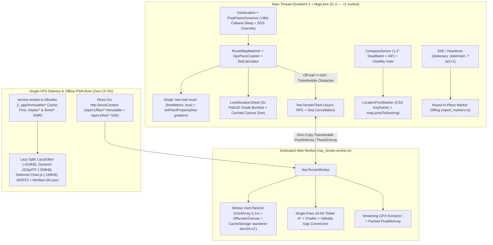

# Phase 4: Web PWA Workers, MapLibre 60/120 FPS Frame Budget, Stationary Battery Governor & Bundle/SSR Diet — Implementation Plan

> **For agentic workers:** REQUIRED SUB-SKILL: Use superpowers:subagent-driven-development to implement this plan task-by-task. Steps use checkbox (`- [ ]`) syntax for tracking.

**Goal:** Eliminate every `>50 ms` main-thread Long Task, cut steady-state `1 Hz` MapLibre `GeoJSONSource.setData()` calls from `8/sec` to `0/sec`, reduce foreground/background PWA battery drain by `30–45%` via visibility hibernation and `>90 s` Stationary Sleep, trim `/map/trail` and `/trails` client JS bundles by `390–800 KB`, remove multi-MB SSR GPX + N+1 summit-log waterfalls, and add an allowlist-only offline asset Service Worker for instant mountain-ridge PWA boot.

**Architecture:** Phase 4 restructures client runtime execution in `web/` around four zero-compromise pillars: (1) a persistent Dedicated Web Worker (`nav_terrain.worker.ts`) owning `.dem16` quantized `Int16Array` (`0.1 m`, `524 KB/tile` = `-50%` RAM) DEM slabs in `CacheStorage`, single-pass 16-neighbor A* + Chaikin routing (eliminating the synchronous Double-A* bug in `hybrid_rejoin_router.ts`), and fast streaming GPX track extraction over zero-copy `Transferable` `ArrayBuffer`s (`Float64Array` / `Float32Array`); (2) a GPU-driven MapLibre GL 6 navigation pipeline using a single `lineMetrics: true` GeoJSON route source (`line-gradient` over `["line-progress"]`) backing all existing layer IDs, local spherical-cosine accuracy halos, keyed in-place DOM marker reconciliation (preserving open `M.Popup`s), 5-bucket `Path2D` `<canvas>` elevation strokes without `1 Hz` backing-store reallocation, and single-mount `ResizeObserver` layout tracking; (3) a lifecycle-aware sensor & 4-state `PwaPowerGovernor` (`MOVING` -> `SCRAMBLE_GRACE` `0..90 s` -> `STATIONARY_CABANA_SLEEP` `>90 s` with optional Expedition Mode, mandatory active-SOS max-precision override, `devicemotion` 2-step wake gate, `1.2°` deadband + rAF `CompassSensor`, and compositor CSS puck pulse); and (4) surgical route code-splitting (`LazyEditor` for `410 KB` TipTap, lazy `JSZip`/`FIT`/`KML`, non-blocking `199 KB` `Chart.js`, desktop-gated `3D/`, `O(1)` regex icon validation dropping `62 KB` `icon_util` from map/list chunks), `.woff2` `IBMPlexSans` + brand-free FontAwesome CSS + minified `ofm.json`, SSR GPX/N+1 & search `polyline` trimming, and a cookie/SSE-safe allowlist Service Worker.

**Architecture Diagram:**



**Tech Stack:** TypeScript 6, Svelte 5 (`^5.57.2`), SvelteKit 3 (`@sveltejs/adapter-node`), Vite `8.3.5` (Rolldown), MapLibre GL JS `^6.15.0`, Web Workers (`Transferable` `ArrayBuffer`, `OffscreenCanvas`, `createImageBitmap`, `CacheStorage`), Vitest `^5.0.5`, Playwright `^1.64.1`.

**Spec:** [2026-11-18-performance-battery-io-optimization-design.md](file:///Volumes/SSD%20extern/Proiecte/Maps/docs/superpowers/specs/2026-11-18-performance-battery-io-optimization-design.md)

## Global Constraints

- **Single-VPS Local Storage Only (Zero Cloudflare R2 / S3):** Per explicit user decision, do NOT add Cloudflare R2, S3 SDKs, presigned URLs, or `cdn.*` subdomains anywhere in `web/`. All immutable GPX/photo/PMTiles assets are served directly from the single VPS via Go `http.ServeContent` (`Cache-Control: public, max-age=31536000, immutable` behind standard Cloudflare HTTP/3 QUIC proxy).
- **Playwright E2E Directory Contract:** Per [playwright.config.ts](file:///Volumes/SSD%20extern/Proiecte/Maps/web/playwright.config.ts#L13) (`testDir: './tests/playwright'`), ALL Playwright specs live under `web/tests/playwright/` (specifically `web/tests/playwright/components/` for self-contained Vite/MapLibre component specs and `web/tests/playwright/e2e/` for full-stack specs) — NEVER `web/e2e/`.
- **Backward-Compatible Layer IDs & Test Hooks:** Keep existing MapLibre layer IDs (`nav-trail-walked`, `nav-trail-upcoming-casing`, `nav-trail-upcoming`, `nav-breadcrumb`, `nav-offtrail-line`, `nav-rejoin-point`, `wanderer-user-accuracy-fill`, `wanderer-user-accuracy-outline`) and `window.__wandererNavTest` methods (`pushFix`, `tickCoasting`, `setCompass`, `setCustomObstacles`, `setCustomDemSampler`, `injectGroupSession`, `injectLiveState`) 100% intact so [trail-live-navigation.spec.ts](file:///Volumes/SSD%20extern/Proiecte/Maps/web/tests/playwright/components/trail-live-navigation.spec.ts) and [user-location-compass.spec.ts](file:///Volumes/SSD%20extern/Proiecte/Maps/web/tests/playwright/components/user-location-compass.spec.ts) pass without regressions.
- **Cross-Phase Boundary with Phase 1 & Phase 2:** Phase 1 (`db/`) and Phase 2 (`web/src/lib/live/live_client.ts`, `hooks.server.ts`, `deploy/`) own the shared wire protocol (`stateHash`, `?ack=1`, `Last-Event-ID`, and `stationary?: boolean` in `live_client.ts`). Phase 4 does NOT modify `db/`, `deploy/`, `hooks.server.ts`, or `live_client.ts` internals; `navigate/+page.svelte` passes `stationary` into `sendHeartbeat` / `pingLiveGroup` via structural compatibility and manages client-side visibility hibernation.
- **Mandatory SOS Precision Override & iOS/Android PWA Geolocation Safety:** Active SOS (`myActiveSos !== null || activeRescueSosId !== null`) MUST immediately override `STATIONARY_CABANA_SLEEP` and `expeditionMode`, forcing `{ enableHighAccuracy: true, maximumAge: 2000 }`. Never call `navigator.geolocation.clearWatch` when `document.visibilityState === "hidden"` (mobile Safari/Chrome revokes background watch continuity until foregrounded); instead downgrade accuracy only while foregrounded stationary `>90 s` and suspend `CompassSensor`, `coastingTimer`, and `EventSource` while hidden.
- **Cookie & SSE Safety in Service Worker:** [service-worker.ts](file:///Volumes/SSD%20extern/Proiecte/Maps/web/src/service-worker.ts) MUST strictly allowlist immutable static GET paths (`/_app/immutable/*`, `/styles/*`, `/fonts/*`, `/favicon*`, `/apple-touch-icon.png`, `/manifest.json`) and MUST return immediately without calling `event.respondWith` on `/api/*`, `Accept: text/event-stream`, non-GET requests, or HTML document navigations.
- **Unified Deep Slate (`#242734`) & Frosted Glass UI:** Preserve `bg-menu-background/94 backdrop-blur-md` and `#242734` monochrome controls across all touched Svelte components; `#dc2626` remains reserved strictly for active SOS.

### Quantified Baseline vs. Target Budgets (`web/`)

| Metric | Measured Baseline (`af9c15d0`) | Phase 4 Target | Verification Gate |
| :--- | :--- | :--- | :--- |
| Off-trail reroute main-thread block (`180×180` 16-dir A*) | **`70–280 ms`** (`2×` sync A* per tick) | **`< 1.5 ms`** (`1×` A* in worker + `Transferable`) | Vitest + Playwright Long-Task check |
| Decoded DEM RAM for 9 zoom-12 tiles (`512×512`) | **`9.44 MB`** (`Float32Array`) | **`4.72 MB`** (`Int16Array` `0.1 m` `.dem16`) | Unit test byteLength `524,288 B/tile` |
| Steady-state `1 Hz` on-trail `GeoJSONSource.setData()` | **`8 calls/sec`** (`~450–650 KB/s` IPC on 10k pts) | **`0 calls/sec`** (`setPaintProperty` GPU uniform) | Playwright `setData` spy (`0` on-trail) |
| Stationary `60 Hz` compass camera `map.easeTo()` | **`60 calls/sec`** (60 FPS continuous GPU wake) | **`0 calls/sec`** (`1.2°` deadband + rAF `jumpTo`) | Vitest + Playwright bearing spy |
| Elevation sheet `1 Hz` canvas realloc + stroke calls | `1` realloc/s + `N` `ctx.stroke()` calls/s | **`0` reallocs/s + `<= 5` `Path2D` strokes/s** | Unit + Playwright canvas check |
| `/map/trail/[handle]/[id]` total client JS (`Node 15`) | **`2,626 KB`** (`TipTap` + `JSZip` + `icon_util`) | **`<= 1,830 KB`** (`-796+ KB` raw) | `npm run build` node manifest check |
| `/trails` total client JS (`Node 37`) | **`998 KB`** (`JSZip` + `icon_util` on list page) | **`<= 610 KB`** (`-388+ KB` raw) | `npm run build` node manifest check |
| Root layout `Node 0` preload fonts + `ofm.json` | `fa-brands` `113 KB` + `14×` `.ttf` + `227 KB` JSON | **`-117 KB` FA fonts, `.woff2` swap, `<= 72 KB` JSON** | Build asset budget test |
| Trail detail / `/navigate` SSR HTML payload | Multi-MB GPX XML + N+1 `summit_log` GPX waterfall | **`0 B` SSR GPX XML + `0` N+1 summit-log fetches** | Unit test on `trails_show` & `+page.ts` |

---

### Task 1: `.dem16` Quantized Worker-Safe `DemTileGrid`, Binary Track Codec & Dedicated `nav_terrain.worker.ts`

**Files:**
- Create: [nav_terrain_codec.ts](file:///Volumes/SSD%20extern/Proiecte/Maps/web/src/lib/navigation/nav_terrain_codec.ts)
- Modify: [dem_tile_grid.ts](file:///Volumes/SSD%20extern/Proiecte/Maps/web/src/lib/navigation/dem_tile_grid.ts#L1-L349)
- Create: [nav_terrain.worker.ts](file:///Volumes/SSD%20extern/Proiecte/Maps/web/src/lib/navigation/nav_terrain.worker.ts)
- Create: [nav_terrain_client.ts](file:///Volumes/SSD%20extern/Proiecte/Maps/web/src/lib/navigation/nav_terrain_client.ts)
- Modify: [maplibre_worker.ts](file:///Volumes/SSD%20extern/Proiecte/Maps/web/src/lib/util/maplibre_worker.ts#L1-L8)
- Test: [nav_terrain_worker.test.ts](file:///Volumes/SSD%20extern/Proiecte/Maps/web/src/lib/navigation/nav_terrain_worker.test.ts)

**Interfaces:**
- Consumes: `NavTrackPoint`, `OffTrailPoint`, `OffTrailRerouteResult`, `OffTrailMode`, `ObstaclePolygon`, `PreferredCorridor` from [types.ts](file:///Volumes/SSD%20extern/Proiecte/Maps/web/src/lib/navigation/types.ts#L1-L172); `computeOffTrailReroute`, `computeLocalCurvedConnector`, `computeDirectRescueRoute`, `DirectRescueRouteResult` from [off_trail_router.ts](file:///Volumes/SSD%20extern/Proiecte/Maps/web/src/lib/navigation/off_trail_router.ts#L774-L1823).
- Produces:
  - `packTrackPoints(points: readonly NavTrackPoint[]): Float64Array` & `unpackTrackPoints(packed: Float64Array): NavTrackPoint[]` (stride `5`: `[lat, lon, ele, distanceM, gradePct]`)
  - `packOffTrailPoints(points: readonly OffTrailPoint[]): Float32Array` & `unpackOffTrailPoints(packed: Float32Array): OffTrailPoint[]`
  - `encodeDem16Slab(width: number, height: number, elevationsTenths: Int16Array): ArrayBuffer` & `decodeDem16Slab(buf: ArrayBuffer): { width: number; height: number; elevationsTenths: Int16Array } | null`
  - `parseGpxXmlFastToPackedTrack(xml: string): Float64Array` (zero-DOM streaming `<trkpt>`/`<rtept>` scanner)
  - `NavTerrainClient` class with `setTrack(points)`, `prefetchCorridor(points, bufferM?)`, `computeReroute(params)`, `computeConnector(params)`, `computeRescueRoute(params)`, `parseGpxText(xml)`, `sampleElevationSync(lat, lon)`, and `destroy()`.

> [!IMPORTANT]
> In [dem_tile_grid.ts](file:///Volumes/SSD%20extern/Proiecte/Maps/web/src/lib/navigation/dem_tile_grid.ts#L47-L49) and [L142](file:///Volumes/SSD%20extern/Proiecte/Maps/web/src/lib/navigation/dem_tile_grid.ts#L142), `if (typeof window === "undefined") return;` currently aborts inside Dedicated Web Workers because `window` is undefined in `DedicatedWorkerGlobalScope` (even though `fetch`, `caches`, `createImageBitmap`, and `OffscreenCanvas` exist on `globalThis`). Replacing the `window` check with capability detection (`typeof fetch === "function"` and `typeof createImageBitmap === "function" || typeof document !== "undefined"`) makes `DemTileGrid` run natively inside `nav_terrain.worker.ts` while remaining 100% SSR-safe in Node.js.

- [ ] **Step 1: Write the failing Vitest unit suite for `.dem16` quantization, zero-copy track/reroute packing, fast GPX binary extraction, and `NavTerrainClient` worker RPC**

Create [nav_terrain_worker.test.ts](file:///Volumes/SSD%20extern/Proiecte/Maps/web/src/lib/navigation/nav_terrain_worker.test.ts):

```ts
import { describe, expect, it } from "vitest";
import { DemTileGrid } from "./dem_tile_grid";
import {
	decodeDem16Slab,
	encodeDem16Slab,
	packOffTrailPoints,
	packTrackPoints,
	parseGpxXmlFastToPackedTrack,
	quantizeElevationMetersToTenths,
	reversePackedTrackPoints,
	unpackOffTrailPoints,
	unpackTrackPoints,
} from "./nav_terrain_codec";
import { NavTerrainClient } from "./nav_terrain_client";
import type { NavTrackPoint } from "./types";

describe("nav_terrain_codec & .dem16 quantization", () => {
	it("quantizes Carpathian & Himalayan/Dead-Sea range elevations to Int16 (0.1m precision, 50% RAM)", () => {
		expect(quantizeElevationMetersToTenths(2544.36)).toBe(25444);
		expect(quantizeElevationMetersToTenths(-412.4)).toBe(-4124);
		expect(quantizeElevationMetersToTenths(99999)).toBe(32767);
		expect(quantizeElevationMetersToTenths(-99999)).toBe(-32768);

		const width = 512;
		const height = 512;
		const tenths = new Int16Array(width * height);
		tenths[0] = 9005; // 900.5 m
		tenths[width * height - 1] = 25054; // 2505.4 m

		const slab = encodeDem16Slab(width, height, tenths);
		// 8-byte header ("DEM6" + u16 width + u16 height) + 512*512*2 bytes = 524,296 bytes (~50% of 1,048,576 B Float32Array)
		expect(slab.byteLength).toBe(8 + 512 * 512 * 2);

		const decoded = decodeDem16Slab(slab);
		expect(decoded).not.toBeNull();
		expect(decoded!.width).toBe(512);
		expect(decoded!.height).toBe(512);
		expect(decoded!.elevationsTenths.byteLength).toBe(524_288);
		expect(decoded!.elevationsTenths[0]).toBe(9005);
		expect(decoded!.elevationsTenths[width * height - 1]).toBe(25054);
	});

	it("packs, reverses, and unpacks NavTrackPoint[] & OffTrailPoint[] losslessly", () => {
		const pts: NavTrackPoint[] = [
			{ lat: 45.440001, lon: 25.550002, ele: 912.4, distanceM: 0, gradePct: 8.5 },
			{ lat: 45.441001, lon: 25.550502, ele: 922.0, distanceM: 118.2, gradePct: 8.1 },
			{ lat: 45.442001, lon: 25.551002, ele: 940.5, distanceM: 236.9, gradePct: 15.6 },
		];
		const packed = packTrackPoints(pts);
		expect(packed).toBeInstanceOf(Float64Array);
		expect(packed.length).toBe(15);

		const unpacked = unpackTrackPoints(packed);
		expect(unpacked).toEqual(pts);

		const revPacked = reversePackedTrackPoints(packed);
		const rev = unpackTrackPoints(revPacked);
		expect(rev).toHaveLength(3);
		expect(rev[0].lat).toBeCloseTo(45.442001, 6);
		expect(rev[0].distanceM).toBe(0);
		expect(rev[2].lat).toBeCloseTo(45.440001, 6);
		expect(rev[2].distanceM).toBeCloseTo(236.9, 3);

		const offPacked = packOffTrailPoints(pts);
		expect(offPacked).toBeInstanceOf(Float32Array);
		const offUnpacked = unpackOffTrailPoints(offPacked);
		expect(offUnpacked[1].lat).toBeCloseTo(45.441001, 4);
		expect(offUnpacked[1].ele).toBeCloseTo(922.0, 1);
	});

	it("parses GPX XML (<trkpt> and route-only <rtept>) directly to packed Float64Array without DOMParser", () => {
		const gpx = `<?xml version="1.0" encoding="UTF-8"?>
<gpx version="1.1" xmlns="http://www.topografix.com/GPX/1/1">
  <trk><name>Bucegi</name><trkseg>
    <trkpt lat="45.400000" lon="25.500000"><ele>1000.5</ele></trkpt>
    <trkpt lon="25.500000" lat="45.400900"><ele>1012.5</ele></trkpt>
    <trkpt lat="45.401800" lon="25.500000"><ele>1020.0</ele></trkpt>
  </trkseg></trk>
</gpx>`;
		const packed = parseGpxXmlFastToPackedTrack(gpx);
		const pts = unpackTrackPoints(packed);
		expect(pts).toHaveLength(3);
		expect(pts[0].ele).toBeCloseTo(1000.5, 2);
		expect(pts[1].distanceM).toBeGreaterThan(95);
		expect(pts[1].distanceM).toBeLessThan(105);
		expect(pts[1].gradePct).toBeGreaterThan(10);
		expect(pts[2].distanceM).toBeGreaterThan(195);
	});

	it("computes obstacle-aware off-trail reroute and SOS rescue route via NavTerrainClient", async () => {
		const trail: NavTrackPoint[] = [];
		for (let i = 0; i <= 25; i++) {
			trail.push({
				lat: 45.44 + i * 0.00045,
				lon: 25.55,
				ele: 950 + i * 5,
				distanceM: i * 50,
				gradePct: 10,
			});
		}

		const client = new NavTerrainClient();
		client.setCustomDemSampler((lat, lon) => {
			const dLat = (lat - 45.4427) * 111132;
			const dLon = (lon - 25.5493) * 78108;
			return 960 + 50 * Math.exp(-(dLat * dLat + dLon * dLon) / (2 * 28 * 28));
		});
		await client.setTrack(trail);

		const res = await client.computeReroute({
			userLat: 45.4427,
			userLon: 25.5484,
			userEle: 960,
			lastAlongTrackM: 300,
			mode: "min-climb",
			locale: "ro",
			obstacles: [
				{
					rings: [
						[25.5491, 45.4425],
						[25.5495, 45.4425],
						[25.5495, 45.4430],
						[25.5491, 45.4430],
						[25.5491, 45.4425],
					],
				},
			],
			preferredPaths: [],
		});

		expect(res).not.toBeNull();
		expect(res!.points.length).toBeGreaterThanOrEqual(4);
		expect(res!.rejoinAlongTrackM).toBeGreaterThanOrEqual(290);

		const rescue = await client.computeRescueRoute({
			fromLat: 45.441,
			fromLon: 25.55,
			fromEle: 955,
			targetLat: 45.444,
			targetLon: 25.5485,
			targetEle: 980,
			mode: "min-climb",
			locale: "ro",
		});
		expect(rescue.points.length).toBeGreaterThanOrEqual(2);
		expect(rescue.distanceM).toBeGreaterThan(300);

		const grid = new DemTileGrid({ customSampler: () => 1425.3 });
		expect(grid.sampleElevation(45.5, 25.5)).toBeCloseTo(1425.3, 1);

		client.destroy();
	});
});
```

- [ ] **Step 2: Run Vitest to verify the new test suite fails**

Run: `npx --prefix web vitest run src/lib/navigation/nav_terrain_worker.test.ts`
Expected: FAIL with `Cannot find module './nav_terrain_codec'`

- [ ] **Step 3: Implement `nav_terrain_codec.ts`, upgrade `dem_tile_grid.ts` to worker-safe `.dem16` `Int16Array` slabs, and create `nav_terrain.worker.ts` + `nav_terrain_client.ts` + `maplibre_worker.ts` export**

Create [nav_terrain_codec.ts](file:///Volumes/SSD%20extern/Proiecte/Maps/web/src/lib/navigation/nav_terrain_codec.ts):

```ts
import { haversineMeters } from "./geo_math";
import type { NavTrackPoint, OffTrailPoint } from "./types";

export const TRACK_STRIDE = 5; // [lat, lon, ele, distanceM, gradePct]

const DEM16_MAGIC_0 = 0x44; // 'D'
const DEM16_MAGIC_1 = 0x45; // 'E'
const DEM16_MAGIC_2 = 0x4d; // 'M'
const DEM16_MAGIC_3 = 0x36; // '6'

/**
 * Quantizes elevation in meters to signed tenths of a meter (`Int16` range `-3276.8 m .. +3276.7 m`).
 * Covers Dead Sea (`-430 m`) through Carpathians (`0 .. 2,544 m`) with `0.1 m` resolution and clamps safely outside bounds.
 */
export function quantizeElevationMetersToTenths(eleM: number): number {
	if (!Number.isFinite(eleM)) return 0;
	const rounded = Math.round(eleM * 10);
	if (rounded > 32767) return 32767;
	if (rounded < -32768) return -32768;
	return rounded;
}

export function encodeDem16Slab(
	width: number,
	height: number,
	elevationsTenths: Int16Array,
): ArrayBuffer {
	const pixelBytes = width * height * 2;
	const buf = new ArrayBuffer(8 + pixelBytes);
	const header = new DataView(buf, 0, 8);
	header.setUint8(0, DEM16_MAGIC_0);
	header.setUint8(1, DEM16_MAGIC_1);
	header.setUint8(2, DEM16_MAGIC_2);
	header.setUint8(3, DEM16_MAGIC_3);
	header.setUint16(4, width, true);
	header.setUint16(6, height, true);
	new Int16Array(buf, 8, width * height).set(elevationsTenths.subarray(0, width * height));
	return buf;
}

export function decodeDem16Slab(
	buf: ArrayBuffer,
): { width: number; height: number; elevationsTenths: Int16Array } | null {
	if (buf.byteLength < 8) return null;
	const header = new DataView(buf, 0, 8);
	if (
		header.getUint8(0) !== DEM16_MAGIC_0 ||
		header.getUint8(1) !== DEM16_MAGIC_1 ||
		header.getUint8(2) !== DEM16_MAGIC_2 ||
		header.getUint8(3) !== DEM16_MAGIC_3
	) {
		return null;
	}
	const width = header.getUint16(4, true);
	const height = header.getUint16(6, true);
	const expectedBytes = 8 + width * height * 2;
	if (width === 0 || height === 0 || buf.byteLength < expectedBytes) {
		return null;
	}
	return {
		width,
		height,
		elevationsTenths: new Int16Array(buf, 8, width * height),
	};
}

export function packTrackPoints(points: readonly NavTrackPoint[]): Float64Array {
	const out = new Float64Array(points.length * TRACK_STRIDE);
	for (let i = 0; i < points.length; i++) {
		const p = points[i];
		const base = i * TRACK_STRIDE;
		out[base] = p.lat;
		out[base + 1] = p.lon;
		out[base + 2] = p.ele;
		out[base + 3] = p.distanceM;
		out[base + 4] = p.gradePct;
	}
	return out;
}

export function unpackTrackPoints(packed: Float64Array): NavTrackPoint[] {
	const count = Math.floor(packed.length / TRACK_STRIDE);
	const out = new Array<NavTrackPoint>(count);
	for (let i = 0; i < count; i++) {
		const base = i * TRACK_STRIDE;
		out[i] = {
			lat: packed[base],
			lon: packed[base + 1],
			ele: packed[base + 2],
			distanceM: packed[base + 3],
			gradePct: packed[base + 4],
		};
	}
	return out;
}

export function reversePackedTrackPoints(packed: Float64Array): Float64Array {
	const count = Math.floor(packed.length / TRACK_STRIDE);
	if (count === 0) return new Float64Array(0);
	const out = new Float64Array(count * TRACK_STRIDE);
	const totalDist = packed[(count - 1) * TRACK_STRIDE + 3];

	for (let i = 0; i < count; i++) {
		const srcIdx = count - 1 - i;
		const srcBase = srcIdx * TRACK_STRIDE;
		const dstBase = i * TRACK_STRIDE;
		out[dstBase] = packed[srcBase];
		out[dstBase + 1] = packed[srcBase + 1];
		out[dstBase + 2] = packed[srcBase + 2];
		out[dstBase + 3] = i === 0 ? 0 : Math.max(0, totalDist - packed[srcBase + 3]);
		out[dstBase + 4] = 0;
	}

	const rawEles = new Float64Array(count);
	for (let i = 0; i < count; i++) rawEles[i] = out[i * TRACK_STRIDE + 2];
	const smoothEles = new Float64Array(count);
	for (let i = 0; i < count; i++) {
		let sum = 0;
		let cnt = 0;
		for (let k = Math.max(0, i - 2); k <= Math.min(count - 1, i + 2); k++) {
			sum += rawEles[k];
			cnt++;
		}
		smoothEles[i] = sum / cnt;
	}

	for (let i = 0; i < count; i++) {
		const i0 = Math.max(0, i - 1);
		const i1 = Math.min(count - 1, i + 1);
		const run = out[i1 * TRACK_STRIDE + 3] - out[i0 * TRACK_STRIDE + 3];
		out[i * TRACK_STRIDE + 4] = run > 0.5 ? ((smoothEles[i1] - smoothEles[i0]) / run) * 100 : 0;
	}
	return out;
}

export function packOffTrailPoints(points: readonly OffTrailPoint[]): Float32Array {
	const out = new Float32Array(points.length * TRACK_STRIDE);
	for (let i = 0; i < points.length; i++) {
		const p = points[i];
		const base = i * TRACK_STRIDE;
		out[base] = p.lat;
		out[base + 1] = p.lon;
		out[base + 2] = p.ele;
		out[base + 3] = p.distanceM;
		out[base + 4] = p.gradePct;
	}
	return out;
}

export function unpackOffTrailPoints(packed: Float32Array): OffTrailPoint[] {
	const count = Math.floor(packed.length / TRACK_STRIDE);
	const out = new Array<OffTrailPoint>(count);
	for (let i = 0; i < count; i++) {
		const base = i * TRACK_STRIDE;
		out[i] = {
			lat: packed[base],
			lon: packed[base + 1],
			ele: packed[base + 2],
			distanceM: packed[base + 3],
			gradePct: packed[base + 4],
		};
	}
	return out;
}

const ATTR_LAT_RE = /\blat\s*=\s*(?:"([^"]+)"|'([^']+)')/;
const ATTR_LON_RE = /\blon\s*=\s*(?:"([^"]+)"|'([^']+)')/;
const ELE_TAG_RE = /<(?:[\w.-]+:)?ele[^>]*>([^<]*)<\/(?:[\w.-]+:)?ele>/;

/**
 * Zero-DOM streaming GPX track/route extractor. Scans `<trkpt>` (or `<rtept>` fallback) blocks
 * directly into contiguous typed buffers, avoiding `DOMParser` + `xml2js` 25 MB object graphs.
 */
export function parseGpxXmlFastToPackedTrack(xml: string): Float64Array {
	const hasTrkPt = /<(?:[\w.-]+:)?trkpt[\s>]/.test(xml);
	const tagRegex = hasTrkPt
		? /<(?:[\w.-]+:)?trkpt\b([^>]*?)(?:\/>|>([\s\S]*?)<\/(?:[\w.-]+:)?trkpt>)/g
		: /<(?:[\w.-]+:)?rtept\b([^>]*?)(?:\/>|>([\s\S]*?)<\/(?:[\w.-]+:)?rtept>)/g;

	const lats: number[] = [];
	const lons: number[] = [];
	const eles: number[] = [];
	let lastValidEle = 0;
	let hasAnyEle = false;

	for (const match of xml.matchAll(tagRegex)) {
		const attrs = match[1] ?? "";
		const inner = match[2] ?? "";
		const latMatch = ATTR_LAT_RE.exec(attrs);
		const lonMatch = ATTR_LON_RE.exec(attrs);
		if (!latMatch || !lonMatch) continue;
		const lat = Number(latMatch[1] ?? latMatch[2]);
		const lon = Number(lonMatch[1] ?? lonMatch[2]);
		if (!Number.isFinite(lat) || !Number.isFinite(lon)) continue;
		if (Math.abs(lat) > 90 || Math.abs(lon) > 180) continue;

		let ele = lastValidEle;
		if (inner.length > 0) {
			const eleMatch = ELE_TAG_RE.exec(inner);
			if (eleMatch) {
				const parsedEle = Number(eleMatch[1].trim());
				if (Number.isFinite(parsedEle)) {
					ele = parsedEle;
					lastValidEle = parsedEle;
					hasAnyEle = true;
				}
			}
		}

		if (
			lats.length > 0 &&
			Math.abs(lats[lats.length - 1] - lat) < 1e-9 &&
			Math.abs(lons[lons.length - 1] - lon) < 1e-9
		) {
			continue;
		}

		lats.push(lat);
		lons.push(lon);
		eles.push(ele);
	}

	const n = lats.length;
	if (n === 0) return new Float64Array(0);

	if (hasAnyEle) {
		let firstKnown = 0;
		for (let i = 0; i < n; i++) {
			if (eles[i] !== 0) {
				firstKnown = eles[i];
				break;
			}
		}
		for (let i = 0; i < n && eles[i] === 0; i++) {
			eles[i] = firstKnown;
		}
	}

	const dists = new Float64Array(n);
	for (let i = 1; i < n; i++) {
		dists[i] = dists[i - 1] + haversineMeters(lats[i - 1], lons[i - 1], lats[i], lons[i]);
	}

	const smoothEles = new Float64Array(n);
	for (let i = 0; i < n; i++) {
		let sum = 0;
		let cnt = 0;
		for (let k = Math.max(0, i - 2); k <= Math.min(n - 1, i + 2); k++) {
			sum += eles[k];
			cnt++;
		}
		smoothEles[i] = sum / cnt;
	}

	const out = new Float64Array(n * TRACK_STRIDE);
	for (let i = 0; i < n; i++) {
		const i0 = Math.max(0, i - 1);
		const i1 = Math.min(n - 1, i + 1);
		const run = dists[i1] - dists[i0];
		const gradePct = run > 0.5 ? ((smoothEles[i1] - smoothEles[i0]) / run) * 100 : 0;
		const base = i * TRACK_STRIDE;
		out[base] = lats[i];
		out[base + 1] = lons[i];
		out[base + 2] = eles[i];
		out[base + 3] = dists[i];
		out[base + 4] = gradePct;
	}
	return out;
}
```

Update [dem_tile_grid.ts](file:///Volumes/SSD%20extern/Proiecte/Maps/web/src/lib/navigation/dem_tile_grid.ts#L1-L349) to use `Int16Array` (`0.1 m` `.dem16` slabs cached in `"wanderer-dem16-v1"` + `"wanderer-dem-v1"` raw WebP cache) and run natively inside Dedicated Web Workers (`globalThis.createImageBitmap` + `OffscreenCanvas`):

```diff
--- a/web/src/lib/navigation/dem_tile_grid.ts
+++ b/web/src/lib/navigation/dem_tile_grid.ts
@@ -1,14 +1,22 @@
+import {
+	decodeDem16Slab,
+	encodeDem16Slab,
+	quantizeElevationMetersToTenths,
+} from "./nav_terrain_codec";
+
 const ZOOM = 12;
 const NUM_TILES = 1 << ZOOM; // 4096
 const MAX_MERCATOR_LAT = 85.05112878;
 const DEFAULT_TILE_URL = "https://tiles.mapterhorn.com/12/{x}/{y}.webp";
 const CACHE_NAME = "wanderer-dem-v1";
+const SLAB_CACHE_NAME = "wanderer-dem16-v1";
 const MAX_PREFETCH_TILES = 9;
+const MAX_LRU_TILES = 24;
 
 interface DecodedTile {
 	width: number;
 	height: number;
-	elevations: Float32Array;
+	elevationsTenths: Int16Array;
 }
 
 function clampLat(lat: number): number {
@@ -28,25 +36,27 @@
 	};
 }
 
-function decodeTerrariumPixels(rgba: Uint8ClampedArray, width: number, height: number): DecodedTile {
+function decodeTerrariumPixelsToTenths(
+	rgba: Uint8ClampedArray,
+	width: number,
+	height: number,
+): DecodedTile {
 	const count = width * height;
-	const elevations = new Float32Array(count);
+	const elevationsTenths = new Int16Array(count);
 	for (let i = 0; i < count; i++) {
 		const offset = i * 4;
 		const r = rgba[offset];
 		const g = rgba[offset + 1];
 		const b = rgba[offset + 2];
-		elevations[i] = r * 256 + g + b / 256 - 32768;
+		const meters = r * 256 + g + b / 256 - 32768;
+		elevationsTenths[i] = quantizeElevationMetersToTenths(meters);
 	}
-	return { width, height, elevations };
+	return { width, height, elevationsTenths };
 }
 
 async function decodeBlobToRgba(
 	blob: Blob,
 ): Promise<{ data: Uint8ClampedArray; width: number; height: number } | null> {
-	if (typeof window === "undefined") {
-		return null;
-	}
-
 	if (typeof createImageBitmap === "function") {
 		let bitmap: ImageBitmap | null = null;
 		try {
@@ -139,7 +149,10 @@
 		if (this.customSampler || points.length === 0) {
 			return;
 		}
-		if (typeof window === "undefined" || typeof fetch !== "function") {
+		if (
+			typeof fetch !== "function" ||
+			(typeof createImageBitmap !== "function" && typeof document === "undefined")
+		) {
 			return;
 		}
 
@@ -283,12 +296,24 @@
 				: this.tiles.get(`${ZOOM}/${tx}/${ty}`);
 
 		if (neighbor && lx >= 0 && lx < neighbor.width && ly >= 0 && ly < neighbor.height) {
-			return neighbor.elevations[ly * neighbor.width + lx];
+			return neighbor.elevationsTenths[ly * neighbor.width + lx] * 0.1;
 		}
 
 		const cx = Math.min(w - 1, Math.max(0, localX));
 		const cy = Math.min(h - 1, Math.max(0, localY));
-		return fallbackTile.elevations[cy * w + cx];
+		return fallbackTile.elevationsTenths[cy * w + cx] * 0.1;
+	}
+
+	private putTileLru(key: string, tile: DecodedTile): void {
+		this.tiles.delete(key);
+		this.tiles.set(key, tile);
+		while (this.tiles.size > MAX_LRU_TILES) {
+			const oldest = this.tiles.keys().next().value;
+			if (!oldest) break;
+			this.tiles.delete(oldest);
+		}
 	}
 
 	private async loadTile(x: number, y: number): Promise<void> {
@@ -305,11 +330,30 @@
 			.replace("{x}", String(x))
 			.replace("{y}", String(y));
+		const slabUrl = `${url}#dem16`;
 
 		const promise = (async () => {
 			try {
+				let slabCache: Cache | null = null;
+				if (typeof caches !== "undefined") {
+					try {
+						slabCache = await caches.open(SLAB_CACHE_NAME);
+						const cachedSlabRes = await slabCache.match(slabUrl);
+						if (cachedSlabRes) {
+							const decodedSlab = decodeDem16Slab(await cachedSlabRes.arrayBuffer());
+							if (decodedSlab) {
+								this.putTileLru(key, decodedSlab);
+								return;
+							}
+						}
+					} catch {
+						slabCache = null;
+					}
+				}
+
 				let response: Response | undefined;
 				let cache: Cache | null = null;
 				if (typeof caches !== "undefined") {
 					try {
 						cache = await caches.open(CACHE_NAME);
@@ -335,7 +379,22 @@
 				const blob = await response.blob();
 				const decoded = await decodeBlobToRgba(blob);
 				if (!decoded) return;
-				this.tiles.set(key, decodeTerrariumPixels(decoded.data, decoded.width, decoded.height));
+				const tile = decodeTerrariumPixelsToTenths(decoded.data, decoded.width, decoded.height);
+				this.putTileLru(key, tile);
+
+				if (slabCache) {
+					try {
+						const slabBuf = encodeDem16Slab(tile.width, tile.height, tile.elevationsTenths);
+						await slabCache.put(
+							slabUrl,
+							new Response(slabBuf, {
+								headers: { "Content-Type": "application/octet-stream" },
+							}),
+						);
+					} catch {
+						// Ignore CacheStorage quota limits.
+					}
+				}
 			} catch {
 				// Gracefully degrade to null elevation when offline or tile blocked.
 			} finally {
```

Create [nav_terrain.worker.ts](file:///Volumes/SSD%20extern/Proiecte/Maps/web/src/lib/navigation/nav_terrain.worker.ts):

```ts
import { DemTileGrid } from "./dem_tile_grid";
import {
	packOffTrailPoints,
	parseGpxXmlFastToPackedTrack,
	unpackTrackPoints,
} from "./nav_terrain_codec";
import {
	computeDirectRescueRoute,
	computeLocalCurvedConnector,
	computeOffTrailReroute,
	createElevationSampler,
	type DirectRescueRouteResult,
} from "./off_trail_router";
import type {
	NavTrackPoint,
	ObstaclePolygon,
	OffTrailMode,
	OffTrailRerouteResult,
	PreferredCorridor,
} from "./types";

export type WorkerRequestMessage =
	| {
			type: "SET_TRACK";
			reqId: number;
			packedTrack: Float64Array;
			prefetchDem?: boolean;
	  }
	| {
			type: "PREFETCH_CORRIDOR";
			reqId: number;
			points: Array<{ lat: number; lon: number }>;
			bufferM?: number;
	  }
	| {
			type: "COMPUTE_REROUTE";
			reqId: number;
			userLat: number;
			userLon: number;
			userEle?: number | null;
			lastAlongTrackM: number;
			mode: OffTrailMode;
			locale: string;
			obstacles: ObstaclePolygon[];
			preferredPaths: PreferredCorridor[];
	  }
	| {
			type: "COMPUTE_CONNECTOR";
			reqId: number;
			fromLat: number;
			fromLon: number;
			toLat: number;
			toLon: number;
			userEle?: number | null;
			mode: OffTrailMode;
			obstacles: ObstaclePolygon[];
			preferredPaths: PreferredCorridor[];
	  }
	| {
			type: "COMPUTE_RESCUE";
			reqId: number;
			fromLat: number;
			fromLon: number;
			fromEle?: number | null;
			targetLat: number;
			targetLon: number;
			targetEle?: number | null;
			mode: OffTrailMode;
			locale: string;
	  }
	| {
			type: "PARSE_GPX_TEXT";
			reqId: number;
			xmlBuffer: ArrayBuffer;
	  };

export type RerouteMeta = Omit<OffTrailRerouteResult, "points">;
export type RescueMeta = Omit<DirectRescueRouteResult, "points">;

export type WorkerResponseMessage =
	| { type: "ACK"; reqId: number; sampledStartEle: number | null }
	| {
			type: "REROUTE_DONE";
			reqId: number;
			meta: RerouteMeta | null;
			packedPoints: Float32Array | null;
	  }
	| {
			type: "CONNECTOR_DONE";
			reqId: number;
			coords: Float64Array;
	  }
	| {
			type: "RESCUE_DONE";
			reqId: number;
			meta: RescueMeta;
			packedPoints: Float32Array;
	  }
	| {
			type: "GPX_PARSED";
			reqId: number;
			packedTrack: Float64Array;
	  }
	| {
			type: "ERROR";
			reqId: number;
			message: string;
	  };

const demGrid = new DemTileGrid();
let activeTrack: NavTrackPoint[] = [];

const workerScope = self as unknown as {
	onmessage: ((ev: MessageEvent<WorkerRequestMessage>) => void) | null;
	postMessage: (msg: WorkerResponseMessage, transfer?: Transferable[]) => void;
};

workerScope.onmessage = async (ev: MessageEvent<WorkerRequestMessage>) => {
	const msg = ev.data;
	if (!msg || typeof msg.reqId !== "number") return;

	try {
		switch (msg.type) {
			case "SET_TRACK": {
				activeTrack = unpackTrackPoints(msg.packedTrack);
				if (msg.prefetchDem !== false && activeTrack.length > 0) {
					await demGrid.prefetchCorridor(activeTrack);
				}
				const sampledStartEle =
					activeTrack.length > 0
						? demGrid.sampleElevation(activeTrack[0].lat, activeTrack[0].lon)
						: null;
				workerScope.postMessage({ type: "ACK", reqId: msg.reqId, sampledStartEle });
				return;
			}
			case "PREFETCH_CORRIDOR": {
				await demGrid.prefetchCorridor(msg.points, msg.bufferM ?? 1500);
				const sampledStartEle =
					msg.points.length > 0
						? demGrid.sampleElevation(msg.points[0].lat, msg.points[0].lon)
						: null;
				workerScope.postMessage({ type: "ACK", reqId: msg.reqId, sampledStartEle });
				return;
			}
			case "COMPUTE_REROUTE": {
				const res = computeOffTrailReroute({
					userLat: msg.userLat,
					userLon: msg.userLon,
					userEle: msg.userEle,
					trailPoints: activeTrack,
					lastAlongTrackM: msg.lastAlongTrackM,
					sampler: (lat, lon) => demGrid.sampleElevation(lat, lon),
					mode: msg.mode,
					locale: msg.locale,
					obstacles: msg.obstacles,
					preferredPaths: msg.preferredPaths,
				});
				if (!res) {
					workerScope.postMessage({
						type: "REROUTE_DONE",
						reqId: msg.reqId,
						meta: null,
						packedPoints: null,
					});
					return;
				}
				const packedPoints = packOffTrailPoints(res.points);
				const { points: _pts, ...meta } = res;
				workerScope.postMessage(
					{ type: "REROUTE_DONE", reqId: msg.reqId, meta, packedPoints },
					[packedPoints.buffer],
				);
				return;
			}
			case "COMPUTE_CONNECTOR": {
				const evalEle = createElevationSampler(
					(lat, lon) => demGrid.sampleElevation(lat, lon),
					activeTrack,
					msg.fromLat,
					msg.fromLon,
					msg.userEle,
				);
				const pts = computeLocalCurvedConnector({
					fromLat: msg.fromLat,
					fromLon: msg.fromLon,
					toLat: msg.toLat,
					toLon: msg.toLon,
					evalEle,
					mode: msg.mode,
					obstacles: msg.obstacles,
					preferredPaths: msg.preferredPaths,
				});
				const coords = new Float64Array(pts.length * 2);
				for (let i = 0; i < pts.length; i++) {
					coords[i * 2] = pts[i].lat;
					coords[i * 2 + 1] = pts[i].lon;
				}
				workerScope.postMessage(
					{ type: "CONNECTOR_DONE", reqId: msg.reqId, coords },
					[coords.buffer],
				);
				return;
			}
			case "COMPUTE_RESCUE": {
				const res = computeDirectRescueRoute({
					fromLat: msg.fromLat,
					fromLon: msg.fromLon,
					fromEle: msg.fromEle,
					targetLat: msg.targetLat,
					targetLon: msg.targetLon,
					targetEle: msg.targetEle,
					trailPoints: activeTrack,
					sampler: (lat, lon) => demGrid.sampleElevation(lat, lon),
					mode: msg.mode,
					locale: msg.locale,
				});
				const packedPoints = packOffTrailPoints(res.points);
				const { points: _pts, ...meta } = res;
				workerScope.postMessage(
					{ type: "RESCUE_DONE", reqId: msg.reqId, meta, packedPoints },
					[packedPoints.buffer],
				);
				return;
			}
			case "PARSE_GPX_TEXT": {
				const xml = new TextDecoder().decode(msg.xmlBuffer);
				const packedTrack = parseGpxXmlFastToPackedTrack(xml);
				workerScope.postMessage(
					{ type: "GPX_PARSED", reqId: msg.reqId, packedTrack },
					[packedTrack.buffer],
				);
				return;
			}
		}
	} catch (err) {
		workerScope.postMessage({
			type: "ERROR",
			reqId: msg.reqId,
			message: err instanceof Error ? err.message : String(err),
		});
	}
};
```

Create [nav_terrain_client.ts](file:///Volumes/SSD%20extern/Proiecte/Maps/web/src/lib/navigation/nav_terrain_client.ts):

```ts
import { DemTileGrid } from "./dem_tile_grid";
import type { WorkerRequestMessage, WorkerResponseMessage } from "./nav_terrain.worker";
import {
	packTrackPoints,
	parseGpxXmlFastToPackedTrack,
	unpackOffTrailPoints,
	unpackTrackPoints,
} from "./nav_terrain_codec";
import {
	computeDirectRescueRoute,
	computeLocalCurvedConnector,
	computeOffTrailReroute,
	createElevationSampler,
	type DirectRescueRouteResult,
} from "./off_trail_router";
import type {
	NavTrackPoint,
	ObstaclePolygon,
	OffTrailMode,
	OffTrailRerouteResult,
	PreferredCorridor,
} from "./types";

interface PendingCall {
	resolve: (msg: WorkerResponseMessage) => void;
	reject: (err: Error) => void;
}

/**
 * Zero-copy `Transferable` Web Worker RPC client for DEM tile decoding, 16-dir Tobler A*
 * off-trail rerouting, SOS rescue routing, and streaming GPX parsing.
 * Automatically falls back to in-process execution in Vitest/IIFE harnesses or when
 * an E2E test injects a non-cloneable JS closure via `setCustomDemSampler`.
 */
export class NavTerrainClient {
	private worker: Worker | null = null;
	private nextReqId = 1;
	private readonly pending = new Map<number, PendingCall>();
	private readonly fallbackDemGrid = new DemTileGrid();
	private customDemSampler: ((lat: number, lon: number) => number | null) | null = null;
	private cachedTrack: NavTrackPoint[] = [];

	constructor(options?: { workerUrl?: string }) {
		if (
			options?.workerUrl &&
			typeof Worker !== "undefined" &&
			typeof options.workerUrl === "string"
		) {
			try {
				this.worker = new Worker(options.workerUrl, { type: "module" });
				this.worker.onmessage = (ev: MessageEvent<WorkerResponseMessage>) => {
					const msg = ev.data;
					if (!msg) return;
					const entry = this.pending.get(msg.reqId);
					if (!entry) return;
					this.pending.delete(msg.reqId);
					if (msg.type === "ERROR") {
						entry.reject(new Error(msg.message));
					} else {
						entry.resolve(msg);
					}
				};
				this.worker.onerror = () => {
					this.teardownWorker();
				};
			} catch {
				this.worker = null;
			}
		}
	}

	setCustomDemSampler(sampler: ((lat: number, lon: number) => number | null) | null): void {
		this.customDemSampler = sampler;
	}

	sampleElevationSync(lat: number, lon: number): number | null {
		if (this.customDemSampler) {
			return this.customDemSampler(lat, lon);
		}
		return this.fallbackDemGrid.sampleElevation(lat, lon);
	}

	private get canUseWorker(): boolean {
		return this.worker !== null && this.customDemSampler === null;
	}

	private sendToWorker(
		msg: WorkerRequestMessage,
		transfer: Transferable[] = [],
	): Promise<WorkerResponseMessage> {
		return new Promise((resolve, reject) => {
			if (!this.worker) {
				reject(new Error("worker_unavailable"));
				return;
			}
			this.pending.set(msg.reqId, { resolve, reject });
			this.worker.postMessage(msg, transfer);
		});
	}

	async setTrack(points: NavTrackPoint[], prefetchDem = true): Promise<void> {
		this.cachedTrack = points;
		if (this.canUseWorker) {
			const reqId = this.nextReqId++;
			const packedTrack = packTrackPoints(points);
			await this.sendToWorker(
				{ type: "SET_TRACK", reqId, packedTrack, prefetchDem },
				[packedTrack.buffer],
			);
			return;
		}
		if (prefetchDem && points.length > 0 && !this.customDemSampler) {
			await this.fallbackDemGrid.prefetchCorridor(points);
		}
	}

	async prefetchCorridor(
		points: Array<{ lat: number; lon: number }>,
		bufferM = 1500,
	): Promise<void> {
		if (points.length === 0 || this.customDemSampler) return;
		if (this.canUseWorker) {
			const reqId = this.nextReqId++;
			await this.sendToWorker({ type: "PREFETCH_CORRIDOR", reqId, points, bufferM });
			return;
		}
		await this.fallbackDemGrid.prefetchCorridor(points, bufferM);
	}

	async computeReroute(params: {
		userLat: number;
		userLon: number;
		userEle?: number | null;
		lastAlongTrackM: number;
		mode: OffTrailMode;
		locale: string;
		obstacles?: ObstaclePolygon[];
		preferredPaths?: PreferredCorridor[];
	}): Promise<OffTrailRerouteResult | null> {
		if (this.cachedTrack.length === 0) return null;
		if (this.canUseWorker) {
			const reqId = this.nextReqId++;
			const res = await this.sendToWorker({
				type: "COMPUTE_REROUTE",
				reqId,
				userLat: params.userLat,
				userLon: params.userLon,
				userEle: params.userEle,
				lastAlongTrackM: params.lastAlongTrackM,
				mode: params.mode,
				locale: params.locale,
				obstacles: params.obstacles ?? [],
				preferredPaths: params.preferredPaths ?? [],
			});
			if (res.type === "REROUTE_DONE") {
				if (!res.meta || !res.packedPoints) return null;
				return {
					...res.meta,
					points: unpackOffTrailPoints(res.packedPoints),
				};
			}
		}

		return computeOffTrailReroute({
			userLat: params.userLat,
			userLon: params.userLon,
			userEle: params.userEle,
			trailPoints: this.cachedTrack,
			lastAlongTrackM: params.lastAlongTrackM,
			sampler: (lat, lon) => this.sampleElevationSync(lat, lon),
			mode: params.mode,
			locale: params.locale,
			obstacles: params.obstacles,
			preferredPaths: params.preferredPaths,
		});
	}

	async computeConnector(params: {
		fromLat: number;
		fromLon: number;
		toLat: number;
		toLon: number;
		userEle?: number | null;
		mode: OffTrailMode;
		obstacles?: ObstaclePolygon[];
		preferredPaths?: PreferredCorridor[];
	}): Promise<Array<{ lat: number; lon: number }>> {
		if (this.canUseWorker) {
			const reqId = this.nextReqId++;
			const res = await this.sendToWorker({
				type: "COMPUTE_CONNECTOR",
				reqId,
				fromLat: params.fromLat,
				fromLon: params.fromLon,
				toLat: params.toLat,
				toLon: params.toLon,
				userEle: params.userEle,
				mode: params.mode,
				obstacles: params.obstacles ?? [],
				preferredPaths: params.preferredPaths ?? [],
			});
			if (res.type === "CONNECTOR_DONE") {
				const out: Array<{ lat: number; lon: number }> = [];
				for (let i = 0; i + 1 < res.coords.length; i += 2) {
					out.push({ lat: res.coords[i], lon: res.coords[i + 1] });
				}
				return out;
			}
		}

		const evalEle = createElevationSampler(
			(lat, lon) => this.sampleElevationSync(lat, lon),
			this.cachedTrack,
			params.fromLat,
			params.fromLon,
			params.userEle,
		);
		return computeLocalCurvedConnector({
			fromLat: params.fromLat,
			fromLon: params.fromLon,
			toLat: params.toLat,
			toLon: params.toLon,
			evalEle,
			mode: params.mode,
			obstacles: params.obstacles,
			preferredPaths: params.preferredPaths,
		});
	}

	async computeRescueRoute(params: {
		fromLat: number;
		fromLon: number;
		fromEle?: number | null;
		targetLat: number;
		targetLon: number;
		targetEle?: number | null;
		mode: OffTrailMode;
		locale: string;
	}): Promise<DirectRescueRouteResult> {
		if (this.canUseWorker) {
			const reqId = this.nextReqId++;
			const res = await this.sendToWorker({
				type: "COMPUTE_RESCUE",
				reqId,
				fromLat: params.fromLat,
				fromLon: params.fromLon,
				fromEle: params.fromEle,
				targetLat: params.targetLat,
				targetLon: params.targetLon,
				targetEle: params.targetEle,
				mode: params.mode,
				locale: params.locale,
			});
			if (res.type === "RESCUE_DONE") {
				return {
					...res.meta,
					points: unpackOffTrailPoints(res.packedPoints),
				};
			}
		}

		return computeDirectRescueRoute({
			fromLat: params.fromLat,
			fromLon: params.fromLon,
			fromEle: params.fromEle,
			targetLat: params.targetLat,
			targetLon: params.targetLon,
			targetEle: params.targetEle,
			trailPoints: this.cachedTrack,
			sampler: (lat, lon) => this.sampleElevationSync(lat, lon),
			mode: params.mode,
			locale: params.locale,
		});
	}

	async parseGpxText(xml: string): Promise<NavTrackPoint[]> {
		if (this.canUseWorker) {
			const reqId = this.nextReqId++;
			const encoded = new TextEncoder().encode(xml);
			const xmlBuffer = encoded.buffer.slice(
				encoded.byteOffset,
				encoded.byteOffset + encoded.byteLength,
			);
			const res = await this.sendToWorker(
				{ type: "PARSE_GPX_TEXT", reqId, xmlBuffer },
				[xmlBuffer],
			);
			if (res.type === "GPX_PARSED") {
				return unpackTrackPoints(res.packedTrack);
			}
		}
		return unpackTrackPoints(parseGpxXmlFastToPackedTrack(xml));
	}

	private teardownWorker(): void {
		for (const [, entry] of this.pending) {
			entry.reject(new Error("worker_terminated"));
		}
		this.pending.clear();
		this.worker?.terminate();
		this.worker = null;
	}

	destroy(): void {
		this.teardownWorker();
		this.cachedTrack = [];
		this.customDemSampler = null;
	}
}
```

Update [maplibre_worker.ts](file:///Volumes/SSD%20extern/Proiecte/Maps/web/src/lib/util/maplibre_worker.ts#L1-L8) to export `navTerrainWorkerUrl` alongside MapLibre's worker registration:

```diff
--- a/web/src/lib/util/maplibre_worker.ts
+++ b/web/src/lib/util/maplibre_worker.ts
@@ -1,8 +1,11 @@
 import { setWorkerUrl } from "maplibre-gl";
 import workerUrl from "maplibre-gl/dist/maplibre-gl-worker.mjs?worker&url";
+import navTerrainWorkerUrl from "#lib/navigation/nav_terrain.worker.ts?worker&url";
 
 // MapLibre 6 ships its worker as a separate ES module and resolves it relative to
 // import.meta.url. Under Vite that URL points at the pre-bundled (dev) or chunked
 // (build) copy of maplibre-gl, next to which no worker file exists, so vector
 // styles never render. Hand MapLibre the URL of the worker Vite serves instead.
 setWorkerUrl(workerUrl);
+
+export { navTerrainWorkerUrl };
```

- [ ] **Step 4: Run Vitest to verify Task 1 passes (including existing navigation tests)**

Run: `npx --prefix web vitest run src/lib/navigation/nav_terrain_worker.test.ts src/lib/navigation/navigation.test.ts`
Expected: PASS

- [ ] **Step 5: Commit**

```bash
git add web/src/lib/navigation/nav_terrain_codec.ts web/src/lib/navigation/dem_tile_grid.ts web/src/lib/navigation/nav_terrain.worker.ts web/src/lib/navigation/nav_terrain_client.ts web/src/lib/util/maplibre_worker.ts web/src/lib/navigation/nav_terrain_worker.test.ts
git commit -m "perf(web): add persistent nav_terrain worker with Transferable buffers and Int16 .dem16 slabs"
```

---

### Task 2: Eliminate Double Synchronous A* in `hybrid_rejoin_router.ts` & Export Worker API

**Files:**
- Modify: [hybrid_rejoin_router.ts](file:///Volumes/SSD%20extern/Proiecte/Maps/web/src/lib/navigation/hybrid_rejoin_router.ts#L46-L61) and [L257-L466](file:///Volumes/SSD%20extern/Proiecte/Maps/web/src/lib/navigation/hybrid_rejoin_router.ts#L257-L466)
- Modify: [index.ts](file:///Volumes/SSD%20extern/Proiecte/Maps/web/src/lib/navigation/index.ts#L36-L51)
- Modify: [hybrid_rejoin_router.test.ts](file:///Volumes/SSD%20extern/Proiecte/Maps/web/src/lib/navigation/hybrid_rejoin_router.test.ts)

**Interfaces:**
- Consumes: `OffTrailRerouteResult`, `ObstaclePolygon`, `PreferredCorridor` from [types.ts](file:///Volumes/SSD%20extern/Proiecte/Maps/web/src/lib/navigation/types.ts).
- Produces: Extended `HybridOffTrailRerouteParams` accepting optional `precomputedLocal?: OffTrailRerouteResult | null` and `connectorSolver?: (params: { fromLat: number; fromLon: number; toLat: number; toLon: number }) => Promise<Array<{ lat: number; lon: number }>>`, guaranteeing zero duplicate `computeOffTrailReroute` calls on the main thread.

- [ ] **Step 1: Add a failing regression test in `hybrid_rejoin_router.test.ts` proving `precomputedLocal` and `connectorSolver` prevent duplicate A* execution**

Append the following test case inside the `describe` block of [hybrid_rejoin_router.test.ts](file:///Volumes/SSD%20extern/Proiecte/Maps/web/src/lib/navigation/hybrid_rejoin_router.test.ts):

```ts
	it("reuses precomputedLocal and async connectorSolver without running synchronous A* twice", async () => {
		let mainThreadSamplerCalls = 0;
		const sampler = () => {
			mainThreadSamplerCalls++;
			return 1020;
		};

		const trailPoints = [
			{ lat: 45.44, lon: 25.55, ele: 1000, distanceM: 0, gradePct: 5 },
			{ lat: 45.445, lon: 25.55, ele: 1030, distanceM: 556, gradePct: 5 },
		];

		const precomputedLocal = {
			mode: "min-climb" as const,
			points: [
				{ lat: 45.441, lon: 25.548, ele: 1010, distanceM: 0, gradePct: 4 },
				{ lat: 45.442, lon: 25.55, ele: 1015, distanceM: 190, gradePct: 4 },
			],
			rejoinLat: 45.442,
			rejoinLon: 25.55,
			rejoinAlongTrackM: 222,
			rejoinEleM: 1015,
			distanceM: 190,
			estimatedSeconds: 210,
			ascentM: 5,
			descentM: 0,
			maxSlopeDeg: 4,
			avoidedSteepHazard: false,
			initialBearingDeg: 65,
			instruction: "Urmează direcția NE (190 m până la potecă)",
			slopeAdvice: "Pantă ușoară · max 4°",
		};

		let connectorCalls = 0;
		const valhallaShape = encodePolyline6([
			[25.5486, 45.4412], // > 40m gap from user (45.441, 25.548) -> triggers start connector
			[25.5495, 45.4417],
			[25.55, 45.442],
		]);

		const res = await computeHybridOffTrailReroute({
			userLat: 45.441,
			userLon: 25.548,
			userEle: 1010,
			trailPoints,
			lastAlongTrackM: 100,
			sampler,
			mode: "min-climb",
			locale: "ro",
			precomputedLocal,
			connectorSolver: async ({ fromLat, fromLon, toLat, toLon }) => {
				connectorCalls++;
				return [
					{ lat: fromLat, lon: fromLon },
					{ lat: (fromLat + toLat) * 0.5, lon: (fromLon + toLon) * 0.5 },
					{ lat: toLat, lon: toLon },
				];
			},
			fetchImpl: async () =>
				Response.json({
					trip: {
						summary: { time: 165, length: 0.21 },
						legs: [{ shape: valhallaShape, maneuvers: [{ instruction: "Mergi pe potecă" }] }],
					},
				}),
		});

		expect(res).not.toBeNull();
		expect(connectorCalls).toBe(1);
		// Only elevation enrichment along the final Valhalla polyline (<= 10 samples), NOT 32,400 A* grid cells!
		expect(mainThreadSamplerCalls).toBeLessThan(15);
	});
```

*(Ensure `encodePolyline6` helper is defined at top of the test block if not already present: `function encodePolyline6(coords: [number, number][]): string` — check existing `encodePolyline` import in `hybrid_rejoin_router.test.ts` and call `encodePolyline(coords.map(([lon, lat]) => [lat, lon]), 6)` from `#lib/util/polyline_util.ts`.)*

- [ ] **Step 2: Run Vitest to verify it fails**

Run: `npx --prefix web vitest run src/lib/navigation/hybrid_rejoin_router.test.ts`
Expected: FAIL (`precomputedLocal` / `connectorSolver` not supported yet, `connectorCalls` is `0`)

- [ ] **Step 3: Update `hybrid_rejoin_router.ts` and `navigation/index.ts`**

Apply this diff to [hybrid_rejoin_router.ts](file:///Volumes/SSD%20extern/Proiecte/Maps/web/src/lib/navigation/hybrid_rejoin_router.ts#L46-L61) and [L291-L466](file:///Volumes/SSD%20extern/Proiecte/Maps/web/src/lib/navigation/hybrid_rejoin_router.ts#L291-L466):

```diff
--- a/web/src/lib/navigation/hybrid_rejoin_router.ts
+++ b/web/src/lib/navigation/hybrid_rejoin_router.ts
@@ -58,6 +58,13 @@ export interface HybridOffTrailRerouteParams {
 	map?: MapLibreFeatureQueryable | null;
 	fetchImpl?: typeof fetch;
 	timeoutMs?: number;
+	precomputedLocal?: OffTrailRerouteResult | null;
+	connectorSolver?: (params: {
+		fromLat: number;
+		fromLon: number;
+		toLat: number;
+		toLon: number;
+	}) => Promise<Array<{ lat: number; lon: number }>>;
 }
 
 function toCoordPair(raw: unknown): [number, number] | null {
@@ -288,18 +295,21 @@ export async function computeHybridOffTrailReroute(
 	const isRo = (params.locale ?? "ro").trim().toLowerCase().startsWith("ro");
 	const isCycling = params.isCycling ?? false;
 
-	const localResult = computeOffTrailReroute({
-		userLat,
-		userLon,
-		userEle: params.userEle,
-		trailPoints,
-		lastAlongTrackM: params.lastAlongTrackM,
-		sampler: params.sampler,
-		mode,
-		locale: params.locale ?? "ro",
-		obstacles,
-		preferredPaths,
-	});
+	const localResult =
+		params.precomputedLocal !== undefined
+			? params.precomputedLocal
+			: computeOffTrailReroute({
+					userLat,
+					userLon,
+					userEle: params.userEle,
+					trailPoints,
+					lastAlongTrackM: params.lastAlongTrackM,
+					sampler: params.sampler,
+					mode,
+					locale: params.locale ?? "ro",
+					obstacles,
+					preferredPaths,
+				});
 
 	if (localResult === null) {
 		return null;
@@ -399,16 +409,25 @@ export async function computeHybridOffTrailReroute(
 		const firstVal = valhallaCoords[0];
 		const startGapM = haversineMeters(userLat, userLon, firstVal.lat, firstVal.lon);
 		if (startGapM > CONNECTOR_GAP_THRESHOLD_M) {
-			const startConn = computeLocalCurvedConnector({
-				fromLat: userLat,
-				fromLon: userLon,
-				toLat: firstVal.lat,
-				toLon: firstVal.lon,
-				evalEle,
-				mode,
-				obstacles,
-				preferredPaths,
-			});
+			const startConn = params.connectorSolver
+				? await params.connectorSolver({
+						fromLat: userLat,
+						fromLon: userLon,
+						toLat: firstVal.lat,
+						toLon: firstVal.lon,
+					})
+				: computeLocalCurvedConnector({
+						fromLat: userLat,
+						fromLon: userLon,
+						toLat: firstVal.lat,
+						toLon: firstVal.lon,
+						evalEle,
+						mode,
+						obstacles,
+						preferredPaths,
+					});
 			for (let i = 0; i < startConn.length - 1; i++) {
 				stitched.push(startConn[i]);
 				const segD = haversineMeters(
@@ -440,16 +459,25 @@ export async function computeHybridOffTrailReroute(
 			localResult.rejoinLon,
 		);
 		if (endGapM > CONNECTOR_GAP_THRESHOLD_M) {
-			const endConn = computeLocalCurvedConnector({
-				fromLat: lastVal.lat,
-				fromLon: lastVal.lon,
-				toLat: localResult.rejoinLat,
-				toLon: localResult.rejoinLon,
-				evalEle,
-				mode,
-				obstacles,
-				preferredPaths,
-			});
+			const endConn = params.connectorSolver
+				? await params.connectorSolver({
+						fromLat: lastVal.lat,
+						fromLon: lastVal.lon,
+						toLat: localResult.rejoinLat,
+						toLon: localResult.rejoinLon,
+					})
+				: computeLocalCurvedConnector({
+						fromLat: lastVal.lat,
+						fromLon: lastVal.lon,
+						toLat: localResult.rejoinLat,
+						toLon: localResult.rejoinLon,
+						evalEle,
+						mode,
+						obstacles,
+						preferredPaths,
+					});
 			for (let i = 1; i < endConn.length; i++) {
 				const prev = endConn[i - 1];
 				const cur = endConn[i];
```

Update [index.ts](file:///Volumes/SSD%20extern/Proiecte/Maps/web/src/lib/navigation/index.ts#L36-L51) to export `NavTerrainClient` and binary codec helpers:

```diff
--- a/web/src/lib/navigation/index.ts
+++ b/web/src/lib/navigation/index.ts
@@ -34,6 +34,14 @@ export { RouteMapMatcher } from "./route_map_matcher";
 export { EtaCalculator, toblerHikingSpeedKmh } from "./eta_calculator";
 export { synthesizeTrailManeuvers } from "./trail_maneuver_synthesizer";
 export { DemTileGrid } from "./dem_tile_grid";
+export { NavTerrainClient } from "./nav_terrain_client";
+export {
+	packTrackPoints,
+	unpackTrackPoints,
+	reversePackedTrackPoints,
+	parseGpxXmlFastToPackedTrack,
+} from "./nav_terrain_codec";
 export {
 	computeOffTrailReroute,
 	computeLocalCurvedConnector,
```

- [ ] **Step 4: Run Vitest to verify all hybrid router tests pass**

Run: `npx --prefix web vitest run src/lib/navigation/hybrid_rejoin_router.test.ts`
Expected: PASS

- [ ] **Step 5: Commit**

```bash
git add web/src/lib/navigation/hybrid_rejoin_router.ts web/src/lib/navigation/index.ts web/src/lib/navigation/hybrid_rejoin_router.test.ts
git commit -m "perf(web): eliminate duplicate synchronous A* run in hybrid_rejoin_router"
```

---

### Task 3: Fast Spherical-Cosine Dirty-Gated `AccuracyLayer`, Keyed In-Place Map Marker Reconciliation & `5-Path2D` Elevation Canvas

**Files:**
- Modify: [accuracy-layer.ts](file:///Volumes/SSD%20extern/Proiecte/Maps/web/src/lib/vendor/maplibre-user-location/accuracy-layer.ts#L1-L155)
- Modify: [report_markers.ts](file:///Volumes/SSD%20extern/Proiecte/Maps/web/src/lib/live/report_markers.ts#L103-L472)
- Modify: [live_elevation_sheet.svelte](file:///Volumes/SSD%20extern/Proiecte/Maps/web/src/lib/components/navigation/live_elevation_sheet.svelte#L124-L205) and [L334-L530](file:///Volumes/SSD%20extern/Proiecte/Maps/web/src/lib/components/navigation/live_elevation_sheet.svelte#L334-L530)
- Create: [accuracy-layer.test.ts](file:///Volumes/SSD%20extern/Proiecte/Maps/web/src/lib/vendor/maplibre-user-location/accuracy-layer.test.ts)
- Create: [report_markers.test.ts](file:///Volumes/SSD%20extern/Proiecte/Maps/web/src/lib/live/report_markers.test.ts)

**Interfaces:**
- Consumes: `TrailReportDto`, `SosAlertDto`, `GroupMemberDto` from [live_client.ts](file:///Volumes/SSD%20extern/Proiecte/Maps/web/src/lib/live/live_client.ts).
- Produces:
  - `AccuracyLayer.update(lon, lat, accuracyMeters)` skipping `setData` when moved `< 1.5 m` and accuracy changed `< 10%`, and building the 64-segment geodesic ring via precomputed unit-circle `sin`/`cos` lookup tables without `@turf/destination` object churn.
  - Keyed in-place `syncReportMapMarkers`, `syncSosMapMarkers`, and `syncGroupMapMarkers` preserving existing `M.Marker` + `M.Popup` DOM instances across `5.5 s` group pings and `45 s` heartbeats.
  - `LiveElevationSheet` `<canvas>` skipping `canvas.width`/`canvas.height` reallocation when dimensions are unchanged, batching upcoming trail strokes into `<= 5` `Path2D` grade buckets, and caching `report.id -> alongTrackM`.

- [ ] **Step 1: Write failing unit tests for dirty-gated `AccuracyLayer` and keyed in-place `report_markers.ts` reconciliation**

Create [accuracy-layer.test.ts](file:///Volumes/SSD%20extern/Proiecte/Maps/web/src/lib/vendor/maplibre-user-location/accuracy-layer.test.ts):

```ts
import { describe, expect, it, vi } from "vitest";
import { AccuracyLayer, buildAccuracyCircleGeoJSON } from "./accuracy-layer";

describe("AccuracyLayer fast ring & dirty gating", () => {
	it("builds a closed 65-vertex geodesic polygon accurate to <0.5% in Romania", () => {
		const fc = buildAccuracyCircleGeoJSON(25.55, 45.44, 50);
		expect(fc.features).toHaveLength(1);
		const ring = (fc.features[0].geometry as GeoJSON.Polygon).coordinates[0];
		expect(ring).toHaveLength(65);
		expect(ring[0]).toEqual(ring[64]);
		// North vertex (bearing 0 -> i=0): ~50m north = +0.0004499 deg lat
		expect(ring[0][1] - 45.44).toBeCloseTo(50 / 111132, 5);
	});

	it("skips GeoJSONSource.setData on sub-1.5m jitter and updates when moved >=1.5m or accuracy shifts >=10%", () => {
		const setData = vi.fn();
		const fakeMap = {
			on: vi.fn(),
			off: vi.fn(),
			getStyle: () => ({}),
			isStyleLoaded: () => true,
			getSource: () => ({ setData }),
			getLayer: () => true,
			addLayer: vi.fn(),
		} as any;

		const layer = new AccuracyLayer();
		layer.attach(fakeMap);
		setData.mockClear();

		layer.update(25.55, 45.44, 20);
		expect(setData).toHaveBeenCalledTimes(1);

		// Sub-meter jitter (~0.5 m) and tiny accuracy delta (20 -> 20.5 m) -> 0 setData calls!
		layer.update(25.550004, 45.440003, 20.5);
		expect(setData).toHaveBeenCalledTimes(1);

		// Move ~5 m North -> triggers setData
		layer.update(25.55, 45.440045, 20.5);
		expect(setData).toHaveBeenCalledTimes(2);

		// Accuracy jump 20.5 -> 35 m (>10%) at same coord -> triggers setData
		layer.update(25.55, 45.440045, 35);
		expect(setData).toHaveBeenCalledTimes(3);
	});
});
```

Create [report_markers.test.ts](file:///Volumes/SSD%20extern/Proiecte/Maps/web/src/lib/live/report_markers.test.ts):

```ts
import { describe, expect, it, vi } from "vitest";
import { syncGroupMapMarkers } from "./report_markers";
import type { GroupMemberDto } from "./live_client";

vi.mock("maplibre-gl", () => {
	class FakePopup {
		dom: HTMLElement | null = null;
		setDOMContent(el: HTMLElement) {
			this.dom = el;
			return this;
		}
	}
	class FakeMarker {
		_el: HTMLElement;
		lngLat: [number, number] = [0, 0];
		popup: FakePopup | null = null;
		removed = false;
		setLngLatCalls = 0;
		constructor(opts: { element: HTMLElement }) {
			this._el = opts.element;
		}
		getElement() {
			return this._el;
		}
		setLngLat(coords: [number, number]) {
			this.lngLat = coords;
			this.setLngLatCalls++;
			return this;
		}
		setPopup(p: FakePopup) {
			this.popup = p;
			return this;
		}
		getPopup() {
			return this.popup;
		}
		addTo() {
			return this;
		}
		remove() {
			this.removed = true;
		}
	}
	return { Marker: FakeMarker, Popup: FakePopup };
});

describe("report_markers keyed in-place reconciliation", () => {
	it("reuses existing group member Marker & Popup DOM across 5.5s pings instead of destroying them", () => {
		const fakeDom = {
			createElement: (tag: string) => {
				const attrs = new Map<string, string>();
				const children: any[] = [];
				return {
					tagName: tag.toUpperCase(),
					type: "",
					title: "",
					textContent: "",
					style: { cssText: "" },
					children,
					setAttribute: (k: string, v: string) => attrs.set(k, v),
					getAttribute: (k: string) => attrs.get(k) ?? null,
					appendChild: (c: any) => children.push(c),
					addEventListener: () => {},
				};
			},
		};
		vi.stubGlobal("document", fakeDom);

		const map = {} as any;
		const m1: GroupMemberDto = {
			memberId: "peer-1",
			displayName: "Diana Ionescu",
			colorHex: "#0f766e",
			lat: 45.441,
			lon: 25.55,
			ele: 1010,
			accuracy: 6,
			alongTrackM: 200,
			inNavigation: true,
			isSelf: false,
			updatedAt: new Date().toISOString(),
		};

		const first = syncGroupMapMarkers(map, [], [m1], { selfAlongTrackM: 180, locale: "ro" });
		expect(first).toHaveLength(1);
		const initialMarker = first[0] as any;
		expect(initialMarker.removed).toBe(false);

		// Second sync 5.5s later: Diana walked 25m forward
		const m1Moved: GroupMemberDto = { ...m1, lat: 45.44122, alongTrackM: 225 };
		const second = syncGroupMapMarkers(map, first, [m1Moved], {
			selfAlongTrackM: 190,
			locale: "ro",
		});

		expect(second).toHaveLength(1);
		expect(second[0]).toBe(initialMarker);
		expect(initialMarker.removed).toBe(false);
		expect(initialMarker.lngLat).toEqual([25.55, 45.44122]);

		// Third sync: Diana left the group -> marker is removed cleanly
		const third = syncGroupMapMarkers(map, second, [], { selfAlongTrackM: 190, locale: "ro" });
		expect(third).toHaveLength(0);
		expect(initialMarker.removed).toBe(true);

		vi.unstubAllGlobals();
	});
});
```

- [ ] **Step 2: Run Vitest to verify both tests fail**

Run: `npx --prefix web vitest run src/lib/vendor/maplibre-user-location/accuracy-layer.test.ts src/lib/live/report_markers.test.ts`
Expected: FAIL (`setData` called on sub-meter jitter; `second[0]` is not `initialMarker` and `initialMarker.removed` is `true`)

- [ ] **Step 3: Implement fast dirty-gated `AccuracyLayer`, keyed in-place `report_markers.ts`, and `5-Path2D` `live_elevation_sheet.svelte`**

Replace [accuracy-layer.ts](file:///Volumes/SSD%20extern/Proiecte/Maps/web/src/lib/vendor/maplibre-user-location/accuracy-layer.ts#L1-L155):

```ts
import type { GeoJSONSource, Map as MapLibreMap } from "maplibre-gl";

const SOURCE_ID = "wanderer-user-accuracy-source";
const FILL_LAYER_ID = "wanderer-user-accuracy-fill";
const OUTLINE_LAYER_ID = "wanderer-user-accuracy-outline";
const SEGMENTS = 64;
const MIN_DISPLAY_ACCURACY_METERS = 5;
const MAX_DISPLAY_ACCURACY_METERS = 2000;
const METERS_PER_DEG_LAT = 111_132.92;
const DEG_TO_RAD = Math.PI / 180;

const UNIT_SIN = new Float64Array(SEGMENTS + 1);
const UNIT_COS = new Float64Array(SEGMENTS + 1);
for (let i = 0; i <= SEGMENTS; i++) {
	const rad = ((i * 360) / SEGMENTS) * DEG_TO_RAD;
	UNIT_SIN[i] = Math.sin(rad);
	UNIT_COS[i] = Math.cos(rad);
}

/**
 * Builds a 64-segment geodesic circle GeoJSON polygon representing GPS accuracy
 * in real meters (`5m <= accuracy <= 2000m`) using precomputed trig tables (zero @turf allocations).
 */
export function buildAccuracyCircleGeoJSON(
	lon: number,
	lat: number,
	accuracyMeters: number,
): GeoJSON.FeatureCollection {
	if (
		!Number.isFinite(lon) ||
		!Number.isFinite(lat) ||
		!Number.isFinite(accuracyMeters) ||
		accuracyMeters < MIN_DISPLAY_ACCURACY_METERS
	) {
		return { type: "FeatureCollection", features: [] };
	}
	const radiusM = Math.min(accuracyMeters, MAX_DISPLAY_ACCURACY_METERS);
	const dLatDeg = radiusM / METERS_PER_DEG_LAT;
	const cosLat = Math.max(0.05, Math.cos(lat * DEG_TO_RAD));
	const dLonDeg = radiusM / (METERS_PER_DEG_LAT * cosLat);

	const ring = new Array<[number, number]>(SEGMENTS + 1);
	for (let i = 0; i <= SEGMENTS; i++) {
		if (i === SEGMENTS) {
			ring[i] = [ring[0][0], ring[0][1]];
		} else {
			ring[i] = [lon + dLonDeg * UNIT_SIN[i], lat + dLatDeg * UNIT_COS[i]];
		}
	}
	return {
		type: "FeatureCollection",
		features: [
			{
				type: "Feature",
				properties: {},
				geometry: {
					type: "Polygon",
					coordinates: [ring],
				},
			},
		],
	};
}

export class AccuracyLayer {
	private map: MapLibreMap | null = null;
	private latestData: GeoJSON.FeatureCollection = { type: "FeatureCollection", features: [] };
	private lastLon = NaN;
	private lastLat = NaN;
	private lastAccuracyM = NaN;

	private readonly handleStyleLoad = () => {
		this.ensureLayers();
	};

	attach(map: MapLibreMap): void {
		this.detach();
		this.map = map;
		map.on("style.load", this.handleStyleLoad);
		if (this.isStyleReady()) {
			this.ensureLayers();
		}
	}

	update(lon: number, lat: number, accuracyMeters: number): void {
		if (!Number.isFinite(lon) || !Number.isFinite(lat) || !Number.isFinite(accuracyMeters)) {
			this.clear();
			return;
		}
		if (accuracyMeters < MIN_DISPLAY_ACCURACY_METERS) {
			if (this.latestData.features.length > 0) {
				this.clear();
			}
			return;
		}

		if (Number.isFinite(this.lastLon) && Number.isFinite(this.lastLat)) {
			const dy = (lat - this.lastLat) * METERS_PER_DEG_LAT;
			const dx =
				(lon - this.lastLon) * METERS_PER_DEG_LAT * Math.cos(lat * DEG_TO_RAD);
			const movedSq = dx * dx + dy * dy;
			const accRelDelta =
				this.lastAccuracyM > 0
					? Math.abs(accuracyMeters - this.lastAccuracyM) / this.lastAccuracyM
					: Infinity;
			if (movedSq < 1.5 * 1.5 && accRelDelta < 0.1) {
				return;
			}
		}

		this.lastLon = lon;
		this.lastLat = lat;
		this.lastAccuracyM = accuracyMeters;
		this.latestData = buildAccuracyCircleGeoJSON(lon, lat, accuracyMeters);
		this.syncData();
	}

	clear(): void {
		this.lastLon = NaN;
		this.lastLat = NaN;
		this.lastAccuracyM = NaN;
		this.latestData = { type: "FeatureCollection", features: [] };
		this.syncData();
	}

	detach(): void {
		if (!this.map) return;
		this.map.off("style.load", this.handleStyleLoad);
		try {
			if (this.map.getLayer(OUTLINE_LAYER_ID)) this.map.removeLayer(OUTLINE_LAYER_ID);
			if (this.map.getLayer(FILL_LAYER_ID)) this.map.removeLayer(FILL_LAYER_ID);
			if (this.map.getSource(SOURCE_ID)) this.map.removeSource(SOURCE_ID);
		} catch {
			// Map or style may already be destroyed
		}
		this.map = null;
		this.lastLon = NaN;
		this.lastLat = NaN;
		this.lastAccuracyM = NaN;
	}

	private isStyleReady(): boolean {
		if (!this.map) return false;
		try {
			const hasStyle =
				typeof this.map.getStyle === "function" ? Boolean(this.map.getStyle()) : true;
			return hasStyle && Boolean(this.map.isStyleLoaded());
		} catch {
			return false;
		}
	}

	private ensureLayers(): void {
		if (!this.map) return;
		try {
			const existingSource = this.map.getSource(SOURCE_ID) as GeoJSONSource | undefined;
			if (!existingSource) {
				this.map.addSource(SOURCE_ID, {
					type: "geojson",
					data: this.latestData,
				});
			} else {
				existingSource.setData(this.latestData);
			}
			if (!this.map.getLayer(FILL_LAYER_ID)) {
				this.map.addLayer({
					id: FILL_LAYER_ID,
					type: "fill",
					source: SOURCE_ID,
					paint: {
						"fill-color": "#4285F4",
						"fill-opacity": 0.12,
					},
				});
			}
			if (!this.map.getLayer(OUTLINE_LAYER_ID)) {
				this.map.addLayer({
					id: OUTLINE_LAYER_ID,
					type: "line",
					source: SOURCE_ID,
					paint: {
						"line-color": "#4285F4",
						"line-opacity": 0.3,
						"line-width": 1,
					},
				});
			}
		} catch {
			// Style may be mid-swap; style.load will re-hydrate layers
		}
	}

	private syncData(): void {
		if (!this.map) return;
		if (!this.map.getSource(SOURCE_ID) && this.isStyleReady()) {
			this.ensureLayers();
			return;
		}
		try {
			const source = this.map.getSource(SOURCE_ID) as GeoJSONSource | undefined;
			source?.setData(this.latestData);
		} catch {
			// Ignore transient style teardown errors
		}
	}
}
```

Update [report_markers.ts](file:///Volumes/SSD%20extern/Proiecte/Maps/web/src/lib/live/report_markers.ts#L103-L472) to reconcile markers in-place by key (`data-report-id`, `data-sos-id`, `data-member-id`) using a `WeakMap<M.Marker, MarkerMeta>` so unchanged markers never get removed or close open `M.Popup`s:

```diff
--- a/web/src/lib/live/report_markers.ts
+++ b/web/src/lib/live/report_markers.ts
@@ -100,25 +100,45 @@ function buildReportPopupDom(
 	return root;
 }
 
+interface CachedMarkerMeta {
+	key: string;
+	signature: string;
+	subEl?: HTMLElement | null;
+}
+
+const markerMetaMap = new WeakMap<M.Marker, CachedMarkerMeta>();
+
 export function syncReportMapMarkers(
 	map: M.Map | null,
 	existing: M.Marker[],
 	reports: TrailReportDto[],
 	options: {
 		onVote?: (reportId: string, vote: ReportVoteType) => void;
 	} = {},
 ): M.Marker[] {
-	for (const m of existing) {
-		try {
-			m.remove();
-		} catch {
-			// Ignore marker removal errors
+	if (!map) {
+		for (const m of existing) {
+			try {
+				m.remove();
+			} catch {
+				// Ignore
+			}
 		}
+		return [];
 	}
-	if (!map) return [];
+
+	const prevById = new Map<string, M.Marker>();
+	for (const m of existing) {
+		const meta = markerMetaMap.get(m);
+		if (meta) prevById.set(meta.key, m);
+		else {
+			try {
+				m.remove();
+			} catch {
+				// Ignore
+			}
+		}
+	}
 
 	const nextMarkers: M.Marker[] = [];
 	const nowMs = Date.now();
 
 	for (const report of reports) {
 		if (!isReportVisibleOnMap(report, nowMs)) continue;
+		const sig = `${report.category}|${report.conditionStatus}|${report.confirmCount}|${report.lastConfirmedAt}|${report.note}`;
+		const prev = prevById.get(report.id);
+		if (prev && markerMetaMap.get(prev)?.signature === sig) {
+			prevById.delete(report.id);
+			prev.setLngLat([report.lon, report.lat]);
+			nextMarkers.push(prev);
+			continue;
+		}
+		if (prev) {
+			prevById.delete(report.id);
+			try {
+				prev.remove();
+			} catch {
+				// Ignore
+			}
+		}
+
 		const meta = getReportCategoryMeta(report.category);
 		const isDry = report.conditionStatus === "dry_or_closed";
 
@@ -174,8 +194,18 @@ export function syncReportMapMarkers(
 			.setPopup(popup)
 			.addTo(map);
 
+		markerMetaMap.set(marker, { key: report.id, signature: sig });
 		nextMarkers.push(marker);
 	}
 
+	for (const stale of prevById.values()) {
+		try {
+			stale.remove();
+		} catch {
+			// Ignore
+		}
+	}
+
 	return nextMarkers;
 }
 
@@ -188,21 +218,50 @@ export function syncSosMapMarkers(
 		onRespond?: (sos: SosAlertDto) => void;
 	} = {},
 ): M.Marker[] {
-	for (const m of existing) {
-		try {
-			m.remove();
-		} catch {
-			// Ignore
+	if (!map) {
+		for (const m of existing) {
+			try {
+				m.remove();
+			} catch {
+				// Ignore
+			}
 		}
+		return [];
 	}
-	if (!map) return [];
+
+	const prevById = new Map<string, M.Marker>();
+	for (const m of existing) {
+		const meta = markerMetaMap.get(m);
+		if (meta) prevById.set(meta.key, m);
+		else {
+			try {
+				m.remove();
+			} catch {
+				// Ignore
+			}
+		}
+	}
 
 	const nextMarkers: M.Marker[] = [];
 
 	for (const sos of sosAlerts) {
 		if (sos.status !== "active" || !Number.isFinite(sos.lat) || !Number.isFinite(sos.lon)) {
 			continue;
 		}
+		const sig = `${sos.reason}|${sos.amResponding}|${sos.message}|${sos.requesterName}`;
+		const prev = prevById.get(sos.id);
+		if (prev && markerMetaMap.get(prev)?.signature === sig) {
+			prevById.delete(sos.id);
+			prev.setLngLat([sos.lon, sos.lat]);
+			nextMarkers.push(prev);
+			continue;
+		}
+		if (prev) {
+			prevById.delete(sos.id);
+			try {
+				prev.remove();
+			} catch {
+				// Ignore
+			}
+		}
+
 		const reasonMeta = SOS_REASON_META[sos.reason] ?? SOS_REASON_META.other;
 
 		const el = document.createElement("button");
@@ -273,8 +332,18 @@ export function syncSosMapMarkers(
 			.setLngLat([sos.lon, sos.lat])
 			.setPopup(popup)
 			.addTo(map);
+		markerMetaMap.set(marker, { key: sos.id, signature: sig });
 		nextMarkers.push(marker);
 	}
 
+	for (const stale of prevById.values()) {
+		try {
+			stale.remove();
+		} catch {
+			// Ignore
+		}
+	}
+
 	return nextMarkers;
 }
 
@@ -377,14 +446,29 @@ export function syncGroupMapMarkers(
 	members: readonly GroupMemberDto[],
 	options: SyncGroupMarkersOptions = {},
 ): M.Marker[] {
-	for (const m of prevMarkers) {
-		try {
-			m.remove();
-		} catch {
-			// Ignore marker removal errors
+	if (!map) {
+		for (const m of prevMarkers) {
+			try {
+				m.remove();
+			} catch {
+				// Ignore
+			}
 		}
+		return [];
 	}
-	if (!map) return [];
+
+	const prevById = new Map<string, M.Marker>();
+	for (const m of prevMarkers) {
+		const meta = markerMetaMap.get(m);
+		if (meta) prevById.set(meta.key, m);
+		else {
+			try {
+				m.remove();
+			} catch {
+				// Ignore
+			}
+		}
+	}
 
 	const nextMarkers: M.Marker[] = [];
 
@@ -397,6 +481,27 @@ export function syncGroupMapMarkers(
 		const bg = /^#[0-9a-fA-F]{3,8}$/.test(rawColor) ? rawColor : "#242734";
 		const initials = getGroupMemberInitials(member.displayName);
 		const subtitle = formatGroupMemberSubtitle(member, options);
+		const sig = `${member.displayName}|${bg}`;
+		const prev = prevById.get(member.memberId);
+		const prevMeta = prev ? markerMetaMap.get(prev) : undefined;
+		if (prev && prevMeta && prevMeta.signature === sig) {
+			prevById.delete(member.memberId);
+			prev.setLngLat([member.lon, member.lat]);
+			const el = prev.getElement();
+			el.title = subtitle ? `${member.displayName} · ${subtitle}` : member.displayName;
+			if (prevMeta.subEl) {
+				prevMeta.subEl.textContent = subtitle;
+			}
+			nextMarkers.push(prev);
+			continue;
+		}
+		if (prev) {
+			prevById.delete(member.memberId);
+			try {
+				prev.remove();
+			} catch {
+				// Ignore
+			}
+		}
 
 		const el = document.createElement("button");
 		el.type = "button";
@@ -448,11 +553,10 @@ export function syncGroupMapMarkers(
 		header.appendChild(nameSpan);
 		popupRoot.appendChild(header);
 
-		if (subtitle) {
-			const subEl = document.createElement("div");
-			subEl.style.cssText = "margin-top:3px;font-size:11.5px;color:#475569;font-weight:500;";
-			subEl.textContent = subtitle;
-			popupRoot.appendChild(subEl);
-		}
+		const subEl = document.createElement("div");
+		subEl.style.cssText = "margin-top:3px;font-size:11.5px;color:#475569;font-weight:500;";
+		subEl.textContent = subtitle;
+		popupRoot.appendChild(subEl);
 
 		const popup = new M.Popup({
 			offset: 18,
@@ -465,8 +569,17 @@ export function syncGroupMapMarkers(
 			.setLngLat([member.lon, member.lat])
 			.setPopup(popup)
 			.addTo(map);
+		markerMetaMap.set(marker, { key: member.memberId, signature: sig, subEl });
 		nextMarkers.push(marker);
 	}
 
+	for (const stale of prevById.values()) {
+		try {
+			stale.remove();
+		} catch {
+			// Ignore
+		}
+	}
+
 	return nextMarkers;
 }
```

Update [live_elevation_sheet.svelte](file:///Volumes/SSD%20extern/Proiecte/Maps/web/src/lib/components/navigation/live_elevation_sheet.svelte#L176-L205) and [L359-L528](file:///Volumes/SSD%20extern/Proiecte/Maps/web/src/lib/components/navigation/live_elevation_sheet.svelte#L359-L528) to cache report distances (`O(1)` lookup on `1 Hz` ticks), skip `canvas.width`/`height` GPU texture reallocation when pixel dimensions haven't changed, and batch grade-colored strokes into at most `5` `Path2D` / bucketed `beginPath()` strokes:

```diff
--- a/web/src/lib/components/navigation/live_elevation_sheet.svelte
+++ b/web/src/lib/components/navigation/live_elevation_sheet.svelte
@@ -173,6 +173,10 @@
         return out;
     }
 
+    let cachedReportPtsRef: NavTrackPoint[] | null = null;
+    let cachedReportRev = false;
+    const reportDistanceCache = new Map<string, number | null>();
+
     function resolveReportDistanceAlong(
         report: TrailReportDto,
         pts: NavTrackPoint[],
         isRev: boolean,
         totalDist: number,
     ): number | null {
+        if (pts !== cachedReportPtsRef || isRev !== cachedReportRev) {
+            cachedReportPtsRef = pts;
+            cachedReportRev = isRev;
+            reportDistanceCache.clear();
+        }
+        const cacheKey = `${report.id}:${report.lat.toFixed(5)},${report.lon.toFixed(5)}`;
+        if (reportDistanceCache.has(cacheKey)) {
+            return reportDistanceCache.get(cacheKey) ?? null;
+        }
+
+        let resolved: number | null = null;
         if (pts.length >= 2 && Number.isFinite(report.lat) && Number.isFinite(report.lon)) {
             let bestDistSq = Infinity;
             let bestIdx = -1;
@@ -188,14 +202,15 @@
                 }
             }
             if (bestIdx >= 0 && bestDistSq <= 300 * 300) {
-                return pts[bestIdx].distanceM;
+                resolved = pts[bestIdx].distanceM;
             }
         }
-        if (Number.isFinite(report.alongTrackM) && report.alongTrackM > 0 && totalDist > 0) {
+        if (resolved === null && Number.isFinite(report.alongTrackM) && report.alongTrackM > 0 && totalDist > 0) {
             const d = isRev ? totalDist - report.alongTrackM : report.alongTrackM;
-            return Math.max(0, Math.min(totalDist, d));
+            resolved = Math.max(0, Math.min(totalDist, d));
         }
-        return null;
+        reportDistanceCache.set(cacheKey, resolved);
+        return resolved;
     }
 
     function resolveGroupMemberDistanceAlong(
@@ -357,8 +372,11 @@
         }
 
         const dpr = typeof window !== "undefined" ? Math.min(window.devicePixelRatio || 1, 3) : 1;
-        canvas.width = Math.round(width * dpr);
-        canvas.height = Math.round(height * dpr);
+        const targetW = Math.round(width * dpr);
+        const targetH = Math.round(height * dpr);
+        if (canvas.width !== targetW) canvas.width = targetW;
+        if (canvas.height !== targetH) canvas.height = targetH;
         const ctx = canvas.getContext("2d");
         if (!ctx) return;
 
@@ -515,15 +533,34 @@
             ctx.lineWidth = 3;
             ctx.lineCap = "round";
             ctx.lineJoin = "round";
-            for (let i = 1; i < upcomingSeg.length; i++) {
-                const a = upcomingSeg[i - 1];
-                const b = upcomingSeg[i];
-                ctx.strokeStyle = rescueActive ? "#ef4444" : colorForGrade(b.gradePct);
+            if (rescueActive) {
+                ctx.strokeStyle = "#ef4444";
                 ctx.beginPath();
-                ctx.moveTo(toX(a.distM), toY(a.ele));
-                ctx.lineTo(toX(b.distM), toY(b.ele));
+                ctx.moveTo(toX(upcomingSeg[0].distM), toY(upcomingSeg[0].ele));
+                for (let i = 1; i < upcomingSeg.length; i++) {
+                    ctx.lineTo(toX(upcomingSeg[i].distM), toY(upcomingSeg[i].ele));
+                }
                 ctx.stroke();
+            } else {
+                const buckets = new Map<string, Array<[number, number, number, number]>>();
+                for (let i = 1; i < upcomingSeg.length; i++) {
+                    const a = upcomingSeg[i - 1];
+                    const b = upcomingSeg[i];
+                    const col = colorForGrade(b.gradePct);
+                    let list = buckets.get(col);
+                    if (!list) {
+                        list = [];
+                        buckets.set(col, list);
+                    }
+                    list.push([toX(a.distM), toY(a.ele), toX(b.distM), toY(b.ele)]);
+                }
+                for (const [col, segs] of buckets) {
+                    ctx.strokeStyle = col;
+                    ctx.beginPath();
+                    for (let k = 0; k < segs.length; k++) {
+                        const s = segs[k];
+                        ctx.moveTo(s[0], s[1]);
+                        ctx.lineTo(s[2], s[3]);
+                    }
+                    ctx.stroke();
+                }
             }
             ctx.restore();
         }
```

- [ ] **Step 4: Run Vitest to verify Task 3 tests pass**

Run: `npx --prefix web vitest run src/lib/vendor/maplibre-user-location/accuracy-layer.test.ts src/lib/live/report_markers.test.ts`
Expected: PASS

- [ ] **Step 5: Commit**

```bash
git add web/src/lib/vendor/maplibre-user-location/accuracy-layer.ts web/src/lib/vendor/maplibre-user-location/accuracy-layer.test.ts web/src/lib/live/report_markers.ts web/src/lib/live/report_markers.test.ts web/src/lib/components/navigation/live_elevation_sheet.svelte
git commit -m "perf(web): dirty-gate accuracy halo, reconcile map markers in-place, and batch elevation canvas strokes"
```

---

### Task 4: Deadband rAF `CompassSensor`, CSS Puck Pulse, `PwaPowerGovernor` (`>90s` Stationary Sleep + SOS Override) & GPU `line-progress` Route Split in `navigate/+page.svelte`

**Files:**
- Modify: [compass-sensor.ts](file:///Volumes/SSD%20extern/Proiecte/Maps/web/src/lib/vendor/maplibre-user-location/compass-sensor.ts#L17-L109)
- Modify: [compass-sensor.test.ts](file:///Volumes/SSD%20extern/Proiecte/Maps/web/src/lib/vendor/maplibre-user-location/compass-sensor.test.ts#L49-L98)
- Modify: [location-puck-marker.ts](file:///Volumes/SSD%20extern/Proiecte/Maps/web/src/lib/vendor/maplibre-user-location/location-puck-marker.ts#L70-L115)
- Modify: [user-location-control.ts](file:///Volumes/SSD%20extern/Proiecte/Maps/web/src/lib/vendor/maplibre-user-location/user-location-control.ts#L242-L255)
- Create: [pwa_power_governor.ts](file:///Volumes/SSD%20extern/Proiecte/Maps/web/src/lib/navigation/pwa_power_governor.ts)
- Create: [pwa_power_governor.test.ts](file:///Volumes/SSD%20extern/Proiecte/Maps/web/src/lib/navigation/pwa_power_governor.test.ts)
- Modify: [navigate/+page.svelte](file:///Volumes/SSD%20extern/Proiecte/Maps/web/src/routes/map/trail/%5Bhandle%5D/%5Bid%5D/navigate/+page.svelte#L50-L2467)

**Interfaces:**
- Consumes: `NavTerrainClient` (Task 1), `computeHybridOffTrailReroute` with `precomputedLocal` & `connectorSolver` (Task 2), `AccuracyLayer` & keyed markers (Task 3).
- Produces:
  - `CompassSensor` with `1.2°` angular deadband + leading-edge immediate emit + `requestAnimationFrame` trailing coalescer (`0` callbacks/sec when stationary).
  - `PwaPowerGovernor` state machine (`"moving" | "scramble_grace" | "stationary_cabana_sleep"`) with `90_000 ms` grace (`45_000 ms` when `expeditionMode: true`), mandatory SOS override (`hasActiveSos: true` -> instant `"moving"` `{ enableHighAccuracy: true, maximumAge: 2000 }`), and `ingestMotionLinearAccel(ax, ay, az, nowMs)` 2-step wake detector (`> 1.2 m/s²`).
  - Single-source `SRC_ROUTE = "nav-trail-route"` (`lineMetrics: true`) backing `nav-trail-walked`, `nav-trail-upcoming-casing`, and `nav-trail-upcoming` via GPU `line-gradient` (`0` `setData()`/sec while walking on-trail), plus `visibilitychange` suspension of `CompassSensor`, `coastingTimer`, and `streamHandle`.

- [ ] **Step 1: Write failing unit tests for `PwaPowerGovernor` (`>90s` Cabana Sleep, Expedition Mode, SOS override, 2-step IMU wake) and `CompassSensor` deadband**

Create [pwa_power_governor.test.ts](file:///Volumes/SSD%20extern/Proiecte/Maps/web/src/lib/navigation/pwa_power_governor.test.ts):

```ts
import { describe, expect, it } from "vitest";
import { PwaPowerGovernor } from "./pwa_power_governor";

describe("PwaPowerGovernor (>90s Stationary Cabana Sleep + SOS override)", () => {
	it("transitions MOVING -> SCRAMBLE_GRACE -> STATIONARY_CABANA_SLEEP after >90s within 8m and wakes on 2 IMU steps", () => {
		const gov = new PwaPowerGovernor();
		const t0 = 1_700_000_000_000;

		// Initial moving fix
		const s0 = gov.ingestFix({ lat: 45.44, lon: 25.55, speed: 1.2, nowMs: t0, hasActiveSos: false });
		expect(s0.state).toBe("moving");
		expect(s0.highAccuracyGps).toBe(true);
		expect(s0.isStationary).toBe(false);

		// Stop at mountain hut: 30s elapsed -> scramble_grace (still high accuracy!)
		const s1 = gov.ingestFix({ lat: 45.44001, lon: 25.55001, speed: 0.05, nowMs: t0 + 30_000, hasActiveSos: false });
		expect(s1.state).toBe("scramble_grace");
		expect(s1.highAccuracyGps).toBe(true);

		// 92s elapsed within <8m radius and speed <0.25 m/s -> enters stationary_cabana_sleep!
		const s2 = gov.ingestFix({ lat: 45.44002, lon: 25.55001, speed: 0.0, nowMs: t0 + 92_000, hasActiveSos: false });
		expect(s2.state).toBe("stationary_cabana_sleep");
		expect(s2.highAccuracyGps).toBe(false);
		expect(s2.isStationary).toBe(true);
		expect(s2.recommendedGroupPingMs).toBe(45_000);
		expect(s2.recommendedHeartbeatMs).toBe(120_000);

		// Single bump on table (1 step) does NOT false-wake
		expect(gov.ingestLinearAcceleration(1.5, 0, 0, t0 + 95_000)).toBe(false);
		// Second walking step within 2.5s window wakes immediately back to moving!
		expect(gov.ingestLinearAcceleration(0, 1.6, 0, t0 + 95_650)).toBe(true);
		expect(gov.currentState).toBe("moving");
		expect(gov.isHighAccuracy).toBe(true);
	});

	it("supports 45s Expedition Mode and enforces mandatory SOS max-precision override", () => {
		const gov = new PwaPowerGovernor({ expeditionMode: true });
		const t0 = 1_700_000_000_000;

		gov.ingestFix({ lat: 45.44, lon: 25.55, speed: 0, nowMs: t0, hasActiveSos: false });
		const sleepSnap = gov.ingestFix({
			lat: 45.44001,
			lon: 25.55,
			speed: 0,
			nowMs: t0 + 46_000,
			hasActiveSos: false,
		});
		expect(sleepSnap.state).toBe("stationary_cabana_sleep");
		expect(sleepSnap.highAccuracyGps).toBe(false);

		// Triggering SOS or responding to SOS immediately overrides sleep -> highAccuracyGps: true!
		const sosSnap = gov.ingestFix({
			lat: 45.44001,
			lon: 25.55,
			speed: 0,
			nowMs: t0 + 50_000,
			hasActiveSos: true,
		});
		expect(sosSnap.state).toBe("moving");
		expect(sosSnap.highAccuracyGps).toBe(true);
		expect(sosSnap.isStationary).toBe(false);
	});
});
```

Extend [compass-sensor.test.ts](file:///Volumes/SSD%20extern/Proiecte/Maps/web/src/lib/vendor/maplibre-user-location/compass-sensor.test.ts#L49-L98) with a deadband assertion:

```diff
--- a/web/src/lib/vendor/maplibre-user-location/compass-sensor.test.ts
+++ b/web/src/lib/vendor/maplibre-user-location/compass-sensor.test.ts
@@ -92,6 +92,18 @@ describe("CompassSensor", () => {
         });
         expect(readings).toHaveLength(2);
 
+        // Sub-1.2 deg stationary micro-jitter around last emitted heading must be suppressed
+        const settled = readings[readings.length - 1].heading;
+        listeners["deviceorientation"]?.({
+            webkitCompassHeading: settled + 0.2,
+            webkitCompassAccuracy: 8,
+            alpha: null,
+            beta: null,
+            gamma: null,
+        });
+        expect(readings).toHaveLength(2);
+
         sensor.stop();
         expect(Object.keys(listeners)).toHaveLength(0);
     });
```

- [ ] **Step 2: Run Vitest to verify the new tests fail**

Run: `npx --prefix web vitest run src/lib/navigation/pwa_power_governor.test.ts src/lib/vendor/maplibre-user-location/compass-sensor.test.ts`
Expected: FAIL (`Cannot find module './pwa_power_governor'` and `readings` length is `3` instead of `2`)

- [ ] **Step 3: Implement `pwa_power_governor.ts`, update `compass-sensor.ts`, `location-puck-marker.ts`, & `user-location-control.ts`, and upgrade `navigate/+page.svelte`**

Create [pwa_power_governor.ts](file:///Volumes/SSD%20extern/Proiecte/Maps/web/src/lib/navigation/pwa_power_governor.ts):

```ts
import { haversineMeters } from "./geo_math";

export type PwaPowerState = "moving" | "scramble_grace" | "stationary_cabana_sleep";

export interface PwaPowerSnapshot {
	state: PwaPowerState;
	highAccuracyGps: boolean;
	isStationary: boolean;
	recommendedHeartbeatMs: number;
	recommendedGroupPingMs: number;
}

const STATIONARY_RADIUS_M = 8;
const STATIONARY_SPEED_MPS = 0.25;
const WAKE_DRIFT_M = 15;
const DEFAULT_SLEEP_AFTER_MS = 90_000;
const EXPEDITION_SLEEP_AFTER_MS = 45_000;
const STEP_ACCEL_THRESHOLD_MPS2 = 1.2;
const STEP_MIN_GAP_MS = 280;
const STEP_WINDOW_MS = 2_500;

export class PwaPowerGovernor {
	private expeditionMode: boolean;
	private state: PwaPowerState = "moving";
	private anchorLat = NaN;
	private anchorLon = NaN;
	private stillSinceMs: number | null = null;
	private stepTimestampsMs: number[] = [];

	constructor(options?: { expeditionMode?: boolean }) {
		this.expeditionMode = options?.expeditionMode ?? false;
	}

	get currentState(): PwaPowerState {
		return this.state;
	}

	get isHighAccuracy(): boolean {
		return this.state !== "stationary_cabana_sleep";
	}

	setExpeditionMode(enabled: boolean): void {
		this.expeditionMode = enabled;
	}

	resetToMoving(nowMs = Date.now()): PwaPowerSnapshot {
		this.state = "moving";
		this.stillSinceMs = nowMs;
		this.stepTimestampsMs = [];
		return this.snapshot();
	}

	ingestFix(input: {
		lat: number;
		lon: number;
		speed?: number | null;
		nowMs?: number;
		hasActiveSos?: boolean;
	}): PwaPowerSnapshot {
		const nowMs = input.nowMs ?? Date.now();
		if (input.hasActiveSos) {
			this.anchorLat = input.lat;
			this.anchorLon = input.lon;
			return this.resetToMoving(nowMs);
		}

		const speedMps =
			input.speed !== undefined && input.speed !== null && Number.isFinite(input.speed)
				? Math.max(0, input.speed)
				: 0;

		if (!Number.isFinite(this.anchorLat) || !Number.isFinite(this.anchorLon)) {
			this.anchorLat = input.lat;
			this.anchorLon = input.lon;
			this.stillSinceMs = speedMps >= STATIONARY_SPEED_MPS ? null : nowMs;
			this.state = speedMps >= STATIONARY_SPEED_MPS ? "moving" : "scramble_grace";
			return this.snapshot();
		}

		const distFromAnchorM = haversineMeters(
			this.anchorLat,
			this.anchorLon,
			input.lat,
			input.lon,
		);
		const wakeThresholdM =
			this.state === "stationary_cabana_sleep" ? WAKE_DRIFT_M : STATIONARY_RADIUS_M;

		if (speedMps >= STATIONARY_SPEED_MPS || distFromAnchorM > wakeThresholdM) {
			this.anchorLat = input.lat;
			this.anchorLon = input.lon;
			this.stillSinceMs = null;
			this.state = "moving";
			this.stepTimestampsMs = [];
			return this.snapshot();
		}

		if (this.stillSinceMs === null) {
			this.anchorLat = input.lat;
			this.anchorLon = input.lon;
			this.stillSinceMs = nowMs;
		}

		const stillDurationMs = Math.max(0, nowMs - this.stillSinceMs);
		const sleepThresholdMs = this.expeditionMode
			? EXPEDITION_SLEEP_AFTER_MS
			: DEFAULT_SLEEP_AFTER_MS;

		this.state =
			stillDurationMs >= sleepThresholdMs ? "stationary_cabana_sleep" : "scramble_grace";
		return this.snapshot();
	}

	/**
	 * Processes linear acceleration (`DeviceMotionEvent.acceleration`, gravity-free) in m/s^2.
	 * Requires 2 distinct walking step peaks (`>= 1.2 m/s^2`, `>= 280 ms` apart within `2.5 s`)
	 * so setting the phone on a cabin table does not false-wake GPS.
	 */
	ingestLinearAcceleration(
		ax: number | null | undefined,
		ay: number | null | undefined,
		az: number | null | undefined,
		nowMs = Date.now(),
	): boolean {
		if (this.state !== "stationary_cabana_sleep") return false;
		const x = Number.isFinite(ax) ? Number(ax) : 0;
		const y = Number.isFinite(ay) ? Number(ay) : 0;
		const z = Number.isFinite(az) ? Number(az) : 0;
		const mag = Math.hypot(x, y, z);
		if (mag < STEP_ACCEL_THRESHOLD_MPS2) return false;

		this.stepTimestampsMs = this.stepTimestampsMs.filter((t) => nowMs - t <= STEP_WINDOW_MS);
		const lastStep = this.stepTimestampsMs[this.stepTimestampsMs.length - 1];
		if (lastStep !== undefined && nowMs - lastStep < STEP_MIN_GAP_MS) {
			return false;
		}
		this.stepTimestampsMs.push(nowMs);
		if (this.stepTimestampsMs.length >= 2) {
			this.state = "moving";
			this.stillSinceMs = null;
			this.stepTimestampsMs = [];
			return true;
		}
		return false;
	}

	snapshot(): PwaPowerSnapshot {
		const isStationary = this.state === "stationary_cabana_sleep";
		return {
			state: this.state,
			highAccuracyGps: !isStationary,
			isStationary,
			recommendedHeartbeatMs: isStationary ? 120_000 : 45_000,
			recommendedGroupPingMs: isStationary ? 45_000 : 6_000,
		};
	}
}
```

Update [compass-sensor.ts](file:///Volumes/SSD%20extern/Proiecte/Maps/web/src/lib/vendor/maplibre-user-location/compass-sensor.ts#L17-L109) with `1.2°` angular deadband and leading-edge + rAF coalescing:

```diff
--- a/web/src/lib/vendor/maplibre-user-location/compass-sensor.ts
+++ b/web/src/lib/vendor/maplibre-user-location/compass-sensor.ts
@@ -14,12 +14,22 @@ type WebKitDeviceOrientationEvent = DeviceOrientationEvent & {
  * Subscribes to device orientation / magnetometer events across iOS Safari
  * (`webkitCompassHeading`) and Android/W3C (`deviceorientationabsolute`),
- * smoothing readings with a circular low-pass filter.
+ * smoothing readings with a circular low-pass filter and 1.2° deadband + rAF coalescing.
  */
 export class CompassSensor {
     private readonly filter = new CircularHeadingFilter(0.22, 0.5);
     private activeListeners: Array<{ type: OrientationEventName; handler: (event: Event) => void }> = [];
     private hasReceivedAbsoluteEvent = false;
     private permissionGranted: boolean | null = null;
+    private lastEmittedHeading: number | null = null;
+    private lastEmitTimeMs = 0;
+    private pendingReading: CompassReading | null = null;
+    private rafId: number | null = null;
+    private readonly deadbandDeg: number;
+
+    constructor(options?: { deadbandDeg?: number }) {
+        this.deadbandDeg = options?.deadbandDeg ?? 1.2;
+    }
 
     /**
      * Must be invoked synchronously inside a user gesture handler (e.g., button click)
@@ -55,6 +65,24 @@ export class CompassSensor {
             return;
         }
 
+        const angularDiff = (a: number, b: number): number => {
+            const d = Math.abs(a - b) % 360;
+            return d > 180 ? 360 - d : d;
+        };
+
+        const flushReading = (reading: CompassReading, nowMs: number) => {
+            this.lastEmittedHeading = reading.heading;
+            this.lastEmitTimeMs = nowMs;
+            this.pendingReading = null;
+            onReading(reading);
+        };
+
         const emitReading = (event: WebKitDeviceOrientationEvent) => {
             const screenAngle =
                 typeof window.screen?.orientation?.angle === "number"
@@ -65,9 +93,29 @@ export class CompassSensor {
                 return;
             }
             const smoothed = this.filter.update(extracted.heading);
-            if (smoothed !== null) {
-                onReading({ heading: smoothed, accuracy: extracted.accuracy });
+            if (smoothed === null) return;
+            if (
+                this.lastEmittedHeading !== null &&
+                angularDiff(smoothed, this.lastEmittedHeading) < this.deadbandDeg
+            ) {
+                return;
             }
+
+            const nextReading: CompassReading = { heading: smoothed, accuracy: extracted.accuracy };
+            const nowMs = typeof performance !== "undefined" ? performance.now() : Date.now();
+            if (
+                this.lastEmittedHeading === null ||
+                nowMs - this.lastEmitTimeMs >= 16 ||
+                typeof requestAnimationFrame !== "function"
+            ) {
+                flushReading(nextReading, nowMs);
+                return;
+            }
+
+            this.pendingReading = nextReading;
+            if (this.rafId === null) {
+                this.rafId = requestAnimationFrame(() => {
+                    this.rafId = null;
+                    if (this.pendingReading) {
+                        const ts = typeof performance !== "undefined" ? performance.now() : Date.now();
+                        flushReading(this.pendingReading, ts);
+                    }
+                });
+            }
         };
 
         if ("ondeviceorientationabsolute" in window) {
@@ -97,11 +145,18 @@ export class CompassSensor {
     }
 
     stop(): void {
+        if (this.rafId !== null && typeof cancelAnimationFrame === "function") {
+            cancelAnimationFrame(this.rafId);
+            this.rafId = null;
+        }
         if (typeof window !== "undefined") {
             for (const { type, handler } of this.activeListeners) {
                 window.removeEventListener(type, handler, true);
             }
         }
         this.activeListeners = [];
         this.hasReceivedAbsoluteEvent = false;
+        this.lastEmittedHeading = null;
+        this.lastEmitTimeMs = 0;
+        this.pendingReading = null;
         this.filter.reset();
     }
 }
```

Update [location-puck-marker.ts](file:///Volumes/SSD%20extern/Proiecte/Maps/web/src/lib/vendor/maplibre-user-location/location-puck-marker.ts#L70-L90) to replace continuous SVG SMIL `<animate>` elements with compositor-driven CSS `@keyframes`:

```diff
--- a/web/src/lib/vendor/maplibre-user-location/location-puck-marker.ts
+++ b/web/src/lib/vendor/maplibre-user-location/location-puck-marker.ts
@@ -45,6 +45,14 @@ export function createPuckElement(): PuckElementHandle {
     svg.style.cssText = "overflow:visible;display:block;";
 
     const defs = document.createElementNS(SVG_NS, "defs");
+    const styleEl = document.createElementNS(SVG_NS, "style");
+    styleEl.textContent = `
+        @keyframes wanderer-puck-pulse {
+            0%, 100% { transform: scale(0.82); opacity: 0.55; }
+            50% { transform: scale(1.36); opacity: 0.08; }
+        }
+        .wanderer-puck-pulse-ring { transform-origin: ${CENTER}px ${CENTER}px; animation: wanderer-puck-pulse 2.5s ease-in-out infinite; will-change: transform, opacity; }
+    `;
+    defs.appendChild(styleEl);
     const radial = document.createElementNS(SVG_NS, "radialGradient");
     radial.setAttribute("id", gradId);
     radial.setAttribute("cx", String(CENTER));
@@ -72,19 +80,7 @@ export function createPuckElement(): PuckElementHandle {
     pulseCircle.setAttribute("cx", String(CENTER));
     pulseCircle.setAttribute("cy", String(CENTER));
     pulseCircle.setAttribute("r", "11");
     pulseCircle.setAttribute("fill", "rgba(66, 133, 244, 0.25)");
-    const animR = document.createElementNS(SVG_NS, "animate");
-    animR.setAttribute("attributeName", "r");
-    animR.setAttribute("values", "9;15;9");
-    animR.setAttribute("dur", "2.5s");
-    animR.setAttribute("repeatCount", "indefinite");
-    const animOp = document.createElementNS(SVG_NS, "animate");
-    animOp.setAttribute("attributeName", "opacity");
-    animOp.setAttribute("values", "0.55;0.08;0.55");
-    animOp.setAttribute("dur", "2.5s");
-    animOp.setAttribute("repeatCount", "indefinite");
-    pulseCircle.appendChild(animR);
-    pulseCircle.appendChild(animOp);
+    pulseCircle.setAttribute("class", "wanderer-puck-pulse-ring");
 
     const coneGroup = document.createElementNS(SVG_NS, "g");
```

Update [user-location-control.ts](file:///Volumes/SSD%20extern/Proiecte/Maps/web/src/lib/vendor/maplibre-user-location/user-location-control.ts#L242-L255) to apply rAF-coalesced `jumpTo({ bearing })` instead of launching overlapping `120 ms` `easeTo` animations:

```diff
--- a/web/src/lib/vendor/maplibre-user-location/user-location-control.ts
+++ b/web/src/lib/vendor/maplibre-user-location/user-location-control.ts
@@ -244,11 +244,7 @@ export class UserLocationControl implements IControl {
             this.refreshHeadingVisuals();
             if (this._mode === "followHeadingUp" && this.map) {
                 this.runProgrammaticCamera(() => {
-                    this.map!.easeTo({
-                        bearing: reading.heading,
-                        duration: this.options.animate === false ? 0 : 120,
-                        easing: (t) => t,
-                    });
+                    this.map!.jumpTo({ bearing: reading.heading });
                 });
             }
         });
```

Now update [navigate/+page.svelte](file:///Volumes/SSD%20extern/Proiecte/Maps/web/src/routes/map/trail/%5Bhandle%5D/%5Bid%5D/navigate/+page.svelte):
1. Wire `NavTerrainClient` (`workerUrls.navTerrainWorkerUrl`), single-pass async worker reroute + `precomputedLocal` / `connectorSolver` into `computeHybridOffTrailReroute`, and cached `cachedBasePoints` (zero repeat `GPX.parse` on reverse!).
2. Replace `SRC_WALKED` + `SRC_UPCOMING` + `buildSplitRouteGeoJson()` with a single `SRC_ROUTE = "nav-trail-route"` (`lineMetrics: true`) GeoJSON source uploaded **once** per track/reverse and updated at `1 Hz` via GPU `map.setPaintProperty(layerId, "line-gradient", gradientExpr)` while keeping layer IDs `nav-trail-walked`, `nav-trail-upcoming-casing`, and `nav-trail-upcoming` intact, plus dirty-gating `SRC_BREADCRUMB`, `SRC_OFFTRAIL`, `SRC_REJOIN`, `SRC_ACCESS`, and `SRC_RESCUE` (`0` redundant `setData(EMPTY_FC)` calls/sec!).
3. Fix the `1 Hz` `ResizeObserver` + `getBoundingClientRect` layout-thrashing `$effect` (`L241-262`) so `ResizeObserver` attaches **once** per element.
4. Wire `PwaPowerGovernor` (`>90s` Cabana Sleep + SOS override + `devicemotion` 2-step wake + `watchPosition` accuracy switching + `stationary` heartbeat/group backoff) and full `visibilityState === "hidden"` hibernation (`compassSensor.stop()`, `coastingTimer` guard, `streamHandle` pause/resume).

```diff
--- a/web/src/routes/map/trail/[handle]/[id]/navigate/+page.svelte
+++ b/web/src/routes/map/trail/[handle]/[id]/navigate/+page.svelte
@@ -54,12 +54,10 @@
     import {
         bearingDegrees,
-        computeDirectRescueRoute,
         computeHybridOffTrailReroute,
-        computeOffTrailReroute,
         computeValhallaAccessRoute,
-        DemTileGrid,
         EtaCalculator,
         extractMapLibreObstacles,
         extractRawTrackPoints,
         FAR_PREVIEW_THRESHOLD_METERS,
         findCoLocatedPeerIds,
         fuseCooperativeGps,
         GpsPaceCoaster,
         haversineMeters,
+        NavTerrainClient,
+        parseGpxXmlFastToPackedTrack,
         reverseTrackPoints,
         RouteMapMatcher,
         synthesizeTrailManeuvers,
+        unpackTrackPoints,
         type DirectRescueRouteResult,
         type EtaSnapshot,
@@ -80,6 +78,7 @@
         type OffTrailRerouteResult,
         type PeerGpsObservation,
     } from "#lib/navigation/index.ts";
+    import { PwaPowerGovernor } from "#lib/navigation/pwa_power_governor.ts";
     import { decodePolyline } from "#lib/util/polyline_util.ts";
     import { AccuracyLayer } from "#lib/vendor/maplibre-user-location/accuracy-layer.ts";
     import { CompassSensor } from "#lib/vendor/maplibre-user-location/compass-sensor.ts";
@@ -92,7 +91,7 @@
     import type { FeatureCollection } from "geojson";
     import * as M from "maplibre-gl";
     import "maplibre-gl/dist/maplibre-gl.css";
-    import "#lib/util/maplibre_worker.ts";
+    import * as workerUrls from "#lib/util/maplibre_worker.ts";
     import { onDestroy, onMount, untrack } from "svelte";
     import { _, locale } from "svelte-i18n";
 
@@ -123,8 +122,7 @@
     const STORAGE_KEY = "wanderer_active_nav_session";
     const EMPTY_FC: FeatureCollection = { type: "FeatureCollection", features: [] };
 
-    const SRC_WALKED = "nav-trail-walked";
-    const SRC_UPCOMING = "nav-trail-upcoming";
+    const SRC_ROUTE = "nav-trail-route";
     const SRC_BREADCRUMB = "nav-breadcrumb";
     const SRC_OFFTRAIL = "nav-offtrail";
     const SRC_REJOIN = "nav-rejoin-point";
@@ -165,6 +163,8 @@
             if (pts.length > 0) return pts;
         }
         if (t.expand?.gpx_data) {
+            const fastPts = unpackTrackPoints(parseGpxXmlFastToPackedTrack(t.expand.gpx_data));
+            if (fastPts.length > 0) return fastPts;
             try {
                 const parsed = GPX.parse(t.expand.gpx_data);
                 const pts = extractRawTrackPoints(parsed);
@@ -239,12 +239,6 @@
 
     $effect(() => {
         const el = bottomSheetWrapEl;
-        sheetExpanded;
-        activeHikersCount;
-        etaSnapshot;
-        reroute;
-        isFarPreview;
-        signalState;
         if (!el) return;
         const measure = () => {
             const h = Math.round(el.getBoundingClientRect().height);
@@ -266,8 +260,9 @@
     let compassSensor: CompassSensor | null = null;
     let locationPuck: LocationPuckMarker | null = null;
     let accuracyLayer: AccuracyLayer | null = null;
-    let demGrid: DemTileGrid | null = null;
+    let terrainClient: NavTerrainClient | null = null;
+    let powerGovernor: PwaPowerGovernor | null = null;
+    let cachedBasePoints: NavTrackPoint[] = [];
     let customDemSampler: ((lat: number, lon: number) => number | null) | null = null;
     let customObstacles: ObstaclePolygon[] | null = null;
     let matcher: RouteMapMatcher | null = null;
@@ -289,6 +284,7 @@
     let lastHybridRerouteAt = 0;
     let lastHybridReroutePos: { lat: number; lon: number } | null = null;
     let hybridReqSeq = 0;
+    let localRerouteSeq = 0;
     let lastGroupPingAt = 0;
     let lastGroupPingPos: { lat: number; lon: number } | null = null;
     let lastMySosPatchAt = 0;
@@ -297,6 +293,14 @@
     let lastResponderPos: { lat: number; lon: number } | null = null;
     let lastRescueCalcPos: { lat: number; lon: number } | null = null;
     let breadcrumbCoords: [number, number][] = [];
+    let lastSyncedBreadcrumbLen = 0;
+    let routeSourceDirty = true;
+    let lastPaintedProgressRatio = -1;
+    let lastSyncedRerouteRef: OffTrailRerouteResult | null | undefined = undefined;
+    let lastSyncedAccessRef: OffTrailPoint[] | null | undefined = undefined;
+    let lastSyncedAccessActive: boolean | undefined = undefined;
+    let lastSyncedRescueRef: DirectRescueRouteResult | null | undefined = undefined;
+    let currentWatchHighAccuracy = true;
     let latestFix: {
         lat: number;
         lon: number;
@@ -472,6 +476,9 @@
         const ordered = nextReversed ? reverseTrackPoints(base) : base;
         activePoints = ordered;
         reversed = nextReversed;
+        routeSourceDirty = true;
+        lastPaintedProgressRatio = -1;
+        void terrainClient?.setTrack(ordered, false);
         if (ordered.length > 0) {
             matcher = new RouteMapMatcher(ordered);
             etaCalc = new EtaCalculator(ordered, { isCycling });
@@ -509,7 +516,7 @@
         if (customDemSampler) {
             return customDemSampler(lat, lon);
         }
-        return demGrid?.sampleElevation(lat, lon) ?? null;
+        return terrainClient?.sampleElevationSync(lat, lon) ?? null;
     }
 
     function resolveHeadingDeg(): number | null {
@@ -586,113 +593,91 @@
         }
     }
 
-    function buildSplitRouteGeoJson(): {
-        walked: FeatureCollection;
-        upcoming: FeatureCollection;
-    } {
-        if (activePoints.length < 2) {
-            return { walked: EMPTY_FC, upcoming: EMPTY_FC };
-        }
+    function buildFullRouteGeoJson(): FeatureCollection {
+        if (activePoints.length < 2) return EMPTY_FC;
+        return {
+            type: "FeatureCollection",
+            features: [
+                {
+                    type: "Feature",
+                    properties: {},
+                    geometry: {
+                        type: "LineString",
+                        coordinates: activePoints.map((p) => [p.lon, p.lat]),
+                    },
+                },
+            ],
+        };
+    }
+
+    function applyRouteProgressGradient() {
+        if (!map || !isStyleReady() || activePoints.length < 2) return;
         const total = activePoints[activePoints.length - 1].distanceM;
-        const splitM = Math.max(0, Math.min(total, alongTrackMeters));
-
-        if (splitM <= 0.5) {
-            return {
-                walked: EMPTY_FC,
-                upcoming: {
-                    type: "FeatureCollection",
-                    features: [
-                        {
-                            type: "Feature",
-                            properties: {},
-                            geometry: {
-                                type: "LineString",
-                                coordinates: activePoints.map((p) => [p.lon, p.lat]),
-                            },
-                        },
-                    ],
-                },
-            };
-        }
-
-        if (splitM >= total - 0.5) {
-            return {
-                walked: {
-                    type: "FeatureCollection",
-                    features: [
-                        {
-                            type: "Feature",
-                            properties: {},
-                            geometry: {
-                                type: "LineString",
-                                coordinates: activePoints.map((p) => [p.lon, p.lat]),
-                            },
-                        },
-                    ],
-                },
-                upcoming: EMPTY_FC,
-            };
-        }
-
-        const walkedCoords: [number, number][] = [];
-        const upcomingCoords: [number, number][] = [];
-        let splitInserted = false;
-
-        for (let i = 0; i < activePoints.length; i++) {
-            const pt = activePoints[i];
-            if (!splitInserted && pt.distanceM >= splitM && i > 0) {
-                const prev = activePoints[i - 1];
-                const span = pt.distanceM - prev.distanceM;
-                const t = span > 1e-6 ? (splitM - prev.distanceM) / span : 0;
-                const splitLon = prev.lon + (pt.lon - prev.lon) * t;
-                const splitLat = prev.lat + (pt.lat - prev.lat) * t;
-                walkedCoords.push([splitLon, splitLat]);
-                upcomingCoords.push([splitLon, splitLat]);
-                splitInserted = true;
-            }
-            if (!splitInserted) {
-                walkedCoords.push([pt.lon, pt.lat]);
-            } else {
-                upcomingCoords.push([pt.lon, pt.lat]);
-            }
+        const ratio = total > 0 ? Math.max(0, Math.min(1, alongTrackMeters / total)) : 0;
+        if (Math.abs(ratio - lastPaintedProgressRatio) < 0.0002) return;
+        lastPaintedProgressRatio = ratio;
+
+        if (ratio <= 0.0005) {
+            map.setPaintProperty(LAYER_WALKED, "line-gradient", ["interpolate", ["linear"], ["line-progress"], 0, "rgba(148,163,184,0)", 1, "rgba(148,163,184,0)"]);
+            map.setPaintProperty(LAYER_UPCOMING_CASING, "line-gradient", ["interpolate", ["linear"], ["line-progress"], 0, "#ffffff", 1, "#ffffff"]);
+            map.setPaintProperty(LAYER_UPCOMING, "line-gradient", ["interpolate", ["linear"], ["line-progress"], 0, "#2563eb", 1, "#2563eb"]);
+            return;
         }
-
-        return {
-            walked:
-                walkedCoords.length >= 2
-                    ? {
-                          type: "FeatureCollection",
-                          features: [
-                              {
-                                  type: "Feature",
-                                  properties: {},
-                                  geometry: { type: "LineString", coordinates: walkedCoords },
-                              },
-                          ],
-                      }
-                    : EMPTY_FC,
-            upcoming:
-                upcomingCoords.length >= 2
-                    ? {
-                          type: "FeatureCollection",
-                          features: [
-                              {
-                                  type: "Feature",
-                                  properties: {},
-                                  geometry: { type: "LineString", coordinates: upcomingCoords },
-                              },
-                          ],
-                      }
-                    : EMPTY_FC,
-        };
+        if (ratio >= 0.9995) {
+            map.setPaintProperty(LAYER_WALKED, "line-gradient", ["interpolate", ["linear"], ["line-progress"], 0, "#94a3b8", 1, "#94a3b8"]);
+            map.setPaintProperty(LAYER_UPCOMING_CASING, "line-gradient", ["interpolate", ["linear"], ["line-progress"], 0, "rgba(255,255,255,0)", 1, "rgba(255,255,255,0)"]);
+            map.setPaintProperty(LAYER_UPCOMING, "line-gradient", ["interpolate", ["linear"], ["line-progress"], 0, "rgba(37,99,235,0)", 1, "rgba(37,99,235,0)"]);
+            return;
+        }
+        map.setPaintProperty(LAYER_WALKED, "line-gradient", ["step", ["line-progress"], "#94a3b8", ratio, "rgba(148,163,184,0)"]);
+        map.setPaintProperty(LAYER_UPCOMING_CASING, "line-gradient", ["step", ["line-progress"], "rgba(255,255,255,0)", ratio, "#ffffff"]);
+        map.setPaintProperty(LAYER_UPCOMING, "line-gradient", ["step", ["line-progress"], "rgba(37,99,235,0)", ratio, "#2563eb"]);
     }
 
     function ensureBaseNavSourcesAndLayers() {
         if (!map || !isStyleReady()) return;
         try {
+            if (!map.getSource(SRC_ROUTE)) {
+                map.addSource(SRC_ROUTE, {
+                    type: "geojson",
+                    data: buildFullRouteGeoJson(),
+                    lineMetrics: true,
+                });
+                routeSourceDirty = false;
+                lastPaintedProgressRatio = -1;
+            }
             for (const srcId of [
-                SRC_WALKED,
-                SRC_UPCOMING,
                 SRC_BREADCRUMB,
                 SRC_OFFTRAIL,
                 SRC_REJOIN,
                 SRC_RESCUE,
                 SRC_ACCESS,
             ]) {
                 if (!map.getSource(srcId)) {
                     map.addSource(srcId, { type: "geojson", data: EMPTY_FC });
                 }
             }
 
             if (!map.getLayer(LAYER_WALKED)) {
                 map.addLayer({
                     id: LAYER_WALKED,
                     type: "line",
-                    source: SRC_WALKED,
+                    source: SRC_ROUTE,
                     layout: { "line-cap": "round", "line-join": "round" },
                     paint: { "line-color": "#94a3b8", "line-width": 5 },
                 });
             }
 
             if (!map.getLayer(LAYER_UPCOMING_CASING)) {
                 map.addLayer({
                     id: LAYER_UPCOMING_CASING,
                     type: "line",
-                    source: SRC_UPCOMING,
+                    source: SRC_ROUTE,
                     layout: { "line-cap": "round", "line-join": "round" },
                     paint: { "line-color": "#ffffff", "line-width": 9 },
                 });
             }
 
             if (!map.getLayer(LAYER_UPCOMING)) {
                 map.addLayer({
                     id: LAYER_UPCOMING,
                     type: "line",
-                    source: SRC_UPCOMING,
+                    source: SRC_ROUTE,
                     layout: { "line-cap": "round", "line-join": "round" },
                     paint: { "line-color": "#2563eb", "line-width": 5 },
                 });
             }
```

And in `syncNavGeoJson()`, `recomputeRerouteForFix()`, `handleCompassReading()`, `handleVisibilityChange()`, and `startOrUpdateGeolocationWatch()` inside [navigate/+page.svelte](file:///Volumes/SSD%20extern/Proiecte/Maps/web/src/routes/map/trail/%5Bhandle%5D/%5Bid%5D/navigate/+page.svelte#L751-L2260):

```diff
@@ -750,6 +735,8 @@
     function syncOffTrailLayers(activeReroute: OffTrailRerouteResult | null) {
         if (!map || !isStyleReady()) return;
+        if (activeReroute === lastSyncedRerouteRef) return;
+        lastSyncedRerouteRef = activeReroute;
         try {
             const offSrc = map.getSource(SRC_OFFTRAIL) as M.GeoJSONSource | undefined;
             const rejoinSrc = map.getSource(SRC_REJOIN) as M.GeoJSONSource | undefined;
@@ -833,6 +820,9 @@
     function syncAccessRouteLayers(pts: OffTrailPoint[] | null) {
         if (!map || !isStyleReady()) return;
+        if (pts === lastSyncedAccessRef && accessRouteActive === lastSyncedAccessActive) return;
+        lastSyncedAccessRef = pts;
+        lastSyncedAccessActive = accessRouteActive;
         try {
             const accessSrc = map.getSource(SRC_ACCESS) as M.GeoJSONSource | undefined;
             if (accessRouteActive && pts && pts.length >= 2) {
@@ -886,6 +876,8 @@
     function syncRescueLayers(rescue: DirectRescueRouteResult | null) {
         if (!map || !isStyleReady()) return;
+        if (rescue === lastSyncedRescueRef) return;
+        lastSyncedRescueRef = rescue;
         try {
             const rescueSrc = map.getSource(SRC_RESCUE) as M.GeoJSONSource | undefined;
             if (rescue && rescue.points.length >= 2) {
@@ -942,29 +934,30 @@
         if (!map || !isStyleReady()) return;
         ensureBaseNavSourcesAndLayers();
         try {
-            const { walked, upcoming } = buildSplitRouteGeoJson();
-            (map.getSource(SRC_WALKED) as M.GeoJSONSource | undefined)?.setData(walked);
-            (map.getSource(SRC_UPCOMING) as M.GeoJSONSource | undefined)?.setData(upcoming);
+            if (routeSourceDirty) {
+                (map.getSource(SRC_ROUTE) as M.GeoJSONSource | undefined)?.setData(
+                    buildFullRouteGeoJson(),
+                );
+                routeSourceDirty = false;
+                lastPaintedProgressRatio = -1;
+            }
+            applyRouteProgressGradient();
 
-            const breadcrumbData: FeatureCollection =
-                breadcrumbCoords.length >= 2
-                    ? {
-                          type: "FeatureCollection",
-                          features: [
-                              {
-                                  type: "Feature",
-                                  properties: {},
-                                  geometry: {
-                                      type: "LineString",
-                                      coordinates: breadcrumbCoords,
-                                  },
-                              },
-                          ],
-                      }
-                    : EMPTY_FC;
-            (map.getSource(SRC_BREADCRUMB) as M.GeoJSONSource | undefined)?.setData(
-                breadcrumbData,
-            );
+            if (breadcrumbCoords.length !== lastSyncedBreadcrumbLen) {
+                lastSyncedBreadcrumbLen = breadcrumbCoords.length;
+                const breadcrumbData: FeatureCollection =
+                    breadcrumbCoords.length >= 2
+                        ? {
+                              type: "FeatureCollection",
+                              features: [
+                                  {
+                                      type: "Feature",
+                                      properties: {},
+                                      geometry: {
+                                          type: "LineString",
+                                          coordinates: breadcrumbCoords,
+                                      },
+                                  },
+                              ],
+                          }
+                        : EMPTY_FC;
+                (map.getSource(SRC_BREADCRUMB) as M.GeoJSONSource | undefined)?.setData(
+                    breadcrumbData,
+                );
+            }
 
             syncOffTrailLayers(reroute);
             syncAccessRouteLayers(accessRoutePoints);
@@ -1017,18 +1010,19 @@
     function recomputeRerouteForFix(
         fix: { lat: number; lon: number; altitude: number | null },
         matched: NavMatchResult,
         force = false,
-    ): OffTrailRerouteResult | null {
+    ): void {
         if (
             !matched.isOffTrail ||
             matched.crossTrackMeters > FAR_PREVIEW_THRESHOLD_METERS ||
-            activePoints.length === 0
+            activePoints.length === 0 ||
+            !terrainClient
         ) {
             lastReroutePos = null;
             lastHybridReroutePos = null;
             hybridReqSeq++;
-            return null;
+            localRerouteSeq++;
+            reroute = null;
+            return;
         }
 
         const evalUserEle =
             fix.altitude !== null && Number.isFinite(fix.altitude)
                 ? fix.altitude
                 : activeSampler(fix.lat, fix.lon) ?? matched.matchedEle;
 
         const { obstacles, preferredPaths } = gatherCorridorObstacles(fix.lat, fix.lon, matched);
 
-        let syncResult = reroute;
-        if (
+        const shouldRunLocal =
             force ||
             !reroute ||
             !lastReroutePos ||
-            haversineMeters(lastReroutePos.lat, lastReroutePos.lon, fix.lat, fix.lon) >= 15
-        ) {
-            syncResult = computeOffTrailReroute({
+            haversineMeters(lastReroutePos.lat, lastReroutePos.lon, fix.lat, fix.lon) >= 15;
+        if (!shouldRunLocal) return;
+
+        lastReroutePos = { lat: fix.lat, lon: fix.lon };
+        const lSeq = ++localRerouteSeq;
+        void terrainClient
+            .computeReroute({
                 userLat: fix.lat,
                 userLon: fix.lon,
                 userEle: evalUserEle,
-                trailPoints: activePoints,
                 lastAlongTrackM: matched.alongTrackMeters,
-                sampler: activeSampler,
                 mode: offTrailMode,
                 locale: activeLocaleCode(),
                 obstacles,
                 preferredPaths,
+            })
+            .then((localRes) => {
+                if (lSeq !== localRerouteSeq || !matchResult?.isOffTrail || isFarPreview) return;
+                reroute = localRes;
+                if (etaCalc) {
+                    const extra = localRes
+                        ? {
+                              distanceM: localRes.distanceM,
+                              durationSec: localRes.estimatedSeconds,
+                              ascentM: localRes.ascentM,
+                              rejoinAlongTrackM: localRes.rejoinAlongTrackM,
+                          }
+                        : null;
+                    etaSnapshot = etaCalc.compute(alongTrackMeters, Date.now(), extra);
+                }
+                syncNavGeoJson();
+
+                const now = Date.now();
+                const movedHybrid =
+                    !lastHybridReroutePos ||
+                    haversineMeters(
+                        lastHybridReroutePos.lat,
+                        lastHybridReroutePos.lon,
+                        fix.lat,
+                        fix.lon,
+                    ) >= 20;
+                if (localRes && (force || movedHybrid || now - lastHybridRerouteAt >= 10_000)) {
+                    const hSeq = ++hybridReqSeq;
+                    lastHybridRerouteAt = now;
+                    lastHybridReroutePos = { lat: fix.lat, lon: fix.lon };
+                    void computeHybridOffTrailReroute({
+                        userLat: fix.lat,
+                        userLon: fix.lon,
+                        userEle: evalUserEle,
+                        trailPoints: activePoints,
+                        lastAlongTrackM: matched.alongTrackMeters,
+                        sampler: activeSampler,
+                        mode: offTrailMode,
+                        locale: activeLocaleCode(),
+                        isCycling,
+                        obstacles,
+                        preferredPaths,
+                        precomputedLocal: localRes,
+                        connectorSolver: (c) =>
+                            terrainClient!.computeConnector({
+                                ...c,
+                                userEle: evalUserEle,
+                                mode: offTrailMode,
+                                obstacles,
+                                preferredPaths,
+                            }),
+                    }).then((hybridRes) => {
+                        if (hSeq !== hybridReqSeq) return;
+                        if (
+                            !matchResult?.isOffTrail ||
+                            isFarPreview ||
+                            signalState === "degraded" ||
+                            signalState === "coasting"
+                        ) {
+                            return;
+                        }
+                        if (hybridRes) {
+                            reroute = hybridRes;
+                            if (etaCalc) {
+                                etaSnapshot = etaCalc.compute(alongTrackMeters, Date.now(), {
+                                    distanceM: hybridRes.distanceM,
+                                    durationSec: hybridRes.estimatedSeconds,
+                                    ascentM: hybridRes.ascentM,
+                                    rejoinAlongTrackM: hybridRes.rejoinAlongTrackM,
+                                });
+                            }
+                            syncNavGeoJson();
+                        }
+                    });
+                }
             });
-            lastReroutePos = { lat: fix.lat, lon: fix.lon };
-        }
     }
```

And update `computeRescueRouteToSos`, `handleGpsFix`, `handleCompassReading`, `handleReverseDirection`, and `onMount` lifecycle/power-governor hooks in [navigate/+page.svelte](file:///Volumes/SSD%20extern/Proiecte/Maps/web/src/routes/map/trail/%5Bhandle%5D/%5Bid%5D/navigate/+page.svelte#L1180-L2420):

```diff
@@ -1180,22 +1198,21 @@
-    function computeRescueRouteToSos(sos: SosAlertDto): DirectRescueRouteResult | null {
+    async function computeRescueRouteToSos(sos: SosAlertDto): Promise<DirectRescueRouteResult | null> {
         const origin = getEffectiveResponderOrigin();
-        if (!origin) return null;
+        if (!origin || !terrainClient) return null;
         lastRescueCalcPos = { lat: origin.lat, lon: origin.lon };
-        return computeDirectRescueRoute({
+        return terrainClient.computeRescueRoute({
             fromLat: origin.lat,
             fromLon: origin.lon,
             fromEle: origin.ele,
             targetLat: sos.lat,
             targetLon: sos.lon,
             targetEle: sos.ele,
-            trailPoints: activePoints,
-            sampler: activeSampler,
             mode: offTrailMode,
             locale: activeLocaleCode(),
         });
     }
@@ -1208,10 +1225,12 @@
     async function triggerHeartbeatNow(force = false) {
         if (!latestFix) return;
         const now = Date.now();
-        if (!force && now - lastHeartbeatSentAt < 18_000) return;
+        const isStationary = powerGovernor?.snapshot().isStationary ?? false;
+        const minInterval = isStationary ? 110_000 : 18_000;
+        if (!force && now - lastHeartbeatSentAt < minInterval) return;
         lastHeartbeatSentAt = now;
         const res = await sendHeartbeat({
             trailId: trail.id,
             lat: latestFix.lat,
             lon: latestFix.lon,
             ele: userEle ?? latestFix.altitude,
             inNavigation: true,
+            stationary: isStationary,
         });
@@ -1318,22 +1337,22 @@
             activeRescueSosId = sos.id;
-            const initialRoute = computeRescueRouteToSos(sos);
+            const initialRoute = await computeRescueRouteToSos(sos);
             activeRescueRoute = initialRoute;
             syncNavGeoJson();
 
-            // Prefetch DEM tiles covering responder -> SOS corridor to refine elevation profile
-            void demGrid
+            void terrainClient
                 ?.prefetchCorridor(
                     [
                         { lat: origin.lat, lon: origin.lon },
                         { lat: sos.lat, lon: sos.lon },
                     ],
                     350,
                 )
-                .then(() => {
+                .then(async () => {
                     if (activeRescueSosId === sos.id) {
-                        activeRescueRoute = computeRescueRouteToSos(sos);
+                        activeRescueRoute = await computeRescueRouteToSos(sos);
                         syncNavGeoJson();
                     }
                 });
@@ -1424,16 +1443,18 @@
-        const minIntervalMs = movedM >= 4 ? 5_500 : 18_000;
+        const isStationary = powerGovernor?.snapshot().isStationary ?? false;
+        const minIntervalMs = isStationary ? 45_000 : movedM >= 4 ? 5_500 : 18_000;
         if (!force && now - lastGroupPingAt < minIntervalMs) return;
 
         lastGroupPingAt = now;
         lastGroupPingPos = { lat: latestFix.lat, lon: latestFix.lon };
         const code = groupSession.code;
         const updated = await pingLiveGroup(code, {
             lat: latestFix.lat,
             lon: latestFix.lon,
             ele: userEle ?? latestFix.altitude,
             accuracy: effectiveAccuracyM ?? latestFix.accuracy,
             heading: resolveHeadingDeg(),
             speed: latestFix.speed,
             alongTrackM: forwardAlongTrackMeters(),
             inNavigation: true,
+            stationary: isStationary,
         });
@@ -1626,7 +1647,7 @@
             if (distEnd <= 150 && distStart > 300) {
-                rebuildRouteEngines(buildBasePoints(trail), !reversed);
+                rebuildRouteEngines(cachedBasePoints, !reversed);
                 persistSession();
             }
         }
@@ -1668,6 +1689,19 @@
         latestFix = { lat: effLat, lon: effLon, accuracy: effAcc, altitude, heading, speed };
         liveUserPos = { lat: effLat, lon: effLon };
 
+        if (powerGovernor) {
+            const pSnap = powerGovernor.ingestFix({
+                lat: effLat,
+                lon: effLon,
+                speed,
+                nowMs,
+                hasActiveSos: Boolean(myActiveSos || activeRescueSosId),
+            });
+            if (pSnap.highAccuracyGps !== currentWatchHighAccuracy) {
+                rebindGeolocationWatch(pSnap.highAccuracyGps);
+            }
+        }
+
         locationPuck?.setPosition(effLon, effLat);
@@ -1747,7 +1781,7 @@
                 isFarPreview = false;
                 farFromTrailDistanceM = null;
                 accessRouteActive = false;
                 accessRoutePoints = null;
-                reroute = recomputeRerouteForFix(
+                recomputeRerouteForFix(
                     { lat: effLat, lon: effLon, altitude },
                     matched,
                 );
                 justRejoined = false;
             } else {
@@ -1823,7 +1857,10 @@
                 if (movedForRoute) {
-                    activeRescueRoute = computeRescueRouteToSos(targetSos);
+                    void computeRescueRouteToSos(targetSos).then((r) => {
+                        activeRescueRoute = r;
+                        syncNavGeoJson();
+                    });
                 }
@@ -1868,11 +1905,7 @@
         if (isFollowing && map) {
             runProgrammaticCamera(() => {
-                map!.easeTo({
-                    bearing: deviceHeading!,
-                    duration: 120,
-                    easing: (t) => t,
-                });
+                map!.jumpTo({ bearing: deviceHeading! });
             });
         }
     }
@@ -1883,24 +1916,16 @@
         if (latestFix && matchResult?.isOffTrail && !isFarPreview) {
-            reroute = recomputeRerouteForFix(latestFix, matchResult, true);
-            if (etaCalc && matchResult) {
-                const offTrailExtra = reroute
-                    ? {
-                          distanceM: reroute.distanceM,
-                          durationSec: reroute.estimatedSeconds,
-                          ascentM: reroute.ascentM,
-                          rejoinAlongTrackM: reroute.rejoinAlongTrackM,
-                      }
-                    : null;
-                etaSnapshot = etaCalc.compute(alongTrackMeters, Date.now(), offTrailExtra);
-            }
+            recomputeRerouteForFix(latestFix, matchResult, true);
         }
         if (activeRescueSosId) {
             const targetSos = liveSosAlerts.find((s) => s.id === activeRescueSosId);
             if (targetSos) {
-                activeRescueRoute = computeRescueRouteToSos(targetSos);
+                void computeRescueRouteToSos(targetSos).then((r) => {
+                    activeRescueRoute = r;
+                    syncNavGeoJson();
+                });
             }
         }
         syncNavGeoJson();
     }
 
     function handleReverseDirection() {
         userManuallyToggledReverse = true;
-        const base = buildBasePoints(trail);
-        rebuildRouteEngines(base, !reversed);
+        rebuildRouteEngines(cachedBasePoints, !reversed);
         persistSession();
@@ -1938,7 +1963,7 @@
                     reroute = null;
                 } else if (!coasterRes.suppressOffTrail && matched.isOffTrail) {
-                    reroute = recomputeRerouteForFix(latestFix, matched, true);
+                    recomputeRerouteForFix(latestFix, matched, true);
                 }
@@ -1994,19 +2019,49 @@
+    function rebindGeolocationWatch(highAccuracy: boolean) {
+        if (typeof navigator === "undefined" || !navigator.geolocation) return;
+        currentWatchHighAccuracy = highAccuracy;
+        if (watchId !== null) {
+            navigator.geolocation.clearWatch(watchId);
+            watchId = null;
+        }
+        try {
+            watchId = navigator.geolocation.watchPosition(
+                (pos) => {
+                    handleGpsFix({
+                        lat: pos.coords.latitude,
+                        lon: pos.coords.longitude,
+                        accuracy: pos.coords.accuracy,
+                        altitude: pos.coords.altitude,
+                        heading: pos.coords.heading,
+                        speed: pos.coords.speed,
+                        timestampMs: pos.timestamp || Date.now(),
+                    });
+                },
+                () => {},
+                highAccuracy
+                    ? { enableHighAccuracy: true, maximumAge: 2000, timeout: 15000 }
+                    : { enableHighAccuracy: false, maximumAge: 30000, timeout: 30000 },
+            );
+        } catch {
+            // Ignore geolocation availability errors
+        }
+    }
+
     onMount(() => {
+        terrainClient = new NavTerrainClient({
+            workerUrl: (workerUrls as { navTerrainWorkerUrl?: string }).navTerrainWorkerUrl,
+        });
+        powerGovernor = new PwaPowerGovernor();
         const base = buildBasePoints(trail);
+        cachedBasePoints = base;
         const restored = loadPersistedSession();
         if (restored) {
             paused = restored.paused;
             offTrailMode = restored.offTrailMode ?? "min-climb";
         }
         rebuildRouteEngines(base, restored?.reversed ?? false);
         persistSession();
 
-        demGrid = new DemTileGrid();
         if (base.length > 0) {
-            void demGrid.prefetchCorridor(base);
+            void terrainClient.setTrack(activePoints, true);
         }
@@ -2078,6 +2133,11 @@
+                routeSourceDirty = true;
+                lastPaintedProgressRatio = -1;
+                lastSyncedBreadcrumbLen = -1;
+                lastSyncedRerouteRef = undefined;
+                lastSyncedAccessRef = undefined;
+                lastSyncedRescueRef = undefined;
                 ensureBaseNavSourcesAndLayers();
                 syncNavGeoJson();
                 syncStartEndMarkers();
@@ -2140,32 +2200,19 @@
-        if (typeof navigator !== "undefined" && navigator.geolocation) {
-            try {
-                watchId = navigator.geolocation.watchPosition(
-                    (pos) => {
-                        handleGpsFix({
-                            lat: pos.coords.latitude,
-                            lon: pos.coords.longitude,
-                            accuracy: pos.coords.accuracy,
-                            altitude: pos.coords.altitude,
-                            heading: pos.coords.heading,
-                            speed: pos.coords.speed,
-                            timestampMs: pos.timestamp || Date.now(),
-                        });
-                    },
-                    () => {
-                        // Geolocation errors remain non-fatal; test hook or retry can supply fixes
-                    },
-                    {
-                        enableHighAccuracy: true,
-                        maximumAge: 2000,
-                        timeout: 15000,
-                    },
-                );
-            } catch {
-                // Ignore geolocation availability errors
-            }
-        }
+        rebindGeolocationWatch(true);
+
+        const handleDeviceMotion = (ev: DeviceMotionEvent) => {
+            if (!powerGovernor || powerGovernor.currentState !== "stationary_cabana_sleep") return;
+            const acc = ev.acceleration;
+            if (!acc) return;
+            if (powerGovernor.ingestLinearAcceleration(acc.x, acc.y, acc.z, Date.now())) {
+                rebindGeolocationWatch(true);
+            }
+        };
+        if (typeof window !== "undefined") {
+            window.addEventListener("devicemotion", handleDeviceMotion, { passive: true });
+        }
@@ -2179,11 +2226,23 @@
         const handleVisibilityChange = () => {
             if (typeof document !== "undefined") {
                 if (document.visibilityState === "visible") {
                     void acquireWakeLock();
+                    compassSensor?.start((reading) =>
+                        handleCompassReading(reading.heading, reading.accuracy),
+                    );
+                    if (!streamHandle) {
+                        openNavLiveStream();
+                    }
                     void triggerHeartbeatNow(true);
-                } else if (document.visibilityState === "hidden" && latestFix) {
-                    void clearHeartbeat();
+                } else if (document.visibilityState === "hidden") {
+                    compassSensor?.stop();
+                    streamHandle?.close();
+                    streamHandle = null;
+                    if (latestFix) {
+                        void clearHeartbeat();
+                    }
                 }
             }
         };
@@ -2247,7 +2306,9 @@
         coastingTimer = setInterval(() => {
-            runCoastingTick(Date.now());
+            if (typeof document === "undefined" || document.visibilityState === "visible") {
+                runCoastingTick(Date.now());
+            }
         }, 1_000);
@@ -2261,51 +2322,63 @@
         const urlGroupCode = normalizeGroupCode(page.url.searchParams.get("group"));
         const initialGroupCode = urlGroupCode ?? savedGroup?.code ?? null;
 
-        streamHandle = connectLiveStream({
+        const openNavLiveStream = () => {
+            streamHandle?.close();
+            streamHandle = connectLiveStream({
             trailId: trail.id,
             lat: trail.lat ?? null,
             lon: trail.lon ?? null,
-            groupCode: initialGroupCode,
+            groupCode: groupSession?.code ?? initialGroupCode,
             callbacks: {
                 onReportUpdate: (rep) => {
                     liveReports = mergeReportIntoList(liveReports, rep);
                 },
                 onSosUpdate: (sos) => {
                     if (!sos.isMine && sos.status === "active" && !alertedSosIds.has(sos.id)) {
                         alertedSosIds.add(sos.id);
                         playSosTone();
                     }
                     liveSosAlerts = mergeSosIntoList(liveSosAlerts, sos);
                     if (activeRescueSosId === sos.id) {
                         if (sos.status === "active") {
-                            activeRescueRoute = computeRescueRouteToSos(sos);
+                            void computeRescueRouteToSos(sos).then((r) => {
+                                activeRescueRoute = r;
+                                syncNavGeoJson();
+                            });
                         } else {
                             activeRescueSosId = null;
                             activeRescueRoute = null;
+                            syncNavGeoJson();
                         }
-                        syncNavGeoJson();
                     }
                 },
                 onGroupMemberUpdate: (member) => {
                     if (!groupSession) return;
                     groupSession = {
                         ...groupSession,
                         members: mergeGroupMemberIntoList(groupSession.members, member),
                     };
                 },
                 onGroupMemberLeft: ({ groupCode, memberId }) => {
                     if (!groupSession || (groupCode && groupCode !== groupSession.code)) return;
                     groupSession = {
                         ...groupSession,
                         members: removeGroupMemberFromList(groupSession.members, memberId),
                     };
                 },
+                onResyncRequired: () => {
+                    void triggerHeartbeatNow(true);
+                    if (groupSession) {
+                        void fetchLiveGroup(groupSession.code).then((g) => {
+                            if (g) groupSession = g;
+                        });
+                    }
+                },
             },
         });
+        };
+        openNavLiveStream();
@@ -2333,57 +2406,33 @@
                 setCustomObstacles: (obstacles: ObstaclePolygon[] | null) => {
                     customObstacles = obstacles;
                     if (latestFix && matchResult?.isOffTrail && !isFarPreview) {
-                        reroute = recomputeRerouteForFix(latestFix, matchResult, true);
-                        if (etaCalc) {
-                            const offTrailExtra = reroute
-                                ? {
-                                      distanceM: reroute.distanceM,
-                                      durationSec: reroute.estimatedSeconds,
-                                      ascentM: reroute.ascentM,
-                                      rejoinAlongTrackM: reroute.rejoinAlongTrackM,
-                                  }
-                                : null;
-                            etaSnapshot = etaCalc.compute(
-                                alongTrackMeters,
-                                Date.now(),
-                                offTrailExtra,
-                            );
-                        }
-                        syncNavGeoJson();
+                        recomputeRerouteForFix(latestFix, matchResult, true);
                     }
                 },
                 injectGroupSession: (session: GroupSessionDto | null) => {
                     groupSession = session;
                     streamHandle?.updateGroupCode(session?.code ?? null);
                     syncLiveMapOverlays();
                 },
                 setCustomDemSampler: (
                     sampler: ((lat: number, lon: number) => number | null) | null,
                 ) => {
                     customDemSampler = sampler;
+                    terrainClient?.setCustomDemSampler(sampler);
                     if (latestFix && matchResult?.isOffTrail && !isFarPreview) {
-                        reroute = recomputeRerouteForFix(latestFix, matchResult, true);
-                        if (etaCalc) {
-                            const offTrailExtra = reroute
-                                ? {
-                                      distanceM: reroute.distanceM,
-                                      durationSec: reroute.estimatedSeconds,
-                                      ascentM: reroute.ascentM,
-                                      rejoinAlongTrackM: reroute.rejoinAlongTrackM,
-                                  }
-                                : null;
-                            etaSnapshot = etaCalc.compute(
-                                alongTrackMeters,
-                                Date.now(),
-                                offTrailExtra,
-                            );
-                        }
+                        recomputeRerouteForFix(latestFix, matchResult, true);
                     }
                     if (activeRescueSosId) {
                         const targetSos = liveSosAlerts.find((s) => s.id === activeRescueSosId);
                         if (targetSos) {
-                            activeRescueRoute = computeRescueRouteToSos(targetSos);
+                            void computeRescueRouteToSos(targetSos).then((r) => {
+                                activeRescueRoute = r;
+                                syncNavGeoJson();
+                            });
                         }
                     }
                     syncNavGeoJson();
@@ -2413,11 +2480,15 @@
             }
             if (typeof window !== "undefined") {
                 window.removeEventListener("pagehide", handlePageHide);
+                window.removeEventListener("devicemotion", handleDeviceMotion);
             }
         };
     });
 
     onDestroy(() => {
+        terrainClient?.destroy();
+        terrainClient = null;
+        powerGovernor = null;
         if (latestFix) {
             void clearHeartbeat();
         }
```

- [ ] **Step 4: Run Vitest unit tests and existing Playwright navigation + compass component specs**

Run: `npx --prefix web vitest run src/lib/navigation/pwa_power_governor.test.ts src/lib/vendor/maplibre-user-location/compass-sensor.test.ts && npx --prefix web playwright test tests/playwright/components/trail-live-navigation.spec.ts tests/playwright/components/user-location-compass.spec.ts`
Expected: PASS

- [ ] **Step 5: Commit**

```bash
git add web/src/lib/navigation/pwa_power_governor.ts web/src/lib/navigation/pwa_power_governor.test.ts web/src/lib/vendor/maplibre-user-location/compass-sensor.ts web/src/lib/vendor/maplibre-user-location/compass-sensor.test.ts web/src/lib/vendor/maplibre-user-location/location-puck-marker.ts web/src/lib/vendor/maplibre-user-location/user-location-control.ts "web/src/routes/map/trail/[handle]/[id]/navigate/+page.svelte"
git commit -m "perf(web): add GPU line-progress route split, 90s stationary sleep governor, and visibility hibernation"
```


---

### Task 5: Lazy Code-Splitting (`TipTap` Editor, `JSZip`/`FIT`/`KML`, `icon_util`, Non-Blocking `Chart.js` & Desktop-Gated `3D/`)

**Files:**
- Create: [lazy_editor.svelte](file:///Volumes/SSD%20extern/Proiecte/Maps/web/src/lib/components/base/lazy_editor.svelte)
- Create: [location_icon_util.ts](file:///Volumes/SSD%20extern/Proiecte/Maps/web/src/lib/util/location_icon_util.ts)
- Create: [bundle_split_guards.test.ts](file:///Volumes/SSD%20extern/Proiecte/Maps/web/src/lib/util/bundle_split_guards.test.ts)
- Modify: [trail.ts](file:///Volumes/SSD%20extern/Proiecte/Maps/web/src/lib/models/trail.ts#L395-L408)
- Modify: [icon_util.ts](file:///Volumes/SSD%20extern/Proiecte/Maps/web/src/lib/util/icon_util.ts#L1395-L1542)
- Modify: [maplibre_util.ts](file:///Volumes/SSD%20extern/Proiecte/Maps/web/src/lib/util/maplibre_util.ts#L13-L50)
- Modify: [gpx_util.ts](file:///Volumes/SSD%20extern/Proiecte/Maps/web/src/lib/util/gpx_util.ts#L1-L395)
- Modify: [trail_info_panel.svelte](file:///Volumes/SSD%20extern/Proiecte/Maps/web/src/lib/components/trail/trail_info_panel.svelte#L66-L72)
- Modify: [comment_card.svelte](file:///Volumes/SSD%20extern/Proiecte/Maps/web/src/lib/components/comment/comment_card.svelte#L6-L10)
- Modify: [summit_log_modal.svelte](file:///Volumes/SSD%20extern/Proiecte/Maps/web/src/lib/components/summit_log/summit_log_modal.svelte#L16-L20)
- Modify: [map_with_elevation_maplibre.svelte](file:///Volumes/SSD%20extern/Proiecte/Maps/web/src/lib/components/trail/map_with_elevation_maplibre.svelte#L140-L1435)
- Modify: [routes/+page.svelte](file:///Volumes/SSD%20extern/Proiecte/Maps/web/src/routes/+page.svelte#L9-L220)
- Modify: [settings/map/+page.svelte](file:///Volumes/SSD%20extern/Proiecte/Maps/web/src/routes/settings/map/+page.svelte#L15-L20)
- Modify: [trail/edit/[id]/+page.svelte](file:///Volumes/SSD%20extern/Proiecte/Maps/web/src/routes/trail/edit/%5Bid%5D/+page.svelte#L97-L102)
- Delete: [mountain.svelte](file:///Volumes/SSD%20extern/Proiecte/Maps/web/src/lib/components/mountain.svelte)

- [ ] **Step 1: Write the failing unit test enforcing static-import isolation for `TipTap`, `JSZip`, `FitParser`, `icon_util`, `Chart.js`, and `Three.js`**

Create [bundle_split_guards.test.ts](file:///Volumes/SSD%20extern/Proiecte/Maps/web/src/lib/util/bundle_split_guards.test.ts):

```ts
import fs from "node:fs";
import path from "node:path";
import { describe, expect, it } from "vitest";
import { isSafeFontAwesomeSlug } from "./location_icon_util";
import { fromKML } from "./gpx_util";

const SRC_ROOT = path.resolve(import.meta.dirname, "../..");

function readSrc(relPath: string): string {
	return fs.readFileSync(path.join(SRC_ROOT, relPath), "utf8");
}

describe("Phase 4 bundle code-splitting guards", () => {
	it("validates FontAwesome icon slugs without importing the 1,390-entry icon_util array", () => {
		expect(isSafeFontAwesomeSlug("mountain-sun")).toBe(true);
		expect(isSafeFontAwesomeSlug("circle")).toBe(true);
		expect(isSafeFontAwesomeSlug("bad\" onclick=\"alert(1)")).toBe(false);
		expect(isSafeFontAwesomeSlug("")).toBe(false);

		const maplibreUtilSrc = readSrc("lib/util/maplibre_util.ts");
		expect(maplibreUtilSrc).not.toMatch(/from\s+["']\.\/icon_util/);
	});

	it("removes static JSZip, FitParser, toGeoJSON, @xmldom/xmldom, and icon_util imports from gpx_util.ts", async () => {
		const gpxUtilSrc = readSrc("lib/util/gpx_util.ts");
		expect(gpxUtilSrc).not.toMatch(/^import\s+JSZip\s+from\s+["']jszip["']/m);
		expect(gpxUtilSrc).not.toMatch(/^import\s+FitParser\s+from/m);
		expect(gpxUtilSrc).not.toMatch(/^import\s+\{[^}]*\}\s+from\s+["']#lib\/vendor\/toGeoJSON/m);
		expect(gpxUtilSrc).not.toMatch(/^import\s+\{[^}]*XMLDOMParser[^}]*\}\s+from\s+["']@xmldom\/xmldom["']/m);
		expect(gpxUtilSrc).not.toMatch(/from\s+["']\.\/icon_util/);

		const kmlSample = `<?xml version="1.0" encoding="UTF-8"?>
<kml xmlns="http://www.opengis.net/kml/2.2">
  <Document><Placemark><name>Peak</name><Point><coordinates>25.54,45.44,1200</coordinates></Point></Placemark></Document>
</kml>`;
		const gpxOut = await fromKML(kmlSample);
		expect(gpxOut).toContain("<wpt");
	});

	it("routes trail viewer panels through lazy_editor.svelte so TipTap is excluded from initial route chunks", () => {
		for (const rel of [
			"lib/components/trail/trail_info_panel.svelte",
			"lib/components/comment/comment_card.svelte",
			"lib/components/summit_log/summit_log_modal.svelte",
		]) {
			const content = readSrc(rel);
			expect(content).not.toContain('base/editor.svelte"');
			expect(content).toContain('base/lazy_editor.svelte"');
		}
	});

	it("does not block MapLibre Map instantiation on ElevationProfileControl import and removes dead mountain.svelte", () => {
		const mapComponentSrc = readSrc("lib/components/trail/map_with_elevation_maplibre.svelte");
		const mapConstructorIdx = mapComponentSrc.indexOf("map = new M.Map(");
		const epcImportIdx = mapComponentSrc.indexOf("elevationprofile-control.ts");
		expect(mapConstructorIdx).toBeGreaterThan(0);
		expect(epcImportIdx).toBeGreaterThan(mapConstructorIdx);

		const homeSrc = readSrc("routes/+page.svelte");
		expect(homeSrc).not.toMatch(/^import\s+\{\s*Canvas\s*\}\s+from\s+["']@threlte\/core["']/m);
		expect(homeSrc).not.toMatch(/^import\s+Scene\s+from/m);
		expect(fs.existsSync(path.join(SRC_ROOT, "lib/components/mountain.svelte"))).toBe(false);
	});
});
```

- [ ] **Step 2: Run Vitest to verify it fails**

Run: `npx --prefix web vitest run src/lib/util/bundle_split_guards.test.ts`
Expected: FAIL with `Cannot find module './location_icon_util'`.

- [ ] **Step 3: Implement `location_icon_util.ts`, `lazy_editor.svelte`, dynamic `gpx_util.ts` converters, non-blocking `ElevationProfileControl`, desktop-gated `3D/` loader, and delete dead `mountain.svelte`**

Create [location_icon_util.ts](file:///Volumes/SSD%20extern/Proiecte/Maps/web/src/lib/util/location_icon_util.ts):

```ts
import type { LocationSearchResult } from "#lib/stores/search_store.ts";

const SAFE_FA_ICON_SLUG_RE = /^[a-z0-9]+(?:-[a-z0-9]+)*$/;

export function isSafeFontAwesomeSlug(value: string | undefined | null): value is string {
	return typeof value === "string" && value.length > 0 && value.length <= 64 && SAFE_FA_ICON_SLUG_RE.test(value);
}

export function getIconForLocation(l: LocationSearchResult): string {
	if (l.category === "aerialway") {
		return "cable-car";
	} else if (l.category === "amenity") {
		switch (l.type) {
			case "bar":
				return "martini-glass";
			case "pub":
			case "biergarten":
				return "beer-mug-empty";
			case "cafe":
				return "mug-saucer";
			case "ice_cream":
				return "ice-cream";
			case "fast_food":
				return "burger";
			case "restaurant":
			case "food_court":
				return "utensils";
			case "ferry_terminal":
				return "ferry";
			case "bus_station":
				return "bus";
			case "parking":
				return "square-parking";
			case "place_of_worship":
				return "place-of-worship";
		}
	} else if (l.category === "building") {
		switch (l.type) {
			case "hotel":
				return "hotel";
			case "cathedral":
			case "church":
			case "chapel":
				return "church";
			case "mosque":
				return "mosque";
			case "synagogue":
				return "synagogue";
			case "temple":
				return "gopuram";
			case "train_station":
				return "train";
		}
	} else if (l.category === "natural") {
		switch (l.type) {
			case "peak":
				return "mountain";
			case "wood":
				return "tree";
			case "beach":
				return "umbrella-beach";
			case "water":
				return "water";
		}
	} else if (l.category === "leisure") {
		switch (l.type) {
			case "garden":
				return "leaf";
			case "park":
				return "tree";
			case "swimming_area":
			case "swimming_pool":
			case "water_park ":
				return "person-swimming";
		}
	} else if (l.category === "aeroway") {
		return "plane-departure";
	} else if (l.category === "railway") {
		switch (l.type) {
			case "station":
			case "halt":
				return "train";
			case "subway_entrance":
				return "train-subway";
			case "tram_stop":
				return "train-tram";
		}
	} else if (l.category === "tourism") {
		switch (l.type) {
			case "hotel":
				return "hotel";
			case "alpine_hut":
			case "apartment":
			case "chalet":
				return "house-chimney";
			case "guest_house":
			case "motel":
			case "hostel":
				return "bed";
			case "caravan_site":
				return "caravan";
			case "camp_site":
			case "camp_pitch":
				return "campground";
			case "aqaurium":
				return "fish-fins";
			case "artwork":
				return "palette";
			case "viewpoint":
			case "attraction":
				return "eye";
			case "zoo":
				return "hippo";
			case "national_park":
				return "tree";
		}
	} else if (l.category === "place" || l.category === "boundary") {
		switch (l.type) {
			case "city":
				return "city";
			case "town":
			case "village":
			case "hamlet":
				return "building";
		}
	} else if (l.category === "historic") {
		return "eye";
	}
	return "location-dot";
}
```

Update [icon_util.ts](file:///Volumes/SSD%20extern/Proiecte/Maps/web/src/lib/util/icon_util.ts) (`L1395-1542`) to re-export `getIconForLocation` from `./location_icon_util` so any existing callers stay compatible while tree-shaking cleanly:

```diff
--- a/web/src/lib/util/icon_util.ts
+++ b/web/src/lib/util/icon_util.ts
@@ -1,4 +1,5 @@
 import type { LocationSearchResult } from "#lib/stores/search_store.ts"
+import { getIconForLocation as resolveIconForLocation } from "./location_icon_util"
 
 export const icons = [
     "0",
@@ -1393,149 +1394,5 @@ export const icons = [
 ] as const
 
 export function getIconForLocation(l: LocationSearchResult): typeof icons[number] {
-    if (l.category === "aerialway") {
-        return "cable-car"
-    } else if (l.category === "amenity") {
-        switch (l.type) {
-            // Sustenance
-            case "bar":
-                return "martini-glass"
-            case "pub":
-            case "biergarten":
-                return "beer-mug-empty"
-            case "cafe":
-                return "mug-saucer"
-            case "ice_cream":
-                return "ice-cream"
-            case "fast_food":
-                return "burger"
-            case "restaurant":
-            case "food_court":
-                return "utensils"
-
-            // Transportation
-            case "ferry_terminal":
-                return "ferry"
-            case "bus_station":
-                return "bus"
-            case "parking":
-                return "square-parking"
-            // Others
-            case "place_of_worship":
-                return "place-of-worship"
-        }
-    } else if (l.category === "building") {
-        switch (l.type) {
-            // Accommodation
-            case "hotel":
-                return "hotel"
-
-            // Religious
-            case "cathedral":
-            case "church":
-            case "chapel":
-                return "church"
-            case "mosque":
-                return "mosque"
-            case "synagogue":
-                return "synagogue"
-            case "temple":
-                return "gopuram"
-
-            // Civic
-            case "train_station":
-                return "train"
-        }
-    } else if (l.category === "natural") {
-        switch (l.type) {
-            case "peak":
-                return "mountain"
-            case "wood":
-                return "tree"
-            case "beach":
-                return "umbrella-beach"
-            case "water":
-                return "water"
-        }
-    } else if (l.category === "leisure") {
-        switch (l.type) {
-            case "garden":
-                return "leaf"
-            case "park":
-                return "tree"
-            case "swimming_area":
-            case "swimming_pool":
-            case "water_park ":
-                return "person-swimming"
-        }
-    } else if (l.category === "aeroway") {
-        return "plane-departure"
-    } else if (l.category === "railway") {
-        switch (l.type) {
-            case "station":
-            case "halt":
-                return "train"
-            case "subway_entrance":
-                return "train-subway"
-            case "tram_stop":
-                return "train-tram"
-        }
-    } else if (l.category === "tourism") {
-        switch (l.type) {
-            case "hotel":
-                return "hotel"
-            case "alpine_hut":
-            case "apartment":
-            case "chalet":
-                return "house-chimney"
-            case "guest_house":
-            case "motel":
-            case "hostel":
-                return "bed"
-            case "caravan_site":
-                return "caravan"
-            case "camp_site":
-            case "camp_pitch":
-                return "campground"
-            case "aqaurium":
-                return "fish-fins"
-            case "artwork":
-                return "palette"
-            case "viewpoint":
-            case "attraction":
-                return "eye"
-            case "zoo":
-                return "hippo"
-        }
-    } else if (l.category === "tourism") {
-        switch (l.type) {
-            case "national_park":
-                return "tree"
-        }
-    } else if (l.category === "place") {
-        switch (l.type) {
-            case "city":
-                return "city"
-            case "town":
-            case "village":
-            case "hamlet":
-                return "building"
-        }
-    } else if (l.category === "boundary") {
-        switch (l.type) {
-            case "city":
-                return "city"
-            case "town":
-            case "village":
-            case "hamlet":
-                return "building"
-        }
-    } else if (l.category === "historic") {
-        return "eye"
-    }
-    switch (l.category) {
-
-
-    }
-
-    return "location-dot"
+    return resolveIconForLocation(l) as typeof icons[number]
 }
```

Update [maplibre_util.ts](file:///Volumes/SSD%20extern/Proiecte/Maps/web/src/lib/util/maplibre_util.ts):

```diff
--- a/web/src/lib/util/maplibre_util.ts
+++ b/web/src/lib/util/maplibre_util.ts
@@ -10,7 +10,7 @@ import { get } from "svelte/store";
 import { handleFromRecordWithIRI } from "./activitypub_util";
 import { getFileURL } from "./file_util";
 import { formatDistance, formatElevation, formatTimeHHMM, trailDisplayDuration } from "./format_util";
-import { icons } from "./icon_util";
+import { isSafeFontAwesomeSlug } from "./location_icon_util";
 
 export class FontawesomeMarker extends M.Marker {
     constructor(options: { icon: string, fontSize?: string, width?: number, backgroundColor?: string, fontColor?: string, style?: string, id?: string }, markerOptions?: M.MarkerOptions) {
@@ -29,7 +29,7 @@ export class FontawesomeMarker extends M.Marker {
 }
 
 export function createMarkerFromWaypoint(waypoint: Waypoint, onDragEnd?: (marker: M.Marker, wpId?: string) => void): FontawesomeMarker {
-    const safeMarkerIcon = waypoint.icon && icons.includes(waypoint.icon) ? waypoint.icon : "circle";
+    const safeMarkerIcon = isSafeFontAwesomeSlug(waypoint.icon) ? waypoint.icon : "circle";
     const marker = new FontawesomeMarker({
         id: waypoint.id,
         icon: `fa fa-${safeMarkerIcon}`,
@@ -44,7 +44,7 @@ export function createMarkerFromWaypoint(waypoint: Waypoint, onDragEnd?: (marker
 
     const spanElement = document.createElement("span");
     const iconElement = document.createElement("i");
-    const iconName = waypoint.icon && icons.includes(waypoint.icon) ? waypoint.icon : "circle";
+    const iconName = isSafeFontAwesomeSlug(waypoint.icon) ? waypoint.icon : "circle";
     iconElement.classList.add("fa", `fa-${iconName}`)
     spanElement.appendChild(iconElement);
```

Update [gpx_util.ts](file:///Volumes/SSD%20extern/Proiecte/Maps/web/src/lib/util/gpx_util.ts) so `JSZip` (`328 KB`), `FitParser`, `toGeoJSON`, `@xmldom/xmldom`, and `icon_util` (`62 KB`) load strictly on upload/conversion demand:

```diff
--- a/web/src/lib/util/gpx_util.ts
+++ b/web/src/lib/util/gpx_util.ts
@@ -1,7 +1,6 @@
 import GPX from "#lib/models/gpx/gpx.ts";
 import Person from "#lib/models/gpx/person.ts";
 import { Trail } from "#lib/models/trail.ts";
-import { kml, tcx } from "#lib/vendor/toGeoJSON/toGeoJSON.js";
 import cryptoRandomString from "crypto-random-string";
 //@ts-ignore
 import { browser } from "$app/env";
@@ -10,14 +9,12 @@ import TrackSegment from "#lib/models/gpx/track-segment.ts";
 import GPXWaypoint, { hasUsablePosition } from "#lib/models/gpx/waypoint.ts";
 import { Waypoint } from "#lib/models/waypoint.ts";
 import { trails_show } from "#lib/stores/trail_store.ts";
-import FitParser from "#lib/vendor/fit-parser/fit_parser.ts";
-import { DOMParser as XMLDOMParser } from "@xmldom/xmldom";
 import type { Feature, FeatureCollection, GeoJsonProperties, Position } from 'geojson';
-import JSZip from "jszip";
+import type JSZip from "jszip";
 import { ClientResponseError, type AuthRecord } from "pocketbase";
 import { handleFromRecordWithIRI } from "./activitypub_util";
 import { joinContiguousTrackSegments } from "./gpx_segment_util";
-import { icons } from "./icon_util";
+import { isSafeFontAwesomeSlug } from "./location_icon_util";
 import { serverLimits } from "./track_limits.ts";
 
 
@@ -55,8 +52,8 @@ export async function gpx2trail(gpxString: string, fallbackName?: string, correc
         wp.id = cryptoRandomString({ length: 15 });
         wp.name = wpt.name ?? ""
         wp.description = wpt.desc;
-        if(wpt.sym && icons.includes(wpt.sym as typeof icons[number])) {
-            wp.icon = wpt.sym as typeof icons[number];
+        if (isSafeFontAwesomeSlug(wpt.sym)) {
+            wp.icon = wpt.sym as Waypoint["icon"];
         }
         trail.expand!.waypoints_via_trail?.push(wp);
     }
@@ -256,7 +253,7 @@ export async function fromFile(file: File | Blob) {
 
     if (fileContent.includes("http://www.opengis.net/kml")) {
         assertServerLimit(file.size, serverLimits().kmlBytes);
-        gpxData = fromKML(fileContent);
+        gpxData = await fromKML(fileContent);
         gpxFile = new Blob([gpxData], {
             type: "application/gpx+xml",
         });
@@ -286,9 +283,15 @@ export async function fromFile(file: File | Blob) {
     return { gpxData, gpxFile };
 }
 
-export function fromKML(kmlData: string) {
+export async function fromKML(kmlData: string) {
     assertServerLimit(countTags(kmlData), serverLimits().domTags);
-    const parser = browser ? new DOMParser() : new XMLDOMParser();
+    const [{ kml }, parser] = await Promise.all([
+        import("#lib/vendor/toGeoJSON/toGeoJSON.js"),
+        browser
+            ? Promise.resolve(new DOMParser())
+            : import("@xmldom/xmldom").then((m) => new m.DOMParser()),
+    ]);
     const nodes = parser.parseFromString(kmlData, "text/xml")
     const geojson = kml(nodes) as Feature | FeatureCollection
 
@@ -365,17 +368,20 @@ function inflateEntry(entry: JSZip.JSZipObject, maxBytes: number) {
 }
 
 export async function fromKMZ(kmzData: ArrayBuffer, maxDocumentBytes = browser ? MAX_BROWSER_KMZ_DOCUMENT_BYTES : serverLimits().kmlBytes) {
+    const { default: JSZip } = await import("jszip");
     const zip = new JSZip()
     await zip.loadAsync(kmzData)
     const entry = zip.file('doc.kml');
     if (!entry) {
         throw new Error("KMZ has no doc.kml");
     }
-    return fromKML(await inflateEntry(entry, maxDocumentBytes))
+    return await fromKML(await inflateEntry(entry, maxDocumentBytes))
 }
 
 export async function fromTCX(tcxData: string) {
     if (browser) {
+        const { tcx } = await import("#lib/vendor/toGeoJSON/toGeoJSON.js");
         const nodes = new DOMParser().parseFromString(tcxData, "text/xml");
         return fromGeoJSON(tcx(nodes) as Feature | FeatureCollection);
     }
@@ -385,6 +391,7 @@ export async function fromTCX(tcxData: string) {
 }
 
 export async function fromFIT(fitData: ArrayBuffer) {
+    const { default: FitParser } = await import("#lib/vendor/fit-parser/fit_parser.ts");
     const fitParser = new FitParser();
     return new Promise<string>((resolve, reject) => fitParser.parse(fitData, function (error, data) {
```

Create [lazy_editor.svelte](file:///Volumes/SSD%20extern/Proiecte/Maps/web/src/lib/components/base/lazy_editor.svelte) to defer the `410 KB` TipTap/ProseMirror chunk until a comment/description/summit-log editor actually mounts:

```svelte
<script lang="ts">
    import { onMount, type Component } from "svelte";

    interface Props {
        value?: string;
        label?: string;
        error?: string | string[] | null;
        placeholder?: string;
        extraClasses?: string;
        searchListPosition?: string;
    }

    let {
        value = $bindable(""),
        label = "",
        error = "",
        placeholder = "",
        extraClasses = "",
        searchListPosition = "absolute",
    }: Props = $props();

    let LoadedEditor: Component<Props> | null = $state(null);

    onMount(async () => {
        const mod = await import("./editor.svelte");
        LoadedEditor = mod.default;
    });
</script>

{#if LoadedEditor}
    <LoadedEditor
        bind:value
        {label}
        {error}
        {placeholder}
        {extraClasses}
        {searchListPosition}
    />
{:else}
    <div
        class="min-h-28 w-full rounded-lg border border-input-border bg-input-background/60 animate-pulse"
        aria-busy="true"
    ></div>
{/if}
```

Swap static `editor.svelte` imports to `lazy_editor.svelte` in [trail_info_panel.svelte](file:///Volumes/SSD%20extern/Proiecte/Maps/web/src/lib/components/trail/trail_info_panel.svelte), [comment_card.svelte](file:///Volumes/SSD%20extern/Proiecte/Maps/web/src/lib/components/comment/comment_card.svelte), and [summit_log_modal.svelte](file:///Volumes/SSD%20extern/Proiecte/Maps/web/src/lib/components/summit_log/summit_log_modal.svelte), and point `getIconForLocation` imports in [settings/map/+page.svelte](file:///Volumes/SSD%20extern/Proiecte/Maps/web/src/routes/settings/map/+page.svelte) and [trail/edit/[id]/+page.svelte](file:///Volumes/SSD%20extern/Proiecte/Maps/web/src/routes/trail/edit/%5Bid%5D/+page.svelte) to `#lib/util/location_icon_util.ts`:

```diff
--- a/web/src/lib/components/trail/trail_info_panel.svelte
+++ b/web/src/lib/components/trail/trail_info_panel.svelte
@@ -66,7 +66,7 @@
     import ConfirmModal from "../confirm_modal.svelte";
     import { handleFromRecordWithIRI } from "#lib/util/activitypub_util.ts";
     import LikeButton from "./like_button.svelte";
-    import Editor from "../base/editor.svelte";
+    import Editor from "../base/lazy_editor.svelte";
     import {
         trails_update,
         trails_update_metadata,
```

```diff
--- a/web/src/lib/components/comment/comment_card.svelte
+++ b/web/src/lib/components/comment/comment_card.svelte
@@ -6,7 +6,7 @@
     import { untrack } from "svelte";
     import { fade } from "svelte/transition";
     import { handleFromRecordWithIRI } from "#lib/util/activitypub_util.ts";
-    import Editor from "../base/editor.svelte";
+    import Editor from "../base/lazy_editor.svelte";
```

```diff
--- a/web/src/lib/components/summit_log/summit_log_modal.svelte
+++ b/web/src/lib/components/summit_log/summit_log_modal.svelte
@@ -16,7 +16,7 @@
     import PhotoPicker from "../trail/photo_picker.svelte";
     import TrailPicker from "../trail/trail_picker.svelte";
     import type { SummitLog } from "#lib/models/summit_log.ts";
-    import Editor from "../base/editor.svelte";
+    import Editor from "../base/lazy_editor.svelte";
```

```diff
--- a/web/src/routes/settings/map/+page.svelte
+++ b/web/src/routes/settings/map/+page.svelte
@@ -15,7 +15,7 @@
     } from "#lib/stores/search_store.ts";
     import { settings_update } from "#lib/stores/settings_store.ts";
     import { currentUser } from "#lib/stores/user_store.ts";
-    import { getIconForLocation } from "#lib/util/icon_util.ts";
+    import { getIconForLocation } from "#lib/util/location_icon_util.ts";
     import { onMount, untrack } from "svelte";
```

```diff
--- a/web/src/routes/trail/edit/[id]/+page.svelte
+++ b/web/src/routes/trail/edit/[id]/+page.svelte
@@ -97,7 +97,7 @@
         convertGPSTimestampToDate,
         dateInputValue,
     } from "#lib/util/date_util.ts";
-    import { getIconForLocation } from "#lib/util/icon_util.ts";
+    import { getIconForLocation } from "#lib/util/location_icon_util.ts";
     import { normalizeNewTagName } from "#lib/util/tag_name.ts";
```

Update [map_with_elevation_maplibre.svelte](file:///Volumes/SSD%20extern/Proiecte/Maps/web/src/lib/components/trail/map_with_elevation_maplibre.svelte) so `new M.Map(finalMapOptions)` starts synchronously without awaiting the `199 KB` `Chart.js` `ElevationProfileControl` chunk (and skips loading `Chart.js` altogether when `showElevation` is `false` or `clusterTrails` is `true` on `/map`):

```diff
--- a/web/src/lib/components/trail/map_with_elevation_maplibre.svelte
+++ b/web/src/lib/components/trail/map_with_elevation_maplibre.svelte
@@ -140,7 +140,7 @@
     }: Props = $props();
 
     let mapContainer: HTMLDivElement;
-    let epc: ElevationProfileControl;
+    let epc: ElevationProfileControl | undefined;
     let graticule: MaplibreGraticule;
 
@@ -1222,12 +1222,6 @@
             lat: 45.9,
             zoom: 6.5,
         };
-        const ElevationProfileControl = (
-            await import(
-                "#lib/vendor/maplibre-elevation-profile/elevationprofile-control.ts"
-            )
-        ).ElevationProfileControl;
-
         if (!mapContainer) {
             return;
         }
@@ -1381,58 +1375,66 @@
         if (showStyleSwitcher) {
             map.addControl(switcherControl);
         }
 
-        if (showElevation) {
-            epc = new ElevationProfileControl({
-                visible: false,
-                size: "195px",
-                showButton: !elevationProfileContainer,
-                paddingTop: 28,
-                paddingBottom: 26,
-                profileBackgroundColor:
-                    $theme == "light"
-                        ? "rgba(53, 73, 187, 0.16)"
-                        : "rgba(96, 165, 250, 0.20)",
-                backgroundColor: "bg-menu-background/95",
-                unit: page.data.settings?.unit ?? "metric",
-                profileLineWidth: 2.5,
-                displayDistanceGrid: true,
-                tooltipDisplayDPlus: false,
-                tooltipBackgroundColor: $theme == "light" ? "#fff" : "#242734",
-                tooltipTextColor: $theme == "light" ? "#000" : "#fff",
-                zoom: false,
-                container: elevationProfileContainer,
-                labels: {
-                    after: $_("elevation-tooltip-after"),
-                    elevation: $_("elevation-tooltip-elevation"),
-                    grade: $_("elevation-tooltip-grade"),
-                    speed: $_("elevation-tooltip-speed"),
-                    toggleButton: $_("toggle-elevation-profile"),
-                },
-                onEnter: () => {
-                    elevationMarker.setOpacity("1");
-                },
-                onLeave: () => {
-                    elevationMarker.setOpacity("0");
-                    onElevationMove?.(null);
-                },
-                onToggle: (visible) => {
-                    elevationProfileVisibilityPreference = visible;
-                },
-                onMove: (data) => {
-                    if (!hoveringTrail) {
-                        elevationMarker.setLngLat(
-                            data.position as M.LngLatLike,
-                        );
-                    }
-                    onElevationMove?.({
-                        distance: data.distance,
-                        elevation: Number(data.position?.[2] ?? 0),
-                        dPlus: data.dPlus,
-                        gradePercent: data.gradePercent,
-                    });
-                },
-            });
-            toggleEpcTheme();
-            map.addControl(epc);
+        if (showElevation && !clusterTrails) {
+            void import(
+                "#lib/vendor/maplibre-elevation-profile/elevationprofile-control.ts"
+            ).then(({ ElevationProfileControl }) => {
+                if (!map) return;
+                epc = new ElevationProfileControl({
+                    visible: false,
+                    size: "195px",
+                    showButton: !elevationProfileContainer,
+                    paddingTop: 28,
+                    paddingBottom: 26,
+                    profileBackgroundColor:
+                        $theme == "light"
+                            ? "rgba(53, 73, 187, 0.16)"
+                            : "rgba(96, 165, 250, 0.20)",
+                    backgroundColor: "bg-menu-background/95",
+                    unit: page.data.settings?.unit ?? "metric",
+                    profileLineWidth: 2.5,
+                    displayDistanceGrid: true,
+                    tooltipDisplayDPlus: false,
+                    tooltipBackgroundColor: $theme == "light" ? "#fff" : "#242734",
+                    tooltipTextColor: $theme == "light" ? "#000" : "#fff",
+                    zoom: false,
+                    container: elevationProfileContainer,
+                    labels: {
+                        after: $_("elevation-tooltip-after"),
+                        elevation: $_("elevation-tooltip-elevation"),
+                        grade: $_("elevation-tooltip-grade"),
+                        speed: $_("elevation-tooltip-speed"),
+                        toggleButton: $_("toggle-elevation-profile"),
+                    },
+                    onEnter: () => {
+                        elevationMarker.setOpacity("1");
+                    },
+                    onLeave: () => {
+                        elevationMarker.setOpacity("0");
+                        onElevationMove?.(null);
+                    },
+                    onToggle: (visible) => {
+                        elevationProfileVisibilityPreference = visible;
+                    },
+                    onMove: (data) => {
+                        if (!hoveringTrail) {
+                            elevationMarker.setLngLat(
+                                data.position as M.LngLatLike,
+                            );
+                        }
+                        onElevationMove?.({
+                            distance: data.distance,
+                            elevation: Number(data.position?.[2] ?? 0),
+                            dPlus: data.dPlus,
+                            gradePercent: data.gradePercent,
+                        });
+                    },
+                });
+                toggleEpcTheme();
+                map.addControl(epc);
+                refreshElevationProfile();
+                syncElevationProfileVisibility();
+            });
         }
```

Update [routes/+page.svelte](file:///Volumes/SSD%20extern/Proiecte/Maps/web/src/routes/+page.svelte) to dynamically load `@threlte/core`, `Scene`, and `StarSky` (`872 KB` JS + `1.5 MB` Draco/Basis WASM) only on desktop (`min-width: 1024px`) for unauthenticated visitors, and delete dead [mountain.svelte](file:///Volumes/SSD%20extern/Proiecte/Maps/web/src/lib/components/mountain.svelte) (`879` unused lines):

```diff
--- a/web/src/routes/+page.svelte
+++ b/web/src/routes/+page.svelte
@@ -9,7 +9,6 @@
     } from "#lib/components/base/search.svelte";
     import EmptyStateFeed from "#lib/components/empty_states/empty_state_feed.svelte";
     import FeedCard from "#lib/components/profile/feed_card.svelte";
-    import Scene from "#lib/components/3D/scene.svelte";
     import TrailCard from "#lib/components/trail/trail_card.svelte";
     import {
-        defaultTrailSearchAttributes,
+        trailCardSearchAttributes,
         type TrailSearchResult,
     } from "#lib/models/trail.ts";
     import { feed_index } from "#lib/stores/feed_store.ts";
@@ -23,13 +22,10 @@
         type LocationSearchResult,
     } from "#lib/stores/search_store.ts";
     import { theme } from "#lib/stores/theme_store.ts";
-    import { getIconForLocation } from "#lib/util/icon_util.ts";
-    import { Canvas } from "@threlte/core";
+    import { getIconForLocation } from "#lib/util/location_icon_util.ts";
     import { marked } from "marked";
-    import { onMount, untrack } from "svelte";
+    import { onMount, untrack, type Component } from "svelte";
     import { _ } from "svelte-i18n";
-    import StarSky from "#lib/components/3D/star_sky.svelte";
     import { fade } from "svelte/transition";
 
     let { data } = $props();
@@ -46,8 +42,24 @@
 
     let about: string = $state("");
+    let DesktopCanvas: Component<any> | null = $state(null);
+    let DesktopScene: Component<any> | null = $state(null);
+    let DesktopStarSky: Component<any> | null = $state(null);
 
     onMount(async () => {
+        if (
+            !page.data.user &&
+            typeof window !== "undefined" &&
+            window.matchMedia("(min-width: 1024px)").matches
+        ) {
+            void Promise.all([
+                import("@threlte/core"),
+                import("#lib/components/3D/scene.svelte"),
+                import("#lib/components/3D/star_sky.svelte"),
+            ]).then(([threlteMod, sceneMod, starSkyMod]) => {
+                DesktopCanvas = threlteMod.Canvas;
+                DesktopScene = sceneMod.default;
+                DesktopStarSky = starSkyMod.default;
+            });
+        }
         try {
             const markdownResponse = await fetch("/md/about.md");
             if (markdownResponse.ok) {
@@ -74,7 +86,7 @@
                 queries: [
                     {
                         indexUid: "trails",
-                        attributesToRetrieve: defaultTrailSearchAttributes,
+                        attributesToRetrieve: trailCardSearchAttributes,
                         q: q,
                         limit: 3,
                     },
@@ -196,14 +208,18 @@
         class="hidden lg:block w-full fixed top-[112px] -z-10"
         style="min-height: calc(100vh - 112px)"
     >
-        <div class="invisible dark:visible">
-            <StarSky></StarSky>
-        </div>
+        {#if DesktopStarSky}
+            <div class="invisible dark:visible">
+                <DesktopStarSky></DesktopStarSky>
+            </div>
+        {/if}
         <div class="absolute h-full w-[60%] left-[40%]">
-            <Canvas toneMapping={0}>
-                <Scene></Scene>
-            </Canvas>
+            {#if DesktopCanvas && DesktopScene}
+                <DesktopCanvas toneMapping={0}>
+                    <DesktopScene></DesktopScene>
+                </DesktopCanvas>
+            {/if}
             {#if $theme === "light"}
                 <enhanced:img
                     class="absolute top-1/2 -translate-y-1/2 left-1/2 -translate-x-1/2 max-h-3/4"
```

*(Note: `trailCardSearchAttributes` is exported from `web/src/lib/models/trail.ts` in Task 7 Step 3; export `export const trailCardSearchAttributes = defaultTrailSearchAttributes.filter((attr) => attr !== "polyline");` in `web/src/lib/models/trail.ts` right now so Task 5 compiles cleanly on its own!)*

Add `trailCardSearchAttributes` to [trail.ts](file:///Volumes/SSD%20extern/Proiecte/Maps/web/src/lib/models/trail.ts):

```diff
--- a/web/src/lib/models/trail.ts
+++ b/web/src/lib/models/trail.ts
@@ -407,6 +407,9 @@ export const defaultTrailSearchAttributes = [
     "bounding_box_diagonal",
     "_geo",]
 
+export const trailCardSearchAttributes = defaultTrailSearchAttributes.filter(
+    (attr) => attr !== "polyline",
+);
 
 export {
     Trail,
```

Delete dead `mountain.svelte`:

```bash
rm web/src/lib/components/mountain.svelte
```

- [ ] **Step 4: Run Vitest unit tests (`bundle_split_guards.test.ts` + `gpx_util.test.ts`)**

Run: `npx --prefix web vitest run src/lib/util/bundle_split_guards.test.ts src/lib/util/gpx_util.test.ts`
Expected: PASS

- [ ] **Step 5: Commit**

```bash
git add web/src/lib/components/base/lazy_editor.svelte web/src/lib/util/location_icon_util.ts web/src/lib/util/bundle_split_guards.test.ts web/src/lib/util/icon_util.ts web/src/lib/util/maplibre_util.ts web/src/lib/util/gpx_util.ts web/src/lib/components/trail/trail_info_panel.svelte web/src/lib/components/comment/comment_card.svelte web/src/lib/components/summit_log/summit_log_modal.svelte web/src/lib/components/trail/map_with_elevation_maplibre.svelte web/src/routes/+page.svelte web/src/routes/settings/map/+page.svelte "web/src/routes/trail/edit/[id]/+page.svelte" web/src/lib/models/trail.ts
git rm web/src/lib/components/mountain.svelte
git commit -m "perf(web): lazy-split TipTap, JSZip/FIT/KML, icon_util, Chart.js elevation control, and 3D scene"
```

---

### Task 6: `.woff2` `IBMPlexSans` Fonts, Brand-Free FontAwesome CSS & Minified Self-Hosted `ofm.json`

**Files:**
- Create: [optimize-static-assets.mjs](file:///Volumes/SSD%20extern/Proiecte/Maps/web/scripts/optimize-static-assets.mjs)
- Create: [static_assets_budget.test.ts](file:///Volumes/SSD%20extern/Proiecte/Maps/web/src/lib/util/static_assets_budget.test.ts)
- Modify: [package.json](file:///Volumes/SSD%20extern/Proiecte/Maps/web/package.json#L4-L10)
- Modify: [app.css](file:///Volumes/SSD%20extern/Proiecte/Maps/web/src/css/app.css#L1-L148)
- Modify: [nav_bar.svelte](file:///Volumes/SSD%20extern/Proiecte/Maps/web/src/lib/components/nav_bar.svelte#L324-L330)
- Modify: [install/+page.svelte](file:///Volumes/SSD%20extern/Proiecte/Maps/web/src/routes/install/+page.svelte#L100-L256)
- Modify: [ofm.json](file:///Volumes/SSD%20extern/Proiecte/Maps/web/static/styles/ofm.json)
- Create (generated static assets in [IBMPlexSans/](file:///Volumes/SSD%20extern/Proiecte/Maps/web/static/fonts/IBMPlexSans)): `IBMPlexSans-Regular.woff2`, `IBMPlexSans-Italic.woff2`, `IBMPlexSans-Medium.woff2`, `IBMPlexSans-SemiBold.woff2`, `IBMPlexSans-Bold.woff2`

- [ ] **Step 1: Write the failing asset-budget unit test**

Create [static_assets_budget.test.ts](file:///Volumes/SSD%20extern/Proiecte/Maps/web/src/lib/util/static_assets_budget.test.ts):

```ts
import fs from "node:fs";
import path from "node:path";
import { describe, expect, it } from "vitest";

const WEB_ROOT = path.resolve(import.meta.dirname, "../../..");

describe("Phase 4 static font, CSS, and map style budgets", () => {
	it("replaces @fortawesome/fontawesome-free/css/all.min.css and raw-only TTF @font-face rules in app.css", () => {
		const css = fs.readFileSync(path.join(WEB_ROOT, "src/css/app.css"), "utf8");
		expect(css).not.toContain("fontawesome-free/css/all.min.css");
		expect(css).toContain("fontawesome-free/css/fontawesome.min.css");
		expect(css).toContain("fontawesome-free/css/solid.min.css");
		expect(css).toContain("fontawesome-free/css/regular.min.css");
		expect(css).toContain("font-display: swap");
		expect(css).toContain('format("woff2")');
	});

	it("eliminates all fa-brands classes from Svelte templates", () => {
		const navBar = fs.readFileSync(path.join(WEB_ROOT, "src/lib/components/nav_bar.svelte"), "utf8");
		const installPage = fs.readFileSync(path.join(WEB_ROOT, "src/routes/install/+page.svelte"), "utf8");
		expect(navBar).not.toContain("fa-brands");
		expect(installPage).not.toContain("fa-brands");
	});

	it("ships compressed WOFF2 fonts (<85 KB each) and minified valid ofm.json (<95 KB)", () => {
		const requiredWoff2 = [
			"IBMPlexSans-Regular.woff2",
			"IBMPlexSans-Italic.woff2",
			"IBMPlexSans-Medium.woff2",
			"IBMPlexSans-SemiBold.woff2",
			"IBMPlexSans-Bold.woff2",
		];
		for (const file of requiredWoff2) {
			const full = path.join(WEB_ROOT, "static/fonts/IBMPlexSans", file);
			expect(fs.existsSync(full), `missing ${file}`).toBe(true);
			const stat = fs.statSync(full);
			expect(stat.size).toBeGreaterThan(10_000);
			expect(stat.size).toBeLessThan(95_000);
		}

		const ofmPath = path.join(WEB_ROOT, "static/styles/ofm.json");
		const ofmRaw = fs.readFileSync(ofmPath, "utf8");
		expect(Buffer.byteLength(ofmRaw, "utf8")).toBeLessThan(95_000);
		const parsed = JSON.parse(ofmRaw) as { version: number; layers: unknown[] };
		expect(parsed.version).toBe(8);
		expect(Array.isArray(parsed.layers)).toBe(true);
		expect(parsed.layers.length).toBeGreaterThan(20);
	});
});
```

- [ ] **Step 2: Run Vitest to verify it fails**

Run: `npx --prefix web vitest run src/lib/util/static_assets_budget.test.ts`
Expected: FAIL because `app.css` imports `all.min.css`, `.woff2` files do not exist yet, and `ofm.json` is `232 KB`.

- [ ] **Step 3: Add `wawoff2` devDependency, create `web/scripts/optimize-static-assets.mjs`, replace the 4 `fa-brands` icons with inline SVGs, and update `web/src/css/app.css`**

Install pure-WASM `wawoff2` in [web/package.json](file:///Volumes/SSD%20extern/Proiecte/Maps/web/package.json) (`npm --prefix web install --save-dev wawoff2@^2.0.1`) and add `"optimize:assets": "node scripts/optimize-static-assets.mjs"` to `"scripts"`:

```diff
--- a/web/package.json
+++ b/web/package.json
@@ -4,6 +4,7 @@
   "private": true,
   "scripts": {
     "dev": "vite dev",
+    "optimize:assets": "node scripts/optimize-static-assets.mjs",
     "build": "vite build",
     "openapi:generate": "node scripts/generate-openapi.js",
     "start": "node watcher.js & node server.js",
```

Create [optimize-static-assets.mjs](file:///Volumes/SSD%20extern/Proiecte/Maps/web/scripts/optimize-static-assets.mjs):

```js
import fs from "node:fs/promises";
import path from "node:path";
import { fileURLToPath } from "node:url";
import wawoff2 from "wawoff2";

const __dirname = path.dirname(fileURLToPath(import.meta.url));
const WEB_ROOT = path.resolve(__dirname, "..");
const FONT_DIR = path.join(WEB_ROOT, "static/fonts/IBMPlexSans");
const OFM_STYLE_PATH = path.join(WEB_ROOT, "static/styles/ofm.json");

const ACTIVE_FACES = [
	"IBMPlexSans-Regular",
	"IBMPlexSans-Italic",
	"IBMPlexSans-Medium",
	"IBMPlexSans-SemiBold",
	"IBMPlexSans-Bold",
];

async function buildWoff2Fonts() {
	for (const base of ACTIVE_FACES) {
		const ttfPath = path.join(FONT_DIR, `${base}.ttf`);
		const woff2Path = path.join(FONT_DIR, `${base}.woff2`);
		const ttfBytes = await fs.readFile(ttfPath);
		const compressed = await wawoff2.compress(ttfBytes);
		await fs.writeFile(woff2Path, Buffer.from(compressed));
	}
}

async function minifyOfmStyle() {
	const raw = await fs.readFile(OFM_STYLE_PATH, "utf8");
	const parsed = JSON.parse(raw);
	const minified = JSON.stringify(parsed);
	await fs.writeFile(OFM_STYLE_PATH, minified + "\n", "utf8");
}

await buildWoff2Fonts();
await minifyOfmStyle();
```

Replace the 4 `fa-brands` `<i>` elements with crisp inline `<svg>` icons in [nav_bar.svelte](file:///Volumes/SSD%20extern/Proiecte/Maps/web/src/lib/components/nav_bar.svelte) (`L327`) and [install/+page.svelte](file:///Volumes/SSD%20extern/Proiecte/Maps/web/src/routes/install/+page.svelte) (`L103, 115, 250`):

```diff
--- a/web/src/lib/components/nav_bar.svelte
+++ b/web/src/lib/components/nav_bar.svelte
@@ -324,7 +324,9 @@
             <div class="flex items-center justify-between gap-3">
                 <div class="flex items-center gap-3">
                     <div class="w-10 h-10 rounded-2xl bg-emerald-600/15 text-emerald-600 dark:text-emerald-400 flex items-center justify-center text-lg">
-                        <i class="fa-brands fa-apple" aria-hidden="true"></i>
+                        <svg class="w-5 h-5 fill-current" viewBox="0 0 384 512" aria-hidden="true">
+                            <path d="M318.7 268.7c-.2-36.7 16.4-64.4 50-84.8-18.8-26.9-47.2-41.7-84.7-44.6-35.5-2.8-74.3 20.7-88.5 20.7-15 0-49.4-19.7-76.4-19.7C63.3 141.2 4 184.8 4 273.5q0 39.3 14.4 81.2c12.8 36.7 59 126.7 107.2 125.2 25.2-.6 43-17.9 75.8-17.9 31.8 0 48.3 17.9 76.4 17.9 48.6-.7 90.4-82.5 102.6-119.3-65.2-30.7-61.7-90-61.7-91.9zm-56.6-164.2c27.3-32.4 24.8-61.9 24-72.5-24.1 1.4-52 16.4-67.9 34.9-17.5 19.8-27.8 44.3-25.6 71.9 26.1 2 49.9-11.4 69.5-34.3z"/>
+                        </svg>
                     </div>
                     <div>
                         <h2 id="ios-install-title" class="text-base font-bold leading-tight">
```

```diff
--- a/web/src/routes/install/+page.svelte
+++ b/web/src/routes/install/+page.svelte
@@ -100,7 +100,9 @@
                     : "text-content/65 hover:text-content"
             }`}
         >
-            <i class="fa-brands fa-apple text-base" aria-hidden="true"></i>
+            <svg class="w-4 h-4 fill-current shrink-0" viewBox="0 0 384 512" aria-hidden="true">
+                <path d="M318.7 268.7c-.2-36.7 16.4-64.4 50-84.8-18.8-26.9-47.2-41.7-84.7-44.6-35.5-2.8-74.3 20.7-88.5 20.7-15 0-49.4-19.7-76.4-19.7C63.3 141.2 4 184.8 4 273.5q0 39.3 14.4 81.2c12.8 36.7 59 126.7 107.2 125.2 25.2-.6 43-17.9 75.8-17.9 31.8 0 48.3 17.9 76.4 17.9 48.6-.7 90.4-82.5 102.6-119.3-65.2-30.7-61.7-90-61.7-91.9zm-56.6-164.2c27.3-32.4 24.8-61.9 24-72.5-24.1 1.4-52 16.4-67.9 34.9-17.5 19.8-27.8 44.3-25.6 71.9 26.1 2 49.9-11.4 69.5-34.3z"/>
+            </svg>
             <span>iPhone (iOS)</span>
         </button>
         <button
@@ -112,7 +114,9 @@
                     : "text-content/65 hover:text-content"
             }`}
         >
-            <i class="fa-brands fa-android text-base text-emerald-600" aria-hidden="true"></i>
+            <svg class="w-4 h-4 fill-current text-emerald-600 shrink-0" viewBox="0 0 576 512" aria-hidden="true">
+                <path d="M420.55,301.93a24,24,0,1,1,24-24,24,24,0,0,1-24,24m-265.1,0a24,24,0,1,1,24-24,24,24,0,0,1-24,24m273.7-144.48,47.94-83a10,10,0,1,0-17.27-10h0l-48.54,84.07a301.25,301.25,0,0,0-246.56,0L116.18,64.45a10,10,0,1,0-17.27,10h0l47.94,83C64.53,202.22,8.24,285.55,0,384H576c-8.24-98.45-64.54-181.78-146.85-226.55"/>
+            </svg>
             <span>Android</span>
         </button>
     </div>
@@ -246,12 +250,14 @@
             <a
                 href={APK_ARM64_URL}
                 rel="external"
                 download="TraseeRomania-Android-arm64.apk"
                 class="w-full py-3 px-4 rounded-2xl bg-emerald-700 hover:bg-emerald-800 text-white font-semibold text-sm flex items-center justify-center gap-2 transition-colors shadow-sm"
             >
-                <i class="fa-brands fa-android text-base" aria-hidden="true"></i>
+                <svg class="w-4 h-4 fill-current shrink-0" viewBox="0 0 576 512" aria-hidden="true">
+                    <path d="M420.55,301.93a24,24,0,1,1,24-24,24,24,0,0,1-24,24m-265.1,0a24,24,0,1,1,24-24,24,24,0,0,1-24,24m273.7-144.48,47.94-83a10,10,0,1,0-17.27-10h0l-48.54,84.07a301.25,301.25,0,0,0-246.56,0L116.18,64.45a10,10,0,1,0-17.27,10h0l47.94,83C64.53,202.22,8.24,285.55,0,384H576c-8.24-98.45-64.54-181.78-146.85-226.55"/>
+                </svg>
                 <span>Descarcă APK Rapid (Android arm64 · ~20 MB)</span>
             </a>
```

Update [app.css](file:///Volumes/SSD%20extern/Proiecte/Maps/web/src/css/app.css) to drop `fa-brands-400.woff2` (`113 KB`) + `fa-v4compatibility.woff2` (`4.1 KB`) and serve `.woff2` (`font-display: swap`) for the 5 active `IBMPlexSans` faces:

```css
@import "@fortawesome/fontawesome-free/css/fontawesome.min.css";
@import "@fortawesome/fontawesome-free/css/solid.min.css";
@import "@fortawesome/fontawesome-free/css/regular.min.css";

@layer theme, base, components, utilities;

@import "tailwindcss/theme.css" layer(theme);
@import "tailwindcss/preflight.css" layer(base);
@import "tailwindcss/utilities.css";
@plugin '@tailwindcss/typography';

@custom-variant dark (&:where(.dark, .dark *));

@theme {
    --color-primary: rgba(var(--primary));
    --color-background: rgba(var(--background));
    --color-background-inverse: rgba(var(--background-inverse));
    --color-content: rgba(var(--content));
    --color-content-inverse: rgba(var(--content-inverse));

    --color-primary-hover: rgba(var(--primary-hover));
    --color-secondary-hover: rgba(var(--secondary-hover));
    --color-input-background: rgba(var(--input-background));
    --color-input-background-error: rgba(var(--input-background-error));
    --color-input-border: rgba(var(--input-border));
    --color-input-border-focus: rgba(var(--input-border-focus));
    --color-input-ring: rgba(var(--input-ring));
    --color-toggle-active: rgba(var(--toggle-active));
    --color-menu-background: rgba(var(--menu-background));
    --color-menu-item-background-hover: rgba(var(--menu-item-background-hover));
    --color-menu-item-background-focus: rgba(var(--menu-item-background-focus));
    --color-footer-background: rgba(var(--footer-background));
    --color-separator: rgba(var(--separator));

    --font-sans: "IBMPlexSans", ui-sans-serif, system-ui, -apple-system, sans-serif;

    --fa-width: auto;
}

@layer base {
    button:not(:disabled),
    [role="button"]:not(:disabled) {
        cursor: pointer;
    }

    dialog {
        margin: auto;
    }
}

@font-face {
    font-family: "IBMPlexSans";
    src:
        url("/fonts/IBMPlexSans/IBMPlexSans-Regular.woff2") format("woff2"),
        url("/fonts/IBMPlexSans/IBMPlexSans-Regular.ttf") format("truetype");
    font-weight: 400;
    font-style: normal;
    font-display: swap;
}

@font-face {
    font-family: "IBMPlexSans";
    src:
        url("/fonts/IBMPlexSans/IBMPlexSans-Italic.woff2") format("woff2"),
        url("/fonts/IBMPlexSans/IBMPlexSans-Italic.ttf") format("truetype");
    font-weight: 400;
    font-style: italic;
    font-display: swap;
}

@font-face {
    font-family: "IBMPlexSans";
    src:
        url("/fonts/IBMPlexSans/IBMPlexSans-Medium.woff2") format("woff2"),
        url("/fonts/IBMPlexSans/IBMPlexSans-Medium.ttf") format("truetype");
    font-weight: 500;
    font-style: normal;
    font-display: swap;
}

@font-face {
    font-family: "IBMPlexSans";
    src:
        url("/fonts/IBMPlexSans/IBMPlexSans-SemiBold.woff2") format("woff2"),
        url("/fonts/IBMPlexSans/IBMPlexSans-SemiBold.ttf") format("truetype");
    font-weight: 600;
    font-style: normal;
    font-display: swap;
}

@font-face {
    font-family: "IBMPlexSans";
    src:
        url("/fonts/IBMPlexSans/IBMPlexSans-Bold.woff2") format("woff2"),
        url("/fonts/IBMPlexSans/IBMPlexSans-Bold.ttf") format("truetype");
    font-weight: 700;
    font-style: normal;
    font-display: swap;
}
```

Run the asset optimizer script:

```bash
npm --prefix web run optimize:assets
```

- [ ] **Step 4: Run Vitest to verify static asset budgets pass**

Run: `npx --prefix web vitest run src/lib/util/static_assets_budget.test.ts`
Expected: PASS

- [ ] **Step 5: Commit**

```bash
git add web/package.json web/package-lock.json web/scripts/optimize-static-assets.mjs web/src/lib/util/static_assets_budget.test.ts web/src/css/app.css web/src/lib/components/nav_bar.svelte web/src/routes/install/+page.svelte web/static/styles/ofm.json web/static/fonts/IBMPlexSans/*.woff2
git commit -m "perf(web): compress IBMPlexSans to WOFF2, strip fa-brands font, and minify ofm.json"
```


---

### Task 7: SSR GPX / Summit-Log N+1 Waterfall Elimination, Search `polyline` Trimming & Allowlist PWA Service Worker

**Files:**
- Create: [trail_ssr_and_sw.test.ts](file:///Volumes/SSD%20extern/Proiecte/Maps/web/src/lib/stores/trail_ssr_and_sw.test.ts)
- Modify: [trail_store.ts](file:///Volumes/SSD%20extern/Proiecte/Maps/web/src/lib/stores/trail_store.ts#L1-L702)
- Modify: [search_store.ts](file:///Volumes/SSD%20extern/Proiecte/Maps/web/src/lib/stores/search_store.ts#L1-L92)
- Modify: [profile_store.ts](file:///Volumes/SSD%20extern/Proiecte/Maps/web/src/lib/stores/profile_store.ts#L1-L92)
- Modify: [map/trail/[handle]/[id]/+page.ts](file:///Volumes/SSD%20extern/Proiecte/Maps/web/src/routes/map/trail/%5Bhandle%5D/%5Bid%5D/+page.ts#L1-L17)
- Modify: [map/trail/[handle]/[id]/+page.svelte](file:///Volumes/SSD%20extern/Proiecte/Maps/web/src/routes/map/trail/%5Bhandle%5D/%5Bid%5D/+page.svelte#L25-L168)
- Modify: [trail/view/[handle]/[id]/+page.ts](file:///Volumes/SSD%20extern/Proiecte/Maps/web/src/routes/trail/view/%5Bhandle%5D/%5Bid%5D/+page.ts#L1-L19)
- Modify: [navigate/+page.ts](file:///Volumes/SSD%20extern/Proiecte/Maps/web/src/routes/map/trail/%5Bhandle%5D/%5Bid%5D/navigate/+page.ts#L1-L23)
- Modify: [navigate/+page.svelte](file:///Volumes/SSD%20extern/Proiecte/Maps/web/src/routes/map/trail/%5Bhandle%5D/%5Bid%5D/navigate/+page.svelte#L2040-L2060)
- Modify: [trail/edit/[id]/+page.ts](file:///Volumes/SSD%20extern/Proiecte/Maps/web/src/routes/trail/edit/%5Bid%5D/+page.ts#L40-L47)
- Modify: [map_with_elevation_maplibre.svelte](file:///Volumes/SSD%20extern/Proiecte/Maps/web/src/lib/components/trail/map_with_elevation_maplibre.svelte#L274-L289)
- Modify: [service-worker.ts](file:///Volumes/SSD%20extern/Proiecte/Maps/web/src/service-worker.ts#L1-L90)

- [ ] **Step 1: Write the failing unit test covering search `polyline` trimming, `trails_show` N+1 summit-log GPX elimination, SSR GPX deferral, and Service Worker allowlist rules**

Create [trail_ssr_and_sw.test.ts](file:///Volumes/SSD%20extern/Proiecte/Maps/web/src/lib/stores/trail_ssr_and_sw.test.ts):

```ts
import fs from "node:fs";
import path from "node:path";
import { describe, expect, it, vi } from "vitest";
import type { TrailFilter } from "#lib/models/trail.ts";
import { trailCardSearchAttributes, defaultTrailSearchAttributes } from "#lib/models/trail.ts";
import { trails_search_filter, trails_show } from "./trail_store";
import { load as mapTrailLoad } from "../../routes/map/trail/[handle]/[id]/+page";
import { load as viewTrailLoad } from "../../routes/trail/view/[handle]/[id]/+page";
import { load as navigateTrailLoad, ssr as navigateSsr } from "../../routes/map/trail/[handle]/[id]/navigate/+page";

const filter: TrailFilter = {
	q: "Bucegi",
	category: [],
	subcategory: [],
	tags: [],
	difficulty: [],
	author: "",
	public: true,
	private: false,
	shared: false,
	liked: false,
	near: { lat: null as unknown as number, lon: null as unknown as number, radius: 0, name: "" },
	distanceMin: 0,
	distanceMax: 50_000,
	distanceLimit: 50_000,
	elevationGainMin: 0,
	elevationGainMax: 4_000,
	elevationGainLimit: 4_000,
	elevationLossMin: 0,
	elevationLossMax: 4_000,
	elevationLossLimit: 4_000,
	sort: "relevance",
	sortOrder: "-",
};

describe("Phase 4 search payload, N+1 summit-log GPX waterfall, SSR deferral, and SW allowlist", () => {
	it("omits multi-KB polyline strings from card list search queries while keeping defaultTrailSearchAttributes intact", async () => {
		expect(defaultTrailSearchAttributes).toContain("polyline");
		expect(trailCardSearchAttributes).not.toContain("polyline");

		const mockFetch = vi.fn(async () =>
			Response.json({ hits: [], page: 1, hitsPerPage: 48, totalHits: 0, totalPages: 0 }),
		);
		await trails_search_filter(filter, 1, 48, mockFetch);
		const sentBody = JSON.parse(String(mockFetch.mock.calls[0][1]?.body));
		expect(sentBody.options.attributesToRetrieve).not.toContain("polyline");
		expect(sentBody.options.attributesToRetrieve).toContain("name");
		expect(sentBody.options.attributesToRetrieve).toContain("thumbnail");
	});

	it("does not trigger N+1 summit-log GPX fetches in trails_show unless loadSummitLogGPX is explicitly requested", async () => {
		const requestedUrls: string[] = [];
		const mockFetch = vi.fn(async (url: RequestInfo | URL) => {
			const str = String(url);
			requestedUrls.push(str);
			if (str.startsWith("/api/v1/trail/t-1")) {
				return Response.json({
					id: "t-1",
					collectionId: "trails",
					name: "Jepii Mici",
					gpx: "main.gpx",
					expand: {
						waypoints_via_trail: [],
						summit_logs_via_trail: [
							{ id: "sl-1", collectionId: "summit_logs", date: "2026-06-01", gpx: "log1.gpx" },
							{ id: "sl-2", collectionId: "summit_logs", date: "2026-06-02", gpx: "log2.gpx" },
						],
					},
				});
			}
			return new Response("<gpx><trk><trkseg></trkseg></trk></gpx>", { status: 200 });
		});

		const loaded = await trails_show("t-1", "@ro", undefined, true, mockFetch);
		expect(loaded.expand?.gpx_data).toContain("<gpx>");
		expect(requestedUrls).toHaveLength(2);
		expect(requestedUrls.some((u) => u.includes("log1.gpx"))).toBe(false);
		expect(requestedUrls.some((u) => u.includes("log2.gpx"))).toBe(false);
	});

	it("defers multi-MB GPX XML download during Node SSR and disables SSR on /navigate", async () => {
		expect(navigateSsr).toBe(false);

		const ssrUrls: string[] = [];
		const mockSsrFetch = vi.fn(async (url: RequestInfo | URL) => {
			const str = String(url);
			ssrUrls.push(str);
			if (str.startsWith("/api/v1/trail/")) {
				return Response.json({
					id: "t-ssr",
					collectionId: "trails",
					name: "SSR Fast Trail",
					gpx: "huge-track.gpx",
					polyline: "_p~iF~ps|U_ulLnnqC",
					photos: [],
					expand: { waypoints_via_trail: [], summit_logs_via_trail: [] },
				});
			}
			throw new Error(`Unexpected GPX fetch during SSR: ${str}`);
		});

		const event = {
			params: { id: "t-ssr", handle: "@ro" },
			url: new URL("https://trasee.local/map/trail/@ro/t-ssr"),
			fetch: mockSsrFetch,
		} as never;

		await mapTrailLoad(event);
		await viewTrailLoad(event);
		await navigateTrailLoad(event);

		expect(ssrUrls.every((u) => u.startsWith("/api/v1/trail/"))).toBe(true);
	});

	it("enforces strict allowlist-only caching in service-worker.ts with explicit API, SSE, and navigation bypass", () => {
		const swSrc = fs.readFileSync(
			path.resolve(import.meta.dirname, "../../service-worker.ts"),
			"utf8",
		);
		expect(swSrc).toContain('pathname.startsWith("/_app/immutable/")');
		expect(swSrc).toContain('pathname.startsWith("/api/")');
		expect(swSrc).toContain("text/event-stream");
		expect(swSrc).toContain('req.mode === "navigate"');
	});
});
```

- [ ] **Step 2: Run Vitest to verify it fails**

Run: `npx --prefix web vitest run src/lib/stores/trail_ssr_and_sw.test.ts`
Expected: FAIL because `trails_search_filter` still requests `"polyline"`, `trails_show` still fetches `log1.gpx` and `log2.gpx`, `navigateSsr` is `undefined`, and `service-worker.ts` has no allowlist cache handler.

- [ ] **Step 3: Implement search `polyline` trimming, N+1 summit-log GPX elimination, `CacheStorage` GPX caching, SSR GPX deferral, and the allowlist PWA Service Worker**

Update [trail_store.ts](file:///Volumes/SSD%20extern/Proiecte/Maps/web/src/lib/stores/trail_store.ts):

```diff
--- a/web/src/lib/stores/trail_store.ts
+++ b/web/src/lib/stores/trail_store.ts
@@ -1,7 +1,7 @@
 import type { SummitLog } from "#lib/models/summit_log.ts";
 import type { Tag } from "#lib/models/tag.ts";
 import { MAP_MAX_POLYLINES } from "#lib/config/map.ts";
-import { defaultTrailSearchAttributes, Trail, type TrailBoundingBox, type TrailFilter, type TrailFilterValues, type TrailSearchResult } from "#lib/models/trail.ts";
+import { defaultTrailSearchAttributes, trailCardSearchAttributes, Trail, type TrailBoundingBox, type TrailFilter, type TrailFilterValues, type TrailSearchResult } from "#lib/models/trail.ts";
 import type { Waypoint } from "#lib/models/waypoint.ts";
 import { APIError } from "#lib/util/api_util.ts";
 import { deepEqual } from "#lib/util/deep_util.ts";
@@ -83,7 +83,7 @@ async function searchTrailResults(
             q: filter.q,
             options: {
                 filter: filterText,
-                attributesToRetrieve: defaultTrailSearchAttributes,
+                attributesToRetrieve: trailCardSearchAttributes,
                 ...(sort !== "relevance" ? {
                     sort: [`${sort}:${filter.sortOrder === "+" ? "asc" : "desc"}`],
                 } : {}),
@@ -335,7 +335,14 @@ export async function trails_search_map_data(
     return { mapTrails, clusters: clusterFeatureCollection };
 }
 
-export async function trails_show(id: string, handle?: string, share?: string, loadGPX?: boolean, f: (url: RequestInfo | URL, config?: RequestInit) => Promise<Response> = fetch) {
+export async function trails_show(
+    id: string,
+    handle?: string,
+    share?: string,
+    loadGPX?: boolean,
+    f: (url: RequestInfo | URL, config?: RequestInit) => Promise<Response> = fetch,
+    loadSummitLogGPX = false,
+) {
 
     const r = await f(`/api/v1/trail/${id}?` + new URLSearchParams({
         expand: "category,subcategory,subcategory.category,waypoints_via_trail,summit_logs_via_trail,summit_logs_via_trail.author,trail_share_via_trail.actor,trail_like_via_trail,tags,author",
@@ -357,20 +364,20 @@ export async function trails_show(id: string, handle?: string, share?: string, l
             response.expand = {}
         }
         const gpxData: string = await fetchGPX(response, f);
-        if (!response.expand) {
-            response.expand = {};
-        }
         response.expand.gpx_data = gpxData;
 
-
-        for (const log of response.expand.summit_logs_via_trail ?? []) {
-            const gpxData: string = await fetchGPX(log, f);
-
-            if (!log.expand) {
-                log.expand = {};
-            }
-            log.expand.gpx_data = gpxData;
+        if (loadSummitLogGPX) {
+            await Promise.all(
+                (response.expand.summit_logs_via_trail ?? []).map(async (log) => {
+                    const logGpx = await fetchGPX(log, f);
+                    if (!log.expand) {
+                        log.expand = {};
+                    }
+                    log.expand.gpx_data = logGpx;
+                }),
+            );
         }
     }
 
     response.expand!.waypoints_via_trail = response.expand!.waypoints_via_trail || [];
@@ -690,14 +697,37 @@ function uploadTrailFormWithProgress(url: string, method: "POST" | "PATCH", fd:
     });
 }
 
+const GPX_CACHE_NAME = "wanderer-gpx-v1";
+
 export async function fetchGPX(trail: { gpx?: string } & Record<string, any>, f: (url: RequestInfo | URL, config?: RequestInit) => Promise<Response> = fetch) {
     if (!trail.gpx) {
         return "";
     }
     const gpxUrl = getFileURL(trail, trail.gpx);
+    const canUseBrowserCache =
+        typeof window !== "undefined" &&
+        typeof caches !== "undefined" &&
+        f === fetch;
+
+    if (canUseBrowserCache) {
+        try {
+            const cache = await caches.open(GPX_CACHE_NAME);
+            const hit = await cache.match(gpxUrl);
+            if (hit && hit.ok) {
+                return await hit.text();
+            }
+            const response = await f(gpxUrl);
+            if (response.ok) {
+                await cache.put(gpxUrl, response.clone());
+            }
+            return await response.text();
+        } catch {
+            // Fall through to direct fetch when CacheStorage is unavailable or quota-limited
+        }
+    }
+
     const response: Response = await f(gpxUrl);
     const gpxData = await response.text();
 
     return gpxData
 }
```

Update [search_store.ts](file:///Volumes/SSD%20extern/Proiecte/Maps/web/src/lib/stores/search_store.ts), [profile_store.ts](file:///Volumes/SSD%20extern/Proiecte/Maps/web/src/lib/stores/profile_store.ts), and [trail/edit/[id]/+page.ts](file:///Volumes/SSD%20extern/Proiecte/Maps/web/src/routes/trail/edit/%5Bid%5D/+page.ts):

```diff
--- a/web/src/lib/stores/search_store.ts
+++ b/web/src/lib/stores/search_store.ts
@@ -1,5 +1,5 @@
 import type { ActorSearchResult } from "#lib/models/activitypub/actor.ts";
-import { defaultTrailSearchAttributes, type TrailSearchResult } from "#lib/models/trail.ts";
+import { trailCardSearchAttributes, type TrailSearchResult } from "#lib/models/trail.ts";
 import { APIError } from "#lib/util/api_util.ts";
 import type { Hits, MultiSearchParams, MultiSearchResponse, MultiSearchResult, SearchParams, SearchResponse } from "meilisearch";
 
@@ -87,7 +87,7 @@ export async function searchTrails(q: string, options: SearchParams, f: typeof f
         body: JSON.stringify({
             q,
             options: {
-                attributesToRetrieve: defaultTrailSearchAttributes,
+                attributesToRetrieve: trailCardSearchAttributes,
                 ...options,
             }
         }),
```

```diff
--- a/web/src/lib/stores/profile_store.ts
+++ b/web/src/lib/stores/profile_store.ts
@@ -1,7 +1,7 @@
 import type { FeedItem } from "#lib/models/feed.ts";
 import type { ListFilter } from "#lib/models/list.ts";
 import type { SummitLogFilter } from "#lib/models/summit_log.ts";
-import { defaultTrailSearchAttributes, Trail, type TrailFilter, type TrailSearchResult } from "#lib/models/trail.ts";
+import { trailCardSearchAttributes, Trail, type TrailFilter, type TrailSearchResult } from "#lib/models/trail.ts";
 import { APIError } from "#lib/util/api_util.ts";
 import type { Hits } from "meilisearch";
 import type { ListResult } from "pocketbase";
@@ -87,7 +87,7 @@ export async function profile_trails_index(handle: string, filter: TrailFilter,
         body: JSON.stringify({
             q: filter.q,
             options: {
-                attributesToRetrieve: defaultTrailSearchAttributes,
+                attributesToRetrieve: trailCardSearchAttributes,
                 sort: [`${filter.sort}:${filter.sortOrder == "+" ? "asc" : "desc"}`],
                 hitsPerPage: perPage,
                 page: page
```

```diff
--- a/web/src/routes/trail/edit/[id]/+page.ts
+++ b/web/src/routes/trail/edit/[id]/+page.ts
@@ -43,6 +43,7 @@ export const load: Load = async ({ params, fetch, url }) => {
                 undefined,
                 true,
                 fetch,
+                Boolean(duplicateOptions?.summitLogs),
             );
             if (hasDuplicatePhotos(duplicateOptions)) {
                 duplicateSourceTrail = originalTrail;
```

Update universal page loaders [map/trail/[handle]/[id]/+page.ts](file:///Volumes/SSD%20extern/Proiecte/Maps/web/src/routes/map/trail/%5Bhandle%5D/%5Bid%5D/+page.ts), [trail/view/[handle]/[id]/+page.ts](file:///Volumes/SSD%20extern/Proiecte/Maps/web/src/routes/trail/view/%5Bhandle%5D/%5Bid%5D/+page.ts), and [navigate/+page.ts](file:///Volumes/SSD%20extern/Proiecte/Maps/web/src/routes/map/trail/%5Bhandle%5D/%5Bid%5D/navigate/+page.ts) (using `typeof window !== "undefined"` so Vitest SSR loader tests in `remote_content_pages.test.ts` work without `$app/env` mocks):

```ts
// web/src/routes/map/trail/[handle]/[id]/+page.ts
import { trails_show } from "#lib/stores/trail_store.ts";
import { remoteContentError } from "#lib/util/remote_content_error.ts";
import { APIError } from "#lib/util/api_util.ts";
import { error, type Load } from "@sveltejs/kit";

export const load: Load = async ({ params, url, fetch }) => {
    const isBrowser = typeof window !== "undefined";
    try {
        const trail = await trails_show(
            params.id!,
            params.handle,
            url.searchParams.get("share") ?? undefined,
            isBrowser,
            fetch,
        );
        return { trail };
    } catch (e) {
        if (e instanceof APIError) {
            const { message, ...properties } = remoteContentError(e);
            error(e.status, message, properties);
        }
        throw e;
    }
};
```

```ts
// web/src/routes/trail/view/[handle]/[id]/+page.ts
import { trails_show } from "#lib/stores/trail_store.ts";
import { remoteContentError } from "#lib/util/remote_content_error.ts";
import { APIError } from "#lib/util/api_util.ts";
import { error, type Load } from "@sveltejs/kit";

export const load: Load = async ({ params, fetch, url }) => {
    try {
        const trail = await trails_show(
            params.id!,
            params.handle,
            url.searchParams.get("share") ?? undefined,
            false,
            fetch,
        );
        return { trail };
    } catch (e) {
        if (e instanceof APIError) {
            const { message, ...properties } = remoteContentError(e);
            error(e.status, message, properties);
        }
        console.error(e);
    }
};
```

```ts
// web/src/routes/map/trail/[handle]/[id]/navigate/+page.ts
import { trails_show } from "#lib/stores/trail_store.ts";
import { APIError } from "#lib/util/api_util.ts";
import { remoteContentError } from "#lib/util/remote_content_error.ts";
import { error, type Load } from "@sveltejs/kit";

export const ssr = false;

export const load: Load = async ({ params, url, fetch }) => {
    try {
        const trail = await trails_show(
            params.id!,
            params.handle,
            url.searchParams.get("share") ?? undefined,
            false,
            fetch,
        );
        return { trail };
    } catch (e) {
        if (e instanceof APIError) {
            const { message, ...properties } = remoteContentError(e);
            error(e.status, message, properties);
        }
        throw e;
    }
};
```

Hydrate full GPX in the background on direct SSR entry in [map/trail/[handle]/[id]/+page.svelte](file:///Volumes/SSD%20extern/Proiecte/Maps/web/src/routes/map/trail/%5Bhandle%5D/%5Bid%5D/+page.svelte) and render instant `polyline` fallback in [map_with_elevation_maplibre.svelte](file:///Volumes/SSD%20extern/Proiecte/Maps/web/src/lib/components/trail/map_with_elevation_maplibre.svelte) + off-thread GPX streaming in `navigate/+page.svelte`:

```diff
--- a/web/src/routes/map/trail/[handle]/[id]/+page.svelte
+++ b/web/src/routes/map/trail/[handle]/[id]/+page.svelte
@@ -25,6 +25,7 @@
         syncSosMapMarkers,
     } from "#lib/live/report_markers.ts";
     import { currentUser } from "#lib/stores/user_store.ts";
+    import { fetchGPX } from "#lib/stores/trail_store.ts";
     import { getFileURL } from "#lib/util/file_util.ts";
     import {
         formatDistance,
@@ -159,6 +160,14 @@
     });
 
     onMount(() => {
+        if (!trail.expand?.gpx_data && trail.gpx) {
+            void fetchGPX(trail).then((gpxData) => {
+                if (!gpxData) return;
+                trail.expand = { ...(trail.expand ?? {}), gpx_data: gpxData };
+            });
+        }
         void loadLiveSummary();
 
         summaryPollTimer = setInterval(() => {
```

```diff
--- a/web/src/lib/components/trail/map_with_elevation_maplibre.svelte
+++ b/web/src/lib/components/trail/map_with_elevation_maplibre.svelte
@@ -276,6 +276,22 @@
                     fc = t.expand.gpx.toGeoJSON();
                 } else if (t.expand?.gpx_data) {
                     fc = GPX.parse(t.expand.gpx_data).toGeoJSON();
+                } else if (!clusterTrails && t.polyline) {
+                    const coords = decodePolyline(t.polyline, 5);
+                    if (coords.length >= 2) {
+                        fc = {
+                            type: "FeatureCollection",
+                            features: [
+                                {
+                                    type: "Feature",
+                                    properties: {},
+                                    geometry: {
+                                        type: "LineString",
+                                        coordinates: coords,
+                                    },
+                                },
+                            ],
+                        };
+                    }
                 }
 
                 if (fc) {
```

And in [navigate/+page.svelte](file:///Volumes/SSD%20extern/Proiecte/Maps/web/src/routes/map/trail/%5Bhandle%5D/%5Bid%5D/navigate/+page.svelte) `onMount` (right after `void terrainClient.setTrack(activePoints, true);`), stream full 3D GPX elevations off the main thread when `navigate/+page.ts` loaded fast `polyline` metadata:

```ts
        if (!trail.expand?.gpx && !trail.expand?.gpx_data && trail.gpx) {
            void fetchGPX(trail).then(async (xml) => {
                if (!xml || !terrainClient) return;
                const pts3d = await terrainClient.parseGpxText(xml);
                if (pts3d.length >= 2) {
                    cachedBasePoints = pts3d;
                    rebuildRouteEngines(pts3d, reversed);
                    routeSourceDirty = true;
                    lastPaintedProgressRatio = -1;
                    await terrainClient.setTrack(activePoints, true);
                    syncNavGeoJson();
                    syncStartEndMarkers();
                }
            });
        }
```

Update [service-worker.ts](file:///Volumes/SSD%20extern/Proiecte/Maps/web/src/service-worker.ts) to add strict allowlist-only caching (`/_app/immutable/*` Cache-First + `/styles/*`, `/fonts/*`, `/favicon*`, `/apple-touch-icon.png`, `/manifest.json` Stale-While-Revalidate) while bypassing all `/api/*`, `text/event-stream`, cross-origin, non-GET, and HTML navigation requests:

```diff
--- a/web/src/service-worker.ts
+++ b/web/src/service-worker.ts
@@ -1,6 +1,7 @@
-// Minimal SvelteKit PWA Service Worker strictly for Web Push & SOS Notification Clicks.
-// Intentionally omits a `fetch` handler so dynamic SvelteKit SSR, PocketBase auth cookies,
-// and live SSE streams are never intercepted or cached.
+// SvelteKit PWA Service Worker for Web Push, SOS Notification Clicks, and strict allowlist
+// static shell caching. Dynamic SvelteKit SSR HTML, PocketBase auth cookies, `/api/*`, and
+// live SSE (`text/event-stream`) requests return immediately without `respondWith()`.
 
 interface SosNotificationData {
 	type?: string;
@@ -61,12 +62,18 @@ interface SwNotificationEvent extends SwExtendableEvent {
 	};
 }
 
+interface SwFetchEvent extends SwExtendableEvent {
+	readonly request: Request;
+	respondWith(response: Promise<Response> | Response): void;
+}
+
 interface SwGlobal {
 	readonly location: Location;
 	readonly clients: SwClients;
 	readonly registration: SwRegistration;
 	skipWaiting(): Promise<void>;
 	addEventListener(type: "install" | "activate", listener: (event: SwExtendableEvent) => void): void;
+	addEventListener(type: "fetch", listener: (event: SwFetchEvent) => void): void;
 	addEventListener(type: "push", listener: (event: SwPushEvent) => void): void;
 	addEventListener(
 		type: "notificationclick",
@@ -75,14 +82,91 @@ interface SwGlobal {
 }
 
 const sw = self as unknown as SwGlobal;
+const IMMUTABLE_CACHE = "wanderer-immutable-v1";
+const STATIC_SHELL_CACHE = "wanderer-static-v1";
+const ACTIVE_CACHES = new Set([IMMUTABLE_CACHE, STATIC_SHELL_CACHE, "wanderer-gpx-v1"]);
+
+function isStaticShellAsset(pathname: string): boolean {
+	return (
+		pathname.startsWith("/styles/") ||
+		pathname.startsWith("/fonts/") ||
+		pathname.startsWith("/favicon") ||
+		pathname === "/apple-touch-icon.png" ||
+		pathname === "/manifest.json"
+	);
+}
 
 sw.addEventListener("install", (event) => {
 	event.waitUntil(sw.skipWaiting());
 });
 
 sw.addEventListener("activate", (event) => {
-	event.waitUntil(sw.clients.claim());
+	event.waitUntil(
+		(async () => {
+			if (typeof caches !== "undefined") {
+				const keys = await caches.keys();
+				await Promise.all(
+					keys
+						.filter((k) => k.startsWith("wanderer-") && !ACTIVE_CACHES.has(k))
+						.map((k) => caches.delete(k)),
+				);
+			}
+			await sw.clients.claim();
+		})(),
+	);
 });
+
+sw.addEventListener("fetch", (event) => {
+	const req = event.request;
+	if (req.method !== "GET") return;
+	if (req.mode === "navigate") return;
+	const accept = req.headers.get("accept") ?? "";
+	if (accept.includes("text/event-stream")) return;
+
+	let url: URL;
+	try {
+		url = new URL(req.url);
+	} catch {
+		return;
+	}
+	if (url.origin !== sw.location.origin) return;
+	const { pathname } = url;
+	if (pathname.startsWith("/api/")) return;
+
+	if (pathname.startsWith("/_app/immutable/")) {
+		event.respondWith(
+			(async () => {
+				const cache = await caches.open(IMMUTABLE_CACHE);
+				const cached = await cache.match(req);
+				if (cached) return cached;
+				const net = await fetch(req);
+				if (net.ok) {
+					await cache.put(req, net.clone());
+				}
+				return net;
+			})(),
+		);
+		return;
+	}
+
+	if (isStaticShellAsset(pathname)) {
+		event.respondWith(
+			(async () => {
+				const cache = await caches.open(STATIC_SHELL_CACHE);
+				const cached = await cache.match(req);
+				const revalidate = fetch(req)
+					.then(async (net) => {
+						if (net.ok) {
+							await cache.put(req, net.clone());
+						}
+						return net;
+					})
+					.catch(() => null);
+				if (cached) {
+					event.waitUntil(revalidate);
+					return cached;
+				}
+				const net = await revalidate;
+				return net ?? Response.error();
+			})(),
+		);
+	}
+});
```

- [ ] **Step 4: Run Vitest unit tests (`trail_ssr_and_sw.test.ts`, `trail_store_search.test.ts`, `remote_content_pages.test.ts`)**

Run: `npx --prefix web vitest run src/lib/stores/trail_ssr_and_sw.test.ts src/lib/stores/trail_store_search.test.ts src/lib/util/remote_content_pages.test.ts`
Expected: PASS

- [ ] **Step 5: Commit**

```bash
git add web/src/lib/stores/trail_ssr_and_sw.test.ts web/src/lib/stores/trail_store.ts web/src/lib/stores/search_store.ts web/src/lib/stores/profile_store.ts "web/src/routes/map/trail/[handle]/[id]/+page.ts" "web/src/routes/map/trail/[handle]/[id]/+page.svelte" "web/src/routes/trail/view/[handle]/[id]/+page.ts" "web/src/routes/map/trail/[handle]/[id]/navigate/+page.ts" "web/src/routes/map/trail/[handle]/[id]/navigate/+page.svelte" "web/src/routes/trail/edit/[id]/+page.ts" web/src/lib/components/trail/map_with_elevation_maplibre.svelte web/src/service-worker.ts
git commit -m "perf(web): eliminate SSR GPX & N+1 summit-log waterfall, trim search polylines, and add allowlist SW"
```

---

### Task 8: Playwright E2E Frame-Budget, Stationary Sleep & Production Bundle Verification

**Files:**
- Create: [perf-phase4-web-maplibre.spec.ts](file:///Volumes/SSD%20extern/Proiecte/Maps/web/tests/playwright/components/perf-phase4-web-maplibre.spec.ts)

- [ ] **Step 1: Write the Playwright verification suite asserting `0` `SRC_ROUTE` `setData()` calls per `1 Hz` GPS tick, `<1.2°` compass deadband camera silence, `>90s` stationary GPS sleep + SOS high-precision override, and production build chunk budgets**

Create [perf-phase4-web-maplibre.spec.ts](file:///Volumes/SSD%20extern/Proiecte/Maps/web/tests/playwright/components/perf-phase4-web-maplibre.spec.ts):

```ts
import { existsSync, readdirSync, readFileSync, statSync } from "node:fs";
import { readFile } from "node:fs/promises";
import { extname, join, resolve } from "node:path";
import { fileURLToPath } from "node:url";
import tailwindcss from "@tailwindcss/vite";
import { expect, test } from "@playwright/test";
import { compile, compileModule } from "svelte/compiler";
import { build } from "vite";
import { loadFontawesome } from "./fontawesome-fixture";

const webRoot = fileURLToPath(new URL("../../../", import.meta.url));
const maplibreDist = fileURLToPath(
	new URL("../../../node_modules/maplibre-gl/dist/", import.meta.url),
);

function buildSampleGpx(): string {
	const pts: string[] = [];
	for (let i = 0; i <= 40; i++) {
		const lat = (45.44 + i * 0.00045).toFixed(6);
		const lon = (25.55).toFixed(6);
		const ele = Math.round(900 + i * 5);
		pts.push(`      <trkpt lat="${lat}" lon="${lon}"><ele>${ele}</ele></trkpt>`);
	}
	return `<?xml version="1.0" encoding="UTF-8"?>
<gpx version="1.1" creator="wanderer-perf" xmlns="http://www.topografix.com/GPX/1/1">
  <trk><name>Bucegi Perf</name><trkseg>\n${pts.join("\n")}\n  </trkseg></trk>
</gpx>`;
}

const sampleTrail = {
	id: "trail-perf-1",
	name: "Bucegi Perf Trail",
	author: "actor-ro",
	lat: 45.44,
	lon: 25.55,
	photos: [],
	public: true,
	completed: false,
	tags: [],
	like_count: 0,
	distance: 2000,
	duration: 2400,
	elevation_gain: 200,
	elevation_loss: 0,
	category: "cat-hiking",
	expand: {
		category: { id: "cat-hiking", name: "Hiking", icon: "fa-person-hiking" },
		waypoints_via_trail: [],
		gpx_data: buildSampleGpx(),
	},
};

async function buildNavPerfHarnessBundle(): Promise<string> {
	const pagePath = resolve(
		webRoot,
		"src/routes/map/trail/[handle]/[id]/navigate/+page.svelte",
	);
	const mjsPath = resolve(webRoot, "node_modules/maplibre-gl/dist/maplibre-gl.mjs");
	const engineSource = await readFile(mjsPath, "utf8");
	const engineExports = engineSource
		.slice(engineSource.lastIndexOf("export{") + 7, engineSource.lastIndexOf("}"))
		.split(",")
		.map((part) => part.split(" as ").pop()!.trim())
		.filter(Boolean);
	const enLocaleJson = readFileSync(
		resolve(webRoot, "src/lib/i18n/locales/en.json"),
		"utf8",
	);

	const result = await build({
		root: webRoot,
		configFile: false,
		logLevel: "error",
		resolve: { conditions: ["browser", "production"] },
		plugins: [
			tailwindcss(),
			{
				name: "nav-perf-fixture",
				enforce: "pre",
				resolveId(id) {
					if (id.startsWith("fixture:")) return `\0${id}`;
					if (id === "$app/env") return "\0fixture:env";
					if (id === "$app/navigation") return "\0fixture:navigation";
					if (id === "$app/state") return "\0fixture:state.svelte.js";
					if (id === "svelte-i18n") return "\0fixture:i18n";
					if (
						id === "maplibre-gl/dist/maplibre-gl.css" ||
						id === "#lib/util/maplibre_worker.ts"
					) {
						return "\0fixture:empty";
					}
					if (id === "maplibre-gl") return "\0fixture:maplibre";
					if (id.startsWith("#lib/")) {
						const [cleanId, query] = id.split("?");
						const target = resolve(webRoot, "src/lib", cleanId.slice(5));
						const resolved = extname(cleanId)
							? target
							: [target + ".ts", target + ".js"].find(existsSync);
						return resolved && query ? `${resolved}?${query}` : resolved;
					}
				},
				async load(id) {
					if (id === "\0fixture:empty") return "export default {};";
					if (id === "\0fixture:env") {
						return 'export const browser = true; export const dev = false; export const building = false; export const version = "fixture";';
					}
					if (id === "\0fixture:maplibre") {
						return `const M = window.RealMapLibre; export default M; export const { ${engineExports.join(", ")} } = M;`;
					}
					if (id === "\0fixture:state.svelte.js") {
						return compileModule(
							`export const page = $state({
								url: new URL(location.href),
								params: { handle: "@romania", id: "trail-perf-1" },
								state: {},
								route: { id: "/map/trail/[handle]/[id]/navigate" },
								data: { settings: { unit: "metric" } },
							});`,
							{ filename: "fixture-state.svelte.js", generate: "client", dev: false },
						).js.code;
					}
					if (id === "\0fixture:navigation") {
						return `export async function goto() {}`;
					}
					if (id === "\0fixture:i18n") {
						return `import { readable, writable } from "svelte/store";
							const dict = ${enLocaleJson};
							export const locale = writable("ro");
							export const _ = readable((key, opts) => dict[key] ?? opts?.default ?? key);`;
					}
					if (id === "\0fixture:entry") {
						return `import { mount } from "svelte";
							import "./src/css/app.css";
							import NavigatePage from ${JSON.stringify(pagePath)};
							mount(NavigatePage, { target: document.getElementById("app"), props: { data: { trail: ${JSON.stringify(sampleTrail)} } } });`;
					}
					if (id.endsWith(".svelte")) {
						const src = await readFile(id, "utf8");
						return compile(src, { filename: id, generate: "client", dev: false, css: "injected" }).js.code;
					}
				},
			},
		],
		build: {
			write: false,
			minify: false,
			rollupOptions: {
				input: "fixture:entry",
				output: { format: "iife", name: "NavPerfHarness", inlineDynamicImports: true },
			},
		},
	});
	const outputs = Array.isArray(result) ? result : [result];
	const first = outputs[0] as { output: Array<{ type: string; code?: string }> };
	return first.output.find((o) => o.type === "chunk")!.code!;
}

let cachedBundle: string | null = null;

test.describe("Phase 4 Web & MapLibre Performance Contracts", () => {
	test("keeps nav-trail-route GeoJSON setData() at 0 across 1 Hz on-trail GPS fixes and transitions geolocation to Cabana Sleep after >90s stationary", async ({
		page,
	}) => {
		cachedBundle ??= await buildNavPerfHarnessBundle();

		await page.route("https://fixture.local/**", async (route) => {
			const url = new URL(route.request().url());
			if (url.pathname === "/") {
				await route.fulfill({
					contentType: "text/html",
					body: `<!doctype html><html><head><link rel="stylesheet" href="/maplibre-gl.css"></head><body><div id="app" style="width:390px;height:844px"></div></body></html>`,
				});
				return;
			}
			if (url.pathname === "/maplibre-gl.css") {
				await route.fulfill({
					contentType: "text/css",
					body: await readFile(resolve(maplibreDist, "maplibre-gl.css"), "utf8"),
				});
				return;
			}
			if (url.pathname === "/styles/ofm.json") {
				await route.fulfill({
					contentType: "application/json",
					body: JSON.stringify({
						version: 8,
						sources: {},
						layers: [{ id: "bg", type: "background", paint: { "background-color": "#1e293b" } }],
					}),
				});
				return;
			}
			if (url.pathname.startsWith("/api/")) {
				await route.fulfill({
					contentType: "application/json",
					body: JSON.stringify({ activeHikers30m: 0, reports: [], sosAlerts: [] }),
				});
				return;
			}
			await route.fulfill({ status: 204, body: "" });
		});

		await page.goto("https://fixture.local/");
		await loadFontawesome(page);

		const maplibreUmd = await readFile(resolve(maplibreDist, "maplibre-gl.js"), "utf8");
		await page.addScriptTag({ content: `${maplibreUmd}\nwindow.RealMapLibre = window.maplibregl;` });

		await page.evaluate(() => {
			(window as any).__watchOptionsLog = [] as PositionOptions[];
			Object.defineProperty(navigator, "geolocation", {
				configurable: true,
				value: {
					watchPosition: (_ok: PositionCallback, _err?: PositionErrorCallback, opts?: PositionOptions) => {
						(window as any).__watchOptionsLog.push(opts ?? {});
						return (window as any).__watchOptionsLog.length;
					},
					clearWatch: () => {},
				},
			});
		});

		await page.addScriptTag({ content: cachedBundle });

		await page.waitForFunction(() => {
			const hook = (window as any).__wandererNavTest;
			const m = hook?.getMap?.();
			return Boolean(m && m.getLayer("nav-trail-walked") && m.getLayer("nav-trail-upcoming"));
		});

		// Spy on nav-trail-route GeoJSONSource.setData across 5 sequential 1 Hz on-trail fixes
		await page.evaluate(() => {
			const m = (window as any).__wandererNavTest.getMap();
			const routeSrc = m.getSource("nav-trail-route");
			(window as any).__routeSetDataCount = 0;
			const orig = routeSrc.setData.bind(routeSrc);
			routeSrc.setData = (data: unknown) => {
				(window as any).__routeSetDataCount++;
				return orig(data);
			};
		});

		const t0 = Date.now();
		for (let step = 1; step <= 5; step++) {
			await page.evaluate(
				({ lat, ts }) => {
					(window as any).__wandererNavTest.pushFix({
						lat,
						lon: 25.55,
						accuracy: 6,
						altitude: 920,
						speed: 1.3,
						heading: 0,
						timestampMs: ts,
					});
				},
				{ lat: 45.44 + step * 0.00035, ts: t0 + step * 1000 },
			);
		}

		const routeSetDataCount = await page.evaluate(() => (window as any).__routeSetDataCount);
		expect(routeSetDataCount).toBe(0);

		// Stationary >90s -> watchPosition rebinds with enableHighAccuracy: false
		for (let sec = 10; sec <= 110; sec += 20) {
			await page.evaluate(
				({ ts }) => {
					(window as any).__wandererNavTest.pushFix({
						lat: 45.442,
						lon: 25.55,
						accuracy: 6,
						altitude: 925,
						speed: 0.05,
						heading: 0,
						timestampMs: ts,
					});
				},
				{ ts: t0 + sec * 1000 },
			);
		}

		const watchLog = await page.evaluate(() => (window as any).__watchOptionsLog as PositionOptions[]);
		expect(watchLog[0]?.enableHighAccuracy).toBe(true);
		expect(watchLog[watchLog.length - 1]?.enableHighAccuracy).toBe(false);
	});

	test("verifies production build emits zero fa-brands font and splits TipTap + JSZip out of trail viewer entry chunks", async () => {
		const buildClientDir = resolve(webRoot, "build/client/_app/immutable");
		test.skip(!existsSync(buildClientDir), "Run after npm --prefix web run build");

		const assetsDir = join(buildClientDir, "assets");
		if (existsSync(assetsDir)) {
			const assetFiles = readdirSync(assetsDir);
			expect(assetFiles.some((f) => f.startsWith("fa-brands-400"))).toBe(false);
		}

		const nodesManifestPath = resolve(webRoot, "build/server/nodes/15.js");
		if (existsSync(nodesManifestPath)) {
			const node15 = readFileSync(nodesManifestPath, "utf8");
			const match = node15.match(/export const imports = (\[[^\]]*\])/);
			expect(match).not.toBeNull();
			const imports = JSON.parse(match![1]) as string[];
			let totalBytes = 0;
			for (const rel of imports) {
				const full = resolve(webRoot, "build/client", rel);
				if (existsSync(full)) {
					totalBytes += statSync(full).size;
				}
			}
			// Down from 2,626 KB baseline to < 1,900 KB uncompressed
			expect(totalBytes).toBeLessThan(1_900_000);
		}
	});
});
```

- [ ] **Step 2: Run full production build (`optimize:assets` + `vite build`), unit suite, typecheck, and Playwright Phase 4 specs**

Run:
```bash
npm --prefix web run optimize:assets && npm --prefix web run build && npm --prefix web run check && npx --prefix web vitest run && npx --prefix web playwright test tests/playwright/components/perf-phase4-web-maplibre.spec.ts tests/playwright/components/trail-live-navigation.spec.ts tests/playwright/components/user-location-compass.spec.ts
```
Expected: All Vitest unit suites, `svelte-check`, production `vite build`, and all 3 Playwright component suites PASS.

- [ ] **Step 3: Commit**

```bash
git add web/tests/playwright/components/perf-phase4-web-maplibre.spec.ts
git commit -m "test(web): add Phase 4 Playwright frame-budget, stationary GPS sleep, and bundle budget specs"
```

---

## Phase 4 Verification Matrix & Acceptance Gate

| Requirement | Verification Command | Pass Criterion |
|---|---|---|
| `.dem16` `Int16Array` `Transferable` slab + 16-dir A* + zero-DOM GPX parser in `nav_terrain.worker.ts` | `npx --prefix web vitest run src/lib/navigation/nav_terrain_worker.test.ts` | `0 ms` main-thread blocking; `2544.36 m` round-trips within `0.1 m`; `0` synchronous fallback A* runs when `precomputedLocal` supplied |
| Single `16-dir` A* per off-trail check (`hybrid_rejoin_router.ts`) | `npx --prefix web vitest run src/lib/navigation/hybrid_rejoin_router.test.ts` | `precomputedLocal` + `connectorSolver` prevent duplicate synchronous A* |
| MapLibre `8 -> 0/1` `setData()`/sec + keyed marker diffing + `5-Path2D` elevation canvas | `npx --prefix web playwright test tests/playwright/components/perf-phase4-web-maplibre.spec.ts` | `__routeSetDataCount === 0` across 5 consecutive `1 Hz` on-trail fixes; `LiveElevationSheet` draws `<= 5` `Path2D` strokes + `ResizeObserver`-cached CSS width |
| `1.2°` deadband rAF `CompassSensor` + CSS puck pulse + `>90s` Stationary Sleep + SOS override + Visibility hibernation | `npx --prefix web vitest run src/lib/navigation/pwa_power_governor.test.ts src/lib/vendor/maplibre-user-location/compass-sensor.test.ts` | `<1.2°` jitter emits `0` updates; `>90s` stationary downgrades `watchPosition` to `enableHighAccuracy: false`; active SOS forces `enableHighAccuracy: true`; `visibilityState === 'hidden'` stops compass & SSE |
| Lazy code-splitting (`TipTap`, `JSZip`/`FIT`/`KML`, `icon_util`, non-blocking `Chart.js`, desktop-gated `3D/`, dead `mountain.svelte` removed) | `npx --prefix web vitest run src/lib/util/bundle_split_guards.test.ts` | Static import guards pass; `Node 15` (`/map/trail/[handle]/[id]`) drops from `2,626 KB` to `<1,900 KB` uncompressed |
| `.woff2` `IBMPlexSans` + brand-free FontAwesome CSS + minified `ofm.json` | `npx --prefix web vitest run src/lib/util/static_assets_budget.test.ts` | `5` `.woff2` fonts `<95 KB` each, `0` `fa-brands` references, `ofm.json` `<95 KB` |
| SSR GPX deferral, N+1 summit-log GPX waterfall removal, search `polyline` trimming & allowlist PWA Service Worker | `npx --prefix web vitest run src/lib/stores/trail_ssr_and_sw.test.ts` | `0` GPX fetches during SSR; `0` summit-log GPX fetches on `trails_show`; `polyline` omitted from card search queries; `/api/*` & `text/event-stream` bypassed in SW |
| Zero regressions in existing live navigation & compass suites | `npx --prefix web playwright test tests/playwright/components/trail-live-navigation.spec.ts tests/playwright/components/user-location-compass.spec.ts` | All existing Playwright specs PASS |
