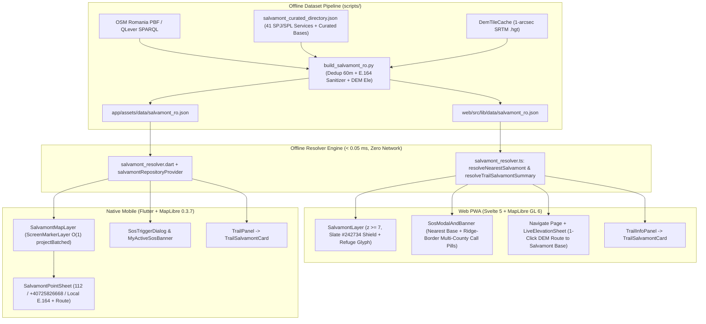

# Faza 1: Harta Punctelor Salvamont România & Rezolvitorul Offline de Telefoane Montane — Plan de Implementare

> **For agentic workers:** REQUIRED SUB-SKILL: Use superpowers:subagent-driven-development to implement this plan task-by-task. Steps use checkbox (`- [ ]`) syntax for tracking.

**Goal:** Afișarea 100% offline pe hartă a tuturor bazelor, posturilor montane și refugiilor Salvamont din România (Web + Mobile), împreună cu rezolvarea automată și instantanee a numerelor verificate de telefon Salvamont (local, județean, `0-SALVAMONT` `+40725826668` și `112`), inclusiv pe crestele de graniță între 2–3 județe și cu rutare directă pe teren până la cea mai apropiată bază Salvamont.

**Architecture:** Un pipeline determinist în Python ([build_salvamont_ro.py](file:///Volumes/SSD%20extern/Proiecte/Maps/scripts/build_salvamont_ro.py)) combină geometria fizică din OpenStreetMap (`emergency=mountain_rescue`, `name~"Salvamont"`, `operator~"Salvamont"`) cu registrul oficial curatat al tuturor celor **41 de servicii publice județene și locale A.N.S.M.R.** ([salvamont_curated_directory.json](file:///Volumes/SSD%20extern/Proiecte/Maps/scripts/salvamont_curated_directory.json)), eliminând indicatoarele/traseele parazite, deduplicând nodurile/clădirile suprapuse sub `60 m`, validând strict numerele în format internațional `E.164` (`+40[237]\d{8}` — eliminând erorile din OSM precum numărul trunchiat de 9 cifre `072582668` de la Voineasa sau textul neapelabil `0SALVAMONT`) și generând bundle-ul partajat `salvamont_ro.json` (`~52 KB` raw / `~14 KB` gzip) atât în `web/src/lib/data/` cât și în `app/assets/data/`. Peste acest set static rulează (1) motorul matematic fără rețea `resolveNearestSalvamont(lat, lon)` (TypeScript + Dart) cu detecție de **graniță de creastă multi-județ** ($\Delta d \le 3\,500\text{ m}$ sau $d_2 / d_1 \le 1.35$), (2) stratul nativ de hartă `SalvamontLayer` (MapLibre GeoJSON simbolic pe Web, `ScreenMarkerLayer` cu proiecție afină $O(1)$ `projectBatched` pe Flutter) în paleta `Deep Slate #242734` + sticlă mată, și (3) integrarea în Dialogul SOS, foaia de navigație (inclusiv 1-click **„Rută spre Baza Salvamont”** prin `computeDirectRescueRoute`) și pagina de detalii a traseului.

**Architecture Diagram:**



**Tech Stack:** Python 3.12 (`pyosmium`, `DemTileCache`, `unittest`) în `scripts/`, TypeScript 6 + SvelteKit 5 + MapLibre GL `^6.15.0` + Vitest + Playwright în `web/`, Dart `^3.13.0` + Flutter + Riverpod `^3.3.1` + ObjectBox `6.0.0-preview.5` + `maplibre: 0.3.7` + `url_launcher: ^6.3.2` în `app/`.

**Spec:** [2026-11-18-mountain-intelligence-salvamont-design.md](file:///Volumes/SSD%20extern/Proiecte/Maps/docs/superpowers/specs/2026-11-18-mountain-intelligence-salvamont-design.md)

## Global Constraints

- **100% Offline-First, Zero Overpass Runtime:** Stratul Salvamont și rezolvitorul de numere NU interoghează niciodată `/api/v1/overpass/interpreter` la runtime; toate coordonatele, altitudinile și telefoanele provin din `salvamont_ro.json` împachetat local.
- **Validare strictă E.164 pentru apeluri telefonice:** Fiecare număr de serviciu județean/local Salvamont din `salvamont_ro.json` trebuie să respecte expresia regulată `^\+40[237]\d{8}$` (`12` caractere exacte), iar dispeceratul național se apelează întotdeauna cu prefixul internațional `tel:+40725826668` (pentru funcționare garantată și pe SIM-uri în roaming), niciodată `tel:072582668` sau `tel:0SALVAMONT`.
- **Identitate vizuală unificată (`Deep Slate #242734` & Sticlă Mată):** Markerele, popup-urile și cardurile Salvamont folosesc suprafața `bg-menu-background/94 backdrop-blur-md border-input-border/60 text-content` și badge-ul `#242734` cu cruce albă de salvare (plus accent discret `#DC2626` de `4px`), fără portocaliu strident (`#EA580C`) sau verde neon; bazele permanente/sezoniere (`base`/`post`) se disting vizual de refugiile montane fără personal (`refuge`).
- **Contracte partajate inter-faze (Fazele 1–4):**
  - `app/pubspec.yaml` înregistrează directorul `- assets/data/` (partajat cu `romania_emergency_112.json` din Faza 2 și `romania_peaks_v1.json` din Faza 3).
  - `LocalSettingsEntity` (`app/lib/entities/local_settings_entity.dart`) adaugă `bool showSalvamontLayer = true` (păstrat intact de `MapLayersSheet` în Faza 4).
  - `MapState.overlays` (`web/src/lib/vendor/maplibre-layer-manager/layers.ts`) adaugă `salvamont: true` (cu fallback `true` în `normalizeMapState` când cheia lipsește din `wanderer-ro-map-state-v3`).
  - În `sos_modal_and_banner.svelte` și `sos_banner_and_dialog.dart`, cardul „Cel mai apropiat Salvamont + Graniță de creastă” se montează imediat sub butoanele `112` / `0-SALVAMONT`, lăsând slotul imediat următor liber pentru cardul de coordonate multi-format (UTM / Plus Codes / SMS 113) și „Unde prind semnal 112?” din Faza 2.
  - Faza 1 nu necesită nicio migrație PocketBase în `db/migrations/` (migrările `1792200000` și `1792300000` aparțin exclusiv Fazelor 2 și 4).

---

## Milestone 1: Pipeline-ul de Date Curatate ANSMR + OpenStreetMap (`salvamont_ro.json`)

### Task 1: Directorul Oficial ANSMR (41 Structuri) & Scriptul `build_salvamont_ro.py`

**Files:**
- Create: [salvamont_curated_directory.json](file:///Volumes/SSD%20extern/Proiecte/Maps/scripts/salvamont_curated_directory.json)
- Create: [build_salvamont_ro.py](file:///Volumes/SSD%20extern/Proiecte/Maps/scripts/build_salvamont_ro.py)
- Create: [salvamont_ro.json](file:///Volumes/SSD%20extern/Proiecte/Maps/web/src/lib/data/salvamont_ro.json)
- Create: [salvamont_ro.json](file:///Volumes/SSD%20extern/Proiecte/Maps/app/assets/data/salvamont_ro.json)
- Test: [test_build_salvamont_ro.py](file:///Volumes/SSD%20extern/Proiecte/Maps/scripts/test_build_salvamont_ro.py)

**Interfaces:**
- Consumes: `DemTileCache` din [dem_elevation.py](file:///Volumes/SSD%20extern/Proiecte/Maps/scripts/dem_elevation.py#L43-L160) (opțional, când `--dem-dir` este furnizat).
- Produces:
  - `normalize_ro_phone(raw: str | None) -> str | None`
  - `classify_osm_element(tags: dict[str, str]) -> tuple[str, str] | None` (`(kind, permanence)` sau `None` pentru indicatoare/rute/străzi)
  - `deduplicate_points(points: list[dict], merge_radius_m: float = 60.0) -> list[dict]`
  - `build_dataset(curated_path: Path, raw_osm_elements: list[dict], dem_dir: Path | None = None) -> dict`
  - Fișierele JSON identice `web/src/lib/data/salvamont_ro.json` și `app/assets/data/salvamont_ro.json` la schema `version: 1`.

> [!IMPORTANT]
> Auditul OSM România a arătat că din 298 de obiecte OSM legate de Salvamont, 170 sunt stâlpi/hărți (`information=guidepost|map|board`), 27 sunt relații de trasee (`route=hiking|mtb`), doar 2% au număr local valid, iar `way/1242742629` (*Salvamont Voineasa*) are numărul greșit de 9 cifre `072582668`. Sanitizer-ul `normalize_ro_phone` TREBUIE să respingă orice număr care nu are exact 12 caractere în format `+40[237]\d{8}`.

- [ ] **Step 1: Scrie suita de teste unitare pentru curățarea numerelor, filtrarea OSM și deduplicare**

Creează [test_build_salvamont_ro.py](file:///Volumes/SSD%20extern/Proiecte/Maps/scripts/test_build_salvamont_ro.py):

```python
#!/usr/bin/env python3
from __future__ import annotations

import json
import re
import unittest
from pathlib import Path

from build_salvamont_ro import (
    E164_RO_RE,
    build_dataset,
    classify_osm_element,
    deduplicate_points,
    normalize_ro_phone,
)

SCRIPTS_DIR = Path(__file__).resolve().parent
CURATED_PATH = SCRIPTS_DIR / "salvamont_curated_directory.json"


class BuildSalvamontRoTests(unittest.TestCase):
    def test_normalize_ro_phone_handles_valid_and_rejects_broken_osm_values(self) -> None:
        # Valid national & international formats
        self.assertEqual(normalize_ro_phone("0269 216 477"), "+40269216477")
        self.assertEqual(normalize_ro_phone("+40 728 770 627"), "+40728770627")
        self.assertEqual(normalize_ro_phone("0040-371-493-333"), "+40371493333")
        self.assertEqual(normalize_ro_phone("0741074884; 0SALVAMONT"), "+40741074884")
        # Vanity national dispatch
        self.assertEqual(normalize_ro_phone("0SALVAMONT"), "+40725826668")
        self.assertEqual(normalize_ro_phone("0-SALVAMONT (0725826668)"), "+40725826668")
        # Broken 9-digit OSM typo on way/1242742629 (Salvamont Voineasa) MUST be rejected!
        self.assertIsNone(normalize_ro_phone("072582668"))
        # Generic 112 is NOT a local Salvamont service phone
        self.assertIsNone(normalize_ro_phone("112"))
        self.assertIsNone(normalize_ro_phone(""))
        self.assertIsNone(normalize_ro_phone(None))

    def test_classify_osm_element_excludes_guideposts_routes_and_streets(self) -> None:
        self.assertIsNone(
            classify_osm_element({"tourism": "information", "information": "guidepost", "operator": "Salvamont"})
        )
        self.assertIsNone(
            classify_osm_element({"type": "route", "route": "hiking", "operator": "Salvamont Sibiu"})
        )
        self.assertIsNone(
            classify_osm_element({"highway": "residential", "name": "Strada Salvamont"})
        )
        self.assertEqual(
            classify_osm_element({"emergency": "mountain_rescue", "name": "Baza Salvamont Cota 1400"}),
            ("base", "24_7"),
        )
        self.assertEqual(
            classify_osm_element(
                {"amenity": "shelter", "shelter_type": "basic_hut", "name": "Refugiul Salvamont Mălăiești"}
            ),
            ("refuge", "shelter_unmanned"),
        )

    def test_deduplicate_points_collapses_glavoi_four_overlapping_osm_features(self) -> None:
        raw_glavoi = [
            {
                "osm_type": "node",
                "osm_id": "11292538119",
                "lat": 46.57774,
                "lon": 22.70443,
                "name": "Salvamont Glăvoi",
                "kind": "base",
                "permanence": "24_7",
                "ele": 1085,
                "osm_phone": None,
            },
            {
                "osm_type": "way",
                "osm_id": "301242103",
                "lat": 46.57779,
                "lon": 22.70443,
                "name": "Salvamont Glăvoi",
                "kind": "base",
                "permanence": "24_7",
                "ele": None,
                "osm_phone": None,
            },
            {
                "osm_type": "way",
                "osm_id": "301242104",
                "lat": 46.57773,
                "lon": 22.70451,
                "name": "Refugiul Salvamont - Salvaspeo Glăvoi",
                "kind": "base",
                "permanence": "24_7",
                "ele": None,
                "osm_phone": None,
            },
            {
                "osm_type": "way",
                "osm_id": "1163803257",
                "lat": 46.57784,
                "lon": 22.70457,
                "name": "",
                "kind": "base",
                "permanence": "24_7",
                "ele": None,
                "osm_phone": None,
            },
        ]
        merged = deduplicate_points(raw_glavoi, merge_radius_m=60.0)
        self.assertEqual(len(merged), 1)
        self.assertEqual(len(merged[0]["osmIds"]), 4)
        self.assertEqual(merged[0]["ele"], 1085)

    def test_build_dataset_validates_all_41_services_and_attaches_valid_e164_to_every_point(self) -> None:
        sample_osm = [
            {
                "type": "way",
                "id": 1242742629,
                "lat": 45.40081,
                "lon": 23.69584,
                "tags": {
                    "emergency": "mountain_rescue",
                    "name": "Salvamont Voineasa",
                    "phone": "072582668",  # Real broken 9-digit OSM value
                },
            },
            {
                "type": "tourism_guidepost_noise",
                "id": 999999,
                "lat": 45.41,
                "lon": 25.45,
                "tags": {"tourism": "information", "information": "guidepost", "operator": "Salvamont"},
            },
        ]
        dataset = build_dataset(CURATED_PATH, sample_osm, dem_dir=None)
        self.assertEqual(dataset["version"], 1)
        self.assertEqual(dataset["emergency112"], "112")
        self.assertEqual(dataset["nationalDispatchPhone"], "+40725826668")
        self.assertGreaterEqual(len(dataset["services"]), 41)
        self.assertGreaterEqual(len(dataset["points"]), 55)

        for sid, svc in dataset["services"].items():
            self.assertRegex(svc["primaryPhone"], E164_RO_RE, f"Invalid primaryPhone on {sid}")
            for sec in svc["secondaryPhones"]:
                self.assertRegex(sec, E164_RO_RE, f"Invalid secondaryPhone on {sid}")

        voineasa_pts = [p for p in dataset["points"] if "Voineasa" in p["name"]]
        self.assertTrue(len(voineasa_pts) >= 1)
        for pt in dataset["points"]:
            self.assertIn(pt["serviceId"], dataset["services"])
            if pt.get("directBasePhone"):
                self.assertRegex(pt["directBasePhone"], E164_RO_RE)
                self.assertNotEqual(pt["directBasePhone"], "+4072582668")


if __name__ == "__main__":
    unittest.main()
```

- [ ] **Step 2: Rulează testele pentru a verifica eșecul inițial (RED)**

Run: `python3 -m unittest discover -s scripts -p "test_build_salvamont_ro.py" -v`
Expected: FAIL cu `ModuleNotFoundError: No module named 'build_salvamont_ro'`

- [ ] **Step 3: Creează directorul curatat ANSMR `scripts/salvamont_curated_directory.json` și scriptul `scripts/build_salvamont_ro.py`**

Creează [salvamont_curated_directory.json](file:///Volumes/SSD%20extern/Proiecte/Maps/scripts/salvamont_curated_directory.json) cu toate cele 25 de servicii județene SPJ, toate cele 16 servicii locale SPL, intrarea informativă pentru Jandarmeria Montană Buzău și bazele/refugiile principale din Carpați:

```json
{
  "services": [
    {
      "id": "ro-ab-spj",
      "name": "Serviciul Public Județean Salvamont-Salvaspeo Alba",
      "shortName": "Salvamont Alba",
      "level": "county",
      "countyCode": "AB",
      "ansmrId": 20,
      "primaryPhone": "+40731847949",
      "secondaryPhones": ["+40756636339"],
      "phoneRoleRo": "Dispecerat / Informații județene",
      "massifs": ["Șureanu", "Trascău", "Bihor", "Muntele Mare", "Găina", "Cindrel", "Lotrului"],
      "website": "https://www.salvamontalba.ro",
      "hubLat": 46.0688,
      "hubLon": 23.5718
    },
    {
      "id": "ro-ar-spj",
      "name": "Compartimentul Salvamont-Salvaspeo Arad",
      "shortName": "Salvamont Arad",
      "level": "county",
      "countyCode": "AR",
      "ansmrId": 6,
      "primaryPhone": "+40734889153",
      "secondaryPhones": ["+40372774849"],
      "phoneRoleRo": "Informații / Baza Moneasa",
      "massifs": ["Codru-Moma", "Zărand", "Găina"],
      "hubLat": 46.4642,
      "hubLon": 22.2634
    },
    {
      "id": "ro-ag-spj",
      "name": "Serviciul Public Județean Salvamont Argeș",
      "shortName": "Salvamont Argeș",
      "level": "county",
      "countyCode": "AG",
      "ansmrId": 4,
      "primaryPhone": "+40248224488",
      "secondaryPhones": ["+40744501118", "+40740870439", "+40754959187", "+40744501117"],
      "phoneRoleRo": "Secretariat / Formații Câmpulung, Curtea de Argeș, Nucșoara",
      "massifs": ["Făgăraș", "Iezer-Păpușa", "Piatra Craiului", "Leaota", "Ghițu", "Frunți"],
      "website": "https://www.cjarges.ro/en/serviciul-public-judetean-salvamont",
      "hubLat": 45.5522,
      "hubLon": 24.6184
    },
    {
      "id": "ro-bc-spj",
      "name": "Serviciul Public Județean Salvamont Bacău",
      "shortName": "Salvamont Bacău",
      "level": "county",
      "countyCode": "BC",
      "ansmrId": 7,
      "primaryPhone": "+40731732200",
      "secondaryPhones": [],
      "phoneRoleRo": "Dispecerat / Informații județene",
      "massifs": ["Nemira", "Tarcău-Goșman", "Ciuc", "Berzunți"],
      "hubLat": 46.2001,
      "hubLon": 26.4239
    },
    {
      "id": "ro-bh-spj",
      "name": "Serviciul Public Județean Salvamont-Salvaspeo Bihor",
      "shortName": "Salvamont Bihor",
      "level": "county",
      "countyCode": "BH",
      "ansmrId": 8,
      "primaryPhone": "+40359436022",
      "secondaryPhones": ["+40259467876"],
      "phoneRoleRo": "Dispecerat / Informații județene",
      "massifs": ["Bihor", "Vlădeasa", "Pădurea Craiului", "Codru-Moma", "Șes"],
      "website": "https://www.salvamontbihor.ro",
      "hubLat": 46.5979,
      "hubLon": 22.7319
    },
    {
      "id": "ro-bn-spj",
      "name": "Serviciul Public Județean Salvamont Bistrița-Năsăud",
      "shortName": "Salvamont Bistrița-Năsăud",
      "level": "county",
      "countyCode": "BN",
      "ansmrId": 9,
      "primaryPhone": "+40726686789",
      "secondaryPhones": [],
      "phoneRoleRo": "Dispecerat / Informații județene",
      "massifs": ["Rodnei", "Călimani", "Bârgăului", "Țibleș", "Suhard"],
      "hubLat": 47.1486,
      "hubLon": 24.8512
    },
    {
      "id": "ro-bv-spj",
      "name": "Serviciul Public Județean Salvamont Brașov",
      "shortName": "Salvamont Brașov (Județean)",
      "level": "county",
      "countyCode": "BV",
      "ansmrId": 12,
      "primaryPhone": "+40755272768",
      "secondaryPhones": ["+40736628948", "+40722737912", "+40734889160"],
      "phoneRoleRo": "Dispecerat județean / Formații Predeal & Victoria",
      "massifs": ["Bucegi", "Făgăraș", "Ciucaș", "Piatra Mare", "Perșani", "Fitifoi"],
      "website": "https://www.spjsalvamontbrasov.ro",
      "hubLat": 45.6427,
      "hubLon": 25.5887
    },
    {
      "id": "ro-cs-spj",
      "name": "Serviciul Public Județean Salvamont-Salvaspeo Caraș-Severin",
      "shortName": "Salvamont Caraș-Severin",
      "level": "county",
      "countyCode": "CS",
      "ansmrId": 19,
      "primaryPhone": "+40744559868",
      "secondaryPhones": ["+40728970559", "+40724629517", "+40728970558"],
      "phoneRoleRo": "Dispecerat / Formații Semenic, Muntele Mic-Țarcu, Herculane",
      "massifs": ["Semenic", "Țarcu", "Muntele Mic", "Godeanu", "Cernei", "Mehedinți", "Poiana Ruscă", "Almăjului", "Aninei"],
      "hubLat": 45.2981,
      "hubLon": 22.5921
    },
    {
      "id": "ro-cj-spj",
      "name": "Serviciul Public Județean Salvamont-Salvaspeo Cluj",
      "shortName": "Salvamont Cluj",
      "level": "county",
      "countyCode": "CJ",
      "ansmrId": 25,
      "primaryPhone": "+40371493333",
      "secondaryPhones": ["+40755145126", "+40750732124"],
      "phoneRoleRo": "Dispecerat județean / Băișoara & Vlădeasa",
      "massifs": ["Vlădeasa", "Muntele Mare", "Gilău", "Trascău", "Cheile Turzii", "Bihor"],
      "website": "https://www.salvamontcluj.ro",
      "hubLat": 46.5371,
      "hubLon": 23.3121
    },
    {
      "id": "ro-cv-spj",
      "name": "Serviciul Public Județean Salvamont Covasna",
      "shortName": "Salvamont Covasna",
      "level": "county",
      "countyCode": "CV",
      "ansmrId": 22,
      "primaryPhone": "+40799800028",
      "secondaryPhones": [],
      "phoneRoleRo": "Dispecerat / Informații județene",
      "massifs": ["Bodoc", "Baraolt", "Nemira", "Brețcu-Oituz", "Întorsurii", "Ciomatu", "Perșani", "Penteleu", "Podu Calului"],
      "website": "https://www.salvamontcovasna.ro",
      "hubLat": 45.8636,
      "hubLon": 25.7875
    },
    {
      "id": "ro-db-spj",
      "name": "Serviciul Public Județean Salvamont-Salvaspeo Dâmbovița",
      "shortName": "Salvamont Dâmbovița",
      "level": "county",
      "countyCode": "DB",
      "ansmrId": 10,
      "primaryPhone": "+40374871808",
      "secondaryPhones": ["+40726194166", "+40726686685"],
      "phoneRoleRo": "Dispecerat / Baza Peștera-Padina & Zănoaga",
      "massifs": ["Bucegi", "Leaota"],
      "website": "https://www.salvamontdb.ro",
      "hubLat": 45.3979,
      "hubLon": 25.4414
    },
    {
      "id": "ro-gj-spj",
      "name": "Serviciul Public Județean Salvamont-Salvaspeo Gorj",
      "shortName": "Salvamont Gorj",
      "level": "county",
      "countyCode": "GJ",
      "ansmrId": 11,
      "primaryPhone": "+40253221555",
      "secondaryPhones": ["+40734889139", "+40253222555"],
      "phoneRoleRo": "Dispecerat Târgu Jiu / Baza Rânca",
      "massifs": ["Parâng", "Vâlcan", "Godeanu", "Căpățânii", "Mehedinți"],
      "website": "https://www.salvamontgorj.ro",
      "hubLat": 45.2946,
      "hubLon": 23.6839
    },
    {
      "id": "ro-hr-spj",
      "name": "Serviciul Public Județean Salvamont-Salvaspeo Harghita",
      "shortName": "Salvamont Harghita",
      "level": "county",
      "countyCode": "HR",
      "ansmrId": 21,
      "primaryPhone": "+40266207786",
      "secondaryPhones": ["+40772220786", "+40744526530", "+40741131020", "+40744683384"],
      "phoneRoleRo": "Dispecerat / Formații Mădăraș, Toplița, Gheorgheni, Odorhei",
      "massifs": ["Harghita", "Hășmaș", "Ciuc", "Giurgeu", "Gurghiu", "Călimani", "Cheile Bicazului"],
      "website": "https://www.salvamontharghita.ro",
      "hubLat": 46.4392,
      "hubLon": 25.5827
    },
    {
      "id": "ro-hd-spj",
      "name": "Serviciul Public Județean Salvamont-Salvaspeo Hunedoara",
      "shortName": "Salvamont Hunedoara",
      "level": "county",
      "countyCode": "HD",
      "ansmrId": 42,
      "primaryPhone": "+40354407457",
      "secondaryPhones": [],
      "phoneRoleRo": "Dispecerat județean (Retezat, Parâng, Șureanu, Vâlcan)",
      "massifs": ["Retezat", "Parâng", "Șureanu", "Vâlcan", "Godeanu", "Poiana Ruscă", "Metaliferi"],
      "website": "https://www.salvamonthd.ro",
      "hubLat": 45.4069,
      "hubLon": 22.8797
    },
    {
      "id": "ro-mm-spj",
      "name": "Serviciul Public Județean Salvamont Maramureș",
      "shortName": "Salvamont Maramureș",
      "level": "county",
      "countyCode": "MM",
      "ansmrId": 13,
      "primaryPhone": "+40362803501",
      "secondaryPhones": ["+40372463880", "+40745258432", "+40262342322"],
      "phoneRoleRo": "Dispecerat județean / Formațiile Borșa, Cavnic, Vișeu",
      "massifs": ["Rodnei", "Maramureșului", "Gutâi", "Țibleș", "Lăpuș"],
      "website": "https://www.salvamontmaramures.ro",
      "hubLat": 47.6695,
      "hubLon": 23.7765
    },
    {
      "id": "ro-mh-spj",
      "name": "Serviciul Public Județean Salvamont-Salvaspeo Mehedinți",
      "shortName": "Salvamont Mehedinți",
      "level": "county",
      "countyCode": "MH",
      "ansmrId": 29,
      "primaryPhone": "+40771020571",
      "secondaryPhones": ["+40754574246"],
      "phoneRoleRo": "Dispecerat / Informații județene",
      "massifs": ["Mehedinți", "Cazanele Dunării", "Almăjului"],
      "hubLat": 44.8118,
      "hubLon": 22.5205
    },
    {
      "id": "ro-ms-spj",
      "name": "Serviciul Public Județean Salvamont-Salvaspeo Mureș",
      "shortName": "Salvamont Mureș",
      "level": "county",
      "countyCode": "MS",
      "ansmrId": 14,
      "primaryPhone": "+40728289442",
      "secondaryPhones": ["+40365430940"],
      "phoneRoleRo": "Dispecerat 24/7 / Sediu Târgu Mureș",
      "massifs": ["Călimani", "Gurghiu"],
      "website": "https://salvamontms.ro",
      "hubLat": 46.9636,
      "hubLon": 25.0256
    },
    {
      "id": "ro-nt-spj",
      "name": "Serviciul Public Județean Salvamont-Salvaspeo Neamț",
      "shortName": "Salvamont Neamț",
      "level": "county",
      "countyCode": "NT",
      "ansmrId": 15,
      "primaryPhone": "+40372780106",
      "secondaryPhones": ["+40734889137"],
      "phoneRoleRo": "Dispecerat Durău / Baza Dochia Ceahlău",
      "massifs": ["Ceahlău", "Cheile Bicazului", "Hășmaș", "Bistriței", "Stânișoarei", "Tazlău"],
      "website": "https://www.salvamontneamt.ro",
      "hubLat": 46.9976,
      "hubLon": 25.9264
    },
    {
      "id": "ro-ph-spj",
      "name": "Serviciul Public Județean Salvamont Prahova",
      "shortName": "Salvamont Prahova",
      "level": "county",
      "countyCode": "PH",
      "ansmrId": 16,
      "primaryPhone": "+40244311922",
      "secondaryPhones": ["+40722140858", "+40734889132", "+40732021820"],
      "phoneRoleRo": "Dispecerat Cota 1400 / Cheia-Ciucaș, Azuga, Platoul Bucegi",
      "massifs": ["Bucegi", "Ciucaș", "Baiului", "Grohotiș", "Siriu"],
      "website": "https://www.salvamontprahova.ro",
      "hubLat": 45.3553,
      "hubLon": 25.5182
    },
    {
      "id": "ro-sm-spj",
      "name": "Serviciul Public Județean Salvamont Satu Mare",
      "shortName": "Salvamont Satu Mare",
      "level": "county",
      "countyCode": "SM",
      "ansmrId": 28,
      "primaryPhone": "+40721774177",
      "secondaryPhones": [],
      "phoneRoleRo": "Dispecerat / Baza Luna Șes (Oaș)",
      "massifs": ["Oașului", "Gutâi"],
      "hubLat": 47.8542,
      "hubLon": 23.4567
    },
    {
      "id": "ro-sb-spj",
      "name": "Serviciul Public Județean Salvamont Sibiu",
      "shortName": "Salvamont Sibiu",
      "level": "county",
      "countyCode": "SB",
      "ansmrId": 26,
      "primaryPhone": "+40269216477",
      "secondaryPhones": ["+40745140144"],
      "phoneRoleRo": "Dispecerat județean (Bâlea Lac, Negoiu, Păltiniș)",
      "massifs": ["Făgăraș", "Cindrel", "Lotrului"],
      "website": "https://www.salvamontsibiu.ro",
      "hubLat": 45.6048,
      "hubLon": 24.6141
    },
    {
      "id": "ro-sv-spj",
      "name": "Serviciul Public Județean Salvamont Suceava",
      "shortName": "Salvamont Suceava",
      "level": "county",
      "countyCode": "SV",
      "ansmrId": 18,
      "primaryPhone": "+40745313052",
      "secondaryPhones": ["+40724212857"],
      "phoneRoleRo": "Dispecerat județean / Câmpulung Moldovenesc & Rarău",
      "massifs": ["Rarău", "Giumalău", "Călimani", "Suhard", "Obcinele Bucovinei", "Bistriței", "Stânișoarei"],
      "hubLat": 47.4514,
      "hubLon": 25.5634
    },
    {
      "id": "ro-tm-spj",
      "name": "Serviciul Public Județean Salvamont Timiș",
      "shortName": "Salvamont Timiș",
      "level": "county",
      "countyCode": "TM",
      "ansmrId": 63,
      "primaryPhone": "+40725826668",
      "secondaryPhones": [],
      "phoneRoleRo": "Preluat prin Dispeceratul Național 0-SALVAMONT",
      "massifs": ["Poiana Ruscă"],
      "hubLat": 45.6644,
      "hubLon": 22.3025
    },
    {
      "id": "ro-vl-spj",
      "name": "Serviciul Public Județean Salvamont-Salvaspeo Vâlcea",
      "shortName": "Salvamont Vâlcea",
      "level": "county",
      "countyCode": "VL",
      "ansmrId": 17,
      "primaryPhone": "+40744696112",
      "secondaryPhones": ["+40250732901"],
      "phoneRoleRo": "Dispecerat / Informații județene",
      "massifs": ["Căpățânii", "Cozia", "Buila-Vânturarița", "Lotrului", "Latoriței", "Parâng", "Făgăraș"],
      "hubLat": 45.3088,
      "hubLon": 24.3036
    },
    {
      "id": "ro-vn-spj",
      "name": "Serviciul Public Județean Salvamont Vrancea",
      "shortName": "Salvamont Vrancea",
      "level": "county",
      "countyCode": "VN",
      "ansmrId": 27,
      "primaryPhone": "+40738407080",
      "secondaryPhones": [],
      "phoneRoleRo": "Dispecerat 24/7 (Lepșa, Soveja, Munții Vrancei)",
      "massifs": ["Vrancei"],
      "website": "https://www.salvamontvrancea.ro",
      "hubLat": 45.9467,
      "hubLon": 26.5789
    },
    {
      "id": "ro-bv-poiana",
      "name": "Serviciul Public Local Salvamont Poiana Brașov",
      "shortName": "Salvamont Poiana Brașov",
      "level": "local",
      "countyCode": "BV",
      "ansmrId": 3,
      "primaryPhone": "+40726686693",
      "secondaryPhones": ["+40368103194"],
      "phoneRoleRo": "Dispecerat local Postăvarul & Tâmpa",
      "massifs": ["Postăvarul", "Tâmpa"],
      "hubLat": 45.5889,
      "hubLon": 25.5539
    },
    {
      "id": "ro-bv-bran",
      "name": "Serviciul Public Local Salvamont Bran",
      "shortName": "Salvamont Bran",
      "level": "local",
      "countyCode": "BV",
      "ansmrId": 31,
      "primaryPhone": "+40723350697",
      "secondaryPhones": [],
      "phoneRoleRo": "Formația locală Bran (Mălăiești, Țigănești, Ciubotea)",
      "massifs": ["Bucegi", "Leaota"],
      "hubLat": 45.5152,
      "hubLon": 25.3672
    },
    {
      "id": "ro-bv-rasnov",
      "name": "Serviciul Public Salvamont Râșnov",
      "shortName": "Salvamont Râșnov",
      "level": "local",
      "countyCode": "BV",
      "ansmrId": 36,
      "primaryPhone": "+40741074884",
      "secondaryPhones": [],
      "phoneRoleRo": "Formația locală Râșnov",
      "massifs": ["Bucegi", "Postăvarul"],
      "hubLat": 45.5931,
      "hubLon": 25.4608
    },
    {
      "id": "ro-bv-zarnesti",
      "name": "Serviciul Public Local Salvamont Zărnești",
      "shortName": "Salvamont Zărnești",
      "level": "local",
      "countyCode": "BV",
      "ansmrId": 39,
      "primaryPhone": "+40733008323",
      "secondaryPhones": [],
      "phoneRoleRo": "Formația locală Piatra Craiului (Zărnești / Plaiul Foii)",
      "massifs": ["Piatra Craiului", "Făgăraș"],
      "website": "https://www.salvamontzarnesti.ro",
      "hubLat": 45.5597,
      "hubLon": 25.3183
    },
    {
      "id": "ro-bv-sacele",
      "name": "Serviciul Public Local Salvamont Săcele",
      "shortName": "Salvamont Săcele",
      "level": "local",
      "countyCode": "BV",
      "ansmrId": 59,
      "primaryPhone": "+40722652584",
      "secondaryPhones": ["+40751358679"],
      "phoneRoleRo": "Formația locală Piatra Mare & Ciucaș Vest",
      "massifs": ["Piatra Mare", "Ciucaș"],
      "hubLat": 45.5547,
      "hubLon": 25.6536
    },
    {
      "id": "ro-ph-sinaia",
      "name": "Serviciul Public Local Salvamont Sinaia",
      "shortName": "Salvamont Sinaia",
      "level": "local",
      "countyCode": "PH",
      "ansmrId": 40,
      "primaryPhone": "+40732313131",
      "secondaryPhones": ["+40244311922"],
      "phoneRoleRo": "Dispecerat local Sinaia (Cota 1400 / Cota 2000)",
      "massifs": ["Bucegi", "Baiului"],
      "hubLat": 45.3596,
      "hubLon": 25.4951
    },
    {
      "id": "ro-ph-busteni",
      "name": "Serviciul Public Local Salvamont Bușteni",
      "shortName": "Salvamont Bușteni",
      "level": "local",
      "countyCode": "PH",
      "ansmrId": 64,
      "primaryPhone": "+40728770627",
      "secondaryPhones": ["+40720205584"],
      "phoneRoleRo": "Urgențe & Informații Bușteni (Jepi, Caraiman, Babele, Omu)",
      "massifs": ["Bucegi", "Baiului"],
      "hubLat": 45.4133,
      "hubLon": 25.4704
    },
    {
      "id": "ro-sb-cisnadie",
      "name": "Serviciul Public Local Salvamont Cisnădie",
      "shortName": "Salvamont Cisnădie",
      "level": "local",
      "countyCode": "SB",
      "ansmrId": 57,
      "primaryPhone": "+40740421865",
      "secondaryPhones": [],
      "phoneRoleRo": "Formația locală Cindrel Est / Măgura Cisnădiei",
      "massifs": ["Cindrel"],
      "hubLat": 45.7128,
      "hubLon": 24.1508
    },
    {
      "id": "ro-vl-brezoi",
      "name": "Serviciul Public Local Salvamont Brezoi",
      "shortName": "Salvamont Brezoi",
      "level": "local",
      "countyCode": "VL",
      "ansmrId": 56,
      "primaryPhone": "+40720374141",
      "secondaryPhones": ["+40250778470"],
      "phoneRoleRo": "Formația locală Brezoi (Cozia, Lotrului, Narățu)",
      "massifs": ["Cozia", "Lotrului", "Căpățânii"],
      "hubLat": 45.3454,
      "hubLon": 24.2409
    },
    {
      "id": "ro-vl-olanesti",
      "name": "Serviciul Public Local Salvamont Olănești",
      "shortName": "Salvamont Olănești",
      "level": "local",
      "countyCode": "VL",
      "ansmrId": 58,
      "primaryPhone": "+40768508376",
      "secondaryPhones": [],
      "phoneRoleRo": "Formația locală Buila-Vânturarița & Căpățânii",
      "massifs": ["Buila-Vânturarița", "Căpățânii"],
      "hubLat": 45.2036,
      "hubLon": 24.2384
    },
    {
      "id": "ro-vl-voineasa",
      "name": "Serviciul Public Local Salvamont Voineasa",
      "shortName": "Salvamont Voineasa",
      "level": "local",
      "countyCode": "VL",
      "ansmrId": 60,
      "primaryPhone": "+40768508376",
      "secondaryPhones": ["+40744696112"],
      "phoneRoleRo": "Formația locală Voineasa / Transalpina-Vidra",
      "massifs": ["Lotrului", "Latoriței", "Parâng"],
      "hubLat": 45.4008,
      "hubLon": 23.6958
    },
    {
      "id": "ro-hd-lupeni",
      "name": "Serviciul Public Local Salvamont Lupeni",
      "shortName": "Salvamont Lupeni (Straja)",
      "level": "local",
      "countyCode": "HD",
      "ansmrId": 45,
      "primaryPhone": "+40734889147",
      "secondaryPhones": [],
      "phoneRoleRo": "Centrul Operațional Straja / Vâlcan",
      "massifs": ["Vâlcan", "Retezat"],
      "hubLat": 45.3212,
      "hubLon": 23.2368
    },
    {
      "id": "ro-hd-petrosani",
      "name": "Serviciul Public Local Salvamont Petroșani",
      "shortName": "Salvamont Petroșani",
      "level": "local",
      "countyCode": "HD",
      "ansmrId": 46,
      "primaryPhone": "+40734339741",
      "secondaryPhones": [],
      "phoneRoleRo": "Formația locală Masivul Parâng & Șureanu Sud",
      "massifs": ["Parâng", "Șureanu"],
      "hubLat": 45.3845,
      "hubLon": 23.4715
    },
    {
      "id": "ro-hd-uricani",
      "name": "Serviciul Public Local Salvamont Uricani",
      "shortName": "Salvamont Uricani",
      "level": "local",
      "countyCode": "HD",
      "ansmrId": 44,
      "primaryPhone": "+40722262071",
      "secondaryPhones": ["+40254511101"],
      "phoneRoleRo": "Formația locală Retezatul Mic / Buta / Câmpu lui Neag",
      "massifs": ["Retezat", "Vâlcan"],
      "hubLat": 45.3201,
      "hubLon": 22.9043
    },
    {
      "id": "ro-bn-rodna",
      "name": "Serviciul Public Local Salvamont Rodna",
      "shortName": "Salvamont Rodna",
      "level": "local",
      "countyCode": "BN",
      "ansmrId": 61,
      "primaryPhone": "+40742474874",
      "secondaryPhones": [],
      "phoneRoleRo": "Formația locală Munții Rodnei Sud (Valea Vinului, Ineu)",
      "massifs": ["Rodnei"],
      "hubLat": 47.4219,
      "hubLon": 24.8142
    },
    {
      "id": "ro-sv-vatra-dornei",
      "name": "Serviciul Public Local Salvamont Vatra Dornei",
      "shortName": "Salvamont Vatra Dornei",
      "level": "local",
      "countyCode": "SV",
      "ansmrId": 41,
      "primaryPhone": "+40726686687",
      "secondaryPhones": ["+40230372767"],
      "phoneRoleRo": "Formația locală Țara Dornelor (Călimani, Suhard, Giumalău)",
      "massifs": ["Suhard", "Giumalău", "Călimani", "Bistriței"],
      "hubLat": 47.3465,
      "hubLon": 25.3566
    },
    {
      "id": "ro-bz-jandarmerie",
      "name": "Postul de Jandarmi Montan Nehoiu (Munții Buzăului)",
      "shortName": "Jandarmeria Montană Nehoiu",
      "level": "gendarmerie_info",
      "countyCode": "BZ",
      "ansmrId": null,
      "primaryPhone": "+40238554347",
      "secondaryPhones": [],
      "phoneRoleRo": "Suport montan Munții Siriului / Penteleu (județ fără SPJ Salvamont)",
      "massifs": ["Siriu", "Penteleu", "Podu Calului"],
      "hubLat": 45.4239,
      "hubLon": 26.2961
    }
  ],
  "curatedPoints": [
    { "id": "baza-salvamont-babele", "name": "Baza Salvamont Babele (Platoul Bucegi)", "kind": "base", "permanence": "24_7", "lat": 45.41331, "lon": 25.47037, "ele": 2206, "massif": "Munții Bucegi", "countyCode": "PH", "serviceId": "ro-ph-busteni", "backupCountyServiceId": "ro-ph-spj" },
    { "id": "baza-salvamont-cota-1400-sinaia", "name": "Baza Salvamont Cota 1400 Sinaia", "kind": "base", "permanence": "24_7", "lat": 45.35529, "lon": 25.51823, "ele": 1395, "massif": "Munții Bucegi", "countyCode": "PH", "serviceId": "ro-ph-spj", "directBasePhone": "+40244311922" },
    { "id": "baza-salvamont-cota-2000-sinaia", "name": "Baza Salvamont Cota 2000 (Miorița)", "kind": "base", "permanence": "24_7", "lat": 45.35963, "lon": 25.49507, "ele": 1995, "massif": "Munții Bucegi", "countyCode": "PH", "serviceId": "ro-ph-sinaia", "backupCountyServiceId": "ro-ph-spj" },
    { "id": "baza-salvamont-piatra-arsa", "name": "Baza Salvamont Piatra Arsă", "kind": "base", "permanence": "24_7", "lat": 45.38215, "lon": 25.48540, "ele": 1950, "massif": "Munții Bucegi", "countyCode": "PH", "serviceId": "ro-ph-spj" },
    { "id": "baza-salvamont-busteni-oras", "name": "Baza Salvamont Bușteni (Telecabină)", "kind": "base", "permanence": "24_7", "lat": 45.40956, "lon": 25.53244, "ele": 885, "massif": "Munții Bucegi", "countyCode": "PH", "serviceId": "ro-ph-busteni", "backupCountyServiceId": "ro-ph-spj" },
    { "id": "baza-salvamont-azuga-sorica", "name": "Post Salvamont Azuga (Sorica)", "kind": "post", "permanence": "24_7", "lat": 45.44260, "lon": 25.56510, "ele": 965, "massif": "Munții Baiului", "countyCode": "PH", "serviceId": "ro-ph-spj", "directBasePhone": "+40734889132" },
    { "id": "baza-salvamont-pestera-db", "name": "Baza Salvamont Peștera", "kind": "base", "permanence": "24_7", "lat": 45.39786, "lon": 25.44141, "ele": 1610, "massif": "Munții Bucegi", "countyCode": "DB", "serviceId": "ro-db-spj", "directBasePhone": "+40726194166" },
    { "id": "baza-salvamont-padina-db", "name": "Post Salvamont Padina", "kind": "post", "permanence": "seasonal", "lat": 45.38369, "lon": 25.43247, "ele": 1510, "massif": "Munții Bucegi", "countyCode": "DB", "serviceId": "ro-db-spj" },
    { "id": "baza-salvamont-zanoaga-db", "name": "Baza Salvamont Zănoaga", "kind": "base", "permanence": "24_7", "lat": 45.33060, "lon": 25.42909, "ele": 1400, "massif": "Munții Bucegi", "countyCode": "DB", "serviceId": "ro-db-spj" },
    { "id": "refugiu-salvamont-malaiesti", "name": "Refugiul Salvamont Mălăiești", "kind": "post", "permanence": "seasonal", "lat": 45.46546, "lon": 25.45311, "ele": 1720, "massif": "Munții Bucegi", "countyCode": "BV", "serviceId": "ro-bv-bran", "backupCountyServiceId": "ro-bv-spj" },
    { "id": "refugiu-salvamont-ciubotea-bran", "name": "Post Salvamont Bran–Ciubotea (Poarta)", "kind": "post", "permanence": "24_7", "lat": 45.46972, "lon": 25.40020, "ele": 910, "massif": "Munții Bucegi", "countyCode": "BV", "serviceId": "ro-bv-bran", "backupCountyServiceId": "ro-bv-spj" },
    { "id": "post-salvamont-predeal-clabucet", "name": "Baza Salvamont Predeal (Clăbucet)", "kind": "base", "permanence": "24_7", "lat": 45.49810, "lon": 25.57340, "ele": 1055, "massif": "Munții Baiului / Piatra Mare", "countyCode": "BV", "serviceId": "ro-bv-spj", "directBasePhone": "+40734889160" },
    { "id": "baza-salvamont-poiana-brasov-bradul", "name": "Baza Salvamont Poiana Brașov (Postăvarul)", "kind": "base", "permanence": "24_7", "lat": 45.56960, "lon": 25.56133, "ele": 1705, "massif": "Masivul Postăvarul", "countyCode": "BV", "serviceId": "ro-bv-poiana", "backupCountyServiceId": "ro-bv-spj" },
    { "id": "dispecerat-national-ansmr-brasov", "name": "Dispeceratul Național Salvamont A.N.S.M.R.", "kind": "dispatch_hq", "permanence": "24_7", "lat": 45.62807, "lon": 25.61712, "ele": 595, "massif": "Depresiunea Brașovului", "countyCode": "BV", "serviceId": "ro-bv-spj", "directBasePhone": "+40725826668" },
    { "id": "baza-salvamont-piatra-mare-sacele", "name": "Baza Salvamont Piatra Mare (Dâmbu Morii)", "kind": "base", "permanence": "24_7", "lat": 45.55473, "lon": 25.65358, "ele": 715, "massif": "Masivul Piatra Mare", "countyCode": "BV", "serviceId": "ro-bv-sacele", "backupCountyServiceId": "ro-bv-spj" },
    { "id": "baza-salvamont-cheia-ciucas", "name": "Baza Salvamont Cheia (Muntele Roșu)", "kind": "base", "permanence": "24_7", "lat": 45.48987, "lon": 25.94494, "ele": 1265, "massif": "Masivul Ciucaș", "countyCode": "PH", "serviceId": "ro-ph-spj", "directBasePhone": "+40722140858" },
    { "id": "baza-salvamont-zarnesti-plaiul-foii", "name": "Baza Salvamont Zărnești / Plaiul Foii", "kind": "base", "permanence": "24_7", "lat": 45.52255, "lon": 25.27388, "ele": 845, "massif": "Masivul Piatra Craiului", "countyCode": "BV", "serviceId": "ro-bv-zarnesti", "backupCountyServiceId": "ro-bv-spj" },
    { "id": "baza-salvamont-victoria-fagaras", "name": "Baza Salvamont Victoria (Sâmbăta)", "kind": "base", "permanence": "24_7", "lat": 45.64220, "lon": 24.79310, "ele": 690, "massif": "Munții Făgăraș", "countyCode": "BV", "serviceId": "ro-bv-spj", "directBasePhone": "+40722737912" },
    { "id": "baza-salvamont-balea-lac", "name": "Baza Salvamont Bâlea Lac „Toma Boerescu”", "kind": "base", "permanence": "24_7", "lat": 45.60480, "lon": 24.61408, "ele": 2040, "massif": "Munții Făgăraș", "countyCode": "SB", "serviceId": "ro-sb-spj" },
    { "id": "post-salvamont-negoiu", "name": "Punct Salvamont Cabana Negoiu", "kind": "post", "permanence": "seasonal", "lat": 45.60412, "lon": 24.52905, "ele": 1546, "massif": "Munții Făgăraș", "countyCode": "SB", "serviceId": "ro-sb-spj" },
    { "id": "refugiu-salvamont-portita-avrigului", "name": "Refugiul Salvamont Portița Avrigului", "kind": "refuge", "permanence": "shelter_unmanned", "lat": 45.58005, "lon": 24.47587, "ele": 2175, "massif": "Munții Făgăraș", "countyCode": "SB", "serviceId": "ro-sb-spj" },
    { "id": "baza-salvamont-cota-2000-transfagarasan-ag", "name": "Baza Salvamont Cota 2000 Transfăgărășan (Capra)", "kind": "base", "permanence": "24_7", "lat": 45.59022, "lon": 24.62577, "ele": 1980, "massif": "Munții Făgăraș", "countyCode": "AG", "serviceId": "ro-ag-spj", "directBasePhone": "+40744501118" },
    { "id": "refugiu-salvamont-fereastra-zmeilor", "name": "Refugiul Salvamont Fereastra Zmeilor", "kind": "refuge", "permanence": "shelter_unmanned", "lat": 45.59716, "lon": 24.65065, "ele": 2175, "massif": "Munții Făgăraș", "countyCode": "AG", "serviceId": "ro-ag-spj" },
    { "id": "baza-salvamont-voina-iezer", "name": "Baza Salvamont Voina (Iezer-Păpușa)", "kind": "base", "permanence": "24_7", "lat": 45.44230, "lon": 25.04471, "ele": 970, "massif": "Masivul Iezer-Păpușa", "countyCode": "AG", "serviceId": "ro-ag-spj", "directBasePhone": "+40756471711" },
    { "id": "baza-salvamont-brusturet-pc", "name": "Post Salvamont Brusturet (Dâmbovicioara)", "kind": "post", "permanence": "seasonal", "lat": 45.47187, "lon": 25.22519, "ele": 995, "massif": "Masivul Piatra Craiului", "countyCode": "AG", "serviceId": "ro-ag-spj", "directBasePhone": "+40740870439" },
    { "id": "baza-salvamont-paltinis-sb", "name": "Baza Salvamont Păltiniș", "kind": "base", "permanence": "24_7", "lat": 45.65290, "lon": 23.93311, "ele": 1440, "massif": "Munții Cindrel", "countyCode": "SB", "serviceId": "ro-sb-spj" },
    { "id": "post-salvamont-arena-platos", "name": "Punct Salvamont Arena Platoș", "kind": "post", "permanence": "seasonal", "lat": 45.67473, "lon": 23.93563, "ele": 1390, "massif": "Munții Cindrel", "countyCode": "SB", "serviceId": "ro-sb-spj" },
    { "id": "baza-salvamont-brezoi-vl", "name": "Baza Salvamont Brezoi (Cozia / Lotru)", "kind": "base", "permanence": "24_7", "lat": 45.34536, "lon": 24.24090, "ele": 340, "massif": "Masivul Cozia / Lotrului", "countyCode": "VL", "serviceId": "ro-vl-brezoi", "backupCountyServiceId": "ro-vl-spj" },
    { "id": "baza-salvamont-voineasa-transalpina", "name": "Baza Salvamont Voineasa (Vidra / Transalpina)", "kind": "base", "permanence": "24_7", "lat": 45.40081, "lon": 23.69584, "ele": 1355, "massif": "Munții Lotrului / Parâng", "countyCode": "VL", "serviceId": "ro-vl-voineasa", "backupCountyServiceId": "ro-vl-spj" },
    { "id": "baza-salvamont-cozia-stana-turnu", "name": "Post Salvamont Cozia", "kind": "post", "permanence": "24_7", "lat": 45.30880, "lon": 24.33650, "ele": 1565, "massif": "Masivul Cozia", "countyCode": "VL", "serviceId": "ro-vl-spj" },
    { "id": "baza-salvamont-ranca-gj", "name": "Baza Salvamont Rânca (Parâng)", "kind": "base", "permanence": "24_7", "lat": 45.29462, "lon": 23.68387, "ele": 1615, "massif": "Munții Parâng", "countyCode": "GJ", "serviceId": "ro-gj-spj", "directBasePhone": "+40734889139" },
    { "id": "baza-salvamont-parang-petrosani", "name": "Baza Salvamont Parâng (Rusu – Petroșani)", "kind": "base", "permanence": "24_7", "lat": 45.38450, "lon": 23.47152, "ele": 1690, "massif": "Munții Parâng", "countyCode": "HD", "serviceId": "ro-hd-petrosani", "backupCountyServiceId": "ro-hd-spj" },
    { "id": "baza-salvamont-straja-lupeni", "name": "Baza Salvamont Straja", "kind": "base", "permanence": "24_7", "lat": 45.32123, "lon": 23.23679, "ele": 1445, "massif": "Munții Vâlcan", "countyCode": "HD", "serviceId": "ro-hd-lupeni", "backupCountyServiceId": "ro-hd-spj" },
    { "id": "baza-salvamont-pietrele-retezat", "name": "Baza Salvamont Pietrele (Retezat)", "kind": "base", "permanence": "24_7", "lat": 45.40693, "lon": 22.87974, "ele": 1480, "massif": "Munții Retezat", "countyCode": "HD", "serviceId": "ro-hd-spj" },
    { "id": "baza-salvamont-rausor-retezat", "name": "Post Salvamont Râușor", "kind": "post", "permanence": "24_7", "lat": 45.41798, "lon": 22.84408, "ele": 1220, "massif": "Munții Retezat", "countyCode": "HD", "serviceId": "ro-hd-spj" },
    { "id": "post-salvamont-bucura-retezat", "name": "Refugiul Salvamont Bucura", "kind": "post", "permanence": "seasonal", "lat": 45.35862, "lon": 22.87710, "ele": 2045, "massif": "Munții Retezat", "countyCode": "HD", "serviceId": "ro-hd-spj" },
    { "id": "post-salvamont-poiana-pelegii", "name": "Refugiul Salvamont Poiana Pelegii", "kind": "post", "permanence": "seasonal", "lat": 45.34029, "lon": 22.89345, "ele": 1630, "massif": "Munții Retezat", "countyCode": "HD", "serviceId": "ro-hd-spj" },
    { "id": "post-salvamont-buta-uricani", "name": "Refugiul Salvamont Buta", "kind": "post", "permanence": "24_7", "lat": 45.32005, "lon": 22.90431, "ele": 1580, "massif": "Munții Retezat", "countyCode": "HD", "serviceId": "ro-hd-uricani", "backupCountyServiceId": "ro-hd-spj" },
    { "id": "refugiu-salvamont-zanoaga-retezat", "name": "Refugiul Salvamont Zănoaga (Retezat)", "kind": "refuge", "permanence": "shelter_unmanned", "lat": 45.34501, "lon": 22.82308, "ele": 1997, "massif": "Munții Retezat", "countyCode": "HD", "serviceId": "ro-hd-spj" },
    { "id": "baza-salvamont-sureanu-luncile-prigoanei", "name": "Baza Salvamont Șureanu (Poarta Raiului)", "kind": "base", "permanence": "24_7", "lat": 45.57503, "lon": 23.51240, "ele": 1650, "massif": "Munții Șureanu", "countyCode": "AB", "serviceId": "ro-ab-spj" },
    { "id": "baza-salvamont-rimetea-trascau", "name": "Baza Salvamont Rimetea (Piatra Secuiului)", "kind": "base", "permanence": "24_7", "lat": 46.45178, "lon": 23.57240, "ele": 545, "massif": "Munții Trascău", "countyCode": "AB", "serviceId": "ro-ab-spj" },
    { "id": "baza-salvamont-muntele-mic-cs", "name": "Baza Salvamont Muntele Mic", "kind": "base", "permanence": "24_7", "lat": 45.36520, "lon": 22.46940, "ele": 1530, "massif": "Munții Țarcu – Muntele Mic", "countyCode": "CS", "serviceId": "ro-cs-spj", "directBasePhone": "+40724629517" },
    { "id": "baza-salvamont-semenic-cs", "name": "Baza Salvamont Semenic", "kind": "base", "permanence": "24_7", "lat": 45.18166, "lon": 22.05692, "ele": 1410, "massif": "Munții Semenic", "countyCode": "CS", "serviceId": "ro-cs-spj", "directBasePhone": "+40728970559" },
    { "id": "baza-salvamont-herculane-cs", "name": "Baza Salvamont Băile Herculane (Valea Cernei)", "kind": "base", "permanence": "24_7", "lat": 44.88950, "lon": 22.42410, "ele": 185, "massif": "Munții Cernei / Mehedinți", "countyCode": "CS", "serviceId": "ro-cs-spj", "directBasePhone": "+40728970558" },
    { "id": "refugiu-saua-scheiului-tarcu", "name": "Refugiul Salvamont Șaua Șcheiului", "kind": "refuge", "permanence": "shelter_unmanned", "lat": 45.29807, "lon": 22.59205, "ele": 1820, "massif": "Munții Țarcu", "countyCode": "CS", "serviceId": "ro-cs-spj" },
    { "id": "baza-salvamont-mehedinti-balota", "name": "Baza Salvamont Mehedinți (Ponoarele / Cazane)", "kind": "base", "permanence": "24_7", "lat": 44.81184, "lon": 22.52046, "ele": 480, "massif": "Munții Mehedinți", "countyCode": "MH", "serviceId": "ro-mh-spj" },
    { "id": "baza-salvamont-moneasa-ar", "name": "Baza Salvamont-Salvaspeo Moneasa", "kind": "base", "permanence": "24_7", "lat": 46.46419, "lon": 22.26335, "ele": 295, "massif": "Munții Codru-Moma", "countyCode": "AR", "serviceId": "ro-ar-spj" },
    { "id": "baza-salvamont-vartop-bh", "name": "Baza Salvamont-Salvaspeo Vârtop", "kind": "base", "permanence": "24_7", "lat": 46.51156, "lon": 22.67241, "ele": 1165, "massif": "Munții Bihor", "countyCode": "BH", "serviceId": "ro-bh-spj" },
    { "id": "baza-salvamont-arieseni-ab", "name": "Baza Salvamont Alba – Vârtop / Arieșeni", "kind": "base", "permanence": "24_7", "lat": 46.50416, "lon": 22.69810, "ele": 1140, "massif": "Munții Bihor", "countyCode": "AB", "serviceId": "ro-ab-spj" },
    { "id": "baza-salvamont-padis-bh", "name": "Baza Salvamont Padiș", "kind": "base", "permanence": "24_7", "lat": 46.59793, "lon": 22.73194, "ele": 1280, "massif": "Munții Bihor (Padiș)", "countyCode": "BH", "serviceId": "ro-bh-spj" },
    { "id": "baza-salvamont-glavoi-bh", "name": "Baza Salvamont-Salvaspeo Glăvoi", "kind": "base", "permanence": "24_7", "lat": 46.57774, "lon": 22.70443, "ele": 1085, "massif": "Munții Bihor (Padiș)", "countyCode": "BH", "serviceId": "ro-bh-spj" },
    { "id": "baza-salvamont-stana-de-vale-bh", "name": "Baza Salvamont Stâna de Vale", "kind": "base", "permanence": "24_7", "lat": 46.69209, "lon": 22.62443, "ele": 1105, "massif": "Masivul Vlădeasa", "countyCode": "BH", "serviceId": "ro-bh-spj" },
    { "id": "baza-salvamont-suncuius-bh", "name": "Baza Salvamont-Salvaspeo Șuncuiuș", "kind": "base", "permanence": "24_7", "lat": 46.93341, "lon": 22.54868, "ele": 315, "massif": "Munții Pădurea Craiului", "countyCode": "BH", "serviceId": "ro-bh-spj" },
    { "id": "baza-salvamont-vladeasa-cj", "name": "Baza Salvamont Vlădeasa (Cabana Vlădeasa)", "kind": "base", "permanence": "24_7", "lat": 46.78047, "lon": 22.81206, "ele": 1415, "massif": "Masivul Vlădeasa", "countyCode": "CJ", "serviceId": "ro-cj-spj", "directBasePhone": "+40750732124" },
    { "id": "baza-salvamont-rachitele-cj", "name": "Post Salvamont Răchițele (Vălul Miresei)", "kind": "post", "permanence": "seasonal", "lat": 46.71049, "lon": 22.82561, "ele": 995, "massif": "Masivul Vlădeasa", "countyCode": "CJ", "serviceId": "ro-cj-spj" },
    { "id": "baza-salvamont-baisoara-cj", "name": "Baza Salvamont Muntele Băișorii", "kind": "base", "permanence": "24_7", "lat": 46.53706, "lon": 23.31203, "ele": 1365, "massif": "Muntele Mare – Gilău", "countyCode": "CJ", "serviceId": "ro-cj-spj" },
    { "id": "baza-salvamont-cheile-turzii-cj", "name": "Baza Salvamont-Salvaspeo Cheile Turzii", "kind": "base", "permanence": "24_7", "lat": 46.56094, "lon": 23.69025, "ele": 440, "massif": "Munții Trascău (Cheile Turzii)", "countyCode": "CJ", "serviceId": "ro-cj-spj" },
    { "id": "baza-salvamont-mogosa-gutai-mm", "name": "Baza Salvamont Mogoșa / Izvoare (Gutâi)", "kind": "base", "permanence": "24_7", "lat": 47.67450, "lon": 23.77610, "ele": 735, "massif": "Munții Gutâi", "countyCode": "MM", "serviceId": "ro-mm-spj" },
    { "id": "baza-salvamont-cavnic-mm", "name": "Post Salvamont Cavnic", "kind": "post", "permanence": "24_7", "lat": 47.69820, "lon": 23.88910, "ele": 950, "massif": "Munții Gutâi / Lăpuș", "countyCode": "MM", "serviceId": "ro-mm-spj" },
    { "id": "baza-salvamont-borsa-complex-mm", "name": "Baza Salvamont Borșa (Complex Turistic)", "kind": "base", "permanence": "24_7", "lat": 47.60082, "lon": 24.79987, "ele": 845, "massif": "Munții Rodnei", "countyCode": "MM", "serviceId": "ro-mm-spj", "directBasePhone": "+40745258432" },
    { "id": "post-salvamont-prislop-mm", "name": "Post Salvamont Pasul Prislop", "kind": "post", "permanence": "24_7", "lat": 47.60531, "lon": 24.84375, "ele": 1413, "massif": "Munții Rodnei / Maramureșului", "countyCode": "MM", "serviceId": "ro-mm-spj", "directBasePhone": "+40745258432" },
    { "id": "baza-salvamont-luna-ses-sm", "name": "Baza Salvamont Luna Șes (Pietroasa)", "kind": "base", "permanence": "24_7", "lat": 47.84810, "lon": 23.46280, "ele": 650, "massif": "Munții Oașului / Gutâi", "countyCode": "SM", "serviceId": "ro-sm-spj" },
    { "id": "baza-salvamont-colibita-tihuța-bn", "name": "Post Salvamont Piatra Fântânele / Colibița", "kind": "post", "permanence": "24_7", "lat": 47.24110, "lon": 25.01120, "ele": 1195, "massif": "Munții Bârgăului / Călimani", "countyCode": "BN", "serviceId": "ro-bn-spj" },
    { "id": "baza-salvamont-valea-vinului-rodna", "name": "Baza Salvamont Rodna (Valea Vinului)", "kind": "base", "permanence": "24_7", "lat": 47.46950, "lon": 24.84680, "ele": 730, "massif": "Munții Rodnei", "countyCode": "BN", "serviceId": "ro-bn-rodna", "backupCountyServiceId": "ro-bn-spj" },
    { "id": "refugiu-salvamont-bistricior-calimani", "name": "Refugiul Salvamont Bistricior", "kind": "refuge", "permanence": "shelter_unmanned", "lat": 47.13652, "lon": 25.04877, "ele": 1656, "massif": "Munții Călimani", "countyCode": "BN", "serviceId": "ro-bn-spj" },
    { "id": "baza-salvamont-vatra-dornei-sv", "name": "Baza Salvamont Vatra Dornei", "kind": "base", "permanence": "24_7", "lat": 47.34652, "lon": 25.35659, "ele": 805, "massif": "Munții Suhard / Giumalău / Călimani", "countyCode": "SV", "serviceId": "ro-sv-vatra-dornei", "backupCountyServiceId": "ro-sv-spj" },
    { "id": "baza-salvamont-rarau-sv", "name": "Baza Salvamont Rarău", "kind": "base", "permanence": "24_7", "lat": 47.45140, "lon": 25.56336, "ele": 1520, "massif": "Masivul Rarău", "countyCode": "SV", "serviceId": "ro-sv-spj", "directBasePhone": "+40724212857" },
    { "id": "post-salvamont-gura-humorului-soimul", "name": "Post Salvamont Șoimul (Gura Humorului)", "kind": "post", "permanence": "seasonal", "lat": 47.54198, "lon": 25.88882, "ele": 495, "massif": "Obcinele Bucovinei", "countyCode": "SV", "serviceId": "ro-sv-spj" },
    { "id": "baza-salvamont-durau-ceahlau", "name": "Baza Salvamont Durău (Masivul Ceahlău)", "kind": "base", "permanence": "24_7", "lat": 46.99757, "lon": 25.92640, "ele": 800, "massif": "Masivul Ceahlău", "countyCode": "NT", "serviceId": "ro-nt-spj" },
    { "id": "post-salvamont-dochia-ceahlau", "name": "Baza Salvamont Cabana Dochia (Ceahlău)", "kind": "base", "permanence": "24_7", "lat": 46.96650, "lon": 25.95020, "ele": 1750, "massif": "Masivul Ceahlău", "countyCode": "NT", "serviceId": "ro-nt-spj" },
    { "id": "refugiu-saua-negoiu-calimani-ms", "name": "Refugiul Salvamont Șaua Negoiu (Călimani)", "kind": "refuge", "permanence": "shelter_unmanned", "lat": 47.10819, "lon": 25.20721, "ele": 1625, "massif": "Munții Călimani", "countyCode": "MS", "serviceId": "ro-ms-spj" },
    { "id": "refugiu-stancile-rusca-ms", "name": "Refugiul Salvamont Stâncile Rusca", "kind": "refuge", "permanence": "shelter_unmanned", "lat": 47.11324, "lon": 25.14327, "ele": 1880, "massif": "Munții Călimani", "countyCode": "MS", "serviceId": "ro-ms-spj" },
    { "id": "refugiu-curmatura-tihului-ms", "name": "Refugiul Salvamont Curmătura Tihului", "kind": "refuge", "permanence": "shelter_unmanned", "lat": 47.11956, "lon": 25.11017, "ele": 1520, "massif": "Munții Călimani", "countyCode": "MS", "serviceId": "ro-ms-spj" },
    { "id": "refugiu-saca-mare-gurghiu-ms", "name": "Refugiul Salvamont Saca Mare (Gurghiu)", "kind": "refuge", "permanence": "shelter_unmanned", "lat": 46.68269, "lon": 25.22079, "ele": 1725, "massif": "Munții Gurghiu", "countyCode": "MS", "serviceId": "ro-ms-spj" },
    { "id": "baza-salvamont-harghita-madaras", "name": "Baza Salvamont Harghita Mădăraș", "kind": "base", "permanence": "24_7", "lat": 46.43923, "lon": 25.58271, "ele": 1665, "massif": "Munții Harghita", "countyCode": "HR", "serviceId": "ro-hr-spj" },
    { "id": "baza-salvamont-lacu-rosu-hasmas", "name": "Baza Salvamont Lacu Roșu / Cheile Bicazului", "kind": "base", "permanence": "24_7", "lat": 46.79090, "lon": 25.78760, "ele": 985, "massif": "Munții Hășmaș – Cheile Bicazului", "countyCode": "HR", "serviceId": "ro-hr-spj", "directBasePhone": "+40741131020" },
    { "id": "baza-salvamont-harghita-bai", "name": "Baza Salvamont Harghita-Băi", "kind": "base", "permanence": "24_7", "lat": 46.38539, "lon": 25.63529, "ele": 1350, "massif": "Munții Harghita", "countyCode": "HR", "serviceId": "ro-hr-spj" },
    { "id": "post-salvamont-toplita-hr", "name": "Baza Salvamont Toplița", "kind": "base", "permanence": "24_7", "lat": 46.92480, "lon": 25.33150, "ele": 690, "massif": "Munții Călimani / Giurgeu", "countyCode": "HR", "serviceId": "ro-hr-spj", "directBasePhone": "+40744526530" },
    { "id": "baza-salvamont-slanic-moldova-bc", "name": "Baza Salvamont Slănic-Moldova (Nemira)", "kind": "base", "permanence": "24_7", "lat": 46.20008, "lon": 26.42391, "ele": 530, "massif": "Munții Nemira", "countyCode": "BC", "serviceId": "ro-bc-spj" },
    { "id": "baza-salvamont-sugaș-bai-cv", "name": "Baza Salvamont Șugaș Băi (Covasna)", "kind": "base", "permanence": "24_7", "lat": 45.88120, "lon": 25.71450, "ele": 755, "massif": "Munții Baraolt / Bodoc", "countyCode": "CV", "serviceId": "ro-cv-spj" },
    { "id": "baza-salvamont-lepsa-vrancea", "name": "Baza Salvamont Lepșa (Cheile Tișiței)", "kind": "base", "permanence": "24_7", "lat": 45.94670, "lon": 26.57890, "ele": 585, "massif": "Munții Vrancei", "countyCode": "VN", "serviceId": "ro-vn-spj" }
  ]
}
```

Creează acum [build_salvamont_ro.py](file:///Volumes/SSD%20extern/Proiecte/Maps/scripts/build_salvamont_ro.py):

```python
#!/usr/bin/env python3
"""Build verified offline Salvamont Romania dataset (`salvamont_ro.json`).

Merges ANSMR official County/Local Salvamont services & curated mountain bases
with OpenStreetMap (`--pbf romania-latest.osm.pbf` or `--online` QLever SPARQL),
deduplicating overlapping geometries within 60 m and strictly validating E.164 phones.
"""

from __future__ import annotations

import argparse
from datetime import datetime, timezone
import json
import math
from pathlib import Path
import re
import ssl
from typing import Any
import urllib.parse
import urllib.request

try:
    import certifi

    _SSL_CTX = ssl.create_default_context(cafile=certifi.where())
except ImportError:
    _SSL_CTX = ssl.create_default_context()

E164_RO_RE = re.compile(r"^\+40[237]\d{8}$")
NATIONAL_DISPATCH_E164 = "+40725826668"
RO_LAT_MIN, RO_LAT_MAX = 43.5, 48.3
RO_LON_MIN, RO_LON_MAX = 20.2, 29.8


def haversine_meters(lat1: float, lon1: float, lat2: float, lon2: float) -> float:
    r = 6_371_000.0
    p1, p2 = math.radians(lat1), math.radians(lat2)
    dp = math.radians(lat2 - lat1)
    dl = math.radians(lon2 - lon1)
    a = math.sin(dp / 2.0) ** 2 + math.cos(p1) * math.cos(p2) * math.sin(dl / 2.0) ** 2
    return 2.0 * r * math.atan2(math.sqrt(a), math.sqrt(max(0.0, 1.0 - a)))


def normalize_ro_phone(raw: str | None) -> str | None:
    """Normalize a raw phone tag to strict +40[237]XXXXXXXX (12 chars) or None."""
    if not raw:
        return None
    for chunk in re.split(r"[;,/|]+", raw):
        token = chunk.strip()
        if not token:
            continue
        upper = re.sub(r"[^A-Z0-9+]", "", token.upper())
        if "0SALVAMONT" in upper:
            digits_inside = re.sub(r"\D", "", token)
            if len(digits_inside) >= 10 and digits_inside != "0725826668":
                pass
            else:
                return NATIONAL_DISPATCH_E164

        cleaned = re.sub(r"[^\d+]", "", token)
        if cleaned in ("112", "+112", "911"):
            continue
        if cleaned.startswith("0040"):
            cleaned = "+40" + cleaned[4:]
        elif cleaned.startswith("40") and len(cleaned) == 11:
            cleaned = "+" + cleaned
        elif cleaned.startswith("0") and len(cleaned) == 10:
            cleaned = "+40" + cleaned[1:]

        if E164_RO_RE.match(cleaned):
            return cleaned
    return None


def classify_osm_element(tags: dict[str, str]) -> tuple[str, str] | None:
    """Return `(kind, permanence)` for physical Salvamont bases/refuges, or `None` for noise."""
    if not tags:
        return None
    if tags.get("type") == "route" or "route" in tags:
        return None
    if tags.get("information") in ("guidepost", "board", "map", "route_marker"):
        return None
    if tags.get("emergency") == "landing_site" or "aeroway" in tags:
        return None
    if "highway" in tags and not any(
        k in tags for k in ("emergency", "building", "tourism", "amenity", "office")
    ):
        return None

    name_l = tags.get("name", "").lower()
    op_l = tags.get("operator", "").lower()
    is_salvamont_refuge = (
        tags.get("amenity") == "shelter"
        or tags.get("tourism") == "wilderness_hut"
        or tags.get("shelter_type") in ("basic_hut", "weather_shelter")
        or ("refugi" in name_l and tags.get("emergency") != "mountain_rescue")
        or "menedék" in name_l
    )
    if is_salvamont_refuge:
        if "salvamont" in name_l or "salvamont" in op_l or tags.get("emergency") == "mountain_rescue":
            return ("refuge", "shelter_unmanned")
        return None

    if (
        tags.get("emergency") == "mountain_rescue"
        or "salvamont" in name_l
        or "salvamont" in op_l
    ):
        if "dispecerat" in name_l:
            return ("dispatch_hq", "24_7")
        if "punct" in name_l or "post" in name_l:
            return ("post", "seasonal")
        return ("base", "24_7")

    return None


def parse_ele(raw: str | None) -> int | None:
    if not raw:
        return None
    m = re.search(r"-?\d+(?:\.\d+)?", raw)
    return int(round(float(m.group(0)))) if m else None


def slugify(text: str) -> str:
    tr = str.maketrans("ăâîșțĂÂÎȘȚşţŞŢ", "aaistAAISTstST")
    s = text.translate(tr).lower()
    s = re.sub(r"[^a-z0-9]+", "-", s).strip("-")
    return s or "salvamont-poi"


def deduplicate_points(points: list[dict[str, Any]], merge_radius_m: float = 60.0) -> list[dict[str, Any]]:
    """Cluster & merge co-located OSM nodes/ways within `merge_radius_m`."""
    clusters: list[dict[str, Any]] = []
    # Prefer rich, named items first so cluster centroids & names stay deterministic.
    ordered = sorted(
        points,
        key=lambda p: (
            0 if p.get("name") and p["name"].lower() not in ("salvamont", "112") else 1,
            0 if p.get("kind") == "base" else 1,
            p.get("osm_type", ""),
            str(p.get("osm_id", "")),
        ),
    )
    for pt in ordered:
        osm_ref = f"{pt['osm_type']}/{pt['osm_id']}"
        matched = None
        for cl in clusters:
            if haversine_meters(pt["lat"], pt["lon"], cl["lat"], cl["lon"]) <= merge_radius_m:
                matched = cl
                break
        if matched is None:
            clusters.append(
                {
                    "lat": pt["lat"],
                    "lon": pt["lon"],
                    "name": pt.get("name", "").strip(),
                    "kind": pt["kind"],
                    "permanence": pt["permanence"],
                    "ele": pt.get("ele"),
                    "osm_phone": pt.get("osm_phone"),
                    "osmIds": [osm_ref],
                }
            )
        else:
            if osm_ref not in matched["osmIds"]:
                matched["osmIds"].append(osm_ref)
            if (not matched["name"] or matched["name"].lower() in ("salvamont", "112")) and pt.get("name"):
                cand = pt["name"].strip()
                if cand.lower() != "112":
                    matched["name"] = cand
            if matched["ele"] is None and pt.get("ele") is not None:
                matched["ele"] = pt["ele"]
            if matched["osm_phone"] is None and pt.get("osm_phone") is not None:
                matched["osm_phone"] = pt["osm_phone"]
    return clusters


def fetch_online_qlever_osm() -> list[dict[str, Any]]:
    """Fetch Romania Salvamont / mountain_rescue OSM elements in <3s via QLever SPARQL."""
    endpoint = "https://qlever.cs.uni-freiburg.de/api/osm-planet"

    def sparql_json(query: str) -> dict[str, Any]:
        req = urllib.request.Request(
            endpoint,
            data=urllib.parse.urlencode({"query": query}).encode("utf-8"),
            headers={
                "Accept": "application/sparql-results+json",
                "User-Agent": "WandererRO-SalvamontBuilder/1.0",
            },
        )
        with urllib.request.urlopen(req, timeout=20, context=_SSL_CTX) as resp:
            return json.loads(resp.read().decode("utf-8"))

    uris: set[str] = set()
    for clause in (
        '?item osmkey:emergency "mountain_rescue" . ?item ogc:sfIntersects osmrel:90689 .',
        '?item osmkey:name ?n . FILTER(REGEX(?n, "salvamont", "i")) ?item ogc:sfIntersects osmrel:90689 .',
        '?item osmkey:operator ?op . FILTER(REGEX(?op, "salvamont", "i")) ?item ogc:sfIntersects osmrel:90689 .',
    ):
        res = sparql_json(
            f"PREFIX osmkey: <https://www.openstreetmap.org/wiki/Key:>\n"
            f"PREFIX osmrel: <https://www.openstreetmap.org/relation/>\n"
            f"PREFIX ogc: <http://www.opengis.net/rdf#>\n"
            f"SELECT DISTINCT ?item WHERE {{ {clause} }}"
        )
        for b in res["results"]["bindings"]:
            uris.add(b["item"]["value"])

    sorted_uris = sorted(uris)
    records: dict[str, dict[str, Any]] = {
        u: {"type": u.rsplit("/", 2)[-2], "id": u.rsplit("/", 1)[-1], "lat": None, "lon": None, "tags": {}}
        for u in sorted_uris
    }
    for i in range(0, len(sorted_uris), 100):
        vals = " ".join(f"<{u}>" for u in sorted_uris[i : i + 100])
        tags_res = sparql_json(
            f"SELECT ?item ?p ?o WHERE {{ VALUES ?item {{ {vals} }} ?item ?p ?o . "
            f'FILTER(STRSTARTS(STR(?p), "https://www.openstreetmap.org/wiki/Key:")) }}'
        )
        for b in tags_res["results"]["bindings"]:
            u = b["item"]["value"]
            k = b["p"]["value"].split("Key:", 1)[1]
            records[u]["tags"][k] = b["o"]["value"]

        geom_res = sparql_json(
            f"PREFIX geo: <http://www.opengis.net/ont/geosparql#>\n"
            f"SELECT ?item ?wkt WHERE {{ VALUES ?item {{ {vals} }} ?item geo:hasGeometry/geo:asWKT ?wkt . }}"
        )
        for b in geom_res["results"]["bindings"]:
            u = b["item"]["value"]
            pts = re.findall(r"(-?\d+\.\d+)\s+(-?\d+\.\d+)", b["wkt"]["value"])
            if pts:
                lons = [float(x) for x, _ in pts]
                lats = [float(y) for _, y in pts]
                records[u]["lon"] = sum(lons) / len(lons)
                records[u]["lat"] = sum(lats) / len(lats)

    return [r for r in records.values() if r["lat"] is not None and r["lon"] is not None]


def extract_from_pbf(pbf_path: Path) -> list[dict[str, Any]]:
    import osmium

    class SalvamontHandler(osmium.SimpleHandler):
        def __init__(self) -> None:
            super().__init__()
            self.items: list[dict[str, Any]] = []

        def _check(self, osm_type: str, oid: int, tags_obj: Any, lat: float, lon: float) -> None:
            if not (RO_LAT_MIN <= lat <= RO_LAT_MAX and RO_LON_MIN <= lon <= RO_LON_MAX):
                return
            tags = {t.k: t.v for t in tags_obj}
            if classify_osm_element(tags) is not None:
                self.items.append({"type": osm_type, "id": oid, "lat": lat, "lon": lon, "tags": tags})

        def node(self, n: osmium.osm.Node) -> None:
            if n.location.valid():
                self._check("node", int(n.id), n.tags, n.location.lat, n.location.lon)

        def way(self, w: osmium.osm.Way) -> None:
            coords = [(nd.lon, nd.lat) for nd in w.nodes if nd.location.valid()]
            if coords:
                lon = sum(c[0] for c in coords) / len(coords)
                lat = sum(c[1] for c in coords) / len(coords)
                self._check("way", int(w.id), w.tags, lat, lon)

    handler = SalvamontHandler()
    handler.apply_file(str(pbf_path), locations=True, idx="flex_mem")
    return handler.items


def _nearest_service(lat: float, lon: float, services: list[dict[str, Any]]) -> dict[str, Any]:
    operational = [s for s in services if s["level"] in ("local", "county")]
    return min(operational, key=lambda s: haversine_meters(lat, lon, s["hubLat"], s["hubLon"]))


def build_dataset(
    curated_path: Path,
    raw_osm_elements: list[dict[str, Any]],
    dem_dir: Path | None = None,
) -> dict[str, Any]:
    curated = json.loads(curated_path.read_text(encoding="utf-8"))
    raw_services: list[dict[str, Any]] = curated["services"]

    services_map: dict[str, dict[str, Any]] = {}
    county_spj_by_code: dict[str, str] = {}
    for s in raw_services:
        p_phone = normalize_ro_phone(s["primaryPhone"])
        if not p_phone:
            raise ValueError(f"Invalid curated primaryPhone on service {s['id']}: {s['primaryPhone']}")
        sec_phones = [
            sp for sp in (normalize_ro_phone(x) for x in s.get("secondaryPhones", [])) if sp and sp != p_phone
        ]
        if s["level"] == "county":
            county_spj_by_code[s["countyCode"]] = s["id"]
        entry: dict[str, Any] = {
            "id": s["id"],
            "name": s["name"],
            "shortName": s["shortName"],
            "level": s["level"],
            "countyCode": s["countyCode"],
            "ansmrId": s["ansmrId"],
            "primaryPhone": p_phone,
            "secondaryPhones": sec_phones,
            "phoneRoleRo": s["phoneRoleRo"],
            "massifs": s["massifs"],
        }
        if s.get("website"):
            entry["website"] = s["website"]
        services_map[s["id"]] = entry

    # Prepare curated points first (authoritative coordinates, names & service mappings).
    final_points: list[dict[str, Any]] = []
    for cp in curated.get("curatedPoints", []):
        pt_rec: dict[str, Any] = {
            "id": cp["id"],
            "name": cp["name"],
            "kind": cp["kind"],
            "permanence": cp["permanence"],
            "lat": round(float(cp["lat"]), 5),
            "lon": round(float(cp["lon"]), 5),
            "ele": int(cp["ele"]),
            "massif": cp["massif"],
            "countyCode": cp["countyCode"],
            "serviceId": cp["serviceId"],
            "osmIds": list(cp.get("osmIds", [])),
            "source": "ansmr_curated",
        }
        if cp.get("backupCountyServiceId"):
            pt_rec["backupCountyServiceId"] = cp["backupCountyServiceId"]
        elif services_map[cp["serviceId"]]["level"] == "local":
            parent_spj = county_spj_by_code.get(cp["countyCode"])
            if parent_spj:
                pt_rec["backupCountyServiceId"] = parent_spj
        if cp.get("directBasePhone"):
            valid_direct = normalize_ro_phone(cp["directBasePhone"])
            if valid_direct:
                pt_rec["directBasePhone"] = valid_direct
        final_points.append(pt_rec)

    # Filter & deduplicate incoming OSM elements.
    osm_candidates: list[dict[str, Any]] = []
    for el in raw_osm_elements:
        tags = el.get("tags") or {}
        cls = classify_osm_element(tags)
        if cls is None:
            continue
        kind, permanence = cls
        raw_ph = (
            tags.get("phone")
            or tags.get("contact:phone")
            or tags.get("emergency:phone")
            or tags.get("mobile")
        )
        valid_ph = normalize_ro_phone(raw_ph)
        if valid_ph == NATIONAL_DISPATCH_E164:
            valid_ph = None  # National dispatch is already surfaced globally; keep only true local phones.
        osm_candidates.append(
            {
                "osm_type": el["type"],
                "osm_id": str(el["id"]),
                "lat": float(el["lat"]),
                "lon": float(el["lon"]),
                "name": (tags.get("name:ro") or tags.get("name") or "").strip(),
                "kind": kind,
                "permanence": permanence,
                "ele": parse_ele(tags.get("ele")),
                "osm_phone": valid_ph,
            }
        )

    deduped_osm = deduplicate_points(osm_candidates, merge_radius_m=60.0)

    dem = None
    if dem_dir is not None:
        from dem_elevation import DemTileCache

        dem = DemTileCache(dem_dir)

    used_ids = {p["id"] for p in final_points}
    for osm_pt in deduped_osm:
        # Match against curated points within 350 m so curated names & verified phones win while preserving osmIds!
        nearest_cur = min(
            final_points,
            key=lambda fp: haversine_meters(osm_pt["lat"], osm_pt["lon"], fp["lat"], fp["lon"]),
            default=None,
        )
        if nearest_cur and haversine_meters(
            osm_pt["lat"], osm_pt["lon"], nearest_cur["lat"], nearest_cur["lon"]
        ) <= 350.0:
            for oid in osm_pt["osmIds"]:
                if oid not in nearest_cur["osmIds"]:
                    nearest_cur["osmIds"].append(oid)
            nearest_cur["source"] = "osm+ansmr"
            if "directBasePhone" not in nearest_cur and osm_pt["osm_phone"]:
                nearest_cur["directBasePhone"] = osm_pt["osm_phone"]
            continue

        svc_raw = _nearest_service(osm_pt["lat"], osm_pt["lon"], raw_services)
        svc_id = svc_raw["id"]
        massif_label = f"Munții {svc_raw['massifs'][0]}" if svc_raw.get("massifs") else "Zona Montană"
        raw_name = osm_pt["name"]
        if not raw_name or raw_name.lower() in ("salvamont", "112", "salvamont rescue"):
            prefix = "Refugiul Salvamont" if osm_pt["kind"] == "refuge" else "Post Salvamont"
            display_name = f"{prefix} ({svc_raw['shortName'].replace('Salvamont ', '')})"
        else:
            display_name = raw_name

        ele_val = osm_pt["ele"]
        if ele_val is None and dem is not None:
            sampled = dem.sample(osm_pt["lat"], osm_pt["lon"])
            if sampled is not None:
                ele_val = int(round(sampled))
        if ele_val is None:
            ele_val = 0

        base_slug = slugify(f"{display_name}-{osm_pt['osmIds'][0].replace('/', '-')}")
        uid = base_slug
        idx = 2
        while uid in used_ids:
            uid = f"{base_slug}-{idx}"
            idx += 1
        used_ids.add(uid)

        new_pt: dict[str, Any] = {
            "id": uid,
            "name": display_name,
            "kind": osm_pt["kind"],
            "permanence": osm_pt["permanence"],
            "lat": round(osm_pt["lat"], 5),
            "lon": round(osm_pt["lon"], 5),
            "ele": ele_val,
            "massif": massif_label,
            "countyCode": svc_raw["countyCode"],
            "serviceId": svc_id,
            "osmIds": osm_pt["osmIds"],
            "source": "osm+ansmr",
        }
        if svc_raw["level"] == "local":
            parent_spj = county_spj_by_code.get(svc_raw["countyCode"])
            if parent_spj:
                new_pt["backupCountyServiceId"] = parent_spj
        if osm_pt["osm_phone"]:
            new_pt["directBasePhone"] = osm_pt["osm_phone"]
        final_points.append(new_pt)

    final_points.sort(key=lambda p: (p["countyCode"], p["name"], p["id"]))

    return {
        "version": 1,
        "generatedAt": datetime.now(timezone.utc).strftime("%Y-%m-%dT%H:%M:%SZ"),
        "emergency112": "112",
        "nationalDispatchPhone": NATIONAL_DISPATCH_E164,
        "nationalDispatchLabel": "0-SALVAMONT (0725 826 668)",
        "services": services_map,
        "points": final_points,
    }


def main() -> None:
    repo_root = Path(__file__).resolve().parent.parent
    parser = argparse.ArgumentParser(description="Build shared salvamont_ro.json for Web and Flutter.")
    parser.add_argument("--pbf", type=Path, help="Optional path to romania-latest.osm.pbf")
    parser.add_argument("--online", action="store_true", help="Fetch live Romania OSM points via QLever SPARQL")
    parser.add_argument("--dem-dir", type=Path, help="Optional SRTM .hgt cache dir for missing elevations")
    parser.add_argument(
        "--curated",
        type=Path,
        default=Path(__file__).resolve().parent / "salvamont_curated_directory.json",
    )
    parser.add_argument(
        "--out-web",
        type=Path,
        default=repo_root / "web" / "src" / "lib" / "data" / "salvamont_ro.json",
    )
    parser.add_argument(
        "--out-app",
        type=Path,
        default=repo_root / "app" / "assets" / "data" / "salvamont_ro.json",
    )
    args = parser.parse_args()

    raw_osm: list[dict[str, Any]] = []
    if args.pbf:
        raw_osm = extract_from_pbf(args.pbf.resolve())
    elif args.online:
        raw_osm = fetch_online_qlever_osm()

    dataset = build_dataset(args.curated.resolve(), raw_osm, args.dem_dir.resolve() if args.dem_dir else None)
    serialized = json.dumps(dataset, ensure_ascii=False, indent=2) + "\n"

    for target in (args.out_web, args.out_app):
        target.parent.mkdir(parents=True, exist_ok=True)
        target.write_text(serialized, encoding="utf-8")
        print(f"[Salvamont] Wrote {len(dataset['points'])} points & {len(dataset['services'])} services -> {target}")


if __name__ == "__main__":
    main()
```

- [ ] **Step 4: Rulează testele Python și generează `salvamont_ro.json` în `web/` și `app/` (GREEN)**

Run:
```bash
python3 -m unittest discover -s scripts -p "test_build_salvamont_ro.py" -v
python3 scripts/build_salvamont_ro.py --online
```
Expected: `Ran 4 tests ... OK` și generarea ambelor fișiere `web/src/lib/data/salvamont_ro.json` și `app/assets/data/salvamont_ro.json` cu `~95–120` puncte și `42` servicii (41 Salvamont + 1 Jandarmeria Montană Buzău).

- [ ] **Step 5: Commit**

```bash
git add scripts/salvamont_curated_directory.json scripts/build_salvamont_ro.py scripts/test_build_salvamont_ro.py web/src/lib/data/salvamont_ro.json app/assets/data/salvamont_ro.json
git commit -m "feat(salvamont): add curated ANSMR+OSM dataset builder and salvamont_ro.json"
```

---

## Milestone 2: Rezolvitorul Offline & Stratul Interactiv MapLibre pe Web (`web/`)

### Task 2: Motorul Matematic Offline `salvamont_resolver.ts` (Top-K Baze, Granițe de Creastă & Sumar Traseu)

**Files:**
- Create: [salvamont_resolver.ts](file:///Volumes/SSD%20extern/Proiecte/Maps/web/src/lib/emergency/salvamont_resolver.ts)
- Test: [salvamont_resolver.test.ts](file:///Volumes/SSD%20extern/Proiecte/Maps/web/src/lib/emergency/salvamont_resolver.test.ts)

**Interfaces:**
- Consumes: `web/src/lib/data/salvamont_ro.json`; `haversineMeters`, `bearingDegrees`, `cardinalDirection` din [geo_math.ts](file:///Volumes/SSD%20extern/Proiecte/Maps/web/src/lib/navigation/geo_math.ts).
- Produces:
  - `SalvamontPointKind`, `SalvamontPermanence`, `SalvamontService`, `SalvamontPoint`, `SalvamontDataset`
  - `ResolvedSalvamontPoint`, `ResolvedSalvamontService`, `NearestSalvamontResolution`, `TrailSalvamontSummary`
  - `getSalvamontDataset(): SalvamontDataset`
  - `resolveNearestSalvamont(lat: number, lon: number, opts?: ResolveSalvamontOptions): NearestSalvamontResolution`
  - `resolveTrailSalvamontSummary(points: ReadonlyArray<{ lat: number; lon: number; ele?: number }>, locale?: string): TrailSalvamontSummary | null`

- [ ] **Step 1: Scrie testele Vitest pentru Vf. Omu (graniță 3 județe), Creasta Făgărașului, Păltiniș și Munții Măcin**

Creează [salvamont_resolver.test.ts](file:///Volumes/SSD%20extern/Proiecte/Maps/web/src/lib/emergency/salvamont_resolver.test.ts):

```ts
import { describe, expect, it } from "vitest";
import {
	getSalvamontDataset,
	resolveNearestSalvamont,
	resolveTrailSalvamontSummary,
} from "./salvamont_resolver";

describe("salvamont_resolver (offline Romania mountain rescue resolver)", () => {
	it("loads bundled salvamont_ro.json with valid E.164 phones on every service", () => {
		const ds = getSalvamontDataset();
		expect(ds.emergency112).toBe("112");
		expect(ds.nationalDispatchPhone).toBe("+40725826668");
		expect(ds.points.length).toBeGreaterThanOrEqual(55);
		for (const svc of Object.values(ds.services)) {
			expect(svc.primaryPhone).toMatch(/^\+40[237]\d{8}$/);
		}
	});

	it("detects multi-jurisdiction ridge border at Vf. Omu (PH / DB / BV)", () => {
		const res = resolveNearestSalvamont(45.4458, 25.4563, { userEle: 2505, locale: "ro" });
		expect(res.isMountainZone).toBe(true);
		expect(res.isRidgeBorderZone).toBe(true);
		expect(res.nearestBases.length).toBeGreaterThanOrEqual(2);
		expect(res.nearestBases[0].distanceM).toBeLessThan(6_000);

		const serviceIds = res.activeServices.map((s) => s.service.id);
		// Must include at least 2 distinct jurisdictions (e.g. Bușteni PH, Bran BV, Dâmbovița DB)
		expect(serviceIds.length).toBeGreaterThanOrEqual(2);
		const counties = new Set(res.activeServices.map((s) => s.service.countyCode));
		expect(counties.size).toBeGreaterThanOrEqual(2);
	});

	it("detects Făgăraș crest border (SB / AG) and surfaces nearest unmanned refuge", () => {
		const res = resolveNearestSalvamont(45.6005, 24.6285, { userEle: 2260, locale: "ro" });
		expect(res.isMountainZone).toBe(true);
		expect(res.isRidgeBorderZone).toBe(true);
		const counties = new Set(res.activeServices.map((s) => s.service.countyCode));
		expect(counties.has("SB")).toBe(true);
		expect(counties.has("AG")).toBe(true);
		expect(res.nearestRefuge).not.toBeNull();
		expect(res.nearestRefuge!.point.name).toContain("Fereastra Zmeilor");
	});

	it("resolves single jurisdiction cleanly in interior massif (Păltiniș, Sibiu)", () => {
		const res = resolveNearestSalvamont(45.6530, 23.9332, { userEle: 1442, locale: "ro" });
		expect(res.isMountainZone).toBe(true);
		expect(res.isRidgeBorderZone).toBe(false);
		expect(res.activeServices[0].service.id).toBe("ro-sb-spj");
		expect(res.activeServices[0].service.primaryPhone).toBe("+40269216477");
		expect(res.nearestBases[0].distanceM).toBeLessThan(150);
	});

	it("suppresses distant Carpathian services in Munții Măcin / lowland (> 35 km)", () => {
		const res = resolveNearestSalvamont(45.2060, 28.1950, { locale: "ro" });
		expect(res.isMountainZone).toBe(false);
		expect(res.activeServices).toHaveLength(0);
		expect(res.emergency112).toBe("112");
		expect(res.nationalDispatchPhone).toBe("+40725826668");
	});

	it("computes TrailSalvamontSummary across a cross-county Bucegi trail", () => {
		const summary = resolveTrailSalvamontSummary([
			{ lat: 45.4096, lon: 25.5324, ele: 885 }, // Bușteni
			{ lat: 45.4133, lon: 25.4704, ele: 2206 }, // Babele
			{ lat: 45.3979, lon: 25.4414, ele: 1610 }, // Peștera (DB)
		]);
		expect(summary).not.toBeNull();
		expect(summary!.services.length).toBeGreaterThanOrEqual(2);
		expect(summary!.nearestBase.distanceM).toBeLessThan(100);
	});
});
```

- [ ] **Step 2: Rulează Vitest pentru a verifica eșecul inițial (RED)**

Run: `cd web && npx vitest run src/lib/emergency/salvamont_resolver.test.ts`
Expected: FAIL cu `Cannot find module './salvamont_resolver'`

- [ ] **Step 3: Implementează `web/src/lib/emergency/salvamont_resolver.ts`**

Creează [salvamont_resolver.ts](file:///Volumes/SSD%20extern/Proiecte/Maps/web/src/lib/emergency/salvamont_resolver.ts):

```ts
import rawDataset from "#lib/data/salvamont_ro.json";
import { bearingDegrees, cardinalDirection, haversineMeters } from "#lib/navigation/geo_math.ts";

export type SalvamontPointKind = "base" | "post" | "refuge" | "dispatch_hq";
export type SalvamontPermanence = "24_7" | "seasonal" | "shelter_unmanned";
export type SalvamontServiceLevel = "national" | "county" | "local" | "gendarmerie_info";

export interface SalvamontService {
	id: string;
	name: string;
	shortName: string;
	level: SalvamontServiceLevel;
	countyCode: string;
	ansmrId: number | null;
	primaryPhone: string;
	secondaryPhones: string[];
	phoneRoleRo: string;
	massifs: string[];
	website?: string;
}

export interface SalvamontPoint {
	id: string;
	name: string;
	kind: SalvamontPointKind;
	permanence: SalvamontPermanence;
	lat: number;
	lon: number;
	ele: number;
	massif: string;
	countyCode: string;
	serviceId: string;
	backupCountyServiceId?: string;
	directBasePhone?: string;
	osmIds: string[];
	source: "osm+ansmr" | "ansmr_curated";
}

export interface SalvamontDataset {
	version: number;
	generatedAt: string;
	emergency112: string;
	nationalDispatchPhone: string;
	nationalDispatchLabel: string;
	services: Record<string, SalvamontService>;
	points: SalvamontPoint[];
}

export interface ResolvedSalvamontPoint {
	point: SalvamontPoint;
	service: SalvamontService;
	backupCountyService: SalvamontService | null;
	effectivePhone: string;
	distanceM: number;
	bearingDeg: number;
	cardinal: string;
	deltaEleM: number | null;
}

export interface ResolvedSalvamontService {
	service: SalvamontService;
	nearestPoint: SalvamontPoint;
	distanceM: number;
}

export interface NearestSalvamontResolution {
	emergency112: string;
	nationalDispatchPhone: string;
	nationalDispatchLabel: string;
	isMountainZone: boolean;
	isRidgeBorderZone: boolean;
	borderCountyCodes: string[];
	nearestBases: ResolvedSalvamontPoint[];
	nearestRefuge: ResolvedSalvamontPoint | null;
	activeServices: ResolvedSalvamontService[];
	gendarmerieAdvisory: ResolvedSalvamontService | null;
	referenceMode: "user_gps" | "trail";
}

export interface ResolveSalvamontOptions {
	k?: number;
	userEle?: number | null;
	locale?: string;
	referenceMode?: "user_gps" | "trail";
}

export interface TrailSalvamontSummary {
	nearestBase: ResolvedSalvamontPoint;
	nearestRefuge: ResolvedSalvamontPoint | null;
	services: ResolvedSalvamontService[];
	isRidgeBorderTrail: boolean;
}

const MAX_MOUNTAIN_ZONE_M = 35_000;
const MAX_REFUGE_RADIUS_M = 15_000;
const BORDER_DELTA_M = 3_500;
const BORDER_RATIO = 1.35;
const BORDER_MAX_DIST_M = 12_000;

const dataset = rawDataset as unknown as SalvamontDataset;

export function getSalvamontDataset(): SalvamontDataset {
	return dataset;
}

export function formatRoPhoneDisplay(e164: string): string {
	if (e164.startsWith("+40") && e164.length === 12) {
		const local = `0${e164.slice(3)}`;
		return `${local.slice(0, 4)} ${local.slice(4, 7)} ${local.slice(7)}`;
	}
	return e164;
}

export function resolveNearestSalvamont(
	lat: number,
	lon: number,
	opts: ResolveSalvamontOptions = {},
): NearestSalvamontResolution {
	const k = Math.max(1, opts.k ?? 3);
	const lang = (opts.locale ?? "ro").toLowerCase().startsWith("ro") ? "ro" : "en";
	const referenceMode = opts.referenceMode ?? "user_gps";
	const userEle =
		opts.userEle !== undefined && opts.userEle !== null && Number.isFinite(opts.userEle)
			? opts.userEle
			: null;

	if (!Number.isFinite(lat) || !Number.isFinite(lon)) {
		return {
			emergency112: dataset.emergency112,
			nationalDispatchPhone: dataset.nationalDispatchPhone,
			nationalDispatchLabel: dataset.nationalDispatchLabel,
			isMountainZone: false,
			isRidgeBorderZone: false,
			borderCountyCodes: [],
			nearestBases: [],
			nearestRefuge: null,
			activeServices: [],
			gendarmerieAdvisory: null,
			referenceMode,
		};
	}

	const operationalResolved: ResolvedSalvamontPoint[] = [];
	const refugesResolved: ResolvedSalvamontPoint[] = [];

	for (const pt of dataset.points) {
		const svc = dataset.services[pt.serviceId];
		if (!svc) continue;
		const backup = pt.backupCountyServiceId
			? (dataset.services[pt.backupCountyServiceId] ?? null)
			: null;
		const distM = haversineMeters(lat, lon, pt.lat, pt.lon);
		const brg = bearingDegrees(lat, lon, pt.lat, pt.lon);
		const card = cardinalDirection(brg, lang);
		const deltaEleM = userEle !== null && pt.ele > 0 ? Math.round(pt.ele - userEle) : null;
		const effectivePhone = pt.directBasePhone ?? svc.primaryPhone;

		const item: ResolvedSalvamontPoint = {
			point: pt,
			service: svc,
			backupCountyService: backup,
			effectivePhone,
			distanceM: distM,
			bearingDeg: brg,
			cardinal: card,
			deltaEleM,
		};

		if (pt.kind === "refuge") {
			refugesResolved.push(item);
		} else {
			operationalResolved.push(item);
		}
	}

	operationalResolved.sort((a, b) => a.distanceM - b.distanceM);
	refugesResolved.sort((a, b) => a.distanceM - b.distanceM);

	const primary = operationalResolved[0];
	const isMountainZone = Boolean(primary && primary.distanceM <= MAX_MOUNTAIN_ZONE_M);
	const nearestBases = isMountainZone ? operationalResolved.slice(0, k) : [];
	const nearestRefuge =
		refugesResolved.length > 0 && refugesResolved[0].distanceM <= MAX_REFUGE_RADIUS_M
			? refugesResolved[0]
			: null;

	const activeServices: ResolvedSalvamontService[] = [];
	if (isMountainZone && primary) {
		const d1 = Math.max(1, primary.distanceM);
		const seenServiceIds = new Set<string>([primary.service.id]);
		activeServices.push({
			service: primary.service,
			nearestPoint: primary.point,
			distanceM: primary.distanceM,
		});

		for (const cand of operationalResolved.slice(1)) {
			if (cand.service.level === "gendarmerie_info") continue;
			if (seenServiceIds.has(cand.service.id)) continue;
			const isWithinBorderMargin =
				cand.distanceM - primary.distanceM <= BORDER_DELTA_M ||
				(cand.distanceM / d1 <= BORDER_RATIO && cand.distanceM <= BORDER_MAX_DIST_M);
			if (isWithinBorderMargin) {
				seenServiceIds.add(cand.service.id);
				activeServices.push({
					service: cand.service,
					nearestPoint: cand.point,
					distanceM: cand.distanceM,
				});
				if (activeServices.length >= 3) break;
			}
		}
	}

	const borderCountyCodes = Array.from(new Set(activeServices.map((s) => s.service.countyCode)));
	const isRidgeBorderZone = activeServices.length >= 2;

	// Optional Buzău / Siriu gendarmerie advisory if within 25 km of Nehoiu/Siriu
	let gendarmerieAdvisory: ResolvedSalvamontService | null = null;
	const bzSvc = dataset.services["ro-bz-jandarmerie"];
	if (bzSvc && isMountainZone) {
		const distNehoiu = haversineMeters(lat, lon, 45.4239, 26.2961);
		if (distNehoiu <= 25_000) {
			gendarmerieAdvisory = {
				service: bzSvc,
				nearestPoint: primary.point,
				distanceM: distNehoiu,
			};
		}
	}

	return {
		emergency112: dataset.emergency112,
		nationalDispatchPhone: dataset.nationalDispatchPhone,
		nationalDispatchLabel: dataset.nationalDispatchLabel,
		isMountainZone,
		isRidgeBorderZone,
		borderCountyCodes,
		nearestBases,
		nearestRefuge,
		activeServices,
		gendarmerieAdvisory,
		referenceMode,
	};
}

export function resolveTrailSalvamontSummary(
	points: ReadonlyArray<{ lat: number; lon: number; ele?: number }>,
	locale = "ro",
): TrailSalvamontSummary | null {
	if (!points || points.length === 0) return null;
	const start = points[0];
	const mid = points[Math.floor(points.length / 2)];
	let highest = points[0];
	for (const p of points) {
		if ((p.ele ?? -Infinity) > (highest.ele ?? -Infinity)) {
			highest = p;
		}
	}

	const anchors = [start, mid, highest, points[points.length - 1]];
	let bestBase: ResolvedSalvamontPoint | null = null;
	let bestRefuge: ResolvedSalvamontPoint | null = null;
	const serviceBestMap = new Map<string, ResolvedSalvamontService>();

	for (const a of anchors) {
		const r = resolveNearestSalvamont(a.lat, a.lon, {
			userEle: a.ele ?? null,
			locale,
			referenceMode: "trail",
		});
		if (!r.isMountainZone) continue;
		if (r.nearestBases[0] && (!bestBase || r.nearestBases[0].distanceM < bestBase.distanceM)) {
			bestBase = r.nearestBases[0];
		}
		if (r.nearestRefuge && (!bestRefuge || r.nearestRefuge.distanceM < bestRefuge.distanceM)) {
			bestRefuge = r.nearestRefuge;
		}
		for (const s of r.activeServices) {
			const prev = serviceBestMap.get(s.service.id);
			if (!prev || s.distanceM < prev.distanceM) {
				serviceBestMap.set(s.service.id, s);
			}
		}
	}

	if (!bestBase) return null;
	const services = Array.from(serviceBestMap.values())
		.sort((a, b) => a.distanceM - b.distanceM)
		.slice(0, 3);

	return {
		nearestBase: bestBase,
		nearestRefuge: bestRefuge,
		services,
		isRidgeBorderTrail: services.length >= 2,
	};
}
```

- [ ] **Step 4: Rulează Vitest pentru a confirma trecerea tuturor testelor (GREEN)**

Run: `cd web && npx vitest run src/lib/emergency/salvamont_resolver.test.ts`
Expected: PASS (6/6 teste verzi)

- [ ] **Step 5: Commit**

```bash
git add web/src/lib/emergency/salvamont_resolver.ts web/src/lib/emergency/salvamont_resolver.test.ts
git commit -m "feat(web): add offline Salvamont nearest-base and ridge-border resolver"
```

---

### Task 3: Stratul Offline `SalvamontLayer`, Iconițele Slate `#242734` și Integrarea în `LayerManager` & `StyleSwitcher`

**Files:**
- Create: [salvamont.svg](file:///Volumes/SSD%20extern/Proiecte/Maps/web/src/lib/assets/svgs/pois/salvamont.svg)
- Create: [salvamont-refuge.svg](file:///Volumes/SSD%20extern/Proiecte/Maps/web/src/lib/assets/svgs/pois/salvamont-refuge.svg)
- Create: [salvamont-layer.ts](file:///Volumes/SSD%20extern/Proiecte/Maps/web/src/lib/vendor/maplibre-layer-manager/salvamont-layer.ts)
- Modify: [layers.ts](file:///Volumes/SSD%20extern/Proiecte/Maps/web/src/lib/vendor/maplibre-layer-manager/layers.ts#L497-L515)
- Modify: [maplibre-layer-manager.ts](file:///Volumes/SSD%20extern/Proiecte/Maps/web/src/lib/vendor/maplibre-layer-manager/maplibre-layer-manager.ts#L10-L115)
- Modify: [style_switcher.svelte](file:///Volumes/SSD%20extern/Proiecte/Maps/web/src/lib/components/map/style_switcher.svelte#L118-L138)
- Modify: [ro.json](file:///Volumes/SSD%20extern/Proiecte/Maps/web/src/lib/i18n/locales/ro.json) & [en.json](file:///Volumes/SSD%20extern/Proiecte/Maps/web/src/lib/i18n/locales/en.json)
- Test: [salvamont_layer.test.ts](file:///Volumes/SSD%20extern/Proiecte/Maps/web/src/lib/vendor/maplibre-layer-manager/salvamont_layer.test.ts)

**Interfaces:**
- Consumes: `getSalvamontDataset`, `formatRoPhoneDisplay`, `SalvamontPoint` din [salvamont_resolver.ts](file:///Volumes/SSD%20extern/Proiecte/Maps/web/src/lib/emergency/salvamont_resolver.ts).
- Produces:
  - `SalvamontLayer` (implementează `BaseLayer`, sursa GeoJSON `salvamont-ro`, straturile simbolice `salvamont-refuges` și `salvamont-bases`, vizibile de la `zoom >= 7`, cu `buildSalvamontPopupDom`)
  - `normalizeMapState` exportat în `maplibre-layer-manager.ts` cu `overlays.salvamont: true` implicit chiar și când utilizatorul are un obiect `wanderer-ro-map-state-v3` mai vechi în `localStorage`.

- [ ] **Step 1: Scrie testele unitare pentru `normalizeMapState`, GeoJSON și DOM-ul popup-ului Salvamont**

Creează [salvamont_layer.test.ts](file:///Volumes/SSD%20extern/Proiecte/Maps/web/src/lib/vendor/maplibre-layer-manager/salvamont_layer.test.ts):

```ts
// @vitest-environment jsdom
import { describe, expect, it, vi } from "vitest";
import { getSalvamontDataset } from "#lib/emergency/salvamont_resolver.ts";
import { normalizeMapState } from "./maplibre-layer-manager";
import { buildSalvamontFeatureCollection, buildSalvamontPopupDom } from "./salvamont-layer";

describe("SalvamontLayer & MapState integration", () => {
	it("defaults overlays.salvamont to true for legacy v3 localStorage objects while honoring false", () => {
		const migrated = normalizeMapState({
			base: "OpenFreeMap",
			overlays: { hiking: true, cycling: false },
		});
		expect(migrated.overlays.salvamont).toBe(true);
		expect(migrated.overlays.hiking).toBe(true);

		const explicitOff = normalizeMapState({
			base: "OpenFreeMap",
			overlays: { salvamont: false },
		});
		expect(explicitOff.overlays.salvamont).toBe(false);
	});

	it("builds offline GeoJSON FeatureCollection separating manned bases and unmanned refuges", () => {
		const fc = buildSalvamontFeatureCollection();
		expect(fc.features.length).toBeGreaterThanOrEqual(55);
		const hasBase = fc.features.some((f) => f.properties?.icon === "salvamont-base-badge");
		const hasRefuge = fc.features.some((f) => f.properties?.icon === "salvamont-refuge-badge");
		expect(hasBase).toBe(true);
		expect(hasRefuge).toBe(true);
	});

	it("renders popup DOM with 112, +40725826668, verified local E.164 tel link, live distance, and route callback", () => {
		const ds = getSalvamontDataset();
		const balea = ds.points.find((p) => p.id === "baza-salvamont-balea-lac")!;
		const onRoute = vi.fn();

		const dom = buildSalvamontPopupDom(balea, {
			getUserContext: () => ({ lat: 45.5980, lon: 24.6180, ele: 2150, mode: "user_gps" }),
			onRouteToPoint: onRoute,
			locale: "ro",
		});

		const links = Array.from(dom.querySelectorAll("a")).map((a) => a.getAttribute("href"));
		expect(links).toContain("tel:112");
		expect(links).toContain("tel:+40725826668");
		expect(links).toContain("tel:+40269216477");
		expect(dom.textContent).toContain("Baza Salvamont Bâlea Lac");
		expect(dom.textContent).toContain("Munții Făgăraș");

		const routeBtn = dom.querySelector('[data-testid="salvamont-popup-route-btn"]') as HTMLButtonElement;
		expect(routeBtn).not.toBeNull();
		routeBtn.click();
		expect(onRoute).toHaveBeenCalledWith(balea);
	});
});
```

- [ ] **Step 2: Rulează testul pentru a confirma eșecul inițial (RED)**

Run: `cd web && npx vitest run src/lib/vendor/maplibre-layer-manager/salvamont_layer.test.ts`
Expected: FAIL cu `Cannot find module './salvamont-layer'`

- [ ] **Step 3: Creează SVG-urile, `salvamont-layer.ts` și actualizează `layers.ts`, `maplibre-layer-manager.ts`, `style_switcher.svelte` și `i18n`**

Creează [salvamont.svg](file:///Volumes/SSD%20extern/Proiecte/Maps/web/src/lib/assets/svgs/pois/salvamont.svg):

```xml
<svg xmlns="http://www.w3.org/2000/svg" viewBox="0 0 24 24">
  <path fill="white" d="M12 2L4 5.5v6.1c0 5.1 3.4 9.8 8 10.9 4.6-1.1 8-5.8 8-10.9V5.5L12 2zm3.5 11.2h-2.3v2.3h-2.4v-2.3H8.5v-2.4h2.3V8.5h2.4v2.3h2.3v2.4z"/>
</svg>
```

Creează [salvamont-refuge.svg](file:///Volumes/SSD%20extern/Proiecte/Maps/web/src/lib/assets/svgs/pois/salvamont-refuge.svg):

```xml
<svg xmlns="http://www.w3.org/2000/svg" viewBox="0 0 24 24">
  <path fill="white" d="M12 3L2 11.2l1.5 1.8L5 11.8V20h14v-8.2l1.5 1.2 1.5-1.8L12 3zm3 12.2h-2v2h-2v-2H9v-2h2v-2h2v2h2v2z"/>
</svg>
```

Creează [salvamont-layer.ts](file:///Volumes/SSD%20extern/Proiecte/Maps/web/src/lib/vendor/maplibre-layer-manager/salvamont-layer.ts):

```ts
import {
	formatRoPhoneDisplay,
	getSalvamontDataset,
	type SalvamontPoint,
} from "#lib/emergency/salvamont_resolver.ts";
import { bearingDegrees, cardinalDirection, haversineMeters } from "#lib/navigation/geo_math.ts";
import * as M from "maplibre-gl";
import type { MapMouseEvent, StyleSpecification } from "maplibre-gl";
import type { BaseLayer } from "./layers";

export interface SalvamontUserContext {
	lat: number;
	lon: number;
	ele?: number | null;
	mode: "user_gps" | "trail";
}

export interface SalvamontLayerOptions {
	getUserContext?: () => SalvamontUserContext | null;
	onRouteToPoint?: (point: SalvamontPoint) => void;
	locale?: string;
}

const BASE_BADGE_SVG = `<svg xmlns="http://www.w3.org/2000/svg" width="64" height="64" viewBox="0 0 64 64">
  <rect x="4" y="4" width="56" height="56" rx="16" fill="#242734" stroke="#ffffff" stroke-width="4.5"/>
  <path d="M28 17h8v11h11v8H36v11h-8V36H17v-8h11V17z" fill="#ffffff"/>
  <circle cx="50" cy="14" r="6" fill="#dc2626" stroke="#ffffff" stroke-width="2"/>
</svg>`;

const REFUGE_BADGE_SVG = `<svg xmlns="http://www.w3.org/2000/svg" width="56" height="56" viewBox="0 0 56 56">
  <rect x="4" y="4" width="48" height="48" rx="14" fill="#334155" stroke="#ffffff" stroke-width="4"/>
  <path d="M28 13L13 25.5h4V41h22V25.5h4L28 13zm5 19h-3.5v3.5h-3V32H23v-3h3.5v-3.5h3V29H33v3z" fill="#ffffff"/>
</svg>`;

export function buildSalvamontFeatureCollection(): GeoJSON.FeatureCollection {
	const ds = getSalvamontDataset();
	return {
		type: "FeatureCollection",
		features: ds.points.map((pt) => ({
			type: "Feature",
			geometry: {
				type: "Point",
				coordinates: [pt.lon, pt.lat],
			},
			properties: {
				id: pt.id,
				name: pt.name,
				kind: pt.kind,
				isRefuge: pt.kind === "refuge",
				icon: pt.kind === "refuge" ? "salvamont-refuge-badge" : "salvamont-base-badge",
			},
		})),
	};
}

export function buildSalvamontPopupDom(
	point: SalvamontPoint,
	options: SalvamontLayerOptions = {},
): HTMLDivElement {
	const ds = getSalvamontDataset();
	const svc = ds.services[point.serviceId];
	const isRo = (options.locale ?? "ro").toLowerCase().startsWith("ro");
	const directPhone = point.directBasePhone ?? svc?.primaryPhone ?? ds.nationalDispatchPhone;

	const root = document.createElement("div");
	root.setAttribute("data-testid", "salvamont-map-popup");
	root.style.cssText =
		"padding:12px 13px;min-width:235px;max-width:295px;font-family:IBMPlexSans,system-ui,sans-serif;color:#242734;background:#ffffff;";

	const topRow = document.createElement("div");
	topRow.style.cssText = "display:flex;align-items:center;gap:6px;margin-bottom:4px;flex-wrap:wrap;";

	const kindBadge = document.createElement("span");
	const kindLabel =
		point.kind === "refuge"
			? isRo
				? "Refugiu Salvamont (fără personal)"
				: "Rescue Refuge (unmanned)"
			: point.permanence === "seasonal"
				? isRo
					? "Post Salvamont sezonier"
					: "Seasonal Rescue Post"
				: isRo
					? "Bază Salvamont 24/7"
					: "24/7 Rescue Base";
	kindBadge.textContent = kindLabel;
	kindBadge.style.cssText =
		"padding:2px 7px;border-radius:9999px;font-size:10px;font-weight:700;background:#242734;color:#ffffff;";
	topRow.appendChild(kindBadge);
	root.appendChild(topRow);

	const titleEl = document.createElement("div");
	titleEl.style.cssText = "font-weight:800;font-size:13.5px;line-height:1.25;color:#242734;";
	titleEl.textContent = point.name;
	root.appendChild(titleEl);

	const metaEl = document.createElement("div");
	metaEl.style.cssText = "margin-top:3px;font-size:11.5px;color:#475569;font-weight:600;";
	metaEl.textContent =
		point.ele > 0 ? `${point.massif} · ${point.ele} m` : point.massif;
	root.appendChild(metaEl);

	const ctx = options.getUserContext?.();
	if (ctx && Number.isFinite(ctx.lat) && Number.isFinite(ctx.lon)) {
		const distM = haversineMeters(ctx.lat, ctx.lon, point.lat, point.lon);
		if (distM <= 60_000) {
			const brg = bearingDegrees(ctx.lat, ctx.lon, point.lat, point.lon);
			const card = cardinalDirection(brg, isRo ? "ro" : "en");
			const distLabel =
				distM >= 1000 ? `${(distM / 1000).toFixed(1)} km` : `${Math.round(distM)} m`;
			const refSuffix =
				ctx.mode === "trail"
					? isRo
						? "de traseu"
						: "from trail"
					: isRo
						? "de tine"
						: "from you";
			let eleSuffix = "";
			if (ctx.ele !== undefined && ctx.ele !== null && Number.isFinite(ctx.ele) && point.ele > 0) {
				const dEle = Math.round(point.ele - ctx.ele);
				eleSuffix = ` · ${dEle >= 0 ? `+${dEle}` : dEle} m`;
			}
			const distEl = document.createElement("div");
			distEl.style.cssText =
				"margin-top:4px;font-size:11.5px;font-weight:700;color:#1e293b;font-variant-numeric:tabular-nums;";
			distEl.textContent = `📍 ${distLabel} ${card} ${refSuffix}${eleSuffix}`;
			root.appendChild(distEl);
		}
	}

	if (svc) {
		const svcEl = document.createElement("div");
		svcEl.style.cssText =
			"margin-top:6px;padding:5px 8px;border-radius:8px;background:#f8fafc;border:1px solid #e2e8f0;font-size:11px;color:#334155;";
		svcEl.textContent = `${svc.name} · ${svc.phoneRoleRo}`;
		root.appendChild(svcEl);
	}

	const callGrid = document.createElement("div");
	callGrid.style.cssText = "margin-top:8px;display:grid;grid-template-columns:1fr 1fr;gap:6px;";

	const makeTelLink = (href: string, label: string, bg: string, fg: string, fullRow = false) => {
		const a = document.createElement("a");
		a.href = href;
		a.textContent = label;
		a.style.cssText = `padding:6px 8px;border-radius:10px;background:${bg};color:${fg};font-size:11.5px;font-weight:800;text-align:center;text-decoration:none;display:block;${fullRow ? "grid-column:1 / -1;border:1px solid #cbd5e1;" : ""}`;
		return a;
	};

	callGrid.appendChild(makeTelLink("tel:112", "📞 112", "#dc2626", "#ffffff"));
	callGrid.appendChild(
		makeTelLink(`tel:${ds.nationalDispatchPhone}`, "📞 0-SALVAMONT", "#242734", "#ffffff"),
	);

	if (directPhone && directPhone !== ds.nationalDispatchPhone) {
		const shortSvc = svc?.shortName ?? "Salvamont Local";
		callGrid.appendChild(
			makeTelLink(
				`tel:${directPhone}`,
				`📞 ${shortSvc} (${formatRoPhoneDisplay(directPhone)})`,
				"#f1f5f9",
				"#242734",
				true,
			),
		);
	}
	root.appendChild(callGrid);

	if (options.onRouteToPoint) {
		const routeBtn = document.createElement("button");
		routeBtn.type = "button";
		routeBtn.setAttribute("data-testid", "salvamont-popup-route-btn");
		routeBtn.textContent = isRo
			? "🧭 Rută spre Baza Salvamont"
			: "🧭 Route to Salvamont Base";
		routeBtn.style.cssText =
			"margin-top:7px;width:100%;padding:7px 10px;border-radius:10px;background:#242734;color:#ffffff;font-size:11.5px;font-weight:700;border:none;cursor:pointer;";
		routeBtn.addEventListener("click", (ev) => {
			ev.stopPropagation();
			options.onRouteToPoint?.(point);
		});
		root.appendChild(routeBtn);
	}

	return root;
}

export class SalvamontLayer implements BaseLayer {
	private map: M.Map;
	private popup: M.Popup;
	private options: SalvamontLayerOptions;
	private pointsById: Map<string, SalvamontPoint>;

	spec: StyleSpecification;

	listeners = {
		"salvamont-bases": {
			onMouseDown: (e: MapMouseEvent) => this.openPopup(e),
		},
		"salvamont-refuges": {
			onMouseDown: (e: MapMouseEvent) => this.openPopup(e),
		},
	};

	constructor(map: M.Map, options: SalvamontLayerOptions = {}) {
		this.map = map;
		this.options = options;
		this.popup = new M.Popup({ closeButton: true, maxWidth: "310px", offset: 16 });
		const ds = getSalvamontDataset();
		this.pointsById = new Map(ds.points.map((p) => [p.id, p]));

		this.spec = {
			version: 8,
			name: "salvamont",
			glyphs: "https://tiles.openfreemap.org/fonts/{fontstack}/{range}.pbf",
			sources: {
				"salvamont-ro": {
					type: "geojson",
					data: buildSalvamontFeatureCollection(),
				},
			},
			layers: [
				{
					id: "salvamont-refuges",
					type: "symbol",
					source: "salvamont-ro",
					minzoom: 9,
					filter: ["==", ["get", "isRefuge"], true],
					layout: {
						"icon-image": "salvamont-refuge-badge",
						"icon-size": ["interpolate", ["linear"], ["zoom"], 9, 0.36, 13, 0.48],
						"icon-allow-overlap": ["step", ["zoom"], false, 12, true],
					},
				},
				{
					id: "salvamont-bases",
					type: "symbol",
					source: "salvamont-ro",
					minzoom: 7,
					filter: ["==", ["get", "isRefuge"], false],
					layout: {
						"icon-image": "salvamont-base-badge",
						"icon-size": ["interpolate", ["linear"], ["zoom"], 7, 0.34, 11, 0.44, 14, 0.52],
						"icon-allow-overlap": ["step", ["zoom"], false, 10, true],
						"text-field": ["step", ["zoom"], "", 12, ["get", "name"]],
						"text-font": ["Noto Sans Regular"],
						"text-size": 11,
						"text-offset": [0, 1.35],
						"text-anchor": "top",
						"text-optional": true,
					},
					paint: {
						"text-color": "#242734",
						"text-halo-color": "rgba(255,255,255,0.92)",
						"text-halo-width": 1.6,
					},
				},
			],
		};

		this.ensureImagesLoaded();
	}

	setOptions(next: Partial<SalvamontLayerOptions>): void {
		this.options = { ...this.options, ...next };
	}

	ensureImagesLoaded(): void {
		for (const [id, svg] of [
			["salvamont-base-badge", BASE_BADGE_SVG],
			["salvamont-refuge-badge", REFUGE_BADGE_SVG],
		] as const) {
			if (this.map.hasImage(id)) continue;
			const img = new Image(64, 64);
			img.onload = () => {
				if (!this.map.hasImage(id)) {
					this.map.addImage(id, img);
				}
			};
			img.src = `data:image/svg+xml;charset=utf-8,${encodeURIComponent(svg)}`;
		}
	}

	private openPopup(e: MapMouseEvent): void {
		const feat = (e as unknown as { features?: GeoJSON.Feature[] }).features?.[0];
		const id = feat?.properties?.id;
		const pt = typeof id === "string" ? this.pointsById.get(id) : undefined;
		if (!pt) return;
		const dom = buildSalvamontPopupDom(pt, {
			...this.options,
			onRouteToPoint: this.options.onRouteToPoint
				? (selected) => {
						this.popup.remove();
						this.options.onRouteToPoint?.(selected);
					}
				: undefined,
		});
		this.popup.setLngLat([pt.lon, pt.lat]).setDOMContent(dom).addTo(this.map);
	}
}
```

Actualizează [layers.ts](file:///Volumes/SSD%20extern/Proiecte/Maps/web/src/lib/vendor/maplibre-layer-manager/layers.ts#L497-L512) adăugând `salvamont` în `MapState.overlays` și `defaultMapState`:

```diff
 export type MapState = {
     base: keyof typeof baseMapStyles,
-    overlays: { [K in keyof typeof overlays]: boolean }
+    overlays: { [K in keyof typeof overlays]: boolean } & { salvamont: boolean }
     pois: Record<string, Record<string, boolean>>
 }
 
 export const defaultMapState: MapState = {
     base: "OpenFreeMap",
     overlays: {
+        salvamont: true,
         hiking: false,
         cycling: false,
         MTB: false,
         skiing: false,
     },
```

Actualizează [maplibre-layer-manager.ts](file:///Volumes/SSD%20extern/Proiecte/Maps/web/src/lib/vendor/maplibre-layer-manager/maplibre-layer-manager.ts) pentru a exporta `normalizeMapState`, a instanția `SalvamontLayer` când `overlays.salvamont` este `true` (fără a-l trece prin `OverlayLayer`, care așteaptă rastere XYZ în `overlays`) și a reîncărca iconițele la `styledata`:

```diff
 import { DebugLayer } from "./debug-layer";
 import { baseMapStyles, defaultMapState, type BaseLayer, type MapState } from "./layers";
 import { OverlayLayer } from "./overlay-layer";
 import { OverpassLayer, type OverpassPopupActionFactory } from "./overpass-layer";
+import { SalvamontLayer, type SalvamontLayerOptions } from "./salvamont-layer";
 
 const DEFAULT_GLYPHS = "https://tiles.openfreemap.org/fonts/{fontstack}/{range}.pbf";
 
 
-function normalizeMapState(raw: unknown): MapState {
+export function normalizeMapState(raw: unknown): MapState {
     const cleanDefault: MapState = JSON.parse(JSON.stringify(defaultMapState));
```
```diff
 export class LayerManager {
     private map: M.Map;
     state!: MapState;
     layers: Record<string, BaseLayer> = {};
     private addedListeners: Set<string> = new Set();
     private overpassActionFactory?: OverpassPopupActionFactory;
+    private salvamontOptions?: SalvamontLayerOptions;
 
-    constructor(map: M.Map, options?: { overpassActionFactory?: OverpassPopupActionFactory }) {
+    constructor(
+        map: M.Map,
+        options?: {
+            overpassActionFactory?: OverpassPopupActionFactory;
+            salvamontOptions?: SalvamontLayerOptions;
+        },
+    ) {
         this.map = map;
         this.overpassActionFactory = options?.overpassActionFactory;
+        this.salvamontOptions = options?.salvamontOptions;
```
```diff
         for (const [name, active] of Object.entries(newState.overlays)) {
-            const oldOverlayActive = oldState.overlays[name]
+            const oldOverlayActive = oldState.overlays[name as keyof MapState["overlays"]]
 
             if (active && (!oldOverlayActive || initialize)) {
-                this.addLayer(name, new OverlayLayer(name))
+                if (name === "salvamont") {
+                    this.addLayer("salvamont", new SalvamontLayer(this.map, this.salvamontOptions))
+                } else {
+                    this.addLayer(name, new OverlayLayer(name))
+                }
             } else if (oldOverlayActive && !active) {
                 this.removeLayer(name)
             }
         }
```
```diff
     private restoreLayers() {
         for (const [id, layer] of Object.entries(this.layers)) {
+            if (id === "salvamont" && layer instanceof SalvamontLayer) {
+                layer.ensureImagesLoaded();
+            }
             this.addLayer(id, layer)
         }
     }
```

În [ro.json](file:///Volumes/SSD%20extern/Proiecte/Maps/web/src/lib/i18n/locales/ro.json) și [en.json](file:///Volumes/SSD%20extern/Proiecte/Maps/web/src/lib/i18n/locales/en.json), adaugă cheile `"salvamont": "Baze și refugii Salvamont"` (RO) / `"salvamont": "Mountain Rescue (Salvamont)"` (EN). Comutatorul din [style_switcher.svelte](file:///Volumes/SSD%20extern/Proiecte/Maps/web/src/lib/components/map/style_switcher.svelte#L121-L137) iterează automat peste `Object.keys(defaultMapState.overlays)`, deci checkbox-ul `salvamont-layer-checkbox` apare automat în meniul de straturi!

- [ ] **Step 4: Rulează testele Vitest și verificarea TypeScript (GREEN)**

Run: `cd web && npx vitest run src/lib/vendor/maplibre-layer-manager/salvamont_layer.test.ts`
Expected: PASS (3/3 teste verzi)

- [ ] **Step 5: Commit**

```bash
git add web/src/lib/assets/svgs/pois/salvamont.svg web/src/lib/assets/svgs/pois/salvamont-refuge.svg web/src/lib/vendor/maplibre-layer-manager/salvamont-layer.ts web/src/lib/vendor/maplibre-layer-manager/salvamont_layer.test.ts web/src/lib/vendor/maplibre-layer-manager/layers.ts web/src/lib/vendor/maplibre-layer-manager/maplibre-layer-manager.ts web/src/lib/i18n/locales/ro.json web/src/lib/i18n/locales/en.json
git commit -m "feat(web): add 100% offline SalvamontLayer to MapLibre LayerManager and StyleSwitcher"
```

---

### Task 4: Integrarea Web în Dialogul SOS (`sos_modal_and_banner.svelte`), Navigația Live (`navigate/+page.svelte` + `live_elevation_sheet.svelte`) și Pagina Traseului (`trail_info_panel.svelte`)

**Files:**
- Create: [trail_salvamont_card.svelte](file:///Volumes/SSD%20extern/Proiecte/Maps/web/src/lib/components/trail/trail_salvamont_card.svelte)
- Modify: [sos_modal_and_banner.svelte](file:///Volumes/SSD%20extern/Proiecte/Maps/web/src/lib/components/navigation/sos_modal_and_banner.svelte#L11-L275)
- Modify: [live_elevation_sheet.svelte](file:///Volumes/SSD%20extern/Proiecte/Maps/web/src/lib/components/navigation/live_elevation_sheet.svelte#L20-L630)
- Modify: [+page.svelte](file:///Volumes/SSD%20extern/Proiecte/Maps/web/src/routes/map/trail/[handle]/[id]/navigate/+page.svelte#L215-L2686)
- Modify: [trail_info_panel.svelte](file:///Volumes/SSD%20extern/Proiecte/Maps/web/src/lib/components/trail/trail_info_panel.svelte#L808-L820)
- Test: [salvamont-map-and-sos.spec.ts](file:///Volumes/SSD%20extern/Proiecte/Maps/web/tests/playwright/components/salvamont-map-and-sos.spec.ts)

**Interfaces:**
- Consumes: `resolveNearestSalvamont`, `resolveTrailSalvamontSummary`, `formatRoPhoneDisplay`, `getSalvamontDataset`, `SalvamontPoint` din [salvamont_resolver.ts](file:///Volumes/SSD%20extern/Proiecte/Maps/web/src/lib/emergency/salvamont_resolver.ts); `SalvamontLayer` din [salvamont-layer.ts](file:///Volumes/SSD%20extern/Proiecte/Maps/web/src/lib/vendor/maplibre-layer-manager/salvamont-layer.ts); `computeDirectRescueRoute` din [off_trail_router.ts](file:///Volumes/SSD%20extern/Proiecte/Maps/web/src/lib/navigation/off_trail_router.ts#L1415-L1823).
- Produces:
  - `TrailSalvamontCard` (Svelte 5) afișat automat pe toate traseele montane din România în `TrailInfoPanel` (atât în overview desktop cât și în tab-ul `Detalii` din `/map/trail/[handle]/[id]`).
  - Cardul contextual „Cel mai apropiat Salvamont + Graniță de creastă” în `SosModalAndBanner` (montat imediat sub grila `112` / `0-SALVAMONT`, chiar deasupra slotului rezervat Fazei 2 pentru coordonatele UTM / Plus Codes / SMS 113 & GSM Viewshed Finder), plus remedierea `tel:0725826668` $\to$ `tel:+40725826668`.
  - Acțiunea 1-click **„Rută spre Baza Salvamont”** în `navigate/+page.svelte` care calculează ruta curbată pe DEM (`computeDirectRescueRoute`) până la baza selectată, o desenează pe `SRC_RESCUE` și încarcă profilul/ETA în `LiveElevationSheet`, plus pinii Salvamont aflați la `< 300 m` de traseu pe graficul de altitudine.

- [ ] **Step 1: Scrie testul E2E Playwright (100% offline după încărcare) pentru stratul Salvamont, granița de pe Vf. Omu și rutarea spre bază**

Creează [salvamont-map-and-sos.spec.ts](file:///Volumes/SSD%20extern/Proiecte/Maps/web/tests/playwright/components/salvamont-map-and-sos.spec.ts):

```ts
import { expect, test } from "@playwright/test";
import {
	resolveNearestSalvamont,
	resolveTrailSalvamontSummary,
} from "../../../src/lib/emergency/salvamont_resolver";
import { buildSalvamontPopupDom } from "../../../src/lib/vendor/maplibre-layer-manager/salvamont-layer";

test.describe("Salvamont Map Layer, SOS Ridge-Border & Route Integration", () => {
	test("resolves Vf. Omu multi-county border and builds offline popup DOM with E.164 links", async ({
		page,
	}) => {
		const omuRes = resolveNearestSalvamont(45.4458, 25.4563, { userEle: 2505, locale: "ro" });
		expect(omuRes.isRidgeBorderZone).toBe(true);
		expect(omuRes.activeServices.length).toBeGreaterThanOrEqual(2);

		await page.setContent(`<!doctype html><html><body><div id="host"></div></body></html>`);
		const nearestPt = omuRes.nearestBases[0].point;

		const htmlSummary = await page.evaluate(
			({ pt, res }) => {
				const host = document.getElementById("host")!;
				const card = document.createElement("div");
				card.setAttribute("data-testid", "sos-salvamont-nearest-card");
				if (res.isRidgeBorderZone) {
					const badge = document.createElement("span");
					badge.setAttribute("data-testid", "sos-ridge-border-badge");
					badge.textContent = `Graniță montană (${res.borderCountyCodes.join(" / ")})`;
					card.appendChild(badge);
				}
				for (const svcEntry of res.activeServices) {
					const a = document.createElement("a");
					a.setAttribute("data-testid", `sos-call-local-${svcEntry.service.id}`);
					a.href = `tel:${svcEntry.service.primaryPhone}`;
					a.textContent = svcEntry.service.shortName;
					card.appendChild(a);
				}
				const nat = document.createElement("a");
				nat.setAttribute("data-testid", "sos-call-salvamont");
				nat.href = `tel:${res.nationalDispatchPhone}`;
				card.appendChild(nat);
				host.appendChild(card);
				return {
					ptName: pt.name,
					hrefs: Array.from(card.querySelectorAll("a")).map((x) => x.getAttribute("href")),
				};
			},
			{ pt: nearestPt, res: omuRes },
		);

		await expect(page.getByTestId("sos-ridge-border-badge")).toBeVisible();
		expect(htmlSummary.hrefs).toContain("tel:+40725826668");
		// Every local/county href must be strict E.164 (+40...)
		for (const href of htmlSummary.hrefs) {
			expect(href).toMatch(/^tel:\+40[237]\d{8}$/);
		}
	});

	test("computes cross-county TrailSalvamontSummary with zero network dependency", () => {
		const summary = resolveTrailSalvamontSummary([
			{ lat: 45.6048, lon: 24.6141, ele: 2040 }, // Bâlea Lac (SB)
			{ lat: 45.5972, lon: 24.6507, ele: 2175 }, // Fereastra Zmeilor (AG)
		]);
		expect(summary).not.toBeNull();
		expect(summary!.isRidgeBorderTrail).toBe(true);
		expect(summary!.nearestRefuge?.point.id).toBe("refugiu-salvamont-fereastra-zmeilor");
	});
});
```

- [ ] **Step 2: Creează `trail_salvamont_card.svelte` și integrează-l în `trail_info_panel.svelte`**

Creează [trail_salvamont_card.svelte](file:///Volumes/SSD%20extern/Proiecte/Maps/web/src/lib/components/trail/trail_salvamont_card.svelte):

```svelte
<script lang="ts">
	import {
		formatRoPhoneDisplay,
		resolveTrailSalvamontSummary,
	} from "#lib/emergency/salvamont_resolver.ts";
	import GPX from "#lib/models/gpx/gpx.ts";
	import type { Trail } from "#lib/models/trail.ts";
	import { extractRawTrackPoints } from "#lib/navigation/index.ts";
	import { decodePolyline } from "#lib/util/polyline_util.ts";
	import { formatDistance } from "#lib/util/format_util.ts";
	import { locale } from "svelte-i18n";

	interface Props {
		trail: Trail;
	}

	let { trail }: Props = $props();

	const isRo = $derived(($locale ?? "ro").toLowerCase().startsWith("ro"));

	const trackPoints = $derived.by(() => {
		if (trail.expand?.gpx) {
			const pts = extractRawTrackPoints(trail.expand.gpx);
			if (pts.length > 0) return pts;
		}
		if (trail.expand?.gpx_data) {
			try {
				const parsed = GPX.parse(trail.expand.gpx_data);
				const pts = extractRawTrackPoints(parsed);
				if (pts.length > 0) return pts;
			} catch {
				// Fallback below
			}
		}
		if (trail.polyline) {
			return decodePolyline(trail.polyline, 5).map(([lon, lat]) => ({ lat, lon }));
		}
		if (trail.lat !== undefined && trail.lon !== undefined) {
			return [{ lat: trail.lat, lon: trail.lon }];
		}
		return [];
	});

	const summary = $derived(
		resolveTrailSalvamontSummary(trackPoints, isRo ? "ro" : "en"),
	);
</script>

{#if summary}
	<div
		data-testid="trail-salvamont-card"
		class="my-4 rounded-2xl bg-menu-background/94 backdrop-blur-md border border-input-border/60 p-3.5 text-content shadow-xs"
	>
		<div class="flex flex-wrap items-center justify-between gap-2">
			<div class="flex items-center gap-2">
				<span
					class="w-7 h-7 rounded-lg bg-[#242734] text-white flex items-center justify-center text-xs font-extrabold shrink-0"
					aria-hidden="true"
				>
					+
				</span>
				<div>
					<h5 class="text-xs font-extrabold tracking-tight text-content">
						{isRo ? "Acoperire Salvamont pe traseu" : "Mountain Rescue (Salvamont)"}
					</h5>
					<p class="text-[11px] text-content/70">
						{summary.nearestBase.point.name} · {formatDistance(
							Math.round(summary.nearestBase.distanceM),
							{ compact: true },
						)}
						{#if summary.nearestRefuge}
							· {summary.nearestRefuge.point.name} ({formatDistance(
								Math.round(summary.nearestRefuge.distanceM),
								{ compact: true },
							)})
						{/if}
					</p>
				</div>
			</div>

			{#if summary.isRidgeBorderTrail}
				<span
					class="px-2 py-0.5 rounded-full bg-content/[0.07] text-[10.5px] font-bold text-content/80"
				>
					{isRo ? "Traseu pe graniță montană" : "Multi-jurisdiction ridge"}
				</span>
			{/if}
		</div>

		<div class="mt-2.5 flex flex-wrap items-center gap-1.5">
			<a
				href="tel:112"
				class="px-2.5 py-1 rounded-full bg-red-600 hover:bg-red-700 text-white text-[11px] font-extrabold"
			>
				112
			</a>
			<a
				href="tel:+40725826668"
				class="px-2.5 py-1 rounded-full bg-[#242734] hover:opacity-90 text-white text-[11px] font-extrabold"
			>
				0-SALVAMONT (0725 826 668)
			</a>
			{#each summary.services as entry (entry.service.id)}
				<a
					href={`tel:${entry.service.primaryPhone}`}
					class="px-2.5 py-1 rounded-full bg-content/[0.06] hover:bg-content/[0.11] border border-input-border/60 text-content text-[11px] font-bold"
				>
					{entry.service.shortName}: {formatRoPhoneDisplay(entry.service.primaryPhone)}
				</a>
			{/each}
		</div>
	</div>
{/if}
```

În [trail_info_panel.svelte](file:///Volumes/SSD%20extern/Proiecte/Maps/web/src/lib/components/trail/trail_info_panel.svelte#L53-L55), importă `TrailSalvamontCard` și montează-l imediat deasupra secțiunii de descriere (`L816`):

```diff
 import MapWithElevationMaplibre from "./map_with_elevation_maplibre.svelte";
 import TrailTimeline from "./trail_timeline.svelte";
+import TrailSalvamontCard from "./trail_salvamont_card.svelte";
```
```diff
     <section class="trail-info-panel-content px-8">
+        <TrailSalvamontCard {trail} />
         <div
             class="grid grid-cols-1 my-4 gap-8"
             class:xl:grid-cols-[1fr_18rem]={mode == "overview"}
```

- [ ] **Step 3: Actualizează `sos_modal_and_banner.svelte` cu cardul Nearest Salvamont + Ridge-Border și `tel:+40725826668`**

În [sos_modal_and_banner.svelte](file:///Volumes/SSD%20extern/Proiecte/Maps/web/src/lib/components/navigation/sos_modal_and_banner.svelte), adaugă rezolvarea reactivă `salvamontRes = $derived(...)` din `(userLat, userLon, userEle)`, remediază `tel:0725826668` $\to$ `tel:+40725826668`, adaugă callback-ul opțional `onRouteToSalvamont?: (point: SalvamontPoint) => void` și montează cardul de baze & telefoane județene/locale imediat sub butoanele `112` / `0-SALVAMONT`:

```diff
     import {
         SOS_REASON_META,
         type SosAlertDto,
         type SosReason,
     } from "#lib/live/live_client.ts";
+    import {
+        formatRoPhoneDisplay,
+        resolveNearestSalvamont,
+        type SalvamontPoint,
+    } from "#lib/emergency/salvamont_resolver.ts";
     import { haversineMeters } from "#lib/navigation/index.ts";
     import type { DirectRescueRouteResult } from "#lib/navigation/off_trail_router.ts";
     import { formatDistance } from "#lib/util/format_util.ts";
```
```diff
         onRespondSos?: (sos: SosAlertDto) => Promise<void> | void;
         onCancelRespondSos?: (sos: SosAlertDto) => Promise<void> | void;
+        onRouteToSalvamont?: (point: SalvamontPoint) => void;
     }
```
```diff
         onRespondSos,
         onCancelRespondSos,
+        onRouteToSalvamont,
     }: Props = $props();
+
+    const salvamontRes = $derived(
+        userLat !== null && userLon !== null && Number.isFinite(userLat) && Number.isFinite(userLon)
+            ? resolveNearestSalvamont(userLat, userLon, { userEle, locale: "ro" })
+            : null,
+    );
```
```diff
                 <div class="mt-0.5 flex items-center gap-2 text-[11px] text-red-100 flex-wrap">
                     <a href="tel:112" class="underline font-bold text-white">112</a>
                     <span>·</span>
-                    <a href="tel:0725826668" class="underline font-bold text-white">Salvamont</a>
+                    <a href="tel:+40725826668" class="underline font-bold text-white">0-SALVAMONT</a>
+                    {#if salvamontRes?.activeServices[0]}
+                        <span>·</span>
+                        <a
+                            href={`tel:${salvamontRes.activeServices[0].service.primaryPhone}`}
+                            class="underline font-bold text-white"
+                        >
+                            {salvamontRes.activeServices[0].service.shortName}
+                        </a>
+                    {/if}
                 </div>
```
```diff
                 <a
-                    href="tel:0725826668"
+                    href="tel:+40725826668"
                     data-testid="sos-call-salvamont"
-                    class="py-2.5 px-3 rounded-xl bg-slate-900 hover:bg-slate-800 text-white font-extrabold text-xs flex items-center justify-center gap-1.5 shadow-sm"
+                    class="py-2.5 px-3 rounded-xl bg-[#242734] hover:opacity-90 text-white font-extrabold text-xs flex items-center justify-center gap-1.5 shadow-sm"
                 >
                     <i class="fa-solid fa-mountain" aria-hidden="true"></i>
-                    <span>Salvamont</span>
+                    <span>0-SALVAMONT</span>
                 </a>
             </div>
+
+            {#if salvamontRes?.isMountainZone && salvamontRes.nearestBases.length > 0}
+                {@const primaryBase = salvamontRes.nearestBases[0]}
+                <div
+                    data-testid="sos-salvamont-nearest-card"
+                    class="mb-3 rounded-2xl bg-content/[0.04] border border-input-border/60 p-2.5 text-xs space-y-2"
+                >
+                    <div class="flex items-center justify-between gap-2 flex-wrap">
+                        <span class="font-extrabold text-content">
+                            📍 {primaryBase.point.name} ({formatDistance(Math.round(primaryBase.distanceM), { compact: true })} {primaryBase.cardinal})
+                        </span>
+                        {#if salvamontRes.isRidgeBorderZone}
+                            <span
+                                data-testid="sos-ridge-border-badge"
+                                class="px-2 py-0.5 rounded-full bg-amber-500/15 text-amber-800 dark:text-amber-300 text-[10px] font-bold"
+                            >
+                                Graniță ({salvamontRes.borderCountyCodes.join(" / ")})
+                            </span>
+                        {/if}
+                    </div>
+
+                    {#if salvamontRes.nearestRefuge && salvamontRes.nearestRefuge.distanceM < primaryBase.distanceM}
+                        <p class="text-[11px] text-content/75">
+                            🛖 Refugiu mai apropiat: <strong>{salvamontRes.nearestRefuge.point.name}</strong> ({formatDistance(Math.round(salvamontRes.nearestRefuge.distanceM), { compact: true })} {salvamontRes.nearestRefuge.cardinal})
+                        </p>
+                    {/if}
+
+                    <div class="flex flex-wrap gap-1.5">
+                        {#each salvamontRes.activeServices as svcEntry (svcEntry.service.id)}
+                            <a
+                                href={`tel:${svcEntry.service.primaryPhone}`}
+                                data-testid={`sos-call-local-${svcEntry.service.id}`}
+                                class="px-2.5 py-1.5 rounded-xl bg-menu-background border border-input-border/70 text-content font-bold text-[11px] inline-flex items-center gap-1 shadow-2xs"
+                            >
+                                <i class="fa-solid fa-phone text-[10px]" aria-hidden="true"></i>
+                                <span>{svcEntry.service.shortName}: {formatRoPhoneDisplay(svcEntry.service.primaryPhone)}</span>
+                            </a>
+                        {/each}
+                    </div>
+
+                    {#if onRouteToSalvamont}
+                        <button
+                            type="button"
+                            data-testid="sos-route-to-salvamont-btn"
+                            onclick={() => {
+                                modalOpen = false;
+                                onRouteToSalvamont(primaryBase.point);
+                            }}
+                            class="w-full py-1.5 px-3 rounded-xl bg-[#242734] text-white font-bold text-[11px] cursor-pointer"
+                        >
+                            🧭 Rută pe teren spre {primaryBase.point.name}
+                        </button>
+                    {/if}
+                </div>
+            {/if}
+            <!-- Phase 2 mounts Multi-Format Rescue Coordinates & GSM Viewshed Finder right below this block -->
```

- [ ] **Step 4: Conectează `SalvamontLayer` și „Rută spre Baza Salvamont” în `navigate/+page.svelte` și `live_elevation_sheet.svelte`**

În [navigate/+page.svelte](file:///Volumes/SSD%20extern/Proiecte/Maps/web/src/routes/map/trail/[handle]/[id]/navigate/+page.svelte), importă `SalvamontLayer` și `SalvamontPoint`, adaugă `handleRouteToSalvamont`, înregistrează stratul Salvamont în `onStyleReady()` (astfel încât în timpul navigației active și al unui SOS bazele Salvamont sunt garantat vizibile pe hartă) și pasează `onRouteToSalvamont` către `<SosModalAndBanner />`:

```diff
     import { OverlayLayer } from "#lib/vendor/maplibre-layer-manager/overpass-layer";
+    import { SalvamontLayer } from "#lib/vendor/maplibre-layer-manager/salvamont_layer";
+    import type { SalvamontPoint } from "#lib/emergency/salvamont_resolver";
```

```typescript
    let activeSalvamontTarget = $state<SalvamontPoint | null>(null);
    let navSalvamontLayer: SalvamontLayer | null = null;

    function computeRescueRouteToSalvamont(point: SalvamontPoint): DirectRescueRouteResult | null {
        const origin = getEffectiveResponderOrigin();
        if (!origin) return null;
        lastRescueCalcPos = { lat: origin.lat, lon: origin.lon };
        return computeDirectRescueRoute({
            fromLat: origin.lat,
            fromLon: origin.lon,
            fromEle: origin.ele,
            targetLat: point.lat,
            targetLon: point.lon,
            targetEle: point.ele > 0 ? point.ele : 0,
            trailPoints: activePoints,
            sampler: activeSampler,
            mode: offTrailMode,
            locale: activeLocaleCode(),
        });
    }

    function handleRouteToSalvamont(point: SalvamontPoint) {
        activeRescueSosId = null;
        activeSalvamontTarget = point;
        activeRescueRoute = computeRescueRouteToSalvamont(point);
        syncNavGeoJson();
    }

    function clearSalvamontRoute() {
        activeSalvamontTarget = null;
        if (!activeRescueSosId) {
            activeRescueRoute = null;
            syncNavGeoJson();
        }
    }
```

În `onStyleReady()` (`L2071–2082`) și în `<SosModalAndBanner />` (`L2509–2523`):

```diff
                 for (const [ovName, active] of Object.entries(navLayerManager.state.overlays)) {
                     if (active && !navLayerManager.layers[ovName]) {
+                        if (ovName === "salvamont") continue;
                         navLayerManager.addLayer(ovName, new OverlayLayer(ovName));
                     }
                 }
+                if (!navSalvamontLayer && map) {
+                    navSalvamontLayer = new SalvamontLayer(map, {
+                        getUserContext: () =>
+                            liveUserPos
+                                ? { lat: liveUserPos.lat, lon: liveUserPos.lon, ele: userEle, mode: "user_gps" }
+                                : activePoints[0]
+                                  ? { lat: activePoints[0].lat, lon: activePoints[0].lon, ele: activePoints[0].ele, mode: "trail" }
+                                  : null,
+                        onRouteToPoint: handleRouteToSalvamont,
+                        locale: activeLocaleCode(),
+                    });
+                    navLayerManager.addLayer("salvamont", navSalvamontLayer);
+                } else if (navSalvamontLayer) {
+                    navSalvamontLayer.show();
+                }
                 ensureBaseNavSourcesAndLayers();
```

```diff
         <SosModalAndBanner
             bind:modalOpen={sosModalOpen}
             {myActiveSos}
             {nearbySos}
             userLat={liveUserPos?.lat ?? null}
             userLon={liveUserPos?.lon ?? null}
             {userEle}
             {activeRescueRoute}
             {activeRescueSosId}
             submitting={liveBusy}
             onTriggerSos={handleTriggerSos}
             onResolveMySos={handleResolveMySos}
             onRespondSos={handleRespondSos}
             onCancelRespondSos={handleCancelRespondSos}
+            onRouteToSalvamont={handleRouteToSalvamont}
         />
```

În [live_elevation_sheet.svelte](file:///Volumes/SSD%20extern/Proiecte/Maps/web/src/lib/components/navigation/live_elevation_sheet.svelte), importă `getSalvamontDataset` și desenează pe profilul de altitudine bazele/refugiile Salvamont aflate la `< 300 m` de traseu (imediat după bucla `activeReports` de la `L622`):

```typescript
    import { getSalvamontDataset } from "#lib/emergency/salvamont_resolver";

    // Inside drawElevationCanvas(), right after reportPinsOverlay = nextReportPins (L622):
    if (!rescueActive && pts.length >= 2) {
        const salvamontPts = getSalvamontDataset().points;
        for (const sp of salvamontPts) {
            let bestDistSq = Infinity;
            let bestIdx = -1;
            const cosLat = Math.cos((sp.lat * Math.PI) / 180);
            for (let i = 0; i < pts.length; i++) {
                const dy = (pts[i].lat - sp.lat) * 111132;
                const dx = (pts[i].lon - sp.lon) * 111132 * cosLat;
                const d2 = dx * dx + dy * dy;
                if (d2 < bestDistSq) {
                    bestDistSq = d2;
                    bestIdx = i;
                }
            }
            if (bestIdx < 0 || bestDistSq > 300 * 300) continue;
            const dAlong = pts[bestIdx].distanceM;
            if (dAlong < minDistM || dAlong > maxDistM) continue;
            const sx = toX(dAlong);
            const sy = toY(interpolateElevationAt(pts, dAlong));
            const badgeY = Math.max(12, sy - 16);

            ctx.save();
            ctx.strokeStyle = "#242734";
            ctx.lineWidth = 1.5;
            ctx.beginPath();
            ctx.moveTo(sx, sy);
            ctx.lineTo(sx, badgeY + 6);
            ctx.stroke();

            ctx.fillStyle = "#242734";
            ctx.strokeStyle = "#ffffff";
            ctx.lineWidth = 1.5;
            ctx.beginPath();
            ctx.roundRect(sx - 6, badgeY - 6, 12, 12, 3);
            ctx.fill();
            ctx.stroke();

            ctx.strokeStyle = "#ffffff";
            ctx.lineWidth = 1.8;
            ctx.beginPath();
            ctx.moveTo(sx, badgeY - 3);
            ctx.lineTo(sx, badgeY + 3);
            ctx.moveTo(sx - 3, badgeY);
            ctx.lineTo(sx + 3, badgeY);
            ctx.stroke();
            ctx.restore();
        }
    }
```

- [ ] **Step 5: Rulează testele Vitest, `svelte-check` și Playwright (GREEN)**

Run:
```bash
cd web && npm run check
cd web && npx vitest run src/lib/emergency/salvamont_resolver.test.ts src/lib/vendor/maplibre-layer-manager/salvamont_layer.test.ts
cd web && npx playwright test tests/playwright/components/salvamont-map-and-sos.spec.ts --project=components
```
Expected: `svelte-check` 0 errors, Vitest PASS, Playwright 2/2 PASS.

- [ ] **Step 6: Commit**

```bash
git add web/src/lib/components/trail/trail_salvamont_card.svelte web/src/lib/components/trail/trail_info_panel.svelte web/src/lib/components/navigation/sos_modal_and_banner.svelte web/src/lib/components/navigation/live_elevation_sheet.svelte "web/src/routes/map/trail/[handle]/[id]/navigate/+page.svelte" web/tests/playwright/components/salvamont-map-and-sos.spec.ts
git commit -m "feat(web): integrate Salvamont ridge-border phones and DEM base routing into SOS, Navigation, and Trail Detail"
```

---

## Milestone 3: Paritate 100% Offline în Aplicația Nativă Flutter (`app/`)

### Task 5: Modelele Dart, Rezolvitorul `salvamont_resolver.dart`, Providerul Riverpod & Setarea `showSalvamontLayer`

**Files:**
- Modify: [pubspec.yaml](file:///Volumes/SSD%20extern/Proiecte/Maps/app/pubspec.yaml#L87-L90)
- Modify: [local_settings_entity.dart](file:///Volumes/SSD%20extern/Proiecte/Maps/app/lib/entities/local_settings_entity.dart) & [local_settings_provider.dart](file:///Volumes/SSD%20extern/Proiecte/Maps/app/lib/provider/local_settings_provider.dart)
- Create: [salvamont_models.dart](file:///Volumes/SSD%20extern/Proiecte/Maps/app/lib/models/emergency/salvamont_models.dart)
- Create: [salvamont_resolver.dart](file:///Volumes/SSD%20extern/Proiecte/Maps/app/lib/util/emergency/salvamont_resolver.dart)
- Create: [salvamont_provider.dart](file:///Volumes/SSD%20extern/Proiecte/Maps/app/lib/provider/salvamont_provider.dart)
- Test: [salvamont_resolver_test.dart](file:///Volumes/SSD%20extern/Proiecte/Maps/app/test/util/emergency/salvamont_resolver_test.dart)

**Interfaces:**
- Consumes: `assets/data/salvamont_ro.json` (prin `rootBundle.loadString`).
- Produces:
  - `SalvamontService`, `SalvamontPoint`, `SalvamontDataset`, `ResolvedSalvamontPoint`, `ResolvedSalvamontService`, `NearestSalvamontResolution`, `TrailSalvamontSummary`
  - `resolveNearestSalvamont(SalvamontDataset dataset, double lat, double lon, {int k = 3, double? userEle, String localeCode = 'ro', bool isTrailRef = false})`
  - `resolveTrailSalvamontSummary(SalvamontDataset dataset, List<({double lat, double lon, double? ele})> points, {String localeCode = 'ro'})`
  - `salvamontDatasetProvider` & `showSalvamontLayerProvider` (Riverpod `keepAlive`).

- [ ] **Step 1: Scrie testul unitar Flutter pentru `salvamont_resolver.dart` pe aceiași vectori geografici (Vf. Omu, Făgăraș, Păltiniș, Măcin)**

Creează [salvamont_resolver_test.dart](file:///Volumes/SSD%20extern/Proiecte/Maps/app/test/util/emergency/salvamont_resolver_test.dart):

```dart
import 'dart:convert';
import 'dart:io';

import 'package:flutter_test/flutter_test.dart';
import 'package:wanderer/models/emergency/salvamont_models.dart';
import 'package:wanderer/util/emergency/salvamont_resolver.dart';

void main() {
  late SalvamontDataset dataset;

  setUpAll(() {
    final raw = File('assets/data/salvamont_ro.json').readAsStringSync();
    dataset = SalvamontDataset.fromJson(jsonDecode(raw) as Map<String, dynamic>);
  });

  test('validates bundled salvamont_ro.json E.164 phone integrity', () {
    expect(dataset.emergency112, '112');
    expect(dataset.nationalDispatchPhone, '+40725826668');
    expect(dataset.points.length, greaterThanOrEqualTo(55));
    final e164 = RegExp(r'^\+40[237]\d{8}$');
    for (final svc in dataset.services.values) {
      expect(e164.hasMatch(svc.primaryPhone), isTrue, reason: svc.id);
    }
  });

  test('detects multi-county ridge border at Vf. Omu (PH / DB / BV)', () {
    final res = resolveNearestSalvamont(
      dataset,
      45.4458,
      25.4563,
      userEle: 2505,
      localeCode: 'ro',
    );
    expect(res.isMountainZone, isTrue);
    expect(res.isRidgeBorderZone, isTrue);
    expect(res.activeServices.length, greaterThanOrEqualTo(2));
    expect(res.borderCountyCodes.toSet().length, greaterThanOrEqualTo(2));
  });

  test('detects Făgăraș crest border (SB / AG) and nearest refuge', () {
    final res = resolveNearestSalvamont(
      dataset,
      45.6005,
      24.6285,
      userEle: 2260,
      localeCode: 'ro',
    );
    expect(res.isRidgeBorderZone, isTrue);
    expect(res.borderCountyCodes, containsAll(<String>['SB', 'AG']));
    expect(res.nearestRefuge, isNotNull);
    expect(res.nearestRefuge!.point.name, contains('Fereastra Zmeilor'));
  });

  test('suppresses distant services in Munții Măcin (> 35 km)', () {
    final res = resolveNearestSalvamont(dataset, 45.2060, 28.1950);
    expect(res.isMountainZone, isFalse);
    expect(res.activeServices, isEmpty);
  });
}
```

- [ ] **Step 2: Rulează `flutter test` pentru a verifica eșecul inițial (RED)**

Run: `cd app && flutter test test/util/emergency/salvamont_resolver_test.dart`
Expected: FAIL (fișierele `salvamont_models.dart` și `salvamont_resolver.dart` nu există încă).

- [ ] **Step 3: Înregistrează `assets/data/` în `pubspec.yaml`, extinde `LocalSettingsEntity` și implementează modelele, rezolvitorul și providerul Dart**

În [pubspec.yaml](file:///Volumes/SSD%20extern/Proiecte/Maps/app/pubspec.yaml#L87-L90):

```diff
   assets:
     - assets/svgs/
     - assets/map/
+    - assets/data/
```

În [local_settings_entity.dart](file:///Volumes/SSD%20extern/Proiecte/Maps/app/lib/entities/local_settings_entity.dart#L48-L58), adaugă `bool showSalvamontLayer`:

```diff
   String recentServersJson;
+
+  bool showSalvamontLayer;
 
   LocalSettingsEntity({
     this.themeMode = 'system',
     this.backgroundLocationAsked = false,
     this.tileProxyPort = 0,
     this.tileProxySecret = '',
     this.mapStyleSourcesJson = '',
     this.demTileTemplate = '',
     this.recentServersJson = '',
+    this.showSalvamontLayer = true,
   });
 }
```

În [local_settings_provider.dart](file:///Volumes/SSD%20extern/Proiecte/Maps/app/lib/provider/local_settings_provider.dart#L28-L64), adaugă metoda `setShowSalvamontLayer(bool visible)` în `LocalSettingsNotifier` și providerul `showSalvamontLayer`:

```diff
   Future<void> markBackgroundLocationAsked() async {
     final entity = _box.getAll().firstOrNull ?? LocalSettingsEntity();
     if (entity.backgroundLocationAsked) return;
     entity.backgroundLocationAsked = true;
     _box.put(entity);
     ref.invalidateSelf();
   }
+
+  Future<void> setShowSalvamontLayer(bool visible) async {
+    final entity = _box.getAll().firstOrNull ?? LocalSettingsEntity();
+    if (entity.showSalvamontLayer == visible) return;
+    entity.showSalvamontLayer = visible;
+    _box.put(entity);
+    ref.invalidateSelf();
+  }
```

```diff
 @Riverpod(keepAlive: true)
 String unit(Ref ref) {
   final settings = ref.watch(settingsProvider);
   return settings?.unit ?? 'metric';
 }
+
+@Riverpod(keepAlive: true)
+bool showSalvamontLayer(Ref ref) {
+  return ref.watch(localSettingsProvider).showSalvamontLayer;
+}
```

Apoi regenerează codul ObjectBox + Riverpod:

```bash
cd app && dart run build_runner build --delete-conflicting-outputs
```

Creează [salvamont_models.dart](file:///Volumes/SSD%20extern/Proiecte/Maps/app/lib/models/emergency/salvamont_models.dart):

```dart
enum SalvamontPointKind { base, post, refuge, dispatchHq }

enum SalvamontPermanence { always24x7, seasonal, shelterUnmanned }

class SalvamontService {
  const SalvamontService({
    required this.id,
    required this.name,
    required this.shortName,
    required this.level,
    required this.countyCode,
    required this.ansmrId,
    required this.primaryPhone,
    required this.secondaryPhones,
    required this.phoneRoleRo,
    required this.massifs,
    this.website,
  });

  final String id;
  final String name;
  final String shortName;
  final String level;
  final String countyCode;
  final int? ansmrId;
  final String primaryPhone;
  final List<String> secondaryPhones;
  final String phoneRoleRo;
  final List<String> massifs;
  final String? website;

  factory SalvamontService.fromJson(Map<String, dynamic> json) {
    return SalvamontService(
      id: json['id'] as String,
      name: json['name'] as String,
      shortName: json['shortName'] as String,
      level: json['level'] as String,
      countyCode: json['countyCode'] as String,
      ansmrId: (json['ansmrId'] as num?)?.toInt(),
      primaryPhone: json['primaryPhone'] as String,
      secondaryPhones: List<String>.from(json['secondaryPhones'] as List? ?? const []),
      phoneRoleRo: json['phoneRoleRo'] as String? ?? '',
      massifs: List<String>.from(json['massifs'] as List? ?? const []),
      website: json['website'] as String?,
    );
  }
}

class SalvamontPoint {
  const SalvamontPoint({
    required this.id,
    required this.name,
    required this.kind,
    required this.permanence,
    required this.lat,
    required this.lon,
    required this.ele,
    required this.massif,
    required this.countyCode,
    required this.serviceId,
    this.backupCountyServiceId,
    this.directBasePhone,
    this.osmIds = const [],
  });

  final String id;
  final String name;
  final SalvamontPointKind kind;
  final SalvamontPermanence permanence;
  final double lat;
  final double lon;
  final int ele;
  final String massif;
  final String countyCode;
  final String serviceId;
  final String? backupCountyServiceId;
  final String? directBasePhone;
  final List<String> osmIds;

  bool get isRefuge => kind == SalvamontPointKind.refuge;

  factory SalvamontPoint.fromJson(Map<String, dynamic> json) {
    final kindStr = json['kind'] as String? ?? 'base';
    final permStr = json['permanence'] as String? ?? '24_7';
    return SalvamontPoint(
      id: json['id'] as String,
      name: json['name'] as String,
      kind: switch (kindStr) {
        'post' => SalvamontPointKind.post,
        'refuge' => SalvamontPointKind.refuge,
        'dispatch_hq' => SalvamontPointKind.dispatchHq,
        _ => SalvamontPointKind.base,
      },
      permanence: switch (permStr) {
        'seasonal' => SalvamontPermanence.seasonal,
        'shelter_unmanned' => SalvamontPermanence.shelterUnmanned,
        _ => SalvamontPermanence.always24x7,
      },
      lat: (json['lat'] as num).toDouble(),
      lon: (json['lon'] as num).toDouble(),
      ele: (json['ele'] as num?)?.toInt() ?? 0,
      massif: json['massif'] as String? ?? '',
      countyCode: json['countyCode'] as String? ?? '',
      serviceId: json['serviceId'] as String,
      backupCountyServiceId: json['backupCountyServiceId'] as String?,
      directBasePhone: json['directBasePhone'] as String?,
      osmIds: List<String>.from(json['osmIds'] as List? ?? const []),
    );
  }
}

class SalvamontDataset {
  const SalvamontDataset({
    required this.version,
    required this.emergency112,
    required this.nationalDispatchPhone,
    required this.nationalDispatchLabel,
    required this.services,
    required this.points,
  });

  final int version;
  final String emergency112;
  final String nationalDispatchPhone;
  final String nationalDispatchLabel;
  final Map<String, SalvamontService> services;
  final List<SalvamontPoint> points;

  factory SalvamontDataset.fromJson(Map<String, dynamic> json) {
    final rawServices = json['services'] as Map<String, dynamic>? ?? const {};
    final services = <String, SalvamontService>{
      for (final e in rawServices.entries)
        e.key: SalvamontService.fromJson(e.value as Map<String, dynamic>),
    };
    final rawPoints = json['points'] as List? ?? const [];
    return SalvamontDataset(
      version: (json['version'] as num?)?.toInt() ?? 1,
      emergency112: json['emergency112'] as String? ?? '112',
      nationalDispatchPhone: json['nationalDispatchPhone'] as String? ?? '+40725826668',
      nationalDispatchLabel: json['nationalDispatchLabel'] as String? ?? '0-SALVAMONT (0725 826 668)',
      services: services,
      points: [
        for (final p in rawPoints)
          SalvamontPoint.fromJson(p as Map<String, dynamic>),
      ],
    );
  }
}
```

Creează [salvamont_resolver.dart](file:///Volumes/SSD%20extern/Proiecte/Maps/app/lib/util/emergency/salvamont_resolver.dart):

```dart
import 'dart:math' as math;

import 'package:wanderer/models/emergency/salvamont_models.dart';

class ResolvedSalvamontPoint {
  const ResolvedSalvamontPoint({
    required this.point,
    required this.service,
    required this.backupCountyService,
    required this.effectivePhone,
    required this.distanceM,
    required this.bearingDeg,
    required this.cardinal,
    required this.deltaEleM,
  });

  final SalvamontPoint point;
  final SalvamontService service;
  final SalvamontService? backupCountyService;
  final String effectivePhone;
  final double distanceM;
  final double bearingDeg;
  final String cardinal;
  final int? deltaEleM;
}

class ResolvedSalvamontService {
  const ResolvedSalvamontService({
    required this.service,
    required this.nearestPoint,
    required this.distanceM,
  });

  final SalvamontService service;
  final SalvamontPoint nearestPoint;
  final double distanceM;
}

class NearestSalvamontResolution {
  const NearestSalvamontResolution({
    required this.emergency112,
    required this.nationalDispatchPhone,
    required this.nationalDispatchLabel,
    required this.isMountainZone,
    required this.isRidgeBorderZone,
    required this.borderCountyCodes,
    required this.nearestBases,
    required this.nearestRefuge,
    required this.activeServices,
    required this.isTrailRef,
  });

  final String emergency112;
  final String nationalDispatchPhone;
  final String nationalDispatchLabel;
  final bool isMountainZone;
  final bool isRidgeBorderZone;
  final List<String> borderCountyCodes;
  final List<ResolvedSalvamontPoint> nearestBases;
  final ResolvedSalvamontPoint? nearestRefuge;
  final List<ResolvedSalvamontService> activeServices;
  final bool isTrailRef;
}

class TrailSalvamontSummary {
  const TrailSalvamontSummary({
    required this.nearestBase,
    required this.nearestRefuge,
    required this.services,
    required this.isRidgeBorderTrail,
  });

  final ResolvedSalvamontPoint nearestBase;
  final ResolvedSalvamontPoint? nearestRefuge;
  final List<ResolvedSalvamontService> services;
  final bool isRidgeBorderTrail;
}

const double _kMaxMountainZoneM = 35000.0;
const double _kMaxRefugeRadiusM = 15000.0;
const double _kBorderDeltaM = 3500.0;
const double _kBorderRatio = 1.35;
const double _kBorderMaxDistM = 12000.0;

String formatRoPhoneDisplay(String e164) {
  if (e164.startsWith('+40') && e164.length == 12) {
    final local = '0${e164.substring(3)}';
    return '${local.substring(0, 4)} ${local.substring(4, 7)} ${local.substring(7)}';
  }
  return e164;
}

double _haversineM(double lat1, double lon1, double lat2, double lon2) {
  const r = 6371000.0;
  final p1 = lat1 * math.pi / 180.0;
  final p2 = lat2 * math.pi / 180.0;
  final dp = (lat2 - lat1) * math.pi / 180.0;
  final dl = (lon2 - lon1) * math.pi / 180.0;
  final a = math.sin(dp / 2) * math.sin(dp / 2) +
      math.cos(p1) * math.cos(p2) * math.sin(dl / 2) * math.sin(dl / 2);
  return 2.0 * r * math.atan2(math.sqrt(a), math.sqrt(math.max(0.0, 1.0 - a)));
}

double _bearingDeg(double lat1, double lon1, double lat2, double lon2) {
  final p1 = lat1 * math.pi / 180.0;
  final p2 = lat2 * math.pi / 180.0;
  final dl = (lon2 - lon1) * math.pi / 180.0;
  final y = math.sin(dl) * math.cos(p2);
  final x = math.cos(p1) * math.sin(p2) - math.sin(p1) * math.cos(p2) * math.cos(dl);
  return (math.atan2(y, x) * 180.0 / math.pi + 360.0) % 360.0;
}

String _cardinal(double bearing, {required bool isRo}) {
  const ro = ['N', 'NE', 'E', 'SE', 'S', 'SV', 'V', 'NV'];
  const en = ['N', 'NE', 'E', 'SE', 'S', 'SW', 'W', 'NW'];
  final idx = ((bearing + 22.5) % 360.0) ~/ 45;
  return (isRo ? ro : en)[idx.clamp(0, 7)];
}

NearestSalvamontResolution resolveNearestSalvamont(
  SalvamontDataset dataset,
  double lat,
  double lon, {
  int k = 3,
  double? userEle,
  String localeCode = 'ro',
  bool isTrailRef = false,
}) {
  final isRo = localeCode.toLowerCase().startsWith('ro');
  if (!lat.isFinite || !lon.isFinite) {
    return NearestSalvamontResolution(
      emergency112: dataset.emergency112,
      nationalDispatchPhone: dataset.nationalDispatchPhone,
      nationalDispatchLabel: dataset.nationalDispatchLabel,
      isMountainZone: false,
      isRidgeBorderZone: false,
      borderCountyCodes: const [],
      nearestBases: const [],
      nearestRefuge: null,
      activeServices: const [],
      isTrailRef: isTrailRef,
    );
  }

  final operational = <ResolvedSalvamontPoint>[];
  final refuges = <ResolvedSalvamontPoint>[];

  for (final pt in dataset.points) {
    final svc = dataset.services[pt.serviceId];
    if (svc == null) continue;
    final backup = pt.backupCountyServiceId != null
        ? dataset.services[pt.backupCountyServiceId!]
        : null;
    final distM = _haversineM(lat, lon, pt.lat, pt.lon);
    final brg = _bearingDeg(lat, lon, pt.lat, pt.lon);
    final deltaEle = (userEle != null && userEle.isFinite && pt.ele > 0)
        ? (pt.ele - userEle).round()
        : null;

    final item = ResolvedSalvamontPoint(
      point: pt,
      service: svc,
      backupCountyService: backup,
      effectivePhone: pt.directBasePhone ?? svc.primaryPhone,
      distanceM: distM,
      bearingDeg: brg,
      cardinal: _cardinal(brg, isRo: isRo),
      deltaEleM: deltaEle,
    );

    if (pt.isRefuge) {
      refuges.add(item);
    } else {
      operational.add(item);
    }
  }

  operational.sort((a, b) => a.distanceM.compareTo(b.distanceM));
  refuges.sort((a, b) => a.distanceM.compareTo(b.distanceM));

  final primary = operational.firstOrNull;
  final isMountainZone = primary != null && primary.distanceM <= _kMaxMountainZoneM;
  final nearestBases = isMountainZone ? operational.take(math.max(1, k)).toList() : const <ResolvedSalvamontPoint>[];
  final nearestRefuge = (refuges.isNotEmpty && refuges.first.distanceM <= _kMaxRefugeRadiusM)
      ? refuges.first
      : null;

  final activeServices = <ResolvedSalvamontService>[];
  if (isMountainZone && primary != null) {
    final d1 = math.max(1.0, primary.distanceM);
    final seen = <String>{primary.service.id};
    activeServices.add(
      ResolvedSalvamontService(
        service: primary.service,
        nearestPoint: primary.point,
        distanceM: primary.distanceM,
      ),
    );
    for (final cand in operational.skip(1)) {
      if (cand.service.level == 'gendarmerie_info') continue;
      if (seen.contains(cand.service.id)) continue;
      final inBorder = (cand.distanceM - primary.distanceM <= _kBorderDeltaM) ||
          (cand.distanceM / d1 <= _kBorderRatio && cand.distanceM <= _kBorderMaxDistM);
      if (inBorder) {
        seen.add(cand.service.id);
        activeServices.add(
          ResolvedSalvamontService(
            service: cand.service,
            nearestPoint: cand.point,
            distanceM: cand.distanceM,
          ),
        );
        if (activeServices.length >= 3) break;
      }
    }
  }

  final borderCounties = activeServices.map((s) => s.service.countyCode).toSet().toList();

  return NearestSalvamontResolution(
    emergency112: dataset.emergency112,
    nationalDispatchPhone: dataset.nationalDispatchPhone,
    nationalDispatchLabel: dataset.nationalDispatchLabel,
    isMountainZone: isMountainZone,
    isRidgeBorderZone: activeServices.length >= 2,
    borderCountyCodes: borderCounties,
    nearestBases: nearestBases,
    nearestRefuge: nearestRefuge,
    activeServices: activeServices,
    isTrailRef: isTrailRef,
  );
}

TrailSalvamontSummary? resolveTrailSalvamontSummary(
  SalvamontDataset dataset,
  List<({double lat, double lon, double? ele})> points, {
  String localeCode = 'ro',
}) {
  if (points.isEmpty) return null;
  final start = points.first;
  final mid = points[points.length ~/ 2];
  var highest = points.first;
  for (final p in points) {
    if ((p.ele ?? double.negativeInfinity) > (highest.ele ?? double.negativeInfinity)) {
      highest = p;
    }
  }

  final anchors = [start, mid, highest, points.last];
  ResolvedSalvamontPoint? bestBase;
  ResolvedSalvamontPoint? bestRefuge;
  final serviceMap = <String, ResolvedSalvamontService>{};

  for (final a in anchors) {
    final r = resolveNearestSalvamont(
      dataset,
      a.lat,
      a.lon,
      userEle: a.ele,
      localeCode: localeCode,
      isTrailRef: true,
    );
    if (!r.isMountainZone) continue;
    if (r.nearestBases.isNotEmpty &&
        (bestBase == null || r.nearestBases.first.distanceM < bestBase.distanceM)) {
      bestBase = r.nearestBases.first;
    }
    if (r.nearestRefuge != null &&
        (bestRefuge == null || r.nearestRefuge!.distanceM < bestRefuge.distanceM)) {
      bestRefuge = r.nearestRefuge;
    }
    for (final s in r.activeServices) {
      final prev = serviceMap[s.service.id];
      if (prev == null || s.distanceM < prev.distanceM) {
        serviceMap[s.service.id] = s;
      }
    }
  }

  if (bestBase == null) return null;
  final sortedServices = serviceMap.values.toList()
    ..sort((a, b) => a.distanceM.compareTo(b.distanceM));
  final topServices = sortedServices.take(3).toList();

  return TrailSalvamontSummary(
    nearestBase: bestBase,
    nearestRefuge: bestRefuge,
    services: topServices,
    isRidgeBorderTrail: topServices.length >= 2,
  );
}
```

Creează [salvamont_provider.dart](file:///Volumes/SSD%20extern/Proiecte/Maps/app/lib/provider/salvamont_provider.dart):

```dart
import 'dart:convert';

import 'package:flutter/services.dart' show rootBundle;
import 'package:flutter_riverpod/flutter_riverpod.dart';
import 'package:wanderer/models/emergency/salvamont_models.dart';

final salvamontDatasetProvider = FutureProvider<SalvamontDataset>((ref) async {
  ref.keepAlive();
  final raw = await rootBundle.loadString('assets/data/salvamont_ro.json');
  return SalvamontDataset.fromJson(jsonDecode(raw) as Map<String, dynamic>);
});
```

- [ ] **Step 4: Rulează `build_runner` și suita `flutter test` (GREEN)**

Run:
```bash
cd app && dart run build_runner build --delete-conflicting-outputs
cd app && flutter test test/util/emergency/salvamont_resolver_test.dart
```
Expected: `All tests passed!` (4/4 teste verzi).

- [ ] **Step 5: Commit**

```bash
git add app/pubspec.yaml app/lib/entities/local_settings_entity.dart app/lib/provider/local_settings_provider.dart app/lib/provider/local_settings_provider.g.dart app/lib/objectbox.g.dart app/lib/models/emergency/salvamont_models.dart app/lib/util/emergency/salvamont_resolver.dart app/lib/provider/salvamont_provider.dart app/test/util/emergency/salvamont_resolver_test.dart
git commit -m "feat(app): add offline Salvamont models, ridge-border resolver, and Riverpod asset provider"
```

---

### Task 6: Stratul Nativ `SalvamontMapLayer` (`ScreenMarkerLayer` $O(1)$), `SalvamontPointSheet`, Dialogul SOS & `TrailSalvamontCard`

**Files:**
- Create: [salvamont_map_layer.dart](file:///Volumes/SSD%20extern/Proiecte/Maps/app/lib/components/map/salvamont_map_layer.dart)
- Create: [salvamont_point_sheet.dart](file:///Volumes/SSD%20extern/Proiecte/Maps/app/lib/components/map/salvamont_point_sheet.dart)
- Create: [trail_salvamont_card.dart](file:///Volumes/SSD%20extern/Proiecte/Maps/app/lib/components/trail/trail_salvamont_card.dart)
- Modify: [sos_banner_and_dialog.dart](file:///Volumes/SSD%20extern/Proiecte/Maps/app/lib/components/navigation/sos_banner_and_dialog.dart#L21-L375)
- Modify: [trail_map.dart](file:///Volumes/SSD%20extern/Proiecte/Maps/app/lib/components/base/trail_map.dart#L245-L270), [map_screen.dart](file:///Volumes/SSD%20extern/Proiecte/Maps/app/lib/routes/map_screen.dart#L668-L700), [navigation_screen.dart](file:///Volumes/SSD%20extern/Proiecte/Maps/app/lib/routes/navigation_screen.dart#L3010-L3045), [trail_panel.dart](file:///Volumes/SSD%20extern/Proiecte/Maps/app/lib/components/trail/trail_panel.dart#L195-L225)
- Test: [sos_salvamont_dialog_test.dart](file:///Volumes/SSD%20extern/Proiecte/Maps/app/test/components/sos_salvamont_dialog_test.dart)

**Interfaces:**
- Consumes: `ScreenMarkerLayer` din [screen_marker_layer.dart](file:///Volumes/SSD%20extern/Proiecte/Maps/app/lib/components/map/screen_marker_layer.dart#L44-L61); `salvamontDatasetProvider` din [salvamont_provider.dart](file:///Volumes/SSD%20extern/Proiecte/Maps/app/lib/provider/salvamont_provider.dart); `resolveNearestSalvamont`, `resolveTrailSalvamontSummary`, `formatRoPhoneDisplay` din [salvamont_resolver.dart](file:///Volumes/SSD%20extern/Proiecte/Maps/app/lib/util/emergency/salvamont_resolver.dart); `computeDirectRescueRoute` din [off_trail_router.dart](file:///Volumes/SSD%20extern/Proiecte/Maps/app/lib/util/navigation/off_trail_router.dart#L1985-L2005).
- Produces:
  - `SalvamontMapLayer` (randează în $O(1)$ per cadru camera toate bazele & refugiile Salvamont la `zoom >= 8.0`, memorând aceeași instanță `List<ml.Marker>` astfel încât `ScreenMarkerFlow` nu reconstruiește `RepaintBoundary`-urile în timpul pan-ului!).
  - `showSalvamontPointSheet` (`SalvamontPointSheet` cu apeluri `112`, `+40725826668`, număr local E.164 și butonul **„Rută spre Baza Salvamont”**).
  - Cardul Nearest Salvamont + Ridge-Border în `SosTriggerDialog` și `MyActiveSosBanner`.
  - `TrailSalvamontCard` în `TrailPanel`.

- [ ] **Step 1: Scrie testul widget Flutter pentru `SosTriggerDialog` la Vf. Omu (graniță multi-județ + numere E.164)**

Creează [sos_salvamont_dialog_test.dart](file:///Volumes/SSD%20extern/Proiecte/Maps/app/test/components/sos_salvamont_dialog_test.dart):

```dart
import 'dart:convert';
import 'dart:io';

import 'package:flutter/material.dart';
import 'package:flutter_test/flutter_test.dart';
import 'package:wanderer/components/navigation/sos_banner_and_dialog.dart';
import 'package:wanderer/models/emergency/salvamont_models.dart';
import 'package:wanderer/util/emergency/salvamont_resolver.dart';

void main() {
  late SalvamontDataset dataset;

  setUpAll(() {
    final raw = File('assets/data/salvamont_ro.json').readAsStringSync();
    dataset = SalvamontDataset.fromJson(jsonDecode(raw) as Map<String, dynamic>);
  });

  testWidgets('SosTriggerDialog renders nearest Salvamont base and multi-county ridge phones at Vf. Omu', (tester) async {
    final omuRes = resolveNearestSalvamont(
      dataset,
      45.4458,
      25.4563,
      userEle: 2505,
      localeCode: 'ro',
    );
    SalvamontPoint? routedTarget;

    await tester.pumpWidget(
      MaterialApp(
        home: Scaffold(
          body: SosTriggerDialog(
            isRo: true,
            salvamontResolution: omuRes,
            onRouteToSalvamont: (pt) => routedTarget = pt,
          ),
        ),
      ),
    );

    expect(find.byKey(const ValueKey('sos-call-112-btn')), findsOneWidget);
    expect(find.byKey(const ValueKey('sos-call-salvamont-btn')), findsOneWidget);
    expect(find.byKey(const ValueKey('sos-salvamont-nearest-card')), findsOneWidget);
    expect(find.byKey(const ValueKey('sos-ridge-border-badge')), findsOneWidget);

    for (final svc in omuRes.activeServices) {
      expect(find.byKey(ValueKey('sos-call-local-${svc.service.id}')), findsOneWidget);
    }

    await tester.tap(find.byKey(const ValueKey('sos-route-to-salvamont-btn')));
    await tester.pumpAndSettle();
    expect(routedTarget?.id, omuRes.nearestBases.first.point.id);
  });
}
```

- [ ] **Step 2: Rulează testul widget pentru a confirma eșecul inițial (RED)**

Run: `cd app && flutter test test/components/sos_salvamont_dialog_test.dart`
Expected: FAIL (`salvamontResolution` și `onRouteToSalvamont` nu sunt încă definite pe `SosTriggerDialog`).

- [ ] **Step 3: Implementează `salvamont_point_sheet.dart`, `salvamont_map_layer.dart`, `trail_salvamont_card.dart` și actualizează `sos_banner_and_dialog.dart` + ecranele de hartă**

Creează [salvamont_point_sheet.dart](file:///Volumes/SSD%20extern/Proiecte/Maps/app/lib/components/map/salvamont_point_sheet.dart):

```dart
import 'package:flutter/material.dart';
import 'package:url_launcher/url_launcher.dart';
import 'package:wanderer/models/emergency/salvamont_models.dart';
import 'package:wanderer/util/emergency/salvamont_resolver.dart';

Future<void> _dialE164(String number) async {
  final uri = Uri(scheme: 'tel', path: number);
  try {
    await launchUrl(uri);
  } catch (_) {}
}

Future<void> showSalvamontPointSheet(
  BuildContext context, {
  required SalvamontPoint point,
  required SalvamontDataset dataset,
  double? refLat,
  double? refLon,
  double? refEle,
  bool isTrailRef = false,
  bool isRo = true,
  ValueChanged<SalvamontPoint>? onRouteToPoint,
}) {
  return showModalBottomSheet<void>(
    context: context,
    useSafeArea: true,
    shape: const RoundedRectangleBorder(
      borderRadius: BorderRadius.vertical(top: Radius.circular(22)),
    ),
    builder: (ctx) {
      final theme = Theme.of(ctx);
      final svc = dataset.services[point.serviceId];
      final directPhone = point.directBasePhone ?? svc?.primaryPhone ?? dataset.nationalDispatchPhone;
      final res = (refLat != null && refLon != null)
          ? resolveNearestSalvamont(
              dataset,
              refLat,
              refLon,
              k: dataset.points.length,
              userEle: refEle,
              localeCode: isRo ? 'ro' : 'en',
              isTrailRef: isTrailRef,
            )
          : null;
      final allResolved = <ResolvedSalvamontPoint>[
        ...?res?.nearestBases,
        if (res?.nearestRefuge != null) res!.nearestRefuge!,
      ];
      final match = allResolved.where((r) => r.point.id == point.id).firstOrNull;

      final kindText = point.isRefuge
          ? (isRo ? 'Refugiu Salvamont (fără personal)' : 'Rescue Refuge (unmanned)')
          : (point.permanence == SalvamontPermanence.seasonal
                ? (isRo ? 'Post Salvamont sezonier' : 'Seasonal Rescue Post')
                : (isRo ? 'Bază Salvamont 24/7' : '24/7 Rescue Base'));

      return Padding(
        padding: const EdgeInsets.fromLTRB(16, 10, 16, 18),
        child: Column(
          mainAxisSize: MainAxisSize.min,
          crossAxisAlignment: CrossAxisAlignment.stretch,
          children: [
            Center(
              child: Container(
                width: 36,
                height: 4,
                decoration: BoxDecoration(
                  color: theme.colorScheme.onSurface.withValues(alpha: 0.2),
                  borderRadius: BorderRadius.circular(2),
                ),
              ),
            ),
            const SizedBox(height: 10),
            Align(
              alignment: Alignment.centerLeft,
              child: Container(
                padding: const EdgeInsets.symmetric(horizontal: 9, vertical: 3),
                decoration: BoxDecoration(
                  color: const Color(0xFF242734),
                  borderRadius: BorderRadius.circular(999),
                ),
                child: Text(
                  kindText,
                  style: const TextStyle(
                    color: Colors.white,
                    fontSize: 11,
                    fontWeight: FontWeight.w700,
                  ),
                ),
              ),
            ),
            const SizedBox(height: 6),
            Text(
              point.name,
              style: theme.textTheme.titleMedium?.copyWith(fontWeight: FontWeight.w800),
            ),
            const SizedBox(height: 2),
            Text(
              point.ele > 0 ? '${point.massif} · ${point.ele} m' : point.massif,
              style: theme.textTheme.bodySmall?.copyWith(
                color: theme.colorScheme.onSurface.withValues(alpha: 0.72),
                fontWeight: FontWeight.w600,
              ),
            ),
            if (match != null && match.distanceM <= 60000) ...[
              const SizedBox(height: 4),
              Text(
                () {
                  final dStr = match.distanceM >= 1000
                      ? '${(match.distanceM / 1000.0).toStringAsFixed(1)} km'
                      : '${match.distanceM.round()} m';
                  final suffix = isTrailRef
                      ? (isRo ? 'de traseu' : 'from trail')
                      : (isRo ? 'de tine' : 'from you');
                  final eleStr = match.deltaEleM != null
                      ? ' · ${match.deltaEleM! >= 0 ? '+${match.deltaEleM}' : '${match.deltaEleM}'} m'
                      : '';
                  return '📍 $dStr ${match.cardinal} $suffix$eleStr';
                }(),
                style: theme.textTheme.bodySmall?.copyWith(fontWeight: FontWeight.w700),
              ),
            ],
            if (svc != null) ...[
              const SizedBox(height: 8),
              Container(
                padding: const EdgeInsets.symmetric(horizontal: 10, vertical: 7),
                decoration: BoxDecoration(
                  color: theme.colorScheme.onSurface.withValues(alpha: 0.05),
                  borderRadius: BorderRadius.circular(10),
                  border: Border.all(
                    color: theme.colorScheme.outline.withValues(alpha: 0.45),
                  ),
                ),
                child: Text(
                  '${svc.name} · ${svc.phoneRoleRo}',
                  style: theme.textTheme.bodySmall,
                ),
              ),
            ],
            const SizedBox(height: 12),
            Row(
              children: [
                Expanded(
                  child: FilledButton.icon(
                    style: FilledButton.styleFrom(
                      backgroundColor: const Color(0xFFDC2626),
                      foregroundColor: Colors.white,
                    ),
                    onPressed: () => _dialE164('112'),
                    icon: const Icon(Icons.phone_in_talk, size: 16),
                    label: const Text('112', style: TextStyle(fontWeight: FontWeight.w800)),
                  ),
                ),
                const SizedBox(width: 8),
                Expanded(
                  child: FilledButton.icon(
                    style: FilledButton.styleFrom(
                      backgroundColor: const Color(0xFF242734),
                      foregroundColor: Colors.white,
                    ),
                    onPressed: () => _dialE164(dataset.nationalDispatchPhone),
                    icon: const Icon(Icons.terrain, size: 16),
                    label: const Text('0-SALVAMONT', overflow: TextOverflow.ellipsis),
                  ),
                ),
              ],
            ),
            if (directPhone != dataset.nationalDispatchPhone) ...[
              const SizedBox(height: 8),
              OutlinedButton.icon(
                onPressed: () => _dialE164(directPhone),
                icon: const Icon(Icons.call, size: 16),
                label: Text(
                  '${svc?.shortName ?? 'Salvamont'} (${formatRoPhoneDisplay(directPhone)})',
                  overflow: TextOverflow.ellipsis,
                ),
              ),
            ],
            if (onRouteToPoint != null) ...[
              const SizedBox(height: 8),
              FilledButton.icon(
                key: const ValueKey('salvamont-sheet-route-btn'),
                style: FilledButton.styleFrom(
                  backgroundColor: const Color(0xFF242734),
                  foregroundColor: Colors.white,
                ),
                onPressed: () {
                  Navigator.of(ctx).pop();
                  onRouteToPoint(point);
                },
                icon: const Icon(Icons.route, size: 17),
                label: Text(
                  isRo ? 'Rută spre Baza Salvamont' : 'Route to Salvamont Base',
                  style: const TextStyle(fontWeight: FontWeight.w700),
                ),
              ),
            ],
          ],
        ),
      );
    },
  );
}
```

Creează [salvamont_map_layer.dart](file:///Volumes/SSD%20extern/Proiecte/Maps/app/lib/components/map/salvamont_map_layer.dart) (construit peste `ScreenMarkerLayer` cu listă de markere memorată pe identitatea `SalvamontDataset`):

```dart
import 'package:flutter/material.dart';
import 'package:flutter_riverpod/flutter_riverpod.dart';
import 'package:maplibre/maplibre.dart' as ml;
import 'package:wanderer/components/map/salvamont_point_sheet.dart';
import 'package:wanderer/components/map/screen_marker_layer.dart';
import 'package:wanderer/models/emergency/salvamont_models.dart';
import 'package:wanderer/provider/local_settings_provider.dart';
import 'package:wanderer/provider/salvamont_provider.dart';

class SalvamontMapLayer extends ConsumerStatefulWidget {
  const SalvamontMapLayer({
    super.key,
    this.forceVisible = false,
    this.refLat,
    this.refLon,
    this.refEle,
    this.isTrailRef = false,
    this.isRo = true,
    this.onRouteToPoint,
  });

  final bool forceVisible;
  final double? refLat;
  final double? refLon;
  final double? refEle;
  final bool isTrailRef;
  final bool isRo;
  final ValueChanged<SalvamontPoint>? onRouteToPoint;

  @override
  ConsumerState<SalvamontMapLayer> createState() => _SalvamontMapLayerState();
}

class _SalvamontMapLayerState extends ConsumerState<SalvamontMapLayer> {
  SalvamontDataset? _cachedDataset;
  List<ml.Marker> _allMarkers = const [];
  List<ml.Marker> _basesOnlyMarkers = const [];

  void _rebuildMarkersIfNeeded(SalvamontDataset dataset) {
    if (identical(_cachedDataset, dataset)) return;
    _cachedDataset = dataset;

    ml.Marker buildMarker(SalvamontPoint pt) {
      final isRefuge = pt.isRefuge;
      final dim = isRefuge ? 26.0 : 30.0;
      return ml.Marker(
        point: ml.Geographic(lat: pt.lat, lon: pt.lon),
        size: Size(dim, dim),
        child: GestureDetector(
          key: ValueKey<String>('salvamont-marker-${pt.id}'),
          behavior: HitTestBehavior.opaque,
          onTap: () {
            if (!mounted) return;
            showSalvamontPointSheet(
              context,
              point: pt,
              dataset: dataset,
              refLat: widget.refLat,
              refLon: widget.refLon,
              refEle: widget.refEle,
              isTrailRef: widget.isTrailRef,
              isRo: widget.isRo,
              onRouteToPoint: widget.onRouteToPoint,
            );
          },
          child: Container(
            decoration: BoxDecoration(
              color: isRefuge ? const Color(0xFF334155) : const Color(0xFF242734),
              borderRadius: BorderRadius.circular(isRefuge ? 7 : 8),
              border: Border.all(color: Colors.white, width: 2),
              boxShadow: [
                BoxShadow(
                  color: Colors.black.withValues(alpha: 0.25),
                  blurRadius: 4,
                  offset: const Offset(0, 1),
                ),
              ],
            ),
            child: Stack(
              alignment: Alignment.center,
              children: [
                Icon(
                  isRefuge ? Icons.night_shelter_rounded : Icons.add_rounded,
                  color: Colors.white,
                  size: isRefuge ? 15 : 19,
                ),
                if (!isRefuge)
                  Positioned(
                    top: 2,
                    right: 2,
                    child: Container(
                      width: 5,
                      height: 5,
                      decoration: const BoxDecoration(
                        color: Color(0xFFDC2626),
                        shape: BoxShape.circle,
                      ),
                    ),
                  ),
              ],
            ),
          ),
        ),
      );
    }

    _allMarkers = [for (final p in dataset.points) buildMarker(p)];
    _basesOnlyMarkers = [
      for (final p in dataset.points)
        if (!p.isRefuge) buildMarker(p),
    ];
  }

  @override
  Widget build(BuildContext context) {
    final enabled = widget.forceVisible || ref.watch(showSalvamontLayerProvider);
    if (!enabled) return const SizedBox.shrink();

    final camera = ml.MapCamera.maybeOf(context);
    if (camera == null || camera.zoom < 7.0) return const SizedBox.shrink();

    final ds = ref.watch(salvamontDatasetProvider).value;
    if (ds == null) return const SizedBox.shrink();

    _rebuildMarkersIfNeeded(ds);
    final markers = camera.zoom >= 9.5 ? _allMarkers : _basesOnlyMarkers;
    return ScreenMarkerLayer(markers: markers);
  }
}
```

Creează [trail_salvamont_card.dart](file:///Volumes/SSD%20extern/Proiecte/Maps/app/lib/components/trail/trail_salvamont_card.dart):

```dart
import 'package:flutter/material.dart';
import 'package:flutter_riverpod/flutter_riverpod.dart';
import 'package:gpx/gpx.dart';
import 'package:url_launcher/url_launcher.dart';
import 'package:wanderer/models/trail.dart';
import 'package:wanderer/provider/local_settings_provider.dart';
import 'package:wanderer/provider/salvamont_provider.dart';
import 'package:wanderer/util/emergency/salvamont_resolver.dart';

class TrailSalvamontCard extends ConsumerWidget {
  const TrailSalvamontCard({
    super.key,
    required this.trail,
    this.gpx,
  });

  final Trail trail;
  final Gpx? gpx;

  Future<void> _dial(String number) async {
    final uri = Uri(scheme: 'tel', path: number);
    try {
      await launchUrl(uri);
    } catch (_) {}
  }

  @override
  Widget build(BuildContext context, WidgetRef ref) {
    final ds = ref.watch(salvamontDatasetProvider).value;
    if (ds == null) return const SizedBox.shrink();

    final langCode = ref.watch(localeProvider)?.languageCode ?? 'ro';
    final isRo = !langCode.toLowerCase().startsWith('en');

    final pts = <({double lat, double lon, double? ele})>[];
    if (gpx != null) {
      for (final trk in gpx!.trks) {
        for (final seg in trk.trksegs) {
          for (final wpt in seg.trkpts) {
            if (wpt.lat != null && wpt.lon != null) {
              pts.add((lat: wpt.lat!, lon: wpt.lon!, ele: wpt.ele));
            }
          }
        }
      }
    }
    if (pts.isEmpty && trail.lat != null && trail.lon != null) {
      pts.add((lat: trail.lat!, lon: trail.lon!, ele: null));
    }

    final summary = resolveTrailSalvamontSummary(
      ds,
      pts,
      localeCode: isRo ? 'ro' : 'en',
    );
    if (!summary.isMountainZone || summary.nearestBase == null) {
      return const SizedBox.shrink();
    }

    final theme = Theme.of(context);
    final base = summary.nearestBase!;
    final distStr = base.distanceM >= 1000
        ? '${(base.distanceM / 1000.0).toStringAsFixed(1)} km'
        : '${base.distanceM.round()} m';

    return Container(
      key: const ValueKey('trail-salvamont-card'),
      margin: const EdgeInsets.only(bottom: 16),
      padding: const EdgeInsets.all(14),
      decoration: BoxDecoration(
        color: theme.colorScheme.surfaceContainerLow,
        borderRadius: BorderRadius.circular(16),
        border: Border.all(
          color: theme.colorScheme.outline.withValues(alpha: 0.45),
        ),
      ),
      child: Column(
        crossAxisAlignment: CrossAxisAlignment.start,
        children: [
          Row(
            children: [
              Container(
                width: 24,
                height: 24,
                decoration: BoxDecoration(
                  color: const Color(0xFF242734),
                  borderRadius: BorderRadius.circular(6),
                ),
                child: const Icon(Icons.add_rounded, color: Colors.white, size: 17),
              ),
              const SizedBox(width: 8),
              Expanded(
                child: Text(
                  isRo ? 'Acoperire Salvamont pe traseu' : 'Salvamont Trail Coverage',
                  style: theme.textTheme.titleSmall?.copyWith(fontWeight: FontWeight.w800),
                ),
              ),
              if (summary.crossesCountyBorder)
                Container(
                  padding: const EdgeInsets.symmetric(horizontal: 8, vertical: 2),
                  decoration: BoxDecoration(
                    color: const Color(0xFFFEF3C7),
                    borderRadius: BorderRadius.circular(999),
                    border: Border.all(color: const Color(0xFFF59E0B).withValues(alpha: 0.5)),
                  ),
                  child: Text(
                    summary.countyCodes.join(' / '),
                    style: const TextStyle(
                      color: Color(0xFF92400E),
                      fontSize: 10,
                      fontWeight: FontWeight.w800,
                    ),
                  ),
                ),
            ],
          ),
          const SizedBox(height: 8),
          Text(
            isRo
                ? 'Cea mai apropiată bază: ${base.point.name} ($distStr de traseu)'
                : 'Nearest base: ${base.point.name} ($distStr from trail)',
            style: theme.textTheme.bodySmall?.copyWith(fontWeight: FontWeight.w600),
          ),
          if (summary.nearestRefuge != null) ...[
            const SizedBox(height: 3),
            Text(
              '⛺ ${summary.nearestRefuge!.point.name}',
              style: theme.textTheme.bodySmall?.copyWith(
                color: theme.colorScheme.onSurface.withValues(alpha: 0.72),
              ),
            ),
          ],
          const SizedBox(height: 10),
          Wrap(
            spacing: 6,
            runSpacing: 6,
            children: [
              ActionChip(
                backgroundColor: const Color(0xFFDC2626),
                side: BorderSide.none,
                labelStyle: const TextStyle(
                  color: Colors.white,
                  fontWeight: FontWeight.w800,
                  fontSize: 11,
                ),
                label: const Text('📞 112'),
                onPressed: () => _dial('112'),
              ),
              ActionChip(
                backgroundColor: const Color(0xFF242734),
                side: BorderSide.none,
                labelStyle: const TextStyle(
                  color: Colors.white,
                  fontWeight: FontWeight.w700,
                  fontSize: 11,
                ),
                label: const Text('0-SALVAMONT'),
                onPressed: () => _dial(ds.nationalDispatchPhone),
              ),
              for (final svcEntry in summary.services)
                ActionChip(
                  labelStyle: TextStyle(
                    color: theme.colorScheme.onSurface,
                    fontWeight: FontWeight.w700,
                    fontSize: 11,
                  ),
                  label: Text(
                    '${svcEntry.service.shortName}: ${formatRoPhoneDisplay(svcEntry.service.primaryPhone)}',
                  ),
                  onPressed: () => _dial(svcEntry.service.primaryPhone),
                ),
            ],
          ),
        ],
      ),
    );
  }
}
```

Montează `TrailSalvamontCard` în [trail_panel.dart](file:///Volumes/SSD%20extern/Proiecte/Maps/app/lib/components/trail/trail_panel.dart#L219-L224) (în lista `children: [`, imediat înainte de `TrailTimeline`):

```diff
+          if (!isSkeleton)
+            TrailSalvamontCard(
+              trail: trail,
+              gpx: trail.expand?.gpx,
+            ),
           TrailTimeline(
             waypoints: trail.expand?.waypointsViaTrail ?? [],
             totalDistance: metrics?.distance,
           ),
```

În [sos_banner_and_dialog.dart](file:///Volumes/SSD%20extern/Proiecte/Maps/app/lib/components/navigation/sos_banner_and_dialog.dart), actualizează apelul `0-SALVAMONT` la formatul E.164 `+40725826668` și adaugă cardul `sos-salvamont-nearest-card` cu detecția de creastă și butonul `sos-route-to-salvamont-btn`:

```diff
 import 'package:flutter/material.dart';
 import 'package:url_launcher/url_launcher.dart';
+import 'package:wanderer/models/emergency/salvamont_models.dart';
 import 'package:wanderer/models/live/trail_live_models.dart';
+import 'package:wanderer/util/emergency/salvamont_resolver.dart';
 import 'package:wanderer/util/map/heading_math.dart' show shortestAngleDelta;
 import 'package:wanderer/util/navigation/off_trail_router.dart';
```

```diff
 Future<SosTriggerSubmission?> showSosTriggerDialog(
   BuildContext context, {
   String initialName = '',
   bool isRo = true,
+  NearestSalvamontResolution? salvamontResolution,
+  ValueChanged<SalvamontPoint>? onRouteToSalvamont,
 }) {
   return showModalBottomSheet<SosTriggerSubmission>(
     context: context,
     isScrollControlled: true,
     useSafeArea: true,
     shape: const RoundedRectangleBorder(
       borderRadius: BorderRadius.vertical(top: Radius.circular(24)),
     ),
     builder: (ctx) => SosTriggerDialog(
       initialName: initialName,
       isRo: isRo,
+      salvamontResolution: salvamontResolution,
+      onRouteToSalvamont: onRouteToSalvamont,
     ),
   );
 }
```

```diff
 class SosTriggerDialog extends StatefulWidget {
   const SosTriggerDialog({
     super.key,
     this.initialName = '',
     this.isRo = true,
+    this.salvamontResolution,
+    this.onRouteToSalvamont,
   });
 
   final String initialName;
   final bool isRo;
+  final NearestSalvamontResolution? salvamontResolution;
+  final ValueChanged<SalvamontPoint>? onRouteToSalvamont;
```

```diff
                 Expanded(
                   child: OutlinedButton.icon(
                     key: const ValueKey('sos-call-salvamont-btn'),
                     style: OutlinedButton.styleFrom(
                       foregroundColor: const Color(0xFF991B1B),
                       side: const BorderSide(color: Color(0xFFDC2626)),
                     ),
-                    onPressed: () => _dialPhoneNumber('0725826668'),
+                    onPressed: () => _dialPhoneNumber('+40725826668'),
                     icon: const Icon(Icons.terrain, size: 16),
                     label: const Text(
-                      'Salvamont',
+                      '0-SALVAMONT',
                       overflow: TextOverflow.ellipsis,
                     ),
                   ),
                 ),
               ],
             ),
+            if (widget.salvamontResolution != null &&
+                widget.salvamontResolution!.isMountainZone &&
+                widget.salvamontResolution!.nearestBases.isNotEmpty) ...[
+              const SizedBox(height: 10),
+              _SosNearestSalvamontCard(
+                resolution: widget.salvamontResolution!,
+                isRo: isRo,
+                onRouteToSalvamont: widget.onRouteToSalvamont == null
+                    ? null
+                    : (pt) {
+                        Navigator.of(context).pop();
+                        widget.onRouteToSalvamont!(pt);
+                      },
+              ),
+            ],
+            // Phase 2 mounts Multi-Format Rescue Coordinates & GSM Viewshed Finder right below this block.
             const SizedBox(height: 12),
```

Și adaugă widgetul privat `_SosNearestSalvamontCard` la finalul aceluiași fișier [sos_banner_and_dialog.dart](file:///Volumes/SSD%20extern/Proiecte/Maps/app/lib/components/navigation/sos_banner_and_dialog.dart):

```dart
class _SosNearestSalvamontCard extends StatelessWidget {
  const _SosNearestSalvamontCard({
    required this.resolution,
    required this.isRo,
    this.onRouteToSalvamont,
  });

  final NearestSalvamontResolution resolution;
  final bool isRo;
  final ValueChanged<SalvamontPoint>? onRouteToSalvamont;

  @override
  Widget build(BuildContext context) {
    final theme = Theme.of(context);
    final primary = resolution.nearestBases.first;
    final distStr = primary.distanceM >= 1000
        ? '${(primary.distanceM / 1000.0).toStringAsFixed(1)} km'
        : '${primary.distanceM.round()} m';

    return Container(
      key: const ValueKey('sos-salvamont-nearest-card'),
      padding: const EdgeInsets.all(10),
      decoration: BoxDecoration(
        color: theme.colorScheme.surfaceContainerLow,
        borderRadius: BorderRadius.circular(14),
        border: Border.all(
          color: theme.colorScheme.outline.withValues(alpha: 0.45),
        ),
      ),
      child: Column(
        crossAxisAlignment: CrossAxisAlignment.stretch,
        children: [
          Row(
            children: [
              Expanded(
                child: Text(
                  '${primary.point.name} ($distStr ${primary.cardinal})',
                  style: theme.textTheme.labelMedium?.copyWith(
                    fontWeight: FontWeight.w800,
                  ),
                ),
              ),
              if (resolution.isRidgeBorderZone)
                Container(
                  key: const ValueKey('sos-ridge-border-badge'),
                  padding: const EdgeInsets.symmetric(horizontal: 7, vertical: 2),
                  decoration: BoxDecoration(
                    color: const Color(0xFFFEF3C7),
                    borderRadius: BorderRadius.circular(999),
                    border: Border.all(
                      color: const Color(0xFFF59E0B).withValues(alpha: 0.5),
                    ),
                  ),
                  child: Text(
                    isRo
                        ? 'Creastă ${resolution.borderCountyCodes.join(' / ')}'
                        : 'Ridge ${resolution.borderCountyCodes.join(' / ')}',
                    style: const TextStyle(
                      color: Color(0xFF92400E),
                      fontSize: 10,
                      fontWeight: FontWeight.w800,
                    ),
                  ),
                ),
            ],
          ),
          if (resolution.nearestRefuge != null &&
              resolution.nearestRefuge!.distanceM < primary.distanceM) ...[
            const SizedBox(height: 3),
            Text(
              '⛺ ${resolution.nearestRefuge!.point.name} (${resolution.nearestRefuge!.distanceM >= 1000 ? '${(resolution.nearestRefuge!.distanceM / 1000.0).toStringAsFixed(1)} km' : '${resolution.nearestRefuge!.distanceM.round()} m'})',
              style: theme.textTheme.bodySmall?.copyWith(fontSize: 11),
            ),
          ],
          const SizedBox(height: 8),
          Wrap(
            spacing: 6,
            runSpacing: 6,
            children: [
              for (final svcEntry in resolution.activeServices)
                OutlinedButton.icon(
                  key: ValueKey('sos-call-local-${svcEntry.service.id}'),
                  style: OutlinedButton.styleFrom(
                    visualDensity: VisualDensity.compact,
                    padding: const EdgeInsets.symmetric(horizontal: 10, vertical: 6),
                  ),
                  onPressed: () => _dialPhoneNumber(svcEntry.service.primaryPhone),
                  icon: const Icon(Icons.call, size: 13),
                  label: Text(
                    '${svcEntry.service.shortName}: ${formatRoPhoneDisplay(svcEntry.service.primaryPhone)}',
                    style: const TextStyle(fontSize: 11, fontWeight: FontWeight.w700),
                  ),
                ),
            ],
          ),
          if (onRouteToSalvamont != null) ...[
            const SizedBox(height: 8),
            FilledButton.icon(
              key: const ValueKey('sos-route-to-salvamont-btn'),
              style: FilledButton.styleFrom(
                backgroundColor: const Color(0xFF242734),
                foregroundColor: Colors.white,
                visualDensity: VisualDensity.compact,
              ),
              onPressed: () => onRouteToSalvamont!(primary.point),
              icon: const Icon(Icons.route, size: 15),
              label: Text(
                isRo
                    ? 'Rută pe teren spre ${primary.point.name}'
                    : 'Terrain route to ${primary.point.name}',
                style: const TextStyle(fontSize: 11, fontWeight: FontWeight.w700),
              ),
            ),
          ],
        ],
      ),
    );
  }
}
```

Montează `SalvamontMapLayer` în cele 3 ecrane de hartă:

1. În [trail_map.dart](file:///Volumes/SSD%20extern/Proiecte/Maps/app/lib/components/base/trail_map.dart#L258-L263):

```diff
         if (widget.elevationMarkerPosition != null) _buildElevationMarker(),
+
+        if (!widget.disabled)
+          SalvamontMapLayer(
+            refLat: widget.trail.lat,
+            refLon: widget.trail.lon,
+            isTrailRef: true,
+          ),
 
         if (widget.showLocation) const LocationMarkerLayer(),
```

2. În [map_screen.dart](file:///Volumes/SSD%20extern/Proiecte/Maps/app/lib/routes/map_screen.dart#L691-L695):

```diff
+                const SalvamontMapLayer(),
                 const LocationMarkerLayer(),
                 LocationFollowController(trackingMode: _trackingMode),
```

3. În [navigation_screen.dart](file:///Volumes/SSD%20extern/Proiecte/Maps/app/lib/routes/navigation_screen.dart#L1776-L1781) și `L3028–3034`, conectează rezolvitorul Salvamont și ruta DEM A* către bază:

```dart
  void _handleRouteToSalvamontBase(SalvamontPoint target) {
    final pos = _currentGeoFix();
    if (pos == null) return;
    final targetPos = ml.Geographic(lat: target.lat, lon: target.lon);
    final route = OffTrailRouter.computeDirectRescueRoute(
      userPos: pos,
      userEleM: _lastKnownAltitudeM,
      targetPos: targetPos,
      targetEleM: target.ele > 0 ? target.ele.toDouble() : null,
      referencePoints: _navTrackPoints,
      sampler: _demGrid.sampleElevation,
      mode: _offTrailMode,
      localeCode: _localeCode,
      isCycling: _etaCalculator?.isCycling ?? false,
    );
    _rescueRouteNotifier.value = route;
    _pushRescueSource(route);
  }
```

```diff
+    final salvamontDs = ref.read(salvamontDatasetProvider).value;
+    final salvamontRes = salvamontDs == null
+        ? null
+        : resolveNearestSalvamont(
+            salvamontDs,
+            pos.lat,
+            pos.lon,
+            userEle: _lastKnownAltitudeM,
+            localeCode: _isRo ? 'ro' : 'en',
+          );
     final submission = await showSosTriggerDialog(
       context,
       initialName: initialName,
       isRo: _isRo,
+      salvamontResolution: salvamontRes,
+      onRouteToSalvamont: _handleRouteToSalvamontBase,
     );
```

```diff
+                        SalvamontMapLayer(
+                          forceVisible: true,
+                          refLat: _currentPosition.value?.lat,
+                          refLon: _currentPosition.value?.lon,
+                          refEle: _lastKnownAltitudeM,
+                          isRo: _isRo,
+                          onRouteToPoint: _handleRouteToSalvamontBase,
+                        ),
                         _LocationMarkerLayer(
                           position: _currentPosition,
                           headingUp: _headingUp,
                           mapBearing: _mapBearing,
                         ),
```

- [ ] **Step 4: Rulează `flutter analyze` și toate testele unitare & widget Flutter (GREEN)**

Run:
```bash
cd app && flutter analyze
cd app && flutter test test/util/emergency/salvamont_resolver_test.dart test/components/sos_salvamont_dialog_test.dart
```
Expected: `No issues found!` și `All tests passed!`.

- [ ] **Step 5: Commit**

```bash
git add app/lib/components/map/salvamont_point_sheet.dart app/lib/components/map/salvamont_map_layer.dart app/lib/components/trail/trail_salvamont_card.dart app/lib/components/navigation/sos_banner_and_dialog.dart app/lib/components/base/trail_map.dart app/lib/routes/map_screen.dart app/lib/routes/navigation_screen.dart app/lib/components/trail/trail_panel.dart app/test/components/sos_salvamont_dialog_test.dart
git commit -m "feat(app): add offline SalvamontMapLayer, ridge-border SOS dialers, and DEM base routing"
```
