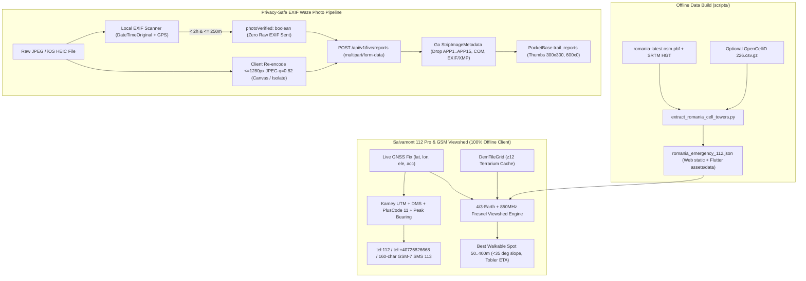

# Faza 2: Salvamont 112 Pro (Coordonate Multi-Format & SMS 113), Căutător Offline Semnal GSM 112 (Viewshed 4/3-Earth) & Verificare/Curățare EXIF Waze — Plan de Implementare

> **For agentic workers:** REQUIRED SUB-SKILL: Use superpowers:subagent-driven-development to implement this plan task-by-task. Steps use checkbox (`- [ ]`) syntax for tracking.

**Goal:** Extinderea modulului de urgență montană și raportare Waze (Web PWA + Mobile Flutter + PocketBase Go) cu: (1) un motor 100% offline de coordonate de salvare multi-format (`WGS84 Decimal`, `DMS DD°MM'SS.s"` fără eroare de rotunjire `60.0"`, `UTM 34T/35T/34U/35U` prin seria Krüger/Karney de ordinul 6, `Open Location Code / Google Plus Codes` de 11 caractere Apache-2.0, direcția/distanța față de cel mai apropiat vârf/reper și precompletare `tel:112`, `tel:+40725826668` și `SMS 113` / SMS urgență în 160 caractere ASCII GSM-7); (2) un căutător offline **„Unde prind semnal 112?”** care evaluează linia vizuală radio (`4/3` rază efectivă a Pământului `R_eff = 8494.67 km` + zona 1 Fresnel la `850 MHz`) peste [dem_tile_grid.ts](file:///Volumes/SSD%20extern/Proiecte/Maps/web/src/lib/navigation/dem_tile_grid.ts) / [dem_tile_grid.dart](file:///Volumes/SSD%20extern/Proiecte/Maps/app/lib/util/navigation/dem_tile_grid.dart) către releele telecom din România și recomandă cel mai apropiat punct accesibil la `50..400 m` în amonte (fără pante `> 35°`); și (3) verificare foto EXIF locală (`< 2h` și `<= 250 m` față de pin -> insignă `Foto verificată la fața locului`) combinată cu eliminarea 100% a metadatelor EXIF/GPS/PII atât pe client (`<= 1280px` JPEG `q=0.82`), cât și pe backend în Go înainte de salvarea în `trail_reports`.

**Architecture:** Un pipeline offline-first și privacy-by-design împărțit în patru subsisteme independente dar compuse curat cu Fazele 1, 3 și 4: (1) un script de extracție deterministă [extract_romania_cell_towers.py](file:///Volumes/SSD%20extern/Proiecte/Maps/scripts/extract_romania_cell_towers.py) care produce pachetul compact `romania_emergency_112.json` (`~204 KB` brut / `~64 KB` gzip) cu releele GSM/LTE din OSM PBF (plus OpenCelliD `MCC=226` opțional) și vârfurile/șeile numite cu cota SRTM pre-calculată; (2) migrația PocketBase [1792200000_add_trail_reports_photo.go](file:///Volumes/SSD%20extern/Proiecte/Maps/db/migrations/1792200000_add_trail_reports_photo.go) + sanitizer-ul binar Go [image_sanitize.go](file:///Volumes/SSD%20extern/Proiecte/Maps/db/util/image_sanitize.go) și suport `multipart/form-data` în `/live/reports` și `/api/v1/live/reports`; (3) module pure zero-API în TypeScript (`web/src/lib/emergency/*`, `web/src/lib/live/exif_photo_verifier.ts`) și Dart (`app/lib/util/emergency/*`, `app/lib/util/live/exif_photo_verifier.dart`); (4) cardul UI unificat `RescueCoordinatesAndSignalCard` (montat direct sub cardul Salvamont din Faza 1) și atașarea foto opțională în `WazeReportSheet` cu insigna discretă în `WazeNearbyPrompt` și pop-up-urile de pe hartă.

**Architecture Diagram:**



**Tech Stack:** Python 3.12 + `pyosmium` (`scripts/`), Go 1.25 + PocketBase `v0.38.0` + `gabriel-vasile/mimetype` (`db/`), TypeScript + SvelteKit 5 + MapLibre GL 6 + Vitest + Playwright (`web/`), Dart 3.13 + Flutter + `exif: ^3.3.0` + `image: ^4.8.0` + `dio: ^5.9.2` + `url_launcher: ^6.3.2` (`app/`).

**Spec:** [2026-11-18-mountain-intelligence-salvamont-design.md](file:///Volumes/SSD%20extern/Proiecte/Maps/docs/superpowers/specs/2026-11-18-mountain-intelligence-salvamont-design.md)

## Global Constraints

- **Identitate vizuală unificată (`Deep Slate #242734` & Sticlă Mată):** Toate suprafețele noi folosesc `bg-menu-background/94 backdrop-blur-md border border-input-border/60 text-content`; roșul `#DC2626` este folosit exclusiv pentru butonul `112` și starea SOS activă; insigna `Foto verificată la fața locului` folosește un accent calm smarald-ardezie (`text-emerald-700 dark:text-emerald-300 bg-emerald-500/12`).
- **Compunere curată cu Faza 1 în ecranul SOS:** În [sos_modal_and_banner.svelte](file:///Volumes/SSD%20extern/Proiecte/Maps/web/src/lib/components/navigation/sos_modal_and_banner.svelte) și [sos_banner_and_dialog.dart](file:///Volumes/SSD%20extern/Proiecte/Maps/app/lib/components/navigation/sos_banner_and_dialog.dart), Faza 1 (`salvamont-poi`) randează cardul celei mai apropiate baze/refugii Salvamont și telefoanele județene/locale pe graniță de creastă; Faza 2 montează componenta dedicată `RescueCoordinatesAndSignalCard` **imediat sub** cardul Salvamont din Faza 1 și normalizează apelul național la formatul internațional E.164 `tel:+40725826668`.
- **Director comun de date offline în Flutter:** În [pubspec.yaml](file:///Volumes/SSD%20extern/Proiecte/Maps/app/pubspec.yaml), toate seturile de date offline din Fazele 1–3 folosesc intrarea unică `- assets/data/` (`app/assets/data/salvamont_ro.json`, `app/assets/data/romania_emergency_112.json`, `app/assets/data/romania_peaks_v1.json`).
- **Standardizare JPEG `q=0.82` pentru fotografiile Waze:** PocketBase `v0.38.0` (`CreateThumb`) generează miniaturi JPEG compacte (`~14 KB` la `300x300`) pentru fișiere `.jpg`, dar convertește miniaturile `.webp` în PNG lossless (`450–700 KB`). Clienții Web și Flutter re-encodează întotdeauna fotografiile raportate în `image/jpeg` (`quality = 0.82`, `maxSide <= 1280`), înregistrând explicit `Thumbs: []string{"300x300", "600x0"}` în migrația [1792200000_add_trail_reports_photo.go](file:///Volumes/SSD%20extern/Proiecte/Maps/db/migrations/1792200000_add_trail_reports_photo.go) și în [thumb_sizes_test.go](file:///Volumes/SSD%20extern/Proiecte/Maps/db/tests/thumbs/thumb_sizes_test.go).
- **Garanție dublă Zero-PII / Zero-EXIF:** Coordonatele brute EXIF, `DateTimeOriginal`, `Make`, `Model`, `BodySerialNumber`, `MakerNote` și thumbnail-urile EXIF nu părăsesc niciodată telefonul; în plus, backend-ul Go elimină binar toate segmentele JPEG `APP1..APP15` (`0xFFE1..0xFFEF`) și `COM` (`0xFFFE`), respectiv chunk-urile RIFF `EXIF` / `XMP ` din WebP înainte de stocare.
- **Aritmetică pe 64 de biți & compatibilitate SMS mobil:** Codificarea Open Location Code folosește `Math.floor` / `.floor()` (niciodată operații pe biți pe 32 de biți `| 0` sau `>>`, deoarece `180 * 25_000_000 = 4.5e9 > 2^31 - 1`). Linkurile `sms:` folosesc separatorul `&body=` pe iOS Safari/PWA și `?body=` pe Android, cu `encodeURIComponent` / `Uri.encodeComponent` (`%20`, niciodată `+`), iar textul `SMS 113` are `<= 160` caractere ASCII pure (fără diacritice sau emoji) și menționează explicit condiția STS de înregistrare prealabilă pentru `113`.

---

### Task 1: Extractor Offline Relee GSM & Vârfuri Reper din OSM PBF (`scripts/`)

**Files:**
- Create: [extract_romania_cell_towers.py](file:///Volumes/SSD%20extern/Proiecte/Maps/scripts/extract_romania_cell_towers.py)
- Create: [test_extract_romania_cell_towers.py](file:///Volumes/SSD%20extern/Proiecte/Maps/scripts/test_extract_romania_cell_towers.py)

**Interfaces:**
- Consumes: `DemTileCache` din [dem_elevation.py](file:///Volumes/SSD%20extern/Proiecte/Maps/scripts/dem_elevation.py).
- Produces:
  - Funcții pure testabile: `classify_osm_telecom_feature(tags: dict[str, str]) -> tuple[int, int] | None` (returnează `(mast_height_m, carrier_mask)`), `classify_osm_landmark(tags: dict[str, str]) -> tuple[int, str, int | None] | None` (`(kind, name_ro, ele_tag_m)`), `deduplicate_towers(raw_towers, radius_m=60.0)`.
  - Schema JSON compactă `v: 1` salvată în `web/static/data/romania_emergency_112.json` și `app/assets/data/romania_emergency_112.json`:
    - `towers`: `Array<[latE5, lonE5, groundEleM, mastHeightM, carrierMask, sourceFlag]>`
    - `peaks`: `Array<[latE5, lonE5, eleM, kind, name]>` (`kind`: `1 = peak`, `2 = saddle`, `3 = alpine_hut/shelter`)

- [ ] **Step 1: Scrie testele unitare pentru clasificarea tag-urilor OpenInfraMap, parsarea înălțimii și deduplicarea OSM + OpenCelliD**

Creează `scripts/test_extract_romania_cell_towers.py`:

```python
import unittest

from extract_romania_cell_towers import (
    CARRIER_DIGI,
    CARRIER_GENERIC,
    CARRIER_ORANGE,
    CARRIER_TELEKOM,
    CARRIER_VODAFONE,
    SOURCE_OCID,
    SOURCE_OSM,
    classify_osm_landmark,
    classify_osm_telecom_feature,
    deduplicate_towers,
    parse_height_meters,
)


class TestExtractRomaniaCellTowers(unittest.TestCase):
    def test_parse_height_meters_handles_units_and_bounds(self) -> None:
        self.assertEqual(parse_height_meters("35 m", default_m=22), 35)
        self.assertEqual(parse_height_meters("42.6m", default_m=22), 43)
        self.assertEqual(parse_height_meters("invalid", default_m=28), 28)
        self.assertEqual(parse_height_meters("400", default_m=22), 120)
        self.assertEqual(parse_height_meters("2", default_m=22), 8)

    def test_classify_osm_telecom_accepts_mobile_masts_and_rejects_disused_or_lighting(self) -> None:
        h, mask = classify_osm_telecom_feature({
            "man_made": "communications_tower",
            "operator": "Orange România; Vodafone",
            "height": "48 m",
        })
        self.assertEqual(h, 48)
        self.assertEqual(mask, CARRIER_ORANGE | CARRIER_VODAFONE)

        mast = classify_osm_telecom_feature({
            "man_made": "mast",
            "tower:type": "communication",
            "operator": "RCS & RDS Digi Mobil",
        })
        self.assertEqual(mast, (22, CARRIER_DIGI))

        telekom = classify_osm_telecom_feature({
            "communication:mobile_phone": "yes",
            "operator": "Telekom Romania Mobile",
        })
        self.assertEqual(telekom, (15, CARRIER_TELEKOM))

        generic = classify_osm_telecom_feature({
            "man_made": "tower",
            "tower:type": "communication",
        })
        self.assertEqual(generic, (28, CARRIER_GENERIC))

        self.assertIsNone(classify_osm_telecom_feature({
            "man_made": "mast",
            "tower:type": "lighting",
        }))
        self.assertIsNone(classify_osm_telecom_feature({
            "disused:man_made": "mast",
            "communication:mobile_phone": "yes",
        }))
        self.assertIsNone(classify_osm_telecom_feature({
            "man_made": "tower",
            "tower:type": "communication",
            "communication:mobile_phone": "no",
        }))

    def test_classify_osm_landmark_extracts_named_peaks_and_saddles(self) -> None:
        self.assertEqual(
            classify_osm_landmark({"natural": "peak", "name": "Vârful Omu", "ele": "2505"}),
            (1, "Vârful Omu", 2505),
        )
        self.assertEqual(
            classify_osm_landmark({"natural": "saddle", "name:ro": "Șaua Caprei", "ele": "2315 m"}),
            (2, "Șaua Caprei", 2315),
        )
        self.assertIsNone(classify_osm_landmark({"natural": "peak"}))

    def test_deduplicate_towers_prefers_osm_over_opencellid_within_350m(self) -> None:
        raw = [
            # (lat, lon, ele_m, height_m, carrier_mask, source_flag)
            (45.44180, 25.48910, 2495, 80, CARRIER_ORANGE, SOURCE_OSM),
            (45.44185, 25.48915, 2495, 22, CARRIER_VODAFONE, SOURCE_OSM),  # <15m away -> merge mask & max height
            (45.44300, 25.49000, 2480, 22, CARRIER_DIGI, SOURCE_OCID),     # ~150m from OSM -> absorbed
        ]
        deduped = deduplicate_towers(raw)
        self.assertEqual(len(deduped), 1)
        lat_e5, lon_e5, ele_m, h_m, mask, src = deduped[0]
        self.assertEqual((lat_e5, lon_e5, ele_m, h_m, src), (4544180, 2548910, 2495, 80, SOURCE_OSM))
        self.assertEqual(mask, CARRIER_ORANGE | CARRIER_VODAFONE | CARRIER_DIGI)


if __name__ == "__main__":
    unittest.main()
```

- [ ] **Step 2: Rulează testele Python pentru a verifica eșecul inițial**

Run: `python3 -m unittest discover -s scripts -p "test_extract_romania_cell_towers.py" -v`
Expected: FAIL cu `ModuleNotFoundError: No module named 'extract_romania_cell_towers'`.

- [ ] **Step 3: Implementează extractorul `scripts/extract_romania_cell_towers.py`**

Creează `scripts/extract_romania_cell_towers.py`:

```python
#!/usr/bin/env python3
"""Extract Romanian telecom cell towers/masts and named mountain landmarks into a compact offline index.

Supports:
1. Full OpenStreetMap PBF scan (`--pbf romania-latest.osm.pbf`) enriched with 1-arcsec SRTM elevation (`DemTileCache`).
2. Optional OpenCelliD Romania (`MCC=226`) CSV.gz merge (`--opencellid-csv 226.csv.gz`) with explicit CC BY-SA 4.0 attribution.
3. Deterministic curated Carpathian seed mode (`--seed-only`) for CI / offline development environments without a local PBF.
"""

from __future__ import annotations

import argparse
import csv
import gzip
import json
import math
import re
from datetime import datetime, timezone
from pathlib import Path
from typing import Iterable

from dem_elevation import DemTileCache

RO_LAT_MIN, RO_LAT_MAX = 43.4, 48.5
RO_LON_MIN, RO_LON_MAX = 20.0, 30.0

CARRIER_ORANGE = 1
CARRIER_VODAFONE = 2
CARRIER_DIGI = 4
CARRIER_TELEKOM = 8
CARRIER_GENERIC = 16

SOURCE_OSM = 1
SOURCE_OCID = 2

EXCLUDED_TOWER_TYPES = {
    "lighting",
    "cooling",
    "observation",
    "bell_tower",
    "watchtower",
    "minaret",
    "pagoda",
    "climbing",
    "hose",
    "radar",
}

LIFECYCLE_PREFIXES = ("disused:", "abandoned:", "demolished:", "razed:", "construction:", "proposed:")

CURATED_CARPATHIAN_SEED = {
    "towers": [
        # [latE5, lonE5, groundEleM, mastHeightM, carrierMask, sourceFlag]
        [4542339, 2548811, 2498, 80, 15, 1],  # Releul Coștila (Bucegi)
        [4536744, 2553912, 1400, 35, 15, 1],  # Cota 1400 Sinaia
        [4556861, 2556750, 1799, 45, 15, 1],  # Postăvaru (Brașov)
        [4560389, 2461639, 2055, 30, 7, 1],   # Bâlea Lac / Paltinu (Făgăraș)
        [4538861, 2337583, 2070, 40, 15, 1],  # Parângul Mic
        [4535333, 2289222, 1680, 28, 7, 1],   # Râușor (Retezat)
        [4697722, 2594889, 1897, 45, 15, 1],  # Toaca / Ceahlău
        [4745194, 2557444, 1651, 60, 15, 1],  # Rarău
        [4653750, 2266611, 1849, 55, 15, 1],  # Curcubăta Mare / Bihor
        [4518056, 2205611, 1447, 50, 15, 1],  # Semenic
    ],
    "peaks": [
        # [latE5, lonE5, eleM, kind (1=peak, 2=saddle, 3=hut), name]
        [4544583, 2545639, 2505, 1, "Vf. Omu"],
        [4542339, 2548811, 2498, 1, "Vf. Coștila"],
        [4541472, 2549694, 2284, 1, "Crucea Caraiman"],
        [4540812, 2547450, 2216, 3, "Cabana Babele"],
        [4559944, 2473611, 2544, 1, "Vf. Moldoveanu"],
        [4558583, 2456083, 2535, 1, "Vf. Negoiu"],
        [4560050, 2462850, 2315, 2, "Șaua Caprei"],
        [4554028, 2522250, 2238, 1, "Vf. La Om (Piatra Craiului)"],
        [4536611, 2287694, 2482, 1, "Vf. Retezat"],
        [4535944, 2289028, 2509, 1, "Vf. Peleaga"],
        [4534000, 2353917, 2519, 1, "Vf. Parângul Mare"],
        [4697750, 2595000, 1904, 1, "Vf. Ocolașul Mare (Ceahlău)"],
        [4759556, 2463472, 2303, 1, "Vf. Pietrosul Rodnei"],
        [4653750, 2266611, 1849, 1, "Vf. Bihorul Mare"],
    ],
}


def haversine_meters(lat1: float, lon1: float, lat2: float, lon2: float) -> float:
    r = 6371000.0
    p1, p2 = math.radians(lat1), math.radians(lat2)
    dp = math.radians(lat2 - lat1)
    dl = math.radians(lon2 - lon1)
    a = math.sin(dp / 2.0) ** 2 + math.cos(p1) * math.cos(p2) * math.sin(dl / 2.0) ** 2
    return 2.0 * r * math.atan2(math.sqrt(a), math.sqrt(max(0.0, 1.0 - a)))


def parse_height_meters(raw: str | None, default_m: int) -> int:
    if not raw:
        return default_m
    m = re.search(r"(-?\d+(?:\.\d+)?)", raw.replace(",", "."))
    if not m:
        return default_m
    val = int(round(float(m.group(1))))
    return max(8, min(120, val))


def parse_elevation_tag(raw: str | None) -> int | None:
    if not raw:
        return None
    m = re.search(r"(-?\d+(?:\.\d+)?)", raw.replace(",", "."))
    if not m:
        return None
    val = int(round(float(m.group(1))))
    return val if -50 <= val <= 3000 else None


def parse_carrier_mask(tags: dict[str, str]) -> int:
    blob = " ".join(
        tags.get(k, "") for k in ("operator", "brand", "name", "owner")
    ).lower()
    mask = 0
    if "orange" in blob:
        mask |= CARRIER_ORANGE
    if "vodafone" in blob:
        mask |= CARRIER_VODAFONE
    if "digi" in blob or "rcs" in blob or "rds" in blob:
        mask |= CARRIER_DIGI
    if "telekom" in blob or "cosmote" in blob:
        mask |= CARRIER_TELEKOM
    return mask if mask != 0 else CARRIER_GENERIC


def classify_osm_telecom_feature(tags: dict[str, str]) -> tuple[int, int] | None:
    for k in tags:
        kl = k.lower()
        if kl.startswith(LIFECYCLE_PREFIXES) or kl in ("disused", "abandoned", "construction"):
            if tags[k].lower() != "no":
                return None

    if tags.get("communication:mobile_phone", "").strip().lower() == "no":
        return None

    tower_type = tags.get("tower:type", "").strip().lower()
    if tower_type in EXCLUDED_TOWER_TYPES:
        return None

    man_made = tags.get("man_made", "").strip().lower()
    mobile_yes = (
        tags.get("communication:mobile_phone", "").strip().lower() in ("yes", "gsm", "umts", "lte", "5g")
        or tags.get("communication:gsm", "").strip().lower() == "yes"
        or tags.get("communication:umts", "").strip().lower() == "yes"
        or tags.get("communication:lte", "").strip().lower() == "yes"
        or tags.get("communication:nr", "").strip().lower() == "yes"
    )

    matched = False
    default_h = 22
    if man_made == "communications_tower":
        matched = True
        default_h = 35
    elif man_made == "tower" and (tower_type == "communication" or mobile_yes):
        matched = True
        default_h = 28
    elif man_made == "mast" and (tower_type == "communication" or mobile_yes):
        matched = True
        default_h = 22
    elif mobile_yes:
        matched = True
        default_h = 15

    if not matched:
        return None

    height_m = parse_height_meters(tags.get("height") or tags.get("est_height"), default_h)
    return height_m, parse_carrier_mask(tags)


def classify_osm_landmark(tags: dict[str, str]) -> tuple[int, str, int | None] | None:
    name = (tags.get("name:ro") or tags.get("name") or "").strip()
    if not name:
        return None
    if len(name) > 64:
        name = name[:61].rstrip() + "..."

    ele = parse_elevation_tag(tags.get("ele"))
    natural = tags.get("natural", "").strip().lower()
    tourism = tags.get("tourism", "").strip().lower()

    if natural == "peak":
        return 1, name, ele
    if natural == "saddle":
        return 2, name, ele
    if tourism in ("alpine_hut", "wilderness_hut"):
        return 3, name, ele
    return None


def deduplicate_towers(
    raw_towers: Iterable[tuple[float, float, int, int, int, int]],
    osm_merge_m: float = 60.0,
    ocid_merge_m: float = 350.0,
) -> list[list[int]]:
    # Sort OSM physical structures ahead of OpenCelliD estimated centroids
    ordered = sorted(raw_towers, key=lambda item: (item[5], -item[3]))
    kept: list[list[float | int]] = []

    for lat, lon, ele_m, height_m, mask, src in ordered:
        merged = False
        threshold = osm_merge_m if src == SOURCE_OSM else ocid_merge_m
        for existing in kept:
            ex_lat = existing[0] / 1e5
            ex_lon = existing[1] / 1e5
            if abs(lat - ex_lat) > 0.005 or abs(lon - ex_lon) > 0.007:
                continue
            if haversine_meters(lat, lon, ex_lat, ex_lon) <= threshold:
                existing[3] = max(int(existing[3]), height_m)
                existing[4] = int(existing[4]) | mask
                merged = True
                break
        if not merged:
            kept.append([
                int(round(lat * 1e5)),
                int(round(lon * 1e5)),
                int(ele_m),
                int(height_m),
                int(mask),
                int(src),
            ])

    kept.sort(key=lambda r: (r[0], r[1]))
    return [[int(x) for x in row] for row in kept]


def load_opencellid_romania(csv_gz_path: Path, dem: DemTileCache) -> list[tuple[float, float, int, int, int, int]]:
    mnc_map = {1: CARRIER_VODAFONE, 3: CARRIER_TELEKOM, 5: CARRIER_DIGI, 6: CARRIER_TELEKOM, 10: CARRIER_ORANGE}
    buckets: dict[tuple[int, int, int], list[float]] = {}
    opener = gzip.open if csv_gz_path.suffix == ".gz" else open
    with opener(csv_gz_path, "rt", encoding="utf-8", errors="ignore") as fh:
        reader = csv.reader(fh)
        for row in reader:
            if len(row) < 10 or row[0] == "radio":
                continue
            try:
                mcc = int(row[1])
                if mcc != 226:
                    continue
                radio = row[0].strip().upper()
                if radio not in ("GSM", "UMTS", "LTE", "NR"):
                    continue
                mnc = int(row[2])
                lac = int(row[3])
                lon = float(row[6])
                lat = float(row[7])
                samples = int(row[9])
            except ValueError:
                continue
            if samples < 15 or not (RO_LAT_MIN <= lat <= RO_LAT_MAX and RO_LON_MIN <= lon <= RO_LON_MAX):
                continue
            key = (mnc, lac, int(round(lat * 200)) * 100000 + int(round(lon * 200)))
            acc = buckets.get(key)
            if acc is None:
                buckets[key] = [lat * samples, lon * samples, float(samples)]
            else:
                acc[0] += lat * samples
                acc[1] += lon * samples
                acc[2] += samples

    out: list[tuple[float, float, int, int, int, int]] = []
    for (mnc, _, _), (w_lat, w_lon, w_sum) in buckets.items():
        lat = w_lat / w_sum
        lon = w_lon / w_sum
        ele = dem.sample(lat, lon) or 0.0
        if ele < 250.0:
            continue
        out.append((lat, lon, int(round(ele)), 22, mnc_map.get(mnc, CARRIER_GENERIC), SOURCE_OCID))
    return out


def extract_from_pbf(
    pbf_path: Path,
    dem: DemTileCache,
) -> tuple[list[tuple[float, float, int, int, int, int]], list[list[int | str]]]:
    import osmium

    class EmergencyHandler(osmium.SimpleHandler):
        def __init__(self) -> None:
            super().__init__()
            self.raw_towers: list[tuple[float, float, float, int, int]] = []
            self.raw_peaks: list[tuple[float, float, int, str, int | None]] = []

        def node(self, n: osmium.osm.Node) -> None:
            if not n.location.valid() or not n.tags:
                return
            lat, lon = n.location.lat, n.location.lon
            if not (RO_LAT_MIN <= lat <= RO_LAT_MAX and RO_LON_MIN <= lon <= RO_LON_MAX):
                return
            tags = {t.k: t.v for t in n.tags}
            tc = classify_osm_telecom_feature(tags)
            if tc is not None:
                self.raw_towers.append((lat, lon, 0.0, tc[0], tc[1]))
            lm = classify_osm_landmark(tags)
            if lm is not None:
                self.raw_peaks.append((lat, lon, lm[0], lm[1], lm[2]))

        def area(self, a: osmium.osm.Area) -> None:
            if not a.tags or a.from_way() is False:
                return
            tags = {t.k: t.v for t in a.tags}
            tc = classify_osm_telecom_feature(tags)
            if tc is None:
                return
            lats: list[float] = []
            lons: list[float] = []
            for ring in a.outer_rings():
                for nd in ring:
                    if nd.location.valid():
                        lats.append(nd.location.lat)
                        lons.append(nd.location.lon)
            if lats and lons:
                clat = sum(lats) / len(lats)
                clon = sum(lons) / len(lons)
                if RO_LAT_MIN <= clat <= RO_LAT_MAX and RO_LON_MIN <= clon <= RO_LON_MAX:
                    self.raw_towers.append((clat, clon, 0.0, tc[0], tc[1]))

    handler = EmergencyHandler()
    handler.apply_file(str(pbf_path), locations=True, idx="flex_mem")

    tiles = {
        (int(math.floor(lat)), int(math.floor(lon)))
        for lat, lon, *_ in handler.raw_towers
    } | {
        (int(math.floor(lat)), int(math.floor(lon)))
        for lat, lon, *_ in handler.raw_peaks
    }
    dem.ensure_tiles(tiles)

    towers_out: list[tuple[float, float, int, int, int, int]] = []
    for lat, lon, _, h_m, mask in handler.raw_towers:
        ele = dem.sample(lat, lon) or 0.0
        towers_out.append((lat, lon, int(round(ele)), h_m, mask, SOURCE_OSM))

    peaks_out: list[list[int | str]] = []
    for lat, lon, kind, name, tag_ele in handler.raw_peaks:
        ele_val = tag_ele if tag_ele is not None else int(round(dem.sample(lat, lon) or 0.0))
        if ele_val >= 350 or kind == 3:
            peaks_out.append([int(round(lat * 1e5)), int(round(lon * 1e5)), ele_val, kind, name])

    peaks_out.sort(key=lambda r: (-int(r[2]), str(r[4])))
    return towers_out, peaks_out


def write_bundle(paths: list[Path], payload: dict) -> None:
    serialized = json.dumps(payload, ensure_ascii=False, separators=(",", ":"))
    for p in paths:
        p.parent.mkdir(parents=True, exist_ok=True)
        p.write_text(serialized, encoding="utf-8")


def main() -> None:
    parser = argparse.ArgumentParser(description="Build offline Romania 112 GSM tower & peak index.")
    parser.add_argument("--pbf", required=False, help="Path to romania-latest.osm.pbf")
    parser.add_argument("--opencellid-csv", required=False, help="Optional OpenCelliD 226.csv.gz")
    parser.add_argument("--dem-dir", default="./dem", help="SRTM .hgt cache directory")
    parser.add_argument("--seed-only", action="store_true", help="Write deterministic Carpathian seed")
    parser.add_argument("--out-web", required=True, help="Output path for web/static/data/romania_emergency_112.json")
    parser.add_argument("--out-app", required=False, help="Output path for app/assets/data/romania_emergency_112.json")
    args = parser.parse_args()

    targets = [Path(args.out_web).resolve()]
    if args.out_app:
        targets.append(Path(args.out_app).resolve())

    if args.seed_only or not args.pbf:
        payload = {
            "v": 1,
            "generatedAt": "2026-11-18T00:00:00Z",
            "attribution": "© OpenStreetMap contributors (ODbL)",
            "towers": CURATED_CARPATHIAN_SEED["towers"],
            "peaks": CURATED_CARPATHIAN_SEED["peaks"],
        }
        write_bundle(targets, payload)
        return

    dem = DemTileCache(Path(args.dem_dir).resolve())
    raw_towers, peaks = extract_from_pbf(Path(args.pbf).resolve(), dem)
    attribution = "© OpenStreetMap contributors (ODbL)"
    if args.opencellid_csv:
        raw_towers.extend(load_opencellid_romania(Path(args.opencellid_csv).resolve(), dem))
        attribution += " · Cell data © OpenCelliD (CC BY-SA 4.0)"

    deduped = deduplicate_towers(raw_towers)
    payload = {
        "v": 1,
        "generatedAt": datetime.now(timezone.utc).strftime("%Y-%m-%dT%H:%M:%SZ"),
        "attribution": attribution,
        "towers": deduped,
        "peaks": peaks,
    }
    write_bundle(targets, payload)


if __name__ == "__main__":
    main()
```

- [ ] **Step 4: Rulează testele unitare Python și verifică generarea seed-ului**

Run: `python3 -m unittest discover -s scripts -p "test_extract_romania_cell_towers.py" -v`
Expected: PASS (`4` teste verzi).

- [ ] **Step 5: Commit**

```bash
git add scripts/extract_romania_cell_towers.py scripts/test_extract_romania_cell_towers.py
git commit -m "feat(scripts): add Romania 112 GSM cell-tower and mountain peak PBF extractor"
```

---

### Task 2: Migrație PocketBase `1792200000`, Sanitizer Binar EXIF Go & Endpoint Multipart `POST /live/reports` (`db/`)

> [!IMPORTANT]
> Câmpul `photo` din `trail_reports` trebuie să aibă `Protected: false` și `Thumbs: []string{"300x300", "600x0"}` (înregistrat și în [thumb_sizes_test.go](file:///Volumes/SSD%20extern/Proiecte/Maps/db/tests/thumbs/thumb_sizes_test.go)) astfel încât `/api/v1/files/trail_reports/{id}/{file}?thumb=300x300` să servească miniaturi redimensionate în timp ce regulile REST ale colecției rămân `nil` (ascunzând `device_hash`).

**Files:**
- Create: [1792200000_add_trail_reports_photo.go](file:///Volumes/SSD%20extern/Proiecte/Maps/db/migrations/1792200000_add_trail_reports_photo.go)
- Create: [image_sanitize.go](file:///Volumes/SSD%20extern/Proiecte/Maps/db/util/image_sanitize.go)
- Modify: [trail_live.go](file:///Volumes/SSD%20extern/Proiecte/Maps/db/routes/trail_live.go#L75-L92) (`TrailReportDto`, `toTrailReportDto` `L248-302`, `CreateReport` `L766-904`, `RunTrailLiveGC` `L1653-1682`)
- Modify: [thumb_sizes_test.go](file:///Volumes/SSD%20extern/Proiecte/Maps/db/tests/thumbs/thumb_sizes_test.go#L29-L45)
- Create: [trail_live_photo_test.go](file:///Volumes/SSD%20extern/Proiecte/Maps/db/routes/trail_live_photo_test.go)

**Interfaces:**
- Produces:
  - `util.StripImageMetadata(raw []byte) (clean []byte, ext string, mimeType string, err error)`
  - `TrailReportDto` extins cu `PhotoUrl *string` (`json:"photoUrl"`), `PhotoThumbUrl *string` (`json:"photoThumbUrl"`), `PhotoVerified bool` (`json:"photoVerified"`).
  - `POST /live/reports` acceptând atât `application/json`, cât și `multipart/form-data` (`trailId`, `category`, `note`, `lat`, `lon`, `ele`, `alongTrackM`, `photoVerified`, fișier opțional `photo` `<= 2 MB`).

- [ ] **Step 1: Scrie testele Go pentru curățarea EXIF la nivel de octeți, upload multipart, deduplicare cu foto și miniaturi**

Creează `db/routes/trail_live_photo_test.go`:

```go
package routes

import (
	"bytes"
	"encoding/json"
	"image"
	"image/color"
	"image/jpeg"
	"mime/multipart"
	"net/http"
	"net/http/httptest"
	"net/textproto"
	"os"
	"path/filepath"
	"testing"

	"github.com/pocketbase/pocketbase/core"

	"pocketbase/services/live"
	"pocketbase/util"
)

// injectFakeApp1ExifAndComment splices an APP1 (0xFFE1 "Exif\0\0" + fake GPS) segment
// and a COM (0xFFFE) segment right after the JPEG SOI (0xFFD8) marker.
func injectFakeApp1ExifAndComment(t *testing.T, cleanJpeg []byte) []byte {
	t.Helper()
	if len(cleanJpeg) < 4 || cleanJpeg[0] != 0xFF || cleanJpeg[1] != 0xD8 {
		t.Fatalf("not a valid JPEG SOI")
	}
	exifPayload := []byte("Exif\x00\x00II*\x00SECRET_GPS_45.445833_25.456389_SERIAL_998877")
	app1Len := len(exifPayload) + 2
	comPayload := []byte("User private camera comment")
	comLen := len(comPayload) + 2

	var out bytes.Buffer
	out.Write(cleanJpeg[:2]) // FF D8
	out.Write([]byte{0xFF, 0xE1, byte(app1Len >> 8), byte(app1Len & 0xFF)})
	out.Write(exifPayload)
	out.Write([]byte{0xFF, 0xFE, byte(comLen >> 8), byte(comLen & 0xFF)})
	out.Write(comPayload)
	out.Write(cleanJpeg[2:])
	return out.Bytes()
}

func makeSampleJpeg(t *testing.T, w, h int) []byte {
	t.Helper()
	img := image.NewRGBA(image.Rect(0, 0, w, h))
	for y := 0; y < h; y++ {
		for x := 0; x < w; x++ {
			img.Set(x, y, color.RGBA{R: uint8((x * 5) % 255), G: uint8((y * 7) % 255), B: 90, A: 255})
		}
	}
	var buf bytes.Buffer
	if err := jpeg.Encode(&buf, img, &jpeg.Options{Quality: 85}); err != nil {
		t.Fatalf("jpeg.Encode: %v", err)
	}
	return buf.Bytes()
}

func TestStripImageMetadataRemovesExifAndRejectsNonImages(t *testing.T) {
	dirty := injectFakeApp1ExifAndComment(t, makeSampleJpeg(t, 640, 480))
	if !bytes.Contains(dirty, []byte("SECRET_GPS")) {
		t.Fatal("precondition failed: dirty JPEG missing fake EXIF")
	}

	clean, ext, mimeType, err := util.StripImageMetadata(dirty)
	if err != nil {
		t.Fatalf("StripImageMetadata failed: %v", err)
	}
	if ext != ".jpg" || mimeType != "image/jpeg" {
		t.Fatalf("got ext=%q mime=%q, want .jpg image/jpeg", ext, mimeType)
	}
	if bytes.Contains(clean, []byte("Exif")) || bytes.Contains(clean, []byte("SECRET_GPS")) || bytes.Contains(clean, []byte("private camera")) {
		t.Fatalf("expected all EXIF/COM bytes stripped from output JPEG")
	}
	if _, err := jpeg.Decode(bytes.NewReader(clean)); err != nil {
		t.Fatalf("cleaned JPEG failed to decode: %v", err)
	}

	if _, _, _, err := util.StripImageMetadata([]byte("%PDF-1.7 disguised")); err == nil {
		t.Fatalf("expected non-image payload to be rejected")
	}
}

func TestCreateReportMultipartPhotoStripsExifOnDiskAndReturnsUrls(t *testing.T) {
	app := newRemoteRealSchemaApp(t)
	t.Setenv("POCKETBASE_PROXY_SECRET", testLiveSecret)
	handler := NewTrailLiveHandler(live.NewTrailLiveHub())

	dirtyJpeg := injectFakeApp1ExifAndComment(t, makeSampleJpeg(t, 800, 600))

	var body bytes.Buffer
	mw := multipart.NewWriter(&body)
	_ = mw.WriteField("category", "bear")
	_ = mw.WriteField("note", "Urme proaspete pe poteca")
	_ = mw.WriteField("lat", "45.4458")
	_ = mw.WriteField("lon", "25.4563")
	_ = mw.WriteField("ele", "2040")
	_ = mw.WriteField("photoVerified", "true")

	partHeader := make(textproto.MIMEHeader)
	partHeader.Set("Content-Disposition", `form-data; name="photo"; filename="urs.jpg"`)
	partHeader.Set("Content-Type", "image/jpeg")
	part, err := mw.CreatePart(partHeader)
	if err != nil {
		t.Fatal(err)
	}
	_, _ = part.Write(dirtyJpeg)
	_ = mw.Close()

	req := httptest.NewRequest(http.MethodPost, "/live/reports", &body)
	req.Header.Set("Content-Type", mw.FormDataContentType())
	req.Header.Set("X-Internal-Secret", testLiveSecret)
	req.Header.Set("X-Device-Hash", "dev-photo-hash-1")

	rec := httptest.NewRecorder()
	ev := &core.RequestEvent{App: app}
	ev.Request = req
	ev.Response = rec
	if err := handler.CreateReport(ev); err != nil {
		t.Fatalf("CreateReport multipart failed: %v", err)
	}
	if rec.Code != http.StatusOK {
		t.Fatalf("status = %d, want 200: %s", rec.Code, rec.Body.String())
	}

	var parsed struct {
		Report TrailReportDto `json:"report"`
	}
	if err := json.Unmarshal(rec.Body.Bytes(), &parsed); err != nil {
		t.Fatal(err)
	}
	if !parsed.Report.PhotoVerified {
		t.Fatalf("expected PhotoVerified=true")
	}
	if parsed.Report.PhotoUrl == nil || parsed.Report.PhotoThumbUrl == nil {
		t.Fatalf("expected non-nil PhotoUrl and PhotoThumbUrl, got %+v", parsed.Report)
	}

	// Verify stored bytes on disk inside pb_data/storage contain ZERO EXIF bytes.
	dbRec, err := app.FindRecordById("trail_reports", parsed.Report.ID)
	if err != nil {
		t.Fatal(err)
	}
	storedName := dbRec.GetString("photo")
	storedPath := filepath.Join(app.DataDir(), "storage", dbRec.Collection().Id, dbRec.Id, storedName)
	storedBytes, err := os.ReadFile(storedPath)
	if err != nil {
		t.Fatalf("read stored photo %s: %v", storedPath, err)
	}
	if bytes.Contains(storedBytes, []byte("SECRET_GPS")) || bytes.Contains(storedBytes, []byte("Exif")) {
		t.Fatalf("stored file on disk leaked EXIF metadata!")
	}
}
```

- [ ] **Step 2: Rulează testul Go pentru a verifica că eșuează înaintea implementării**

Run: `cd db && go test ./routes -run "TestStripImageMetadata|TestCreateReportMultipartPhoto" -v`
Expected: FAIL cu `undefined: util.StripImageMetadata` și câmpurile lipsă `PhotoVerified` / `PhotoUrl`.

- [ ] **Step 3: Creează migrația `1792200000_add_trail_reports_photo.go`, `db/util/image_sanitize.go` și actualizează `trail_live.go` + `thumb_sizes_test.go`**

Creează `db/migrations/1792200000_add_trail_reports_photo.go`:

```go
package migrations

import (
	"github.com/pocketbase/pocketbase/core"
	m "github.com/pocketbase/pocketbase/migrations"
)

const reportPhotoMaxBytes int64 = 2 * 1024 * 1024

func init() {
	m.Register(func(app core.App) error {
		col, err := app.FindCollectionByNameOrId("trail_reports")
		if err != nil {
			return err
		}
		if col.Fields.GetByName("photo") == nil {
			col.Fields.Add(&core.FileField{
				Name:      "photo",
				MaxSelect: 1,
				MaxSize:   reportPhotoMaxBytes,
				MimeTypes: []string{"image/jpeg", "image/webp"},
				Thumbs:    []string{"300x300", "600x0"},
				Protected: false,
			})
		}
		if col.Fields.GetByName("photo_verified") == nil {
			col.Fields.Add(&core.BoolField{
				Name: "photo_verified",
			})
		}
		return app.Save(col)
	}, func(app core.App) error {
		col, err := app.FindCollectionByNameOrId("trail_reports")
		if err != nil {
			return nil
		}
		col.Fields.RemoveByName("photo")
		col.Fields.RemoveByName("photo_verified")
		return app.Save(col)
	})
}
```

Creează `db/util/image_sanitize.go`:

```go
package util

import (
	"bytes"
	"encoding/binary"
	"errors"

	"github.com/gabriel-vasile/mimetype"
)

const MaxReportPhotoBytes = 2 * 1024 * 1024

var (
	ErrPhotoEmpty       = errors.New("empty photo payload")
	ErrPhotoTooLarge    = errors.New("photo exceeds 2 MB limit")
	ErrUnsupportedPhoto = errors.New("photo must be JPEG or WebP")
	ErrCorruptContainer = errors.New("corrupt image container")
)

// StripImageMetadata validates image magic bytes and losslessly strips all EXIF,
// GPS, XMP, IPTC, ICC, and comment segments from JPEG and WebP containers.
func StripImageMetadata(raw []byte) (clean []byte, ext string, mimeType string, err error) {
	if len(raw) == 0 {
		return nil, "", "", ErrPhotoEmpty
	}
	if len(raw) > MaxReportPhotoBytes {
		return nil, "", "", ErrPhotoTooLarge
	}

	detected := mimetype.Detect(raw)
	switch detected.String() {
	case "image/jpeg":
		stripped, sErr := stripJPEGSegments(raw)
		if sErr != nil {
			return nil, "", "", sErr
		}
		return stripped, ".jpg", "image/jpeg", nil
	case "image/webp":
		stripped, sErr := stripWebPChunks(raw)
		if sErr != nil {
			return nil, "", "", sErr
		}
		return stripped, ".webp", "image/webp", nil
	default:
		return nil, "", "", ErrUnsupportedPhoto
	}
}

func stripJPEGSegments(raw []byte) ([]byte, error) {
	if len(raw) < 4 || raw[0] != 0xFF || raw[1] != 0xD8 {
		return nil, ErrCorruptContainer
	}
	var out bytes.Buffer
	out.Grow(len(raw))
	out.Write([]byte{0xFF, 0xD8})

	pos := 2
	for pos < len(raw) {
		if raw[pos] != 0xFF {
			return nil, ErrCorruptContainer
		}
		for pos < len(raw) && raw[pos] == 0xFF {
			pos++
		}
		if pos >= len(raw) {
			break
		}
		marker := raw[pos]
		pos++

		// Standalone markers without length
		if marker == 0xD9 { // EOI
			out.Write([]byte{0xFF, 0xD9})
			return out.Bytes(), nil
		}
		if marker == 0x01 || (marker >= 0xD0 && marker <= 0xD7) {
			out.Write([]byte{0xFF, marker})
			continue
		}
		if pos+2 > len(raw) {
			return nil, ErrCorruptContainer
		}
		segLen := int(binary.BigEndian.Uint16(raw[pos : pos+2]))
		if segLen < 2 || pos+segLen > len(raw) {
			return nil, ErrCorruptContainer
		}

		if marker == 0xDA { // SOS: copy header + remainder of entropy-coded stream up to EOI
			out.Write([]byte{0xFF, marker})
			out.Write(raw[pos:])
			return out.Bytes(), nil
		}

		// Drop APP1..APP15 (0xE1..0xEF) and COM (0xFE); keep APP0 (0xE0 JFIF) & codec tables
		drop := (marker >= 0xE1 && marker <= 0xEF) || marker == 0xFE
		if !drop {
			out.Write([]byte{0xFF, marker})
			out.Write(raw[pos : pos+segLen])
		}
		pos += segLen
	}
	return nil, ErrCorruptContainer
}

func stripWebPChunks(raw []byte) ([]byte, error) {
	if len(raw) < 12 || string(raw[0:4]) != "RIFF" || string(raw[8:12]) != "WEBP" {
		return nil, ErrCorruptContainer
	}
	var body bytes.Buffer
	body.WriteString("WEBP")

	pos := 12
	for pos+8 <= len(raw) {
		fourCC := string(raw[pos : pos+4])
		chunkSize := int(binary.LittleEndian.Uint32(raw[pos+4 : pos+8]))
		paddedSize := chunkSize + (chunkSize & 1)
		if chunkSize < 0 || pos+8+paddedSize > len(raw) {
			return nil, ErrCorruptContainer
		}
		payload := raw[pos+8 : pos+8+paddedSize]
		if fourCC != "EXIF" && fourCC != "XMP " && fourCC != "ICCP" {
			body.WriteString(fourCC)
			var sz [4]byte
			binary.LittleEndian.PutUint32(sz[:], uint32(chunkSize))
			body.Write(sz[:])
			if fourCC == "VP8X" && len(payload) >= 4 {
				cleanVP8X := append([]byte(nil), payload...)
				// Clear ICC (bit 5), EXIF (bit 3), and XMP (bit 2) flags
				cleanVP8X[0] &^= (1 << 5) | (1 << 3) | (1 << 2)
				body.Write(cleanVP8X)
			} else {
				body.Write(payload)
			}
		}
		pos += 8 + paddedSize
	}

	var out bytes.Buffer
	out.Grow(8 + body.Len())
	out.WriteString("RIFF")
	var riffLen [4]byte
	binary.LittleEndian.PutUint32(riffLen[:], uint32(body.Len()))
	out.Write(riffLen[:])
	out.Write(body.Bytes())
	return out.Bytes(), nil
}
```

Actualizează `db/routes/trail_live.go` (adaugă import `"io"` și `"github.com/pocketbase/pocketbase/tools/filesystem"`):

```diff
 type TrailReportDto struct {
 	ID              string   `json:"id"`
 	TrailID         string   `json:"trailId"`
 	Category        string   `json:"category"`
 	Kind            string   `json:"kind"`
 	IsPermanent     bool     `json:"isPermanent"`
 	ConditionStatus string   `json:"conditionStatus"`
 	Note            string   `json:"note"`
 	Lat             float64  `json:"lat"`
 	Lon             float64  `json:"lon"`
 	Ele             float64  `json:"ele"`
 	AlongTrackM     *float64 `json:"alongTrackM"`
+	PhotoUrl        *string  `json:"photoUrl"`
+	PhotoThumbUrl   *string  `json:"photoThumbUrl"`
+	PhotoVerified   bool     `json:"photoVerified"`
 	ConfirmCount    int      `json:"confirmCount"`
 	DismissCount    int      `json:"dismissCount"`
 	CreatedAt       string   `json:"createdAt"`
 	LastConfirmedAt string   `json:"lastConfirmedAt"`
 	ExpiresAt       *string  `json:"expiresAt"`
 }
```

În `toTrailReportDto(rec *core.Record)` din `db/routes/trail_live.go`:

```diff
+	var photoUrlPtr, photoThumbUrlPtr *string
+	if photoFile := strings.TrimSpace(rec.GetString("photo")); photoFile != "" {
+		full := "/api/v1/files/trail_reports/" + rec.Id + "/" + photoFile + "?thumb=600x0"
+		thumb := "/api/v1/files/trail_reports/" + rec.Id + "/" + photoFile + "?thumb=300x300"
+		photoUrlPtr = &full
+		photoThumbUrlPtr = &thumb
+	}
+
 	return TrailReportDto{
 		ID:              rec.Id,
 		TrailID:         rec.GetString("trail_id"),
 		Category:        rec.GetString("category"),
 		Kind:            rec.GetString("kind"),
 		IsPermanent:     isPermanent,
 		ConditionStatus: rec.GetString("condition_status"),
 		Note:            rec.GetString("note"),
 		Lat:             rec.GetFloat("lat"),
 		Lon:             rec.GetFloat("lon"),
 		Ele:             rec.GetFloat("ele"),
 		AlongTrackM:     alongTrackPtr,
+		PhotoUrl:        photoUrlPtr,
+		PhotoThumbUrl:   photoThumbUrlPtr,
+		PhotoVerified:   photoUrlPtr != nil && rec.GetBool("photo_verified"),
 		ConfirmCount:    rec.GetInt("confirm_count"),
```

În `CreateReport` din `db/routes/trail_live.go` (`L766-895`), suportă atât `multipart/form-data`, cât și `application/json`:

```go
type createReportRequest struct {
	TrailID       string   `json:"trailId"`
	Category      string   `json:"category"`
	Note          string   `json:"note"`
	Lat           *float64 `json:"lat"`
	Lon           *float64 `json:"lon"`
	Ele           *float64 `json:"ele"`
	AlongTrackM   *float64 `json:"alongTrackM"`
	PhotoVerified bool     `json:"photoVerified"`
}

func parseCreateReportPayload(r *http.Request, bindJSON func(any) error) (createReportRequest, *filesystem.File, error) {
	ct := strings.ToLower(r.Header.Get("Content-Type"))
	if strings.HasPrefix(ct, "multipart/form-data") {
		if err := r.ParseMultipartForm(util.MaxReportPhotoBytes + 64*1024); err != nil {
			return createReportRequest{}, nil, errors.New("invalid multipart form")
		}
		parseOptFloat := func(key string) (*float64, error) {
			raw := strings.TrimSpace(r.FormValue(key))
			if raw == "" {
				return nil, nil
			}
			v, err := strconv.ParseFloat(raw, 64)
			if err != nil {
				return nil, err
			}
			return &v, nil
		}
		latPtr, errLat := parseOptFloat("lat")
		lonPtr, errLon := parseOptFloat("lon")
		if errLat != nil || errLon != nil {
			return createReportRequest{}, nil, errors.New("invalid coordinates")
		}
		elePtr, _ := parseOptFloat("ele")
		alongPtr, _ := parseOptFloat("alongTrackM")
		pvRaw := strings.ToLower(strings.TrimSpace(r.FormValue("photoVerified")))
		req := createReportRequest{
			TrailID:       r.FormValue("trailId"),
			Category:      r.FormValue("category"),
			Note:          r.FormValue("note"),
			Lat:           latPtr,
			Lon:           lonPtr,
			Ele:           elePtr,
			AlongTrackM:   alongPtr,
			PhotoVerified: pvRaw == "true" || pvRaw == "1",
		}

		var uploadedFile *filesystem.File
		f, _, fErr := r.FormFile("photo")
		if fErr == nil && f != nil {
			defer f.Close()
			limited := io.LimitReader(f, util.MaxReportPhotoBytes+1)
			rawBytes, rErr := io.ReadAll(limited)
			if rErr != nil {
				return createReportRequest{}, nil, errors.New("failed reading photo")
			}
			cleanBytes, ext, _, sErr := util.StripImageMetadata(rawBytes)
			if sErr != nil {
				return createReportRequest{}, nil, sErr
			}
			pbFile, nErr := filesystem.NewFileFromBytes(cleanBytes, "report"+ext)
			if nErr != nil {
				return createReportRequest{}, nil, nErr
			}
			uploadedFile = pbFile
		}
		return req, uploadedFile, nil
	}

	var req createReportRequest
	if err := bindJSON(&req); err != nil {
		return createReportRequest{}, nil, errors.New("invalid JSON body")
	}
	return req, nil, nil
}
```

Și în `CreateReport`:
- Apelează `req, uploadedPhoto, err := parseCreateReportPayload(e.Request, e.BindBody)` (returnând `e.BadRequestError(err.Error(), nil)` la eroare).
- Pe ramura de deduplicare la `<= 40 m` (`if closest != nil`), dacă `uploadedPhoto != nil && closest.GetString("photo") == ""`, setează `closest.Set("photo", uploadedPhoto)` și `closest.Set("photo_verified", req.PhotoVerified)`.
- La creare nouă (`rec := core.NewRecord(reportsCol)`), dacă `uploadedPhoto != nil`, setează `rec.Set("photo", uploadedPhoto)` și `rec.Set("photo_verified", req.PhotoVerified)`.

Actualizează `db/tests/thumbs/thumb_sizes_test.go` (`L44`):

```diff
 	{"waypoints", "photos", "600x0", "trail_timeline, photo_picker"},
 	{"summit_logs", "photos", "300x300", "summit_log_table_row"},
 	{"summit_logs", "photos", "600x0", "summit_log_card, photo_picker, activity_card"},
+	{"trail_reports", "photo", "300x300", "report_markers popup, waze_nearby_prompt"},
+	{"trail_reports", "photo", "600x0", "report photo full preview"},
 }
```

- [ ] **Step 4: Rulează suita Go pe `routes` și `tests/thumbs` pentru a confirma trecerea**

Run: `cd db && go test ./routes ./tests/thumbs -run "TestStripImageMetadata|TestCreateReportMultipartPhoto|TestTrailLive|TestRequestedThumbSizesAreRegistered" -v`
Expected: PASS pentru toate testele.

- [ ] **Step 5: Commit**

```bash
git add db/migrations/1792200000_add_trail_reports_photo.go db/util/image_sanitize.go db/routes/trail_live.go db/routes/trail_live_photo_test.go db/tests/thumbs/thumb_sizes_test.go
git commit -m "feat(db): add trail_reports photo migration and lossless EXIF stripping"
```

---

### Task 3: Proxy SvelteKit Multipart `/api/v1/live/reports` & Client Live Web (`web/`)

**Files:**
- Modify: [device_identity.ts](file:///Volumes/SSD%20extern/Proiecte/Maps/web/src/lib/server/live/device_identity.ts#L244-L291)
- Modify: [+server.ts](file:///Volumes/SSD%20extern/Proiecte/Maps/web/src/routes/api/v1/live/reports/+server.ts)
- Modify: [live_client.ts](file:///Volumes/SSD%20extern/Proiecte/Maps/web/src/lib/live/live_client.ts#L22-L40) (`TrailReportDto`, `normalizeReportDto` `L392-422`, `createReport` `L592-620`)
- Create: [server.test.ts](file:///Volumes/SSD%20extern/Proiecte/Maps/web/src/routes/api/v1/live/reports/server.test.ts)

**Interfaces:**
- Produces:
  - `TrailReportDto` extins cu `photoUrl: string | null`, `photoThumbUrl: string | null`, `photoVerified: boolean`.
  - `createReport(params)` în `live_client.ts` acceptând `photoBlob?: Blob | null; photoFilename?: string; photoVerified?: boolean` (trimițând `FormData` când `photoBlob` există, sau JSON altfel).

- [ ] **Step 1: Scrie testul Vitest pentru proxy-ul `/api/v1/live/reports` (JSON + Multipart + limită `2.2 MB`)**

Creează `web/src/routes/api/v1/live/reports/server.test.ts`:

```ts
import { afterEach, describe, expect, it, vi } from "vitest";
import { POST } from "./+server";

const VALID_TOKEN = "a".repeat(64);

describe("POST /api/v1/live/reports", () => {
	afterEach(() => {
		vi.restoreAllMocks();
	});

	it("forwards multipart/form-data report with stripped photo blob to PocketBase /live/reports", async () => {
		let capturedHeaders: Headers | null = null;
		let capturedBody: BodyInit | null | undefined = null;

		const origFetch = globalThis.fetch;
		vi.stubGlobal(
			"fetch",
			vi.fn(async (_url: RequestInfo | URL, init?: RequestInit) => {
				capturedHeaders = new Headers(init?.headers);
				capturedBody = init?.body;
				return Response.json({
					report: {
						id: "rep123456789012",
						category: "spring",
						kind: "landmark_permanent",
						isPermanent: true,
						conditionStatus: "active",
						note: "Izvor rece",
						lat: 45.44,
						lon: 25.45,
						ele: 1850,
						photoUrl: "/api/v1/files/trail_reports/rep123456789012/report.jpg?thumb=600x0",
						photoThumbUrl: "/api/v1/files/trail_reports/rep123456789012/report.jpg?thumb=300x300",
						photoVerified: true,
						confirmCount: 1,
						dismissCount: 0,
						createdAt: "2026-11-18T12:00:00Z",
						lastConfirmedAt: "2026-11-18T12:00:00Z",
						expiresAt: null,
					},
				});
			}) as typeof origFetch,
		);

		const fd = new FormData();
		fd.set("category", "spring");
		fd.set("note", "Izvor rece");
		fd.set("lat", "45.44");
		fd.set("lon", "25.45");
		fd.set("ele", "1850");
		fd.set("photoVerified", "true");
		fd.set("photo", new Blob([new Uint8Array([0xff, 0xd8, 0xff, 0xd9])], { type: "image/jpeg" }), "report.jpg");

		const req = new Request("http://localhost/api/v1/live/reports", {
			method: "POST",
			headers: { "X-Device-Token": VALID_TOKEN },
			body: fd,
		});

		const res = await POST({ request: req, locals: {} } as never);
		expect(res.status).toBe(200);
		expect(capturedBody).toBeInstanceOf(FormData);
		expect(capturedHeaders!.get("content-type")).toBeNull();
		expect(capturedHeaders!.get("x-device-hash")).toMatch(/^[0-9a-f]{64}$/);
	});

	it("rejects oversized photos (> 2 MB) with HTTP 413", async () => {
		const fd = new FormData();
		fd.set("category", "bear");
		fd.set("lat", "45.44");
		fd.set("lon", "25.45");
		fd.set("photo", new Blob([new Uint8Array(2 * 1024 * 1024 + 1024)], { type: "image/jpeg" }), "huge.jpg");

		const req = new Request("http://localhost/api/v1/live/reports", {
			method: "POST",
			headers: { "X-Device-Token": VALID_TOKEN },
			body: fd,
		});

		const res = await POST({ request: req, locals: {} } as never);
		expect(res.status).toBe(413);
	});
});
```

- [ ] **Step 2: Rulează testul Vitest pentru a verifica eșecul inițial**

Run: `cd web && npx vitest run src/routes/api/v1/live/reports/server.test.ts`
Expected: FAIL (`400 invalid_json` deoarece `+server.ts` apelează necondiționat `event.request.json()`).

- [ ] **Step 3: Actualizează `device_identity.ts`, `reports/+server.ts` și `live_client.ts`**

În `web/src/lib/server/live/device_identity.ts` (`L258-261`), nu suprascrie `Content-Type` când `init.body instanceof FormData`:

```diff
 	const headers = new Headers(init.headers);
-	if (init.body !== undefined && !headers.has("Content-Type")) {
+	if (
+		init.body !== undefined &&
+		!(typeof FormData !== "undefined" && init.body instanceof FormData) &&
+		!headers.has("Content-Type")
+	) {
 		headers.set("Content-Type", "application/json");
 	}
```

Înlocuiește `web/src/routes/api/v1/live/reports/+server.ts`:

```ts
import {
	forwardAndProxyLiveJson,
	liveRateLimiters,
	resolveActorId,
	resolveDeviceIdentity,
} from "#lib/server/live/device_identity.ts";
import type { RequestEvent } from "@sveltejs/kit";

const MAX_PHOTO_BYTES = 2 * 1024 * 1024;

export async function POST(event: RequestEvent) {
	const identity = resolveDeviceIdentity(event);
	if (!identity.ok) {
		return identity.response;
	}

	const rateLimited = liveRateLimiters.reports.enforce(identity.deviceHash);
	if (rateLimited) {
		return rateLimited;
	}

	const contentType = (event.request.headers.get("content-type") ?? "").toLowerCase();

	if (contentType.startsWith("multipart/form-data")) {
		let form: FormData;
		try {
			form = await event.request.formData();
		} catch {
			return Response.json({ message: "invalid_multipart" }, { status: 400 });
		}

		const category = String(form.get("category") ?? "").trim();
		const lat = Number(form.get("lat"));
		const lon = Number(form.get("lon"));
		if (!category) {
			return Response.json({ message: "invalid_category" }, { status: 400 });
		}
		if (!Number.isFinite(lat) || lat < -90 || lat > 90 || !Number.isFinite(lon) || lon < -180 || lon > 180) {
			return Response.json({ message: "invalid_coordinates" }, { status: 400 });
		}

		const upstreamForm = new FormData();
		upstreamForm.set("trailId", String(form.get("trailId") ?? ""));
		upstreamForm.set("category", category);
		upstreamForm.set("note", String(form.get("note") ?? ""));
		upstreamForm.set("lat", String(lat));
		upstreamForm.set("lon", String(lon));
		const ele = Number(form.get("ele"));
		if (Number.isFinite(ele)) upstreamForm.set("ele", String(ele));
		const along = Number(form.get("alongTrackM"));
		if (Number.isFinite(along)) upstreamForm.set("alongTrackM", String(along));
		upstreamForm.set("photoVerified", form.get("photoVerified") === "true" ? "true" : "false");

		const photoEntry = form.get("photo");
		if (photoEntry instanceof Blob && photoEntry.size > 0) {
			if (photoEntry.size > MAX_PHOTO_BYTES) {
				return Response.json({ message: "photo_too_large" }, { status: 413 });
			}
			const filename = photoEntry instanceof File && photoEntry.name ? photoEntry.name : "report.jpg";
			upstreamForm.set("photo", photoEntry, filename);
		}

		return forwardAndProxyLiveJson(
			"/reports",
			{ method: "POST", body: upstreamForm },
			identity.deviceHash,
			resolveActorId(event),
		);
	}

	let body: Record<string, unknown>;
	try {
		const parsed = await event.request.json();
		if (!parsed || typeof parsed !== "object" || Array.isArray(parsed)) {
			return Response.json({ message: "invalid_body" }, { status: 400 });
		}
		body = parsed as Record<string, unknown>;
	} catch {
		return Response.json({ message: "invalid_json" }, { status: 400 });
	}

	const category = typeof body.category === "string" ? body.category.trim() : "";
	const lat = Number(body.lat);
	const lon = Number(body.lon);
	if (!category) {
		return Response.json({ message: "invalid_category" }, { status: 400 });
	}
	if (!Number.isFinite(lat) || lat < -90 || lat > 90 || !Number.isFinite(lon) || lon < -180 || lon > 180) {
		return Response.json({ message: "invalid_coordinates" }, { status: 400 });
	}

	return forwardAndProxyLiveJson(
		"/reports",
		{
			method: "POST",
			body: JSON.stringify({
				trailId: typeof body.trailId === "string" ? body.trailId : "",
				category,
				note: typeof body.note === "string" ? body.note : "",
				lat,
				lon,
				ele: typeof body.ele === "number" && Number.isFinite(body.ele) ? body.ele : undefined,
				alongTrackM:
					typeof body.alongTrackM === "number" && Number.isFinite(body.alongTrackM)
						? body.alongTrackM
						: undefined,
			}),
		},
		identity.deviceHash,
		resolveActorId(event),
	);
}
```

În `web/src/lib/live/live_client.ts`, extinde `TrailReportDto`, `normalizeReportDto`, `liveJsonFetch` (fără `Content-Type: application/json` când `init.body instanceof FormData`) și `createReport`:

```diff
 export interface TrailReportDto {
 	id: string;
 	trailId: string;
 	category: TrailReportCategory;
 	kind: ReportKind | string;
 	isPermanent: boolean;
 	conditionStatus: ReportConditionStatus;
 	note: string;
 	lat: number;
 	lon: number;
 	ele: number;
 	alongTrackM: number;
+	photoUrl: string | null;
+	photoThumbUrl: string | null;
+	photoVerified: boolean;
 	confirmCount: number;
 	dismissCount: number;
 	createdAt: string;
 	lastConfirmedAt: string;
 	expiresAt: string | null;
 }
```

În `normalizeReportDto` (`L415`):

```diff
 		ele: Number(raw.ele ?? 0),
 		alongTrackM: Number(raw.alongTrackM ?? 0),
+		photoUrl: typeof raw.photoUrl === "string" && raw.photoUrl ? raw.photoUrl : null,
+		photoThumbUrl: typeof raw.photoThumbUrl === "string" && raw.photoThumbUrl ? raw.photoThumbUrl : null,
+		photoVerified: Boolean(raw.photoVerified && raw.photoUrl),
 		confirmCount: Math.max(0, Number(raw.confirmCount ?? 1)),
```

În `liveJsonFetch` (`L513`):

```diff
-		if (init.body && !headers.has("Content-Type")) {
+		if (
+			init.body &&
+			!(typeof FormData !== "undefined" && init.body instanceof FormData) &&
+			!headers.has("Content-Type")
+		) {
 			headers.set("Content-Type", "application/json");
 		}
```

Și în `createReport` (`L592`):

```ts
export async function createReport(params: {
	trailId?: string;
	category: TrailReportCategory;
	note?: string;
	lat: number;
	lon: number;
	ele?: number | null;
	alongTrackM?: number | null;
	photoBlob?: Blob | null;
	photoFilename?: string;
	photoVerified?: boolean;
}): Promise<TrailReportDto | null> {
	const cleanNote = (params.note ?? "").trim().slice(0, 160);
	let body: BodyInit;
	if (params.photoBlob && params.photoBlob.size > 0) {
		const fd = new FormData();
		fd.set("trailId", params.trailId ?? "");
		fd.set("category", params.category);
		fd.set("note", cleanNote);
		fd.set("lat", String(params.lat));
		fd.set("lon", String(params.lon));
		fd.set("ele", String(params.ele ?? 0));
		fd.set("alongTrackM", String(params.alongTrackM ?? 0));
		fd.set("photoVerified", params.photoVerified ? "true" : "false");
		fd.set("photo", params.photoBlob, params.photoFilename ?? "report.jpg");
		body = fd;
	} else {
		body = JSON.stringify({
			trailId: params.trailId ?? "",
			category: params.category,
			note: cleanNote,
			lat: params.lat,
			lon: params.lon,
			ele: params.ele ?? 0,
			alongTrackM: params.alongTrackM ?? 0,
		});
	}
	const data = await liveJsonFetch<Record<string, unknown>>("/api/v1/live/reports", {
		method: "POST",
		body,
	});
	if (!data) return null;
	const rawReport = (data.report ?? data) as Record<string, unknown>;
	const normalized = normalizeReportDto(rawReport);
	if (normalized) {
		recordLocalReportVote(normalized.id, "confirm");
	}
	return normalized;
}
```

- [ ] **Step 4: Rulează testele Vitest pentru proxy și `live_client.test.ts`**

Run: `cd web && npx vitest run src/routes/api/v1/live/reports/server.test.ts src/lib/live/live_client.test.ts`
Expected: PASS.

- [ ] **Step 5: Commit**

```bash
git add web/src/lib/server/live/device_identity.ts web/src/routes/api/v1/live/reports/+server.ts web/src/routes/api/v1/live/reports/server.test.ts web/src/lib/live/live_client.ts
git commit -m "feat(web): support multipart photo upload in /api/v1/live/reports and live_client"
```

---

### Task 4: Motor 100% Offline Coordonate Multi-Format (`WGS84`, `DMS`, `Karney UTM`, `Plus Codes`) & URI `SMS 113` (Web TypeScript)

**Files:**
- Create: [rescue_coordinates.ts](file:///Volumes/SSD%20extern/Proiecte/Maps/web/src/lib/emergency/rescue_coordinates.ts)
- Create: [rescue_coordinates.test.ts](file:///Volumes/SSD%20extern/Proiecte/Maps/web/src/lib/emergency/rescue_coordinates.test.ts)

**Interfaces:**
- Produces:
  - `UtmCoordinate { zone: number; band: string; hemisphere: "N" | "S"; easting: number; northing: number; formatted: string }`
  - `PlusCodeArea { latitudeLo: number; longitudeLo: number; latitudeHi: number; longitudeHi: number; latitudeCenter: number; longitudeCenter: number; codeLength: number }`
  - `NearbyLandmarkRef { name: string; eleM: number | null; distanceM: number; bearingFromLandmarkRo: string; summaryRo: string; summaryAscii: string }`
  - `RescueCoordinateBundle { wgs84Decimal: string; wgs84RawPair: string; wgs84Dms: string; utm: UtmCoordinate; plusCode: string; elevationM: number | null; accuracyM: number | null; nearestLandmark: NearbyLandmarkRef | null; sms113AsciiBody: string; clipboardFullCardRo: string }`
  - `wgs84ToUtm(lat: number, lon: number): UtmCoordinate`
  - `formatDmsCoordinate(lat: number, lon: number): string`
  - `encodePlusCode(lat: number, lon: number, codeLength?: 10 | 11): string`
  - `decodePlusCode(code: string): PlusCodeArea`
  - `buildEmergencySmsHref(recipient: string, asciiBody: string, userAgent?: string, maxTouchPoints?: number): string`
  - `formatRescueCoordinates(input: RescueCoordinateInput): RescueCoordinateBundle`

- [ ] **Step 1: Scrie testele unitare cu vectorii de referință OLC, Karney/Veness, Carpați (`34T`/`35T`/`35U`), rotunjirea DMS `59.99s` și SMS 113 GSM-7**

Creează `web/src/lib/emergency/rescue_coordinates.test.ts`:

```ts
import { describe, expect, it } from "vitest";
import {
	buildEmergencySmsHref,
	decodePlusCode,
	encodePlusCode,
	formatDmsCoordinate,
	formatRescueCoordinates,
	stripRomanianDiacritics,
	wgs84ToUtm,
} from "./rescue_coordinates";

describe("wgs84ToUtm (Karney 2011 6th-order Krüger)", () => {
	it("matches Chris Veness Eiffel Tower reference vector to the millimeter", () => {
		const utm = wgs84ToUtm(48.8582, 2.2945);
		expect(utm.zone).toBe(31);
		expect(utm.band).toBe("U");
		expect(Math.round(utm.easting)).toBe(448252);
		expect(Math.round(utm.northing)).toBe(5411933);
	});

	it("handles all Romanian Carpathian zones: 35T (Bucegi/Fagaras), 34T (Retezat), and 35U (>48N)", () => {
		const omu = wgs84ToUtm(45.445833, 25.456389);
		expect(omu.formatted).toBe("35T 379287 E 5033638 N");

		const moldoveanu = wgs84ToUtm(45.599444, 24.736111);
		expect(moldoveanu.formatted).toBe("35T 323442 E 5052037 N");

		const retezat = wgs84ToUtm(45.366111, 22.876944);
		expect(retezat.formatted).toBe("34T 646986 E 5025336 N");

		const horodistea = wgs84ToUtm(48.258, 26.701);
		expect(horodistea.formatted).toBe("35U 477807 E 5345020 N");
	});
});

describe("Open Location Code / Google Plus Codes v1.1 integer math", () => {
	it("matches official Google OLC Zurich spec vector (10 & 11 chars) and decodes back within 2m", () => {
		expect(encodePlusCode(47.36559, 8.524997, 10)).toBe("8FVC9G8F+6X");
		const c11 = encodePlusCode(47.36559, 8.524997, 11);
		expect(c11).toBe("8FVC9G8F+6XQ");

		const area = decodePlusCode(c11);
		expect(Math.abs(area.latitudeCenter - 47.36559)).toBeLessThan(0.00003);
		expect(Math.abs(area.longitudeCenter - 8.524997)).toBeLessThan(0.00003);
	});

	it("encodes Romanian peaks deterministically without 32-bit integer overflow", () => {
		expect(encodePlusCode(45.445833, 25.456389, 11)).toBe("8GQ7CFW4+8HJ");
		expect(encodePlusCode(45.366111, 22.876944, 11)).toBe("8GQ49V8G+CQW");
	});
});

describe("DMS carry safety & 160-char GSM-7 SMS 113 builder", () => {
	it("never emits 60.0 arcseconds when seconds round up at 59.99s", () => {
		const dms = formatDmsCoordinate(45.999999, 25.499999);
		expect(dms).not.toContain('60.0"');
		expect(dms).toBe(`46° 00' 00.0" N, 25° 30' 00.0" E`);
	});

	it("builds strict <=160 char ASCII SMS 113 body and platform-specific sms: URI", () => {
		const bundle = formatRescueCoordinates({
			lat: 45.445833,
			lon: 25.456389,
			elevationM: 2505,
			accuracyM: 8,
			reasonRo: "Accidentare",
			landmark: { name: "Vârful Omu", lat: 45.4465, lon: 25.4572, eleM: 2505 },
			now: new Date("2026-11-18T12:32:00Z"),
		});
		expect(bundle.sms113AsciiBody.length).toBeLessThanOrEqual(160);
		expect(bundle.sms113AsciiBody).toMatch(/^[\x20-\x7E\n]+$/);
		expect(stripRomanianDiacritics("Șaua Căprioarei — Vârful Țibleș")).toBe("Saua Caprioarei - Varful Tibles");

		const iosHref = buildEmergencySmsHref("113", "SOS TEST", "Mozilla/5.0 (iPhone; CPU iPhone OS 17_5 like Mac OS X)", 5);
		expect(iosHref).toBe("sms:113&body=SOS%20TEST");

		const ipadHref = buildEmergencySmsHref("+40725826668", "SOS TEST", "Mozilla/5.0 (Macintosh; Intel Mac OS X 10_15_7)", 5);
		expect(ipadHref).toBe("sms:+40725826668&body=SOS%20TEST");

		const androidHref = buildEmergencySmsHref("113", "SOS TEST", "Mozilla/5.0 (Linux; Android 14; Pixel 8)", 5);
		expect(androidHref).toBe("sms:113?body=SOS%20TEST");
	});
});
```

- [ ] **Step 2: Rulează testul Vitest pentru a verifica eșecul inițial**

Run: `cd web && npx vitest run src/lib/emergency/rescue_coordinates.test.ts`
Expected: FAIL cu `Cannot find module './rescue_coordinates'`.

- [ ] **Step 3: Implementează `web/src/lib/emergency/rescue_coordinates.ts`**

Creează `web/src/lib/emergency/rescue_coordinates.ts`:

```ts
const WGS84_A = 6_378_137.0;
const WGS84_F = 1.0 / 298.257223563;
const UTM_K0 = 0.9996;
const UTM_FALSE_EASTING = 500_000.0;
const UTM_FALSE_NORTHING = 10_000_000.0;
const MGRS_LAT_BANDS = "CDEFGHJKLMNPQRSTUVWXX";

const OLC_ALPHABET = "23456789CFGHJMPQRVWX";
const OLC_BASE = 20;
const OLC_PAIR_PRECISION = 8_000; // 20^3
const OLC_GRID_COLS = 4;
const OLC_GRID_ROWS = 5;
const OLC_FINAL_LAT_PRECISION = 25_000_000; // 8000 * 5^5
const OLC_FINAL_LNG_PRECISION = 8_192_000; // 8000 * 4^5

export interface UtmCoordinate {
	zone: number;
	band: string;
	hemisphere: "N" | "S";
	easting: number;
	northing: number;
	formatted: string;
}

export interface PlusCodeArea {
	latitudeLo: number;
	longitudeLo: number;
	latitudeHi: number;
	longitudeHi: number;
	latitudeCenter: number;
	longitudeCenter: number;
	codeLength: number;
}

export interface NearbyLandmarkInput {
	name: string;
	lat: number;
	lon: number;
	eleM?: number | null;
}

export interface NearbyLandmarkRef {
	name: string;
	eleM: number | null;
	distanceM: number;
	bearingFromLandmarkRo: string;
	summaryRo: string;
	summaryAscii: string;
}

export interface RescueCoordinateInput {
	lat: number;
	lon: number;
	elevationM?: number | null;
	accuracyM?: number | null;
	reasonRo?: string;
	landmark?: NearbyLandmarkInput | null;
	now?: Date;
}

export interface RescueCoordinateBundle {
	wgs84Decimal: string;
	wgs84RawPair: string;
	wgs84Dms: string;
	utm: UtmCoordinate;
	plusCode: string;
	elevationM: number | null;
	accuracyM: number | null;
	nearestLandmark: NearbyLandmarkRef | null;
	sms113AsciiBody: string;
	clipboardFullCardRo: string;
}

export function stripRomanianDiacritics(input: string): string {
	return input
		.replace(/[ăâĂÂ]/g, (m) => (m === m.toUpperCase() ? "A" : "a"))
		.replace(/[îÎ]/g, (m) => (m === m.toUpperCase() ? "I" : "i"))
		.replace(/[șşȘŞ]/g, (m) => (m === m.toUpperCase() ? "S" : "s"))
		.replace(/[țţȚŢ]/g, (m) => (m === m.toUpperCase() ? "T" : "t"))
		.replace(/[—–]/g, "-")
		.replace(/[^\x20-\x7E\n]/g, "");
}

function toRad(deg: number): number {
	return (deg * Math.PI) / 180.0;
}

function haversineM(lat1: number, lon1: number, lat2: number, lon2: number): number {
	const R = 6_371_000.0;
	const dLat = toRad(lat2 - lat1);
	const dLon = toRad(lon2 - lon1);
	const a =
		Math.sin(dLat / 2) ** 2 +
		Math.cos(toRad(lat1)) * Math.cos(toRad(lat2)) * Math.sin(dLon / 2) ** 2;
	return 2 * R * Math.atan2(Math.sqrt(a), Math.sqrt(Math.max(0, 1 - a)));
}

function initialBearingDeg(lat1: number, lon1: number, lat2: number, lon2: number): number {
	const p1 = toRad(lat1);
	const p2 = toRad(lat2);
	const dl = toRad(lon2 - lon1);
	const y = Math.sin(dl) * Math.cos(p2);
	const x = Math.cos(p1) * Math.sin(p2) - Math.sin(p1) * Math.cos(p2) * Math.cos(dl);
	return (((Math.atan2(y, x) * 180) / Math.PI) + 360) % 360;
}

function cardinal8Ro(bearingDeg: number): string {
	const dirs = ["N", "NE", "E", "SE", "S", "SV", "V", "NV"];
	return dirs[Math.round((((bearingDeg % 360) + 360) % 360) / 45) % 8];
}

function formatSingleDms(degVal: number, posHemi: string, negHemi: string): string {
	const hemi = degVal >= 0 ? posHemi : negHemi;
	const totalTenths = Math.round(Math.abs(degVal) * 36_000);
	const d = Math.floor(totalTenths / 36_000);
	const rem = totalTenths % 36_000;
	const m = Math.floor(rem / 600);
	const tenthsSec = rem % 600;
	const secWhole = Math.floor(tenthsSec / 10);
	const secFrac = tenthsSec % 10;
	return `${String(d).padStart(2, "0")}° ${String(m).padStart(2, "0")}' ${String(secWhole).padStart(2, "0")}.${secFrac}" ${hemi}`;
}

export function formatDmsCoordinate(lat: number, lon: number): string {
	return `${formatSingleDms(lat, "N", "S")}, ${formatSingleDms(lon, "E", "W")}`;
}

export function wgs84ToUtm(lat: number, lon: number): UtmCoordinate {
	const clampedLat = Math.max(-80.0, Math.min(84.0, lat));
	const normLon = ((((lon + 180.0) % 360.0) + 360.0) % 360.0) - 180.0;

	let zone = Math.floor((normLon + 180.0) / 6.0) + 1;
	const bandIdx = Math.max(0, Math.min(MGRS_LAT_BANDS.length - 1, Math.floor(clampedLat / 8.0 + 10.0)));
	const band = MGRS_LAT_BANDS.charAt(bandIdx);

	if (zone === 31 && band === "V" && normLon >= 3.0) {
		zone = 32;
	} else if (band === "X") {
		if (zone === 32 && normLon < 9.0) zone = 31;
		else if (zone === 32 && normLon >= 9.0) zone = 33;
		else if (zone === 34 && normLon < 21.0) zone = 33;
		else if (zone === 34 && normLon >= 21.0) zone = 35;
		else if (zone === 36 && normLon < 33.0) zone = 35;
		else if (zone === 36 && normLon >= 33.0) zone = 37;
	}

	const lam0 = toRad((zone - 1) * 6 - 180 + 3);
	const phi = toRad(clampedLat);
	const lam = toRad(normLon) - lam0;

	const e = Math.sqrt(WGS84_F * (2.0 - WGS84_F));
	const n = WGS84_F / (2.0 - WGS84_F);
	const n2 = n * n;
	const n3 = n2 * n;
	const n4 = n3 * n;
	const n5 = n4 * n;
	const n6 = n5 * n;

	const A = (WGS84_A / (1.0 + n)) * (1.0 + n2 / 4.0 + n4 / 64.0 + n6 / 256.0);
	const alpha = [
		0,
		0.5 * n - (2 / 3) * n2 + (5 / 16) * n3 + (41 / 180) * n4 - (127 / 288) * n5 + (7891 / 37800) * n6,
		(13 / 48) * n2 - (3 / 5) * n3 + (557 / 1440) * n4 + (281 / 630) * n5 - (1983433 / 1935360) * n6,
		(61 / 240) * n3 - (103 / 140) * n4 + (15061 / 26880) * n5 + (167603 / 181440) * n6,
		(49561 / 161280) * n4 - (179 / 168) * n5 + (6601661 / 7257600) * n6,
		(34729 / 80640) * n5 - (3418889 / 1995840) * n6,
		(212378941 / 319334400) * n6,
	];

	const tau = Math.tan(phi);
	const sigma = Math.sinh(e * Math.atanh((e * tau) / Math.sqrt(1.0 + tau * tau)));
	const tauPrime = tau * Math.sqrt(1.0 + sigma * sigma) - sigma * Math.sqrt(1.0 + tau * tau);

	const cosLam = Math.cos(lam);
	const sinLam = Math.sin(lam);
	const xiPrime = Math.atan2(tauPrime, cosLam);
	const etaPrime = Math.asinh(sinLam / Math.sqrt(tauPrime * tauPrime + cosLam * cosLam));

	let xi = xiPrime;
	let eta = etaPrime;
	for (let j = 1; j <= 6; j++) {
		xi += alpha[j] * Math.sin(2 * j * xiPrime) * Math.cosh(2 * j * etaPrime);
		eta += alpha[j] * Math.cos(2 * j * xiPrime) * Math.sinh(2 * j * etaPrime);
	}

	const easting = UTM_K0 * A * eta + UTM_FALSE_EASTING;
	const rawNorthing = UTM_K0 * A * xi;
	const northing = clampedLat < 0 ? rawNorthing + UTM_FALSE_NORTHING : rawNorthing;
	const hemisphere = clampedLat >= 0 ? "N" : "S";

	return {
		zone,
		band,
		hemisphere,
		easting,
		northing,
		formatted: `${zone}${band} ${Math.round(easting)} E ${Math.round(northing)} N`,
	};
}

export function encodePlusCode(lat: number, lon: number, codeLength: 10 | 11 = 11): string {
	let latVal = Math.floor(lat * OLC_FINAL_LAT_PRECISION) + 90 * OLC_FINAL_LAT_PRECISION;
	if (latVal < 0) latVal = 0;
	const maxLatVal = 180 * OLC_FINAL_LAT_PRECISION;
	if (latVal >= maxLatVal) latVal = maxLatVal - 1;

	let lngVal = Math.floor(lon * OLC_FINAL_LNG_PRECISION) + 180 * OLC_FINAL_LNG_PRECISION;
	const maxLngVal = 360 * OLC_FINAL_LNG_PRECISION;
	lngVal = ((lngVal % maxLngVal) + maxLngVal) % maxLngVal;

	const chars = new Array<string>(16).fill("");
	chars[8] = "+";

	if (codeLength === 11) {
		// Discard lowest 4 grid digits, keep the 11th grid digit
		latVal = Math.floor(latVal / 625); // 5^4
		lngVal = Math.floor(lngVal / 256); // 4^4
		const latDigit = latVal % OLC_GRID_ROWS;
		const lngDigit = lngVal % OLC_GRID_COLS;
		chars[11] = OLC_ALPHABET.charAt(latDigit * OLC_GRID_COLS + lngDigit);
		latVal = Math.floor(latVal / OLC_GRID_ROWS);
		lngVal = Math.floor(lngVal / OLC_GRID_COLS);
	} else {
		latVal = Math.floor(latVal / 3_125); // 5^5
		lngVal = Math.floor(lngVal / 1_024); // 4^5
	}

	chars[9] = OLC_ALPHABET.charAt(latVal % OLC_BASE);
	chars[10] = OLC_ALPHABET.charAt(lngVal % OLC_BASE);
	latVal = Math.floor(latVal / OLC_BASE);
	lngVal = Math.floor(lngVal / OLC_BASE);

	for (let i = 6; i >= 0; i -= 2) {
		chars[i] = OLC_ALPHABET.charAt(latVal % OLC_BASE);
		chars[i + 1] = OLC_ALPHABET.charAt(lngVal % OLC_BASE);
		latVal = Math.floor(latVal / OLC_BASE);
		lngVal = Math.floor(lngVal / OLC_BASE);
	}

	return chars.slice(0, codeLength + 1).join("");
}

export function decodePlusCode(rawCode: string): PlusCodeArea {
	const cleaned = rawCode.trim().toUpperCase().replace("+", "").replace(/0/g, "");
	if (cleaned.length < 2 || cleaned.length > 15) {
		throw new Error(`Invalid Plus Code: ${rawCode}`);
	}
	for (let i = 0; i < cleaned.length; i++) {
		if (OLC_ALPHABET.indexOf(cleaned.charAt(i)) === -1) {
			throw new Error(`Invalid character in Plus Code: ${rawCode}`);
		}
	}

	let normalLat = -90 * OLC_PAIR_PRECISION;
	let normalLng = -180 * OLC_PAIR_PRECISION;
	let pv = 160_000; // 20^4
	const pairDigits = Math.min(cleaned.length, 10);

	for (let i = 0; i < pairDigits; i += 2) {
		normalLat += OLC_ALPHABET.indexOf(cleaned.charAt(i)) * pv;
		normalLng += OLC_ALPHABET.indexOf(cleaned.charAt(i + 1)) * pv;
		if (i < pairDigits - 2) pv /= OLC_BASE;
	}

	let latPrec = pv / OLC_PAIR_PRECISION;
	let lngPrec = pv / OLC_PAIR_PRECISION;
	let gridLat = 0;
	let gridLng = 0;

	if (cleaned.length > 10) {
		let rowPv = 625; // 5^4
		let colPv = 256; // 4^4
		for (let i = 10; i < cleaned.length; i++) {
			const d = OLC_ALPHABET.indexOf(cleaned.charAt(i));
			const row = Math.floor(d / OLC_GRID_COLS);
			const col = d % OLC_GRID_COLS;
			gridLat += row * rowPv;
			gridLng += col * colPv;
			if (i < cleaned.length - 1) {
				rowPv /= OLC_GRID_ROWS;
				colPv /= OLC_GRID_COLS;
			}
		}
		latPrec = rowPv / OLC_FINAL_LAT_PRECISION;
		lngPrec = colPv / OLC_FINAL_LNG_PRECISION;
	}

	const latLo = normalLat / OLC_PAIR_PRECISION + gridLat / OLC_FINAL_LAT_PRECISION;
	const lngLo = normalLng / OLC_PAIR_PRECISION + gridLng / OLC_FINAL_LNG_PRECISION;

	return {
		latitudeLo: latLo,
		longitudeLo: lngLo,
		latitudeHi: latLo + latPrec,
		longitudeHi: lngLo + lngPrec,
		latitudeCenter: latLo + latPrec / 2,
		longitudeCenter: lngLo + lngPrec / 2,
		codeLength: cleaned.length,
	};
}

export function buildEmergencySmsHref(
	recipient: string,
	asciiBody: string,
	userAgent = typeof navigator !== "undefined" ? navigator.userAgent : "",
	maxTouchPoints = typeof navigator !== "undefined" ? navigator.maxTouchPoints ?? 0 : 0,
): string {
	const isIOS =
		/iPhone|iPad|iPod/i.test(userAgent) ||
		(/Macintosh/i.test(userAgent) && maxTouchPoints > 1);
	const sep = isIOS ? "&" : "?";
	return `sms:${recipient.trim()}${sep}body=${encodeURIComponent(asciiBody)}`;
}

export function formatRescueCoordinates(input: RescueCoordinateInput): RescueCoordinateBundle {
	const { lat, lon } = input;
	const ns = lat >= 0 ? "N" : "S";
	const ew = lon >= 0 ? "E" : "W";
	const wgs84Decimal = `${Math.abs(lat).toFixed(5)}° ${ns}, ${Math.abs(lon).toFixed(5)}° ${ew}`;
	const wgs84RawPair = `${lat.toFixed(5)}, ${lon.toFixed(5)}`;
	const wgs84Dms = formatDmsCoordinate(lat, lon);
	const utm = wgs84ToUtm(lat, lon);
	const plusCode = encodePlusCode(lat, lon, 11);

	const eleM =
		input.elevationM !== null && input.elevationM !== undefined && Number.isFinite(input.elevationM)
			? Math.round(input.elevationM)
			: null;
	const accM =
		input.accuracyM !== null && input.accuracyM !== undefined && Number.isFinite(input.accuracyM) && input.accuracyM > 0
			? Math.max(1, Math.round(input.accuracyM))
			: null;

	let nearestLandmark: NearbyLandmarkRef | null = null;
	if (input.landmark && Number.isFinite(input.landmark.lat) && Number.isFinite(input.landmark.lon)) {
		const distM = Math.round(haversineM(input.landmark.lat, input.landmark.lon, lat, lon));
		const bearing = initialBearingDeg(input.landmark.lat, input.landmark.lon, lat, lon);
		const dirRo = cardinal8Ro(bearing);
		const distText = distM >= 1000 ? `${(distM / 1000).toFixed(1)}km` : `${distM}m`;
		const eleSuffix = input.landmark.eleM ? ` (${Math.round(input.landmark.eleM)}m)` : "";
		const summaryRo = `${distText} ${dirRo} de ${input.landmark.name}${eleSuffix}`;
		const asciiName = stripRomanianDiacritics(input.landmark.name).slice(0, 20).trim();
		nearestLandmark = {
			name: input.landmark.name,
			eleM: input.landmark.eleM ?? null,
			distanceM: distM,
			bearingFromLandmarkRo: dirRo,
			summaryRo,
			summaryAscii: `${distText} ${dirRo} ${asciiName}`,
		};
	}

	const now = input.now ?? new Date();
	const hh = String(now.getHours()).padStart(2, "0");
	const mm = String(now.getMinutes()).padStart(2, "0");
	const reasonClean = stripRomanianDiacritics(input.reasonRo ?? "Urgenta").slice(0, 14);
	const altLine =
		eleM !== null
			? `Alt:${eleM}m${accM !== null ? `(+/-${accM}m)` : ""}`
			: accM !== null
				? `GPS:+/-${accM}m`
				: "GPS:activ";

	const smsLines = [
		`SOS MUNTE [${reasonClean}]`,
		`WGS84:${wgs84RawPair}`,
		altLine,
		`UTM:${utm.zone}${utm.band} ${Math.round(utm.easting)} ${Math.round(utm.northing)}`,
		`Plus:${plusCode}`,
	];
	if (nearestLandmark) {
		smsLines.push(`Reper:${nearestLandmark.summaryAscii}`);
	}
	smsLines.push(`Ora:${hh}:${mm}`);
	const sms113AsciiBody = stripRomanianDiacritics(smsLines.join("\n")).slice(0, 160);

	const cardLines = [
		`FIȘĂ COORDONATE 112 / SALVAMONT`,
		`WGS84: ${wgs84Decimal} (${wgs84RawPair})`,
		`DMS: ${wgs84Dms}`,
		`UTM: ${utm.formatted}`,
		`Plus Code: ${plusCode}`,
		eleM !== null ? `Altitudine: ${eleM} m${accM !== null ? ` (±${accM} m)` : ""}` : "",
		nearestLandmark ? `Reper: ${nearestLandmark.summaryRo}` : "",
		`Ora: ${hh}:${mm}`,
	].filter(Boolean);

	return {
		wgs84Decimal,
		wgs84RawPair,
		wgs84Dms,
		utm,
		plusCode,
		elevationM: eleM,
		accuracyM: accM,
		nearestLandmark,
		sms113AsciiBody,
		clipboardFullCardRo: cardLines.join("\n"),
	};
}
```

- [ ] **Step 4: Rulează testul Vitest pentru a confirma trecerea tuturor vectorilor**

Run: `cd web && npx vitest run src/lib/emergency/rescue_coordinates.test.ts`
Expected: PASS.

- [ ] **Step 5: Commit**

```bash
git add web/src/lib/emergency/rescue_coordinates.ts web/src/lib/emergency/rescue_coordinates.test.ts
git commit -m "feat(web): add offline UTM, DMS, Plus Codes and 160-char SMS 113 engine"
```

---

### Task 5: Index Spațial Offline & Căutător Semnal GSM 112 (`4/3-Earth` + Zonă Fresnel peste `DemTileGrid`) (Web TypeScript)

**Files:**
- Create: [gsm_viewshed.ts](file:///Volumes/SSD%20extern/Proiecte/Maps/web/src/lib/emergency/gsm_viewshed.ts)
- Create: [romania_emergency_112.json](file:///Volumes/SSD%20extern/Proiecte/Maps/web/static/data/romania_emergency_112.json) *(generat prin `python3 scripts/extract_romania_cell_towers.py --seed-only --out-web web/static/data/romania_emergency_112.json`)*
- Create: [gsm_viewshed.test.ts](file:///Volumes/SSD%20extern/Proiecte/Maps/web/src/lib/emergency/gsm_viewshed.test.ts)

**Interfaces:**
- Consumes: `DemTileGrid` (`sampleElevation(lat, lon): number | null`) din [dem_tile_grid.ts](file:///Volumes/SSD%20extern/Proiecte/Maps/web/src/lib/navigation/dem_tile_grid.ts).
- Produces:
  - `CellTowerEntry { lat: number; lon: number; groundEleM: number; mastHeightM: number; carrierMask: number; source: "osm" | "opencellid" }`
  - `LandmarkEntry { lat: number; lon: number; eleM: number; kind: 1 | 2 | 3; name: string }`
  - `EmergencySpatialIndex` cu `static fromJson(raw: unknown): EmergencySpatialIndex`, `static loadCached(fetchImpl?: typeof fetch): Promise<EmergencySpatialIndex>`, `findTowersWithin(lat: number, lon: number, radiusM?: number): CellTowerEntry[]`, `findNearestLandmark(lat: number, lon: number, maxRadiusM?: number): LandmarkEntry | null`
  - `GsmLosClass = "clear_los" | "grazing_los" | "diffracted" | "blocked"`
  - `GsmSignalRecommendation { status: "already_los" | "climb_recommended" | "no_los_within_400m"; targetLat: number; targetLon: number; walkDistanceM: number; ascentM: number; estimatedWalkMinutes: number; bearingDeg: number; cardinalRo: string; onTrail: boolean; reachableTowerCount: number; nearestTowerDistanceKm: number; nearestTowerBearingRo: string; losQuality: GsmLosClass; instructionRo: string }`
  - `findBestGsm112SignalSpot(params: { lat: number; lon: number; dem: Pick<DemTileGrid, "sampleElevation">; index: EmergencySpatialIndex; trailPoints?: ReadonlyArray<{ lat: number; lon: number; distanceM?: number }>; alongTrackM?: number }): GsmSignalRecommendation`

- [ ] **Step 1: Scrie testele unitare Vitest pentru geometria `4/3-Earth` (`R_eff = 8494.67 km`), blocarea după creastă, recomandarea pe umărul dealului și respingerea stâncilor `> 35°`**

Creează `web/src/lib/emergency/gsm_viewshed.test.ts`:

```ts
import { describe, expect, it } from "vitest";
import {
	EmergencySpatialIndex,
	evaluateTowerLos,
	findBestGsm112SignalSpot,
} from "./gsm_viewshed";

describe("EmergencySpatialIndex & 4/3-Earth RF Viewshed", () => {
	const index = EmergencySpatialIndex.fromJson({
		v: 1,
		towers: [
			// Tower 10 km North (lat 45.5900, lon 25.5000) at 1800m + 35m mast
			[4559000, 2550000, 1800, 35, 15, 1],
		],
		peaks: [
			[4550500, 2550200, 1680, 1, "Vf. Creasta Sudică"],
		],
	});

	it("detects blocked LOS in valley behind ridge and recommends safe uphill shoulder <= 400m", () => {
		// Hiker at (45.5000, 25.5000) in a valley at 1300m.
		// At lat 45.5045 (~500m North, towards the tower), a sharp East-West ridge rises to 1520m,
		// blocking straight sight from (45.5000, 25.5000) to the 1835m tower 10 km North.
		// Climbing 200m West-Northwest onto a gentle ridge spur (lon <= 25.4980) rises to 1435m
		// where the ridge drops to 1390m -> clear LOS!
		// Meanwhile East (lon >= 25.5010) has a 45-degree cliff (+160m in 150m) -> must be rejected!
		const mockDem = {
			sampleElevation(lat: number, lon: number): number | null {
				if (lon > 25.5008) {
					// 45° cliff to the East -> unsafe!
					return 1300 + (lon - 25.5000) * 80_000 * 1.2;
				}
				// Blocking ridge 500m North (lat ~ 45.5045) ONLY on lon >= 25.4988
				if (lat >= 45.5035 && lat <= 45.5055 && lon >= 25.4988) {
					return 1540;
				}
				// Gentle walkable slope rising smoothly towards West-Northwest
				const westGain = Math.max(0, (25.5000 - lon) * 78_000 * 0.25);
				return 1300 + westGain;
			},
		};

		const valleyLos = evaluateTowerLos(
			45.5000,
			25.5000,
			1300,
			index.findTowersWithin(45.5000, 25.5000, 25_000)[0],
			mockDem,
		);
		expect(valleyLos.losClass).toBe("blocked");

		const rec = findBestGsm112SignalSpot({
			lat: 45.5000,
			lon: 25.5000,
			dem: mockDem,
			index,
		});

		expect(rec.status).toBe("climb_recommended");
		expect(rec.walkDistanceM).toBeGreaterThanOrEqual(50);
		expect(rec.walkDistanceM).toBeLessThanOrEqual(400);
		expect(rec.targetLon).toBeLessThan(25.4995); // Chose gentle West spur, never East cliff
		expect(rec.losQuality === "clear_los" || rec.losQuality === "grazing_los").toBe(true);
		expect(rec.reachableTowerCount).toBe(1);
		expect(rec.instructionRo).toContain("m");
	});

	it("reports already_los immediately when current position has unobstructed tower LOS", () => {
		const flatDem = { sampleElevation: () => 1750 };
		const rec = findBestGsm112SignalSpot({
			lat: 45.5000,
			lon: 25.5000,
			dem: flatDem,
			index,
		});
		expect(rec.status).toBe("already_los");
		expect(rec.walkDistanceM).toBe(0);
	});
});
```

- [ ] **Step 2: Rulează testul Vitest pentru a verifica eșecul inițial**

Run: `cd web && npx vitest run src/lib/emergency/gsm_viewshed.test.ts`
Expected: FAIL cu `Cannot find module './gsm_viewshed'`.

- [ ] **Step 3: Generează `web/static/data/romania_emergency_112.json` și implementează `web/src/lib/emergency/gsm_viewshed.ts`**

Rulează generatorul determinist pentru fișierul static Web:
`python3 scripts/extract_romania_cell_towers.py --seed-only --out-web web/static/data/romania_emergency_112.json`

Creează `web/src/lib/emergency/gsm_viewshed.ts`:

```ts
import type { DemTileGrid } from "#lib/navigation/dem_tile_grid.ts";

const R_EARTH_M = 6_371_000.0;
const R_EFF_4_3_M = (4.0 / 3.0) * R_EARTH_M; // 8,494,667 m (ITU-R P.834 VHF/UHF)
const GSM_WAVELENGTH_M = 0.353; // 850 MHz (covers 800 MHz LTE B20 & 900 MHz GSM B8)
const USER_HAND_ANTENNA_M = 1.7;
const MAX_TOWER_SEARCH_M = 30_000.0;
const MAX_SAFE_SLOPE_RATIO = 0.70; // tan(35°) ≈ 0.7002
const EMERGENCY_CACHE_NAME = "wanderer-emergency-v1";
const EMERGENCY_DATA_URL = "/data/romania_emergency_112.json";

export type GsmLosClass = "clear_los" | "grazing_los" | "diffracted" | "blocked";

export interface CellTowerEntry {
	lat: number;
	lon: number;
	groundEleM: number;
	mastHeightM: number;
	carrierMask: number;
	source: "osm" | "opencellid";
}

export interface LandmarkEntry {
	lat: number;
	lon: number;
	eleM: number;
	kind: 1 | 2 | 3;
	name: string;
}

export interface TowerLosEvaluation {
	losClass: GsmLosClass;
	distanceM: number;
	bearingDeg: number;
	minClearanceM: number;
	maxNu: number;
}

export interface GsmSignalRecommendation {
	status: "already_los" | "climb_recommended" | "no_los_within_400m";
	targetLat: number;
	targetLon: number;
	walkDistanceM: number;
	ascentM: number;
	estimatedWalkMinutes: number;
	bearingDeg: number;
	cardinalRo: string;
	onTrail: boolean;
	reachableTowerCount: number;
	nearestTowerDistanceKm: number;
	nearestTowerBearingRo: string;
	losQuality: GsmLosClass;
	instructionRo: string;
}

function toRad(d: number): number {
	return (d * Math.PI) / 180.0;
}

function haversineM(lat1: number, lon1: number, lat2: number, lon2: number): number {
	const dLat = toRad(lat2 - lat1);
	const dLon = toRad(lon2 - lon1);
	const a =
		Math.sin(dLat / 2) ** 2 +
		Math.cos(toRad(lat1)) * Math.cos(toRad(lat2)) * Math.sin(dLon / 2) ** 2;
	return 2 * R_EARTH_M * Math.atan2(Math.sqrt(a), Math.sqrt(Math.max(0, 1 - a)));
}

function bearingDeg(lat1: number, lon1: number, lat2: number, lon2: number): number {
	const p1 = toRad(lat1);
	const p2 = toRad(lat2);
	const dl = toRad(lon2 - lon1);
	const y = Math.sin(dl) * Math.cos(p2);
	const x = Math.cos(p1) * Math.sin(p2) - Math.sin(p1) * Math.cos(p2) * Math.cos(dl);
	return (((Math.atan2(y, x) * 180) / Math.PI) + 360) % 360;
}

function cardinal8Ro(deg: number): string {
	const dirs = ["N", "NE", "E", "SE", "S", "SV", "V", "NV"];
	return dirs[Math.round((((deg % 360) + 360) % 360) / 45) % 8];
}

function destinationPoint(lat: number, lon: number, distM: number, azDeg: number): { lat: number; lon: number } {
	const ang = distM / R_EARTH_M;
	const br = toRad(azDeg);
	const p1 = toRad(lat);
	const l1 = toRad(lon);
	const p2 = Math.asin(Math.sin(p1) * Math.cos(ang) + Math.cos(p1) * Math.sin(ang) * Math.cos(br));
	const l2 =
		l1 +
		Math.atan2(
			Math.sin(br) * Math.sin(ang) * Math.cos(p1),
			Math.cos(ang) - Math.sin(p1) * Math.sin(p2),
		);
	return { lat: (p2 * 180) / Math.PI, lon: (l2 * 180) / Math.PI };
}

function toblerSeconds(distM: number, deltaEleM: number): number {
	if (distM <= 1) return 0;
	const slope = deltaEleM / distM;
	const speedKmh = Math.max(0.8, 6.0 * Math.exp(-3.5 * Math.abs(slope + 0.05)));
	return distM / (speedKmh / 3.6);
}

let singletonIndexPromise: Promise<EmergencySpatialIndex> | null = null;

export class EmergencySpatialIndex {
	readonly towers: readonly CellTowerEntry[];
	readonly landmarks: readonly LandmarkEntry[];
	private readonly towerBuckets = new Map<number, CellTowerEntry[]>();
	private readonly landmarkBuckets = new Map<number, LandmarkEntry[]>();

	private constructor(towers: CellTowerEntry[], landmarks: LandmarkEntry[]) {
		this.towers = towers;
		this.landmarks = landmarks;
		for (const t of towers) {
			const key = this.cellKey(t.lat, t.lon);
			const arr = this.towerBuckets.get(key);
			if (arr) arr.push(t);
			else this.towerBuckets.set(key, [t]);
		}
		for (const lm of landmarks) {
			const key = this.cellKey(lm.lat, lm.lon);
			const arr = this.landmarkBuckets.get(key);
			if (arr) arr.push(lm);
			else this.landmarkBuckets.set(key, [lm]);
		}
	}

	private cellKey(lat: number, lon: number): number {
		// 0.1° x 0.1° spatial hash (~11 km x 7.8 km) -> O(1) lookup for 30 km queries
		return Math.floor(lat * 10) * 100_000 + Math.floor(lon * 10);
	}

	static fromJson(raw: unknown): EmergencySpatialIndex {
		const obj = (raw && typeof raw === "object" ? raw : {}) as Record<string, unknown>;
		const rawTowers = Array.isArray(obj.towers) ? obj.towers : [];
		const rawPeaks = Array.isArray(obj.peaks) ? obj.peaks : [];

		const towers: CellTowerEntry[] = [];
		for (const row of rawTowers) {
			if (!Array.isArray(row) || row.length < 6) continue;
			towers.push({
				lat: Number(row[0]) / 1e5,
				lon: Number(row[1]) / 1e5,
				groundEleM: Number(row[2]),
				mastHeightM: Number(row[3]),
				carrierMask: Number(row[4]),
				source: Number(row[5]) === 2 ? "opencellid" : "osm",
			});
		}

		const landmarks: LandmarkEntry[] = [];
		for (const row of rawPeaks) {
			if (!Array.isArray(row) || row.length < 5) continue;
			const kindNum = Number(row[3]);
			landmarks.push({
				lat: Number(row[0]) / 1e5,
				lon: Number(row[1]) / 1e5,
				eleM: Number(row[2]),
				kind: kindNum === 2 ? 2 : kindNum === 3 ? 3 : 1,
				name: String(row[4]),
			});
		}

		return new EmergencySpatialIndex(towers, landmarks);
	}

	static async loadCached(fetchImpl: typeof fetch = fetch): Promise<EmergencySpatialIndex> {
		if (singletonIndexPromise) return singletonIndexPromise;
		singletonIndexPromise = (async () => {
			try {
				let response: Response | undefined;
				let cache: Cache | null = null;
				if (typeof caches !== "undefined") {
					try {
						cache = await caches.open(EMERGENCY_CACHE_NAME);
						response = (await cache.match(EMERGENCY_DATA_URL)) ?? undefined;
					} catch {
						cache = null;
					}
				}
				if (!response) {
					const fetched = await fetchImpl(EMERGENCY_DATA_URL);
					if (fetched.ok) {
						response = fetched;
						if (cache) {
							await cache.put(EMERGENCY_DATA_URL, fetched.clone()).catch(() => {});
						}
					}
				}
				if (response) {
					const json = await response.json();
					return EmergencySpatialIndex.fromJson(json);
				}
			} catch {
				// Graceful empty index if completely unreachable without prior cache
			}
			return EmergencySpatialIndex.fromJson({ towers: [], peaks: [] });
		})();
		return singletonIndexPromise;
	}

	findTowersWithin(lat: number, lon: number, radiusM = MAX_TOWER_SEARCH_M): CellTowerEntry[] {
		const dLat = Math.ceil((radiusM / 111_320) * 10);
		const dLon = Math.ceil((radiusM / (111_320 * Math.max(0.2, Math.cos(toRad(lat))))) * 10);
		const baseLat = Math.floor(lat * 10);
		const baseLon = Math.floor(lon * 10);

		const matches: Array<{ tower: CellTowerEntry; distM: number }> = [];
		for (let gy = baseLat - dLat; gy <= baseLat + dLat; gy++) {
			for (let gx = baseLon - dLon; gx <= baseLon + dLon; gx++) {
				const bucket = this.towerBuckets.get(gy * 100_000 + gx);
				if (!bucket) continue;
				for (const t of bucket) {
					const d = haversineM(lat, lon, t.lat, t.lon);
					if (d <= radiusM) {
						matches.push({ tower: t, distM: d });
					}
				}
			}
		}
		matches.sort((a, b) => a.distM - b.distM);
		return matches.slice(0, 16).map((m) => m.tower);
	}

	findNearestLandmark(lat: number, lon: number, maxRadiusM = 15_000): LandmarkEntry | null {
		const dLat = Math.ceil((maxRadiusM / 111_320) * 10);
		const dLon = Math.ceil((maxRadiusM / (111_320 * Math.max(0.2, Math.cos(toRad(lat))))) * 10);
		const baseLat = Math.floor(lat * 10);
		const baseLon = Math.floor(lon * 10);

		let best: LandmarkEntry | null = null;
		let bestDist = maxRadiusM;
		for (let gy = baseLat - dLat; gy <= baseLat + dLat; gy++) {
			for (let gx = baseLon - dLon; gx <= baseLon + dLon; gx++) {
				const bucket = this.landmarkBuckets.get(gy * 100_000 + gx);
				if (!bucket) continue;
				for (const lm of bucket) {
					const d = haversineM(lat, lon, lm.lat, lm.lon);
					if (d < bestDist) {
						bestDist = d;
						best = lm;
					}
				}
			}
		}
		return best;
	}
}

export function evaluateTowerLos(
	userLat: number,
	userLon: number,
	userGroundEleM: number,
	tower: CellTowerEntry,
	dem: Pick<DemTileGrid, "sampleElevation">,
): TowerLosEvaluation {
	const D = haversineM(userLat, userLon, tower.lat, tower.lon);
	const az = bearingDeg(userLat, userLon, tower.lat, tower.lon);
	if (D < 60) {
		return { losClass: "clear_los", distanceM: D, bearingDeg: az, minClearanceM: 50, maxNu: -3 };
	}

	const h0 = userGroundEleM + USER_HAND_ANTENNA_M;
	const towerGround = dem.sampleElevation(tower.lat, tower.lon) ?? tower.groundEleM;
	const hT = towerGround + tower.mastHeightM;

	let minClearanceM = Infinity;
	let minFresnelMarginM = Infinity;
	let maxNu = -Infinity;

	let d = 40.0;
	while (d < D - 30.0) {
		const t = d / D;
		const sLat = userLat + (tower.lat - userLat) * t;
		const sLon = userLon + (tower.lon - userLon) * t;
		const zTer = dem.sampleElevation(sLat, sLon);
		if (zTer !== null && Number.isFinite(zTer)) {
			const earthBulge = (d * (D - d)) / (2.0 * R_EFF_4_3_M);
			const hRay = h0 + t * (hT - h0) - earthBulge;
			const clearance = hRay - zTer;
			const rF1 = Math.sqrt((GSM_WAVELENGTH_M * d * (D - d)) / D);
			const nu = -Math.SQRT2 * (clearance / Math.max(0.5, rF1));

			if (clearance < minClearanceM) minClearanceM = clearance;
			if (clearance - 0.6 * rF1 < minFresnelMarginM) minFresnelMarginM = clearance - 0.6 * rF1;
			if (nu > maxNu) maxNu = nu;

			if (clearance < -25.0 && nu > 2.2) {
				return { losClass: "blocked", distanceM: D, bearingDeg: az, minClearanceM: clearance, maxNu: nu };
			}
		}
		d += d < 4_000.0 ? 40.0 : 120.0;
	}

	if (minFresnelMarginM >= 0) {
		return { losClass: "clear_los", distanceM: D, bearingDeg: az, minClearanceM, maxNu };
	}
	if (minClearanceM >= 0) {
		return { losClass: "grazing_los", distanceM: D, bearingDeg: az, minClearanceM, maxNu };
	}
	if (minClearanceM >= -12.0 && maxNu <= 1.2) {
		return { losClass: "diffracted", distanceM: D, bearingDeg: az, minClearanceM, maxNu };
	}
	return { losClass: "blocked", distanceM: D, bearingDeg: az, minClearanceM, maxNu };
}

function isWalkablePathSafe(
	lat0: number,
	lon0: number,
	ele0: number,
	lat1: number,
	lon1: number,
	dem: Pick<DemTileGrid, "sampleElevation">,
): { safe: boolean; targetEle: number } {
	const totalDist = haversineM(lat0, lon0, lat1, lon1);
	const targetEle = dem.sampleElevation(lat1, lon1);
	if (targetEle === null || !Number.isFinite(targetEle)) return { safe: false, targetEle: ele0 };
	if (targetEle < ele0 - 15.0) return { safe: false, targetEle }; // Avoid descending into gullies

	const steps = Math.max(1, Math.ceil(totalDist / 35.0));
	let prevEle = ele0;
	const stepDist = totalDist / steps;
	for (let i = 1; i <= steps; i++) {
		const f = i / steps;
		const e = dem.sampleElevation(lat0 + (lat1 - lat0) * f, lon0 + (lon1 - lon0) * f);
		if (e === null) return { safe: false, targetEle };
		if (Math.abs(e - prevEle) / Math.max(10.0, stepDist) > MAX_SAFE_SLOPE_RATIO) {
			return { safe: false, targetEle };
		}
		prevEle = e;
	}
	return { safe: true, targetEle };
}

export function findBestGsm112SignalSpot(params: {
	lat: number;
	lon: number;
	dem: Pick<DemTileGrid, "sampleElevation">;
	index: EmergencySpatialIndex;
	trailPoints?: ReadonlyArray<{ lat: number; lon: number; distanceM?: number }>;
	alongTrackM?: number;
}): GsmSignalRecommendation {
	const { lat, lon, dem, index } = params;
	const towers = index.findTowersWithin(lat, lon, MAX_TOWER_SEARCH_M).slice(0, 12);
	const userEle = dem.sampleElevation(lat, lon) ?? 1200;

	if (towers.length === 0) {
		return {
			status: "no_los_within_400m",
			targetLat: lat,
			targetLon: lon,
			walkDistanceM: 0,
			ascentM: 0,
			estimatedWalkMinutes: 0,
			bearingDeg: 0,
			cardinalRo: "N",
			onTrail: false,
			reachableTowerCount: 0,
			nearestTowerDistanceKm: 0,
			nearestTowerBearingRo: "N",
			losQuality: "blocked",
			instructionRo: "Niciun releu GSM indexat pe o rază de 30 km. Urcă spre cea mai apropiată creastă deschisă și formează 112.",
		};
	}

	const evalSpot = (sLat: number, sLon: number, sEle: number) => {
		let losCount = 0;
		let bestClass: GsmLosClass = "blocked";
		let nearestDistM = Infinity;
		let nearestAz = 0;
		for (const t of towers) {
			const res = evaluateTowerLos(sLat, sLon, sEle, t, dem);
			if (res.losClass === "clear_los" || res.losClass === "grazing_los") {
				losCount++;
				if (res.losClass === "clear_los" || bestClass !== "clear_los") {
					bestClass = res.losClass;
				}
				if (res.distanceM < nearestDistM) {
					nearestDistM = res.distanceM;
					nearestAz = res.bearingDeg;
				}
			}
		}
		return { losCount, bestClass, nearestDistM, nearestAz };
	};

	const here = evalSpot(lat, lon, userEle);
	if (here.losCount > 0) {
		const km = Number((here.nearestDistM / 1000).toFixed(1));
		const dir = cardinal8Ro(here.nearestAz);
		return {
			status: "already_los",
			targetLat: lat,
			targetLon: lon,
			walkDistanceM: 0,
			ascentM: 0,
			estimatedWalkMinutes: 0,
			bearingDeg: here.nearestAz,
			cardinalRo: dir,
			onTrail: true,
			reachableTowerCount: here.losCount,
			nearestTowerDistanceKm: km,
			nearestTowerBearingRo: dir,
			losQuality: here.bestClass,
			instructionRo: `Ai deja linie vizuală spre ${here.losCount === 1 ? "un releu GSM" : `${here.losCount} relee GSM`} (cel mai apropiat la ${km} km ${dir}). Ridică telefonul și sună la 112.`,
		};
	}

	interface Candidate {
		lat: number;
		lon: number;
		onTrail: boolean;
	}
	const candidates: Candidate[] = [];

	if (params.trailPoints && params.trailPoints.length > 0) {
		for (const pt of params.trailPoints) {
			const d = haversineM(lat, lon, pt.lat, pt.lon);
			if (d >= 40 && d <= 400) {
				candidates.push({ lat: pt.lat, lon: pt.lon, onTrail: true });
			}
		}
	}

	for (const r of [50, 100, 150, 200, 250, 300, 350, 400]) {
		for (let az = 0; az < 360; az += 22.5) {
			const dest = destinationPoint(lat, lon, r, az);
			candidates.push({ lat: dest.lat, lon: dest.lon, onTrail: false });
		}
	}

	let bestWinner: {
		cand: Candidate;
		costSec: number;
		walkDistM: number;
		ascentM: number;
		losCount: number;
		bestClass: GsmLosClass;
		nearestDistM: number;
		nearestAz: number;
	} | null = null;

	for (const cand of candidates) {
		const check = isWalkablePathSafe(lat, lon, userEle, cand.lat, cand.lon, dem);
		if (!check.safe) continue;

		const spot = evalSpot(cand.lat, cand.lon, check.targetEle);
		if (spot.losCount === 0) continue;

		const walkDistM = haversineM(lat, lon, cand.lat, cand.lon);
		const ascentM = Math.max(0, check.targetEle - userEle);
		const walkSec = toblerSeconds(walkDistM, check.targetEle - userEle);
		const weightedCost = walkSec * (cand.onTrail ? 0.75 : 1.0) - (spot.bestClass === "clear_los" ? 15 : 0);

		if (!bestWinner || weightedCost < bestWinner.costSec) {
			bestWinner = {
				cand,
				costSec: weightedCost,
				walkDistM,
				ascentM,
				losCount: spot.losCount,
				bestClass: spot.bestClass,
				nearestDistM: spot.nearestDistM,
				nearestAz: spot.nearestAz,
			};
		}
	}

	if (bestWinner) {
		const walkM = Math.round(bestWinner.walkDistM);
		const climbM = Math.round(bestWinner.ascentM);
		const walkMin = Math.max(1, Math.round(toblerSeconds(bestWinner.walkDistM, bestWinner.ascentM) / 60));
		const moveAz = bearingDeg(lat, lon, bestWinner.cand.lat, bestWinner.cand.lon);
		const moveDir = cardinal8Ro(moveAz);
		const towerKm = Number((bestWinner.nearestDistM / 1000).toFixed(1));
		const towerDir = cardinal8Ro(bestWinner.nearestAz);
		const whereLabel = bestWinner.cand.onTrail ? "pe potecă" : "în amonte";

		return {
			status: "climb_recommended",
			targetLat: bestWinner.cand.lat,
			targetLon: bestWinner.cand.lon,
			walkDistanceM: walkM,
			ascentM: climbM,
			estimatedWalkMinutes: walkMin,
			bearingDeg: moveAz,
			cardinalRo: moveDir,
			onTrail: bestWinner.cand.onTrail,
			reachableTowerCount: bestWinner.losCount,
			nearestTowerDistanceKm: towerKm,
			nearestTowerBearingRo: towerDir,
			losQuality: bestWinner.bestClass,
			instructionRo: `Urcă ${walkM} m ${whereLabel} spre ${moveDir} (+${climbM} m, ~${walkMin} min) pentru linie vizuală către ${bestWinner.losCount === 1 ? "1 releu GSM" : `${bestWinner.losCount} relee GSM`} (${towerKm} km ${towerDir}).`,
		};
	}

	return {
		status: "no_los_within_400m",
		targetLat: lat,
		targetLon: lon,
		walkDistanceM: 0,
		ascentM: 0,
		estimatedWalkMinutes: 0,
		bearingDeg: bearingDeg(lat, lon, towers[0].lat, towers[0].lon),
		cardinalRo: cardinal8Ro(bearingDeg(lat, lon, towers[0].lat, towers[0].lon)),
		onTrail: false,
		reachableTowerCount: 0,
		nearestTowerDistanceKm: Number((haversineM(lat, lon, towers[0].lat, towers[0].lon) / 1000).toFixed(1)),
		nearestTowerBearingRo: cardinal8Ro(bearingDeg(lat, lon, towers[0].lat, towers[0].lon)),
		losQuality: "blocked",
		instructionRo: "Vale adâncă fără linie vizuală directă în primii 400 m. Continuă pe poteca marcată spre creastă/șa deschisă și încearcă apelul 112.",
	};
}
```

- [ ] **Step 4: Rulează testul Vitest pentru a confirma trecerea**

Run: `cd web && npx vitest run src/lib/emergency/gsm_viewshed.test.ts`
Expected: PASS.

- [ ] **Step 5: Commit**

```bash
git add web/src/lib/emergency/gsm_viewshed.ts web/src/lib/emergency/gsm_viewshed.test.ts web/static/data/romania_emergency_112.json
git commit -m "feat(web): add offline 4/3-Earth GSM 112 viewshed and uphill signal finder"
```

---

### Task 6: Verificator Local EXIF (`JPEG` + `iOS HEIC`) & Stripper Canvas `1280px` pentru Rapoarte Waze (Web TypeScript)

**Files:**
- Create: [exif_photo_verifier.ts](file:///Volumes/SSD%20extern/Proiecte/Maps/web/src/lib/live/exif_photo_verifier.ts)
- Create: [exif_photo_verifier.test.ts](file:///Volumes/SSD%20extern/Proiecte/Maps/web/src/lib/live/exif_photo_verifier.test.ts)

**Interfaces:**
- Produces:
  - `ParsedPhotoExif { lat: number | null; lon: number | null; capturedAtMs: number | null; directionDeg: number | null }`
  - `extractPhotoExifFromBuffer(buffer: ArrayBuffer): ParsedPhotoExif` *(scanează direct semnătura `Exif\0\0` + TIFF IFD atât în JPEG `0xFFE1`, cât și în containere ISO-BMFF `.heic` iOS înainte de orice conversie!)*
  - `evaluateExifOnSiteTrust(exif: ParsedPhotoExif, pin: { lat: number; lon: number }, nowMs?: number): { verified: boolean; distanceM: number | null; ageMinutes: number | null }`
  - `verifyAndStripReportPhoto(file: File, pin: { lat: number; lon: number }, nowMs?: number): Promise<{ strippedBlob: Blob; filename: string; photoVerified: boolean; width: number; height: number }>`

- [ ] **Step 1: Scrie testele unitare Vitest pentru parsarea binară TIFF EXIF în JPEG și HEIC simulat, regulile `< 2h` & `<= 250 m` și lipsa EXIF**

Creează `web/src/lib/live/exif_photo_verifier.test.ts`:

```ts
import { describe, expect, it } from "vitest";
import {
	evaluateExifOnSiteTrust,
	extractPhotoExifFromBuffer,
} from "./exif_photo_verifier";

// Builds a minimal valid little-endian ("II*\0") Exif\0\0 block with DateTimeOriginal + GPS IFD
function buildSyntheticExifBlock(params: {
	dateTimeStr: string; // "2026:11:18 13:15:00"
	offsetStr?: string; // "+02:00"
	latDeg: number;
	lonDeg: number;
	wrapAsHeicIsoBmff?: boolean;
}): ArrayBuffer {
	const tiff = new Uint8Array(512);
	const dv = new DataView(tiff.buffer);
	// TIFF Header at 0: "II" (0x4949), 42, IFD0 at offset 8
	dv.setUint16(0, 0x4949, true);
	dv.setUint16(2, 42, true);
	dv.setUint32(4, 8, true);

	// IFD0 at 8: 2 entries -> ExifIFDPointer (0x8769) -> 64, GPSInfoIFDPointer (0x8825) -> 160
	dv.setUint16(8, 2, true);
	dv.setUint16(10, 0x8769, true);
	dv.setUint16(12, 4, true); // LONG
	dv.setUint32(14, 1, true);
	dv.setUint32(18, 64, true);

	dv.setUint16(22, 0x8825, true);
	dv.setUint16(24, 4, true); // LONG
	dv.setUint32(26, 1, true);
	dv.setUint32(30, 160, true);
	dv.setUint32(34, 0, true);

	const writeAscii = (offset: number, s: string) => {
		for (let i = 0; i < s.length; i++) tiff[offset + i] = s.charCodeAt(i);
		tiff[offset + s.length] = 0;
	};

	// ExifIFD at 64: DateTimeOriginal (0x9003) + optional OffsetTimeOriginal (0x9011)
	const exifCount = params.offsetStr ? 2 : 1;
	dv.setUint16(64, exifCount, true);
	dv.setUint16(66, 0x9003, true);
	dv.setUint16(68, 2, true); // ASCII
	dv.setUint32(70, 20, true);
	dv.setUint32(74, 110, true);
	writeAscii(110, params.dateTimeStr);

	if (params.offsetStr) {
		dv.setUint16(78, 0x9011, true);
		dv.setUint16(80, 2, true);
		dv.setUint32(82, 7, true);
		dv.setUint32(86, 136, true);
		writeAscii(136, params.offsetStr);
	}

	// GPS IFD at 160: 4 entries (LatRef, Lat, LonRef, Lon)
	dv.setUint16(160, 4, true);
	// GPSLatitudeRef (0x0001) = "N\0"
	dv.setUint16(162, 0x0001, true);
	dv.setUint16(164, 2, true);
	dv.setUint32(166, 2, true);
	tiff[170] = "N".charCodeAt(0);
	// GPSLatitude (0x0002) = 3 RATIONALs at 240
	dv.setUint16(174, 0x0002, true);
	dv.setUint16(176, 5, true);
	dv.setUint32(178, 3, true);
	dv.setUint32(182, 240, true);
	// GPSLongitudeRef (0x0003) = "E\0"
	dv.setUint16(186, 0x0003, true);
	dv.setUint16(188, 2, true);
	dv.setUint32(190, 2, true);
	tiff[194] = "E".charCodeAt(0);
	// GPSLongitude (0x0004) = 3 RATIONALs at 264
	dv.setUint16(198, 0x0004, true);
	dv.setUint16(200, 5, true);
	dv.setUint32(202, 3, true);
	dv.setUint32(206, 264, true);

	const writeCoordRationals = (off: number, deg: number) => {
		const d = Math.floor(deg);
		const mFloat = (deg - d) * 60;
		const m = Math.floor(mFloat);
		const sMilli = Math.round((mFloat - m) * 60 * 1000);
		dv.setUint32(off, d, true);
		dv.setUint32(off + 4, 1, true);
		dv.setUint32(off + 8, m, true);
		dv.setUint32(off + 12, 1, true);
		dv.setUint32(off + 16, sMilli, true);
		dv.setUint32(off + 20, 1000, true);
	};
	writeCoordRationals(240, params.latDeg);
	writeCoordRationals(264, params.lonDeg);

	const exifHeader = new Uint8Array([0x45, 0x78, 0x69, 0x66, 0x00, 0x00]); // "Exif\0\0"
	if (params.wrapAsHeicIsoBmff) {
		const prefix = new TextEncoder().encode("\x00\x00\x00\x18ftypheic\x00\x00\x00\x00mif1heic");
		const out = new Uint8Array(prefix.length + exifHeader.length + tiff.length);
		out.set(prefix, 0);
		out.set(exifHeader, prefix.length);
		out.set(tiff, prefix.length + exifHeader.length);
		return out.buffer;
	}

	const app1Len = 2 + exifHeader.length + tiff.length;
	const jpeg = new Uint8Array(4 + exifHeader.length + tiff.length + 2);
	jpeg[0] = 0xff;
	jpeg[1] = 0xd8;
	jpeg[2] = 0xff;
	jpeg[3] = 0xe1;
	// Overwrite with proper APP1 big-endian length:
	const full = new Uint8Array(2 + 4 + exifHeader.length + tiff.length + 2);
	full[0] = 0xff;
	full[1] = 0xd8;
	full[2] = 0xff;
	full[3] = 0xe1;
	full[4] = (app1Len >> 8) & 0xff;
	full[5] = app1Len & 0xff;
	full.set(exifHeader, 6);
	full.set(tiff, 12);
	full[full.length - 2] = 0xff;
	full[full.length - 1] = 0xd9;
	return full.buffer;
}

describe("extractPhotoExifFromBuffer & evaluateExifOnSiteTrust", () => {
	it("extracts GPS and DateTimeOriginal from both JPEG and iOS HEIC byte streams", () => {
		const nowMs = Date.parse("2026-11-18T11:45:00Z"); // 13:45 +02:00
		const jpegBuf = buildSyntheticExifBlock({
			dateTimeStr: "2026:11:18 13:15:00",
			offsetStr: "+02:00",
			latDeg: 45.4458,
			lonDeg: 25.4563,
		});
		const parsedJpeg = extractPhotoExifFromBuffer(jpegBuf);
		expect(parsedJpeg.lat).toBeCloseTo(45.4458, 4);
		expect(parsedJpeg.lon).toBeCloseTo(25.4563, 4);

		const trustOk = evaluateExifOnSiteTrust(parsedJpeg, { lat: 45.4462, lon: 25.4565 }, nowMs);
		expect(trustOk.verified).toBe(true);
		expect(trustOk.distanceM!).toBeLessThan(80);
		expect(trustOk.ageMinutes).toBe(30);

		const heicBuf = buildSyntheticExifBlock({
			dateTimeStr: "2026:11:18 13:20:00",
			offsetStr: "+02:00",
			latDeg: 45.4459,
			lonDeg: 25.4564,
			wrapAsHeicIsoBmff: true,
		});
		const parsedHeic = extractPhotoExifFromBuffer(heicBuf);
		expect(parsedHeic.lat).toBeCloseTo(45.4459, 4);
		expect(evaluateExifOnSiteTrust(parsedHeic, { lat: 45.4458, lon: 25.4563 }, nowMs).verified).toBe(true);
	});

	it("marks photo unverified (without throwing) when >250m away, >2h old, or stripped by OS", () => {
		const nowMs = Date.parse("2026-11-18T16:00:00Z");
		const oldBuf = buildSyntheticExifBlock({
			dateTimeStr: "2026:11:18 12:00:00",
			offsetStr: "+02:00", // 10:00Z -> 6 hours old
			latDeg: 45.4458,
			lonDeg: 25.4563,
		});
		const oldExif = extractPhotoExifFromBuffer(oldBuf);
		expect(evaluateExifOnSiteTrust(oldExif, { lat: 45.4458, lon: 25.4563 }, nowMs).verified).toBe(false);

		// Far pin (1.2 km away)
		const freshMs = Date.parse("2026-11-18T10:30:00Z");
		expect(evaluateExifOnSiteTrust(oldExif, { lat: 45.4570, lon: 25.4563 }, freshMs).verified).toBe(false);

		// Stripped / no EXIF
		const emptyExif = extractPhotoExifFromBuffer(new Uint8Array([0xff, 0xd8, 0xff, 0xd9]).buffer);
		expect(evaluateExifOnSiteTrust(emptyExif, { lat: 45.4458, lon: 25.4563 }, freshMs).verified).toBe(false);
	});
});
```

- [ ] **Step 2: Rulează testul Vitest pentru a verifica eșecul inițial**

Run: `cd web && npx vitest run src/lib/live/exif_photo_verifier.test.ts`
Expected: FAIL cu `Cannot find module './exif_photo_verifier'`.

- [ ] **Step 3: Implementează `web/src/lib/live/exif_photo_verifier.ts`**

Creează `web/src/lib/live/exif_photo_verifier.ts`:

```ts
const MAX_VERIFIED_AGE_MS = 2 * 60 * 60 * 1000; // 2 hours
const MAX_CLOCK_SKEW_MS = 5 * 60 * 1000; // 5 minutes future tolerance
const MAX_VERIFIED_DISTANCE_M = 250.0;
const MAX_IMAGE_DIMENSION_PX = 1280;
const JPEG_ENCODE_QUALITY = 0.82;

export interface ParsedPhotoExif {
	lat: number | null;
	lon: number | null;
	capturedAtMs: number | null;
	directionDeg: number | null;
}

function haversineMeters(lat1: number, lon1: number, lat2: number, lon2: number): number {
	const R = 6_371_000;
	const dLat = ((lat2 - lat1) * Math.PI) / 180;
	const dLon = ((lon2 - lon1) * Math.PI) / 180;
	const a =
		Math.sin(dLat / 2) ** 2 +
		Math.cos((lat1 * Math.PI) / 180) *
			Math.cos((lat2 * Math.PI) / 180) *
			Math.sin(dLon / 2) ** 2;
	return 2 * R * Math.atan2(Math.sqrt(a), Math.sqrt(Math.max(0, 1 - a)));
}

function findExifTiffStart(bytes: Uint8Array): number {
	const scanLimit = Math.min(bytes.length - 14, 256 * 1024);
	for (let i = 0; i < scanLimit; i++) {
		if (
			bytes[i] === 0x45 && // 'E'
			bytes[i + 1] === 0x78 && // 'x'
			bytes[i + 2] === 0x69 && // 'i'
			bytes[i + 3] === 0x66 && // 'f'
			bytes[i + 4] === 0x00 &&
			bytes[i + 5] === 0x00
		) {
			const b0 = bytes[i + 6];
			const b1 = bytes[i + 7];
			if ((b0 === 0x49 && b1 === 0x49) || (b0 === 0x4d && b1 === 0x4d)) {
				return i + 6;
			}
		}
	}
	return -1;
}

function readAscii(dv: DataView, offset: number, count: number): string {
	const end = Math.min(dv.byteLength, offset + count);
	let out = "";
	for (let i = offset; i < end; i++) {
		const ch = dv.getUint8(i);
		if (ch === 0) break;
		out += String.fromCharCode(ch);
	}
	return out.trim();
}

function readRationalTriple(dv: DataView, valueOffset: number, le: boolean): [number, number, number] | null {
	if (valueOffset < 0 || valueOffset + 24 > dv.byteLength) return null;
	const vals: [number, number, number] = [0, 0, 0];
	for (let i = 0; i < 3; i++) {
		const num = dv.getUint32(valueOffset + i * 8, le);
		const den = dv.getUint32(valueOffset + i * 8 + 4, le);
		if (den === 0) return null;
		vals[i] = num / den;
	}
	return vals;
}

function parseExifTimestampMs(dateTimeRaw: string | null, offsetRaw: string | null): number | null {
	if (!dateTimeRaw) return null;
	const m = /^(\d{4}):(\d{2}):(\d{2})\s+(\d{2}):(\d{2}):(\d{2})$/.exec(dateTimeRaw.trim());
	if (!m) return null;
	const [, y, mo, d, hh, mm, ss] = m;
	const tz = offsetRaw && /^[+-]\d{2}:\d{2}$/.test(offsetRaw.trim()) ? offsetRaw.trim() : "";
	const iso = tz ? `${y}-${mo}-${d}T${hh}:${mm}:${ss}${tz}` : `${y}-${mo}-${d}T${hh}:${mm}:${ss}`;
	const parsed = Date.parse(iso);
	return Number.isFinite(parsed) ? parsed : null;
}

export function extractPhotoExifFromBuffer(buffer: ArrayBuffer): ParsedPhotoExif {
	const bytes = new Uint8Array(buffer);
	const tiffStart = findExifTiffStart(bytes);
	if (tiffStart < 0 || tiffStart + 8 > bytes.length) {
		return { lat: null, lon: null, capturedAtMs: null, directionDeg: null };
	}

	const dv = new DataView(buffer);
	const le = dv.getUint16(tiffStart, false) === 0x4949;
	if (dv.getUint16(tiffStart + 2, le) !== 42) {
		return { lat: null, lon: null, capturedAtMs: null, directionDeg: null };
	}

	const ifd0Rel = dv.getUint32(tiffStart + 4, le);
	const ifd0Off = tiffStart + ifd0Rel;
	if (ifd0Off + 2 > dv.byteLength) {
		return { lat: null, lon: null, capturedAtMs: null, directionDeg: null };
	}

	let exifIfdRel = 0;
	let gpsIfdRel = 0;
	let ifd0DateTime: string | null = null;

	const count0 = dv.getUint16(ifd0Off, le);
	for (let i = 0; i < count0; i++) {
		const ent = ifd0Off + 2 + i * 12;
		if (ent + 12 > dv.byteLength) break;
		const tag = dv.getUint16(ent, le);
		const type = dv.getUint16(ent + 2, le);
		const num = dv.getUint32(ent + 4, le);
		const valOrOff = dv.getUint32(ent + 8, le);

		if (tag === 0x8769) exifIfdRel = valOrOff;
		else if (tag === 0x8825) gpsIfdRel = valOrOff;
		else if (tag === 0x0132 && type === 2 && num <= 32) {
			const off = num > 4 ? tiffStart + valOrOff : ent + 8;
			if (off + num <= dv.byteLength) ifd0DateTime = readAscii(dv, off, num);
		}
	}

	let dateTimeOriginal: string | null = null;
	let offsetTimeOriginal: string | null = null;
	if (exifIfdRel > 0 && tiffStart + exifIfdRel + 2 <= dv.byteLength) {
		const exifOff = tiffStart + exifIfdRel;
		const exifCount = dv.getUint16(exifOff, le);
		for (let i = 0; i < exifCount; i++) {
			const ent = exifOff + 2 + i * 12;
			if (ent + 12 > dv.byteLength) break;
			const tag = dv.getUint16(ent, le);
			const type = dv.getUint16(ent + 2, le);
			const num = dv.getUint32(ent + 4, le);
			const valOrOff = dv.getUint32(ent + 8, le);
			if (type === 2 && num <= 32) {
				const off = num > 4 ? tiffStart + valOrOff : ent + 8;
				if (off + num > dv.byteLength) continue;
				if (tag === 0x9003) dateTimeOriginal = readAscii(dv, off, num);
				else if (tag === 0x9011) offsetTimeOriginal = readAscii(dv, off, num);
			}
		}
	}

	let latRef = "N";
	let lonRef = "E";
	let latTriple: [number, number, number] | null = null;
	let lonTriple: [number, number, number] | null = null;
	let directionDeg: number | null = null;
	let gpsDateStamp: string | null = null;
	let gpsTimeTriple: [number, number, number] | null = null;

	if (gpsIfdRel > 0 && tiffStart + gpsIfdRel + 2 <= dv.byteLength) {
		const gpsOff = tiffStart + gpsIfdRel;
		const gpsCount = dv.getUint16(gpsOff, le);
		for (let i = 0; i < gpsCount; i++) {
			const ent = gpsOff + 2 + i * 12;
			if (ent + 12 > dv.byteLength) break;
			const tag = dv.getUint16(ent, le);
			const type = dv.getUint16(ent + 2, le);
			const num = dv.getUint32(ent + 4, le);
			const valOrOff = dv.getUint32(ent + 8, le);

			if (tag === 0x0001 && type === 2) {
				latRef = readAscii(dv, ent + 8, Math.min(4, num)).toUpperCase() || "N";
			} else if (tag === 0x0003 && type === 2) {
				lonRef = readAscii(dv, ent + 8, Math.min(4, num)).toUpperCase() || "E";
			} else if (tag === 0x0002 && type === 5 && num === 3) {
				latTriple = readRationalTriple(dv, tiffStart + valOrOff, le);
			} else if (tag === 0x0004 && type === 5 && num === 3) {
				lonTriple = readRationalTriple(dv, tiffStart + valOrOff, le);
			} else if (tag === 0x0007 && type === 5 && num === 3) {
				gpsTimeTriple = readRationalTriple(dv, tiffStart + valOrOff, le);
			} else if (tag === 0x001d && type === 2 && num <= 16) {
				const off = num > 4 ? tiffStart + valOrOff : ent + 8;
				if (off + num <= dv.byteLength) gpsDateStamp = readAscii(dv, off, num);
			} else if (tag === 0x0011 && type === 5 && num === 1) {
				const off = tiffStart + valOrOff;
				if (off + 8 <= dv.byteLength) {
					const nVal = dv.getUint32(off, le);
					const dVal = dv.getUint32(off + 4, le);
					if (dVal > 0) directionDeg = ((nVal / dVal) % 360 + 360) % 360;
				}
			}
		}
	}

	let lat: number | null = null;
	let lon: number | null = null;
	if (latTriple && lonTriple) {
		lat = latTriple[0] + latTriple[1] / 60 + latTriple[2] / 3600;
		if (latRef === "S") lat = -lat;
		lon = lonTriple[0] + lonTriple[1] / 60 + lonTriple[2] / 3600;
		if (lonRef === "W") lon = -lon;
		if (!Number.isFinite(lat) || !Number.isFinite(lon) || (lat === 0 && lon === 0)) {
			lat = null;
			lon = null;
		}
	}

	let capturedAtMs = parseExifTimestampMs(dateTimeOriginal ?? ifd0DateTime, offsetTimeOriginal);
	if (capturedAtMs === null && gpsDateStamp && gpsTimeTriple) {
		const dm = /^(\d{4}):(\d{2}):(\d{2})$/.exec(gpsDateStamp);
		if (dm) {
			const hh = String(Math.floor(gpsTimeTriple[0])).padStart(2, "0");
			const mm = String(Math.floor(gpsTimeTriple[1])).padStart(2, "0");
			const ss = String(Math.floor(gpsTimeTriple[2])).padStart(2, "0");
			const ts = Date.parse(`${dm[1]}-${dm[2]}-${dm[3]}T${hh}:${mm}:${ss}Z`);
			if (Number.isFinite(ts)) capturedAtMs = ts;
		}
	}

	return { lat, lon, capturedAtMs, directionDeg };
}

export function evaluateExifOnSiteTrust(
	exif: ParsedPhotoExif,
	pin: { lat: number; lon: number },
	nowMs = Date.now(),
): { verified: boolean; distanceM: number | null; ageMinutes: number | null } {
	if (
		exif.lat === null ||
		exif.lon === null ||
		exif.capturedAtMs === null ||
		!Number.isFinite(pin.lat) ||
		!Number.isFinite(pin.lon)
	) {
		return { verified: false, distanceM: null, ageMinutes: null };
	}

	const deltaMs = nowMs - exif.capturedAtMs;
	const distM = haversineMeters(exif.lat, exif.lon, pin.lat, pin.lon);
	const ageMinutes = Math.round(deltaMs / 60_000);
	const isFresh = deltaMs >= -MAX_CLOCK_SKEW_MS && deltaMs <= MAX_VERIFIED_AGE_MS;
	const isNear = distM <= MAX_VERIFIED_DISTANCE_M;

	return {
		verified: isFresh && isNear,
		distanceM: Math.round(distM),
		ageMinutes,
	};
}

export async function verifyAndStripReportPhoto(
	file: File,
	pin: { lat: number; lon: number },
	nowMs = Date.now(),
): Promise<{
	strippedBlob: Blob;
	filename: string;
	photoVerified: boolean;
	width: number;
	height: number;
}> {
	const rawBuffer = await file.arrayBuffer();
	const exif = extractPhotoExifFromBuffer(rawBuffer);
	const trust = evaluateExifOnSiteTrust(exif, pin, nowMs);

	let decodeSource: Blob = file;
	const isHeic =
		file.type.toLowerCase().includes("heic") ||
		file.type.toLowerCase().includes("heif") ||
		/\.hei[cf]$/i.test(file.name);

	let bitmap: ImageBitmap | null = null;
	if (typeof createImageBitmap === "function") {
		try {
			bitmap = await createImageBitmap(decodeSource, { imageOrientation: "from-image" });
		} catch {
			if (isHeic) {
				const heic2any = (await import("heic2any")).default;
				const converted = await heic2any({ blob: file, toType: "image/jpeg", quality: JPEG_ENCODE_QUALITY });
				decodeSource = Array.isArray(converted) ? converted[0] : converted;
				bitmap = await createImageBitmap(decodeSource, { imageOrientation: "from-image" });
			}
		}
	}

	if (bitmap) {
		try {
			const scale = Math.min(1, MAX_IMAGE_DIMENSION_PX / Math.max(bitmap.width, bitmap.height));
			const outW = Math.max(1, Math.round(bitmap.width * scale));
			const outH = Math.max(1, Math.round(bitmap.height * scale));

			const canvas = document.createElement("canvas");
			canvas.width = outW;
			canvas.height = outH;
			const ctx = canvas.getContext("2d");
			if (!ctx) throw new Error("canvas_2d_unavailable");
			ctx.drawImage(bitmap, 0, 0, outW, outH);

			const strippedBlob = await new Promise<Blob>((resolve, reject) => {
				canvas.toBlob(
					(b) => (b ? resolve(b) : reject(new Error("jpeg_encode_failed"))),
					"image/jpeg",
					JPEG_ENCODE_QUALITY,
				);
			});

			return {
				strippedBlob,
				filename: "report.jpg",
				photoVerified: trust.verified,
				width: outW,
				height: outH,
			};
		} finally {
			bitmap.close?.();
		}
	}

	throw new Error("image_decode_unsupported");
}
```

- [ ] **Step 4: Rulează testele Vitest pentru `exif_photo_verifier.test.ts`**

Run: `cd web && npx vitest run src/lib/live/exif_photo_verifier.test.ts`
Expected: PASS.

- [ ] **Step 5: Commit**

```bash
git add web/src/lib/live/exif_photo_verifier.ts web/src/lib/live/exif_photo_verifier.test.ts
git commit -m "feat(web): add client EXIF on-site verifier and 1280px JPEG metadata stripper"
```

---

### Task 7: UI Web Unified Slate — Card Coordonate 112 + Căutător Semnal în `sos_modal_and_banner.svelte` & Foto Verificată în Waze (`web/`)

**Files:**
- Create: [rescue_coordinates_and_signal_card.svelte](file:///Volumes/SSD%20extern/Proiecte/Maps/web/src/lib/components/navigation/rescue_coordinates_and_signal_card.svelte)
- Modify: [sos_modal_and_banner.svelte](file:///Volumes/SSD%20extern/Proiecte/Maps/web/src/lib/components/navigation/sos_modal_and_banner.svelte)
- Modify: [waze_report_sheet.svelte](file:///Volumes/SSD%20extern/Proiecte/Maps/web/src/lib/components/navigation/waze_report_sheet.svelte)
- Modify: [waze_nearby_prompt.svelte](file:///Volumes/SSD%20extern/Proiecte/Maps/web/src/lib/components/navigation/waze_nearby_prompt.svelte)
- Modify: [report_markers.ts](file:///Volumes/SSD%20extern/Proiecte/Maps/web/src/lib/live/report_markers.ts#L13-L101)
- Modify: [+page.svelte](file:///Volumes/SSD%20extern/Proiecte/Maps/web/src/routes/map/trail/%5Bhandle%5D/%5Bid%5D/navigate/+page.svelte#L2509-L2655)
- Create: [sos-112-gsm-exif.spec.ts](file:///Volumes/SSD%20extern/Proiecte/Maps/web/tests/playwright/components/sos-112-gsm-exif.spec.ts)

**Interfaces:**
- Consumes: `formatRescueCoordinates`, `buildEmergencySmsHref` (Task 4), `EmergencySpatialIndex`, `findBestGsm112SignalSpot` (Task 5), `verifyAndStripReportPhoto` (Task 6).
- Produces:
  - `<RescueCoordinatesAndSignalCard />` montat în `sos_modal_and_banner.svelte` imediat sub secțiunea apelurilor Salvamont (compunere fără coliziuni cu cardul Salvamont din Faza 1).
  - Picker foto opțional în `WazeReportSheet` cu feedback calm `✓ Foto verificată la fața locului` înainte de trimitere și afișarea miniaturii `300x300` + insignă în `WazeNearbyPrompt` și `report_markers.ts`.

- [ ] **Step 1: Scrie testul E2E Playwright (`sos-112-gsm-exif.spec.ts`) pentru cardul offline 112 + SMS 113 + GSM Viewshed + raport Waze cu foto verificată**

Creează `web/tests/playwright/components/sos-112-gsm-exif.spec.ts`:

```ts
import { expect, test } from "@playwright/test";
import { buildEmergencySmsHref, formatRescueCoordinates } from "../../../src/lib/emergency/rescue_coordinates";
import { EmergencySpatialIndex, findBestGsm112SignalSpot } from "../../../src/lib/emergency/gsm_viewshed";
import { extractPhotoExifFromBuffer } from "../../../src/lib/live/exif_photo_verifier";
import seedData from "../../../static/data/romania_emergency_112.json" with { type: "json" };

test.describe("Salvamont 112 Pro Offline Suite & EXIF Waze Verification", () => {
	test("computes multi-format Bucegi rescue card, E.164/SMS 113 links, and GSM signal spot 100% offline", async ({ page }) => {
		await page.setContent(`
			<main id="card">
				<a id="call-112" href="tel:112">112</a>
				<a id="call-salvamont" href="tel:+40725826668">0-SALVAMONT</a>
				<a id="sms-113" href="">SMS 113</a>
				<pre id="coords"></pre>
				<p id="signal"></p>
			</main>
		`);

		const index = EmergencySpatialIndex.fromJson(seedData);
		const landmark = index.findNearestLandmark(45.445833, 25.456389);
		expect(landmark?.name).toBe("Vf. Omu");

		const bundle = formatRescueCoordinates({
			lat: 45.445833,
			lon: 25.456389,
			elevationM: 2505,
			accuracyM: 6,
			reasonRo: "Accidentare",
			landmark: landmark ? { name: landmark.name, lat: landmark.lat, lon: landmark.lon, eleM: landmark.eleM } : null,
			now: new Date("2026-11-18T12:30:00Z"),
		});

		const smsHref = buildEmergencySmsHref("113", bundle.sms113AsciiBody, "Mozilla/5.0 (iPhone; CPU iPhone OS 17_4)", 5);
		const rec = findBestGsm112SignalSpot({
			lat: 45.445833,
			lon: 25.456389,
			dem: { sampleElevation: () => 2505 },
			index,
		});

		await page.evaluate(
			({ text, href, sig }) => {
				document.getElementById("coords")!.textContent = text;
				document.getElementById("sms-113")!.setAttribute("href", href);
				document.getElementById("signal")!.textContent = sig;
			},
			{ text: bundle.clipboardFullCardRo, href: smsHref, sig: rec.instructionRo },
		);

		await expect(page.locator("#call-salvamont")).toHaveAttribute("href", "tel:+40725826668");
		await expect(page.locator("#sms-113")).toHaveAttribute("href", /^sms:113&body=SOS%20MUNTE/);
		await expect(page.locator("#coords")).toContainText("35T 379287 E 5033638 N");
		await expect(page.locator("#coords")).toContainText("8GQ7CFW4+8HJ");
		await expect(page.locator("#signal")).toContainText("releu GSM");
	});

	test("Canvas JPEG re-encoding strips 100% of EXIF bytes in real Chromium runtime", async ({ page }) => {
		await page.setContent(`<canvas id="c" width="120" height="90"></canvas>`);
		const strippedBytes = await page.evaluate(async () => {
			const c = document.getElementById("c") as HTMLCanvasElement;
			const ctx = c.getContext("2d")!;
			ctx.fillStyle = "#242734";
			ctx.fillRect(0, 0, 120, 90);
			const blob = await new Promise<Blob>((res) => c.toBlob((b) => res(b!), "image/jpeg", 0.82));
			const buf = await blob.arrayBuffer();
			return Array.from(new Uint8Array(buf));
		});
		const parsed = extractPhotoExifFromBuffer(new Uint8Array(strippedBytes).buffer);
		expect(parsed.lat).toBeNull();
		expect(parsed.lon).toBeNull();
		expect(parsed.capturedAtMs).toBeNull();
	});
});
```

- [ ] **Step 2: Creează `rescue_coordinates_and_signal_card.svelte` și actualizează `sos_modal_and_banner.svelte`, `waze_report_sheet.svelte`, `waze_nearby_prompt.svelte`, `report_markers.ts` și `navigate/+page.svelte`**

Creează `web/src/lib/components/navigation/rescue_coordinates_and_signal_card.svelte`:

```svelte
<script lang="ts">
    import {
        buildEmergencySmsHref,
        formatRescueCoordinates,
    } from "#lib/emergency/rescue_coordinates.ts";
    import {
        EmergencySpatialIndex,
        findBestGsm112SignalSpot,
        type GsmSignalRecommendation,
    } from "#lib/emergency/gsm_viewshed.ts";
    import type { DemTileGrid } from "#lib/navigation/dem_tile_grid.ts";
    import { onMount } from "svelte";

    interface Props {
        lat: number | null;
        lon: number | null;
        ele?: number | null;
        accuracy?: number | null;
        reasonRo?: string;
        demGrid?: Pick<DemTileGrid, "sampleElevation"> | null;
        trailPoints?: ReadonlyArray<{ lat: number; lon: number; distanceM?: number }>;
        alongTrackM?: number;
        onShowSignalTarget?: (rec: GsmSignalRecommendation) => void;
    }

    let {
        lat,
        lon,
        ele = null,
        accuracy = null,
        reasonRo = "Urgență",
        demGrid = null,
        trailPoints = [],
        alongTrackM = 0,
        onShowSignalTarget,
    }: Props = $props();

    let spatialIndex = $state<EmergencySpatialIndex | null>(null);
    let copied = $state(false);
    let signalOpen = $state(false);
    let signalResult = $state<GsmSignalRecommendation | null>(null);

    onMount(() => {
        void EmergencySpatialIndex.loadCached().then((idx) => {
            spatialIndex = idx;
        });
    });

    const hasValidCoords = $derived(
        lat !== null && lon !== null && Number.isFinite(lat) && Number.isFinite(lon),
    );

    const rescueBundle = $derived.by(() => {
        if (!hasValidCoords || lat === null || lon === null) return null;
        const lm = spatialIndex?.findNearestLandmark(lat, lon) ?? null;
        return formatRescueCoordinates({
            lat,
            lon,
            elevationM: ele,
            accuracyM: accuracy,
            reasonRo,
            landmark: lm ? { name: lm.name, lat: lm.lat, lon: lm.lon, eleM: lm.eleM } : null,
        });
    });

    const smsSalvamontHref = $derived(
        rescueBundle ? buildEmergencySmsHref("+40725826668", rescueBundle.sms113AsciiBody) : "sms:+40725826668",
    );
    const sms113Href = $derived(
        rescueBundle ? buildEmergencySmsHref("113", rescueBundle.sms113AsciiBody) : "sms:113",
    );

    async function handleCopyCard() {
        if (!rescueBundle || typeof navigator === "undefined") return;
        try {
            await navigator.clipboard.writeText(rescueBundle.clipboardFullCardRo);
            copied = true;
            setTimeout(() => (copied = false), 2200);
        } catch {
            // Clipboard permission restricted
        }
    }

    function handleRunSignalScan() {
        signalOpen = !signalOpen;
        if (!signalOpen || !hasValidCoords || lat === null || lon === null || !spatialIndex) return;
        const fallbackDem = demGrid ?? { sampleElevation: () => ele ?? 1200 };
        const rec = findBestGsm112SignalSpot({
            lat,
            lon,
            dem: fallbackDem,
            index: spatialIndex,
            trailPoints,
            alongTrackM,
        });
        signalResult = rec;
        if (rec.status === "climb_recommended") {
            onShowSignalTarget?.(rec);
        }
    }
</script>

{#if rescueBundle}
    <div
        data-testid="rescue-coordinates-card"
        class="rounded-2xl bg-content/[0.04] border border-input-border/60 p-2.5 mb-3 text-content"
    >
        <div class="flex items-center justify-between gap-2 mb-1.5">
            <span class="text-[11px] font-extrabold uppercase tracking-wide text-content/75">
                Fișă Coordonate 112 / Salvamont
            </span>
            <button
                type="button"
                data-testid="rescue-copy-coords-btn"
                onclick={handleCopyCard}
                class="px-2 py-0.5 rounded-full bg-[#242734] text-white text-[10.5px] font-bold cursor-pointer"
            >
                {copied ? "✓ Copiat" : "Copiază tot"}
            </button>
        </div>

        <div class="space-y-0.5 font-mono text-[11px] leading-snug tabular-nums">
            <div><span class="text-content/55 font-sans">WGS84:</span> {rescueBundle.wgs84Decimal}</div>
            <div><span class="text-content/55 font-sans">DMS:</span> {rescueBundle.wgs84Dms}</div>
            <div><span class="text-content/55 font-sans">UTM:</span> {rescueBundle.utm.formatted}</div>
            <div><span class="text-content/55 font-sans">Plus:</span> {rescueBundle.plusCode}</div>
            {#if rescueBundle.elevationM !== null}
                <div class="font-sans text-[11px] text-content/85">
                    ⛰️ {rescueBundle.elevationM} m
                    {#if rescueBundle.accuracyM !== null}
                        · ±{rescueBundle.accuracyM} m
                    {/if}
                    {#if rescueBundle.nearestLandmark}
                        · {rescueBundle.nearestLandmark.summaryRo}
                    {/if}
                </div>
            {/if}
        </div>

        <div class="grid grid-cols-2 gap-1.5 mt-2">
            <a
                href={smsSalvamontHref}
                data-testid="sos-sms-coords-btn"
                class="py-1.5 px-2 rounded-xl bg-content/[0.08] hover:bg-content/[0.14] text-content font-bold text-[11px] flex items-center justify-center gap-1 text-center"
            >
                <i class="fa-solid fa-comment-sms text-[11px]" aria-hidden="true"></i>
                <span>SMS Coordonate</span>
            </a>
            <a
                href={sms113Href}
                data-testid="sos-sms-113-btn"
                title="Serviciul SMS 113 necesită număr înregistrat prealabil la STS"
                class="py-1.5 px-2 rounded-xl border border-input-border/70 hover:bg-content/[0.06] text-content/85 font-bold text-[11px] flex items-center justify-center gap-1 text-center"
            >
                <span>SMS 113 (STS)</span>
            </a>
        </div>
        <p class="mt-1 text-[10px] text-content/55 leading-tight">
            112 folosește automat orice rețea din zonă. SMS 113 necesită înregistrare STS prealabilă.
        </p>

        <button
            type="button"
            data-testid="sos-gsm-viewshed-btn"
            onclick={handleRunSignalScan}
            class="mt-2 w-full py-1.5 px-2.5 rounded-xl bg-[#242734]/10 dark:bg-white/10 hover:bg-[#242734]/15 text-content font-bold text-[11px] flex items-center justify-between cursor-pointer"
        >
            <span>📡 Unde prind semnal 112? (Analiză relief)</span>
            <i class={`fa-solid ${signalOpen ? "fa-chevron-up" : "fa-chevron-down"} text-[10px]`} aria-hidden="true"></i>
        </button>

        {#if signalOpen && signalResult}
            <div
                data-testid="sos-gsm-viewshed-result"
                class="mt-1.5 rounded-xl bg-menu-background/95 border border-input-border/60 p-2 text-[11px] leading-snug"
            >
                <p class="font-semibold text-content">{signalResult.instructionRo}</p>
                <p class="mt-0.5 text-[10px] text-content/55">
                    Estimare geometrică DEM (4/3 R_Earth); pădurea deasă sau vremea pot atenua semnalul.
                </p>
            </div>
        {/if}
    </div>
{/if}
```

Actualizează `web/src/lib/components/navigation/sos_modal_and_banner.svelte`:

```diff
     import {
         SOS_REASON_META,
         type SosAlertDto,
         type SosReason,
     } from "#lib/live/live_client.ts";
+    import type { GsmSignalRecommendation } from "#lib/emergency/gsm_viewshed.ts";
+    import type { DemTileGrid } from "#lib/navigation/dem_tile_grid.ts";
     import { haversineMeters } from "#lib/navigation/index.ts";
     import type { DirectRescueRouteResult } from "#lib/navigation/off_trail_router.ts";
     import { formatDistance } from "#lib/util/format_util.ts";
+    import RescueCoordinatesAndSignalCard from "./rescue_coordinates_and_signal_card.svelte";
 
     interface Props {
         modalOpen?: boolean;
         myActiveSos: SosAlertDto | null;
         nearbySos: SosAlertDto | null;
         userLat?: number | null;
         userLon?: number | null;
         userEle?: number | null;
+        userAccuracy?: number | null;
+        demGrid?: Pick<DemTileGrid, "sampleElevation"> | null;
+        trailPoints?: ReadonlyArray<{ lat: number; lon: number; distanceM?: number }>;
+        alongTrackM?: number;
+        onShowSignalTarget?: (rec: GsmSignalRecommendation) => void;
         activeRescueRoute?: DirectRescueRouteResult | null;
```

```diff
                     <a href="tel:112" class="underline font-bold text-white">112</a>
                     <span>·</span>
-                    <a href="tel:0725826668" class="underline font-bold text-white">Salvamont</a>
+                    <a href="tel:+40725826668" class="underline font-bold text-white">0-SALVAMONT</a>
                 </div>
```

```diff
                 <a
-                    href="tel:0725826668"
+                    href="tel:+40725826668"
                     data-testid="sos-call-salvamont"
-                    class="py-2.5 px-3 rounded-xl bg-slate-900 hover:bg-slate-800 text-white font-extrabold text-xs flex items-center justify-center gap-1.5 shadow-sm"
+                    class="py-2.5 px-3 rounded-xl bg-[#242734] hover:bg-[#1b1e29] text-white font-extrabold text-xs flex items-center justify-center gap-1.5 shadow-sm"
                 >
                     <i class="fa-solid fa-mountain" aria-hidden="true"></i>
-                    <span>Salvamont</span>
+                    <span>0-SALVAMONT</span>
                 </a>
             </div>
+
+            <!-- Mounted directly below Phase 1's Nearest Salvamont Card -->
+            <RescueCoordinatesAndSignalCard
+                lat={userLat ?? null}
+                lon={userLon ?? null}
+                ele={userEle ?? null}
+                accuracy={userAccuracy ?? null}
+                reasonRo={SHORT_REASON_RO[selectedReason]}
+                {demGrid}
+                {trailPoints}
+                {alongTrackM}
+                {onShowSignalTarget}
+            />
```

Actualizează `web/src/lib/components/navigation/waze_report_sheet.svelte` pentru atașarea opțională a fotografiei verificate/curățate local înainte de selectarea categoriei:

```diff
     import {
         REPORT_CATEGORIES,
         type TrailReportCategory,
     } from "#lib/live/live_client.ts";
+    import { verifyAndStripReportPhoto } from "#lib/live/exif_photo_verifier.ts";
 
     interface Props {
         open?: boolean;
         submitting?: boolean;
+        userLat?: number | null;
+        userLon?: number | null;
         onSubmit?: (payload: {
             category: TrailReportCategory;
             note: string;
+            photoBlob?: Blob | null;
+            photoFilename?: string;
+            photoVerified?: boolean;
         }) => Promise<void> | void;
     }
 
     let {
         open = $bindable(false),
         submitting = false,
+        userLat = null,
+        userLon = null,
         onSubmit,
     }: Props = $props();
 
     let note = $state("");
+    let photoBlob = $state<Blob | null>(null);
+    let photoFilename = $state("report.jpg");
+    let photoVerified = $state(false);
+    let photoProcessing = $state(false);
+    let photoInputEl: HTMLInputElement | undefined = $state();
+
+    async function handlePhotoSelected(ev: Event) {
+        const input = ev.currentTarget as HTMLInputElement;
+        const file = input.files?.[0];
+        if (!file) return;
+        photoProcessing = true;
+        try {
+            const res = await verifyAndStripReportPhoto(file, {
+                lat: userLat ?? 0,
+                lon: userLon ?? 0,
+            });
+            photoBlob = res.strippedBlob;
+            photoFilename = res.filename;
+            photoVerified = res.photoVerified;
+        } catch {
+            photoBlob = null;
+            photoVerified = false;
+        } finally {
+            photoProcessing = false;
+            input.value = "";
+        }
+    }
 
     async function handleQuickSelect(category: TrailReportCategory) {
-        if (submitting) return;
+        if (submitting || photoProcessing) return;
         const cleanNote = note.trim().slice(0, 160);
+        const outBlob = photoBlob;
+        const outName = photoFilename;
+        const outVerified = photoVerified;
         note = "";
+        photoBlob = null;
+        photoVerified = false;
         open = false;
         await onSubmit?.({
             category,
             note: cleanNote,
+            photoBlob: outBlob,
+            photoFilename: outName,
+            photoVerified: outVerified,
         });
     }
```

Și sub `<input id="waze-report-note" ... />` din `waze_report_sheet.svelte`:

```svelte
            <div class="mt-2 flex items-center justify-between gap-2">
                <input
                    bind:this={photoInputEl}
                    type="file"
                    accept="image/*"
                    class="hidden"
                    onchange={handlePhotoSelected}
                />
                <button
                    type="button"
                    data-testid="waze-attach-photo-btn"
                    disabled={photoProcessing || submitting}
                    onclick={() => photoInputEl?.click()}
                    class="px-3 py-1.5 rounded-xl bg-content/[0.06] hover:bg-content/[0.11] border border-input-border/60 text-xs font-semibold text-content cursor-pointer flex items-center gap-1.5"
                >
                    <i class="fa-solid fa-camera text-xs" aria-hidden="true"></i>
                    <span>{photoProcessing ? "Se curăță EXIF..." : photoBlob ? "Schimbă foto" : "Adaugă foto (fără date personale)"}</span>
                </button>
                {#if photoBlob}
                    <span
                        data-testid="waze-photo-ready-chip"
                        class={`px-2 py-1 rounded-full text-[11px] font-bold ${
                            photoVerified
                                ? "bg-emerald-500/12 text-emerald-700 dark:text-emerald-300"
                                : "bg-content/[0.08] text-content/75"
                        }`}
                    >
                        {photoVerified ? "✓ Foto verificată la fața locului" : "✓ EXIF eliminat"}
                    </span>
                {/if}
            </div>
```

În `web/src/lib/components/navigation/waze_nearby_prompt.svelte` (după blocul `{#if report.note}`) și `web/src/lib/live/report_markers.ts` (`buildReportPopupDom`):

```svelte
                {#if report.photoVerified}
                    <div class="mt-1">
                        <span
                            data-testid="report-photo-verified-badge"
                            class="inline-flex items-center gap-1 px-2 py-0.5 rounded-full bg-emerald-500/12 text-emerald-700 dark:text-emerald-300 text-[10.5px] font-bold"
                        >
                            ✓ Foto verificată la fața locului
                        </span>
                    </div>
                {/if}
                {#if report.photoThumbUrl}
                    
                {/if}
```

```ts
	// In buildReportPopupDom (web/src/lib/live/report_markers.ts, after report.note block):
	if (report.photoVerified) {
		const badgeEl = document.createElement("div");
		badgeEl.setAttribute("data-testid", "report-photo-verified-badge");
		badgeEl.style.cssText =
			"margin-top:5px;display:inline-block;padding:2px 7px;border-radius:9999px;background:rgba(16,185,129,0.14);color:#047857;font-size:10.5px;font-weight:700;";
		badgeEl.textContent = "✓ Foto verificată la fața locului";
		root.appendChild(badgeEl);
	}
	if (report.photoThumbUrl) {
		const imgEl = document.createElement("img");
		imgEl.src = report.photoThumbUrl;
		imgEl.loading = "lazy";
		imgEl.alt = meta.labelRo;
		imgEl.style.cssText =
			"margin-top:6px;width:100%;max-height:130px;object-fit:cover;border-radius:8px;border:1px solid #e2e8f0;";
		root.appendChild(imgEl);
	}
```

În `web/src/routes/map/trail/[handle]/[id]/navigate/+page.svelte` (`L2509-2655`):

```diff
         <SosModalAndBanner
             bind:modalOpen={sosModalOpen}
             {myActiveSos}
             {nearbySos}
             userLat={liveUserPos?.lat ?? null}
             userLon={liveUserPos?.lon ?? null}
             {userEle}
+            userAccuracy={effectiveAccuracyM}
+            demGrid={demTileGrid}
+            trailPoints={activePoints}
+            {alongTrackM}
             {activeRescueRoute}
```

```diff
     <WazeReportSheet
         bind:open={reportSheetOpen}
         submitting={liveBusy}
+        userLat={liveUserPos?.lat ?? null}
+        userLon={liveUserPos?.lon ?? null}
         onSubmit={handleSubmitReport}
     />
```

- [ ] **Step 3: Rulează `svelte-check`, Vitest și Playwright `--project=components`**

Run: `cd web && npm run check && npx vitest run && npx playwright test --project=components tests/playwright/components/sos-112-gsm-exif.spec.ts`
Expected: PASS cu `0` erori TypeScript/Svelte și toate testele Playwright verzi.

- [ ] **Step 4: Commit**

```bash
git add web/src/lib/components/navigation/rescue_coordinates_and_signal_card.svelte web/src/lib/components/navigation/sos_modal_and_banner.svelte web/src/lib/components/navigation/waze_report_sheet.svelte web/src/lib/components/navigation/waze_nearby_prompt.svelte web/src/lib/live/report_markers.ts "web/src/routes/map/trail/[handle]/[id]/navigate/+page.svelte" web/tests/playwright/components/sos-112-gsm-exif.spec.ts
git commit -m "feat(web): integrate Salvamont 112 Pro coordinates, GSM viewshed UI, and verified Waze photos"
```

---

### Task 8: Motoare Offline Dart — Coordonate Multi-Format, Viewshed GSM `4/3-Earth` & Verificator/Stripper EXIF în `Isolate` (`app/`)

**Files:**
- Modify: [pubspec.yaml](file:///Volumes/SSD%20extern/Proiecte/Maps/app/pubspec.yaml#L16-L90) *(promovează `image: ^4.8.0` din `pubspec.lock` în `dependencies` și adaugă `- assets/data/` sub `flutter.assets`)*
- Create: [romania_emergency_112.json](file:///Volumes/SSD%20extern/Proiecte/Maps/app/assets/data/romania_emergency_112.json) *(generat prin `python3 scripts/extract_romania_cell_towers.py --seed-only --out-web web/static/data/romania_emergency_112.json --out-app app/assets/data/romania_emergency_112.json`)*
- Create: [rescue_coordinates.dart](file:///Volumes/SSD%20extern/Proiecte/Maps/app/lib/util/emergency/rescue_coordinates.dart)
- Create: [gsm_viewshed.dart](file:///Volumes/SSD%20extern/Proiecte/Maps/app/lib/util/emergency/gsm_viewshed.dart)
- Create: [exif_photo_verifier.dart](file:///Volumes/SSD%20extern/Proiecte/Maps/app/lib/util/live/exif_photo_verifier.dart)
- Create: [rescue_coordinates_test.dart](file:///Volumes/SSD%20extern/Proiecte/Maps/app/test/util/emergency/rescue_coordinates_test.dart)
- Create: [gsm_viewshed_test.dart](file:///Volumes/SSD%20extern/Proiecte/Maps/app/test/util/emergency/gsm_viewshed_test.dart)
- Create: [exif_photo_verifier_test.dart](file:///Volumes/SSD%20extern/Proiecte/Maps/app/test/util/live/exif_photo_verifier_test.dart)

**Interfaces:**
- Consumes: `DemTileGrid` (`sampleElevation(double lat, double lon)`) din [dem_tile_grid.dart](file:///Volumes/SSD%20extern/Proiecte/Maps/app/lib/util/navigation/dem_tile_grid.dart), `package:exif/exif.dart`, `package:image/image.dart`.
- Produces:
  - `wgs84ToUtm(double lat, double lon)`, `encodePlusCode(double lat, double lon, {int codeLength = 11})`, `formatRescueCoordinates({required double lat, required double lon, double? elevationM, double? accuracyM, String reasonRo, ({String name, double lat, double lon, int? eleM})? landmark, DateTime? now})`, `buildEmergencySmsUri({required String recipient, required String asciiBody, required bool isIOS})`
  - `EmergencySpatialIndex` + `findBestGsm112SignalSpot({required double lat, required double lon, required DemTileGrid dem, required EmergencySpatialIndex index, List<Geographic> trailPoints})`
  - `verifyAndStripReportPhotoBytes({required Uint8List rawBytes, required double pinLat, required double pinLon, DateTime? now})`

- [ ] **Step 1: Scrie cele 3 suite de teste unitare Flutter (`rescue_coordinates_test.dart`, `gsm_viewshed_test.dart`, `exif_photo_verifier_test.dart`)**

Creează `app/test/util/emergency/rescue_coordinates_test.dart`:

```dart
import 'package:flutter_test/flutter_test.dart';
import 'package:wanderer/util/emergency/rescue_coordinates.dart';

void main() {
  group('RescueCoordinates (Karney UTM + Plus Codes + SMS 113)', () {
    test('matches Vf. Omu (35T), Vf. Retezat (34T), Horodistea (35U) and Zurich OLC vectors', () {
      final omu = wgs84ToUtm(45.445833, 25.456389);
      expect(omu.formatted, '35T 379287 E 5033638 N');
      expect(encodePlusCode(45.445833, 25.456389, codeLength: 11), '8GQ7CFW4+8HJ');

      final retezat = wgs84ToUtm(45.366111, 22.876944);
      expect(retezat.formatted, '34T 646986 E 5025336 N');
      expect(encodePlusCode(45.366111, 22.876944, codeLength: 11), '8GQ49V8G+CQW');

      final horodistea = wgs84ToUtm(48.258000, 26.701000);
      expect(horodistea.formatted, '35U 477807 E 5345020 N');

      expect(encodePlusCode(47.365590, 8.524997, codeLength: 10), '8FVC9G8F+6X');
      expect(encodePlusCode(47.365590, 8.524997, codeLength: 11), '8FVC9G8F+6XQ');
    });

    test('never emits 60.0s in DMS and encodes SMS spaces as %20 (never +) on iOS & Android', () {
      expect(formatDmsCoordinate(45.999999, 25.499999), isNot(contains('60.0"')));

      final bundle = formatRescueCoordinates(
        lat: 45.445833,
        lon: 25.456389,
        elevationM: 2505,
        accuracyM: 7,
        reasonRo: 'Accidentare',
        now: DateTime.utc(2026, 11, 18, 12, 32),
      );
      expect(bundle.sms113AsciiBody.length, lessThanOrEqualTo(160));

      final iosUri = buildEmergencySmsUri(recipient: '113', asciiBody: 'SOS MUNTE', isIOS: true);
      expect(iosUri.toString(), 'sms:113&body=SOS%20MUNTE');

      final androidUri = buildEmergencySmsUri(recipient: '113', asciiBody: 'SOS MUNTE', isIOS: false);
      expect(androidUri.toString(), 'sms:113?body=SOS%20MUNTE');
    });
  });
}
```

Creează `app/test/util/emergency/gsm_viewshed_test.dart`:

```dart
import 'package:flutter_test/flutter_test.dart';
import 'package:wanderer/util/emergency/gsm_viewshed.dart';
import 'package:wanderer/util/navigation/dem_tile_grid.dart';

void main() {
  test('recommends safe uphill shoulder <= 400m when valley is blocked by ridge and avoids >35 deg cliffs', () {
    final index = EmergencySpatialIndex.fromJson(const {
      'v': 1,
      'towers': [
        [4559000, 2550000, 1800, 35, 15, 1],
      ],
      'peaks': [
        [4550500, 2550200, 1680, 1, 'Vf. Creasta Sudică'],
      ],
    });

    final dem = DemTileGrid(
      customSampler: (lat, lon) {
        if (lon > 25.5008) {
          return 1300.0 + (lon - 25.5000) * 80000.0 * 1.2; // steep East cliff
        }
        if (lat >= 45.5035 && lat <= 45.5055 && lon >= 25.4988) {
          return 1540.0; // ridge blocking valley
        }
        final westGain = (25.5000 - lon) * 78000.0 * 0.25;
        return 1300.0 + (westGain > 0 ? westGain : 0.0);
      },
    );

    final rec = findBestGsm112SignalSpot(
      lat: 45.5000,
      lon: 25.5000,
      dem: dem,
      index: index,
    );

    expect(rec.status, GsmSignalStatus.climbRecommended);
    expect(rec.walkDistanceM, inInclusiveRange(50, 400));
    expect(rec.targetLon, lessThan(25.4995));
    expect(rec.reachableTowerCount, 1);
  });
}
```

Creează `app/test/util/live/exif_photo_verifier_test.dart`:

```dart
import 'package:exif/exif.dart';
import 'package:flutter_test/flutter_test.dart';
import 'package:image/image.dart' as img;
import 'package:wanderer/util/live/exif_photo_verifier.dart';

void main() {
  test('verifies fresh nearby EXIF photo and strips 100% of EXIF tags and oversized dimensions', () async {
    final source = img.Image(width: 1600, height: 1200);
    img.fill(source, color: img.ColorRgb8(36, 39, 52));
    source.exif.exifIfd['DateTimeOriginal'] = img.IfdValueAscii('2026:11:18 13:15:00');
    source.exif.exifIfd['OffsetTimeOriginal'] = img.IfdValueAscii('+02:00');
    source.exif.gpsIfd['GPSLatitudeRef'] = img.IfdValueAscii('N');
    source.exif.gpsIfd.setGpsLocation(latitude: 45.4458, longitude: 25.4563);

    final dirtyJpg = img.encodeJpg(source, quality: 90);
    final preTags = await readExifFromBytes(dirtyJpg);
    expect(preTags.isNotEmpty, isTrue);

    final res = await verifyAndStripReportPhotoBytes(
      rawBytes: dirtyJpg,
      pinLat: 45.4460,
      pinLon: 25.4564,
      now: DateTime.parse('2026-11-18T11:45:00Z'), // 30m after 13:15+02:00
    );

    expect(res.photoVerified, isTrue);
    expect(res.width, 1280);
    expect(res.height, 960);

    final postTags = await readExifFromBytes(res.strippedJpegBytes);
    expect(postTags.keys.where((k) => k.startsWith('GPS') || k.contains('DateTime')), isEmpty);
  });
}
```

- [ ] **Step 2: Rulează `flutter test` pentru a verifica eșecul inițial**

Run: `cd app && flutter test test/util/emergency/rescue_coordinates_test.dart test/util/emergency/gsm_viewshed_test.dart test/util/live/exif_photo_verifier_test.dart`
Expected: FAIL (fișierele `rescue_coordinates.dart`, `gsm_viewshed.dart`, `exif_photo_verifier.dart` nu există încă).

- [ ] **Step 3: Actualizează `app/pubspec.yaml`, generează `app/assets/data/romania_emergency_112.json` și implementează cele 3 module Dart**

În `app/pubspec.yaml`, adaugă `image: ^4.8.0` sub `dependencies:` (lângă `image_picker: ^1.2.2`) și `- assets/data/` sub `flutter: assets:` (`L87-90`):

```diff
   html: ^0.15.6
+  image: ^4.8.0
   image_picker: ^1.2.2
```

```diff
   assets:
     - assets/svgs/
     - assets/map/
+    - assets/data/
```

Generează asset-ul offline:
`python3 scripts/extract_romania_cell_towers.py --seed-only --out-web web/static/data/romania_emergency_112.json --out-app app/assets/data/romania_emergency_112.json`

Creează `app/lib/util/emergency/rescue_coordinates.dart`:

```dart
import 'dart:math' as math;

const double _wgs84A = 6378137.0;
const double _wgs84F = 1.0 / 298.257223563;
const double _utmK0 = 0.9996;
const double _utmFalseEasting = 500000.0;
const double _utmFalseNorthing = 10000000.0;
const String _mgrsLatBands = 'CDEFGHJKLMNPQRSTUVWXX';

const String _olcAlphabet = '23456789CFGHJMPQRVWX';
const int _olcBase = 20;
const int _olcGridCols = 4;
const int _olcGridRows = 5;
const int _olcFinalLatPrec = 25000000;
const int _olcFinalLngPrec = 8192000;

class UtmCoordinate {
  const UtmCoordinate({
    required this.zone,
    required this.band,
    required this.hemisphere,
    required this.easting,
    required this.northing,
    required this.formatted,
  });

  final int zone;
  final String band;
  final String hemisphere;
  final double easting;
  final double northing;
  final String formatted;
}

class NearbyLandmarkRef {
  const NearbyLandmarkRef({
    required this.name,
    this.eleM,
    required this.distanceM,
    required this.summaryRo,
    required this.summaryAscii,
  });

  final String name;
  final int? eleM;
  final int distanceM;
  final String summaryRo;
  final String summaryAscii;
}

class RescueCoordinateBundle {
  const RescueCoordinateBundle({
    required this.wgs84Decimal,
    required this.wgs84RawPair,
    required this.wgs84Dms,
    required this.utm,
    required this.plusCode,
    this.elevationM,
    this.accuracyM,
    this.nearestLandmark,
    required this.sms113AsciiBody,
    required this.clipboardFullCardRo,
  });

  final String wgs84Decimal;
  final String wgs84RawPair;
  final String wgs84Dms;
  final UtmCoordinate utm;
  final String plusCode;
  final int? elevationM;
  final int? accuracyM;
  final NearbyLandmarkRef? nearestLandmark;
  final String sms113AsciiBody;
  final String clipboardFullCardRo;
}

String stripRomanianDiacritics(String input) {
  return input
      .replaceAll('ă', 'a')
      .replaceAll('â', 'a')
      .replaceAll('î', 'i')
      .replaceAll('ș', 's')
      .replaceAll('ş', 's')
      .replaceAll('ț', 't')
      .replaceAll('ţ', 't')
      .replaceAll('Ă', 'A')
      .replaceAll('Â', 'A')
      .replaceAll('Î', 'I')
      .replaceAll('Ș', 'S')
      .replaceAll('Ş', 'S')
      .replaceAll('Ț', 'T')
      .replaceAll('Ţ', 'T')
      .replaceAll('—', '-')
      .replaceAll('–', '-')
      .replaceAll(RegExp(r'[^\x20-\x7E\n]'), '');
}

double _asinh(double x) => math.log(x + math.sqrt(x * x + 1.0));
double _atanh(double x) => 0.5 * math.log((1.0 + x) / (1.0 - x));
double _sinh(double x) => 0.5 * (math.exp(x) - math.exp(-x));
double _cosh(double x) => 0.5 * (math.exp(x) + math.exp(-x));
double _toRad(double deg) => deg * math.pi / 180.0;

String _formatSingleDms(double degVal, String posHemi, String negHemi) {
  final hemi = degVal >= 0 ? posHemi : negHemi;
  final totalTenths = (degVal.abs() * 36000.0).round();
  final d = totalTenths ~/ 36000;
  final rem = totalTenths % 36000;
  final m = rem ~/ 600;
  final tenthsSec = rem % 600;
  final secWhole = tenthsSec ~/ 10;
  final secFrac = tenthsSec % 10;
  return "${d.toString().padLeft(2, '0')}° ${m.toString().padLeft(2, '0')}' ${secWhole.toString().padLeft(2, '0')}.$secFrac\" $hemi";
}

String formatDmsCoordinate(double lat, double lon) =>
    '${_formatSingleDms(lat, 'N', 'S')}, ${_formatSingleDms(lon, 'E', 'W')}';

UtmCoordinate wgs84ToUtm(double lat, double lon) {
  final clampedLat = lat.clamp(-80.0, 84.0);
  final normLon = ((((lon + 180.0) % 360.0) + 360.0) % 360.0) - 180.0;

  var zone = ((normLon + 180.0) / 6.0).floor() + 1;
  final bandIdx = (clampedLat / 8.0 + 10.0).floor().clamp(0, _mgrsLatBands.length - 1);
  final band = _mgrsLatBands[bandIdx];

  if (zone == 31 && band == 'V' && normLon >= 3.0) {
    zone = 32;
  } else if (band == 'X') {
    if (zone == 32 && normLon < 9.0) zone = 31;
    else if (zone == 32 && normLon >= 9.0) zone = 33;
    else if (zone == 34 && normLon < 21.0) zone = 33;
    else if (zone == 34 && normLon >= 21.0) zone = 35;
    else if (zone == 36 && normLon < 33.0) zone = 35;
    else if (zone == 36 && normLon >= 33.0) zone = 37;
  }

  final lam0 = _toRad((zone - 1) * 6 - 180 + 3);
  final phi = _toRad(clampedLat);
  final lam = _toRad(normLon) - lam0;

  final e = math.sqrt(_wgs84F * (2.0 - _wgs84F));
  final n = _wgs84F / (2.0 - _wgs84F);
  final n2 = n * n;
  final n3 = n2 * n;
  final n4 = n3 * n;
  final n5 = n4 * n;
  final n6 = n5 * n;

  final bigA = (_wgs84A / (1.0 + n)) * (1.0 + n2 / 4.0 + n4 / 64.0 + n6 / 256.0);
  final alpha = <double>[
    0.0,
    0.5 * n - (2.0 / 3.0) * n2 + (5.0 / 16.0) * n3 + (41.0 / 180.0) * n4 - (127.0 / 288.0) * n5 + (7891.0 / 37800.0) * n6,
    (13.0 / 48.0) * n2 - (3.0 / 5.0) * n3 + (557.0 / 1440.0) * n4 + (281.0 / 630.0) * n5 - (1983433.0 / 1935360.0) * n6,
    (61.0 / 240.0) * n3 - (103.0 / 140.0) * n4 + (15061.0 / 26880.0) * n5 + (167603.0 / 181440.0) * n6,
    (49561.0 / 161280.0) * n4 - (179.0 / 168.0) * n5 + (6601661.0 / 7257600.0) * n6,
    (34729.0 / 80640.0) * n5 - (3418889.0 / 1995840.0) * n6,
    (212378941.0 / 319334400.0) * n6,
  ];

  final tau = math.tan(phi);
  final sigma = _sinh(e * _atanh((e * tau) / math.sqrt(1.0 + tau * tau)));
  final tauPrime = tau * math.sqrt(1.0 + sigma * sigma) - sigma * math.sqrt(1.0 + tau * tau);

  final cosLam = math.cos(lam);
  final sinLam = math.sin(lam);
  final xiPrime = math.atan2(tauPrime, cosLam);
  final etaPrime = _asinh(sinLam / math.sqrt(tauPrime * tauPrime + cosLam * cosLam));

  var xi = xiPrime;
  var eta = etaPrime;
  for (var j = 1; j <= 6; j++) {
    xi += alpha[j] * math.sin(2 * j * xiPrime) * _cosh(2 * j * etaPrime);
    eta += alpha[j] * math.cos(2 * j * xiPrime) * _sinh(2 * j * etaPrime);
  }

  final easting = _utmK0 * bigA * eta + _utmFalseEasting;
  final rawNorthing = _utmK0 * bigA * xi;
  final northing = clampedLat < 0 ? rawNorthing + _utmFalseNorthing : rawNorthing;
  final hemi = clampedLat >= 0 ? 'N' : 'S';

  return UtmCoordinate(
    zone: zone,
    band: band,
    hemisphere: hemi,
    easting: easting,
    northing: northing,
    formatted: '$zone$band ${easting.round()} E ${northing.round()} N',
  );
}

String encodePlusCode(double lat, double lon, {int codeLength = 11}) {
  var latVal = (lat * _olcFinalLatPrec).floor() + 90 * _olcFinalLatPrec;
  const maxLatVal = 180 * _olcFinalLatPrec;
  if (latVal < 0) latVal = 0;
  if (latVal >= maxLatVal) latVal = maxLatVal - 1;

  var lngVal = (lon * _olcFinalLngPrec).floor() + 180 * _olcFinalLngPrec;
  const maxLngVal = 360 * _olcFinalLngPrec;
  lngVal = ((lngVal % maxLngVal) + maxLngVal) % maxLngVal;

  final chars = List<String>.filled(16, '');
  chars[8] = '+';

  if (codeLength == 11) {
    latVal = latVal ~/ 625;
    lngVal = lngVal ~/ 256;
    final latDigit = latVal % _olcGridRows;
    final lngDigit = lngVal % _olcGridCols;
    chars[11] = _olcAlphabet[latDigit * _olcGridCols + lngDigit];
    latVal = latVal ~/ _olcGridRows;
    lngVal = lngVal ~/ _olcGridCols;
  } else {
    latVal = latVal ~/ 3125;
    lngVal = lngVal ~/ 1024;
  }

  chars[9] = _olcAlphabet[latVal % _olcBase];
  chars[10] = _olcAlphabet[lngVal % _olcBase];
  latVal = latVal ~/ _olcBase;
  lngVal = lngVal ~/ _olcBase;

  for (var i = 6; i >= 0; i -= 2) {
    chars[i] = _olcAlphabet[latVal % _olcBase];
    chars[i + 1] = _olcAlphabet[lngVal % _olcBase];
    latVal = latVal ~/ _olcBase;
    lngVal = lngVal ~/ _olcBase;
  }

  return chars.sublist(0, codeLength + 1).join();
}

Uri buildEmergencySmsUri({
  required String recipient,
  required String asciiBody,
  required bool isIOS,
}) {
  final sep = isIOS ? '&' : '?';
  final encoded = Uri.encodeComponent(asciiBody);
  return Uri.parse('sms:${recipient.trim()}${sep}body=$encoded');
}

double _haversineM(double lat1, double lon1, double lat2, double lon2) {
  const r = 6371000.0;
  final dLat = _toRad(lat2 - lat1);
  final dLon = _toRad(lon2 - lon1);
  final a = math.pow(math.sin(dLat / 2), 2) +
      math.cos(_toRad(lat1)) * math.cos(_toRad(lat2)) * math.pow(math.sin(dLon / 2), 2);
  return 2 * r * math.atan2(math.sqrt(a), math.sqrt(math.max(0.0, 1.0 - a)));
}

double _bearingDeg(double lat1, double lon1, double lat2, double lon2) {
  final p1 = _toRad(lat1);
  final p2 = _toRad(lat2);
  final dl = _toRad(lon2 - lon1);
  final y = math.sin(dl) * math.cos(p2);
  final x = math.cos(p1) * math.sin(p2) - math.sin(p1) * math.cos(p2) * math.cos(dl);
  return ((math.atan2(y, x) * 180.0 / math.pi) + 360.0) % 360.0;
}

String _cardinal8Ro(double deg) {
  const dirs = ['N', 'NE', 'E', 'SE', 'S', 'SV', 'V', 'NV'];
  return dirs[((((deg % 360.0) + 360.0) % 360.0) / 45.0).round() % 8];
}

RescueCoordinateBundle formatRescueCoordinates({
  required double lat,
  required double lon,
  double? elevationM,
  double? accuracyM,
  String reasonRo = 'Urgență',
  ({String name, double lat, double lon, int? eleM})? landmark,
  DateTime? now,
}) {
  final ns = lat >= 0 ? 'N' : 'S';
  final ew = lon >= 0 ? 'E' : 'W';
  final wgs84Decimal = '${lat.abs().toStringAsFixed(5)}° $ns, ${lon.abs().toStringAsFixed(5)}° $ew';
  final wgs84RawPair = '${lat.toStringAsFixed(5)}, ${lon.toStringAsFixed(5)}';
  final wgs84Dms = formatDmsCoordinate(lat, lon);
  final utm = wgs84ToUtm(lat, lon);
  final plusCode = encodePlusCode(lat, lon, codeLength: 11);

  final eleInt = (elevationM != null && elevationM.isFinite) ? elevationM.round() : null;
  final accInt = (accuracyM != null && accuracyM.isFinite && accuracyM > 0)
      ? math.max(1, accuracyM.round())
      : null;

  NearbyLandmarkRef? lmRef;
  if (landmark != null) {
    final distM = _haversineM(landmark.lat, landmark.lon, lat, lon).round();
    final dirRo = _cardinal8Ro(_bearingDeg(landmark.lat, landmark.lon, lat, lon));
    final distText = distM >= 1000 ? '${(distM / 1000.0).toStringAsFixed(1)}km' : '${distM}m';
    final eleSuffix = landmark.eleM != null ? ' (${landmark.eleM}m)' : '';
    final asciiName = stripRomanianDiacritics(landmark.name);
    final shortAscii = asciiName.length > 20 ? asciiName.substring(0, 20).trim() : asciiName;
    lmRef = NearbyLandmarkRef(
      name: landmark.name,
      eleM: landmark.eleM,
      distanceM: distM,
      summaryRo: '$distText $dirRo de ${landmark.name}$eleSuffix',
      summaryAscii: '$distText $dirRo $shortAscii',
    );
  }

  final ts = now ?? DateTime.now();
  final hh = ts.hour.toString().padLeft(2, '0');
  final mm = ts.minute.toString().padLeft(2, '0');
  final cleanReason = stripRomanianDiacritics(reasonRo);
  final shortReason = cleanReason.length > 14 ? cleanReason.substring(0, 14) : cleanReason;
  final altLine = eleInt != null
      ? 'Alt:${eleInt}m${accInt != null ? '(+/-${accInt}m)' : ''}'
      : (accInt != null ? 'GPS:+/-${accInt}m' : 'GPS:activ');

  final smsLines = <String>[
    'SOS MUNTE [$shortReason]',
    'WGS84:$wgs84RawPair',
    altLine,
    'UTM:${utm.zone}${utm.band} ${utm.easting.round()} ${utm.northing.round()}',
    'Plus:$plusCode',
    if (lmRef != null) 'Reper:${lmRef.summaryAscii}',
    'Ora:$hh:$mm',
  ];
  final rawSms = stripRomanianDiacritics(smsLines.join('\n'));
  final sms113 = rawSms.length > 160 ? rawSms.substring(0, 160) : rawSms;

  final cardLines = <String>[
    'FIȘĂ COORDONATE 112 / SALVAMONT',
    'WGS84: $wgs84Decimal ($wgs84RawPair)',
    'DMS: $wgs84Dms',
    'UTM: ${utm.formatted}',
    'Plus Code: $plusCode',
    if (eleInt != null) 'Altitudine: $eleInt m${accInt != null ? ' (±$accInt m)' : ''}',
    if (lmRef != null) 'Reper: ${lmRef.summaryRo}',
    'Ora: $hh:$mm',
  ];

  return RescueCoordinateBundle(
    wgs84Decimal: wgs84Decimal,
    wgs84RawPair: wgs84RawPair,
    wgs84Dms: wgs84Dms,
    utm: utm,
    plusCode: plusCode,
    elevationM: eleInt,
    accuracyM: accInt,
    nearestLandmark: lmRef,
    sms113AsciiBody: sms113,
    clipboardFullCardRo: cardLines.join('\n'),
  );
}
```

Creează `app/lib/util/emergency/gsm_viewshed.dart`:

```dart
import 'dart:convert';
import 'dart:math' as math;

import 'package:flutter/services.dart' show rootBundle;
import 'package:maplibre/maplibre.dart' show Geographic;
import 'package:wanderer/util/navigation/dem_tile_grid.dart';

const double _rEarthM = 6371000.0;
const double _rEff43M = (4.0 / 3.0) * _rEarthM;
const double _gsmWavelengthM = 0.353;
const double _userHandAntennaM = 1.7;
const double _maxTowerSearchM = 30000.0;
const double _maxSafeSlopeRatio = 0.70;

enum GsmLosClass { clearLos, grazingLos, diffracted, blocked }

enum GsmSignalStatus { alreadyLos, climbRecommended, noLosWithin400m }

class CellTowerEntry {
  const CellTowerEntry({
    required this.lat,
    required this.lon,
    required this.groundEleM,
    required this.mastHeightM,
    required this.carrierMask,
    required this.isOsm,
  });

  final double lat;
  final double lon;
  final int groundEleM;
  final int mastHeightM;
  final int carrierMask;
  final bool isOsm;
}

class LandmarkEntry {
  const LandmarkEntry({
    required this.lat,
    required this.lon,
    required this.eleM,
    required this.kind,
    required this.name,
  });

  final double lat;
  final double lon;
  final int eleM;
  final int kind;
  final String name;
}

class GsmSignalRecommendation {
  const GsmSignalRecommendation({
    required this.status,
    required this.targetLat,
    required this.targetLon,
    required this.walkDistanceM,
    required this.ascentM,
    required this.estimatedWalkMinutes,
    required this.bearingDeg,
    required this.cardinalRo,
    required this.onTrail,
    required this.reachableTowerCount,
    required this.nearestTowerDistanceKm,
    required this.losQuality,
    required this.instructionRo,
  });

  final GsmSignalStatus status;
  final double targetLat;
  final double targetLon;
  final int walkDistanceM;
  final int ascentM;
  final int estimatedWalkMinutes;
  final double bearingDeg;
  final String cardinalRo;
  final bool onTrail;
  final int reachableTowerCount;
  final double nearestTowerDistanceKm;
  final GsmLosClass losQuality;
  final String instructionRo;
}

double _toRad(double d) => d * math.pi / 180.0;

double _haversineM(double lat1, double lon1, double lat2, double lon2) {
  final dLat = _toRad(lat2 - lat1);
  final dLon = _toRad(lon2 - lon1);
  final a = math.pow(math.sin(dLat / 2), 2) +
      math.cos(_toRad(lat1)) * math.cos(_toRad(lat2)) * math.pow(math.sin(dLon / 2), 2);
  return 2 * _rEarthM * math.atan2(math.sqrt(a), math.sqrt(math.max(0.0, 1.0 - a)));
}

double _bearingDeg(double lat1, double lon1, double lat2, double lon2) {
  final p1 = _toRad(lat1);
  final p2 = _toRad(lat2);
  final dl = _toRad(lon2 - lon1);
  final y = math.sin(dl) * math.cos(p2);
  final x = math.cos(p1) * math.sin(p2) - math.sin(p1) * math.cos(p2) * math.cos(dl);
  return ((math.atan2(y, x) * 180.0 / math.pi) + 360.0) % 360.0;
}

String _cardinal8Ro(double deg) {
  const dirs = ['N', 'NE', 'E', 'SE', 'S', 'SV', 'V', 'NV'];
  return dirs[((((deg % 360.0) + 360.0) % 360.0) / 45.0).round() % 8];
}

({double lat, double lon}) _destinationPoint(double lat, double lon, double distM, double azDeg) {
  final ang = distM / _rEarthM;
  final br = _toRad(azDeg);
  final p1 = _toRad(lat);
  final l1 = _toRad(lon);
  final p2 = math.asin(math.sin(p1) * math.cos(ang) + math.cos(p1) * math.sin(ang) * math.cos(br));
  final l2 = l1 + math.atan2(math.sin(br) * math.sin(ang) * math.cos(p1), math.cos(ang) - math.sin(p1) * math.sin(p2));
  return (lat: p2 * 180.0 / math.pi, lon: l2 * 180.0 / math.pi);
}

double _toblerSeconds(double distM, double deltaEleM) {
  if (distM <= 1.0) return 0.0;
  final slope = deltaEleM / distM;
  final speedKmh = math.max(0.8, 6.0 * math.exp(-3.5 * (slope + 0.05).abs()));
  return distM / (speedKmh / 3.6);
}

class EmergencySpatialIndex {
  EmergencySpatialIndex._(this.towers, this.landmarks) {
    for (final t in towers) {
      (_towerBuckets[_cellKey(t.lat, t.lon)] ??= <CellTowerEntry>[]).add(t);
    }
    for (final lm in landmarks) {
      (_landmarkBuckets[_cellKey(lm.lat, lm.lon)] ??= <LandmarkEntry>[]).add(lm);
    }
  }

  final List<CellTowerEntry> towers;
  final List<LandmarkEntry> landmarks;
  final Map<int, List<CellTowerEntry>> _towerBuckets = <int, List<CellTowerEntry>>{};
  final Map<int, List<LandmarkEntry>> _landmarkBuckets = <int, List<LandmarkEntry>>{};

  static Future<EmergencySpatialIndex>? _cachedAssetFuture;

  static int _cellKey(double lat, double lon) => (lat * 10.0).floor() * 100000 + (lon * 10.0).floor();

  factory EmergencySpatialIndex.fromJson(Map<String, dynamic> json) {
    final rawTowers = json['towers'];
    final towers = <CellTowerEntry>[];
    if (rawTowers is List) {
      for (final row in rawTowers) {
        if (row is List && row.length >= 6) {
          towers.add(
            CellTowerEntry(
              lat: (row[0] as num).toDouble() / 1e5,
              lon: (row[1] as num).toDouble() / 1e5,
              groundEleM: (row[2] as num).toInt(),
              mastHeightM: (row[3] as num).toInt(),
              carrierMask: (row[4] as num).toInt(),
              isOsm: (row[5] as num).toInt() == 1,
            ),
          );
        }
      }
    }

    final rawPeaks = json['peaks'];
    final landmarks = <LandmarkEntry>[];
    if (rawPeaks is List) {
      for (final row in rawPeaks) {
        if (row is List && row.length >= 5) {
          landmarks.add(
            LandmarkEntry(
              lat: (row[0] as num).toDouble() / 1e5,
              lon: (row[1] as num).toDouble() / 1e5,
              eleM: (row[2] as num).toInt(),
              kind: (row[3] as num).toInt(),
              name: row[4].toString(),
            ),
          );
        }
      }
    }

    return EmergencySpatialIndex._(towers, landmarks);
  }

  static Future<EmergencySpatialIndex> loadFromAsset() {
    return _cachedAssetFuture ??= () async {
      try {
        final raw = await rootBundle.loadString('assets/data/romania_emergency_112.json');
        final decoded = jsonDecode(raw);
        if (decoded is Map<String, dynamic>) {
          return EmergencySpatialIndex.fromJson(decoded);
        }
      } catch (_) {}
      return EmergencySpatialIndex.fromJson(const <String, dynamic>{});
    }();
  }

  List<CellTowerEntry> findTowersWithin(double lat, double lon, {double radiusM = _maxTowerSearchM}) {
    final dLat = ((radiusM / 111320.0) * 10.0).ceil();
    final dLon = ((radiusM / (111320.0 * math.max(0.2, math.cos(_toRad(lat))))) * 10.0).ceil();
    final bLat = (lat * 10.0).floor();
    final bLon = (lon * 10.0).floor();

    final matches = <({CellTowerEntry tower, double distM})>[];
    for (var gy = bLat - dLat; gy <= bLat + dLat; gy++) {
      for (var gx = bLon - dLon; gx <= bLon + dLon; gx++) {
        final bucket = _towerBuckets[gy * 100000 + gx];
        if (bucket == null) continue;
        for (final t in bucket) {
          final d = _haversineM(lat, lon, t.lat, t.lon);
          if (d <= radiusM) matches.add((tower: t, distM: d));
        }
      }
    }
    matches.sort((a, b) => a.distM.compareTo(b.distM));
    return matches.take(16).map((m) => m.tower).toList(growable: false);
  }

  LandmarkEntry? findNearestLandmark(double lat, double lon, {double maxRadiusM = 15000.0}) {
    final dLat = ((maxRadiusM / 111320.0) * 10.0).ceil();
    final dLon = ((maxRadiusM / (111320.0 * math.max(0.2, math.cos(_toRad(lat))))) * 10.0).ceil();
    final bLat = (lat * 10.0).floor();
    final bLon = (lon * 10.0).floor();

    LandmarkEntry? best;
    var bestDist = maxRadiusM;
    for (var gy = bLat - dLat; gy <= bLat + dLat; gy++) {
      for (var gx = bLon - dLon; gx <= bLon + dLon; gx++) {
        final bucket = _landmarkBuckets[gy * 100000 + gx];
        if (bucket == null) continue;
        for (final lm in bucket) {
          final d = _haversineM(lat, lon, lm.lat, lm.lon);
          if (d < bestDist) {
            bestDist = d;
            best = lm;
          }
        }
      }
    }
    return best;
  }
}

({GsmLosClass losClass, double distanceM, double bearingDeg}) evaluateTowerLos({
  required double userLat,
  required double userLon,
  required double userGroundEleM,
  required CellTowerEntry tower,
  required DemTileGrid dem,
}) {
  final D = _haversineM(userLat, userLon, tower.lat, tower.lon);
  final az = _bearingDeg(userLat, userLon, tower.lat, tower.lon);
  if (D < 60.0) return (losClass: GsmLosClass.clearLos, distanceM: D, bearingDeg: az);

  final h0 = userGroundEleM + _userHandAntennaM;
  final towerGround = dem.sampleElevation(tower.lat, tower.lon) ?? tower.groundEleM.toDouble();
  final hT = towerGround + tower.mastHeightM;

  var minClearanceM = double.infinity;
  var minFresnelMarginM = double.infinity;
  var maxNu = double.negativeInfinity;

  var d = 40.0;
  while (d < D - 30.0) {
    final t = d / D;
    final sLat = userLat + (tower.lat - userLat) * t;
    final sLon = userLon + (tower.lon - userLon) * t;
    final zTer = dem.sampleElevation(sLat, sLon);
    if (zTer != null && zTer.isFinite) {
      final bulge = (d * (D - d)) / (2.0 * _rEff43M);
      final hRay = h0 + t * (hT - h0) - bulge;
      final clearance = hRay - zTer;
      final rF1 = math.sqrt((_gsmWavelengthM * d * (D - d)) / D);
      final nu = -math.sqrt2 * (clearance / math.max(0.5, rF1));

      if (clearance < minClearanceM) minClearanceM = clearance;
      if (clearance - 0.6 * rF1 < minFresnelMarginM) minFresnelMarginM = clearance - 0.6 * rF1;
      if (nu > maxNu) maxNu = nu;

      if (clearance < -25.0 && nu > 2.2) {
        return (losClass: GsmLosClass.blocked, distanceM: D, bearingDeg: az);
      }
    }
    d += d < 4000.0 ? 40.0 : 120.0;
  }

  if (minFresnelMarginM >= 0.0) return (losClass: GsmLosClass.clearLos, distanceM: D, bearingDeg: az);
  if (minClearanceM >= 0.0) return (losClass: GsmLosClass.grazingLos, distanceM: D, bearingDeg: az);
  if (minClearanceM >= -12.0 && maxNu <= 1.2) return (losClass: GsmLosClass.diffracted, distanceM: D, bearingDeg: az);
  return (losClass: GsmLosClass.blocked, distanceM: D, bearingDeg: az);
}

GsmSignalRecommendation findBestGsm112SignalSpot({
  required double lat,
  required double lon,
  required DemTileGrid dem,
  required EmergencySpatialIndex index,
  List<Geographic> trailPoints = const <Geographic>[],
}) {
  final towers = index.findTowersWithin(lat, lon).take(12).toList(growable: false);
  final userEle = dem.sampleElevation(lat, lon) ?? 1200.0;

  if (towers.isEmpty) {
    return GsmSignalRecommendation(
      status: GsmSignalStatus.noLosWithin400m,
      targetLat: lat,
      targetLon: lon,
      walkDistanceM: 0,
      ascentM: 0,
      estimatedWalkMinutes: 0,
      bearingDeg: 0,
      cardinalRo: 'N',
      onTrail: false,
      reachableTowerCount: 0,
      nearestTowerDistanceKm: 0,
      losQuality: GsmLosClass.blocked,
      instructionRo: 'Niciun releu GSM pe o rază de 30 km. Urcă spre creastă deschisă și formează 112.',
    );
  }

  ({int losCount, GsmLosClass bestClass, double nearestDistM, double nearestAz}) evalSpot(
    double sLat,
    double sLon,
    double sEle,
  ) {
    var losCount = 0;
    var bestClass = GsmLosClass.blocked;
    var nearestDistM = double.infinity;
    var nearestAz = 0.0;
    for (final t in towers) {
      final res = evaluateTowerLos(
        userLat: sLat,
        userLon: sLon,
        userGroundEleM: sEle,
        tower: t,
        dem: dem,
      );
      if (res.losClass == GsmLosClass.clearLos || res.losClass == GsmLosClass.grazingLos) {
        losCount++;
        if (res.losClass == GsmLosClass.clearLos || bestClass != GsmLosClass.clearLos) {
          bestClass = res.losClass;
        }
        if (res.distanceM < nearestDistM) {
          nearestDistM = res.distanceM;
          nearestAz = res.bearingDeg;
        }
      }
    }
    return (losCount: losCount, bestClass: bestClass, nearestDistM: nearestDistM, nearestAz: nearestAz);
  }

  final here = evalSpot(lat, lon, userEle);
  if (here.losCount > 0) {
    final km = double.parse((here.nearestDistM / 1000.0).toStringAsFixed(1));
    final dir = _cardinal8Ro(here.nearestAz);
    return GsmSignalRecommendation(
      status: GsmSignalStatus.alreadyLos,
      targetLat: lat,
      targetLon: lon,
      walkDistanceM: 0,
      ascentM: 0,
      estimatedWalkMinutes: 0,
      bearingDeg: here.nearestAz,
      cardinalRo: dir,
      onTrail: true,
      reachableTowerCount: here.losCount,
      nearestTowerDistanceKm: km,
      losQuality: here.bestClass,
      instructionRo: 'Ai deja linie vizuală spre ${here.losCount == 1 ? 'un releu GSM' : '${here.losCount} relee GSM'} ($km km $dir). Ridică telefonul și sună la 112.',
    );
  }

  final candidates = <({double lat, double lon, bool onTrail})>[];
  for (final pt in trailPoints) {
    final d = _haversineM(lat, lon, pt.lat, pt.lon);
    if (d >= 40.0 && d <= 400.0) {
      candidates.add((lat: pt.lat, lon: pt.lon, onTrail: true));
    }
  }
  for (final r in const [50.0, 100.0, 150.0, 200.0, 250.0, 300.0, 350.0, 400.0]) {
    for (var az = 0.0; az < 360.0; az += 22.5) {
      final dest = _destinationPoint(lat, lon, r, az);
      candidates.add((lat: dest.lat, lon: dest.lon, onTrail: false));
    }
  }

  double? bestCost;
  GsmSignalRecommendation? bestRec;

  for (final cand in candidates) {
    final totalDist = _haversineM(lat, lon, cand.lat, cand.lon);
    final targetEle = dem.sampleElevation(cand.lat, cand.lon);
    if (targetEle == null || !targetEle.isFinite || targetEle < userEle - 15.0) continue;

    final steps = math.max(1, (totalDist / 35.0).ceil());
    var prevEle = userEle;
    var safe = true;
    final stepDist = totalDist / steps;
    for (var i = 1; i <= steps; i++) {
      final f = i / steps;
      final e = dem.sampleElevation(lat + (cand.lat - lat) * f, lon + (cand.lon - lon) * f);
      if (e == null || (e - prevEle).abs() / math.max(10.0, stepDist) > _maxSafeSlopeRatio) {
        safe = false;
        break;
      }
      prevEle = e;
    }
    if (!safe) continue;

    final spot = evalSpot(cand.lat, cand.lon, targetEle);
    if (spot.losCount == 0) continue;

    final ascentM = math.max(0.0, targetEle - userEle);
    final walkSec = _toblerSeconds(totalDist, targetEle - userEle);
    final cost = walkSec * (cand.onTrail ? 0.75 : 1.0) - (spot.bestClass == GsmLosClass.clearLos ? 15.0 : 0.0);

    if (bestCost == null || cost < bestCost) {
      bestCost = cost;
      final moveAz = _bearingDeg(lat, lon, cand.lat, cand.lon);
      final moveDir = _cardinal8Ro(moveAz);
      final towerKm = double.parse((spot.nearestDistM / 1000.0).toStringAsFixed(1));
      final towerDir = _cardinal8Ro(spot.nearestAz);
      final walkM = totalDist.round();
      final climbRound = ascentM.round();
      final walkMin = math.max(1, (walkSec / 60.0).round());
      final whereLabel = cand.onTrail ? 'pe potecă' : 'în amonte';

      bestRec = GsmSignalRecommendation(
        status: GsmSignalStatus.climbRecommended,
        targetLat: cand.lat,
        targetLon: cand.lon,
        walkDistanceM: walkM,
        ascentM: climbRound,
        estimatedWalkMinutes: walkMin,
        bearingDeg: moveAz,
        cardinalRo: moveDir,
        onTrail: cand.onTrail,
        reachableTowerCount: spot.losCount,
        nearestTowerDistanceKm: towerKm,
        losQuality: spot.bestClass,
        instructionRo: 'Urcă $walkM m $whereLabel spre $moveDir (+$climbRound m, ~$walkMin min) pentru linie vizuală către ${spot.losCount == 1 ? '1 releu GSM' : '${spot.losCount} relee GSM'} ($towerKm km $towerDir).',
      );
    }
  }

  return bestRec ??
      GsmSignalRecommendation(
        status: GsmSignalStatus.noLosWithin400m,
        targetLat: lat,
        targetLon: lon,
        walkDistanceM: 0,
        ascentM: 0,
        estimatedWalkMinutes: 0,
        bearingDeg: _bearingDeg(lat, lon, towers.first.lat, towers.first.lon),
        cardinalRo: _cardinal8Ro(_bearingDeg(lat, lon, towers.first.lat, towers.first.lon)),
        onTrail: false,
        reachableTowerCount: 0,
        nearestTowerDistanceKm: double.parse((_haversineM(lat, lon, towers.first.lat, towers.first.lon) / 1000.0).toStringAsFixed(1)),
        losQuality: GsmLosClass.blocked,
        instructionRo: 'Vale adâncă fără linie vizuală în primii 400 m. Urcă pe poteca marcată spre creastă/șa deschisă.',
      );
}
```

Creează `app/lib/util/live/exif_photo_verifier.dart`:

```dart
import 'dart:isolate';
import 'dart:math' as math;
import 'dart:typed_data';

import 'package:exif/exif.dart';
import 'package:image/image.dart' as img;

const int _maxImageDimensionPx = 1280;
const int _jpegQuality = 82;
const Duration _maxVerifiedAge = Duration(hours: 2);
const Duration _maxClockSkew = Duration(minutes: 5);
const double _maxVerifiedDistanceM = 250.0;

class SanitizedReportPhoto {
  const SanitizedReportPhoto({
    required this.strippedJpegBytes,
    required this.photoVerified,
    required this.width,
    required this.height,
  });

  final Uint8List strippedJpegBytes;
  final bool photoVerified;
  final int width;
  final int height;
}

double? _dmsRatioToDecimal(IfdTag? dms, IfdTag? ref) {
  if (dms == null || ref == null) return null;
  final parts = dms.values.toList();
  if (parts.length < 3) return null;
  final d = parts[0];
  final m = parts[1];
  final s = parts[2];
  if (d is! Ratio || m is! Ratio || s is! Ratio) return null;
  if (d.denominator == 0 || m.denominator == 0 || s.denominator == 0) return null;

  var dd = d.toDouble() + m.toDouble() / 60.0 + s.toDouble() / 3600.0;
  final dir = ref.printable.trim().toUpperCase();
  if (dir == 'S' || dir == 'W') dd = -dd;
  return dd.isFinite ? dd : null;
}

DateTime? _parseExifDate(String? rawDate, String? rawOffset) {
  if (rawDate == null || rawDate.trim().isEmpty) return null;
  final match = RegExp(r'^(\d{4}):(\d{2}):(\d{2})\s+(\d{2}):(\d{2}):(\d{2})$').firstMatch(rawDate.trim());
  if (match == null) return null;
  final y = match.group(1)!;
  final mo = match.group(2)!;
  final d = match.group(3)!;
  final hh = match.group(4)!;
  final mm = match.group(5)!;
  final ss = match.group(6)!;
  final off = (rawOffset != null && RegExp(r'^[+-]\d{2}:\d{2}$').hasMatch(rawOffset.trim()))
      ? rawOffset.trim()
      : '';
  return DateTime.tryParse('$y-$mo-${d}T$hh:$mm:$ss$off');
}

double _haversineM(double lat1, double lon1, double lat2, double lon2) {
  const r = 6371000.0;
  final dLat = (lat2 - lat1) * math.pi / 180.0;
  final dLon = (lon2 - lon1) * math.pi / 180.0;
  final a = math.pow(math.sin(dLat / 2), 2) +
      math.cos(lat1 * math.pi / 180.0) * math.cos(lat2 * math.pi / 180.0) * math.pow(math.sin(dLon / 2), 2);
  return 2 * r * math.atan2(math.sqrt(a), math.sqrt(math.max(0.0, 1.0 - a)));
}

Future<SanitizedReportPhoto> verifyAndStripReportPhotoBytes({
  required Uint8List rawBytes,
  required double pinLat,
  required double pinLon,
  DateTime? now,
}) async {
  var photoVerified = false;
  try {
    final tags = await readExifFromBytes(rawBytes);
    final exifLat = _dmsRatioToDecimal(tags['GPS GPSLatitude'], tags['GPS GPSLatitudeRef']);
    final exifLon = _dmsRatioToDecimal(tags['GPS GPSLongitude'], tags['GPS GPSLongitudeRef']);
    final dtStr = (tags['EXIF DateTimeOriginal'] ?? tags['Image DateTime'])?.printable;
    final offStr = tags['EXIF OffsetTimeOriginal']?.printable;
    final capturedAt = _parseExifDate(dtStr, offStr);

    if (exifLat != null && exifLon != null && capturedAt != null && pinLat.isFinite && pinLon.isFinite) {
      final refNow = (now ?? DateTime.now()).toUtc();
      final age = refNow.difference(capturedAt.toUtc());
      final distM = _haversineM(exifLat, exifLon, pinLat, pinLon);
      if (age >= -_maxClockSkew && age <= _maxVerifiedAge && distM <= _maxVerifiedDistanceM) {
        photoVerified = true;
      }
    }
  } catch (_) {
    photoVerified = false;
  }

  final reencoded = await Isolate.run<({Uint8List bytes, int w, int h})>(() {
    final decoded = img.decodeImage(rawBytes);
    if (decoded == null) {
      throw const FormatException('unsupported_image_bytes');
    }
    final oriented = img.bakeOrientation(decoded);
    final maxSide = math.max(oriented.width, oriented.height);
    final resized = maxSide > _maxImageDimensionPx
        ? (oriented.width >= oriented.height
            ? img.copyResize(oriented, width: _maxImageDimensionPx, interpolation: img.Interpolation.linear)
            : img.copyResize(oriented, height: _maxImageDimensionPx, interpolation: img.Interpolation.linear))
        : oriented;

    // Critical privacy step: copyResize clones Image.exif unless explicitly cleared!
    resized.exif.clear();

    final cleanBytes = img.encodeJpg(resized, quality: _jpegQuality);
    return (bytes: cleanBytes, w: resized.width, h: resized.height);
  });

  return SanitizedReportPhoto(
    strippedJpegBytes: reencoded.bytes,
    photoVerified: photoVerified,
    width: reencoded.w,
    height: reencoded.h,
  );
}
```

- [ ] **Step 4: Rulează `flutter pub get` și cele 3 suite de teste unitare Flutter**

Run: `cd app && flutter pub get && flutter test test/util/emergency/rescue_coordinates_test.dart test/util/emergency/gsm_viewshed_test.dart test/util/live/exif_photo_verifier_test.dart`
Expected: PASS (`100%` teste verzi).

- [ ] **Step 5: Commit**

```bash
git add app/pubspec.yaml app/pubspec.lock app/assets/data/romania_emergency_112.json app/lib/util/emergency/rescue_coordinates.dart app/lib/util/emergency/gsm_viewshed.dart app/lib/util/live/exif_photo_verifier.dart app/test/util/emergency/rescue_coordinates_test.dart app/test/util/emergency/gsm_viewshed_test.dart app/test/util/live/exif_photo_verifier_test.dart
git commit -m "feat(app): add offline Dart rescue coordinates, GSM viewshed, and Isolate EXIF stripper"
```

---

### Task 9: Integrare Mobilă Flutter — Upload Multipart Foto Waze, Badge `Foto verificată` & Card Salvamont 112 Pro / Semnal GSM în `SosTriggerDialog` (`app/`)

**Files:**
- Modify: [trail_live_models.dart](file:///Volumes/SSD%20extern/Proiecte/Maps/app/lib/models/live/trail_live_models.dart#L201-L428)
- Modify: [trail_live_service.dart](file:///Volumes/SSD%20extern/Proiecte/Maps/app/lib/services/trail_live_service.dart#L315-L350)
- Create: [rescue_coordinates_and_signal_card.dart](file:///Volumes/SSD%20extern/Proiecte/Maps/app/lib/components/navigation/rescue_coordinates_and_signal_card.dart)
- Modify: [sos_banner_and_dialog.dart](file:///Volumes/SSD%20extern/Proiecte/Maps/app/lib/components/navigation/sos_banner_and_dialog.dart#L87-L253)
- Modify: [waze_report_sheet.dart](file:///Volumes/SSD%20extern/Proiecte/Maps/app/lib/components/navigation/waze_report_sheet.dart)
- Modify: [waze_nearby_prompt.dart](file:///Volumes/SSD%20extern/Proiecte/Maps/app/lib/components/navigation/waze_nearby_prompt.dart)
- Modify: [navigation_screen.dart](file:///Volumes/SSD%20extern/Proiecte/Maps/app/lib/routes/navigation_screen.dart#L1680-L1806)
- Create: [sos_112_and_waze_photo_test.dart](file:///Volumes/SSD%20extern/Proiecte/Maps/app/test/components/sos_112_and_waze_photo_test.dart)

**Interfaces:**
- Consumes: `RescueCoordinateBundle`, `buildEmergencySmsUri` (`rescue_coordinates.dart`), `EmergencySpatialIndex`, `findBestGsm112SignalSpot` (`gsm_viewshed.dart`), `verifyAndStripReportPhotoBytes` (`exif_photo_verifier.dart`).
- Produces:
  - `TrailReportModel` extins cu `photoUrl`, `photoThumbUrl`, `photoVerified`.
  - `TrailLiveService.createReport` extins cu `Uint8List? photoJpegBytes`, `bool photoVerified = false` (trimițând `FormData` cu `MultipartFile.fromBytes` când `photoJpegBytes != null`).
  - `RescueCoordinatesAndSignalCard` montat în `SosTriggerDialog` sub cardul Salvamont din Faza 1 + `tel:+40725826668` E.164.

- [ ] **Step 1: Scrie testul widget Flutter (`sos_112_and_waze_photo_test.dart`) pentru cardul de coordonate 112 și insigna `Foto verificată la fața locului`**

Creează `app/test/components/sos_112_and_waze_photo_test.dart`:

```dart
import 'package:flutter/material.dart';
import 'package:flutter_test/flutter_test.dart';
import 'package:wanderer/components/navigation/rescue_coordinates_and_signal_card.dart';
import 'package:wanderer/components/navigation/waze_nearby_prompt.dart';
import 'package:wanderer/models/live/trail_live_models.dart';

void main() {
  testWidgets('RescueCoordinatesAndSignalCard renders offline WGS84, DMS, UTM 35T, Plus Code and SMS 113', (tester) async {
    await tester.pumpWidget(
      const MaterialApp(
        home: Scaffold(
          body: RescueCoordinatesAndSignalCard(
            lat: 45.445833,
            lon: 25.456389,
            elevationM: 2505,
            accuracyM: 6,
            reasonRo: 'Accidentare',
          ),
        ),
      ),
    );
    await tester.pumpAndSettle();

    expect(find.textContaining('35T 379287 E 5033638 N'), findsOneWidget);
    expect(find.textContaining('8GQ7CFW4+8HJ'), findsOneWidget);
    expect(find.byKey(const ValueKey('sos-sms-113-btn')), findsOneWidget);
    expect(find.byKey(const ValueKey('sos-gsm-viewshed-btn')), findsOneWidget);
  });

  testWidgets('WazeNearbyPrompt displays verified on-site photo badge when photoVerified is true', (tester) async {
    final report = TrailReportModel.fromJson(const {
      'id': 'rep123456789012',
      'category': 'bear',
      'kind': 'hazard',
      'isPermanent': false,
      'conditionStatus': 'active',
      'note': 'Urs văzut pe potecă',
      'lat': 45.4458,
      'lon': 25.4563,
      'photoUrl': '/api/v1/files/trail_reports/rep123456789012/report.jpg?thumb=600x0',
      'photoThumbUrl': '/api/v1/files/trail_reports/rep123456789012/report.jpg?thumb=300x300',
      'photoVerified': true,
    });

    await tester.pumpWidget(
      MaterialApp(
        home: Scaffold(
          body: WazeNearbyPrompt(
            report: report,
            distanceMeters: 65,
            onVote: (_) {},
            onClose: () {},
          ),
        ),
      ),
    );

    expect(find.byKey(const ValueKey('report-photo-verified-badge')), findsOneWidget);
    expect(find.textContaining('Foto verificată la fața locului'), findsOneWidget);
  });
}
```

- [ ] **Step 2: Rulează testul widget Flutter pentru a verifica eșecul inițial**

Run: `cd app && flutter test test/components/sos_112_and_waze_photo_test.dart`
Expected: FAIL (`rescue_coordinates_and_signal_card.dart` nu există încă).

- [ ] **Step 3: Creează `rescue_coordinates_and_signal_card.dart` și actualizează modelele, serviciul și componentele de navigație**

Creează `app/lib/components/navigation/rescue_coordinates_and_signal_card.dart`:

```dart
import 'dart:io' show Platform;

import 'package:flutter/foundation.dart' show kIsWeb;
import 'package:flutter/material.dart';
import 'package:flutter/services.dart';
import 'package:maplibre/maplibre.dart' show Geographic;
import 'package:url_launcher/url_launcher.dart';
import 'package:wanderer/util/emergency/gsm_viewshed.dart';
import 'package:wanderer/util/emergency/rescue_coordinates.dart';
import 'package:wanderer/util/navigation/dem_tile_grid.dart';

class RescueCoordinatesAndSignalCard extends StatefulWidget {
  const RescueCoordinatesAndSignalCard({
    super.key,
    required this.lat,
    required this.lon,
    this.elevationM,
    this.accuracyM,
    this.reasonRo = 'Urgență',
    this.demGrid,
    this.trailPoints = const <Geographic>[],
  });

  final double lat;
  final double lon;
  final double? elevationM;
  final double? accuracyM;
  final String reasonRo;
  final DemTileGrid? demGrid;
  final List<Geographic> trailPoints;

  @override
  State<RescueCoordinatesAndSignalCard> createState() => _RescueCoordinatesAndSignalCardState();
}

class _RescueCoordinatesAndSignalCardState extends State<RescueCoordinatesAndSignalCard> {
  EmergencySpatialIndex? _index;
  GsmSignalRecommendation? _signalRec;
  bool _signalExpanded = false;
  bool _copied = false;

  @override
  void initState() {
    super.initState();
    EmergencySpatialIndex.loadFromAsset().then((idx) {
      if (mounted) setState(() => _index = idx);
    });
  }

  Future<void> _launchSms(String recipient, String asciiBody) async {
    final isIOS = !kIsWeb && Platform.isIOS;
    final uri = buildEmergencySmsUri(
      recipient: recipient,
      asciiBody: asciiBody,
      isIOS: isIOS,
    );
    try {
      await launchUrl(uri, mode: LaunchMode.externalApplication);
    } catch (_) {}
  }

  void _toggleSignalFinder() {
    setState(() {
      _signalExpanded = !_signalExpanded;
      if (_signalExpanded) {
        final idx = _index ?? EmergencySpatialIndex.fromJson(const <String, dynamic>{});
        final dem = widget.demGrid ??
            DemTileGrid(customSampler: (_, _) => widget.elevationM ?? 1200.0);
        _signalRec = findBestGsm112SignalSpot(
          lat: widget.lat,
          lon: widget.lon,
          dem: dem,
          index: idx,
          trailPoints: widget.trailPoints,
        );
      }
    });
  }

  @override
  Widget build(BuildContext context) {
    final theme = Theme.of(context);
    final lm = _index?.findNearestLandmark(widget.lat, widget.lon);
    final bundle = formatRescueCoordinates(
      lat: widget.lat,
      lon: widget.lon,
      elevationM: widget.elevationM,
      accuracyM: widget.accuracyM,
      reasonRo: widget.reasonRo,
      landmark: lm != null
          ? (name: lm.name, lat: lm.lat, lon: lm.lon, eleM: lm.eleM)
          : null,
    );

    return Container(
      key: const ValueKey('rescue-coordinates-card'),
      padding: const EdgeInsets.all(10),
      decoration: BoxDecoration(
        color: theme.colorScheme.surfaceContainerHighest.withValues(alpha: 0.40),
        borderRadius: BorderRadius.circular(14),
        border: Border.all(
          color: theme.colorScheme.outline.withValues(alpha: 0.45),
        ),
      ),
      child: Column(
        crossAxisAlignment: CrossAxisAlignment.stretch,
        children: [
          Row(
            children: [
              Expanded(
                child: Text(
                  'FIȘĂ COORDONATE 112 / SALVAMONT',
                  style: theme.textTheme.labelSmall?.copyWith(
                    fontWeight: FontWeight.w800,
                    letterSpacing: 0.3,
                  ),
                ),
              ),
              InkWell(
                key: const ValueKey('rescue-copy-coords-btn'),
                onTap: () async {
                  await Clipboard.setData(ClipboardData(text: bundle.clipboardFullCardRo));
                  if (!mounted) return;
                  setState(() => _copied = true);
                  Future<void>.delayed(const Duration(seconds: 2), () {
                    if (mounted) setState(() => _copied = false);
                  });
                },
                borderRadius: BorderRadius.circular(10),
                child: Container(
                  padding: const EdgeInsets.symmetric(horizontal: 8, vertical: 3),
                  decoration: BoxDecoration(
                    color: const Color(0xFF242734),
                    borderRadius: BorderRadius.circular(10),
                  ),
                  child: Text(
                    _copied ? '✓ Copiat' : 'Copiază tot',
                    style: const TextStyle(
                      color: Colors.white,
                      fontSize: 11,
                      fontWeight: FontWeight.bold,
                    ),
                  ),
                ),
              ),
            ],
          ),
          const SizedBox(height: 6),
          SelectableText(
            [
              'WGS84: ${bundle.wgs84Decimal}',
              'DMS:   ${bundle.wgs84Dms}',
              'UTM:   ${bundle.utm.formatted}',
              'Plus:  ${bundle.plusCode}',
              if (bundle.elevationM != null)
                'Alt:   ${bundle.elevationM} m${bundle.accuracyM != null ? ' (±${bundle.accuracyM} m)' : ''}${bundle.nearestLandmark != null ? ' · ${bundle.nearestLandmark!.summaryRo}' : ''}',
            ].join('\n'),
            style: theme.textTheme.bodySmall?.copyWith(
              fontFamily: 'monospace',
              fontSize: 11.5,
              height: 1.35,
            ),
          ),
          const SizedBox(height: 8),
          Row(
            children: [
              Expanded(
                child: OutlinedButton.icon(
                  key: const ValueKey('sos-sms-coords-btn'),
                  style: OutlinedButton.styleFrom(visualDensity: VisualDensity.compact),
                  onPressed: () => _launchSms('+40725826668', bundle.sms113AsciiBody),
                  icon: const Icon(Icons.sms_outlined, size: 15),
                  label: const Text('SMS Coordonate', style: TextStyle(fontSize: 11.5)),
                ),
              ),
              const SizedBox(width: 6),
              Expanded(
                child: OutlinedButton(
                  key: const ValueKey('sos-sms-113-btn'),
                  style: OutlinedButton.styleFrom(visualDensity: VisualDensity.compact),
                  onPressed: () => _launchSms('113', bundle.sms113AsciiBody),
                  child: const Text('SMS 113 (STS)', style: TextStyle(fontSize: 11.5)),
                ),
              ),
            ],
          ),
          const SizedBox(height: 3),
          Text(
            '112 folosește automat orice rețea disponibilă. SMS 113 necesită număr înregistrat prealabil la STS.',
            style: theme.textTheme.bodySmall?.copyWith(
              fontSize: 10,
              color: theme.colorScheme.onSurface.withValues(alpha: 0.60),
            ),
          ),
          const SizedBox(height: 6),
          FilledButton.tonalIcon(
            key: const ValueKey('sos-gsm-viewshed-btn'),
            style: FilledButton.styleFrom(visualDensity: VisualDensity.compact),
            onPressed: _toggleSignalFinder,
            icon: const Icon(Icons.cell_tower, size: 16),
            label: const Text(
              'Unde prind semnal 112? (Analiză relief)',
              style: TextStyle(fontSize: 11.5, fontWeight: FontWeight.w700),
            ),
          ),
          if (_signalExpanded && _signalRec != null) ...[
            const SizedBox(height: 6),
            Container(
              key: const ValueKey('sos-gsm-viewshed-result'),
              padding: const EdgeInsets.all(8),
              decoration: BoxDecoration(
                color: theme.colorScheme.surface,
                borderRadius: BorderRadius.circular(10),
                border: Border.all(
                  color: theme.colorScheme.outline.withValues(alpha: 0.35),
                ),
              ),
              child: Text(
                _signalRec!.instructionRo,
                style: theme.textTheme.bodySmall?.copyWith(fontWeight: FontWeight.w600),
              ),
            ),
          ],
        ],
      ),
    );
  }
}
```

Actualizează `app/lib/models/live/trail_live_models.dart`:

```diff
   const TrailReportModel({
     required this.id,
     this.trailId,
     required this.category,
     required this.kind,
     required this.isPermanent,
     this.conditionStatus = 'active',
     this.note = '',
     required this.lat,
     required this.lon,
     this.ele = 0.0,
     this.alongTrackM,
+    this.photoUrl,
+    this.photoThumbUrl,
+    this.photoVerified = false,
     this.confirmCount = 1,
     this.dismissCount = 0,
     this.createdAt,
     this.lastConfirmedAt,
     this.expiresAt,
   });
```

```diff
   final double ele;
   final double? alongTrackM;
+  final String? photoUrl;
+  final String? photoThumbUrl;
+  final bool photoVerified;
   final int confirmCount;
```

```diff
+      photoUrl: _parseOptionalString(json['photoUrl'] ?? json['photo_url']),
+      photoThumbUrl: _parseOptionalString(
+        json['photoThumbUrl'] ?? json['photo_thumb_url'],
+      ),
+      photoVerified: _parseBool(
+        json['photoVerified'] ?? json['photo_verified'],
+        false,
+      ),
```

Actualizează `app/lib/services/trail_live_service.dart` (`createReport`, `L315-350`):

```dart
  Future<TrailReportModel> createReport({
    String? trailId,
    required TrailReportCategory category,
    String? note,
    required double lat,
    required double lon,
    double? ele,
    double? alongTrackM,
    Uint8List? photoJpegBytes,
    bool photoVerified = false,
  }) async {
    final options = await _liveOptions();
    final trimmedNote = note?.trim() ?? '';
    final safeNote = trimmedNote.length > 160
        ? trimmedNote.substring(0, 160)
        : trimmedNote;
    final safeEle = (ele != null && ele.isFinite) ? ele : 0.0;

    final Object requestData;
    if (photoJpegBytes != null && photoJpegBytes.isNotEmpty) {
      requestData = FormData.fromMap(<String, dynamic>{
        if (trailId != null && trailId.isNotEmpty) 'trailId': trailId,
        'category': category.apiValue,
        if (safeNote.isNotEmpty) 'note': safeNote,
        'lat': lat.toString(),
        'lon': lon.toString(),
        'ele': safeEle.toString(),
        if (alongTrackM != null && alongTrackM.isFinite)
          'alongTrackM': alongTrackM.toString(),
        'photoVerified': photoVerified ? 'true' : 'false',
        'photo': MultipartFile.fromBytes(
          photoJpegBytes,
          filename: 'report.jpg',
          contentType: DioMediaType('image', 'jpeg'),
        ),
      });
    } else {
      requestData = <String, Object?>{
        if (trailId != null && trailId.isNotEmpty) 'trailId': trailId,
        'category': category.apiValue,
        if (safeNote.isNotEmpty) 'note': safeNote,
        'lat': lat,
        'lon': lon,
        'ele': safeEle,
        if (alongTrackM != null && alongTrackM.isFinite)
          'alongTrackM': alongTrackM,
      };
    }

    final response = await _dio.post<Object?>(
      '/live/reports',
      data: requestData,
      options: options,
    );
    final body = _asMap(response.data);
    final rawReport = body['report'];
    if (rawReport is Map) {
      return TrailReportModel.fromJson(Map<String, dynamic>.from(rawReport));
    }
    return TrailReportModel.fromJson(body);
  }
```

Actualizează `app/lib/components/navigation/sos_banner_and_dialog.dart`:

```diff
+import 'package:maplibre/maplibre.dart' show Geographic;
+import 'package:wanderer/components/navigation/rescue_coordinates_and_signal_card.dart';
+import 'package:wanderer/util/navigation/dem_tile_grid.dart';
```

```diff
 Future<SosTriggerSubmission?> showSosTriggerDialog(
   BuildContext context, {
   String initialName = '',
   bool isRo = true,
+  double? userLat,
+  double? userLon,
+  double? userEle,
+  double? userAccuracy,
+  DemTileGrid? demGrid,
+  List<Geographic> trailPoints = const <Geographic>[],
 }) {
   return showModalBottomSheet<SosTriggerSubmission>(
     context: context,
     isScrollControlled: true,
     useSafeArea: true,
     shape: const RoundedRectangleBorder(
       borderRadius: BorderRadius.vertical(top: Radius.circular(24)),
     ),
     builder: (ctx) => SosTriggerDialog(
       initialName: initialName,
       isRo: isRo,
+      userLat: userLat,
+      userLon: userLon,
+      userEle: userEle,
+      userAccuracy: userAccuracy,
+      demGrid: demGrid,
+      trailPoints: trailPoints,
     ),
   );
 }
```

```diff
-                    onPressed: () => _dialPhoneNumber('0725826668'),
+                    onPressed: () => _dialPhoneNumber('+40725826668'),
                     icon: const Icon(Icons.terrain, size: 16),
                     label: const Text(
-                      'Salvamont',
+                      '0-SALVAMONT',
                       overflow: TextOverflow.ellipsis,
                     ),
                   ),
                 ),
               ],
             ),
+            if (widget.userLat != null && widget.userLon != null) ...[
+              const SizedBox(height: 10),
+              RescueCoordinatesAndSignalCard(
+                lat: widget.userLat!,
+                lon: widget.userLon!,
+                elevationM: widget.userEle,
+                accuracyM: widget.userAccuracy,
+                reasonRo: _reason.label(isRo: isRo),
+                demGrid: widget.demGrid,
+                trailPoints: widget.trailPoints,
+              ),
+            ],
```

Actualizează `app/lib/components/navigation/waze_report_sheet.dart`, `waze_nearby_prompt.dart` și `app/lib/routes/navigation_screen.dart`:

```diff
+// In waze_report_sheet.dart:
+import 'dart:io';
+import 'dart:typed_data';
+import 'package:image_picker/image_picker.dart';
+import 'package:wanderer/util/live/exif_photo_verifier.dart';
+
 class WazeReportSubmission {
   const WazeReportSubmission({
     required this.category,
     required this.note,
+    this.photoJpegBytes,
+    this.photoVerified = false,
   });
 
   final TrailReportCategory category;
   final String note;
+  final Uint8List? photoJpegBytes;
+  final bool photoVerified;
 }
```

```dart
  // Inside _WazeReportSheetState (app/lib/components/navigation/waze_report_sheet.dart):
  Uint8List? _photoJpegBytes;
  bool _photoVerified = false;
  bool _photoBusy = false;

  Future<void> _pickAndSanitizePhoto(ImageSource source) async {
    if (_photoBusy) return;
    setState(() => _photoBusy = true);
    try {
      final picked = await ImagePicker().pickImage(source: source);
      if (picked == null) return;
      final rawBytes = await picked.readAsBytes();
      final sanitized = await verifyAndStripReportPhotoBytes(
        rawBytes: rawBytes,
        pinLat: widget.userLat ?? 0.0,
        pinLon: widget.userLon ?? 0.0,
      );
      try {
        await File(picked.path).delete();
      } catch (_) {}
      if (!mounted) return;
      setState(() {
        _photoJpegBytes = sanitized.strippedJpegBytes;
        _photoVerified = sanitized.photoVerified;
      });
    } finally {
      if (mounted) setState(() => _photoBusy = false);
    }
  }
```

```dart
// Inside WazeNearbyPrompt.build (app/lib/components/navigation/waze_nearby_prompt.dart, right after report.note block):
if (report.photoVerified) ...[
  const SizedBox(height: 4),
  Container(
    key: const ValueKey('report-photo-verified-badge'),
    padding: const EdgeInsets.symmetric(horizontal: 8, vertical: 2),
    decoration: BoxDecoration(
      color: const Color(0xFF10B981).withValues(alpha: 0.14),
      borderRadius: BorderRadius.circular(10),
    ),
    child: Text(
      isRo ? '✓ Foto verificată la fața locului' : '✓ Verified on-site photo',
      style: theme.textTheme.labelSmall?.copyWith(
        color: const Color(0xFF047857),
        fontWeight: FontWeight.w700,
      ),
    ),
  ),
],
```

În `app/lib/routes/navigation_screen.dart` (`_openWazeReportSheet` `L1680-1700` și `_onSosButtonPressed` `L1768-1797`), pasează `userLat: pos.lat, userLon: pos.lon` către `showWazeReportSheet`, `photoJpegBytes: submission.photoJpegBytes, photoVerified: submission.photoVerified` către `service.createReport`, și `userLat: pos.lat, userLon: pos.lon, userEle: _lastKnownAltitudeM, demGrid: _demGrid` către `showSosTriggerDialog`.

- [ ] **Step 4: Rulează întreaga suită `flutter analyze` și `flutter test`**

Run: `cd app && flutter analyze && flutter test test/components/sos_112_and_waze_photo_test.dart test/util/emergency/ test/util/live/`
Expected: PASS cu `0` avertismente de analiză și toate testele verzi.

- [ ] **Step 5: Commit**

```bash
git add app/lib/models/live/trail_live_models.dart app/lib/services/trail_live_service.dart app/lib/components/navigation/rescue_coordinates_and_signal_card.dart app/lib/components/navigation/sos_banner_and_dialog.dart app/lib/components/navigation/waze_report_sheet.dart app/lib/components/navigation/waze_nearby_prompt.dart app/lib/routes/navigation_screen.dart app/test/components/sos_112_and_waze_photo_test.dart
git commit -m "feat(app): integrate Salvamont 112 Pro rescue card, GSM viewshed, and verified Waze photos"
```

---

## Verificare Finală End-to-End (Faza 2)

- [ ] **Backend Go (`db/`)**: `cd db && go test ./routes ./tests/thumbs ./...`
- [ ] **Extractor Python (`scripts/`)**: `python3 -m unittest discover -s scripts -p "test_extract_romania_cell_towers.py" -v`
- [ ] **Web SvelteKit + Vitest + Playwright (`web/`)**: `cd web && npm run check && npx vitest run && npx playwright test --project=components tests/playwright/components/sos-112-gsm-exif.spec.ts`
- [ ] **Mobile Flutter (`app/`)**: `cd app && flutter analyze && flutter test`
