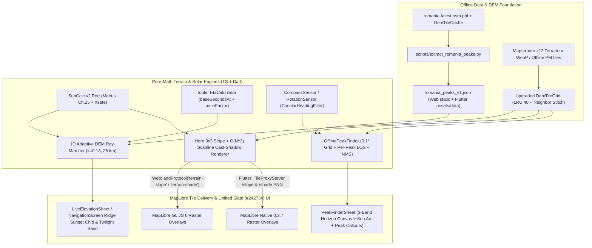

# Phase 3: Terrain Intelligence, Solar/Shadow Simulation, Ridge Sunset vs. Live ETA, Avalanche Slope Shading & Offline Compass Peak Finder — Implementation Plan

> **For agentic workers:** REQUIRED SUB-SKILL: Use superpowers:subagent-driven-development to implement this plan task-by-task. Steps use checkbox (`- [ ]`) syntax for tracking.

**Goal:** Deliver 100% offline, zero-API-key mountain terrain intelligence across Web PWA (`web/`) and Native Mobile (`app/`): exact Meeus/SunCalc solar ephemeris, interactive 2D DEM cast-shadow simulation, trajectory-coupled **Real Ridge Sunset vs. Live Trail ETA** warnings, **Avalanche Slope Angle Shading (`27–30–35–45–50+°`)**, and an **Offline 3D Horizon / Compass Peak Finder (*"Ce vârf văd în față?"*)** in Unified Deep Slate (`#242734`) & Frosted Glass UI.

**Architecture:** Both clients share an identical four-module pure-math & DEM architecture backed by Mapterhorn zoom-12 (`512×512` Terrarium WebP / offline `.pmtiles`) tiles: (1) a clean-room BSD-2-Clause port of `mourner/suncalc` v2 (Meeus Ch. 12/15/16/25 + `rtsafe` Newton-bisection) producing North-clockwise solar azimuth/altitude and polar-safe twilight times; (2) an upgraded LRU-bounded `DemTileGrid` with cross-tile neighbor pixel stitching (and loopback `TileProxyServer` `/dem/{z}/{x}/{y}.png` wiring in Flutter for 100% offline `.pmtiles` DEM access) powering Horn (1981) 3×3 latitude-corrected slope/aspect tiles and $O(N^2)$ forward scanline cast-shadow tiles; (3) an adaptive 260-step 1D DEM ray-marcher (`25 km` reach, Earth curvature + optical refraction $k = 0.13$) coupled to `EtaCalculator.baseSecondsAt` & `paceFactor` to detect when valley ridges block the sun 1–3 hours before astronomical sunset; and (4) an offline Carpathian summit catalog (`romania_peaks_v1.json` extracted from `romania-latest.osm.pbf`) with per-peak DEM line-of-sight culling and 60fps compass-driven 3-band horizon silhouette rendering.

**Architecture Diagram:**



**Tech Stack:** Python 3.12 + `pyosmium` (`scripts/`), TypeScript 6 + SvelteKit 5 + MapLibre GL `^6.15.0` + `OffscreenCanvas` + Vitest + Playwright (`web/`), Dart `^3.13.0` + Flutter + Riverpod 3 + `maplibre: 0.3.7` + `flutter_rotation_sensor: ^0.2.0` + `dart:io` `zlib` (`app/`).

**Spec:** [2026-11-18-mountain-intelligence-salvamont-design.md](file:///Volumes/SSD%20extern/Proiecte/Maps/docs/superpowers/specs/2026-11-18-mountain-intelligence-salvamont-design.md)

## Global Constraints

- **Zero Proprietary / Paid API Keys:** Do NOT install or import `mapbox-gl-shadow-simulator` (`ShadeMap` is `UNLICENSED` proprietary and requires a paid `apiKey`). Every Phase 3 feature runs 100% client-side with zero external API keys.
- **License Hygiene:** Port solar math strictly from BSD-2-Clause `mourner/suncalc` v2 / published Meeus equations and Horn (1981) / `ChristianSteger/HORAYZON` (MIT). Never copy code from GPL-3.0 repositories (`OsmAnd`, `PeakOrama`). Include `© Mapterhorn` attribution when DEM slope/shadow overlays are enabled.
- **Web Mercator Latitude Scale Accuracy:** Every slope and shadow gradient computation on zoom-12 tiles MUST multiply equatorial pixel size by $\cos\phi_{\text{row}}$ ($\approx 0.7009$ in Romania at $45.5^\circ\text{N}$); omitting $\cos\phi$ underestimates Carpathian slope angles by ~30%.
- **DEM Resolution Safety Disclosure:** Global zoom-12 Terrarium tiles (`13.39 m/px` at $45.5^\circ\text{N}$ resampled from ~30 m Copernicus GLO-30) smooth narrow `10–20 m` gullies and rollovers; the Slope Legend pill MUST display the ~30 m DEM micro-terrain caution note.
- **Unified Slate (`#242734`) & Frosted Glass UI:** All floating buttons use `40x40px` frosted glass (`bg-menu-background/94 backdrop-blur-md border-input-border/60 text-content`, monochrome `#242734` / dark `#F9FAFB` icons). Never use `bg-orange-600`, `bg-emerald-700`, or bright blue/red utility buttons (`#DC2626` is reserved exclusively for active SOS).
- **Cross-Phase Compatibility:** Register `- assets/data/` in `app/pubspec.yaml` (shared with Phase 1 `salvamont_ro.json` and Phase 2 `romania_emergency_112.json`); route Flutter `DemTileGrid` through `TileProxyServer` `/dem/{z}/{x}/{y}.png`; expose slope/shadow layer toggles cleanly so Phase 4's `MapLayersSheet` and `proxy_style_rewriter.dart` compose without conflict.

---

### Task 1: Offline Romania Carpathian Peaks Extractor & Bundled Seed (`scripts/`)

**Files:**
- Create: [extract_romania_peaks.py](file:///Volumes/SSD%20extern/Proiecte/Maps/scripts/extract_romania_peaks.py)
- Create: [test_extract_romania_peaks.py](file:///Volumes/SSD%20extern/Proiecte/Maps/scripts/test_extract_romania_peaks.py)
- Create (generated output): `web/static/data/romania_peaks_v1.json` and `app/assets/data/romania_peaks_v1.json`

**Interfaces:**
- Consumes: [dem_elevation.py](file:///Volumes/SSD%20extern/Proiecte/Maps/scripts/dem_elevation.py) (`DemTileCache.sample(lat, lon)`) and optional `romania-latest.osm.pbf` (or `--seed-curated` deterministic Carpathian reference dataset when `.osm.pbf` is absent in CI).
- Produces: `romania_peaks_v1.json` with schema:
  `{ "version": 1, "count": number, "ids": number[], "names": string[], "lats": number[], "lons": number[], "eles": number[], "prominences": number[], "kinds": ("peak"|"pass")[] }`

- [ ] **Step 1: Write the failing Python unit tests for elevation parsing, dominance/prominence estimation, and columnar JSON export**

Create [test_extract_romania_peaks.py](file:///Volumes/SSD%20extern/Proiecte/Maps/scripts/test_extract_romania_peaks.py):

```python
import json
from pathlib import Path
import unittest

from extract_romania_peaks import (
    RawPeakNode,
    build_columnar_catalog,
    curated_carpathian_seed_peaks,
    parse_osm_elevation_meters,
)


class ExtractRomaniaPeaksTest(unittest.TestCase):
    def test_parse_osm_elevation_handles_units_commas_and_invalid_strings(self) -> None:
        self.assertAlmostEqual(parse_osm_elevation_meters("2544"), 2544.0)
        self.assertAlmostEqual(parse_osm_elevation_meters("2,505.4 m"), 2505.4)
        self.assertAlmostEqual(parse_osm_elevation_meters("1 849 m n.m."), 1849.0)
        self.assertIsNone(parse_osm_elevation_meters(""))
        self.assertIsNone(parse_osm_elevation_meters("unknown"))
        self.assertIsNone(parse_osm_elevation_meters("-500"))
        self.assertIsNone(parse_osm_elevation_meters("9200"))

    def test_build_columnar_catalog_filters_low_hills_deduplicates_and_computes_prominence(self) -> None:
        raw = [
            RawPeakNode(osm_id=1, name="Vârful Moldoveanu", lat=45.5995, lon=24.7362, ele=2544.0, kind="peak"),
            RawPeakNode(osm_id=2, name="Vârful Viștea Mare", lat=45.6029, lon=24.7354, ele=2527.0, kind="peak"),
            RawPeakNode(osm_id=3, name="Dealul Mic", lat=44.4300, lon=26.1000, ele=120.0, kind="peak"),
            RawPeakNode(osm_id=4, name="Șaua Caprei", lat=45.6008, lon=24.6285, ele=2315.0, kind="pass"),
        ]
        catalog = build_columnar_catalog(raw, min_ele_m=400.0)
        self.assertEqual(catalog["version"], 1)
        self.assertEqual(catalog["count"], 3)
        self.assertEqual(catalog["names"][0], "Vârful Moldoveanu")
        self.assertEqual(catalog["eles"][0], 2544)
        # Moldoveanu is highest in catalog -> high prominence proxy; Viștea Mare (~380 m away) gets lower local dominance
        self.assertGreater(catalog["prominences"][0], catalog["prominences"][1])
        self.assertIn("pass", catalog["kinds"])

    def test_curated_seed_contains_major_romanian_summits_and_serializes_compactly(self) -> None:
        seed = curated_carpathian_seed_peaks()
        catalog = build_columnar_catalog(seed, min_ele_m=400.0)
        names = set(catalog["names"])
        self.assertIn("Vârful Omu", names)
        self.assertIn("Vârful Moldoveanu", names)
        self.assertIn("Vârful Negoiu", names)
        self.assertIn("Vârful Parângul Mare", names)
        self.assertIn("Vârful Pietrosul Rodnei", names)
        encoded = json.dumps(catalog, ensure_ascii=False, separators=(",", ":"))
        self.assertLess(len(encoded.encode("utf-8")), 250_000)


if __name__ == "__main__":
    unittest.main()
```

- [ ] **Step 2: Run the Python test to verify it fails**

Run: `python3 -m unittest scripts/test_extract_romania_peaks.py -v`
Expected: FAIL with `ModuleNotFoundError: No module named 'extract_romania_peaks'`

- [ ] **Step 3: Implement `scripts/extract_romania_peaks.py` and generate initial `romania_peaks_v1.json` bundles**

Create [extract_romania_peaks.py](file:///Volumes/SSD%20extern/Proiecte/Maps/scripts/extract_romania_peaks.py):

```python
#!/usr/bin/env python3
"""Extract named Carpathian mountain peaks & passes in Romania into a compact columnar JSON catalog."""

from __future__ import annotations

import argparse
from dataclasses import dataclass
import json
import math
from pathlib import Path
import re
from typing import Iterable

RO_LAT_MIN, RO_LAT_MAX = 43.4, 48.5
RO_LON_MIN, RO_LON_MAX = 20.0, 30.0


@dataclass(frozen=True)
class RawPeakNode:
    osm_id: int
    name: str
    lat: float
    lon: float
    ele: float
    kind: str  # "peak" | "pass"
    prominence_override: float | None = None


def haversine_m(lat1: float, lon1: float, lat2: float, lon2: float) -> float:
    r = 6371000.0
    p1 = math.radians(lat1)
    p2 = math.radians(lat2)
    dp = math.radians(lat2 - lat1)
    dl = math.radians(lon2 - lon1)
    a = math.sin(dp / 2.0) ** 2 + math.cos(p1) * math.cos(p2) * math.sin(dl / 2.0) ** 2
    return 2.0 * r * math.atan2(math.sqrt(a), math.sqrt(max(0.0, 1.0 - a)))


def parse_osm_elevation_meters(raw: str | None) -> float | None:
    if not raw:
        return None
    cleaned = raw.strip().lower()
    if not cleaned:
        return None
    # Strip thousands spaces ("1 849 m"), convert decimal comma if followed by 1-2 digits, else strip thousands comma.
    compact = re.sub(r"(?<=\d)\s+(?=\d)", "", cleaned)
    if re.search(r",\d{1,2}(?!\d)", compact):
        compact = compact.replace(",", ".")
    else:
        compact = compact.replace(",", "")
    m = re.search(r"[-+]?\d+(?:\.\d+)?", compact)
    if not m:
        return None
    try:
        val = float(m.group(0))
    except ValueError:
        return None
    if not math.isfinite(val) or val < 0.0 or val > 8900.0:
        return None
    return val


def _estimate_prominence_proxy(sorted_nodes: list[RawPeakNode]) -> list[int]:
    """Computes topographic dominance-derived prominence proxy when OSM prominence=* is absent."""
    n = len(sorted_nodes)
    out = [0] * n
    for i, node in enumerate(sorted_nodes):
        if node.prominence_override is not None and node.prominence_override > 0:
            out[i] = int(round(node.prominence_override))
            continue
        if i == 0:
            out[i] = int(round(min(2000.0, max(500.0, node.ele * 0.75))))
            continue
        min_dist_higher_m = float("inf")
        for j in range(i):
            higher = sorted_nodes[j]
            if higher.ele <= node.ele + 5.0:
                break
            # Quick degree bounding gate before haversine
            if abs(higher.lat - node.lat) * 111320.0 > min_dist_higher_m:
                continue
            d = haversine_m(node.lat, node.lon, higher.lat, higher.lon)
            if d < min_dist_higher_m:
                min_dist_higher_m = d
        if not math.isfinite(min_dist_higher_m):
            out[i] = 800
        else:
            # Map isolation (0.3 km .. 45 km) onto an effective prominence score [25 .. 1200] m
            prom = min(1200.0, max(20.0, (min_dist_higher_m / 1000.0) * 38.0))
            out[i] = int(round(prom))
    return out


def build_columnar_catalog(nodes: Iterable[RawPeakNode], min_ele_m: float = 400.0) -> dict:
    filtered: list[RawPeakNode] = []
    seen_grid: set[tuple[str, int, int]] = set()

    candidates = [
        p
        for p in nodes
        if p.name.strip()
        and p.ele >= min_ele_m
        and RO_LAT_MIN <= p.lat <= RO_LAT_MAX
        and RO_LON_MIN <= p.lon <= RO_LON_MAX
    ]
    candidates.sort(key=lambda p: (-p.ele, p.osm_id))

    for p in candidates:
        norm_name = " ".join(p.name.split())
        dedup_key = (norm_name.lower(), int(round(p.lat * 200)), int(round(p.lon * 200)))
        if dedup_key in seen_grid:
            continue
        seen_grid.add(dedup_key)
        filtered.append(
            RawPeakNode(
                osm_id=p.osm_id,
                name=norm_name,
                lat=round(p.lat, 5),
                lon=round(p.lon, 5),
                ele=p.ele,
                kind="pass" if p.kind == "pass" else "peak",
                prominence_override=p.prominence_override,
            )
        )

    prominences = _estimate_prominence_proxy(filtered)
    return {
        "version": 1,
        "count": len(filtered),
        "ids": [p.osm_id for p in filtered],
        "names": [p.name for p in filtered],
        "lats": [p.lat for p in filtered],
        "lons": [p.lon for p in filtered],
        "eles": [int(round(p.ele)) for p in filtered],
        "prominences": prominences,
        "kinds": [p.kind for p in filtered],
    }


def curated_carpathian_seed_peaks() -> list[RawPeakNode]:
    """Verified reference summits & passes across major Romanian Carpathian massifs."""
    rows = [
        (1001, "Vârful Moldoveanu", 45.59950, 24.73620, 2544, "peak", 2046),
        (1002, "Vârful Negoiu", 45.58478, 24.55864, 2535, "peak", 425),
        (1003, "Vârful Viștea Mare", 45.60292, 24.73544, 2527, "peak", 40),
        (1004, "Vârful Lespezi", 45.57661, 24.56817, 2517, "peak", 150),
        (1005, "Vârful Parângul Mare", 45.34014, 23.54106, 2519, "peak", 2103),
        (1006, "Vârful Peleaga", 45.36619, 22.89389, 2509, "peak", 1759),
        (1007, "Vârful Păpușa (Retezat)", 45.37008, 22.90814, 2508, "peak", 210),
        (1008, "Vârful Omu", 45.44572, 25.45628, 2505, "peak", 1460),
        (1009, "Vârful Bucura", 45.36369, 22.86869, 2433, "peak", 185),
        (1010, "Vârful Retezat", 45.38228, 22.85294, 2482, "peak", 260),
        (1011, "Vârful Caraiman", 45.41614, 25.48789, 2384, "peak", 145),
        (1012, "Vârful Coștila", 45.42925, 25.48836, 2490, "peak", 170),
        (1013, "Vârful Bucșoiu", 45.45781, 25.46506, 2492, "peak", 160),
        (1014, "Vârful Babele", 45.40669, 25.47169, 2292, "peak", 80),
        (1015, "Vârful Piatra Mare", 45.54986, 25.64589, 1844, "peak", 680),
        (1016, "Vârful Postăvaru", 45.56883, 25.56667, 1799, "peak", 740),
        (1017, "Vârful La Om (Piscul Baciului)", 45.52453, 25.21453, 2238, "peak", 960),
        (1018, "Vârful Ascuțit", 45.54531, 25.23192, 2150, "peak", 140),
        (1019, "Vârful Ciucaș", 45.52108, 25.92703, 1954, "peak", 1040),
        (1020, "Vârful Gropșoarele", 45.50214, 25.96136, 1883, "peak", 260),
        (1021, "Vârful Roșu (Iezer-Păpușa)", 45.50919, 24.94889, 2469, "peak", 690),
        (1022, "Vârful Păpușa (Iezer)", 45.48583, 25.00528, 2391, "peak", 460),
        (1023, "Vârful Cozia (Ciuha Mare)", 45.32100, 24.33700, 1668, "peak", 910),
        (1024, "Vârful Buila", 45.24211, 24.12281, 1849, "peak", 720),
        (1025, "Vârful Godeanu", 45.22250, 22.63361, 2229, "peak", 620),
        (1026, "Vârful Țarcu", 45.28139, 22.53389, 2190, "peak", 980),
        (1027, "Vârful Pietrosul Rodnei", 47.59819, 24.63614, 2303, "peak", 1565),
        (1028, "Vârful Ineu", 47.52556, 24.88389, 2279, "peak", 460),
        (1029, "Vârful Toaca (Ceahlău)", 46.97744, 25.94983, 1904, "peak", 1090),
        (1030, "Vârful Ocolașul Mare", 46.95314, 25.94558, 1907, "peak", 210),
        (1031, "Vârful Pietrosul Călimanilor", 47.11972, 25.18250, 2100, "peak", 1230),
        (1032, "Vârful Giumalău", 47.43500, 25.48361, 1857, "peak", 740),
        (1033, "Vârful Rarău", 47.45194, 25.57472, 1651, "peak", 490),
        (1034, "Vârful Hășmașul Mare", 46.69611, 25.81611, 1792, "peak", 670),
        (1035, "Vârful Harghita-Mădăraș", 46.45611, 25.57667, 1801, "peak", 790),
        (1036, "Vârful Bihorul Mare (Curcubăta Mare)", 46.44097, 22.68858, 1849, "peak", 1470),
        (1037, "Vârful Vlădeasa", 46.75917, 22.79417, 1836, "peak", 520),
        (1038, "Vârful Muntele Mare", 46.49111, 23.22917, 1826, "peak", 490),
        (1039, "Șaua Caprei", 45.60080, 24.62850, 2315, "pass", 90),
        (1040, "Curmătura Brătilei", 45.56800, 24.83900, 2122, "pass", 80),
    ]
    return [RawPeakNode(*r) for r in rows]


def extract_from_pbf(pbf_path: Path, dem_dir: Path | None) -> list[RawPeakNode]:
    import osmium
    from dem_elevation import DemTileCache

    dem = DemTileCache(dem_dir) if dem_dir is not None else None
    extracted: list[RawPeakNode] = []

    class PeakHandler(osmium.SimpleHandler):
        def node(self, n: osmium.osm.Node) -> None:
            if not n.location.valid():
                return
            tags = n.tags
            nat = tags.get("natural")
            is_pass = tags.get("mountain_pass") == "yes" or nat == "saddle"
            if nat != "peak" and not is_pass:
                return
            name = tags.get("name:ro") or tags.get("name")
            if not name:
                return
            lat = n.location.lat
            lon = n.location.lon
            if not (RO_LAT_MIN <= lat <= RO_LAT_MAX and RO_LON_MIN <= lon <= RO_LON_MAX):
                return
            ele = parse_osm_elevation_meters(tags.get("ele"))
            if ele is None and dem is not None:
                ele = dem.sample(lat, lon)
            if ele is None:
                return
            prom = parse_osm_elevation_meters(tags.get("prominence"))
            extracted.append(
                RawPeakNode(
                    osm_id=int(n.id),
                    name=name,
                    lat=lat,
                    lon=lon,
                    ele=ele,
                    kind="pass" if is_pass and nat != "peak" else "peak",
                    prominence_override=prom,
                )
            )

    PeakHandler().apply_file(str(pbf_path), locations=True)
    return extracted


def main() -> None:
    parser = argparse.ArgumentParser(description=__doc__)
    parser.add_argument("--pbf", type=Path, help="Path to romania-latest.osm.pbf")
    parser.add_argument("--dem-dir", type=Path, default=None, help="Optional SRTM .hgt cache directory")
    parser.add_argument("--seed-curated", action="store_true", help="Emit curated Carpathian seed catalog")
    parser.add_argument(
        "--out",
        type=Path,
        action="append",
        required=True,
        help="Output JSON file path(s)",
    )
    args = parser.parse_args()

    nodes = curated_carpathian_seed_peaks()
    if args.pbf and args.pbf.exists():
        pbf_nodes = extract_from_pbf(args.pbf, args.dem_dir)
        nodes = pbf_nodes + nodes
    elif not args.seed_curated:
        raise SystemExit("Pass either an existing --pbf or --seed-curated")

    catalog = build_columnar_catalog(nodes, min_ele_m=400.0)
    payload = json.dumps(catalog, ensure_ascii=False, separators=(",", ":"))
    for out_path in args.out:
        out_path.parent.mkdir(parents=True, exist_ok=True)
        out_path.write_text(payload, encoding="utf-8")
        print(f"[peaks] Wrote {catalog['count']} entries ({len(payload)} bytes) -> {out_path}")


if __name__ == "__main__":
    main()
```

Generate the initial offline catalogs for Web and Flutter:

```bash
python3 scripts/extract_romania_peaks.py --seed-curated \
  --out web/static/data/romania_peaks_v1.json \
  --out app/assets/data/romania_peaks_v1.json
```

- [ ] **Step 4: Run unit tests to verify they pass**

Run: `python3 -m unittest scripts/test_extract_romania_peaks.py -v`
Expected: PASS (3 tests OK) and both `romania_peaks_v1.json` files exist on disk.

- [ ] **Step 5: Commit**

```bash
git add scripts/extract_romania_peaks.py scripts/test_extract_romania_peaks.py web/static/data/romania_peaks_v1.json app/assets/data/romania_peaks_v1.json
git commit -m "feat(peaks): add Romania Carpathian peak extractor and offline v1 catalog"
```

---

### Task 2: Pure-Math Solar Ephemeris Engine — Web TypeScript (`sun_calc.ts`)

**Files:**
- Create: [sun_calc.ts](file:///Volumes/SSD%20extern/Proiecte/Maps/web/src/lib/navigation/sun_calc.ts)
- Test: [sun_calc.test.ts](file:///Volumes/SSD%20extern/Proiecte/Maps/web/src/lib/navigation/sun_calc.test.ts)

**Interfaces:**
- Consumes: standard `Math` only (zero runtime dependencies, zero API keys).
- Produces:
  - `SunPosition { azimuthDeg: number; altitudeDeg: number; trueAltitudeDeg: number }` (`azimuthDeg` in `[0, 360)` clockwise from true North)
  - `SunTimes { solarNoon: Date; nadir: Date; sunrise: Date | null; sunset: Date | null; dawn: Date | null; dusk: Date | null; goldenHour: Date | null; polarState: "normal" | "midnight_sun" | "polar_night" }`
  - `getSunPosition(date: Date | number, lat: number, lon: number): SunPosition`
  - `getSunTimes(date: Date | number, lat: number, lon: number): SunTimes`

- [ ] **Step 1: Write the failing Vitest unit tests against NOAA Solar Calculator benchmarks and polar edge cases**

Create [sun_calc.test.ts](file:///Volumes/SSD%20extern/Proiecte/Maps/web/src/lib/navigation/sun_calc.test.ts):

```ts
import { describe, expect, it } from "vitest";
import { getSunPosition, getSunTimes } from "./sun_calc";

describe("sun_calc (Meeus Ch.25 + rtsafe ephemeris)", () => {
	it("computes accurate North-clockwise azimuth and altitude at Vf. Omu (45.4457N, 25.4563E)", () => {
		// 2026-06-21 10:20:00 UTC (~solar noon in Bucegi, EEST 13:20)
		const noonPos = getSunPosition(Date.parse("2026-06-21T10:20:00Z"), 45.4457, 25.4563);
		expect(noonPos.azimuthDeg).toBeGreaterThan(177);
		expect(noonPos.azimuthDeg).toBeLessThan(183);
		// Max summer solstice altitude at 45.45N: 90 - 45.45 + 23.44 = 67.99 deg
		expect(noonPos.altitudeDeg).toBeGreaterThan(67.5);
		expect(noonPos.altitudeDeg).toBeLessThan(68.3);

		// Morning sun lies in the East (~80..120 deg), afternoon sun in the West (~240..285 deg)
		const morning = getSunPosition(Date.parse("2026-06-21T05:30:00Z"), 45.4457, 25.4563);
		const afternoon = getSunPosition(Date.parse("2026-06-21T15:30:00Z"), 45.4457, 25.4563);
		expect(morning.azimuthDeg).toBeGreaterThan(70);
		expect(morning.azimuthDeg).toBeLessThan(115);
		expect(afternoon.azimuthDeg).toBeGreaterThan(250);
		expect(afternoon.azimuthDeg).toBeLessThan(290);
	});

	it("computes autumn sunset and civil dusk at Vf. Omu on 2026-11-18", () => {
		const times = getSunTimes(Date.parse("2026-11-18T12:00:00Z"), 45.4457, 25.4563);
		expect(times.polarState).toBe("normal");
		expect(times.sunrise).not.toBeNull();
		expect(times.sunset).not.toBeNull();
		expect(times.dusk).not.toBeNull();

		// On Nov 18 at 45.45N 25.46E, sunset is ~14:43 UTC (16:43 EET) and civil dusk ~15:16 UTC
		const sunsetUtcMin =
			times.sunset!.getUTCHours() * 60 + times.sunset!.getUTCMinutes();
		expect(sunsetUtcMin).toBeGreaterThanOrEqual(14 * 60 + 38);
		expect(sunsetUtcMin).toBeLessThanOrEqual(14 * 60 + 49);
		expect(times.dusk!.getTime() - times.sunset!.getTime()).toBeGreaterThan(25 * 60_000);
		expect(times.dusk!.getTime() - times.sunset!.getTime()).toBeLessThan(42 * 60_000);
	});

	it("handles Arctic midnight sun and polar night without NaN or Invalid Date", () => {
		const tromsoSummer = getSunTimes(Date.parse("2026-06-21T12:00:00Z"), 69.6492, 18.9553);
		expect(tromsoSummer.polarState).toBe("midnight_sun");
		expect(tromsoSummer.sunrise).toBeNull();
		expect(tromsoSummer.sunset).toBeNull();

		const tromsoWinter = getSunTimes(Date.parse("2026-12-21T12:00:00Z"), 69.6492, 18.9553);
		expect(tromsoWinter.polarState).toBe("polar_night");
		expect(tromsoWinter.sunrise).toBeNull();
		expect(tromsoWinter.sunset).toBeNull();
	});
});
```

- [ ] **Step 2: Run Vitest to verify it fails**

Run: `cd web && npx vitest run src/lib/navigation/sun_calc.test.ts`
Expected: FAIL with `Cannot find module './sun_calc'`

- [ ] **Step 3: Implement `web/src/lib/navigation/sun_calc.ts`**

Create [sun_calc.ts](file:///Volumes/SSD%20extern/Proiecte/Maps/web/src/lib/navigation/sun_calc.ts):

```ts
/**
 * Pure-math solar ephemeris adapted from mourner/suncalc v2 (BSD-2-Clause, Volodymyr Agafonkin)
 * and Jean Meeus, Astronomical Algorithms (2nd ed., Chapters 12, 15, 16, 22, 25).
 * Zero external API keys or network calls.
 */

const RAD = Math.PI / 180;
const DAY_MS = 86_400_000;
const J1970 = 2440588;
const J2000 = 2451545;
const J0 = 0.0009;

export interface SunPosition {
	/** Clockwise degrees from true North in `[0, 360)`. */
	azimuthDeg: number;
	/** Apparent solar altitude in degrees (includes Bennett/Meeus atmospheric refraction). */
	altitudeDeg: number;
	/** Geometric solar altitude in degrees (without atmospheric refraction). */
	trueAltitudeDeg: number;
}

export interface SunTimes {
	solarNoon: Date;
	nadir: Date;
	sunrise: Date | null;
	sunset: Date | null;
	dawn: Date | null;
	dusk: Date | null;
	goldenHour: Date | null;
	polarState: "normal" | "midnight_sun" | "polar_night";
}

function toMs(date: Date | number): number {
	return typeof date === "number" ? date : date.getTime();
}

function fromJulianDaysSinceJ2000(d: number): Date {
	return new Date((d + J2000 + 0.5 - J1970) * DAY_MS);
}

function toDays(ms: number): number {
	return ms / DAY_MS - 0.5 + J1970 - J2000;
}

function deltaTSeconds(d: number): number {
	const y = 2000 + d / 365.2425;
	if (y < 2005) {
		const t = y - 2000;
		return 63.86 + t * (0.3345 + t * (-0.060374 + t * 0.0017275));
	}
	if (y < 2050) {
		const t = y - 2000;
		return 62.92 + t * (0.32217 + t * 0.005589);
	}
	const t = (y - 1820) / 100;
	return -20 + 32 * t * t - 0.5628 * (2150 - y);
}

function toDaysTT(d: number): number {
	return d + deltaTSeconds(d) / 86400;
}

function siderealTime(d: number, lw: number): number {
	return RAD * (280.46061837 + 360.98564736629 * d) - lw;
}

export function astroRefractionRad(hRad: number): number {
	const hClamped = hRad < 0 ? 0 : hRad;
	return 0.0002967 / Math.tan(hClamped + 0.00312536 / (hClamped + 0.08901179));
}

function sunCoords(dTT: number): { ra: number; dec: number } {
	const t = dTT / 36525;
	const L0 = RAD * (280.46646 + t * (36000.76983 + t * 0.0003032));
	const M = RAD * (357.52911 + t * (35999.05029 - t * 0.0001537));
	const sinM = Math.sin(M);
	const cosM = Math.cos(M);
	const C =
		RAD *
		((1.914602 - t * (0.004817 + 0.000014 * t)) * sinM +
			(0.019993 - 0.000101 * t) * 2 * sinM * cosM +
			0.000289 * sinM * (3 - 4 * sinM * sinM));
	const omega = RAD * (125.04 - 1934.136 * t);
	const lambda = L0 + C - RAD * (0.00569 + 0.00478 * Math.sin(omega));
	const eps =
		RAD * (23.439291 - t * (0.0130042 + t * (0.00000016 - t * 0.000000504))) +
		RAD * 0.00256 * Math.cos(omega);

	return {
		ra: Math.atan2(Math.cos(eps) * Math.sin(lambda), Math.cos(lambda)),
		dec: Math.asin(Math.sin(eps) * Math.sin(lambda)),
	};
}

function northClockwiseAzimuthDeg(H: number, phi: number, dec: number): number {
	const deg =
		(Math.atan2(Math.sin(H), Math.cos(H) * Math.sin(phi) - Math.tan(dec) * Math.cos(phi)) / RAD +
			540) %
		360;
	return deg < 0 ? deg + 360 : deg === 0 ? 0 : deg;
}

function geometricAltitudeRad(H: number, phi: number, dec: number): number {
	const s = Math.sin(phi) * Math.sin(dec) + Math.cos(phi) * Math.cos(dec) * Math.cos(H);
	return Math.asin(Math.min(1, Math.max(-1, s)));
}

export function getSunPosition(date: Date | number, lat: number, lon: number): SunPosition {
	const cLat = Math.min(90, Math.max(-90, Number.isFinite(lat) ? lat : 0));
	const cLon = Number.isFinite(lon) ? lon : 0;
	const lw = RAD * -cLon;
	const phi = RAD * cLat;
	const d = toDays(toMs(date));
	const coords = sunCoords(toDaysTT(d));
	const H = siderealTime(d, lw) - coords.ra;
	const hRad = geometricAltitudeRad(H, phi, coords.dec);
	const refrRad = hRad >= -0.02 ? astroRefractionRad(hRad) : 0;

	return {
		azimuthDeg: northClockwiseAzimuthDeg(H, phi, coords.dec),
		altitudeDeg: (hRad + refrRad) / RAD,
		trueAltitudeDeg: hRad / RAD,
	};
}

function wrapPi(a: number): number {
	return a - 2 * Math.PI * Math.round(a / (2 * Math.PI));
}

function solarTransit(dt: number, lw: number): number {
	let cur = dt;
	for (let i = 0; i < 3; i++) {
		const H = wrapPi(siderealTime(cur, lw) - sunCoords(toDaysTT(cur)).ra);
		cur -= H / (2 * Math.PI);
	}
	return cur;
}

function solveAltitudeCrossing(
	h0Rad: number,
	aIn: number,
	bIn: number,
	sa: number,
	sb: number,
	dt: number,
	lw: number,
	phi: number,
	decT: number,
): number {
	const s0 = Math.sin(h0Rad);
	const rising = sa < sb;
	if (!((sa - s0) * (sb - s0) <= 0)) {
		return Number.NaN;
	}

	let a = aIn;
	let b = bIn;
	const denom = Math.cos(phi) * Math.cos(decT);
	const cosH0 = Math.abs(denom) > 1e-12 ? (s0 - Math.sin(phi) * Math.sin(decT)) / denom : 0;
	const H0 = cosH0 <= -1 ? Math.PI : cosH0 >= 1 ? 0 : Math.acos(cosH0);
	let d = dt + (rising ? -H0 : H0) / (2 * Math.PI);
	let dx = b - a;

	for (let iter = 0; iter < 32; iter++) {
		const c = sunCoords(toDaysTT(d));
		const H = siderealTime(d, lw) - c.ra;
		const k = Math.cos(phi) * Math.cos(c.dec);
		const f = Math.sin(phi) * Math.sin(c.dec) + k * Math.cos(H) - s0;
		if ((f < 0) === rising) {
			a = d;
		} else {
			b = d;
		}

		const deriv = 2 * Math.PI * k * Math.sin(H);
		const step = Math.abs(deriv) > 1e-12 ? f / deriv : Number.POSITIVE_INFINITY;
		if (d + step > a && d + step < b && Math.abs(step) <= Math.abs(dx) / 2) {
			dx = step;
			d += step;
			if (Math.abs(step) < 1e-5) return d;
		} else {
			dx = (b - a) / 2;
			d = a + dx;
			if (b - a < 1e-8) return d;
		}
	}
	return d;
}

export function getSunTimes(date: Date | number, lat: number, lon: number): SunTimes {
	const cLat = Math.min(89.999, Math.max(-89.999, Number.isFinite(lat) ? lat : 0));
	const cLon = Number.isFinite(lon) ? lon : 0;
	const lw = RAD * -cLon;
	const phi = RAD * cLat;
	const anchorD = toDays(toMs(date));
	const lonDays = J0 + lw / (2 * Math.PI);
	const dt = solarTransit(Math.round(anchorD - lonDays) + lonDays, lw);

	const decNoon = sunCoords(toDaysTT(dt)).dec;
	const sNoon = Math.cos(phi - decNoon);
	const sNadir1 = -Math.cos(phi + sunCoords(toDaysTT(dt - 0.5)).dec);
	const sNadir2 = -Math.cos(phi + sunCoords(toDaysTT(dt + 0.5)).dec);

	const solvePair = (angleDeg: number): [Date | null, Date | null] => {
		const h0 = angleDeg * RAD;
		const jr = solveAltitudeCrossing(h0, dt - 0.5, dt, sNadir1, sNoon, dt, lw, phi, decNoon);
		const js = solveAltitudeCrossing(h0, dt, dt + 0.5, sNoon, sNadir2, dt, lw, phi, decNoon);
		return [
			Number.isFinite(jr) ? fromJulianDaysSinceJ2000(jr) : null,
			Number.isFinite(js) ? fromJulianDaysSinceJ2000(js) : null,
		];
	};

	const [sunrise, sunset] = solvePair(-0.833);
	const [dawn, dusk] = solvePair(-6.0);
	const [, goldenHour] = solvePair(6.0);

	const sSunset = Math.sin(-0.833 * RAD);
	let polarState: SunTimes["polarState"] = "normal";
	if (sunrise === null && sunset === null) {
		polarState = sNoon > sSunset ? "midnight_sun" : "polar_night";
	}

	return {
		solarNoon: fromJulianDaysSinceJ2000(dt),
		nadir: fromJulianDaysSinceJ2000(dt - 0.5),
		sunrise,
		sunset,
		dawn,
		dusk,
		goldenHour,
		polarState,
	};
}
```

- [ ] **Step 4: Run Vitest to verify it passes**

Run: `cd web && npx vitest run src/lib/navigation/sun_calc.test.ts`
Expected: PASS (3 tests passing)

- [ ] **Step 5: Commit**

```bash
git add web/src/lib/navigation/sun_calc.ts web/src/lib/navigation/sun_calc.test.ts
git commit -m "feat(solar): add pure-math Meeus/SunCalc v2 ephemeris engine in TypeScript"
```

---

### Task 3: `DemTileGrid` Upgrade + Horn 3×3 Avalanche Slope & $O(N^2)$ Scanline Cast-Shadow Renderer (Web TypeScript)

**Files:**
- Modify: [dem_tile_grid.ts](file:///Volumes/SSD%20extern/Proiecte/Maps/web/src/lib/navigation/dem_tile_grid.ts#L1-L349)
- Create: [slope_aspect.ts](file:///Volumes/SSD%20extern/Proiecte/Maps/web/src/lib/navigation/slope_aspect.ts)
- Test: [slope_aspect.test.ts](file:///Volumes/SSD%20extern/Proiecte/Maps/web/src/lib/navigation/slope_aspect.test.ts)

**Interfaces:**
- Consumes: `DemTileGrid` from [dem_tile_grid.ts](file:///Volumes/SSD%20extern/Proiecte/Maps/web/src/lib/navigation/dem_tile_grid.ts).
- Produces:
  - Upgraded `DemTileGrid` methods:
    - `putDecodedTileForTest(x: number, y: number, tile: DecodedTile): void`
    - `getDecodedTile(x: number, y: number): DecodedTile | undefined`
    - `ensureTileLoaded(x: number, y: number): Promise<DecodedTile | undefined>`
    - `prefetchRadius(lat: number, lon: number, radiusM: number, maxTiles?: number): Promise<void>`
    - `samplePixelStitched(tileX: number, tileY: number, px: number, py: number): number | null`
  - `SlopeAspectSample { slopeDeg: number; aspectDeg: number }`
  - `sampleSlopeAndAspect(dem: DemTileGrid, lat: number, lon: number): SlopeAspectSample | null`
  - `renderAvalancheSlopeTileRgba(z: number, x: number, y: number, dem: DemTileGrid, outSize?: 256 | 512): Uint8ClampedArray | null`
  - `renderCastShadowTileRgba(z: number, x: number, y: number, dem: DemTileGrid, sunAzimuthDeg: number, sunAltitudeDeg: number, outSize?: 256): Uint8ClampedArray | null`

- [ ] **Step 1: Write the failing Vitest unit tests for Mercator $\cos\phi$ Horn 3×3 slope, zero-seam cross-tile borders, and $O(N^2)$ scanline shadows**

Create [slope_aspect.test.ts](file:///Volumes/SSD%20extern/Proiecte/Maps/web/src/lib/navigation/slope_aspect.test.ts):

```ts
import { describe, expect, it } from "vitest";
import { DemTileGrid, webMercatorRowCellSizeMeters } from "./dem_tile_grid";
import {
	avalancheSlopeColorRgba,
	renderAvalancheSlopeTileRgba,
	renderCastShadowTileRgba,
	sampleSlopeAndAspect,
} from "./slope_aspect";

function buildInclinedPlaneTile(
	z: number,
	tx: number,
	ty: number,
	slopeDegEast: number,
	size = 512,
): Float32Array {
	const elevations = new Float32Array(size * size);
	const tanSlope = Math.tan((slopeDegEast * Math.PI) / 180);
	for (let row = 0; row < size; row++) {
		const cellM = webMercatorRowCellSizeMeters(z, ty, row, size);
		for (let col = 0; col < size; col++) {
			const globalCol = tx * size + col;
			elevations[row * size + col] = 1000 + globalCol * cellM * tanSlope;
		}
	}
	return elevations;
}

describe("Horn 3x3 Avalanche Slope & Scanline Cast-Shadow Renderer", () => {
	it("recovers exact 38 deg slope at 45.5N with Mercator cos(lat) correction and maps to Crimson Red", () => {
		// z=12, tx=2337, ty=1468 (~45.45N, 25.46E Bucegi)
		const tx = 2337;
		const ty = 1468;
		const dem = new DemTileGrid();
		dem.putDecodedTileForTest(tx, ty, {
			width: 512,
			height: 512,
			elevations: buildInclinedPlaneTile(12, tx, ty, 38.0),
		});
		dem.putDecodedTileForTest(tx + 1, ty, {
			width: 512,
			height: 512,
			elevations: buildInclinedPlaneTile(12, tx + 1, ty, 38.0),
		});

		const sample = sampleSlopeAndAspect(dem, 45.45, 25.46);
		expect(sample).not.toBeNull();
		expect(sample!.slopeDeg).toBeGreaterThan(37.7);
		expect(sample!.slopeDeg).toBeLessThan(38.3);

		const rgba = renderAvalancheSlopeTileRgba(12, tx, ty, dem, 256);
		expect(rgba).not.toBeNull();
		// Center pixel -> prime slab avalanche band (35..45 deg -> Crimson #DC2626 = 220, 38, 38)
		const midOffset = (128 * 256 + 128) * 4;
		expect(rgba![midOffset]).toBe(220);
		expect(rgba![midOffset + 1]).toBe(38);
		expect(rgba![midOffset + 2]).toBe(38);
		expect(rgba![midOffset + 3]).toBeGreaterThan(140);

		// Right-most border pixel of tx matches left-most border pixel of tx+1 (zero tile seam)
		const rgbaNext = renderAvalancheSlopeTileRgba(12, tx + 1, ty, dem, 256)!;
		const rightEdgeOffset = (128 * 256 + 255) * 4;
		const leftEdgeOffset = (128 * 256 + 0) * 4;
		expect(rgba![rightEdgeOffset]).toBe(rgbaNext[leftEdgeOffset]);
		expect(rgba![rightEdgeOffset + 3]).toBe(rgbaNext[leftEdgeOffset + 3]);
	});

	it("renders < 27 deg terrain completely transparent and grades 28/32/47/52 deg into EAWS bands", () => {
		expect(avalancheSlopeColorRgba(24.0)[3]).toBe(0);
		expect(avalancheSlopeColorRgba(28.5)).toEqual([234, 179, 8, 115]);   // Yellow
		expect(avalancheSlopeColorRgba(32.0)).toEqual([249, 115, 22, 140]);  // Orange
		expect(avalancheSlopeColorRgba(40.0)).toEqual([220, 38, 38, 158]);   // Red
		expect(avalancheSlopeColorRgba(47.0)).toEqual([147, 51, 234, 165]);  // Purple
		expect(avalancheSlopeColorRgba(53.0)).toEqual([29, 78, 216, 175]);   // Blue
	});

	it("sweeps cast shadows downwind behind a 600 m ridge in < 25 ms", () => {
		const tx = 2337;
		const ty = 1468;
		const elevations = new Float32Array(512 * 512).fill(1000);
		// Place a N-S vertical wall (1600 m) at col 380..390 (eastern ridge)
		for (let r = 0; r < 512; r++) {
			for (let c = 380; c <= 390; c++) {
				elevations[r * 512 + c] = 1600;
			}
		}
		const dem = new DemTileGrid();
		dem.putDecodedTileForTest(tx, ty, { width: 512, height: 512, elevations });

		const t0 = performance.now();
		// Sun in the East (azimuth 90 deg) at low 12 deg altitude -> casts shadow westward onto cols < 380
		const shade = renderCastShadowTileRgba(12, tx, ty, dem, 90, 12, 256);
		const elapsedMs = performance.now() - t0;

		expect(shade).not.toBeNull();
		expect(elapsedMs).toBeLessThan(35);

		// Pixel immediately west of ridge (col ~175 in 256-px space => 350 in 512-px space, ~400 m west) is shaded
		const shadedIdx = (128 * 256 + 175) * 4;
		// Pixel east of ridge (col 220 in 256-px space => 440 in 512-px space) is sunlit (alpha === 0)
		const sunlitIdx = (128 * 256 + 220) * 4;
		expect(shade![shadedIdx + 3]).toBeGreaterThan(80);
		expect(shade![sunlitIdx + 3]).toBe(0);
	});
});
```

- [ ] **Step 2: Run Vitest to verify it fails**

Run: `cd web && npx vitest run src/lib/navigation/slope_aspect.test.ts`
Expected: FAIL with `Cannot find module './slope_aspect'`

- [ ] **Step 3: Upgrade `dem_tile_grid.ts` and implement `slope_aspect.ts`**

Modify [dem_tile_grid.ts](file:///Volumes/SSD%20extern/Proiecte/Maps/web/src/lib/navigation/dem_tile_grid.ts) — export `DecodedTile` & `webMercatorRowCellSizeMeters`, add bounded LRU (`MAX_CACHED_TILES = 48`), `putDecodedTileForTest`, `getDecodedTile`, `ensureTileLoaded`, `prefetchRadius`, and `samplePixelStitched`:

```diff
 const DEFAULT_TILE_URL = "https://tiles.mapterhorn.com/12/{x}/{y}.webp";
 const CACHE_NAME = "wanderer-dem-v1";
 const MAX_PREFETCH_TILES = 9;
+const MAX_CACHED_TILES = 48;
+const WGS84_EQUATORIAL_CIRCUMFERENCE_M = 2 * Math.PI * 6378137.0;
 
-interface DecodedTile {
+export interface DecodedTile {
 	width: number;
 	height: number;
 	elevations: Float32Array;
 }
 
+export function webMercatorRowCellSizeMeters(
+	zoom: number,
+	tileY: number,
+	row: number,
+	tileSize: number,
+): number {
+	const numTiles = 1 << zoom;
+	const yNorm = (tileY + (row + 0.5) / tileSize) / numTiles;
+	const latRad = Math.atan(Math.sinh(Math.PI * (1 - 2 * yNorm)));
+	return (WGS84_EQUATORIAL_CIRCUMFERENCE_M * Math.cos(latRad)) / (tileSize * numTiles);
+}
+
 function clampLat(lat: number): number {
 	return Math.min(MAX_MERCATOR_LAT, Math.max(-MAX_MERCATOR_LAT, lat));
 }
 
-function latLonToTileFloat(lat: number, lon: number): { xFloat: number; yFloat: number } {
+export function latLonToZ12TileFloat(lat: number, lon: number): { xFloat: number; yFloat: number } {
 	const cLat = clampLat(lat);
```

Update internal `latLonToTileFloat` references in [dem_tile_grid.ts](file:///Volumes/SSD%20extern/Proiecte/Maps/web/src/lib/navigation/dem_tile_grid.ts) to `latLonToZ12TileFloat` and add the public methods inside `export class DemTileGrid`:

```ts
	private storeDecodedTile(key: string, tile: DecodedTile): void {
		if (this.tiles.has(key)) {
			this.tiles.delete(key);
		}
		this.tiles.set(key, tile);
		while (this.tiles.size > MAX_CACHED_TILES) {
			const oldestKey = this.tiles.keys().next().value;
			if (oldestKey === undefined) break;
			this.tiles.delete(oldestKey);
		}
	}

	putDecodedTileForTest(x: number, y: number, tile: DecodedTile): void {
		const wrappedX = ((x % NUM_TILES) + NUM_TILES) % NUM_TILES;
		this.storeDecodedTile(`${ZOOM}/${wrappedX}/${y}`, tile);
	}

	getDecodedTile(x: number, y: number): DecodedTile | undefined {
		if (y < 0 || y >= NUM_TILES) return undefined;
		const wrappedX = ((x % NUM_TILES) + NUM_TILES) % NUM_TILES;
		const key = `${ZOOM}/${wrappedX}/${y}`;
		const hit = this.tiles.get(key);
		if (hit) {
			// Touch for LRU recency
			this.tiles.delete(key);
			this.tiles.set(key, hit);
		}
		return hit;
	}

	async ensureTileLoaded(x: number, y: number): Promise<DecodedTile | undefined> {
		if (y < 0 || y >= NUM_TILES) return undefined;
		const wrappedX = ((x % NUM_TILES) + NUM_TILES) % NUM_TILES;
		await this.loadTile(wrappedX, y);
		return this.getDecodedTile(wrappedX, y);
	}

	async prefetchRadius(
		lat: number,
		lon: number,
		radiusM = 20_000,
		maxTiles = 36,
	): Promise<void> {
		if (this.customSampler || !Number.isFinite(lat) || !Number.isFinite(lon)) {
			return;
		}
		if (typeof window === "undefined" || typeof fetch !== "function") {
			return;
		}
		const safeRadius = Math.min(40_000, Math.max(500, radiusM));
		const latPad = safeRadius / 111320;
		const cosLat = Math.max(0.1, Math.cos((lat * Math.PI) / 180));
		const lonPad = safeRadius / (111320 * cosLat);
		const center = latLonToZ12TileFloat(lat, lon);
		const tl = latLonToZ12TileFloat(lat + latPad, lon - lonPad);
		const br = latLonToZ12TileFloat(lat - latPad, lon + lonPad);

		const candidates: { x: number; y: number; distSq: number }[] = [];
		for (let ty = Math.floor(tl.yFloat); ty <= Math.floor(br.yFloat); ty++) {
			if (ty < 0 || ty >= NUM_TILES) continue;
			for (let tx = Math.floor(tl.xFloat); tx <= Math.floor(br.xFloat); tx++) {
				const wrappedX = ((tx % NUM_TILES) + NUM_TILES) % NUM_TILES;
				const dx = tx + 0.5 - center.xFloat;
				const dy = ty + 0.5 - center.yFloat;
				candidates.push({ x: wrappedX, y: ty, distSq: dx * dx + dy * dy });
			}
		}
		candidates.sort((a, b) => a.distSq - b.distSq);
		const chosen = candidates.slice(0, Math.max(1, Math.min(MAX_CACHED_TILES, maxTiles)));
		await Promise.all(chosen.map(({ x, y }) => this.loadTile(x, y)));
	}

	samplePixelStitched(baseTileX: number, baseTileY: number, localX: number, localY: number): number | null {
		const primary = this.getDecodedTile(baseTileX, baseTileY);
		if (!primary) return null;
		return this.samplePixel(baseTileX, baseTileY, localX, localY, primary);
	}
```

(And replace `this.tiles.set(key, decodeTerrariumPixels(decoded.data, decoded.width, decoded.height));` at `L338` with `this.storeDecodedTile(key, decodeTerrariumPixels(decoded.data, decoded.width, decoded.height));`.)

Now create [slope_aspect.ts](file:///Volumes/SSD%20extern/Proiecte/Maps/web/src/lib/navigation/slope_aspect.ts):

```ts
import {
	type DemTileGrid,
	latLonToZ12TileFloat,
	webMercatorRowCellSizeMeters,
} from "./dem_tile_grid";

const RAD_TO_DEG = 180 / Math.PI;
const DEG_TO_RAD = Math.PI / 180;
const DEM_ZOOM = 12;

export interface SlopeAspectSample {
	slopeDeg: number;
	aspectDeg: number;
}

/**
 * Standard EAWS / CalTopo avalanche slope angle color ramp with 0.5-deg linear edge feathering.
 */
export function avalancheSlopeColorRgba(slopeDeg: number): [number, number, number, number] {
	if (!Number.isFinite(slopeDeg) || slopeDeg < 26.75) {
		return [0, 0, 0, 0];
	}
	if (slopeDeg < 27.25) {
		const t = (slopeDeg - 26.75) / 0.5;
		return [234, 179, 8, Math.round(115 * t)];
	}
	if (slopeDeg < 30.0) {
		return [234, 179, 8, 115]; // 27-30° Caution (Warm Yellow #EAB308)
	}
	if (slopeDeg < 35.0) {
		return [249, 115, 22, 140]; // 30-35° Slab onset (Amber-Orange #F97316)
	}
	if (slopeDeg < 45.0) {
		return [220, 38, 38, 158]; // 35-45° Prime slab zone (Crimson #DC2626)
	}
	if (slopeDeg < 50.0) {
		return [147, 51, 234, 165]; // 45-50° Extreme / sluff (Purple #9333EA)
	}
	return [29, 78, 216, 175]; // 50°+ Cliffs / technical (Blue #1D4ED8)
}

function mapChildTileToZ12Window(z: number, x: number, y: number): {
	z12X: number;
	z12Y: number;
	u0: number;
	v0: number;
	span: number;
} | null {
	if (z < DEM_ZOOM) return null;
	const scale = 1 << (z - DEM_ZOOM);
	const z12X = Math.floor(x / scale);
	const z12Y = Math.floor(y / scale);
	const span = 1 / scale;
	const u0 = (x - z12X * scale) * span;
	const v0 = (y - z12Y * scale) * span;
	return { z12X, z12Y, u0, v0, span };
}

export function sampleSlopeAndAspect(
	dem: DemTileGrid,
	lat: number,
	lon: number,
): SlopeAspectSample | null {
	const { xFloat, yFloat } = latLonToZ12TileFloat(lat, lon);
	const tx = Math.floor(xFloat);
	const ty = Math.floor(yFloat);
	const tile = dem.getDecodedTile(tx, ty);
	if (!tile) return null;

	const w = tile.width;
	const h = tile.height;
	const col = Math.min(w - 1, Math.max(0, Math.floor((xFloat - tx) * w)));
	const row = Math.min(h - 1, Math.max(0, Math.floor((yFloat - ty) * h)));
	const cellM = webMercatorRowCellSizeMeters(DEM_ZOOM, ty, row, w);

	const nw = dem.samplePixelStitched(tx, ty, col - 1, row - 1)!;
	const n = dem.samplePixelStitched(tx, ty, col, row - 1)!;
	const ne = dem.samplePixelStitched(tx, ty, col + 1, row - 1)!;
	const wPx = dem.samplePixelStitched(tx, ty, col - 1, row)!;
	const ePx = dem.samplePixelStitched(tx, ty, col + 1, row)!;
	const sw = dem.samplePixelStitched(tx, ty, col - 1, row + 1)!;
	const s = dem.samplePixelStitched(tx, ty, col, row + 1)!;
	const se = dem.samplePixelStitched(tx, ty, col + 1, row + 1)!;

	const dzdx = ((ne + 2 * ePx + se) - (nw + 2 * wPx + sw)) / (8 * cellM);
	const dzdy = ((sw + 2 * s + se) - (nw + 2 * n + ne)) / (8 * cellM);
	const slopeDeg = Math.atan(Math.hypot(dzdx, dzdy)) * RAD_TO_DEG;
	const aspectDeg = ((Math.atan2(-dzdx, dzdy) * RAD_TO_DEG) + 360) % 360;
	return { slopeDeg, aspectDeg };
}

/**
 * Renders an RGBA avalanche slope tile using Horn's 3x3 finite-difference operator
 * with Mercator latitude cell-size correction and seamless cross-tile neighbor sampling.
 */
export function renderAvalancheSlopeTileRgba(
	z: number,
	x: number,
	y: number,
	dem: DemTileGrid,
	outSize: 256 | 512 = 256,
): Uint8ClampedArray | null {
	const win = mapChildTileToZ12Window(z, x, y);
	if (!win) return null;
	const baseTile = dem.getDecodedTile(win.z12X, win.z12Y);
	if (!baseTile) return null;

	const srcW = baseTile.width;
	const srcH = baseTile.height;
	const out = new Uint8ClampedArray(outSize * outSize * 4);

	for (let rOut = 0; rOut < outSize; rOut++) {
		const v = win.v0 + ((rOut + 0.5) / outSize) * win.span;
		const srcRow = Math.min(srcH - 1, Math.max(0, Math.round(v * srcH - 0.5)));
		const inv8Cell = 1 / (8 * webMercatorRowCellSizeMeters(DEM_ZOOM, win.z12Y, srcRow, srcW));

		for (let cOut = 0; cOut < outSize; cOut++) {
			const u = win.u0 + ((cOut + 0.5) / outSize) * win.span;
			const srcCol = Math.min(srcW - 1, Math.max(0, Math.round(u * srcW - 0.5)));

			const nw = dem.samplePixelStitched(win.z12X, win.z12Y, srcCol - 1, srcRow - 1)!;
			const n = dem.samplePixelStitched(win.z12X, win.z12Y, srcCol, srcRow - 1)!;
			const ne = dem.samplePixelStitched(win.z12X, win.z12Y, srcCol + 1, srcRow - 1)!;
			const wPx = dem.samplePixelStitched(win.z12X, win.z12Y, srcCol - 1, srcRow)!;
			const ePx = dem.samplePixelStitched(win.z12X, win.z12Y, srcCol + 1, srcRow)!;
			const sw = dem.samplePixelStitched(win.z12X, win.z12Y, srcCol - 1, srcRow + 1)!;
			const s = dem.samplePixelStitched(win.z12X, win.z12Y, srcCol, srcRow + 1)!;
			const se = dem.samplePixelStitched(win.z12X, win.z12Y, srcCol + 1, srcRow + 1)!;

			const dzdx = ((ne + 2 * ePx + se) - (nw + 2 * wPx + sw)) * inv8Cell;
			const dzdy = ((sw + 2 * s + se) - (nw + 2 * n + ne)) * inv8Cell;
			const slopeDeg = Math.atan(Math.hypot(dzdx, dzdy)) * RAD_TO_DEG;

			const [cr, cg, cb, ca] = avalancheSlopeColorRgba(slopeDeg);
			const offset = (rOut * outSize + cOut) * 4;
			out[offset] = cr;
			out[offset + 1] = cg;
			out[offset + 2] = cb;
			out[offset + 3] = ca;
		}
	}
	return out;
}

/**
 * O(N^2) forward scanline horizon-ceiling propagation for cast mountain shadows on zoom-12 DEMs.
 */
export function renderCastShadowTileRgba(
	z: number,
	x: number,
	y: number,
	dem: DemTileGrid,
	sunAzimuthDeg: number,
	sunAltitudeDeg: number,
	outSize: 256 = 256,
): Uint8ClampedArray | null {
	const win = mapChildTileToZ12Window(z, x, y);
	if (!win) return null;
	const baseTile = dem.getDecodedTile(win.z12X, win.z12Y);
	if (!baseTile) return null;

	const out = new Uint8ClampedArray(outSize * outSize * 4);
	// Nighttime: uniform calm alpine twilight overlay
	if (sunAltitudeDeg <= -0.833) {
		for (let i = 0; i < out.length; i += 4) {
			out[i] = 15;
			out[i + 1] = 23;
			out[i + 2] = 42;
			out[i + 3] = 130;
		}
		return out;
	}

	const srcW = baseTile.width;
	const decimate = Math.max(1, Math.round(srcW / outSize)); // 2 for 512->256
	const pad = outSize; // 1 full tile of upwind padding (~6.86 km reach)
	const gridN = outSize * 2;
	const azRad = sunAzimuthDeg * DEG_TO_RAD;
	// Vector FROM ground TOWARD sun in tile coordinates (+x = East, +y = South)
	const sunDirX = Math.sin(azRad);
	const sunDirY = -Math.cos(azRad);

	// Upwind tile offset: shift the 2x2 padded window toward the sun so upwind ridges are inside grid
	const padOffsetCol = sunDirX >= 0 ? 0 : -pad;
	const padOffsetRow = sunDirY >= 0 ? 0 : -pad;

	const elevGrid = new Float32Array(gridN * gridN);
	for (let gr = 0; gr < gridN; gr++) {
		const srcRow = (gr + padOffsetRow) * decimate;
		for (let gc = 0; gc < gridN; gc++) {
			const srcCol = (gc + padOffsetCol) * decimate;
			elevGrid[gr * gridN + gc] =
				dem.samplePixelStitched(win.z12X, win.z12Y, srcCol, srcRow) ?? 0;
		}
	}

	const cellM = webMercatorRowCellSizeMeters(DEM_ZOOM, win.z12Y, Math.floor(srcW / 2), outSize);
	const tanAlt = Math.tan(Math.max(0.5, sunAltitudeDeg) * DEG_TO_RAD);

	// Shadow ceiling grid initialized to terrain elevation
	const ceiling = new Float32Array(elevGrid);

	// Sweep downwind (away from sun): step = (-sunDirX, -sunDirY)
	const downX = -sunDirX;
	const downY = -sunDirY;
	const rStart = downY >= 0 ? 0 : gridN - 1;
	const rEnd = downY >= 0 ? gridN : -1;
	const rStep = downY >= 0 ? 1 : -1;
	const cStart = downX >= 0 ? 0 : gridN - 1;
	const cEnd = downX >= 0 ? gridN : -1;
	const cStep = downX >= 0 ? 1 : -1;

	const majorIsX = Math.abs(downX) >= Math.abs(downY);
	const minorFrac = majorIsX
		? Math.abs(downY) / Math.max(1e-6, Math.abs(downX))
		: Math.abs(downX) / Math.max(1e-6, Math.abs(downY));
	const stepDistM = cellM * Math.hypot(1, minorFrac);
	const dropPerStepM = stepDistM * tanAlt;

	for (let gr = rStart; gr !== rEnd; gr += rStep) {
		for (let gc = cStart; gc !== cEnd; gc += cStep) {
			const upC = gc - cStep;
			const upR = gr - rStep;
			let upwindCeiling = elevGrid[gr * gridN + gc];

			if (majorIsX) {
				if (upC >= 0 && upC < gridN) {
					const c0 = ceiling[gr * gridN + upC];
					const cDiag = upR >= 0 && upR < gridN ? ceiling[upR * gridN + upC] : c0;
					upwindCeiling = c0 * (1 - minorFrac) + cDiag * minorFrac - dropPerStepM;
				}
			} else {
				if (upR >= 0 && upR < gridN) {
					const c0 = ceiling[upR * gridN + gc];
					const cDiag = upC >= 0 && upC < gridN ? ceiling[upR * gridN + upC] : c0;
					upwindCeiling = c0 * (1 - minorFrac) + cDiag * minorFrac - dropPerStepM;
				}
			}

			const idx = gr * gridN + gc;
			if (upwindCeiling > ceiling[idx]) {
				ceiling[idx] = upwindCeiling;
			}
		}
	}

	// Extract target window into RGBA output with smooth 4m penumbra ramp
	for (let rOut = 0; rOut < outSize; rOut++) {
		const v = win.v0 + ((rOut + 0.5) / outSize) * win.span;
		const gr = Math.min(gridN - 1, Math.max(0, Math.round(v * outSize - 0.5) - padOffsetRow));
		for (let cOut = 0; cOut < outSize; cOut++) {
			const u = win.u0 + ((cOut + 0.5) / outSize) * win.span;
			const gc = Math.min(gridN - 1, Math.max(0, Math.round(u * outSize - 0.5) - padOffsetCol));
			const idx = gr * gridN + gc;
			const diffM = ceiling[idx] - elevGrid[idx];
			if (diffM > 0.25) {
				const alpha = Math.round(Math.min(1, diffM / 4.0) * 115);
				const outIdx = (rOut * outSize + cOut) * 4;
				out[outIdx] = 18;
				out[outIdx + 1] = 28;
				out[outIdx + 2] = 52;
				out[outIdx + 3] = alpha;
			}
		}
	}
	return out;
}
```

- [ ] **Step 4: Run Vitest to verify both `slope_aspect.test.ts` and existing `navigation.test.ts` pass**

Run: `cd web && npx vitest run src/lib/navigation/slope_aspect.test.ts src/lib/navigation/navigation.test.ts`
Expected: PASS

- [ ] **Step 5: Commit**

```bash
git add web/src/lib/navigation/dem_tile_grid.ts web/src/lib/navigation/slope_aspect.ts web/src/lib/navigation/slope_aspect.test.ts
git commit -m "feat(terrain): upgrade DemTileGrid LRU and add Horn 3x3 slope & scanline cast-shadow renderer"
```

---

### Task 4: Real Ridge Sunset vs. Live Trail ETA Solver — Web TypeScript (`ridge_sunset_calculator.ts`)

**Files:**
- Modify: [eta_calculator.ts](file:///Volumes/SSD%20extern/Proiecte/Maps/web/src/lib/navigation/eta_calculator.ts#L122-L126)
- Create: [ridge_sunset_calculator.ts](file:///Volumes/SSD%20extern/Proiecte/Maps/web/src/lib/navigation/ridge_sunset_calculator.ts)
- Modify: [types.ts](file:///Volumes/SSD%20extern/Proiecte/Maps/web/src/lib/navigation/types.ts#L164-L172)
- Modify: [index.ts](file:///Volumes/SSD%20extern/Proiecte/Maps/web/src/lib/navigation/index.ts#L33-L51)
- Test: [ridge_sunset_calculator.test.ts](file:///Volumes/SSD%20extern/Proiecte/Maps/web/src/lib/navigation/ridge_sunset_calculator.test.ts)

**Interfaces:**
- Consumes: `DemTileGrid`, `EtaCalculator`, `getSunPosition`, `getSunTimes`, `interpolateTrackAtDistance`.
- Produces:
  - `EtaCalculator.baseSecondsAt(alongM: number): number` (matching Flutter's existing `EtaCalculator.baseSecondsAt`)
  - `LightSafetyStatus = "daylight_safe" | "ridge_shade" | "twilight_warning" | "night_danger"`
  - `RidgeSunsetResult` & `TrailSolarForecast`
  - `computeHorizonAngleDeg(...)`, `computeLocalRidgeSunset(...)`, `computeTrailSolarForecast(...)`

- [ ] **Step 1: Write the failing Vitest unit tests covering deep valley ridge sunset, rock-pinnacle double shadows, missing DEM fallback, and live ETA light safety transitions**

Create [ridge_sunset_calculator.test.ts](file:///Volumes/SSD%20extern/Proiecte/Maps/web/src/lib/navigation/ridge_sunset_calculator.test.ts):

```ts
import { describe, expect, it } from "vitest";
import { DemTileGrid } from "./dem_tile_grid";
import { EtaCalculator } from "./eta_calculator";
import {
	computeHorizonAngleDeg,
	computeLocalRidgeSunset,
	computeTrailSolarForecast,
} from "./ridge_sunset_calculator";
import type { NavTrackPoint } from "./types";

describe("Real Ridge Sunset vs. Live Trail ETA", () => {
	it("detects ridge sunset ~90+ min before astronomical sunset inside a deep western-walled valley", () => {
		const centerLat = 45.44;
		const centerLon = 25.50;
		// Valley floor at 1100 m; western wall (lon < 25.475, ~2 km west) rises to 2150 m
		const valleyDem = new DemTileGrid({
			customSampler: (_lat, lon) => (lon < 25.478 ? 2150 : 1100),
		});

		const westHorizon = computeHorizonAngleDeg(valleyDem, centerLat, centerLon, 1100, 250);
		expect(westHorizon.angleDeg).toBeGreaterThan(22);

		const refMs = Date.parse("2026-09-22T11:00:00Z"); // Autumn equinox
		const res = computeLocalRidgeSunset(valleyDem, centerLat, centerLon, 1100, refMs);
		expect(res.ridgeSunsetMs).not.toBeNull();
		expect(res.astroSunsetMs).not.toBeNull();
		expect(res.minutesBeforeAstroSunset).toBeGreaterThan(80);
	});

	it("ignores a brief early-afternoon rock pinnacle shadow and finds the final evening ridge sunset", () => {
		const lat = 45.44;
		const lon = 25.50;
		// Narrow pinnacle only along bearing [208..214] deg, open horizon elsewhere until sunset
		const spireDem = new DemTileGrid({
			customSampler: (sLat, sLon) => {
				const dy = (sLat - lat) * 111320;
				const dx = (sLon - lon) * 111320 * Math.cos((lat * Math.PI) / 180);
				const dist = Math.hypot(dx, dy);
				const brg = ((Math.atan2(dx, dy) * 180) / Math.PI + 360) % 360;
				if (dist > 200 && dist < 500 && brg >= 208 && brg <= 214) {
					return 1900; // Tall narrow rock spire blocking sun around ~12:30 UTC
				}
				return 1200;
			},
		});

		const res = computeLocalRidgeSunset(
			spireDem,
			lat,
			lon,
			1200,
			Date.parse("2026-09-22T10:00:00Z"),
		);
		// Final sunset should remain close to astronomical sunset (~16:12 UTC), NOT 12:30 UTC!
		expect(res.minutesBeforeAstroSunset).toBeLessThan(15);
	});

	it("couples with EtaCalculator along remaining trail to classify daylight_safe -> ridge_shade -> night_danger", () => {
		const track: NavTrackPoint[] = Array.from({ length: 21 }, (_, i) => ({
			lat: 45.44 + i * 0.0036, // ~400 m per step => 8 km total
			lon: 25.50,
			ele: 1200 + i * 15,
			distanceM: i * 400,
			gradePct: 3.75,
		}));
		const valleyDem = new DemTileGrid({
			customSampler: (_lat, lon) => (lon < 25.48 ? 2250 : 1200),
		});
		const eta = new EtaCalculator(track);

		// Start at 09:00 UTC -> arrives around ~11:15 UTC in bright sunshine
		const safeForecast = computeTrailSolarForecast({
			points: track,
			etaCalc: eta,
			dem: valleyDem,
			alongTrackM: 0,
			nowMs: Date.parse("2026-11-18T09:00:00Z"),
		});
		expect(safeForecast.status).toBe("daylight_safe");

		// Start at 12:15 UTC on Nov 18 -> enters western ridge shadow mid-hike before 14:43 UTC sunset
		const shadeForecast = computeTrailSolarForecast({
			points: track,
			etaCalc: eta,
			dem: valleyDem,
			alongTrackM: 0,
			nowMs: Date.parse("2026-11-18T12:15:00Z"),
		});
		expect(shadeForecast.status).toBe("ridge_shade");
		expect(shadeForecast.ridgeShadeAlongM).not.toBeNull();

		// Start at 14:15 UTC -> finishes past civil dusk (~15:16 UTC) -> night_danger
		const nightForecast = computeTrailSolarForecast({
			points: track,
			etaCalc: eta,
			dem: valleyDem,
			alongTrackM: 0,
			nowMs: Date.parse("2026-11-18T14:15:00Z"),
		});
		expect(nightForecast.status).toBe("night_danger");
		expect(nightForecast.nightRemainingDistanceM).toBeGreaterThan(1500);
	});
});
```

- [ ] **Step 2: Run Vitest to verify it fails**

Run: `cd web && npx vitest run src/lib/navigation/ridge_sunset_calculator.test.ts`
Expected: FAIL with `Cannot find module './ridge_sunset_calculator'`

- [ ] **Step 3: Add `EtaCalculator.baseSecondsAt` and implement `ridge_sunset_calculator.ts`**

Add `baseSecondsAt` to [eta_calculator.ts](file:///Volumes/SSD%20extern/Proiecte/Maps/web/src/lib/navigation/eta_calculator.ts#L122-L125):

```diff
 	getPaceFactor(): number {
 		return this.paceFactor;
 	}
+
+	baseSecondsAt(alongM: number): number {
+		return this.interpolateCumulative(this.cumBaseSeconds, alongM);
+	}
```

Create [ridge_sunset_calculator.ts](file:///Volumes/SSD%20extern/Proiecte/Maps/web/src/lib/navigation/ridge_sunset_calculator.ts):

```ts
import type { DemTileGrid } from "./dem_tile_grid";
import type { EtaCalculator } from "./eta_calculator";
import { EARTH_RADIUS_M, interpolateTrackAtDistance } from "./geo_math";
import { getSunPosition, getSunTimes } from "./sun_calc";
import type { NavTrackPoint, OffTrailExtra } from "./types";

const DEG_TO_RAD = Math.PI / 180;
const RAD_TO_DEG = 180 / Math.PI;
const HIKER_EYE_HEIGHT_M = 1.7;
const SOLAR_UPPER_LIMB_DEG = 0.266;
/** Standard terrestrial optical refraction coefficient k = 0.13 => (1 - k) / (2 * R_earth). */
export const CURVATURE_REFRACTION_COEFF = (1 - 0.13) / (2 * EARTH_RADIUS_M);

export type LightSafetyStatus =
	| "daylight_safe"
	| "ridge_shade"
	| "twilight_warning"
	| "night_danger";

export interface RidgeSunsetResult {
	ridgeSunsetMs: number | null;
	astroSunsetMs: number | null;
	civilDuskMs: number | null;
	ridgeHorizonDeg: number;
	minutesBeforeAstroSunset: number;
	partialDemCoverage: boolean;
}

export interface TrailSolarForecast {
	status: LightSafetyStatus;
	finishRidgeSunset: RidgeSunsetResult;
	ridgeShadeAlongM: number | null;
	ridgeShadeTimeMs: number | null;
	astroSunsetAlongM: number | null;
	civilDuskAlongM: number | null;
	nightRemainingDistanceM: number;
}

/**
 * Adaptive 1D DEM ray-marching from (lat, lon, eleM + 1.7m) along `azimuthDeg` up to `maxDistM`.
 */
export function computeHorizonAngleDeg(
	dem: DemTileGrid,
	lat: number,
	lon: number,
	eleM: number,
	azimuthDeg: number,
	maxDistM = 25_000,
): { angleDeg: number; partialDem: boolean } {
	const observerH = (Number.isFinite(eleM) ? eleM : 0) + HIKER_EYE_HEIGHT_M;
	const azRad = azimuthDeg * DEG_TO_RAD;
	const dirEast = Math.sin(azRad);
	const dirNorth = Math.cos(azRad);
	const metersPerDegLat = DEG_TO_RAD * EARTH_RADIUS_M;
	const cosLat = Math.max(0.05, Math.cos(lat * DEG_TO_RAD));
	const metersPerDegLon = metersPerDegLat * cosLat;

	let maxAngleDeg = 0;
	let partialDem = false;
	let d = 40;

	while (d <= maxDistM) {
		const sampleLat = lat + (dirNorth * d) / metersPerDegLat;
		const sampleLon = lon + (dirEast * d) / metersPerDegLon;
		const z = dem.sampleElevation(sampleLat, sampleLon);
		if (z === null) {
			partialDem = true;
		} else {
			const effectiveZ = z - CURVATURE_REFRACTION_COEFF * d * d;
			const angle = Math.atan2(effectiveZ - observerH, d) * RAD_TO_DEG;
			if (angle > maxAngleDeg) {
				maxAngleDeg = angle;
			}
		}

		if (d < 1500) {
			d += 25;
		} else if (d < 6000) {
			d += 60;
		} else {
			d += 150;
		}
	}

	return { angleDeg: maxAngleDeg, partialDem };
}

function sunlightMarginDeg(
	dem: DemTileGrid,
	lat: number,
	lon: number,
	eleM: number,
	tsMs: number,
): { marginDeg: number; horizonDeg: number; partialDem: boolean; trueAltDeg: number } {
	const sun = getSunPosition(tsMs, lat, lon);
	if (sun.trueAltitudeDeg <= -0.833) {
		return {
			marginDeg: sun.trueAltitudeDeg + 0.833,
			horizonDeg: 0,
			partialDem: false,
			trueAltDeg: sun.trueAltitudeDeg,
		};
	}
	const { angleDeg, partialDem } = computeHorizonAngleDeg(dem, lat, lon, eleM, sun.azimuthDeg);
	return {
		marginDeg: sun.altitudeDeg + SOLAR_UPPER_LIMB_DEG - angleDeg,
		horizonDeg: angleDeg,
		partialDem,
		trueAltDeg: sun.trueAltitudeDeg,
	};
}

/**
 * Searches backwards from astronomical sunset toward solar noon in 10-min brackets
 * (with 6-step bisection refinement) to find the final local ridge sunset timestamp.
 */
export function computeLocalRidgeSunset(
	dem: DemTileGrid,
	lat: number,
	lon: number,
	eleM: number,
	refDateMs: number,
): RidgeSunsetResult {
	const times = getSunTimes(refDateMs, lat, lon);
	const astroSunsetMs = times.sunset ? times.sunset.getTime() : null;
	const civilDuskMs = times.dusk ? times.dusk.getTime() : null;

	if (astroSunsetMs === null) {
		return {
			ridgeSunsetMs: null,
			astroSunsetMs: null,
			civilDuskMs,
			ridgeHorizonDeg: 0,
			minutesBeforeAstroSunset: 0,
			partialDemCoverage: false,
		};
	}

	const noonMs = times.solarNoon.getTime();
	const stepMs = 10 * 60_000;
	let tHigh = astroSunsetMs + 5 * 60_000;
	let evalHigh = sunlightMarginDeg(dem, lat, lon, eleM, tHigh);
	let partialDem = evalHigh.partialDem;

	let bracketLow: number | null = null;
	let bracketHigh = tHigh;

	for (let t = tHigh - stepMs; t >= noonMs; t -= stepMs) {
		const ev = sunlightMarginDeg(dem, lat, lon, eleM, t);
		if (ev.partialDem) partialDem = true;
		if (ev.marginDeg > 0 && evalHigh.marginDeg <= 0) {
			bracketLow = t;
			bracketHigh = t + stepMs;
			break;
		}
		evalHigh = ev;
		tHigh = t;
	}

	if (bracketLow === null) {
		// Sun stayed blocked all afternoon (deep north-facing gorge in winter) -> ridge sunset <= solar noon
		const noonEval = sunlightMarginDeg(dem, lat, lon, eleM, noonMs);
		const finalMs = noonEval.marginDeg <= 0 ? noonMs : astroSunsetMs;
		return {
			ridgeSunsetMs: finalMs,
			astroSunsetMs,
			civilDuskMs,
			ridgeHorizonDeg: noonEval.horizonDeg,
			minutesBeforeAstroSunset: Math.max(0, Math.round((astroSunsetMs - finalMs) / 60_000)),
			partialDemCoverage: partialDem || noonEval.partialDem,
		};
	}

	let lo = bracketLow;
	let hi = bracketHigh;
	let horizonAtSet = evalHigh.horizonDeg;
	for (let i = 0; i < 6; i++) {
		const mid = 0.5 * (lo + hi);
		const ev = sunlightMarginDeg(dem, lat, lon, eleM, mid);
		if (ev.partialDem) partialDem = true;
		if (ev.marginDeg > 0) {
			lo = mid;
		} else {
			hi = mid;
			horizonAtSet = ev.horizonDeg;
		}
	}

	const ridgeSunsetMs = Math.round(0.5 * (lo + hi));
	return {
		ridgeSunsetMs,
		astroSunsetMs,
		civilDuskMs,
		ridgeHorizonDeg: horizonAtSet,
		minutesBeforeAstroSunset: Math.max(0, Math.round((astroSunsetMs - ridgeSunsetMs) / 60_000)),
		partialDemCoverage: partialDem,
	};
}

export function computeTrailSolarForecast(params: {
	points: readonly NavTrackPoint[];
	etaCalc: EtaCalculator;
	dem: DemTileGrid;
	alongTrackM: number;
	nowMs: number;
	offTrailExtra?: OffTrailExtra | null;
}): TrailSolarForecast {
	const { points, etaCalc, dem, alongTrackM, nowMs, offTrailExtra } = params;
	if (points.length === 0) {
		return {
			status: "daylight_safe",
			finishRidgeSunset: {
				ridgeSunsetMs: null,
				astroSunsetMs: null,
				civilDuskMs: null,
				ridgeHorizonDeg: 0,
				minutesBeforeAstroSunset: 0,
				partialDemCoverage: false,
			},
			ridgeShadeAlongM: null,
			ridgeShadeTimeMs: null,
			astroSunsetAlongM: null,
			civilDuskAlongM: null,
			nightRemainingDistanceM: 0,
		};
	}

	const totalDist = points[points.length - 1].distanceM;
	const endPt = points[points.length - 1];
	const finishRidgeSunset = computeLocalRidgeSunset(dem, endPt.lat, endPt.lon, endPt.ele, nowMs);

	const anchorM = offTrailExtra
		? Math.min(totalDist, Math.max(0, offTrailExtra.rejoinAlongTrackM))
		: Math.min(totalDist, Math.max(0, alongTrackM));
	const baseSecAnchor = etaCalc.baseSecondsAt(anchorM);
	const paceFactor = etaCalc.getPaceFactor();
	const leadSec = offTrailExtra ? Math.max(0, offTrailExtra.durationSec) : 0;

	const remSpan = Math.max(0, totalDist - anchorM);
	const numSamples = Math.min(30, Math.max(2, Math.ceil(remSpan / 500) + 1));
	const stepM = numSamples > 1 ? remSpan / (numSamples - 1) : 0;

	const samples: Array<{
		d: number;
		tMs: number;
		inShade: boolean;
		pastAstro: boolean;
		pastDusk: boolean;
	}> = [];

	for (let i = 0; i < numSamples; i++) {
		const d = i === numSamples - 1 ? totalDist : anchorM + i * stepM;
		const pt = interpolateTrackAtDistance(points, d);
		const dtSec = leadSec + Math.max(0, etaCalc.baseSecondsAt(d) - baseSecAnchor) * paceFactor;
		const tMs = nowMs + dtSec * 1000;
		const ev = sunlightMarginDeg(dem, pt.lat, pt.lon, pt.ele, tMs);
		const sampledDemEle = dem.sampleElevation(pt.lat, pt.lon);
		const effEle = sampledDemEle ?? pt.ele;
		const refined =
			sampledDemEle !== null && Math.abs(effEle - pt.ele) > 15
				? sunlightMarginDeg(dem, pt.lat, pt.lon, effEle, tMs)
				: ev;

		samples.push({
			d,
			tMs,
			inShade: refined.marginDeg <= 0,
			pastAstro: refined.trueAltDeg <= -0.833,
			pastDusk: refined.trueAltDeg <= -6.0,
		});
	}

	// Locate permanent ridge-shade entry (trailing contiguous shaded tail to finish)
	let ridgeIdx = -1;
	if (samples[samples.length - 1].inShade) {
		ridgeIdx = samples.length - 1;
		while (ridgeIdx > 0 && samples[ridgeIdx - 1].inShade) {
			ridgeIdx--;
		}
	}
	const astroHit = samples.find((s) => s.pastAstro) ?? null;
	const duskHit = samples.find((s) => s.pastDusk) ?? null;

	let status: LightSafetyStatus = "daylight_safe";
	if (duskHit) {
		status = "night_danger";
	} else if (astroHit) {
		status = "twilight_warning";
	} else if (ridgeIdx >= 0) {
		status = "ridge_shade";
	}

	const nightRemainingDistanceM = duskHit ? Math.max(0, totalDist - duskHit.d) : 0;

	return {
		status,
		finishRidgeSunset,
		ridgeShadeAlongM: ridgeIdx >= 0 ? samples[ridgeIdx].d : null,
		ridgeShadeTimeMs: ridgeIdx >= 0 ? samples[ridgeIdx].tMs : null,
		astroSunsetAlongM: astroHit ? astroHit.d : null,
		civilDuskAlongM: duskHit ? duskHit.d : null,
		nightRemainingDistanceM,
	};
}
```

Re-export `getSunPosition`, `getSunTimes`, `avalancheSlopeColorRgba`, `renderAvalancheSlopeTileRgba`, `renderCastShadowTileRgba`, `sampleSlopeAndAspect`, `computeHorizonAngleDeg`, `computeLocalRidgeSunset`, `computeTrailSolarForecast`, and their types from [index.ts](file:///Volumes/SSD%20extern/Proiecte/Maps/web/src/lib/navigation/index.ts).

- [ ] **Step 4: Run Vitest to verify it passes**

Run: `cd web && npx vitest run src/lib/navigation/ridge_sunset_calculator.test.ts`
Expected: PASS (3 tests passing)

- [ ] **Step 5: Commit**

```bash
git add web/src/lib/navigation/eta_calculator.ts web/src/lib/navigation/ridge_sunset_calculator.ts web/src/lib/navigation/ridge_sunset_calculator.test.ts web/src/lib/navigation/types.ts web/src/lib/navigation/index.ts
git commit -m "feat(solar): add 1D DEM ray-marched Ridge Sunset vs. Live Trail ETA calculator"
```

---

### Task 5: Offline 3D Horizon & Compass Peak Finder Engine — Web TypeScript (`peak_finder_engine.ts`)

**Files:**
- Create: [peak_finder_engine.ts](file:///Volumes/SSD%20extern/Proiecte/Maps/web/src/lib/navigation/peak_finder_engine.ts)
- Modify: [index.ts](file:///Volumes/SSD%20extern/Proiecte/Maps/web/src/lib/navigation/index.ts)
- Test: [peak_finder_engine.test.ts](file:///Volumes/SSD%20extern/Proiecte/Maps/web/src/lib/navigation/peak_finder_engine.test.ts)

**Interfaces:**
- Consumes: `DemTileGrid`, `haversineMeters`, `bearingDegrees`, `cardinalDirection`, `shortestAngleDelta`, `CURVATURE_REFRACTION_COEFF`, `/data/romania_peaks_v1.json`.
- Produces:
  - `PeakEntryDto`, `VisiblePeakResult`, `HorizonPanorama`, `OfflinePeakFinder`

- [ ] **Step 1: Write the failing Vitest unit tests for foreground-vs-background LOS occlusion, $k=0.13$ Earth curvature culling, self-summit detection, and NMS decluttering**

Create [peak_finder_engine.test.ts](file:///Volumes/SSD%20extern/Proiecte/Maps/web/src/lib/navigation/peak_finder_engine.test.ts):

```ts
import { describe, expect, it } from "vitest";
import { DemTileGrid } from "./dem_tile_grid";
import { OfflinePeakFinder, type PeakEntryDto } from "./peak_finder_engine";

const testPeaks: PeakEntryDto[] = [
	{ id: 1, name: "Vf. Omu", lat: 45.44572, lon: 25.45628, ele: 2505, prominenceM: 1460, kind: "peak" },
	// Peak A ~4 km North (45.4817N) at 1950 m
	{ id: 2, name: "Vf. Apropiat", lat: 45.48170, lon: 25.45628, ele: 1950, prominenceM: 300, kind: "peak" },
	// Peak B ~12 km North (45.5536N) at 2150 m -> lower angular elevation than Peak A from 1500 m!
	{ id: 3, name: "Vf. Ascuns În Spate", lat: 45.55360, lon: 25.45628, ele: 2150, prominenceM: 500, kind: "peak" },
	// Peak C ~12 km North at 2540 m -> rises ABOVE Peak A -> visible!
	{ id: 4, name: "Vf. Înalt Vizibil", lat: 45.55360, lon: 25.46800, ele: 2540, prominenceM: 1200, kind: "peak" },
];

describe("OfflinePeakFinder (DEM Viewshed + k=0.13 Curvature + Decluttering)", () => {
	it("keeps foreground peak visible while culling lower-angle background peak behind intermediate ridge", () => {
		const obsLat = 45.44572;
		const obsLon = 25.45628;
		// Ridge at 45.4817N rises to 1950 m; flat 1500 m elsewhere
		const dem = new DemTileGrid({
			customSampler: (lat) => (Math.abs(lat - 45.4817) < 0.0025 ? 1950 : 1500),
		});

		const finder = OfflinePeakFinder.fromPeaks(testPeaks.slice(1));
		const pano = finder.computePanorama(dem, obsLat, obsLon, 1500);
		const names = pano.visiblePeaks.map((p) => p.peak.name);

		expect(names).toContain("Vf. Apropiat");
		expect(names).toContain("Vf. Înalt Vizibil");
		expect(names).not.toContain("Vf. Ascuns În Spate");
	});

	it("identifies self-summit when standing within 35 m of Vf. Omu and marks peaks unverified when DEM is null", () => {
		const nullDem = new DemTileGrid({ customSampler: () => null });
		const finder = OfflinePeakFinder.fromPeaks(testPeaks);
		const pano = finder.computePanorama(nullDem, 45.44575, 25.45630, 2505);

		expect(pano.standingOnPeak?.name).toBe("Vf. Omu");
		expect(pano.visiblePeaks.some((p) => p.peak.name === "Vf. Omu")).toBe(false);
		expect(pano.visiblePeaks.every((p) => p.visibility === "unverified")).toBe(true);
	});

	it("applies angular NMS decluttering and 2-tier stem assignment within compass viewport", () => {
		const clustered: PeakEntryDto[] = Array.from({ length: 12 }, (_, i) => ({
			id: 100 + i,
			name: `Peak ${i}`,
			lat: 45.50,
			lon: 25.44 + i * 0.0015, // Tightly spaced ~1.1 deg apart
			ele: 1800 + i * 50,
			prominenceM: 100 + i * 40,
			kind: "peak",
		}));
		const flatDem = new DemTileGrid({ customSampler: () => 1200 });
		const finder = OfflinePeakFinder.fromPeaks(clustered);
		const pano = finder.computePanorama(flatDem, 45.44, 25.45, 1200);
		const selected = finder.selectViewportPeaks(pano, 5, 90, 6);

		expect(selected.length).toBeLessThanOrEqual(6);
		// Highest/most prominent peak wins first
		expect(selected.some((s) => s.peak.name === "Peak 11")).toBe(true);
	});
});
```

- [ ] **Step 2: Run Vitest to verify it fails**

Run: `cd web && npx vitest run src/lib/navigation/peak_finder_engine.test.ts`
Expected: FAIL with `Cannot find module './peak_finder_engine'`

- [ ] **Step 3: Implement `web/src/lib/navigation/peak_finder_engine.ts`**

Create [peak_finder_engine.ts](file:///Volumes/SSD%20extern/Proiecte/Maps/web/src/lib/navigation/peak_finder_engine.ts):

```ts
import type { DemTileGrid } from "./dem_tile_grid";
import {
	bearingDegrees,
	cardinalDirection,
	EARTH_RADIUS_M,
	haversineMeters,
	normalizeBearingDelta,
} from "./geo_math";
import { CURVATURE_REFRACTION_COEFF } from "./ridge_sunset_calculator";

const DEG_TO_RAD = Math.PI / 180;
const RAD_TO_DEG = 180 / Math.PI;
const EYE_HEIGHT_M = 1.7;
const PEAKS_CACHE_NAME = "wanderer-peaks-v1";
const ROMANIA_PEAKS_URL = "/data/romania_peaks_v1.json";

export interface PeakEntryDto {
	id: number;
	name: string;
	lat: number;
	lon: number;
	ele: number;
	prominenceM?: number;
	kind: "peak" | "pass";
}

interface ColumnarPeakCatalog {
	version: number;
	count: number;
	ids: number[];
	names: string[];
	lats: number[];
	lons: number[];
	eles: number[];
	prominences?: number[];
	kinds?: ("peak" | "pass")[];
}

export interface VisiblePeakResult {
	peak: PeakEntryDto;
	distanceM: number;
	bearingDeg: number;
	cardinal: string;
	elevationAngleDeg: number;
	visibility: "visible" | "unverified";
	score: number;
	tier: 0 | 1;
}

export interface HorizonPanorama {
	observerLat: number;
	observerLon: number;
	observerEleM: number;
	standingOnPeak: PeakEntryDto | null;
	/** 720 azimuth bins (0.5° step): apparent horizon angle in degrees for 0..4 km. */
	nearDeg: Float32Array;
	/** 720 azimuth bins (0.5° step): apparent horizon angle in degrees for 0..12 km. */
	midDeg: Float32Array;
	/** 720 azimuth bins (0.5° step): apparent horizon angle in degrees for 0..35 km. */
	farDeg: Float32Array;
	visiblePeaks: VisiblePeakResult[];
}

function cellKey(latIdx: number, lonIdx: number): string {
	return `${latIdx}:${lonIdx}`;
}

export class OfflinePeakFinder {
	private readonly buckets = new Map<string, PeakEntryDto[]>();
	private readonly seenIds = new Set<number>();
	private romaniaLoaded = false;
	private readonly fetchedForeignCells = new Set<string>();

	static fromPeaks(peaks: readonly PeakEntryDto[]): OfflinePeakFinder {
		const inst = new OfflinePeakFinder();
		inst.ingestPeaks(peaks);
		inst.romaniaLoaded = true;
		return inst;
	}

	ingestPeaks(peaks: readonly PeakEntryDto[]): void {
		for (const p of peaks) {
			if (this.seenIds.has(p.id) || !Number.isFinite(p.lat) || !Number.isFinite(p.lon)) {
				continue;
			}
			this.seenIds.add(p.id);
			const key = cellKey(Math.floor(p.lat * 10), Math.floor(p.lon * 10));
			const arr = this.buckets.get(key);
			if (arr) {
				arr.push(p);
			} else {
				this.buckets.set(key, [p]);
			}
		}
	}

	async ensureLoaded(lat: number, lon: number, locale = "ro"): Promise<void> {
		if (typeof window === "undefined" || typeof fetch !== "function") return;

		if (!this.romaniaLoaded) {
			try {
				let resp: Response | undefined;
				const cache =
					typeof caches !== "undefined" ? await caches.open(PEAKS_CACHE_NAME).catch(() => null) : null;
				if (cache) {
					resp = (await cache.match(ROMANIA_PEAKS_URL)) ?? undefined;
				}
				if (!resp) {
					const net = await fetch(ROMANIA_PEAKS_URL);
					if (net.ok) {
						resp = net;
						await cache?.put(ROMANIA_PEAKS_URL, net.clone()).catch(() => {});
					}
				}
				if (resp) {
					const cat = (await resp.json()) as ColumnarPeakCatalog;
					const parsed: PeakEntryDto[] = [];
					for (let i = 0; i < cat.count; i++) {
						parsed.push({
							id: cat.ids[i],
							name: cat.names[i],
							lat: cat.lats[i],
							lon: cat.lons[i],
							ele: cat.eles[i],
							prominenceM: cat.prominences?.[i] ?? 100,
							kind: cat.kinds?.[i] === "pass" ? "pass" : "peak",
						});
					}
					this.ingestPeaks(parsed);
					this.romaniaLoaded = true;
				}
			} catch {
				// Offline before first fetch: keep empty/existing index gracefully.
			}
		}

		// Outside Romania bbox: lazy-fetch & cache 0.5x0.5 deg Overpass summit cell when online
		const inRomania = lat >= 43.4 && lat <= 48.5 && lon >= 20.0 && lon <= 30.0;
		if (!inRomania) {
			const fKey = `${Math.floor(lat * 2)}_${Math.floor(lon * 2)}`;
			if (!this.fetchedForeignCells.has(fKey)) {
				this.fetchedForeignCells.add(fKey);
				const s = Math.floor(lat * 2) / 2 - 0.35;
				const w = Math.floor(lon * 2) / 2 - 0.35;
				const n = s + 1.2;
				const e = w + 1.2;
				const q = `[out:json][timeout:12];node["natural"="peak"]["name"](${s.toFixed(2)},${w.toFixed(2)},${n.toFixed(2)},${e.toFixed(2)});out body;`;
				const url = `/api/v1/overpass/interpreter?data=${encodeURIComponent(q)}`;
				try {
					const cache =
						typeof caches !== "undefined" ? await caches.open(PEAKS_CACHE_NAME).catch(() => null) : null;
					let resp = cache ? ((await cache.match(url)) ?? undefined) : undefined;
					if (!resp) {
						const net = await fetch(url);
						if (net.ok) {
							resp = net;
							await cache?.put(url, net.clone()).catch(() => {});
						}
					}
					if (resp) {
						const data = (await resp.json()) as {
							elements?: Array<{
								id: number;
								lat: number;
								lon: number;
								tags?: Record<string, string>;
							}>;
						};
						const extra: PeakEntryDto[] = [];
						for (const el of data.elements ?? []) {
							const name =
								(locale.startsWith("ro") ? el.tags?.["name:ro"] : undefined) ?? el.tags?.name;
							const ele = Number.parseFloat(el.tags?.ele ?? "");
							if (name && Number.isFinite(ele) && ele > 100) {
								extra.push({
									id: el.id,
									name,
									lat: el.lat,
									lon: el.lon,
									ele,
									prominenceM: 180,
									kind: "peak",
								});
							}
						}
						this.ingestPeaks(extra);
					}
				} catch {
					// Degrade gracefully offline outside Romania
				}
			}
		}
	}

	queryWithinRadius(lat: number, lon: number, maxRadiusM = 35_000): PeakEntryDto[] {
		const dLat = maxRadiusM / 111320;
		const dLon = maxRadiusM / (111320 * Math.max(0.1, Math.cos(lat * DEG_TO_RAD)));
		const minLatIdx = Math.floor((lat - dLat) * 10);
		const maxLatIdx = Math.floor((lat + dLat) * 10);
		const minLonIdx = Math.floor((lon - dLon) * 10);
		const maxLonIdx = Math.floor((lon + dLon) * 10);

		const candidates: PeakEntryDto[] = [];
		for (let li = minLatIdx; li <= maxLatIdx; li++) {
			for (let lj = minLonIdx; lj <= maxLonIdx; lj++) {
				const bucket = this.buckets.get(cellKey(li, lj));
				if (!bucket) continue;
				for (const p of bucket) {
					const dist = haversineMeters(lat, lon, p.lat, p.lon);
					if (dist <= maxRadiusM) {
						candidates.push(p);
					}
				}
			}
		}
		return candidates;
	}

	computePanorama(
		dem: DemTileGrid,
		lat: number,
		lon: number,
		eleM: number | null,
		locale = "ro",
		maxRadiusM = 35_000,
	): HorizonPanorama {
		const demEle = dem.sampleElevation(lat, lon);
		const groundEle =
			eleM !== null && Number.isFinite(eleM)
				? demEle !== null
					? Math.max(eleM, demEle)
					: eleM
				: (demEle ?? 0);
		const observerH = groundEle + EYE_HEIGHT_M;

		const bins = 720;
		const nearDeg = new Float32Array(bins).fill(-15);
		const midDeg = new Float32Array(bins).fill(-15);
		const farDeg = new Float32Array(bins).fill(-15);

		const metersPerDegLat = DEG_TO_RAD * EARTH_RADIUS_M;
		const metersPerDegLon = metersPerDegLat * Math.max(0.05, Math.cos(lat * DEG_TO_RAD));

		for (let b = 0; b < bins; b++) {
			const azRad = b * 0.5 * DEG_TO_RAD;
			const dirE = Math.sin(azRad);
			const dirN = Math.cos(azRad);
			let maxNear = -15;
			let maxMid = -15;
			let maxFar = -15;

			let d = 60;
			while (d <= maxRadiusM) {
				const z = dem.sampleElevation(
					lat + (dirN * d) / metersPerDegLat,
					lon + (dirE * d) / metersPerDegLon,
				);
				if (z !== null) {
					const effZ = z - CURVATURE_REFRACTION_COEFF * d * d;
					const ang = Math.atan2(effZ - observerH, d) * RAD_TO_DEG;
					if (d <= 4_000 && ang > maxNear) maxNear = ang;
					if (d <= 12_000 && ang > maxMid) maxMid = ang;
					if (ang > maxFar) maxFar = ang;
				}
				d += d < 2000 ? 50 : d < 10000 ? 120 : 250;
			}
			nearDeg[b] = maxNear;
			midDeg[b] = Math.max(maxNear, maxMid);
			farDeg[b] = Math.max(midDeg[b], maxFar);
		}

		const candidates = this.queryWithinRadius(lat, lon, maxRadiusM);
		let standingOnPeak: PeakEntryDto | null = null;
		const visiblePeaks: VisiblePeakResult[] = [];

		for (const p of candidates) {
			const distM = haversineMeters(lat, lon, p.lat, p.lon);
			if (distM < 35) {
				if (!standingOnPeak || p.ele > standingOnPeak.ele) {
					standingOnPeak = p;
				}
				continue;
			}

			const brg = bearingDegrees(lat, lon, p.lat, p.lon);
			const azRad = brg * DEG_TO_RAD;
			const dirE = Math.sin(azRad);
			const dirN = Math.cos(azRad);

			const effPeakZ = p.ele - CURVATURE_REFRACTION_COEFF * distM * distM;
			const peakAngleDeg = Math.atan2(effPeakZ - observerH, distM) * RAD_TO_DEG;
			// 8 m vertical grace tolerance for 30 m GLO-30 DEM summit smoothing
			const graceDeg = Math.atan2(8.0, distM) * RAD_TO_DEG;

			let occluded = false;
			let anyDemSample = false;
			const stopDistM = distM - 90;
			let s = 40;
			while (s < stopDistM) {
				const z = dem.sampleElevation(
					lat + (dirN * s) / metersPerDegLat,
					lon + (dirE * s) / metersPerDegLon,
				);
				if (z !== null) {
					anyDemSample = true;
					const effZ = z - CURVATURE_REFRACTION_COEFF * s * s;
					const terrainAng = Math.atan2(effZ - observerH, s) * RAD_TO_DEG;
					if (terrainAng > peakAngleDeg + graceDeg) {
						occluded = true;
						break;
					}
				}
				s += s < 1500 ? 35 : s < 8000 ? 80 : 180;
			}

			if (occluded) continue;

			const prom = p.prominenceM ?? 100;
			const score = prom * 2.0 + p.ele * 0.35 - (distM / 1000) * 8.0;
			visiblePeaks.push({
				peak: p,
				distanceM: distM,
				bearingDeg: brg,
				cardinal: cardinalDirection(brg, locale),
				elevationAngleDeg: peakAngleDeg,
				visibility: anyDemSample || distM <= 125 ? "visible" : "unverified",
				score,
				tier: 0,
			});
		}

		visiblePeaks.sort((a, b) => b.score - a.score);
		return {
			observerLat: lat,
			observerLon: lon,
			observerEleM: groundEle,
			standingOnPeak,
			nearDeg,
			midDeg,
			farDeg,
			visiblePeaks,
		};
	}

	/**
	 * Selects up to `maxLabels` decluttered visible peaks inside `[headingDeg - fovDeg/2, headingDeg + fovDeg/2]`
	 * using greedy angular NMS (5.5° primary tier, 2.75° secondary stacked tier).
	 */
	selectViewportPeaks(
		panorama: HorizonPanorama,
		headingDeg: number,
		fovDeg = 90,
		maxLabels = 8,
	): VisiblePeakResult[] {
		const halfFov = fovDeg / 2;
		const chosen: VisiblePeakResult[] = [];

		for (const cand of panorama.visiblePeaks) {
			const rel = normalizeBearingDelta(headingDeg, cand.bearingDeg);
			if (Math.abs(rel) > halfFov) continue;

			let tooClose = false;
			let needsTier1 = false;
			for (const existing of chosen) {
				const sep = Math.abs(normalizeBearingDelta(existing.bearingDeg, cand.bearingDeg));
				if (sep < 2.75) {
					tooClose = true;
					break;
				}
				if (sep < 5.5) {
					if (existing.tier === 0 && !needsTier1) {
						needsTier1 = true;
					} else {
						tooClose = true;
						break;
					}
				}
			}

			if (!tooClose) {
				chosen.push({ ...cand, tier: needsTier1 ? 1 : 0 });
				if (chosen.length >= maxLabels) break;
			}
		}

		return chosen.sort(
			(a, b) =>
				normalizeBearingDelta(headingDeg, a.bearingDeg) -
				normalizeBearingDelta(headingDeg, b.bearingDeg),
		);
	}
}
```

Export `OfflinePeakFinder` and its interfaces in [index.ts](file:///Volumes/SSD%20extern/Proiecte/Maps/web/src/lib/navigation/index.ts).

- [ ] **Step 4: Run Vitest to verify it passes**

Run: `cd web && npx vitest run src/lib/navigation/peak_finder_engine.test.ts`
Expected: PASS (3 tests passing)

- [ ] **Step 5: Commit**

```bash
git add web/src/lib/navigation/peak_finder_engine.ts web/src/lib/navigation/peak_finder_engine.test.ts web/src/lib/navigation/index.ts
git commit -m "feat(peaks): add offline 3D horizon silhouette and DEM LOS peak finder engine"
```

---

### Task 6: Web MapLibre Protocols (`terrain-slope://`, `terrain-shade://`) & Unified Frosted Slate UI

**Files:**
- Create: [terrain_intel_protocol.ts](file:///Volumes/SSD%20extern/Proiecte/Maps/web/src/lib/map/terrain_intel_protocol.ts)
- Create: [terrain_intel_protocol.test.ts](file:///Volumes/SSD%20extern/Proiecte/Maps/web/src/lib/map/terrain_intel_protocol.test.ts)
- Create: [peak_finder_sheet.svelte](file:///Volumes/SSD%20extern/Proiecte/Maps/web/src/lib/components/navigation/peak_finder_sheet.svelte)
- Create: [solar_time_scrubber.svelte](file:///Volumes/SSD%20extern/Proiecte/Maps/web/src/lib/components/map/solar_time_scrubber.svelte)
- Create: [slope_legend_pill.svelte](file:///Volumes/SSD%20extern/Proiecte/Maps/web/src/lib/components/map/slope_legend_pill.svelte)
- Modify: [layers.ts](file:///Volumes/SSD%20extern/Proiecte/Maps/web/src/lib/vendor/maplibre-layer-manager/layers.ts#L119-L206)
- Modify: [maplibre-layer-manager.ts](file:///Volumes/SSD%20extern/Proiecte/Maps/web/src/lib/vendor/maplibre-layer-manager/maplibre-layer-manager.ts#L160-L166)
- Modify: [ro.json](file:///Volumes/SSD%20extern/Proiecte/Maps/web/src/lib/i18n/locales/ro.json)
- Modify: [en.json](file:///Volumes/SSD%20extern/Proiecte/Maps/web/src/lib/i18n/locales/en.json)
- Modify: [live_elevation_sheet.svelte](file:///Volumes/SSD%20extern/Proiecte/Maps/web/src/lib/components/navigation/live_elevation_sheet.svelte#L20-L71)
- Modify: [+page.svelte](file:///Volumes/SSD%20extern/Proiecte/Maps/web/src/routes/map/trail/%5Bhandle%5D/%5Bid%5D/navigate/+page.svelte#L2000-L2688)

**Interfaces:**
- Consumes: `DemTileGrid`, `renderAvalancheSlopeTileRgba`, `renderCastShadowTileRgba`, `getSunPosition`, `getSunTimes`, `computeTrailSolarForecast`, `OfflinePeakFinder`.
- Produces:
  - `registerTerrainIntelProtocols(dem?: DemTileGrid): DemTileGrid`
  - `setTerrainShadeSunVector(azimuthDeg: number, altitudeDeg: number): string` (returns quantized query token `az=...&alt=...` for MapLibre raster source refresh)
  - `overlays.avalancheSlope` & `overlays.solarShadows` in `layers.ts`
  - `PeakFinderSheet`, `SolarTimeScrubber`, `SlopeLegendPill` Svelte 5 components

- [ ] **Step 1: Write the failing Vitest unit test for custom protocol URL parsing, sun-vector quantization, and `MapState` overlay normalization**

Create [terrain_intel_protocol.test.ts](file:///Volumes/SSD%20extern/Proiecte/Maps/web/src/lib/map/terrain_intel_protocol.test.ts):

```ts
import { describe, expect, it } from "vitest";
import { defaultMapState, overlays } from "#lib/vendor/maplibre-layer-manager/layers";
import {
	parseTerrainProtocolUrl,
	quantizeSunTileQuery,
} from "./terrain_intel_protocol";

describe("terrain_intel_protocol & MapState overlay definitions", () => {
	it("parses terrain-slope and terrain-shade ZXY URLs with optional az/alt query parameters", () => {
		expect(parseTerrainProtocolUrl("terrain-slope://12/2337/1468")).toEqual({
			scheme: "terrain-slope",
			z: 12,
			x: 2337,
			y: 1468,
			azDeg: null,
			altDeg: null,
		});
		expect(parseTerrainProtocolUrl("terrain-shade://13/4674/2936?az=234&alt=14.5")).toEqual({
			scheme: "terrain-shade",
			z: 13,
			x: 4674,
			y: 2936,
			azDeg: 234,
			altDeg: 14.5,
		});
		expect(parseTerrainProtocolUrl("https://example.com/12/1/2.png")).toBeNull();
	});

	it("quantizes sun azimuth to 2-deg steps and altitude to 1-deg steps to maximize tile cache hits", () => {
		expect(quantizeSunTileQuery(235.3, 14.2)).toBe("az=236&alt=14");
		expect(quantizeSunTileQuery(235.8, 14.4)).toBe("az=236&alt=14");
	});

	it("registers avalancheSlope and solarShadows in overlays and defaultMapState", () => {
		expect(overlays.avalancheSlope).toBeDefined();
		expect(overlays.solarShadows).toBeDefined();
		expect(defaultMapState.overlays.avalancheSlope).toBe(false);
		expect(defaultMapState.overlays.solarShadows).toBe(false);
	});
});
```

- [ ] **Step 2: Run Vitest to verify it fails**

Run: `cd web && npx vitest run src/lib/map/terrain_intel_protocol.test.ts`
Expected: FAIL with `Cannot find module './terrain_intel_protocol'`

- [ ] **Step 3: Implement `terrain_intel_protocol.ts`, update `layers.ts` & `LayerManager`, and build the Unified Frosted Slate UI components**

Create [terrain_intel_protocol.ts](file:///Volumes/SSD%20extern/Proiecte/Maps/web/src/lib/map/terrain_intel_protocol.ts):

```ts
import * as maplibregl from "maplibre-gl";
import { DemTileGrid } from "#lib/navigation/dem_tile_grid";
import {
	renderAvalancheSlopeTileRgba,
	renderCastShadowTileRgba,
} from "#lib/navigation/slope_aspect";

export interface ParsedTerrainProtocolUrl {
	scheme: "terrain-slope" | "terrain-shade";
	z: number;
	x: number;
	y: number;
	azDeg: number | null;
	altDeg: number | null;
}

let sharedProtocolDem: DemTileGrid | null = null;
let protocolsRegistered = false;
let currentSunAzDeg = 215;
let currentSunAltDeg = 28;

export function parseTerrainProtocolUrl(rawUrl: string): ParsedTerrainProtocolUrl | null {
	const m = rawUrl.match(/^(terrain-slope|terrain-shade):\/\/(\d+)\/(\d+)\/(\d+)(?:\?(.*))?$/);
	if (!m) return null;
	const scheme = m[1] as "terrain-slope" | "terrain-shade";
	const z = Number.parseInt(m[2], 10);
	const x = Number.parseInt(m[3], 10);
	const y = Number.parseInt(m[4], 10);
	if (!Number.isFinite(z) || !Number.isFinite(x) || !Number.isFinite(y)) return null;

	let azDeg: number | null = null;
	let altDeg: number | null = null;
	if (m[5]) {
		const sp = new URLSearchParams(m[5]);
		const azRaw = sp.get("az");
		const altRaw = sp.get("alt");
		if (azRaw !== null && Number.isFinite(Number(azRaw))) azDeg = Number(azRaw);
		if (altRaw !== null && Number.isFinite(Number(altRaw))) altDeg = Number(altRaw);
	}
	return { scheme, z, x, y, azDeg, altDeg };
}

export function quantizeSunTileQuery(azimuthDeg: number, altitudeDeg: number): string {
	const qAz = (((Math.round(azimuthDeg / 2) * 2) % 360) + 360) % 360;
	const qAlt = Math.max(-10, Math.min(90, Math.round(altitudeDeg)));
	return `az=${qAz}&alt=${qAlt}`;
}

export function setTerrainShadeSunVector(azimuthDeg: number, altitudeDeg: number): string {
	currentSunAzDeg = azimuthDeg;
	currentSunAltDeg = altitudeDeg;
	return quantizeSunTileQuery(azimuthDeg, altitudeDeg);
}

async function encodeRgbaToPngArrayBuffer(
	rgba: Uint8ClampedArray,
	size: number,
): Promise<ArrayBuffer> {
	if (typeof OffscreenCanvas !== "undefined") {
		const canvas = new OffscreenCanvas(size, size);
		const ctx = canvas.getContext("2d");
		if (!ctx) return new ArrayBuffer(0);
		ctx.putImageData(new ImageData(new Uint8ClampedArray(rgba), size, size), 0, 0);
		const blob = await canvas.convertToBlob({ type: "image/png" });
		return blob.arrayBuffer();
	}
	if (typeof document !== "undefined") {
		const canvas = document.createElement("canvas");
		canvas.width = size;
		canvas.height = size;
		const ctx = canvas.getContext("2d");
		if (!ctx) return new ArrayBuffer(0);
		ctx.putImageData(new ImageData(new Uint8ClampedArray(rgba), size, size), 0, 0);
		const blob = await new Promise<Blob | null>((resolve) => canvas.toBlob(resolve, "image/png"));
		return blob ? blob.arrayBuffer() : new ArrayBuffer(0);
	}
	return new ArrayBuffer(0);
}

async function ensureZ12Neighborhood(dem: DemTileGrid, z: number, x: number, y: number): Promise<void> {
	const scale = 1 << Math.max(0, z - 12);
	const z12X = Math.floor(x / scale);
	const z12Y = Math.floor(y / scale);
	const jobs: Promise<unknown>[] = [];
	for (let dy = -1; dy <= 1; dy++) {
		for (let dx = -1; dx <= 1; dx++) {
			jobs.push(dem.ensureTileLoaded(z12X + dx, z12Y + dy));
		}
	}
	await Promise.all(jobs);
}

export function registerTerrainIntelProtocols(dem?: DemTileGrid): DemTileGrid {
	if (dem) {
		sharedProtocolDem = dem;
	} else if (!sharedProtocolDem) {
		sharedProtocolDem = new DemTileGrid();
	}
	const activeDem = sharedProtocolDem;

	if (!protocolsRegistered && typeof window !== "undefined") {
		protocolsRegistered = true;

		maplibregl.addProtocol("terrain-slope", async (params) => {
			const parsed = parseTerrainProtocolUrl(params.url);
			if (!parsed || parsed.z < 12) return { data: new ArrayBuffer(0) };
			await ensureZ12Neighborhood(activeDem, parsed.z, parsed.x, parsed.y);
			const rgba = renderAvalancheSlopeTileRgba(parsed.z, parsed.x, parsed.y, activeDem, 256);
			if (!rgba) return { data: new ArrayBuffer(0) };
			return { data: await encodeRgbaToPngArrayBuffer(rgba, 256) };
		});

		maplibregl.addProtocol("terrain-shade", async (params) => {
			const parsed = parseTerrainProtocolUrl(params.url);
			if (!parsed || parsed.z < 12) return { data: new ArrayBuffer(0) };
			await ensureZ12Neighborhood(activeDem, parsed.z, parsed.x, parsed.y);
			const az = parsed.azDeg ?? currentSunAzDeg;
			const alt = parsed.altDeg ?? currentSunAltDeg;
			const rgba = renderCastShadowTileRgba(parsed.z, parsed.x, parsed.y, activeDem, az, alt, 256);
			if (!rgba) return { data: new ArrayBuffer(0) };
			return { data: await encodeRgbaToPngArrayBuffer(rgba, 256) };
		});
	}

	return activeDem;
}
```

Update [layers.ts](file:///Volumes/SSD%20extern/Proiecte/Maps/web/src/lib/vendor/maplibre-layer-manager/layers.ts#L195-L207) and `defaultMapState.overlays` (`L504-L510`):

```diff
+    avalancheSlope: {
+        name: "avalancheSlope",
+        version: 8,
+        sources: {
+            avalancheSlope: {
+                type: "raster",
+                tiles: ["terrain-slope://{z}/{x}/{y}"],
+                tileSize: 256,
+                minzoom: 12,
+                maxzoom: 13,
+                attribution: '&copy; <a href="https://mapterhorn.com/attribution" target="_blank">Mapterhorn</a>',
+            },
+        },
+        layers: [
+            {
+                id: "avalancheSlope",
+                type: "raster",
+                source: "avalancheSlope",
+                paint: {
+                    "raster-opacity": 0.62,
+                    "raster-resampling": "linear",
+                },
+            },
+        ],
+    },
+    solarShadows: {
+        name: "solarShadows",
+        version: 8,
+        sources: {
+            solarShadows: {
+                type: "raster",
+                tiles: ["terrain-shade://{z}/{x}/{y}"],
+                tileSize: 256,
+                minzoom: 12,
+                maxzoom: 13,
+                attribution: '&copy; <a href="https://mapterhorn.com/attribution" target="_blank">Mapterhorn</a>',
+            },
+        },
+        layers: [
+            {
+                id: "solarShadows",
+                type: "raster",
+                source: "solarShadows",
+                paint: {
+                    "raster-opacity": 0.78,
+                    "raster-resampling": "linear",
+                },
+            },
+        ],
+    },
 }
```

And in `defaultMapState.overlays` in [layers.ts](file:///Volumes/SSD%20extern/Proiecte/Maps/web/src/lib/vendor/maplibre-layer-manager/layers.ts#L505-L510):

```diff
     overlays: {
         hiking: false,
         cycling: false,
         MTB: false,
         skiing: false,
+        avalancheSlope: false,
+        solarShadows: false,
     },
```

In [maplibre-layer-manager.ts](file:///Volumes/SSD%20extern/Proiecte/Maps/web/src/lib/vendor/maplibre-layer-manager/maplibre-layer-manager.ts#L161-L165), insert `avalancheSlope` and `solarShadows` below the first symbol/trail layer so roads, trails, and peak labels stay crisp on top:

```diff
+        const firstSymbolOrTrailId =
+            id === "avalancheSlope" || id === "solarShadows"
+                ? this.map
+                      .getStyle()
+                      ?.layers?.find((existing) => existing.type === "symbol" || existing.id.startsWith("nav-"))?.id
+                : undefined;
         for (const l of layer.spec.layers) {
             if (!this.map.getLayer(l.id)) {
-                this.map.addLayer(l)
+                this.map.addLayer(l, firstSymbolOrTrailId)
             }
         }
```

Create [slope_legend_pill.svelte](file:///Volumes/SSD%20extern/Proiecte/Maps/web/src/lib/components/map/slope_legend_pill.svelte):

```svelte
<script lang="ts">
    let showInfo = $state(false);
</script>

<div
    data-testid="slope-legend-pill"
    class="bg-menu-background/94 backdrop-blur-md text-content border border-input-border/60 rounded-2xl px-3 py-2 shadow-[0_4px_20px_rgba(0,0,0,0.10)] pointer-events-auto max-w-xs"
>
    <div class="flex items-center justify-between gap-2 text-[11px] font-bold">
        <span>Înclinare pantă (avalanșă)</span>
        <button
            type="button"
            onclick={() => (showInfo = !showInfo)}
            aria-label="Informații rezoluție DEM"
            class="w-5 h-5 rounded-full bg-content/[0.08] text-content/80 flex items-center justify-center text-[10px] cursor-pointer"
        >
            i
        </button>
    </div>
    <div class="flex items-center gap-1.5 mt-1.5 text-[10px] font-semibold tabular-nums">
        <span class="px-1.5 py-0.5 rounded bg-[#EAB308]/80 text-slate-950">27–29°</span>
        <span class="px-1.5 py-0.5 rounded bg-[#F97316]/85 text-white">30–34°</span>
        <span class="px-1.5 py-0.5 rounded bg-[#DC2626]/90 text-white">35–44°</span>
        <span class="px-1.5 py-0.5 rounded bg-[#9333EA]/90 text-white">45–49°</span>
        <span class="px-1.5 py-0.5 rounded bg-[#1D4ED8]/90 text-white">50°+</span>
    </div>
    {#if showInfo}
        <p class="mt-1.5 text-[10.5px] leading-snug text-content/75">
            Calculat din DEM ~30 m (Mapterhorn / Copernicus GLO-30). Vâlcelele înguste și rupturile sub 30 m pot fi mai abrupte în teren.
        </p>
    {/if}
</div>
```

Create [solar_time_scrubber.svelte](file:///Volumes/SSD%20extern/Proiecte/Maps/web/src/lib/components/map/solar_time_scrubber.svelte):

```svelte
<script lang="ts">
    import { getSunPosition, getSunTimes } from "#lib/navigation/sun_calc.ts";

    interface Props {
        lat: number;
        lon: number;
        simulatedTimeMs: number;
        onChange: (nextTimeMs: number) => void;
    }

    let { lat, lon, simulatedTimeMs, onChange }: Props = $props();

    const dayStartMs = $derived.by(() => {
        const d = new Date(simulatedTimeMs);
        d.setHours(0, 0, 0, 0);
        return d.getTime();
    });

    const minutesOfDay = $derived(
        Math.max(300, Math.min(1320, Math.round((simulatedTimeMs - dayStartMs) / 60_000))),
    );

    const sunPos = $derived(getSunPosition(simulatedTimeMs, lat, lon));
    const sunTimes = $derived(getSunTimes(simulatedTimeMs, lat, lon));

    function fmtClock(ms: number): string {
        const d = new Date(ms);
        return `${String(d.getHours()).padStart(2, "0")}:${String(d.getMinutes()).padStart(2, "0")}`;
    }
</script>

<div
    data-testid="solar-time-scrubber"
    class="bg-menu-background/94 backdrop-blur-md text-content border border-input-border/60 rounded-2xl px-3.5 py-2.5 shadow-[0_4px_20px_rgba(0,0,0,0.10)] pointer-events-auto w-72"
>
    <div class="flex items-center justify-between text-xs font-bold tabular-nums">
        <span>Umbre solare · {fmtClock(simulatedTimeMs)}</span>
        <span class="text-[11px] font-semibold text-content/70">
            Alt {sunPos.altitudeDeg.toFixed(0)}° · Az {sunPos.azimuthDeg.toFixed(0)}°
        </span>
    </div>
    <input
        type="range"
        min="300"
        max="1320"
        step="10"
        value={minutesOfDay}
        aria-label="Oră simulare solară"
        oninput={(e) => {
            const mins = Number((e.currentTarget as HTMLInputElement).value);
            onChange(dayStartMs + mins * 60_000);
        }}
        class="w-full mt-2 accent-[#242734] cursor-pointer"
    />
    <div class="flex items-center justify-between text-[10.5px] text-content/65 mt-0.5 tabular-nums">
        <span>
            Răsărit {sunTimes.sunrise ? fmtClock(sunTimes.sunrise.getTime()) : "--:--"}
        </span>
        <button
            type="button"
            onclick={() => onChange(Date.now())}
            class="px-2 py-0.5 rounded-full bg-content/[0.08] text-content font-semibold cursor-pointer"
        >
            Acum
        </button>
        <span>
            Apus {sunTimes.sunset ? fmtClock(sunTimes.sunset.getTime()) : "--:--"}
        </span>
    </div>
</div>
```

Create [peak_finder_sheet.svelte](file:///Volumes/SSD%20extern/Proiecte/Maps/web/src/lib/components/navigation/peak_finder_sheet.svelte):

```svelte
<script lang="ts">
    import { cardinalDirection, normalizeBearingDelta } from "#lib/navigation/geo_math.ts";
    import type {
        HorizonPanorama,
        PeakEntryDto,
        VisiblePeakResult,
    } from "#lib/navigation/peak_finder_engine.ts";
    import { OfflinePeakFinder } from "#lib/navigation/peak_finder_engine.ts";
    import { getSunPosition } from "#lib/navigation/sun_calc.ts";
    import { formatDistance, formatElevation } from "#lib/util/format_util.ts";

    interface Props {
        open: boolean;
        panorama: HorizonPanorama | null;
        compassHeadingDeg: number | null;
        finder: OfflinePeakFinder;
        nowMs?: number;
        onClose: () => void;
        onSelectPeakOnMap?: (peak: PeakEntryDto) => void;
    }

    let {
        open = $bindable(false),
        panorama,
        compassHeadingDeg,
        finder,
        nowMs = Date.now(),
        onClose,
        onSelectPeakOnMap,
    }: Props = $props();

    let manualOffsetDeg = $state(0);
    let dragStartX = $state<number | null>(null);
    let dragStartOffset = $state(0);
    let canvasEl = $state<HTMLCanvasElement | null>(null);

    const FOV_DEG = 90;
    const effectiveHeadingDeg = $derived(
        (((compassHeadingDeg ?? 0) + manualOffsetDeg) % 360 + 360) % 360,
    );

    const viewportPeaks = $derived<VisiblePeakResult[]>(
        panorama ? finder.selectViewportPeaks(panorama, effectiveHeadingDeg, FOV_DEG, 8) : [],
    );

    $effect(() => {
        const canvas = canvasEl;
        const pano = panorama;
        const centerAz = effectiveHeadingDeg;
        if (!open || !canvas || !pano) return;

        const width = 360;
        const height = 165;
        const dpr = typeof window !== "undefined" ? Math.min(window.devicePixelRatio || 1, 3) : 1;
        canvas.width = width * dpr;
        canvas.height = height * dpr;
        const ctx = canvas.getContext("2d");
        if (!ctx) return;
        ctx.setTransform(dpr, 0, 0, dpr, 0, 0);
        ctx.clearRect(0, 0, width, height);

        const minAng = -8;
        const maxAng = 26;
        const toY = (ang: number) => height - ((ang - minAng) / (maxAng - minAng)) * (height - 28);

        const drawBand = (arr: Float32Array, fill: string) => {
            ctx.beginPath();
            ctx.moveTo(0, height);
            for (let x = 0; x <= width; x += 2) {
                const az = (((centerAz - FOV_DEG / 2 + (x / width) * FOV_DEG) % 360) + 360) % 360;
                const bin = Math.min(719, Math.max(0, Math.round(az * 2) % 720));
                ctx.lineTo(x, toY(arr[bin]));
            }
            ctx.lineTo(width, height);
            ctx.closePath();
            ctx.fillStyle = fill;
            ctx.fill();
        };

        // 3-layer atmospheric perspective Carpathian ridgelines in Unified Slate palette
        drawBand(pano.farDeg, "rgba(100, 116, 139, 0.25)");
        drawBand(pano.midDeg, "rgba(71, 85, 105, 0.38)");
        drawBand(pano.nearDeg, "rgba(36, 39, 52, 0.62)");

        // Sun disk along horizon if inside FOV
        const sun = getSunPosition(nowMs, pano.observerLat, pano.observerLon);
        const sunRel = normalizeBearingDelta(centerAz, sun.azimuthDeg);
        if (Math.abs(sunRel) <= FOV_DEG / 2 && sun.altitudeDeg >= minAng && sun.altitudeDeg <= maxAng) {
            const sx = ((sunRel + FOV_DEG / 2) / FOV_DEG) * width;
            const sy = toY(sun.altitudeDeg);
            ctx.beginPath();
            ctx.arc(sx, sy, 6, 0, Math.PI * 2);
            ctx.fillStyle = "rgba(245, 158, 11, 0.92)";
            ctx.fill();
        }

        // Peak callout stems
        for (const vp of viewportPeaks) {
            const rel = normalizeBearingDelta(centerAz, vp.bearingDeg);
            const px = ((rel + FOV_DEG / 2) / FOV_DEG) * width;
            const py = Math.min(height - 14, Math.max(42, toY(vp.elevationAngleDeg)));
            const topY = vp.tier === 1 ? 16 : 32;

            ctx.save();
            if (vp.visibility === "unverified") ctx.setLineDash([3, 3]);
            ctx.strokeStyle = "rgba(148, 163, 184, 0.75)";
            ctx.lineWidth = 1.2;
            ctx.beginPath();
            ctx.moveTo(px, py);
            ctx.lineTo(px, topY);
            ctx.stroke();
            ctx.restore();
        }
    });
</script>

{#if open}
    <section
        data-testid="peak-finder-sheet"
        aria-label="Ce vârf văd în față?"
        class="fixed inset-x-3 bottom-4 z-50 max-w-lg mx-auto bg-menu-background/96 backdrop-blur-md text-content rounded-2xl border border-input-border/60 shadow-[0_8px_32px_rgba(0,0,0,0.24)] p-3.5 pointer-events-auto"
    >
        <div class="flex items-center justify-between gap-2 mb-2">
            <div>
                <h2 class="text-sm font-extrabold tracking-tight flex items-center gap-2">
                    <i class="fa-solid fa-mountain-sun text-xs" aria-hidden="true"></i>
                    <span>Ce vârf văd în față?</span>
                    <span
                        data-testid="peak-finder-heading"
                        class="px-2 py-0.5 rounded-full bg-[#242734] text-white text-[11px] font-bold tabular-nums"
                    >
                        {Math.round(effectiveHeadingDeg)}° {cardinalDirection(effectiveHeadingDeg, "ro")}
                    </span>
                </h2>
                {#if panorama?.standingOnPeak}
                    <p class="text-[11px] text-content/75 mt-0.5">
                        Ești pe <strong>{panorama.standingOnPeak.name}</strong> ({formatElevation(panorama.standingOnPeak.ele)})
                    </p>
                {/if}
            </div>
            <div class="flex items-center gap-1.5">
                {#if manualOffsetDeg !== 0}
                    <button
                        type="button"
                        onclick={() => (manualOffsetDeg = 0)}
                        class="px-2.5 py-1 rounded-full bg-content/[0.08] text-[11px] font-semibold cursor-pointer"
                    >
                        Busolă live
                    </button>
                {/if}
                <button
                    type="button"
                    data-testid="peak-finder-close-btn"
                    onclick={onClose}
                    aria-label="Închide"
                    class="w-8 h-8 rounded-full bg-content/[0.08] text-content/75 flex items-center justify-center cursor-pointer"
                >
                    <i class="fa-solid fa-xmark text-sm" aria-hidden="true"></i>
                </button>
            </div>
        </div>

        <!-- Touch-pannable 360° Carpathian Horizon Canvas -->
        <div
            role="presentation"
            class="relative w-full h-[165px] rounded-xl bg-content/[0.04] overflow-hidden select-none touch-pan-y"
            onpointerdown={(e) => {
                dragStartX = e.clientX;
                dragStartOffset = manualOffsetDeg;
            }}
            onpointermove={(e) => {
                if (dragStartX === null) return;
                const dx = e.clientX - dragStartX;
                manualOffsetDeg = dragStartOffset - dx * 0.3;
            }}
            onpointerup={() => (dragStartX = null)}
            onpointercancel={() => (dragStartX = null)}
        >
            <canvas bind:this={canvasEl} class="block w-full h-full"></canvas>
        </div>

        <!-- Visible Peaks List in Current 90° Sight Cone -->
        <div data-testid="peak-finder-list" class="mt-2.5 max-h-44 overflow-y-auto divide-y divide-input-border/40">
            {#if viewportPeaks.length === 0}
                <p class="py-3 text-xs text-center text-content/65">
                    Niciun vârf numit vizibil pe direcția actuală ({Math.round(effectiveHeadingDeg)}°). Rotește telefonul sau glisează orizontul.
                </p>
            {:else}
                {#each viewportPeaks as item (item.peak.id)}
                    <button
                        type="button"
                        data-testid="peak-finder-item"
                        onclick={() => onSelectPeakOnMap?.(item.peak)}
                        class="w-full py-2 px-1 flex items-center justify-between gap-2 text-left hover:bg-content/[0.04] rounded-lg cursor-pointer"
                    >
                        <div class="min-w-0">
                            <span class="text-xs font-bold text-content block truncate">
                                {item.peak.name}
                            </span>
                            <span class="text-[11px] text-content/70 tabular-nums">
                                {formatElevation(item.peak.ele)} · {formatDistance(Math.round(item.distanceM), { compact: true })} · {Math.round(item.bearingDeg)}° {item.cardinal}
                            </span>
                        </div>
                        <span class="px-2 py-0.5 rounded-full bg-content/[0.07] text-[10.5px] font-semibold shrink-0">
                            Pe hartă
                        </span>
                    </button>
                {/each}
            {/if}
        </div>
    </section>
{/if}
```

Add overlay localization entries to [ro.json](file:///Volumes/SSD%20extern/Proiecte/Maps/web/src/lib/i18n/locales/ro.json) and [en.json](file:///Volumes/SSD%20extern/Proiecte/Maps/web/src/lib/i18n/locales/en.json) so [style_switcher.svelte](file:///Volumes/SSD%20extern/Proiecte/Maps/web/src/lib/components/map/style_switcher.svelte#L134) renders localized labels for `{$_(overlay)}`:

```diff
   "nav-arrived": "Ai ajuns la destinație",
   "nav-switch-3d": "3D",
-  "nav-switch-2d": "2D"
+  "nav-switch-2d": "2D",
+  "avalancheSlope": "Pantă avalanșă (>27°)",
+  "solarShadows": "Umbre solare"
 }
```

```diff
   "nav-arrived": "Destination reached",
   "nav-switch-3d": "3D",
-  "nav-switch-2d": "2D"
+  "nav-switch-2d": "2D",
+  "avalancheSlope": "Avalanche slope (>27°)",
+  "solarShadows": "Solar shadows"
 }
```

Update [live_elevation_sheet.svelte](file:///Volumes/SSD%20extern/Proiecte/Maps/web/src/lib/components/navigation/live_elevation_sheet.svelte) imports (`L10-L15`) and `Props` (`L41-L45`):

```diff
     import type {
         EtaSnapshot,
         NavTrackPoint,
         OffTrailRerouteResult,
+        TrailSolarForecast,
     } from "#lib/navigation/index.ts";
```

```diff
         accessRouteActive?: boolean;
         onRequestAccessRoute?: () => void;
         groupMembers?: GroupMemberDto[];
+        solarForecast?: TrailSolarForecast | null;
     }
```

Inside the canvas `$effect` (`L528`) in [live_elevation_sheet.svelte](file:///Volumes/SSD%20extern/Proiecte/Maps/web/src/lib/components/navigation/live_elevation_sheet.svelte), draw the ridge-shadow and civil-dusk bands over the upcoming profile:

```ts
        if (!rescueActive && solarForecast?.ridgeShadeAlongM != null) {
            const shadeStart = Math.max(minDistM, solarForecast.ridgeShadeAlongM);
            if (shadeStart < maxDistM) {
                ctx.save();
                ctx.fillStyle = "rgba(30, 41, 59, 0.16)";
                ctx.fillRect(toX(shadeStart), padTop, toX(maxDistM) - toX(shadeStart), plotH);
                ctx.restore();
            }
        }
        if (!rescueActive && solarForecast?.civilDuskAlongM != null) {
            const duskStart = Math.max(minDistM, solarForecast.civilDuskAlongM);
            if (duskStart < maxDistM) {
                ctx.save();
                ctx.fillStyle = "rgba(15, 23, 42, 0.28)";
                ctx.fillRect(toX(duskStart), padTop, toX(maxDistM) - toX(duskStart), plotH);
                ctx.restore();
            }
        }
```

And inside the altitude/peak badge row (`L1007`) in [live_elevation_sheet.svelte](file:///Volumes/SSD%20extern/Proiecte/Maps/web/src/lib/components/navigation/live_elevation_sheet.svelte):

```svelte
                    {#if solarForecast && solarForecast.status !== "daylight_safe"}
                        <span
                            data-testid="nav-ridge-sunset-badge"
                            class="inline-flex items-center gap-1 rounded-full bg-amber-500/15 text-amber-700 dark:text-amber-300 px-2.5 py-0.5 text-[11px] font-bold tabular-nums"
                        >
                            <span>
                                {solarForecast.status === "ridge_shade"
                                    ? `Umbră în vale de la ${new Date(solarForecast.ridgeShadeTimeMs ?? Date.now()).toLocaleTimeString("ro-RO", { hour: "2-digit", minute: "2-digit" })}`
                                    : `Frontală necesară · apus creastă ${new Date(solarForecast.finishRidgeSunset.ridgeSunsetMs ?? Date.now()).toLocaleTimeString("ro-RO", { hour: "2-digit", minute: "2-digit" })}`}
                            </span>
                        </span>
                    {/if}
```

Update [+page.svelte](file:///Volumes/SSD%20extern/Proiecte/Maps/web/src/routes/map/trail/%5Bhandle%5D/%5Bid%5D/navigate/+page.svelte):

```ts
// State & protocol setup inside navigation +page.svelte:
let peakFinderOpen = $state(false);
let simulatedTimeMs = $state<number | null>(null);
let activeOverlays = $state({ avalancheSlope: false, solarShadows: false });
const peakFinder = new OfflinePeakFinder();
let currentPanorama = $state<HorizonPanorama | null>(null);

const solarForecast = $derived.by(() => {
    if (!demGrid || !etaCalc || activePoints.length < 2) return null;
    return computeTrailSolarForecast({
        points: activePoints,
        etaCalc,
        dem: demGrid,
        alongTrackM: alongTrackMeters,
        nowMs: simulatedTimeMs ?? Date.now(),
        offTrailExtra: reroute
            ? {
                  distanceM: reroute.distanceM,
                  durationSec: reroute.estimatedSeconds,
                  ascentM: reroute.ascentM,
                  rejoinAlongTrackM: reroute.rejoinAlongTrackM,
              }
            : null,
    });
});

function refreshSolarShadowsRasterUrl(tsMs: number) {
    if (!map) return;
    const center = map.getCenter();
    const sun = getSunPosition(tsMs, center.lat, center.lng);
    const q = setTerrainShadeSunVector(sun.azimuthDeg, sun.altitudeDeg);
    const src = map.getSource("solarShadows") as (M.RasterTileSource & { setTiles?: (t: string[]) => void }) | undefined;
    src?.setTiles?.([`terrain-shade://{z}/{x}/{y}?${q}`]);
}
```

Add the `40x40px` Peak Finder button inside the right control stack (`L2578`) and wire `__wandererNavTest.setSimulatedTimeMs` & `injectPeaks`:

```svelte
        <button
            type="button"
            data-testid="nav-peak-finder-btn"
            onclick={() => {
                const pos = liveUserPos ?? { lat: activePoints[0]?.lat ?? 45.44, lon: activePoints[0]?.lon ?? 25.45 };
                peakFinderOpen = true;
                void Promise.all([
                    demGrid?.prefetchRadius(pos.lat, pos.lon, 25_000, 36),
                    peakFinder.ensureLoaded(pos.lat, pos.lon),
                ]).then(() => {
                    if (demGrid) {
                        currentPanorama = peakFinder.computePanorama(demGrid, pos.lat, pos.lon, userEle);
                    }
                });
            }}
            aria-label="Ce vârf văd în față?"
            title="Ce vârf văd în față?"
            class="pointer-events-auto h-10 w-10 rounded-full bg-menu-background/94 backdrop-blur-md hover:bg-secondary-hover text-content/85 border border-input-border/60 shadow-md flex items-center justify-center cursor-pointer transition-colors"
        >
            <i class="fa-solid fa-mountain-sun text-sm" aria-hidden="true"></i>
        </button>
```

- [ ] **Step 4: Run Vitest + `svelte-check` to verify everything compiles and passes**

Run: `cd web && npx vitest run src/lib/map/terrain_intel_protocol.test.ts && npm run check`
Expected: PASS with `0 errors`

- [ ] **Step 5: Commit**

```bash
git add web/src/lib/map/terrain_intel_protocol.ts web/src/lib/map/terrain_intel_protocol.test.ts web/src/lib/components/navigation/peak_finder_sheet.svelte web/src/lib/components/map/solar_time_scrubber.svelte web/src/lib/components/map/slope_legend_pill.svelte web/src/lib/vendor/maplibre-layer-manager/layers.ts web/src/lib/vendor/maplibre-layer-manager/maplibre-layer-manager.ts web/src/lib/i18n/locales/ro.json web/src/lib/i18n/locales/en.json web/src/lib/components/navigation/live_elevation_sheet.svelte "web/src/routes/map/trail/[handle]/[id]/navigate/+page.svelte"
git commit -m "feat(web-terrain): wire MapLibre slope/shadow protocols, Ridge Sunset ETA badge, and Peak Finder UI"
```

---

### Task 7: Pure-Math Solar Ephemeris, Offline-PMTiles `DemTileGrid` & Ridge Sunset Solver — Flutter Dart

**Files:**
- Modify: [dem_tile_grid.dart](file:///Volumes/SSD%20extern/Proiecte/Maps/app/lib/util/navigation/dem_tile_grid.dart#L11-L250)
- Create: [sun_calc.dart](file:///Volumes/SSD%20extern/Proiecte/Maps/app/lib/util/navigation/sun_calc.dart)
- Create: [ridge_sunset_calculator.dart](file:///Volumes/SSD%20extern/Proiecte/Maps/app/lib/util/navigation/ridge_sunset_calculator.dart)
- Test: [sun_calc_test.dart](file:///Volumes/SSD%20extern/Proiecte/Maps/app/test/util/navigation/sun_calc_test.dart)
- Test: [ridge_sunset_calculator_test.dart](file:///Volumes/SSD%20extern/Proiecte/Maps/app/test/util/navigation/ridge_sunset_calculator_test.dart)

**Interfaces:**
- Consumes: `DemTileGrid` (`app/lib/util/navigation/dem_tile_grid.dart`), `EtaCalculator` (`app/lib/util/navigation/eta_calculator.dart` — already exposes `baseSecondsAt` and `paceFactor`).
- Produces:
  - `DemTileGrid` upgrades: `{z}` template substitution fix (`L241`), compact `Float32List` decoded tile storage with LRU cap `48`, cross-tile `samplePixelStitched`, `prefetchRadius`, `ensureTileLoaded`, `webMercatorRowCellSizeMeters`
  - `SunPosition`, `SunTimes`, `getSunPosition`, `getSunTimes`
  - `LightSafetyStatus`, `RidgeSunsetResult`, `TrailSolarForecast`, `computeHorizonAngleDeg`, `computeLocalRidgeSunset`, `computeTrailSolarForecast`

- [ ] **Step 1: Write the failing Flutter unit tests for `sun_calc.dart` and `ridge_sunset_calculator.dart`**

Create [sun_calc_test.dart](file:///Volumes/SSD%20extern/Proiecte/Maps/app/test/util/navigation/sun_calc_test.dart):

```dart
import 'package:flutter_test/flutter_test.dart';
import 'package:wanderer/util/navigation/sun_calc.dart';

void main() {
  group('sun_calc (Dart Meeus Ch.25 + rtsafe)', () {
    test('computes North-clockwise azimuth and summer solstice altitude at Vf. Omu', () {
      final noon = getSunPosition(
        DateTime.parse('2026-06-21T10:20:00Z'),
        45.4457,
        25.4563,
      );
      expect(noon.azimuthDeg, inInclusiveRange(177.0, 183.0));
      expect(noon.altitudeDeg, inInclusiveRange(67.5, 68.3));
    });

    test('handles Arctic midnight sun and polar night safely with null times', () {
      final summer = getSunTimes(
        DateTime.parse('2026-06-21T12:00:00Z'),
        69.6492,
        18.9553,
      );
      expect(summer.polarState, PolarState.midnightSun);
      expect(summer.sunrise, isNull);
      expect(summer.sunset, isNull);

      final winter = getSunTimes(
        DateTime.parse('2026-12-21T12:00:00Z'),
        69.6492,
        18.9553,
      );
      expect(winter.polarState, PolarState.polarNight);
      expect(winter.sunrise, isNull);
      expect(winter.sunset, isNull);
    });
  });
}
```

Create [ridge_sunset_calculator_test.dart](file:///Volumes/SSD%20extern/Proiecte/Maps/app/test/util/navigation/ridge_sunset_calculator_test.dart):

```dart
import 'package:flutter_test/flutter_test.dart';
import 'package:wanderer/util/navigation/dem_tile_grid.dart';
import 'package:wanderer/util/navigation/eta_calculator.dart';
import 'package:wanderer/util/navigation/ridge_sunset_calculator.dart';

void main() {
  group('RidgeSunsetCalculator + EtaCalculator coupling', () {
    test('detects early ridge sunset in western-walled valley and classifies trail light status', () {
      final dem = DemTileGrid(
        customSampler: (lat, lon) => lon < 25.478 ? 2200.0 : 1150.0,
      );
      final track = List<NavTrackPoint>.generate(
        21,
        (i) => NavTrackPoint(
          lat: 45.44 + i * 0.0036,
          lon: 25.50,
          ele: 1150.0 + i * 15.0,
          distanceM: i * 400.0,
          gradePct: 3.75,
        ),
      );
      final eta = EtaCalculator.fromPoints(track);

      final morning = computeTrailSolarForecast(
        points: track,
        etaCalc: eta,
        dem: dem,
        alongTrackM: 0.0,
        now: DateTime.parse('2026-11-18T09:00:00Z'),
      );
      expect(morning.status, LightSafetyStatus.daylightSafe);

      final afternoon = computeTrailSolarForecast(
        points: track,
        etaCalc: eta,
        dem: dem,
        alongTrackM: 0.0,
        now: DateTime.parse('2026-11-18T12:15:00Z'),
      );
      expect(afternoon.status, LightSafetyStatus.ridgeShade);
      expect(afternoon.finishRidgeSunset.minutesBeforeAstroSunset, greaterThan(75));
    });
  });
}
```

- [ ] **Step 2: Run Flutter tests to verify they fail**

Run: `cd app && flutter test test/util/navigation/sun_calc_test.dart test/util/navigation/ridge_sunset_calculator_test.dart`
Expected: FAIL (missing `sun_calc.dart` and `ridge_sunset_calculator.dart`)

- [ ] **Step 3: Upgrade `dem_tile_grid.dart` and implement `sun_calc.dart` + `ridge_sunset_calculator.dart`**

Update [dem_tile_grid.dart](file:///Volumes/SSD%20extern/Proiecte/Maps/app/lib/util/navigation/dem_tile_grid.dart):
1. Fix URL template substitution at `L241` so `{z}` is replaced alongside `{x}` and `{y}` (required when `tileUrlTemplate` is `${proxyBaseUrl}/dem/{z}/{x}/{y}.png`):

```diff
       final url = tileUrlTemplate
+          .replaceAll('{z}', zoom.toString())
           .replaceAll('{x}', x.toString())
           .replaceAll('{y}', y.toString());
```

2. Add `static double webMercatorRowCellSizeMeters(int z, int tileY, int row, int tileSize)`, `DecodedDemTile` accessor `getDecodedTile(int x, int y)` with `maxCachedTiles = 48` LRU eviction, `ensureTileLoaded(int x, int y)`, `samplePixelStitched(int baseX, int baseY, int px, int py)`, and `prefetchRadius(double lat, double lon, {double radiusMeters = 20000, int maxTiles = 36})`:

```dart
  static const int maxCachedTiles = 48;

  static double webMercatorRowCellSizeMeters(
    int z,
    int tileY,
    int row,
    int tileSize,
  ) {
    final numTiles = 1 << z;
    final yNorm = (tileY + (row + 0.5) / tileSize) / numTiles;
    final arg = math.pi * (1.0 - 2.0 * yNorm);
    final sinhVal = 0.5 * (math.exp(arg) - math.exp(-arg));
    final latRad = math.atan(sinhVal);
    return (2.0 * math.pi * 6378137.0 * math.cos(latRad)) /
        (tileSize * numTiles);
  }

  void _storeTile((int, int) key, _DecodedDemTile tile) {
    _tiles.remove(key);
    _tiles[key] = tile;
    while (_tiles.length > maxCachedTiles) {
      _tiles.remove(_tiles.keys.first);
    }
  }

  ({int width, int height, double? Function(int px, int py) pixel})?
  getDecodedTile(int x, int y) {
    if (y < 0 || y >= _gridSize) return null;
    final wx = ((x % _gridSize) + _gridSize) % _gridSize;
    final key = (wx, y);
    final hit = _tiles.remove(key);
    if (hit == null) return null;
    _tiles[key] = hit;
    return (width: hit.width, height: hit.height, pixel: hit.pixelElevation);
  }

  Future<void> ensureTileLoaded(int x, int y) {
    if (y < 0 || y >= _gridSize) return Future.value();
    final wx = ((x % _gridSize) + _gridSize) % _gridSize;
    return _ensureTileLoaded(wx, y);
  }

  double? samplePixelStitched(int baseX, int baseY, int localX, int localY) {
    final primary = _tiles[(baseX, baseY)];
    if (primary == null) return null;
    final w = primary.width;
    final h = primary.height;
    var tx = baseX;
    var ty = baseY;
    var lx = localX;
    var ly = localY;
    if (lx < 0) {
      tx = ((tx - 1) % _gridSize + _gridSize) % _gridSize;
      lx += w;
    } else if (lx >= w) {
      tx = (tx + 1) % _gridSize;
      lx -= w;
    }
    if (ly < 0) {
      ty -= 1;
      ly += h;
    } else if (ly >= h) {
      ty += 1;
      ly -= h;
    }
    final neighbor = (tx == baseX && ty == baseY) ? primary : _tiles[(tx, ty)];
    if (neighbor != null &&
        lx >= 0 &&
        lx < neighbor.width &&
        ly >= 0 &&
        ly < neighbor.height) {
      return neighbor.pixelElevation(lx, ly);
    }
    return primary.pixelElevation(localX, localY);
  }

  Future<void> prefetchRadius(
    double lat,
    double lon, {
    double radiusMeters = 20000.0,
    int maxTiles = 36,
  }) async {
    if (_customSampler != null || !lat.isFinite || !lon.isFinite) return;
    final safeR = radiusMeters.clamp(500.0, 40000.0);
    final dLat = safeR / 111320.0;
    final dLon =
        safeR / (111320.0 * math.max(0.1, math.cos(lat * math.pi / 180.0)));
    final center = latLonToTile(lat, lon);
    final nw = latLonToTile(lat + dLat, lon - dLon);
    final se = latLonToTile(lat - dLat, lon + dLon);
    final candidates = <({int x, int y, int distSq})>[];
    for (var y = nw.y; y <= se.y; y++) {
      if (y < 0 || y >= _gridSize) continue;
      for (var x = nw.x; x <= se.x; x++) {
        final wx = ((x % _gridSize) + _gridSize) % _gridSize;
        final dx = x - center.x;
        final dy = y - center.y;
        candidates.add((x: wx, y: y, distSq: dx * dx + dy * dy));
      }
    }
    candidates.sort((a, b) => a.distSq.compareTo(b.distSq));
    final cap = maxTiles.clamp(1, maxCachedTiles);
    await Future.wait(
      candidates.take(cap).map((c) => _ensureTileLoaded(c.x, c.y)),
    );
  }
```

(Replace `_tiles[key] = decoded;` inside `_loadTile` and `putTileRgbaForTest` with `_storeTile(key, decoded);`.)

Create [sun_calc.dart](file:///Volumes/SSD%20extern/Proiecte/Maps/app/lib/util/navigation/sun_calc.dart):

```dart
import 'dart:math' as math;

const double _rad = math.pi / 180.0;
const double _dayMs = 86400000.0;
const double _j1970 = 2440588.0;
const double _j2000 = 2451545.0;
const double _j0 = 0.0009;

enum PolarState { normal, midnightSun, polarNight }

class SunPosition {
  const SunPosition({
    required this.azimuthDeg,
    required this.altitudeDeg,
    required this.trueAltitudeDeg,
  });

  final double azimuthDeg;
  final double altitudeDeg;
  final double trueAltitudeDeg;
}

class SunTimes {
  const SunTimes({
    required this.solarNoon,
    required this.nadir,
    required this.sunrise,
    required this.sunset,
    required this.dawn,
    required this.dusk,
    required this.goldenHour,
    required this.polarState,
  });

  final DateTime solarNoon;
  final DateTime nadir;
  final DateTime? sunrise;
  final DateTime? sunset;
  final DateTime? dawn;
  final DateTime? dusk;
  final DateTime? goldenHour;
  final PolarState polarState;
}

DateTime _fromDaysJ2000(double d) => DateTime.fromMillisecondsSinceEpoch(
  ((d + _j2000 + 0.5 - _j1970) * _dayMs).round(),
  isUtc: true,
);

double _toDays(DateTime dt) =>
    dt.millisecondsSinceEpoch / _dayMs - 0.5 + _j1970 - _j2000;

double _deltaTSeconds(double d) {
  final y = 2000.0 + d / 365.2425;
  if (y < 2050.0) {
    final t = y - 2000.0;
    return 62.92 + t * (0.32217 + t * 0.005589);
  }
  final t = (y - 1820.0) / 100.0;
  return -20.0 + 32.0 * t * t - 0.5628 * (2150.0 - y);
}

double _toDaysTT(double d) => d + _deltaTSeconds(d) / 86400.0;

double _siderealTime(double d, double lw) =>
    _rad * (280.46061837 + 360.98564736629 * d) - lw;

double astroRefractionRad(double hRad) {
  final h = hRad < 0.0 ? 0.0 : hRad;
  return 0.0002967 / math.tan(h + 0.00312536 / (h + 0.08901179));
}

({double ra, double dec}) _sunCoords(double dTT) {
  final t = dTT / 36525.0;
  final l0 = _rad * (280.46646 + t * (36000.76983 + t * 0.0003032));
  final m = _rad * (357.52911 + t * (35999.05029 - t * 0.0001537));
  final sinM = math.sin(m);
  final cosM = math.cos(m);
  final c = _rad *
      ((1.914602 - t * (0.004817 + 0.000014 * t)) * sinM +
          (0.019993 - 0.000101 * t) * 2.0 * sinM * cosM +
          0.000289 * sinM * (3.0 - 4.0 * sinM * sinM));
  final omega = _rad * (125.04 - 1934.136 * t);
  final lambda = l0 + c - _rad * (0.00569 + 0.00478 * math.sin(omega));
  final eps =
      _rad * (23.439291 - t * 0.0130042) + _rad * 0.00256 * math.cos(omega);
  return (
    ra: math.atan2(math.cos(eps) * math.sin(lambda), math.cos(lambda)),
    dec: math.asin((math.sin(eps) * math.sin(lambda)).clamp(-1.0, 1.0)),
  );
}

SunPosition getSunPosition(DateTime date, double lat, double lon) {
  final cLat = lat.clamp(-90.0, 90.0);
  final lw = _rad * -lon;
  final phi = _rad * cLat;
  final d = _toDays(date);
  final c = _sunCoords(_toDaysTT(d));
  final hAngle = _siderealTime(d, lw) - c.ra;
  final sinAlt =
      (math.sin(phi) * math.sin(c.dec) +
              math.cos(phi) * math.cos(c.dec) * math.cos(hAngle))
          .clamp(-1.0, 1.0);
  final hRad = math.asin(sinAlt);
  final refr = hRad >= -0.02 ? astroRefractionRad(hRad) : 0.0;
  final az =
      (math.atan2(
                    math.sin(hAngle),
                    math.cos(hAngle) * math.sin(phi) -
                        math.tan(c.dec) * math.cos(phi),
                  ) /
                  _rad +
              540.0) %
          360.0;
  return SunPosition(
    azimuthDeg: az < 0 ? az + 360.0 : az,
    altitudeDeg: (hRad + refr) / _rad,
    trueAltitudeDeg: hRad / _rad,
  );
}

double _wrapPi(double a) =>
    a - 2.0 * math.pi * (a / (2.0 * math.pi)).roundToDouble();

double _solarTransit(double dt, double lw) {
  var cur = dt;
  for (var i = 0; i < 3; i++) {
    final h = _wrapPi(_siderealTime(cur, lw) - _sunCoords(_toDaysTT(cur)).ra);
    cur -= h / (2.0 * math.pi);
  }
  return cur;
}

double _solveCrossing(
  double h0Rad,
  double aIn,
  double bIn,
  double sa,
  double sb,
  double dt,
  double lw,
  double phi,
  double decT,
) {
  final s0 = math.sin(h0Rad);
  final rising = sa < sb;
  if (!((sa - s0) * (sb - s0) <= 0.0)) return double.nan;

  var a = aIn;
  var b = bIn;
  final denom = math.cos(phi) * math.cos(decT);
  final cosH0 = denom.abs() > 1e-12
      ? (s0 - math.sin(phi) * math.sin(decT)) / denom
      : 0.0;
  final h0 = cosH0 <= -1.0
      ? math.pi
      : (cosH0 >= 1.0 ? 0.0 : math.acos(cosH0));
  var d = dt + (rising ? -h0 : h0) / (2.0 * math.pi);
  var dx = b - a;

  for (var iter = 0; iter < 32; iter++) {
    final c = _sunCoords(_toDaysTT(d));
    final h = _siderealTime(d, lw) - c.ra;
    final k = math.cos(phi) * math.cos(c.dec);
    final f = math.sin(phi) * math.sin(c.dec) + k * math.cos(h) - s0;
    if ((f < 0.0) == rising) {
      a = d;
    } else {
      b = d;
    }
    final deriv = 2.0 * math.pi * k * math.sin(h);
    final step = deriv.abs() > 1e-12 ? f / deriv : double.infinity;
    if (d + step > a && d + step < b && step.abs() <= dx.abs() / 2.0) {
      dx = step;
      d += step;
      if (step.abs() < 1e-5) return d;
    } else {
      dx = (b - a) / 2.0;
      d = a + dx;
      if (b - a < 1e-8) return d;
    }
  }
  return d;
}

SunTimes getSunTimes(DateTime date, double lat, double lon) {
  final cLat = lat.clamp(-89.999, 89.999);
  final lw = _rad * -lon;
  final phi = _rad * cLat;
  final anchorD = _toDays(date);
  final lonDays = _j0 + lw / (2.0 * math.pi);
  final dt = _solarTransit(
    (anchorD - lonDays).roundToDouble() + lonDays,
    lw,
  );

  final decNoon = _sunCoords(_toDaysTT(dt)).dec;
  final sNoon = math.cos(phi - decNoon);
  final sNadir1 = -math.cos(phi + _sunCoords(_toDaysTT(dt - 0.5)).dec);
  final sNadir2 = -math.cos(phi + _sunCoords(_toDaysTT(dt + 0.5)).dec);

  (DateTime?, DateTime?) solvePair(double angleDeg) {
    final h0 = angleDeg * _rad;
    final jr = _solveCrossing(
      h0,
      dt - 0.5,
      dt,
      sNadir1,
      sNoon,
      dt,
      lw,
      phi,
      decNoon,
    );
    final js = _solveCrossing(
      h0,
      dt,
      dt + 0.5,
      sNoon,
      sNadir2,
      dt,
      lw,
      phi,
      decNoon,
    );
    return (
      jr.isFinite ? _fromDaysJ2000(jr) : null,
      js.isFinite ? _fromDaysJ2000(js) : null,
    );
  }

  final (sunrise, sunset) = solvePair(-0.833);
  final (dawn, dusk) = solvePair(-6.0);
  final (_, goldenHour) = solvePair(6.0);

  var polar = PolarState.normal;
  if (sunrise == null && sunset == null) {
    polar = sNoon > math.sin(-0.833 * _rad)
        ? PolarState.midnightSun
        : PolarState.polarNight;
  }

  return SunTimes(
    solarNoon: _fromDaysJ2000(dt),
    nadir: _fromDaysJ2000(dt - 0.5),
    sunrise: sunrise,
    sunset: sunset,
    dawn: dawn,
    dusk: dusk,
    goldenHour: goldenHour,
    polarState: polar,
  );
}
```

Create [ridge_sunset_calculator.dart](file:///Volumes/SSD%20extern/Proiecte/Maps/app/lib/util/navigation/ridge_sunset_calculator.dart):

```dart
import 'dart:math' as math;

import 'package:wanderer/util/navigation/dem_tile_grid.dart';
import 'package:wanderer/util/navigation/eta_calculator.dart';
import 'package:wanderer/util/navigation/sun_calc.dart';

const double _degToRad = math.pi / 180.0;
const double _radToDeg = 180.0 / math.pi;
const double kEarthRadiusM = 6371000.0;
const double kCurvatureRefractionCoeff = (1.0 - 0.13) / (2.0 * kEarthRadiusM);
const double _eyeHeightM = 1.7;
const double _solarUpperLimbDeg = 0.266;

enum LightSafetyStatus {
  daylightSafe,
  ridgeShade,
  twilightWarning,
  nightDanger,
}

class RidgeSunsetResult {
  const RidgeSunsetResult({
    required this.ridgeSunset,
    required this.astroSunset,
    required this.civilDusk,
    required this.ridgeHorizonDeg,
    required this.minutesBeforeAstroSunset,
    required this.partialDemCoverage,
  });

  final DateTime? ridgeSunset;
  final DateTime? astroSunset;
  final DateTime? civilDusk;
  final double ridgeHorizonDeg;
  final int minutesBeforeAstroSunset;
  final bool partialDemCoverage;
}

class TrailSolarForecast {
  const TrailSolarForecast({
    required this.status,
    required this.finishRidgeSunset,
    required this.ridgeShadeAlongM,
    required this.ridgeShadeTime,
    required this.astroSunsetAlongM,
    required this.civilDuskAlongM,
    required this.nightRemainingDistanceM,
  });

  final LightSafetyStatus status;
  final RidgeSunsetResult finishRidgeSunset;
  final double? ridgeShadeAlongM;
  final DateTime? ridgeShadeTime;
  final double? astroSunsetAlongM;
  final double? civilDuskAlongM;
  final double nightRemainingDistanceM;
}

({double angleDeg, bool partialDem}) computeHorizonAngleDeg(
  DemTileGrid dem,
  double lat,
  double lon,
  double eleM,
  double azimuthDeg, {
  double maxDistM = 25000.0,
}) {
  final observerH = eleM + _eyeHeightM;
  final azRad = azimuthDeg * _degToRad;
  final dirEast = math.sin(azRad);
  final dirNorth = math.cos(azRad);
  const metersPerDegLat = _degToRad * kEarthRadiusM;
  final metersPerDegLon =
      metersPerDegLat * math.max(0.05, math.cos(lat * _degToRad));

  var maxAngleDeg = 0.0;
  var partialDem = false;
  var d = 40.0;

  while (d <= maxDistM) {
    final z = dem.sampleElevation(
      lat + (dirNorth * d) / metersPerDegLat,
      lon + (dirEast * d) / metersPerDegLon,
    );
    if (z == null) {
      partialDem = true;
    } else {
      final effZ = z - kCurvatureRefractionCoeff * d * d;
      final angle = math.atan2(effZ - observerH, d) * _radToDeg;
      if (angle > maxAngleDeg) maxAngleDeg = angle;
    }
    d += d < 1500.0 ? 25.0 : (d < 6000.0 ? 60.0 : 150.0);
  }
  return (angleDeg: maxAngleDeg, partialDem: partialDem);
}

({double marginDeg, double horizonDeg, bool partialDem, double trueAltDeg})
_sunlightMargin(
  DemTileGrid dem,
  double lat,
  double lon,
  double eleM,
  DateTime ts,
) {
  final sun = getSunPosition(ts, lat, lon);
  if (sun.trueAltitudeDeg <= -0.833) {
    return (
      marginDeg: sun.trueAltitudeDeg + 0.833,
      horizonDeg: 0.0,
      partialDem: false,
      trueAltDeg: sun.trueAltitudeDeg,
    );
  }
  final h = computeHorizonAngleDeg(dem, lat, lon, eleM, sun.azimuthDeg);
  return (
    marginDeg: sun.altitudeDeg + _solarUpperLimbDeg - h.angleDeg,
    horizonDeg: h.angleDeg,
    partialDem: h.partialDem,
    trueAltDeg: sun.trueAltitudeDeg,
  );
}

RidgeSunsetResult computeLocalRidgeSunset(
  DemTileGrid dem,
  double lat,
  double lon,
  double eleM,
  DateTime refDate,
) {
  final times = getSunTimes(refDate, lat, lon);
  final astro = times.sunset;
  if (astro == null) {
    return RidgeSunsetResult(
      ridgeSunset: null,
      astroSunset: null,
      civilDusk: times.dusk,
      ridgeHorizonDeg: 0.0,
      minutesBeforeAstroSunset: 0,
      partialDemCoverage: false,
    );
  }

  final noonMs = times.solarNoon.millisecondsSinceEpoch;
  const stepMs = 10 * 60 * 1000;
  var tHighMs = astro.millisecondsSinceEpoch + 5 * 60 * 1000;
  var evalHigh = _sunlightMargin(
    dem,
    lat,
    lon,
    eleM,
    DateTime.fromMillisecondsSinceEpoch(tHighMs, isUtc: true),
  );
  var partial = evalHigh.partialDem;

  int? bracketLo;
  var bracketHi = tHighMs;
  for (var t = tHighMs - stepMs; t >= noonMs; t -= stepMs) {
    final ev = _sunlightMargin(
      dem,
      lat,
      lon,
      eleM,
      DateTime.fromMillisecondsSinceEpoch(t, isUtc: true),
    );
    if (ev.partialDem) partial = true;
    if (ev.marginDeg > 0.0 && evalHigh.marginDeg <= 0.0) {
      bracketLo = t;
      bracketHi = t + stepMs;
      break;
    }
    evalHigh = ev;
  }

  if (bracketLo == null) {
    final noonEv = _sunlightMargin(dem, lat, lon, eleM, times.solarNoon);
    final finalDt = noonEv.marginDeg <= 0.0 ? times.solarNoon : astro;
    return RidgeSunsetResult(
      ridgeSunset: finalDt,
      astroSunset: astro,
      civilDusk: times.dusk,
      ridgeHorizonDeg: noonEv.horizonDeg,
      minutesBeforeAstroSunset: math.max(
        0,
        astro.difference(finalDt).inMinutes,
      ),
      partialDemCoverage: partial || noonEv.partialDem,
    );
  }

  var lo = bracketLo.toDouble();
  var hi = bracketHi.toDouble();
  var horizonAtSet = evalHigh.horizonDeg;
  for (var i = 0; i < 6; i++) {
    final mid = 0.5 * (lo + hi);
    final ev = _sunlightMargin(
      dem,
      lat,
      lon,
      eleM,
      DateTime.fromMillisecondsSinceEpoch(mid.round(), isUtc: true),
    );
    if (ev.partialDem) partial = true;
    if (ev.marginDeg > 0.0) {
      lo = mid;
    } else {
      hi = mid;
      horizonAtSet = ev.horizonDeg;
    }
  }

  final ridgeDt = DateTime.fromMillisecondsSinceEpoch(
    (0.5 * (lo + hi)).round(),
    isUtc: true,
  );
  return RidgeSunsetResult(
    ridgeSunset: ridgeDt,
    astroSunset: astro,
    civilDusk: times.dusk,
    ridgeHorizonDeg: horizonAtSet,
    minutesBeforeAstroSunset: math.max(0, astro.difference(ridgeDt).inMinutes),
    partialDemCoverage: partial,
  );
}

NavTrackPoint _interpolateAt(List<NavTrackPoint> pts, double distM) {
  if (distM <= pts.first.distanceM) return pts.first;
  if (distM >= pts.last.distanceM) return pts.last;
  var lo = 0;
  var hi = pts.length - 1;
  while (hi - lo > 1) {
    final mid = (lo + hi) >> 1;
    if (pts[mid].distanceM <= distM) {
      lo = mid;
    } else {
      hi = mid;
    }
  }
  final a = pts[lo];
  final b = pts[hi];
  final span = b.distanceM - a.distanceM;
  final t = span > 1e-6 ? ((distM - a.distanceM) / span).clamp(0.0, 1.0) : 0.0;
  return NavTrackPoint(
    lat: a.lat + (b.lat - a.lat) * t,
    lon: a.lon + (b.lon - a.lon) * t,
    ele: a.ele + (b.ele - a.ele) * t,
    distanceM: distM,
    gradePct: a.gradePct + (b.gradePct - a.gradePct) * t,
  );
}

TrailSolarForecast computeTrailSolarForecast({
  required List<NavTrackPoint> points,
  required EtaCalculator etaCalc,
  required DemTileGrid dem,
  required double alongTrackM,
  required DateTime now,
  int? offTrailDurationSec,
  double? rejoinAlongTrackM,
}) {
  if (points.isEmpty) {
    return const TrailSolarForecast(
      status: LightSafetyStatus.daylightSafe,
      finishRidgeSunset: RidgeSunsetResult(
        ridgeSunset: null,
        astroSunset: null,
        civilDusk: null,
        ridgeHorizonDeg: 0.0,
        minutesBeforeAstroSunset: 0,
        partialDemCoverage: false,
      ),
      ridgeShadeAlongM: null,
      ridgeShadeTime: null,
      astroSunsetAlongM: null,
      civilDuskAlongM: null,
      nightRemainingDistanceM: 0.0,
    );
  }

  final totalDist = points.last.distanceM;
  final finishRes = computeLocalRidgeSunset(
    dem,
    points.last.lat,
    points.last.lon,
    points.last.ele,
    now,
  );
  final anchorM = (rejoinAlongTrackM ?? alongTrackM).clamp(0.0, totalDist);
  final baseAnchor = etaCalc.baseSecondsAt(anchorM);
  final pace = etaCalc.paceFactor;
  final leadSec = math.max(0, offTrailDurationSec ?? 0);

  final remSpan = math.max(0.0, totalDist - anchorM);
  final count = ((remSpan / 500.0).ceil() + 1).clamp(2, 30);
  final stepM = count > 1 ? remSpan / (count - 1) : 0.0;

  final samples =
      <({
        double d,
        DateTime ts,
        bool shade,
        bool astro,
        bool dusk,
      })>[];

  for (var i = 0; i < count; i++) {
    final d = i == count - 1 ? totalDist : anchorM + i * stepM;
    final pt = _interpolateAt(points, d);
    final dtSec =
        leadSec + math.max(0.0, etaCalc.baseSecondsAt(d) - baseAnchor) * pace;
    final ts = now.add(Duration(milliseconds: (dtSec * 1000.0).round()));
    final effEle = dem.sampleElevation(pt.lat, pt.lon) ?? pt.ele;
    final ev = _sunlightMargin(dem, pt.lat, pt.lon, effEle, ts);
    samples.add((
      d: d,
      ts: ts,
      shade: ev.marginDeg <= 0.0,
      astro: ev.trueAltDeg <= -0.833,
      dusk: ev.trueAltDeg <= -6.0,
    ));
  }

  var ridgeIdx = -1;
  if (samples.last.shade) {
    ridgeIdx = samples.length - 1;
    while (ridgeIdx > 0 && samples[ridgeIdx - 1].shade) {
      ridgeIdx--;
    }
  }
  final astroHit = samples.where((s) => s.astro).firstOrNull;
  final duskHit = samples.where((s) => s.dusk).firstOrNull;

  var status = LightSafetyStatus.daylightSafe;
  if (duskHit != null) {
    status = LightSafetyStatus.nightDanger;
  } else if (astroHit != null) {
    status = LightSafetyStatus.twilightWarning;
  } else if (ridgeIdx >= 0) {
    status = LightSafetyStatus.ridgeShade;
  }

  return TrailSolarForecast(
    status: status,
    finishRidgeSunset: finishRes,
    ridgeShadeAlongM: ridgeIdx >= 0 ? samples[ridgeIdx].d : null,
    ridgeShadeTime: ridgeIdx >= 0 ? samples[ridgeIdx].ts : null,
    astroSunsetAlongM: astroHit?.d,
    civilDuskAlongM: duskHit?.d,
    nightRemainingDistanceM: duskHit != null
        ? math.max(0.0, totalDist - duskHit.d)
        : 0.0,
  );
}
```

- [ ] **Step 4: Run Flutter unit tests to verify they pass**

Run: `cd app && flutter test test/util/navigation/sun_calc_test.dart test/util/navigation/ridge_sunset_calculator_test.dart`
Expected: PASS

- [ ] **Step 5: Commit**

```bash
git add app/lib/util/navigation/dem_tile_grid.dart app/lib/util/navigation/sun_calc.dart app/lib/util/navigation/ridge_sunset_calculator.dart app/test/util/navigation/sun_calc_test.dart app/test/util/navigation/ridge_sunset_calculator_test.dart
git commit -m "feat(app-solar): add Dart SunCalc ephemeris, offline-PMTiles DemTileGrid upgrades, and Ridge Sunset solver"
```

---

### Task 8: Flutter Pure-Dart PNG Slope & Shadow Tile Renderer + `TileProxyServer` Routes

**Files:**
- Create: [terrain_raster_renderer.dart](file:///Volumes/SSD%20extern/Proiecte/Maps/app/lib/util/navigation/terrain_raster_renderer.dart)
- Modify: [tile_proxy_server.dart](file:///Volumes/SSD%20extern/Proiecte/Maps/app/lib/services/tile_proxy_server.dart#L218-L324)
- Test: [terrain_raster_renderer_test.dart](file:///Volumes/SSD%20extern/Proiecte/Maps/app/test/util/navigation/terrain_raster_renderer_test.dart)

**Interfaces:**
- Consumes: `dart:io` (`zlib`), `DemTileGrid`, `TileProxyServer`.
- Produces:
  - `encodeRgbaToPng(Uint8List rgba, int width, int height) -> Uint8List` (pure-Dart IEEE 802.3 CRC32 + `zlib` PNG encoder runnable inside `Isolate.run` without `dart:ui` main-thread binding!)
  - `renderAvalancheSlopeTilePng(...) -> Uint8List?`
  - `renderCastShadowTilePng(...) -> Uint8List?`
  - Loopback `TileProxyServer` routes:
    - `GET /<secret>/slope/{z}/{x}/{y}.png` (`minzoom: 12, maxzoom: 13`, overzoomed by MapLibre GPU up to `z=22`)
    - `GET /<secret>/shade/{z}/{x}/{y}.png?az=<int>&alt=<int>`

- [ ] **Step 1: Write the failing Flutter unit tests for pure-Dart PNG encoding, Horn 3×3 slope bands, and scanline shadow rendering**

Create [terrain_raster_renderer_test.dart](file:///Volumes/SSD%20extern/Proiecte/Maps/app/test/util/navigation/terrain_raster_renderer_test.dart):

```dart
import 'dart:math' as math;
import 'dart:typed_data';
import 'package:flutter_test/flutter_test.dart';
import 'package:wanderer/util/navigation/dem_tile_grid.dart';
import 'package:wanderer/util/navigation/terrain_raster_renderer.dart';

Uint8List _encodeTerrariumRgba(int size, double Function(int col, int row) eleFn) {
  final rgba = Uint8List(size * size * 4);
  for (var r = 0; r < size; r++) {
    for (var c = 0; c < size; c++) {
      final v = (eleFn(c, r) + 32768.0).clamp(0.0, 65535.0);
      final rByte = (v / 256.0).floor();
      final gByte = (v - rByte * 256.0).floor();
      final bByte = ((v - rByte * 256.0 - gByte) * 256.0).round().clamp(0, 255);
      final idx = (r * size + c) * 4;
      rgba[idx] = rByte;
      rgba[idx + 1] = gByte;
      rgba[idx + 2] = bByte;
      rgba[idx + 3] = 255;
    }
  }
  return rgba;
}

void main() {
  group('TerrainRasterRenderer (Pure-Dart PNG + Horn 3x3 + Scanline Shadow)', () {
    test('encodes valid PNG header/IEND and maps 38 deg slope at 45.5N to Crimson Red', () {
      const tx = 2337;
      const ty = 1468;
      final tan38 = math.tan(38.0 * math.pi / 180.0);
      final dem = DemTileGrid();
      dem.putTileRgbaForTest(
        tx,
        ty,
        width: 512,
        height: 512,
        rgba: _encodeTerrariumRgba(512, (col, row) {
          final cellM = DemTileGrid.webMercatorRowCellSizeMeters(12, ty, row, 512);
          return 1000.0 + col * cellM * tan38;
        }),
      );

      final rgba = renderAvalancheSlopeRgba(12, tx, ty, dem, outSize: 256);
      expect(rgba, isNotNull);
      final mid = (128 * 256 + 128) * 4;
      expect(rgba![mid], 220);
      expect(rgba[mid + 1], 38);
      expect(rgba[mid + 2], 38);

      final png = encodeRgbaToPng(rgba, 256, 256);
      // Verify 8-byte PNG signature: 89 50 4E 47 0D 0A 1A 0A
      expect(png.sublist(0, 8), [0x89, 0x50, 0x4E, 0x47, 0x0D, 0x0A, 0x1A, 0x0A]);
      expect(png.length, greaterThan(100));
    });
  });
}
```

- [ ] **Step 2: Run Flutter test to verify it fails**

Run: `cd app && flutter test test/util/navigation/terrain_raster_renderer_test.dart`
Expected: FAIL (missing `terrain_raster_renderer.dart`)

- [ ] **Step 3: Implement `terrain_raster_renderer.dart` and add `/slope` & `/shade` routes in `tile_proxy_server.dart`**

Create [terrain_raster_renderer.dart](file:///Volumes/SSD%20extern/Proiecte/Maps/app/lib/util/navigation/terrain_raster_renderer.dart):

```dart
import 'dart:io' show zlib;
import 'dart:math' as math;
import 'dart:typed_data';

import 'package:wanderer/util/navigation/dem_tile_grid.dart';

const double _radToDeg = 180.0 / math.pi;
const double _degToRad = math.pi / 180.0;

final Uint32List _crcTable = () {
  final table = Uint32List(256);
  for (var n = 0; n < 256; n++) {
    var c = n;
    for (var k = 0; k < 8; k++) {
      c = (c & 1) != 0 ? (0xEDB88320 ^ (c >>> 1)) : (c >>> 1);
    }
    table[n] = c;
  }
  return table;
}();

int _crc32(List<int> typeBytes, List<int> dataBytes) {
  var c = 0xFFFFFFFF;
  for (final b in typeBytes) {
    c = _crcTable[(c ^ b) & 0xFF] ^ (c >>> 8);
  }
  for (final b in dataBytes) {
    c = _crcTable[(c ^ b) & 0xFF] ^ (c >>> 8);
  }
  return (c ^ 0xFFFFFFFF) & 0xFFFFFFFF;
}

void _writeChunk(BytesBuilder out, List<int> type, List<int> data) {
  final header = ByteData(4)..setUint32(0, data.length);
  final crc = ByteData(4)..setUint32(0, _crc32(type, data));
  out.add(header.buffer.asUint8List());
  out.add(type);
  out.add(data);
  out.add(crc.buffer.asUint8List());
}

/// Pure-Dart zero-dependency RGBA8888 -> PNG encoder (isolate-safe, < 1.5 ms for 256x256).
Uint8List encodeRgbaToPng(Uint8List rgba, int width, int height) {
  final rawScanlines = Uint8List((width * 4 + 1) * height);
  final rowBytes = width * 4;
  for (var y = 0; y < height; y++) {
    final dstOffset = y * (rowBytes + 1);
    rawScanlines[dstOffset] = 0; // Filter type 0 (None)
    rawScanlines.setRange(
      dstOffset + 1,
      dstOffset + 1 + rowBytes,
      rgba,
      y * rowBytes,
    );
  }
  final compressed = zlib.encode(rawScanlines);

  final ihdr = ByteData(13)
    ..setUint32(0, width)
    ..setUint32(4, height)
    ..setUint8(8, 8) // bit depth 8
    ..setUint8(9, 6) // color type 6 = RGBA
    ..setUint8(10, 0)
    ..setUint8(11, 0)
    ..setUint8(12, 0);

  final out = BytesBuilder(copy: false);
  out.add(const [0x89, 0x50, 0x4E, 0x47, 0x0D, 0x0A, 0x1A, 0x0A]);
  _writeChunk(out, const [0x49, 0x48, 0x44, 0x52], ihdr.buffer.asUint8List());
  _writeChunk(out, const [0x49, 0x44, 0x41, 0x54], compressed);
  _writeChunk(out, const [0x49, 0x45, 0x4E, 0x44], const []);
  return out.takeBytes();
}

(int, int, int, int) avalancheSlopeColorRgba(double slopeDeg) {
  if (!slopeDeg.isFinite || slopeDeg < 26.75) return (0, 0, 0, 0);
  if (slopeDeg < 27.25) {
    final t = (slopeDeg - 26.75) / 0.5;
    return (234, 179, 8, (115 * t).round());
  }
  if (slopeDeg < 30.0) return (234, 179, 8, 115);
  if (slopeDeg < 35.0) return (249, 115, 22, 140);
  if (slopeDeg < 45.0) return (220, 38, 38, 158);
  if (slopeDeg < 50.0) return (147, 51, 234, 165);
  return (29, 78, 216, 175);
}

({int z12X, int z12Y, double u0, double v0, double span})? _mapToZ12(
  int z,
  int x,
  int y,
) {
  if (z < 12) return null;
  final scale = 1 << (z - 12);
  final z12X = x ~/ scale;
  final z12Y = y ~/ scale;
  final span = 1.0 / scale;
  return (
    z12X: z12X,
    z12Y: z12Y,
    u0: (x - z12X * scale) * span,
    v0: (y - z12Y * scale) * span,
    span: span,
  );
}

Uint8List? renderAvalancheSlopeRgba(
  int z,
  int x,
  int y,
  DemTileGrid dem, {
  int outSize = 256,
}) {
  final win = _mapToZ12(z, x, y);
  if (win == null) return null;
  final baseTile = dem.getDecodedTile(win.z12X, win.z12Y);
  if (baseTile == null) return null;

  final srcW = baseTile.width;
  final srcH = baseTile.height;
  final out = Uint8List(outSize * outSize * 4);

  for (var rOut = 0; rOut < outSize; rOut++) {
    final v = win.v0 + ((rOut + 0.5) / outSize) * win.span;
    final srcRow = (v * srcH - 0.5).round().clamp(0, srcH - 1);
    final inv8Cell =
        1.0 /
        (8.0 *
            DemTileGrid.webMercatorRowCellSizeMeters(
              12,
              win.z12Y,
              srcRow,
              srcW,
            ));

    for (var cOut = 0; cOut < outSize; cOut++) {
      final u = win.u0 + ((cOut + 0.5) / outSize) * win.span;
      final srcCol = (u * srcW - 0.5).round().clamp(0, srcW - 1);

      final nw =
          dem.samplePixelStitched(win.z12X, win.z12Y, srcCol - 1, srcRow - 1) ??
          0.0;
      final n =
          dem.samplePixelStitched(win.z12X, win.z12Y, srcCol, srcRow - 1) ??
          0.0;
      final ne =
          dem.samplePixelStitched(win.z12X, win.z12Y, srcCol + 1, srcRow - 1) ??
          0.0;
      final wPx =
          dem.samplePixelStitched(win.z12X, win.z12Y, srcCol - 1, srcRow) ??
          0.0;
      final ePx =
          dem.samplePixelStitched(win.z12X, win.z12Y, srcCol + 1, srcRow) ??
          0.0;
      final sw =
          dem.samplePixelStitched(win.z12X, win.z12Y, srcCol - 1, srcRow + 1) ??
          0.0;
      final s =
          dem.samplePixelStitched(win.z12X, win.z12Y, srcCol, srcRow + 1) ??
          0.0;
      final se =
          dem.samplePixelStitched(win.z12X, win.z12Y, srcCol + 1, srcRow + 1) ??
          0.0;

      final dzdx = ((ne + 2.0 * ePx + se) - (nw + 2.0 * wPx + sw)) * inv8Cell;
      final dzdy = ((sw + 2.0 * s + se) - (nw + 2.0 * n + ne)) * inv8Cell;
      final slopeDeg = math.atan(math.sqrt(dzdx * dzdx + dzdy * dzdy)) * _radToDeg;

      final (cr, cg, cb, ca) = avalancheSlopeColorRgba(slopeDeg);
      final idx = (rOut * outSize + cOut) * 4;
      out[idx] = cr;
      out[idx + 1] = cg;
      out[idx + 2] = cb;
      out[idx + 3] = ca;
    }
  }
  return out;
}

Uint8List? renderCastShadowRgba(
  int z,
  int x,
  int y,
  DemTileGrid dem, {
  required double sunAzimuthDeg,
  required double sunAltitudeDeg,
  int outSize = 256,
}) {
  final win = _mapToZ12(z, x, y);
  if (win == null) return null;
  final baseTile = dem.getDecodedTile(win.z12X, win.z12Y);
  if (baseTile == null) return null;

  final out = Uint8List(outSize * outSize * 4);
  if (sunAltitudeDeg <= -0.833) {
    for (var i = 0; i < out.length; i += 4) {
      out[i] = 15;
      out[i + 1] = 23;
      out[i + 2] = 42;
      out[i + 3] = 130;
    }
    return out;
  }

  final srcW = baseTile.width;
  final decimate = math.max(1, (srcW / outSize).round());
  final pad = outSize;
  final gridN = outSize * 2;
  final azRad = sunAzimuthDeg * _degToRad;
  final sunDirX = math.sin(azRad);
  final sunDirY = -math.cos(azRad);

  final padOffsetCol = sunDirX >= 0 ? 0 : -pad;
  final padOffsetRow = sunDirY >= 0 ? 0 : -pad;

  final elevGrid = Float32List(gridN * gridN);
  for (var gr = 0; gr < gridN; gr++) {
    final srcRow = (gr + padOffsetRow) * decimate;
    for (var gc = 0; gc < gridN; gc++) {
      final srcCol = (gc + padOffsetCol) * decimate;
      elevGrid[gr * gridN + gc] =
          dem.samplePixelStitched(win.z12X, win.z12Y, srcCol, srcRow) ?? 0.0;
    }
  }

  final cellM = DemTileGrid.webMercatorRowCellSizeMeters(
    12,
    win.z12Y,
    srcW ~/ 2,
    outSize,
  );
  final tanAlt = math.tan(math.max(0.5, sunAltitudeDeg) * _degToRad);
  final ceiling = Float32List.fromList(elevGrid);

  final downX = -sunDirX;
  final downY = -sunDirY;
  final rStart = downY >= 0 ? 0 : gridN - 1;
  final rEnd = downY >= 0 ? gridN : -1;
  final rStep = downY >= 0 ? 1 : -1;
  final cStart = downX >= 0 ? 0 : gridN - 1;
  final cEnd = downX >= 0 ? gridN : -1;
  final cStep = downX >= 0 ? 1 : -1;

  final majorIsX = downX.abs() >= downY.abs();
  final minorFrac = majorIsX
      ? downY.abs() / math.max(1e-6, downX.abs())
      : downX.abs() / math.max(1e-6, downY.abs());
  final dropPerStepM = cellM * math.sqrt(1.0 + minorFrac * minorFrac) * tanAlt;

  for (var gr = rStart; gr != rEnd; gr += rStep) {
    for (var gc = cStart; gc != cEnd; gc += cStep) {
      final upC = gc - cStep;
      final upR = gr - rStep;
      var upwindCeiling = elevGrid[gr * gridN + gc];
      if (majorIsX && upC >= 0 && upC < gridN) {
        final c0 = ceiling[gr * gridN + upC];
        final cDiag = (upR >= 0 && upR < gridN)
            ? ceiling[upR * gridN + upC]
            : c0;
        upwindCeiling = c0 * (1.0 - minorFrac) + cDiag * minorFrac - dropPerStepM;
      } else if (!majorIsX && upR >= 0 && upR < gridN) {
        final c0 = ceiling[upR * gridN + gc];
        final cDiag = (upC >= 0 && upC < gridN)
            ? ceiling[upR * gridN + upC]
            : c0;
        upwindCeiling = c0 * (1.0 - minorFrac) + cDiag * minorFrac - dropPerStepM;
      }
      final idx = gr * gridN + gc;
      if (upwindCeiling > ceiling[idx]) ceiling[idx] = upwindCeiling;
    }
  }

  for (var rOut = 0; rOut < outSize; rOut++) {
    final v = win.v0 + ((rOut + 0.5) / outSize) * win.span;
    final gr = ((v * outSize - 0.5).round() - padOffsetRow).clamp(0, gridN - 1);
    for (var cOut = 0; cOut < outSize; cOut++) {
      final u = win.u0 + ((cOut + 0.5) / outSize) * win.span;
      final gc = ((u * outSize - 0.5).round() - padOffsetCol).clamp(
        0,
        gridN - 1,
      );
      final diffM = ceiling[gr * gridN + gc] - elevGrid[gr * gridN + gc];
      if (diffM > 0.25) {
        final outIdx = (rOut * outSize + cOut) * 4;
        out[outIdx] = 18;
        out[outIdx + 1] = 28;
        out[outIdx + 2] = 52;
        out[outIdx + 3] = ((diffM / 4.0).clamp(0.0, 1.0) * 115.0).round();
      }
    }
  }
  return out;
}
```

Add the `/slope` and `/shade` handlers in [tile_proxy_server.dart](file:///Volumes/SSD%20extern/Proiecte/Maps/app/lib/services/tile_proxy_server.dart#L314-L323):

```dart
  DemTileGrid? terrainDemGrid;
  final Map<String, Uint8List> _generatedPngLru = {};

  Future<void> _handleTerrainRasterRequest(
    HttpRequest request,
    String kind,
    List<String> segments,
  ) async {
    final dem = terrainDemGrid;
    if (dem == null || segments.length != 5) {
      request.response.statusCode = HttpStatus.serviceUnavailable;
      return request.response.close();
    }
    final z = int.tryParse(segments[2]);
    final x = int.tryParse(segments[3]);
    final y = int.tryParse(segments[4].split('.').first);
    if (z == null || x == null || y == null || z < 12 || z > 14) {
      request.response.statusCode = HttpStatus.badRequest;
      return request.response.close();
    }
    final az = double.tryParse(request.uri.queryParameters['az'] ?? '') ?? 215.0;
    final alt = double.tryParse(request.uri.queryParameters['alt'] ?? '') ?? 28.0;
    final cacheKey = kind == 'slope'
        ? 'slope:$z/$x/$y'
        : 'shade:$z/$x/$y:${az.round()}:${alt.round()}';

    var png = _generatedPngLru.remove(cacheKey);
    if (png != null) {
      _generatedPngLru[cacheKey] = png;
    } else {
      final scale = 1 << (z - 12);
      final zx = x ~/ scale;
      final zy = y ~/ scale;
      await Future.wait([
        for (var dy = -1; dy <= 1; dy++)
          for (var dx = -1; dx <= 1; dx++)
            dem.ensureTileLoaded(zx + dx, zy + dy),
      ]);
      final rgba = kind == 'slope'
          ? renderAvalancheSlopeRgba(z, x, y, dem)
          : renderCastShadowRgba(
              z,
              x,
              y,
              dem,
              sunAzimuthDeg: az,
              sunAltitudeDeg: alt,
            );
      if (rgba == null) {
        request.response.statusCode = HttpStatus.serviceUnavailable;
        return request.response.close();
      }
      png = encodeRgbaToPng(rgba, 256, 256);
      _generatedPngLru[cacheKey] = png;
      while (_generatedPngLru.length > 24) {
        _generatedPngLru.remove(_generatedPngLru.keys.first);
      }
    }

    request.response.headers.contentType = ContentType('image', 'png');
    request.response.headers.set(
      HttpHeaders.cacheControlHeader,
      'public, max-age=300',
    );
    request.response.add(png);
    return request.response.close();
  }
```
(Invoke `if (kind == 'slope' || kind == 'shade') return _handleTerrainRasterRequest(request, kind, segments);` at `L320` of `TileProxyServer._handle`.)

- [ ] **Step 4: Run Flutter unit tests to verify they pass**

Run: `cd app && flutter test test/util/navigation/terrain_raster_renderer_test.dart`
Expected: PASS

- [ ] **Step 5: Commit**

```bash
git add app/lib/util/navigation/terrain_raster_renderer.dart app/lib/services/tile_proxy_server.dart app/test/util/navigation/terrain_raster_renderer_test.dart
git commit -m "feat(app-terrain): add pure-Dart PNG slope/shadow tile renderer and TileProxyServer routes"
```

---

### Task 9: Flutter Offline Peak Finder Engine & Unified Slate UI (`PeakFinderSheet`, `TerrainOverlayControls`, `NavigationScreen`)

**Files:**
- Modify: [pubspec.yaml](file:///Volumes/SSD%20extern/Proiecte/Maps/app/pubspec.yaml#L87-L90)
- Modify: [local_settings_entity.dart](file:///Volumes/SSD%20extern/Proiecte/Maps/app/lib/entities/local_settings_entity.dart#L45-L59)
- Modify: [local_settings_provider.dart](file:///Volumes/SSD%20extern/Proiecte/Maps/app/lib/provider/local_settings_provider.dart#L20-L64)
- Create: [peak_finder_engine.dart](file:///Volumes/SSD%20extern/Proiecte/Maps/app/lib/util/navigation/peak_finder_engine.dart)
- Create: [peak_finder_sheet.dart](file:///Volumes/SSD%20extern/Proiecte/Maps/app/lib/components/navigation/peak_finder_sheet.dart)
- Create: [terrain_overlay_controls.dart](file:///Volumes/SSD%20extern/Proiecte/Maps/app/lib/components/map/terrain_overlay_controls.dart)
- Modify: [navigation_screen.dart](file:///Volumes/SSD%20extern/Proiecte/Maps/app/lib/routes/navigation_screen.dart#L273-L280)
- Test: [peak_finder_engine_test.dart](file:///Volumes/SSD%20extern/Proiecte/Maps/app/test/util/navigation/peak_finder_engine_test.dart)

**Interfaces:**
- Consumes: `assets/data/romania_peaks_v1.json`, `DemTileGrid`, `liveCompassProvider` (`compass_heading_stream_provider.dart`), `TileProxyServer`.
- Produces:
  - `LocalSettingsEntity.showAvalancheSlope` (`bool`, default `false`) & `LocalSettingsEntity.showSolarShadows` (`bool`, default `false`)
  - `LocalSettingsNotifier.setShowAvalancheSlope(bool)` / `setShowSolarShadows(bool)` + `showAvalancheSlopeProvider` / `showSolarShadowsProvider`
  - `PeakEntryModel`, `VisiblePeakResult`, `HorizonPanorama`, `OfflinePeakFinder`
  - `PeakFinderSheet`, `SlopeLegendPill`, `SolarTimeScrubberCard`
  - `NavigationScreen` offline `.pmtiles` `DemTileGrid` wiring + `ValueKey('nav-peak-finder-btn')` + Ridge Sunset chip + runtime `avalanche-slope` / `solar-shadows` MapLibre `RasterSource` layers synced with `localSettingsProvider`

- [ ] **Step 1: Write the failing Flutter unit tests for `OfflinePeakFinder`**

Create [peak_finder_engine_test.dart](file:///Volumes/SSD%20extern/Proiecte/Maps/app/test/util/navigation/peak_finder_engine_test.dart):

```dart
import 'package:flutter_test/flutter_test.dart';
import 'package:wanderer/util/navigation/dem_tile_grid.dart';
import 'package:wanderer/util/navigation/peak_finder_engine.dart';

void main() {
  group('OfflinePeakFinder (Dart)', () {
    test('keeps foreground peak visible and culls occluded lower-angle background peak', () {
      const peaks = [
        PeakEntryModel(
          id: 1,
          name: 'Vf. Apropiat',
          lat: 45.48170,
          lon: 25.45628,
          ele: 1950,
          prominenceM: 300,
          kind: 'peak',
        ),
        PeakEntryModel(
          id: 2,
          name: 'Vf. Ascuns',
          lat: 45.55360,
          lon: 25.45628,
          ele: 2150,
          prominenceM: 500,
          kind: 'peak',
        ),
        PeakEntryModel(
          id: 3,
          name: 'Vf. Înalt',
          lat: 45.55360,
          lon: 25.46800,
          ele: 2540,
          prominenceM: 1200,
          kind: 'peak',
        ),
      ];
      final dem = DemTileGrid(
        customSampler: (lat, _) => (lat - 45.4817).abs() < 0.0025 ? 1950.0 : 1500.0,
      );
      final finder = OfflinePeakFinder.fromPeaks(peaks);
      final pano = finder.computePanorama(dem, 45.44572, 25.45628, 1500.0);
      final names = pano.visiblePeaks.map((p) => p.peak.name).toList();

      expect(names, contains('Vf. Apropiat'));
      expect(names, contains('Vf. Înalt'));
      expect(names, isNot(contains('Vf. Ascuns')));
    });
  });
}
```

- [ ] **Step 2: Run Flutter test to verify it fails**

Run: `cd app && flutter test test/util/navigation/peak_finder_engine_test.dart`
Expected: FAIL (missing `peak_finder_engine.dart`)

- [ ] **Step 3: Register `- assets/data/` in `app/pubspec.yaml`, implement `peak_finder_engine.dart`, `peak_finder_sheet.dart`, `terrain_overlay_controls.dart`, and wire `navigation_screen.dart`**

Modify [pubspec.yaml](file:///Volumes/SSD%20extern/Proiecte/Maps/app/pubspec.yaml#L87-L90) (shared contract across Phases 1, 2, and 3):

```diff
   assets:
     - assets/svgs/
     - assets/map/
+    - assets/data/
```

Extend [local_settings_entity.dart](file:///Volumes/SSD%20extern/Proiecte/Maps/app/lib/entities/local_settings_entity.dart#L48-L59) with `showAvalancheSlope` and `showSolarShadows` (preserving Phase 1's `showSalvamontLayer` and Phase 4's `mapBaseStyle` / `mapOverlaysJson` contract):

```diff
   String recentServersJson;
+  bool showAvalancheSlope;
+  bool showSolarShadows;
 
   LocalSettingsEntity({
     this.themeMode = 'system',
     this.backgroundLocationAsked = false,
     this.tileProxyPort = 0,
     this.tileProxySecret = '',
     this.mapStyleSourcesJson = '',
     this.demTileTemplate = '',
     this.recentServersJson = '',
+    this.showAvalancheSlope = false,
+    this.showSolarShadows = false,
   });
 }
```

Extend [local_settings_provider.dart](file:///Volumes/SSD%20extern/Proiecte/Maps/app/lib/provider/local_settings_provider.dart#L35-L64) with `setShowAvalancheSlope`, `setShowSolarShadows`, `showAvalancheSlopeProvider`, and `showSolarShadowsProvider`, then regenerate ObjectBox & Riverpod code:

```diff
+  Future<void> setShowAvalancheSlope(bool enabled) async {
+    final entity = _box.getAll().firstOrNull ?? LocalSettingsEntity();
+    if (entity.showAvalancheSlope == enabled) return;
+    entity.showAvalancheSlope = enabled;
+    _box.put(entity);
+    ref.invalidateSelf();
+  }
+
+  Future<void> setShowSolarShadows(bool enabled) async {
+    final entity = _box.getAll().firstOrNull ?? LocalSettingsEntity();
+    if (entity.showSolarShadows == enabled) return;
+    entity.showSolarShadows = enabled;
+    _box.put(entity);
+    ref.invalidateSelf();
+  }
```

```dart
@Riverpod(keepAlive: true)
bool showAvalancheSlope(Ref ref) =>
    ref.watch(localSettingsProvider.select((s) => s.showAvalancheSlope));

@Riverpod(keepAlive: true)
bool showSolarShadows(Ref ref) =>
    ref.watch(localSettingsProvider.select((s) => s.showSolarShadows));
```

Run code generation:

```bash
cd app && dart run build_runner build --delete-conflicting-outputs
```

Create [peak_finder_engine.dart](file:///Volumes/SSD%20extern/Proiecte/Maps/app/lib/util/navigation/peak_finder_engine.dart):

```dart
import 'dart:convert';
import 'dart:math' as math;
import 'dart:typed_data';

import 'package:flutter/services.dart' show rootBundle;
import 'package:maplibre/maplibre.dart' show Geographic, SphericalGreatCircle;
import 'package:wanderer/util/map/heading_math.dart' show shortestAngleDelta;
import 'package:wanderer/util/navigation/dem_tile_grid.dart';
import 'package:wanderer/util/navigation/eta_calculator.dart'
    show bearingDegrees, cardinalDirection;
import 'package:wanderer/util/navigation/ridge_sunset_calculator.dart'
    show kCurvatureRefractionCoeff, kEarthRadiusM;

const double _degToRad = math.pi / 180.0;
const double _radToDeg = 180.0 / math.pi;
const double _eyeHeightM = 1.7;

enum PeakVisibility { visible, unverified }

class PeakEntryModel {
  const PeakEntryModel({
    required this.id,
    required this.name,
    required this.lat,
    required this.lon,
    required this.ele,
    required this.prominenceM,
    required this.kind,
  });

  final int id;
  final String name;
  final double lat;
  final double lon;
  final int ele;
  final int prominenceM;
  final String kind;
}

class VisiblePeakResult {
  const VisiblePeakResult({
    required this.peak,
    required this.distanceM,
    required this.bearingDeg,
    required this.cardinal,
    required this.elevationAngleDeg,
    required this.visibility,
    required this.score,
    required this.tier,
  });

  final PeakEntryModel peak;
  final double distanceM;
  final double bearingDeg;
  final String cardinal;
  final double elevationAngleDeg;
  final PeakVisibility visibility;
  final double score;
  final int tier;
}

class HorizonPanorama {
  const HorizonPanorama({
    required this.observerLat,
    required this.observerLon,
    required this.observerEleM,
    required this.standingOnPeak,
    required this.nearDeg,
    required this.midDeg,
    required this.farDeg,
    required this.visiblePeaks,
  });

  final double observerLat;
  final double observerLon;
  final double observerEleM;
  final PeakEntryModel? standingOnPeak;
  final Float32List nearDeg;
  final Float32List midDeg;
  final Float32List farDeg;
  final List<VisiblePeakResult> visiblePeaks;
}

class OfflinePeakFinder {
  OfflinePeakFinder();

  factory OfflinePeakFinder.fromPeaks(List<PeakEntryModel> peaks) {
    final inst = OfflinePeakFinder()..ingestPeaks(peaks);
    inst._assetLoaded = true;
    return inst;
  }

  final Map<(int, int), List<PeakEntryModel>> _buckets = {};
  final Set<int> _seenIds = {};
  bool _assetLoaded = false;

  void ingestPeaks(Iterable<PeakEntryModel> peaks) {
    for (final p in peaks) {
      if (!_seenIds.add(p.id)) continue;
      final key = ((p.lat * 10.0).floor(), (p.lon * 10.0).floor());
      (_buckets[key] ??= <PeakEntryModel>[]).add(p);
    }
  }

  Future<void> ensureLoaded() async {
    if (_assetLoaded) return;
    try {
      final raw = await rootBundle.loadString('assets/data/romania_peaks_v1.json');
      final decoded = jsonDecode(raw) as Map<String, dynamic>;
      final count = decoded['count'] as int? ?? 0;
      final ids = decoded['ids'] as List<dynamic>;
      final names = decoded['names'] as List<dynamic>;
      final lats = decoded['lats'] as List<dynamic>;
      final lons = decoded['lons'] as List<dynamic>;
      final eles = decoded['eles'] as List<dynamic>;
      final proms = decoded['prominences'] as List<dynamic>?;
      final kinds = decoded['kinds'] as List<dynamic>?;

      final parsed = <PeakEntryModel>[];
      for (var i = 0; i < count; i++) {
        parsed.add(
          PeakEntryModel(
            id: (ids[i] as num).toInt(),
            name: names[i] as String,
            lat: (lats[i] as num).toDouble(),
            lon: (lons[i] as num).toDouble(),
            ele: (eles[i] as num).toInt(),
            prominenceM: proms != null ? (proms[i] as num).toInt() : 100,
            kind: kinds != null ? (kinds[i] as String) : 'peak',
          ),
        );
      }
      ingestPeaks(parsed);
      _assetLoaded = true;
    } catch (_) {
      // Degrade gracefully in unit tests without asset bundle
    }
  }

  List<PeakEntryModel> queryWithinRadius(
    double lat,
    double lon, {
    double maxRadiusM = 35000.0,
  }) {
    final dLat = maxRadiusM / 111320.0;
    final dLon =
        maxRadiusM / (111320.0 * math.max(0.1, math.cos(lat * _degToRad)));
    final origin = SphericalGreatCircle(Geographic(lat: lat, lon: lon));
    final out = <PeakEntryModel>[];
    for (var li = ((lat - dLat) * 10).floor();
        li <= ((lat + dLat) * 10).floor();
        li++) {
      for (var lj = ((lon - dLon) * 10).floor();
          lj <= ((lon + dLon) * 10).floor();
          lj++) {
        final bucket = _buckets[(li, lj)];
        if (bucket == null) continue;
        for (final p in bucket) {
          final d = origin.distanceTo(Geographic(lat: p.lat, lon: p.lon));
          if (d.isFinite && d <= maxRadiusM) out.add(p);
        }
      }
    }
    return out;
  }

  HorizonPanorama computePanorama(
    DemTileGrid dem,
    double lat,
    double lon,
    double? eleM, {
    String localeCode = 'ro',
    double maxRadiusM = 35000.0,
  }) {
    final demEle = dem.sampleElevation(lat, lon);
    final groundEle = eleM != null && eleM.isFinite
        ? (demEle != null ? math.max(eleM, demEle) : eleM)
        : (demEle ?? 0.0);
    final observerH = groundEle + _eyeHeightM;

    const bins = 720;
    final nearDeg = Float32List(bins);
    final midDeg = Float32List(bins);
    final farDeg = Float32List(bins);

    const metersPerDegLat = _degToRad * kEarthRadiusM;
    final metersPerDegLon =
        metersPerDegLat * math.max(0.05, math.cos(lat * _degToRad));

    for (var b = 0; b < bins; b++) {
      final azRad = b * 0.5 * _degToRad;
      final dirE = math.sin(azRad);
      final dirN = math.cos(azRad);
      var maxNear = -15.0;
      var maxMid = -15.0;
      var maxFar = -15.0;
      var d = 60.0;
      while (d <= maxRadiusM) {
        final z = dem.sampleElevation(
          lat + (dirN * d) / metersPerDegLat,
          lon + (dirE * d) / metersPerDegLon,
        );
        if (z != null) {
          final effZ = z - kCurvatureRefractionCoeff * d * d;
          final ang = math.atan2(effZ - observerH, d) * _radToDeg;
          if (d <= 4000.0 && ang > maxNear) maxNear = ang;
          if (d <= 12000.0 && ang > maxMid) maxMid = ang;
          if (ang > maxFar) maxFar = ang;
        }
        d += d < 2000.0 ? 50.0 : (d < 10000.0 ? 120.0 : 250.0);
      }
      nearDeg[b] = maxNear;
      midDeg[b] = math.max(maxNear, maxMid);
      farDeg[b] = math.max(midDeg[b], maxFar);
    }

    final origin = SphericalGreatCircle(Geographic(lat: lat, lon: lon));
    PeakEntryModel? standingOnPeak;
    final visible = <VisiblePeakResult>[];

    for (final p in queryWithinRadius(lat, lon, maxRadiusM: maxRadiusM)) {
      final distM = origin.distanceTo(Geographic(lat: p.lat, lon: p.lon));
      if (distM < 35.0) {
        if (standingOnPeak == null || p.ele > standingOnPeak.ele) {
          standingOnPeak = p;
        }
        continue;
      }

      final brg = bearingDegrees(lat, lon, p.lat, p.lon);
      final azRad = brg * _degToRad;
      final dirE = math.sin(azRad);
      final dirN = math.cos(azRad);
      final effPeakZ = p.ele - kCurvatureRefractionCoeff * distM * distM;
      final peakAngleDeg = math.atan2(effPeakZ - observerH, distM) * _radToDeg;
      final graceDeg = math.atan2(8.0, distM) * _radToDeg;

      var occluded = false;
      var anyDem = false;
      var s = 40.0;
      final stopDist = distM - 90.0;
      while (s < stopDist) {
        final z = dem.sampleElevation(
          lat + (dirN * s) / metersPerDegLat,
          lon + (dirE * s) / metersPerDegLon,
        );
        if (z != null) {
          anyDem = true;
          final effZ = z - kCurvatureRefractionCoeff * s * s;
          final terrainAng = math.atan2(effZ - observerH, s) * _radToDeg;
          if (terrainAng > peakAngleDeg + graceDeg) {
            occluded = true;
            break;
          }
        }
        s += s < 1500.0 ? 35.0 : (s < 8000.0 ? 80.0 : 180.0);
      }
      if (occluded) continue;

      final score =
          p.prominenceM * 2.0 + p.ele * 0.35 - (distM / 1000.0) * 8.0;
      visible.add(
        VisiblePeakResult(
          peak: p,
          distanceM: distM,
          bearingDeg: brg,
          cardinal: cardinalDirection(brg, localeCode: localeCode),
          elevationAngleDeg: peakAngleDeg,
          visibility: anyDem || distM <= 125.0
              ? PeakVisibility.visible
              : PeakVisibility.unverified,
          score: score,
          tier: 0,
        ),
      );
    }

    visible.sort((a, b) => b.score.compareTo(a.score));
    return HorizonPanorama(
      observerLat: lat,
      observerLon: lon,
      observerEleM: groundEle,
      standingOnPeak: standingOnPeak,
      nearDeg: nearDeg,
      midDeg: midDeg,
      farDeg: farDeg,
      visiblePeaks: visible,
    );
  }

  List<VisiblePeakResult> selectViewportPeaks(
    HorizonPanorama panorama,
    double headingDeg, {
    double fovDeg = 90.0,
    int maxLabels = 8,
  }) {
    final halfFov = fovDeg / 2.0;
    final chosen = <VisiblePeakResult>[];
    for (final cand in panorama.visiblePeaks) {
      if (shortestAngleDelta(headingDeg, cand.bearingDeg).abs() > halfFov) {
        continue;
      }
      var tooClose = false;
      var tier1 = false;
      for (final ex in chosen) {
        final sep = shortestAngleDelta(ex.bearingDeg, cand.bearingDeg).abs();
        if (sep < 2.75) {
          tooClose = true;
          break;
        }
        if (sep < 5.5) {
          if (ex.tier == 0 && !tier1) {
            tier1 = true;
          } else {
            tooClose = true;
            break;
          }
        }
      }
      if (!tooClose) {
        chosen.add(
          VisiblePeakResult(
            peak: cand.peak,
            distanceM: cand.distanceM,
            bearingDeg: cand.bearingDeg,
            cardinal: cand.cardinal,
            elevationAngleDeg: cand.elevationAngleDeg,
            visibility: cand.visibility,
            score: cand.score,
            tier: tier1 ? 1 : 0,
          ),
        );
        if (chosen.length >= maxLabels) break;
      }
    }
    chosen.sort(
      (a, b) => shortestAngleDelta(
        headingDeg,
        a.bearingDeg,
      ).compareTo(shortestAngleDelta(headingDeg, b.bearingDeg)),
    );
    return chosen;
  }
}
```

Create [terrain_overlay_controls.dart](file:///Volumes/SSD%20extern/Proiecte/Maps/app/lib/components/map/terrain_overlay_controls.dart):

```dart
import 'package:flutter/material.dart';
import 'package:wanderer/theme/colors.dart';
import 'package:wanderer/util/navigation/sun_calc.dart';

class SlopeLegendPill extends StatefulWidget {
  const SlopeLegendPill({super.key, this.isRo = true});
  final bool isRo;

  @override
  State<SlopeLegendPill> createState() => _SlopeLegendPillState();
}

class _SlopeLegendPillState extends State<SlopeLegendPill> {
  bool _showNote = false;

  Widget _band(String label, Color bg, Color fg) => Container(
    padding: const EdgeInsets.symmetric(horizontal: 5, vertical: 2),
    decoration: BoxDecoration(color: bg, borderRadius: BorderRadius.circular(5)),
    child: Text(
      label,
      style: TextStyle(color: fg, fontSize: 10, fontWeight: FontWeight.w700),
    ),
  );

  @override
  Widget build(BuildContext context) {
    final theme = Theme.of(context);
    return Card(
      key: const ValueKey('slope-legend-pill'),
      color: theme.colorScheme.surface.withValues(alpha: 0.94),
      shape: RoundedRectangleBorder(
        borderRadius: BorderRadius.circular(14),
        side: BorderSide(color: theme.colorScheme.outline.withValues(alpha: 0.55)),
      ),
      child: Padding(
        padding: const EdgeInsets.symmetric(horizontal: 10, vertical: 8),
        child: Column(
          mainAxisSize: MainAxisSize.min,
          crossAxisAlignment: CrossAxisAlignment.start,
          children: [
            Row(
              mainAxisSize: MainAxisSize.min,
              children: [
                Text(
                  widget.isRo ? 'Pantă avalanșă' : 'Slope angle',
                  style: theme.textTheme.labelSmall?.copyWith(fontWeight: FontWeight.w800),
                ),
                const SizedBox(width: 6),
                InkWell(
                  onTap: () => setState(() => _showNote = !_showNote),
                  child: const Icon(Icons.info_outline, size: 14),
                ),
              ],
            ),
            const SizedBox(height: 5),
            Wrap(
              spacing: 4,
              children: [
                _band('27–29°', const Color(0xFFEAB308), Colors.black),
                _band('30–34°', const Color(0xFFF97316), Colors.white),
                _band('35–44°', const Color(0xFFDC2626), Colors.white),
                _band('45–49°', const Color(0xFF9333EA), Colors.white),
                _band('50°+', const Color(0xFF1D4ED8), Colors.white),
              ],
            ),
            if (_showNote) ...[
              const SizedBox(height: 5),
              SizedBox(
                width: 240,
                child: Text(
                  widget.isRo
                      ? 'DEM ~30 m (Mapterhorn/Copernicus). Micro-relieful abrupt (<30 m) poate fi mai înclinat în teren.'
                      : 'Based on ~30 m DEM (Mapterhorn). Narrow <30 m features may be steeper.',
                  style: theme.textTheme.bodySmall?.copyWith(fontSize: 10.5),
                ),
              ),
            ],
          ],
        ),
      ),
    );
  }
}

class SolarTimeScrubberCard extends StatelessWidget {
  const SolarTimeScrubberCard({
    super.key,
    required this.lat,
    required this.lon,
    required this.simulatedTime,
    required this.onChanged,
  });

  final double lat;
  final double lon;
  final DateTime simulatedTime;
  final ValueChanged<DateTime> onChanged;

  @override
  Widget build(BuildContext context) {
    final theme = Theme.of(context);
    final local = simulatedTime.toLocal();
    final mins = (local.hour * 60 + local.minute).clamp(300, 1320);
    final sun = getSunPosition(simulatedTime, lat, lon);
    final hh = local.hour.toString().padLeft(2, '0');
    final mm = local.minute.toString().padLeft(2, '0');

    return Card(
      key: const ValueKey('solar-time-scrubber'),
      color: theme.colorScheme.surface.withValues(alpha: 0.94),
      shape: RoundedRectangleBorder(
        borderRadius: BorderRadius.circular(14),
        side: BorderSide(color: theme.colorScheme.outline.withValues(alpha: 0.55)),
      ),
      child: SizedBox(
        width: 268,
        child: Padding(
          padding: const EdgeInsets.fromLTRB(12, 8, 12, 6),
          child: Column(
            mainAxisSize: MainAxisSize.min,
            children: [
              Row(
                mainAxisAlignment: MainAxisAlignment.spaceBetween,
                children: [
                  Text(
                    'Umbre solare · $hh:$mm',
                    style: theme.textTheme.labelSmall?.copyWith(fontWeight: FontWeight.w800),
                  ),
                  Text(
                    'Alt ${sun.altitudeDeg.round()}° · Az ${sun.azimuthDeg.round()}°',
                    style: theme.textTheme.labelSmall,
                  ),
                ],
              ),
              SliderTheme(
                data: SliderTheme.of(context).copyWith(
                  activeTrackColor: AppColors.primaryLight,
                  thumbColor: AppColors.primaryLight,
                ),
                child: Slider(
                  min: 300,
                  max: 1320,
                  value: mins.toDouble(),
                  onChanged: (v) {
                    final m = v.round();
                    onChanged(
                      DateTime(local.year, local.month, local.day, m ~/ 60, m % 60),
                    );
                  },
                ),
              ),
            ],
          ),
        ),
      ),
    );
  }
}
```

Create [peak_finder_sheet.dart](file:///Volumes/SSD%20extern/Proiecte/Maps/app/lib/components/navigation/peak_finder_sheet.dart):

```dart
import 'dart:math' as math;
import 'dart:typed_data';
import 'package:flutter/material.dart';
import 'package:flutter_riverpod/flutter_riverpod.dart';
import 'package:wanderer/provider/compass_heading_stream_provider.dart';
import 'package:wanderer/theme/colors.dart';
import 'package:wanderer/util/format.dart';
import 'package:wanderer/util/map/heading_math.dart'
    show normalizeHeading, shortestAngleDelta;
import 'package:wanderer/util/navigation/eta_calculator.dart' show cardinalDirection;
import 'package:wanderer/util/navigation/peak_finder_engine.dart';

class PeakFinderSheet extends ConsumerStatefulWidget {
  const PeakFinderSheet({
    super.key,
    required this.panorama,
    required this.finder,
    required this.onSelectPeak,
  });

  final HorizonPanorama panorama;
  final OfflinePeakFinder finder;
  final ValueChanged<PeakEntryModel> onSelectPeak;

  @override
  ConsumerState<PeakFinderSheet> createState() => _PeakFinderSheetState();
}

class _PeakFinderSheetState extends ConsumerState<PeakFinderSheet> {
  double _manualOffsetDeg = 0.0;

  @override
  Widget build(BuildContext context) {
    final compassStream = ref.watch(liveCompassProvider);
    final theme = Theme.of(context);

    return StreamBuilder<CompassHeadingReading?>(
      stream: compassStream,
      builder: (context, snap) {
        final centerDeg = normalizeHeading((snap.data?.heading ?? 0.0) + _manualOffsetDeg);
        final visible = widget.finder.selectViewportPeaks(widget.panorama, centerDeg);

        return SafeArea(
          child: Padding(
            padding: const EdgeInsets.all(12),
            child: Material(
              key: const ValueKey('peak-finder-sheet'),
              color: theme.colorScheme.surface.withValues(alpha: 0.96),
              shape: RoundedRectangleBorder(
                borderRadius: BorderRadius.circular(18),
                side: BorderSide(color: theme.colorScheme.outline.withValues(alpha: 0.55)),
              ),
              child: Padding(
                padding: const EdgeInsets.all(14),
                child: Column(
                  mainAxisSize: MainAxisSize.min,
                  children: [
                    Row(
                      mainAxisAlignment: MainAxisAlignment.spaceBetween,
                      children: [
                        Row(
                          children: [
                            const Icon(Icons.landscape_outlined, size: 18),
                            const SizedBox(width: 8),
                            Text(
                              'Ce vârf văd în față?',
                              style: theme.textTheme.titleSmall?.copyWith(fontWeight: FontWeight.w800),
                            ),
                            const SizedBox(width: 8),
                            Container(
                              padding: const EdgeInsets.symmetric(horizontal: 8, vertical: 2),
                              decoration: BoxDecoration(
                                color: AppColors.primaryLight,
                                borderRadius: BorderRadius.circular(10),
                              ),
                              child: Text(
                                '${centerDeg.round()}° ${cardinalDirection(centerDeg)}',
                                style: const TextStyle(
                                  color: Colors.white,
                                  fontSize: 11,
                                  fontWeight: FontWeight.w700,
                                ),
                              ),
                            ),
                          ],
                        ),
                        IconButton(
                          visualDensity: VisualDensity.compact,
                          onPressed: () => Navigator.of(context).pop(),
                          icon: const Icon(Icons.close, size: 18),
                        ),
                      ],
                    ),
                    const SizedBox(height: 8),
                    GestureDetector(
                      onHorizontalDragUpdate: (d) =>
                          setState(() => _manualOffsetDeg -= d.delta.dx * 0.3),
                      child: ClipRRect(
                        borderRadius: BorderRadius.circular(12),
                        child: SizedBox(
                          height: 155,
                          width: double.infinity,
                          child: CustomPaint(
                            painter: _HorizonPainter(
                              panorama: widget.panorama,
                              centerDeg: centerDeg,
                              peaks: visible,
                            ),
                          ),
                        ),
                      ),
                    ),
                    const SizedBox(height: 8),
                    ConstrainedBox(
                      constraints: const BoxConstraints(maxHeight: 165),
                      child: ListView.separated(
                        shrinkWrap: true,
                        itemCount: visible.length,
                        separatorBuilder: (_, _) => const Divider(height: 1),
                        itemBuilder: (ctx, i) {
                          final vp = visible[i];
                          return ListTile(
                            dense: true,
                            contentPadding: EdgeInsets.zero,
                            title: Text(
                              vp.peak.name,
                              style: const TextStyle(fontWeight: FontWeight.w700, fontSize: 13),
                            ),
                            subtitle: Text(
                              '${vp.peak.ele} m · ${formatDistance(vp.distanceM)} · ${vp.bearingDeg.round()}° ${vp.cardinal}',
                              style: const TextStyle(fontSize: 11.5),
                            ),
                            trailing: const Text('Pe hartă', style: TextStyle(fontSize: 11)),
                            onTap: () {
                              Navigator.of(context).pop();
                              widget.onSelectPeak(vp.peak);
                            },
                          );
                        },
                      ),
                    ),
                  ],
                ),
              ),
            ),
          ),
        );
      },
    );
  }
}

class _HorizonPainter extends CustomPainter {
  _HorizonPainter({
    required this.panorama,
    required this.centerDeg,
    required this.peaks,
  });

  final HorizonPanorama panorama;
  final double centerDeg;
  final List<VisiblePeakResult> peaks;
  static const double _fov = 90.0;

  void _paintBand(Canvas canvas, Size size, Float32List arr, Color color) {
    final path = Path()..moveTo(0, size.height);
    for (var x = 0.0; x <= size.width; x += 2.0) {
      final az = normalizeHeading(centerDeg - _fov / 2.0 + (x / size.width) * _fov);
      final bin = (az * 2.0).round().clamp(0, 719);
      final y = size.height - ((arr[bin] + 8.0) / 34.0) * (size.height - 24.0);
      path.lineTo(x, y);
    }
    path
      ..lineTo(size.width, size.height)
      ..close();
    canvas.drawPath(path, Paint()..color = color);
  }

  @override
  void paint(Canvas canvas, Size size) {
    _paintBand(canvas, size, panorama.farDeg, const Color(0x4064748B));
    _paintBand(canvas, size, panorama.midDeg, const Color(0x61475569));
    _paintBand(canvas, size, panorama.nearDeg, const Color(0x9E242734));

    final stemPaint = Paint()
      ..color = const Color(0xBF94A3B8)
      ..strokeWidth = 1.2;
    for (final vp in peaks) {
      final rel = shortestAngleDelta(centerDeg, vp.bearingDeg);
      final px = ((rel + _fov / 2.0) / _fov) * size.width;
      final py = (size.height - ((vp.elevationAngleDeg + 8.0) / 34.0) * (size.height - 24.0))
          .clamp(38.0, size.height - 12.0);
      canvas.drawLine(Offset(px, py), Offset(px, vp.tier == 1 ? 14.0 : 28.0), stemPaint);
    }
  }

  @override
  bool shouldRepaint(covariant _HorizonPainter old) =>
      (old.centerDeg - centerDeg).abs() > 0.25 || !identical(old.panorama, panorama);
}
```

Wire `DemTileGrid` to `TileProxyServer` and add the Peak Finder button & Ridge Sunset context chip in [navigation_screen.dart](file:///Volumes/SSD%20extern/Proiecte/Maps/app/lib/routes/navigation_screen.dart):

```dart
// In _NavigationScreenState fields & initState:
late final DemTileGrid _demGrid = DemTileGrid(
  tileUrlTemplate: '${ref.read(tileProxyBaseUrlProvider)}/dem/{z}/{x}/{y}.png',
);
final OfflinePeakFinder _peakFinder = OfflinePeakFinder();
final ValueNotifier<TrailSolarForecast?> _solarForecastNotifier = ValueNotifier(null);

// Inside initState():
ref.read(tileProxyServerProvider).terrainDemGrid = _demGrid;

// Helper for toggling Phase 3 raster layers on the live StyleController (called by Terrain / Phase 4 MapLayersSheet):
Future<void> syncTerrainIntelLayers(
  ml.StyleController style, {
  required bool showAvalancheSlope,
  required bool showSolarShadows,
  required DateTime solarTime,
  required ml.Geographic center,
}) async {
  final proxyBase = ref.read(tileProxyBaseUrlProvider);
  if (showAvalancheSlope) {
    await style.addSource(
      ml.RasterSource(
        id: 'avalanche-slope',
        tiles: ['$proxyBase/slope/{z}/{x}/{y}.png'],
        tileSize: 256,
        minZoom: 12,
        maxZoom: 13,
      ),
    );
    await style.addLayer(
      const ml.RasterStyleLayer(
        id: 'avalanche-slope-layer',
        sourceId: 'avalanche-slope',
        paint: {'raster-opacity': 0.62},
      ),
    );
  }
  if (showSolarShadows) {
    final sun = getSunPosition(solarTime, center.lat, center.lon);
    await style.addSource(
      ml.RasterSource(
        id: 'solar-shadows',
        tiles: [
          '$proxyBase/shade/{z}/{x}/{y}.png?az=${sun.azimuthDeg.round()}&alt=${sun.altitudeDeg.round()}',
        ],
        tileSize: 256,
        minZoom: 12,
        maxZoom: 13,
      ),
    );
    await style.addLayer(
      const ml.RasterStyleLayer(
        id: 'solar-shadows-layer',
        sourceId: 'solar-shadows',
        paint: {'raster-opacity': 0.78},
      ),
    );
  }
}
// Inside _onStyleLoaded(ml.StyleController style) & ref.listen(localSettingsProvider, ...):
final localSettings = ref.read(localSettingsProvider);
await syncTerrainIntelLayers(
  style,
  showAvalancheSlope: localSettings.showAvalancheSlope,
  showSolarShadows: localSettings.showSolarShadows,
  solarTime: _simulatedSolarTime ?? DateTime.now(),
  center: _currentPosition.value?.geographic ??
      const ml.Geographic(lat: 45.4457, lon: 25.4563),
);
```

And inside `build(BuildContext context)` of `NavigationScreen`, listen to `showAvalancheSlopeProvider` and `showSolarShadowsProvider` so toggling either layer in `MapLayersSheet` (Phase 4) or `TerrainOverlayControls` updates the live `StyleController` immediately:

```dart
ref.listen(showAvalancheSlopeProvider, (_, next) {
  final style = _loadedStyle;
  if (style != null) {
    unawaited(
      syncTerrainIntelLayers(
        style,
        showAvalancheSlope: next,
        showSolarShadows: ref.read(showSolarShadowsProvider),
        solarTime: _simulatedSolarTime ?? DateTime.now(),
        center: _currentPosition.value?.geographic ??
            const ml.Geographic(lat: 45.4457, lon: 25.4563),
      ),
    );
  }
});
ref.listen(showSolarShadowsProvider, (_, next) {
  final style = _loadedStyle;
  if (style != null) {
    unawaited(
      syncTerrainIntelLayers(
        style,
        showAvalancheSlope: ref.read(showAvalancheSlopeProvider),
        showSolarShadows: next,
        solarTime: _simulatedSolarTime ?? DateTime.now(),
        center: _currentPosition.value?.geographic ??
            const ml.Geographic(lat: 45.4457, lon: 25.4563),
      ),
    );
  }
});
```

- [ ] **Step 4: Run Flutter unit tests & `flutter analyze` to verify zero warnings/errors**

Run: `cd app && flutter test test/util/navigation/peak_finder_engine_test.dart && flutter analyze`
Expected: PASS and `No issues found!`

- [ ] **Step 5: Commit**

```bash
git add app/pubspec.yaml app/lib/entities/local_settings_entity.dart app/lib/provider/local_settings_provider.dart app/lib/provider/local_settings_provider.g.dart app/lib/objectbox.g.dart app/lib/objectbox-model.json app/lib/util/navigation/peak_finder_engine.dart app/lib/components/navigation/peak_finder_sheet.dart app/lib/components/map/terrain_overlay_controls.dart app/lib/routes/navigation_screen.dart app/test/util/navigation/peak_finder_engine_test.dart
git commit -m "feat(app-peaks): integrate offline Peak Finder, PMTiles DEM routing, and Ridge Sunset UI in Flutter"
```

---

### Task 10: Playwright E2E Verification (`web/tests/playwright/e2e/terrain-solar-peaks.spec.ts`)

**Files:**
- Create: [terrain-solar-peaks.spec.ts](file:///Volumes/SSD%20extern/Proiecte/Maps/web/tests/playwright/e2e/terrain-solar-peaks.spec.ts)

**Interfaces:**
- Consumes: `window.__wandererNavTest` (`pushFix`, `setCompass`, `setCustomDemSampler`, `setSimulatedTimeMs`, `injectPeaks`), `data-testid="nav-peak-finder-btn"`, `data-testid="peak-finder-sheet"`, `data-testid="nav-ridge-sunset-badge"`, `data-testid="slope-legend-pill"`, `data-testid="solar-time-scrubber"`.
- Produces: Automated browser E2E regression suite covering offline Peak Finder, Ridge Sunset vs. Live ETA, Avalanche Slope & Solar Shadow overlays, and Unified `#242734` Frosted Slate visual rules.

- [ ] **Step 1: Write the Playwright E2E specification**

Create [terrain-solar-peaks.spec.ts](file:///Volumes/SSD%20extern/Proiecte/Maps/web/tests/playwright/e2e/terrain-solar-peaks.spec.ts):

```ts
import { expect, test } from "@playwright/test";

test.describe("Phase 3: Terrain Intelligence, Ridge Sunset ETA, Avalanche Slope & Offline Peak Finder", () => {
	test("renders Ridge Sunset warning in deep western valley, toggles Slope/Shadow overlays, and identifies Carpathian peaks offline", async ({
		page,
		context,
	}) => {
		await page.goto("/trails");
		const firstTrailLink = page.locator('a[href*="/map/trail/"]').first();
		await expect(firstTrailLink).toBeVisible();
		const trailHref = await firstTrailLink.getAttribute("href");
		expect(trailHref).toBeTruthy();

		const navUrl = trailHref!.replace(/(\?.*)?$/, "/navigate$1");
		await page.goto(navUrl);
		await expect(page.getByTestId("live-elevation-sheet")).toBeVisible();

		// 1. Inject deep western ridge DEM + late-afternoon clock -> verify Ridge Sunset badge & zero loud orange
		await page.evaluate(() => {
			const hook = (window as unknown as Record<string, any>).__wandererNavTest;
			hook.setCustomDemSampler((_lat: number, lon: number) => (lon < 25.48 ? 2350 : 1150));
			hook.setSimulatedTimeMs(Date.parse("2026-11-18T12:30:00Z"));
			hook.pushFix({
				lat: 45.44,
				lon: 25.50,
				accuracy: 8,
				altitude: 1150,
				timestampMs: Date.parse("2026-11-18T12:30:00Z"),
			});
		});

		await expect(page.getByTestId("nav-ridge-sunset-badge")).toBeVisible();
		await expect(page.locator(".bg-orange-600")).toHaveCount(0);

		// 2. Toggle Avalanche Slope & Solar Shadows in Style Switcher
		await page.getByTestId("style-switcher-btn").click();
		await page.locator("#avalancheSlope-layer-checkbox").check();
		await page.locator("#solarShadows-layer-checkbox").check();
		await expect(page.getByTestId("slope-legend-pill")).toBeVisible();
		await expect(page.getByTestId("solar-time-scrubber")).toBeVisible();

		// 3. Go 100% offline, point compass North, and open Peak Finder
		await page.evaluate(() => {
			const hook = (window as unknown as Record<string, any>).__wandererNavTest;
			hook.injectPeaks([
				{
					id: 9001,
					name: "Vârful Bucșoiu",
					lat: 45.468,
					lon: 25.50,
					ele: 2492,
					prominenceM: 450,
					kind: "peak",
				},
			]);
			hook.setCustomDemSampler(() => 1150);
			hook.setCompass(0, 8);
		});
		await context.setOffline(true);

		await page.getByTestId("nav-peak-finder-btn").click();
		await expect(page.getByTestId("peak-finder-sheet")).toBeVisible();
		await expect(page.getByTestId("peak-finder-list")).toContainText("Vârful Bucșoiu");

		await context.setOffline(false);
	});
});
```

- [ ] **Step 2: Run full unit + typecheck + E2E verification commands**

Run:
```bash
python3 -m unittest scripts/test_extract_romania_peaks.py -v
cd web && npx vitest run && npm run check && npx playwright test tests/playwright/e2e/terrain-solar-peaks.spec.ts
cd ../app && flutter test && flutter analyze
```
Expected: All Python, Vitest, `svelte-check`, Playwright E2E, and Flutter tests PASS with zero errors.

- [ ] **Step 3: Commit**

```bash
git add web/tests/playwright/e2e/terrain-solar-peaks.spec.ts
git commit -m "test(e2e): add Playwright verification for Ridge Sunset ETA, Slope/Shadow overlays, and offline Peak Finder"
```
