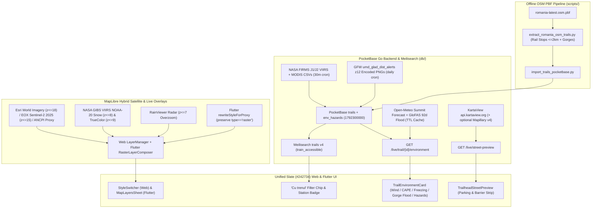

# Phase 4: Satellite & Snow Layers, Mountain Weather & Hazard Feeds, Trailhead Street Preview & Rail-Accessible Trails ("Cu trenul") — Implementation Plan

> **For agentic workers:** REQUIRED SUB-SKILL: Use superpowers:subagent-driven-development to implement this plan task-by-task. Steps use checkbox (`- [ ]`) syntax for tracking.

**Goal:** Deliver high-resolution hybrid satellite & Sentinel-2 cloudless base layers (with optional ANCPI Romania orthophoto proxy), near-real-time NASA GIBS snow-cover & RainViewer weather-radar overlays, automated Go backend wildfire (`NASA FIRMS`), forest-disturbance/windthrow (`GFW umd_glad_dist_alerts`), elevation-aware mountain weather (`Open-Meteo`), and gorge flash-flood (`GloFAS`) feeds, crowdsourced trailhead street-level preview (`KartaView` + optional `Mapillary`), and end-to-end CFR rail-accessible trail discovery (`"Cu trenul"`) across Go, Python, Web, and Flutter.

**Architecture:** Four cohesive subsystems share a zero-key-first contract: (1) PocketBase migration `1792300000` + Meilisearch `trails` v4 schema (`train_accessible`, `rail_station_*`, `is_water_gorge`, and `env_hazards`), populated offline at import time by `extract_romania_osm_trails.py` from `romania-latest.osm.pbf`; (2) Go background ingestors (`firms_ingestor.go` polling NOAA-20/21 VIIRS + MODIS 24h CSVs every 30 min, `gfw_disturbance_scanner.go` decoding z12 RGBA `umd_glad_dist_alerts` PNGs along trail corridors) and cached on-demand services (`mountain_weather.go` + `street_preview.go`) exposed under `/live/*` and proxied by SvelteKit `/api/v1/live/*`; (3) hybrid satellite raster + `openmaptiles` vector-label styles and dynamic NDSI snow / RainViewer (`maxzoom: 7`) / GFW overlays in Web (`LayerManager`) and Flutter (`rewriteStyleForProxy` raster preservation + `MapLayersSheet` composing Phase 1 Salvamont and Phase 3 Slope/Shadow toggles); (4) Unified Deep Slate (`#242734`) frosted-glass UI cards for mountain weather/flood/fire hazards, trailhead street thumbnails, and 1-tap `Cu trenul` filtering.

**Architecture Diagram:**



**Tech Stack:** Go 1.24 + PocketBase + Meilisearch (`db/`), Python 3.12 + PyOsmium (`scripts/`), TypeScript + SvelteKit 5 + MapLibre GL 6 + Vitest + Playwright (`web/`), Dart 3 + Flutter 3.47 + Riverpod + ObjectBox + MapLibre (`app/`).

**Spec:** [2026-11-18-mountain-intelligence-salvamont-design.md](file:///Volumes/SSD%20extern/Proiecte/Maps/docs/superpowers/specs/2026-11-18-mountain-intelligence-salvamont-design.md)

## Global Constraints

- **Zero Mandatory API Keys:** Every user-facing feature works 100% keyless out of the box. Optional `.env` keys (`ANCPI_ORTHO_URL_TEMPLATE`, `FIRMS_MAP_KEY`, `MAPILLARY_CLIENT_TOKEN`, `EOX_CLOUDLESS_YEAR`, `OPEN_METEO_API_KEY`) strictly unlock extra coverage or commercial licensing without breaking keyless defaults.
- **Verified Upstream Sensor & Host Rules (Empirical Live Probes):**
  - Use `VIIRS_NOAA20_NDSI_Snow_Cover` (`maxzoom: 8`) and `VIIRS_NOAA20_CorrectedReflectance_TrueColor` (`maxzoom: 9`) on NASA GIBS (`VIIRS_SNPP_*` is frozen since `2026-11-03`); always use `{z}/{y}/{x}` tile order on Esri, EOX, and GIBS.
  - Cap Esri World Imagery at `maxzoom: 18` (avoids `z>=19` `2,521 B` placeholder tiles) and RainViewer radar at `maxzoom: 7` (avoids `z>=8` `1,370 B` colormap watermark tiles) so MapLibre GPU-upscales cleanly to `z=18+`.
  - Use `umd_glad_dist_alerts` with HTTP `GET` (never `HEAD`, which returns `405`; never `gfw_integrated_alerts`, which is tropics-only and returns `500` over Romania).
  - Use `J1_VIIRS_C2_Europe_24h.csv` + `J2_VIIRS_C2_Europe_24h.csv` + `MODIS_C6_1_Europe_24h.csv` for keyless FIRMS (`SUOMI_VIIRS_C2` is empty).
  - Use `https://api.kartaview.org/2.0/photo/` (`api.openstreetcam.org` times out).
  - Request `past_days=92&forecast_days=3` on `flood-api.open-meteo.com/v1/flood` to compute a true 92-day reanalysis median/P90 baseline (since `river_discharge_p75` is a same-day ensemble percentile).
- **Cross-Phase Composition:**
  - Migration file is strictly `db/migrations/1792300000_add_env_hazards_and_rail_trails.go` (runs after Phase 2's `1792200000_add_trail_reports_photo.go`).
  - Flutter `rewriteStyleForProxy` (`app/lib/util/region/proxy_style_rewriter.dart`) MUST rewrite `type == 'vector'` and `type == 'raster-dem'` while preserving `type == 'raster'` sources untouched, and `MapLayersSheet` MUST preserve Phase 1 (`showSalvamontLayer`) and Phase 3 (`showAvalancheSlope`, `showSolarShadows`) toggles.
- **Unified Deep Slate (`#242734`) & Frosted Glass UI:** All floating controls (`40x40px`), layer menus, weather/hazard badges, and filter pills use `bg-menu-background/94 backdrop-blur-md border-input-border/60 text-content` (`#242734` monochrome icons in light mode, `#F9FAFB` in dark mode; `#DC2626` reserved for active SOS / critical wildfire danger).

---

### Task 1: PocketBase Migration (`1792300000`) & Meilisearch Index v4 (`train_accessible` & `env_hazards`)

> [!IMPORTANT]
> Bumping `SearchDocumentVersions["trails"]` from `3` to `4` in [meilisearch.go](file:///Volumes/SSD%20extern/Proiecte/Maps/db/util/meilisearch.go#L25-L31) triggers an automatic startup reindex so existing trails immediately expose `train_accessible` in Meilisearch filters.

**Files:**
- Create: [1792300000_add_env_hazards_and_rail_trails.go](file:///Volumes/SSD%20extern/Proiecte/Maps/db/migrations/1792300000_add_env_hazards_and_rail_trails.go)
- Modify: [main.go](file:///Volumes/SSD%20extern/Proiecte/Maps/db/main.go#L615-L630)
- Modify: [meilisearch.go](file:///Volumes/SSD%20extern/Proiecte/Maps/db/util/meilisearch.go#L25-L128)
- Test: [migrations_env_rail_test.go](file:///Volumes/SSD%20extern/Proiecte/Maps/db/migrations_env_rail_test.go)

**Interfaces:**
- Consumes: PocketBase `core.App`, `migrations.Register`, `util.TrailSearchDocument`.
- Produces:
  - `trails` fields: `train_accessible` (`bool`), `rail_station_name` (`text`), `rail_station_distance_m` (`number`), `rail_station_lat` (`number`), `rail_station_lon` (`number`), `is_water_gorge` (`bool`).
  - `env_hazards` collection: `external_key` (unique), `source` (`nasa_firms` | `gfw_dist_alert`), `hazard_type` (`wildfire` | `forest_disturbance`), `severity` (`warning` | `danger`), `title`, `lat`, `lon`, `radius_m`, `confidence`, `frp_mw`, `affected_trail_ids` (`json`), `detected_at` (`date`), `expires_at` (`date`).
  - Meilisearch `trails` v4 document fields: `train_accessible`, `rail_station_name`, `rail_station_distance_m`, `is_water_gorge` (`train_accessible` added to `FilterableAttributes`).

- [ ] **Step 1: Write the failing Go schema & search-document test**

Create `db/migrations_env_rail_test.go`:

```go
package main

import (
	"testing"

	"github.com/pocketbase/pocketbase/core"
	"github.com/pocketbase/pocketbase/tests"

	_ "pocketbase/migrations"
	"pocketbase/util"
)

func TestEnvHazardsAndRailMigrationAndSearchDoc(t *testing.T) {
	app, err := tests.NewTestApp()
	if err != nil {
		t.Fatalf("failed to init test app: %v", err)
	}
	defer app.Cleanup()

	trailsCol, err := app.FindCollectionByNameOrId("trails")
	if err != nil {
		t.Fatalf("trails collection missing: %v", err)
	}
	for _, fieldName := range []string{
		"train_accessible",
		"rail_station_name",
		"rail_station_distance_m",
		"rail_station_lat",
		"rail_station_lon",
		"is_water_gorge",
	} {
		if trailsCol.Fields.GetByName(fieldName) == nil {
			t.Fatalf("expected field %q on trails collection", fieldName)
		}
	}

	hazardsCol, err := app.FindCollectionByNameOrId("env_hazards")
	if err != nil {
		t.Fatalf("env_hazards collection missing: %v", err)
	}
	for _, fieldName := range []string{
		"external_key", "source", "hazard_type", "severity",
		"title", "lat", "lon", "radius_m", "affected_trail_ids", "expires_at",
	} {
		if hazardsCol.Fields.GetByName(fieldName) == nil {
			t.Fatalf("expected field %q on env_hazards collection", fieldName)
		}
	}

	if util.SearchDocumentVersions["trails"] < 4 {
		t.Fatalf("expected SearchDocumentVersions[trails] >= 4, got %d", util.SearchDocumentVersions["trails"])
	}

	settings := searchIndexSettings()["trails"]
	foundFilterable := false
	for _, attr := range settings.FilterableAttributes {
		if attr == "train_accessible" {
			foundFilterable = true
			break
		}
	}
	if !foundFilterable {
		t.Fatalf("expected train_accessible in trails FilterableAttributes")
	}

	actorsCol, _ := app.FindCollectionByNameOrId("activitypub_actors")
	actor := core.NewRecord(actorsCol)
	actor.Set("username", "romania")
	actor.Set("preferred_username", "romania")
	actor.Set("is_local", true)
	actor.Set("iri", "https://example.com/actors/romania")
	actor.Set("inbox", "https://example.com/actors/romania/inbox")
	actor.Set("public_key", "pem")
	if err := app.UnsafeWithoutHooks().Save(actor); err != nil {
		t.Fatalf("save actor: %v", err)
	}

	trail := core.NewRecord(trailsCol)
	trail.Set("name", "Gara Bușteni – Cascada Urlătoarea")
	trail.Set("author", actor.Id)
	trail.Set("public", true)
	trail.Set("train_accessible", true)
	trail.Set("rail_station_name", "Bușteni")
	trail.Set("rail_station_distance_m", 640)
	trail.Set("is_water_gorge", false)
	if err := app.UnsafeWithoutHooks().Save(trail); err != nil {
		t.Fatalf("save trail: %v", err)
	}

	doc, err := util.TrailSearchDocument(app, trail)
	if err != nil {
		t.Fatalf("TrailSearchDocument failed: %v", err)
	}
	if doc["train_accessible"] != true {
		t.Fatalf("expected train_accessible=true in search doc, got %v", doc["train_accessible"])
	}
	if doc["rail_station_name"] != "Bușteni" {
		t.Fatalf("expected rail_station_name=Bușteni, got %v", doc["rail_station_name"])
	}
	if doc["rail_station_distance_m"] != float64(640) {
		t.Fatalf("expected rail_station_distance_m=640, got %v", doc["rail_station_distance_m"])
	}
}
```

- [ ] **Step 2: Run Go test to verify it fails**

Run: `cd db && go test -v -run TestEnvHazardsAndRailMigrationAndSearchDoc .`
Expected: FAIL with `expected field "train_accessible" on trails collection`.

- [ ] **Step 3: Implement migration `1792300000` and Meilisearch v4 attributes**

Create `db/migrations/1792300000_add_env_hazards_and_rail_trails.go`:

```go
package migrations

import (
	"github.com/pocketbase/pocketbase/core"
	m "github.com/pocketbase/pocketbase/migrations"
)

func init() {
	m.Register(func(app core.App) error {
		if err := addRailAndGorgeFieldsToTrails(app); err != nil {
			return err
		}
		return createEnvHazardsCollection(app)
	}, func(app core.App) error {
		if col, err := app.FindCollectionByNameOrId("env_hazards"); err == nil && col != nil {
			if err := app.Delete(col); err != nil {
				return err
			}
		}
		trailsCol, err := app.FindCollectionByNameOrId("trails")
		if err != nil {
			return nil
		}
		for _, name := range []string{
			"train_accessible",
			"rail_station_name",
			"rail_station_distance_m",
			"rail_station_lat",
			"rail_station_lon",
			"is_water_gorge",
		} {
			trailsCol.Fields.RemoveByName(name)
		}
		return app.Save(trailsCol)
	})
}

func addRailAndGorgeFieldsToTrails(app core.App) error {
	col, err := app.FindCollectionByNameOrId("trails")
	if err != nil {
		return err
	}
	if col.Fields.GetByName("train_accessible") == nil {
		col.Fields.Add(&core.BoolField{Name: "train_accessible"})
	}
	if col.Fields.GetByName("rail_station_name") == nil {
		col.Fields.Add(&core.TextField{Name: "rail_station_name", Max: 120})
	}
	if col.Fields.GetByName("rail_station_distance_m") == nil {
		col.Fields.Add(&core.NumberField{Name: "rail_station_distance_m"})
	}
	if col.Fields.GetByName("rail_station_lat") == nil {
		col.Fields.Add(&core.NumberField{Name: "rail_station_lat"})
	}
	if col.Fields.GetByName("rail_station_lon") == nil {
		col.Fields.Add(&core.NumberField{Name: "rail_station_lon"})
	}
	if col.Fields.GetByName("is_water_gorge") == nil {
		col.Fields.Add(&core.BoolField{Name: "is_water_gorge"})
	}
	return app.Save(col)
}

func createEnvHazardsCollection(app core.App) error {
	if _, err := app.FindCollectionByNameOrId("env_hazards"); err == nil {
		return nil
	}
	col := core.NewBaseCollection("env_hazards")
	col.ListRule = nil
	col.ViewRule = nil
	col.CreateRule = nil
	col.UpdateRule = nil
	col.DeleteRule = nil

	col.Fields.Add(
		&core.TextField{Name: "external_key", Required: true, Max: 160},
		&core.SelectField{
			Name:     "source",
			Required: true,
			Values:   []string{"nasa_firms", "gfw_dist_alert"},
		},
		&core.SelectField{
			Name:     "hazard_type",
			Required: true,
			Values:   []string{"wildfire", "forest_disturbance"},
		},
		&core.SelectField{
			Name:     "severity",
			Required: true,
			Values:   []string{"warning", "danger"},
		},
		&core.TextField{Name: "title", Max: 200},
		&core.NumberField{Name: "lat", Required: true},
		&core.NumberField{Name: "lon", Required: true},
		&core.NumberField{Name: "radius_m"},
		&core.TextField{Name: "confidence", Max: 40},
		&core.NumberField{Name: "frp_mw"},
		&core.JSONField{Name: "affected_trail_ids", MaxSize: 65536},
		&core.DateField{Name: "detected_at"},
		&core.DateField{Name: "expires_at"},
		&core.AutodateField{Name: "created", OnCreate: true},
		&core.AutodateField{Name: "updated", OnCreate: true, OnUpdate: true},
	)

	col.AddIndex("idx_env_hazards_external_key", true, "`external_key`", "")
	col.AddIndex("idx_env_hazards_expires_at", false, "`expires_at`", "")
	col.AddIndex("idx_env_hazards_coords", false, "`lat`, `lon`", "")

	return app.Save(col)
}
```

Update `db/main.go` (`L618–624`):

```diff
 			FilterableAttributes: []string{
 				"id", "_geo", "author", "category_id", "subcategory_id",
 				"is_federated", "completed", "date", "difficulty", "distance",
 				"elevation_gain", "elevation_loss", "likes", "public", "shares",
-				"tags", "min_lat", "max_lat", "min_lon", "max_lon", "bounding_box_diagonal",
+				"tags", "train_accessible", "min_lat", "max_lat", "min_lon", "max_lon", "bounding_box_diagonal",
 			},
```

Update `db/util/meilisearch.go` (`L25–31` and `L118–127`):

```diff
 var SearchDocumentVersions = map[string]int{
 	// feature/app (moving_duration) and main (trails rewritten by migrations)
 	// each moved trails to 2; 3 rebuilds instances coming from either.
-	"trails": 3,
+	// 4 adds train_accessible, rail_station_*, and is_water_gorge.
+	"trails": 4,
 	"lists":  2,
 	"actors": 2,
 }
```

```diff
 		"min_lat":                    bounds[0],
 		"max_lat":                    bounds[1],
 		"min_lon":                    bounds[2],
 		"max_lon":                    bounds[3],
 		"bounding_box_diagonal":      diagonal,
+		"train_accessible":           r.GetBool("train_accessible"),
+		"rail_station_name":          r.GetString("rail_station_name"),
+		"rail_station_distance_m":    r.GetFloat("rail_station_distance_m"),
+		"is_water_gorge":             r.GetBool("is_water_gorge"),
 		"_geo": map[string]float64{
```

- [ ] **Step 4: Run Go test to verify it passes**

Run: `cd db && go test -v -run TestEnvHazardsAndRailMigrationAndSearchDoc .`
Expected: PASS (`ok  	pocketbase`).

- [ ] **Step 5: Commit**

```bash
git add db/migrations/1792300000_add_env_hazards_and_rail_trails.go db/main.go db/util/meilisearch.go db/migrations_env_rail_test.go
git commit -m "feat(db): add env_hazards collection and rail/gorge trail fields in Meilisearch v4"
```

---

### Task 2: OSM PBF Extractor & Importer for CFR Rail Stops ("Cu trenul") & Gorge Trails (`scripts/`)

**Files:**
- Modify: [extract_romania_osm_trails.py](file:///Volumes/SSD%20extern/Proiecte/Maps/scripts/extract_romania_osm_trails.py#L29-L460)
- Modify: [import_trails_pocketbase.py](file:///Volumes/SSD%20extern/Proiecte/Maps/scripts/import_trails_pocketbase.py#L280-L309)
- Test: [test_extract_romania_osm_trails.py](file:///Volumes/SSD%20extern/Proiecte/Maps/scripts/test_extract_romania_osm_trails.py)

**Interfaces:**
- Consumes: OSM PBF nodes/ways (`railway=station|halt`, `natural=gorge|canyon`) via `pyosmium`.
- Produces:
  - `is_valid_passenger_rail_stop(tags: dict[str, str]) -> bool`
  - `find_nearest_rail_stop(endpoints: list[tuple[float, float]], stops: list[dict], max_distance_m: float = 2000.0) -> dict | None`
  - `detect_water_gorge(name: str, tags: dict[str, str], all_pts: list[tuple[float, float]], gorge_pts: list[tuple[float, float]]) -> bool`
  - Manifest JSONL fields: `train_accessible`, `rail_station_name`, `rail_station_distance_m`, `rail_station_lat`, `rail_station_lon`, `is_water_gorge`, plus `"Cu trenul"` tag.

- [ ] **Step 1: Write the failing Python unit tests**

Create `scripts/test_extract_romania_osm_trails.py`:

```python
import unittest
from unittest.mock import MagicMock

from extract_romania_osm_trails import (
    build_trail_record,
    detect_water_gorge,
    find_nearest_rail_stop,
    is_valid_passenger_rail_stop,
)


class TestRomaniaRailAndGorgeExtraction(unittest.TestCase):
    def test_passenger_rail_stop_filtering(self) -> None:
        self.assertTrue(is_valid_passenger_rail_stop({"railway": "station", "name": "Gara Bușteni"}))
        self.assertTrue(is_valid_passenger_rail_stop({"railway": "halt", "name": "Halta Timișu de Sus"}))
        self.assertFalse(is_valid_passenger_rail_stop({"railway": "station", "station": "subway", "name": "Piața Unirii"}))
        self.assertFalse(is_valid_passenger_rail_stop({"railway": "station", "subway": "yes", "name": "Eroilor"}))
        self.assertFalse(is_valid_passenger_rail_stop({"railway": "station", "usage": "industrial", "name": "Triaj"}))
        self.assertFalse(is_valid_passenger_rail_stop({"railway": "station", "disused:railway": "station", "name": "Veche"}))
        self.assertFalse(is_valid_passenger_rail_stop({"railway": "abandoned", "name": "Cale Ferată Veche"}))

    def test_nearest_rail_stop_matches_trailhead_within_2km(self) -> None:
        stops = [
            {"name": "Bușteni", "lat": 45.4119, "lon": 25.5378},
            {"name": "Brașov", "lat": 45.6606, "lon": 25.6136},
        ]
        # Jepii Mici trailhead ~450m from Gara Bușteni
        match = find_nearest_rail_stop([(25.5325, 45.4130), (25.4710, 45.4080)], stops, max_distance_m=2000.0)
        self.assertIsNotNone(match)
        assert match is not None
        self.assertEqual(match["name"], "Bușteni")
        self.assertLess(match["distance_m"], 700.0)

        # Remote Retezat trailhead >20km from stations
        far = find_nearest_rail_stop([(22.8750, 45.3670), (22.8900, 45.3500)], stops, max_distance_m=2000.0)
        self.assertIsNone(far)

    def test_water_gorge_detection_and_build_trail_record(self) -> None:
        self.assertTrue(detect_water_gorge("Traseu Cheile Nerei – La Tunele", {}, [(21.78, 44.89)], []))
        self.assertFalse(detect_water_gorge("Vârful Omu pe Culmea Bucșoiu", {}, [(25.45, 45.44)], []))

        dem = MagicMock()
        dem.sample.return_value = 920.0
        ways = {
            101: [(25.5350, 45.4120), (25.5280, 45.4125), (25.5200, 45.4130)],
        }
        rel = {
            "id": 99901,
            "tags": {"type": "route", "route": "hiking", "name": "Bușteni – Cascada Urlătoarea", "osmc:symbol": "red:white:red_dot"},
            "way_ids": [101],
        }
        stops = [{"name": "Gara Bușteni", "lat": 45.4119, "lon": 25.5378}]
        res = build_trail_record(rel, ways, dem, rail_stops=stops, gorge_pts=[])
        self.assertIsNotNone(res)
        assert res is not None
        rec, _ = res
        self.assertTrue(rec["train_accessible"])
        self.assertEqual(rec["rail_station_name"], "Bușteni")
        self.assertIn("Cu trenul", rec["tags"])


if __name__ == "__main__":
    unittest.main()
```

- [ ] **Step 2: Run Python test to verify it fails**

Run: `PYTHONPATH=scripts python3 -m unittest scripts/test_extract_romania_osm_trails.py -v`
Expected: FAIL with `ImportError: cannot import name 'is_valid_passenger_rail_stop'`.

- [ ] **Step 3: Implement rail-stop & gorge extraction in `extract_romania_osm_trails.py` and `import_trails_pocketbase.py`**

Update `scripts/extract_romania_osm_trails.py` to add rail stop & gorge helpers and wire them into Pass 2 and `build_trail_record`:

```python
MAX_RAIL_ACCESS_METERS = 2000.0
GORGE_NAME_RE = re.compile(r"\b(cheile|canionul|canion|defileul|vale[ai]\s+cernei|vale[ai]\s+lui\s+stan)\b", re.IGNORECASE)


def normalize_station_name(raw_name: str) -> str:
    cleaned = re.sub(r"^(Gara\s+CFR\s+|Gara\s+|Halta\s+|Stația\s+)", "", raw_name.strip(), flags=re.IGNORECASE).strip()
    return cleaned or raw_name.strip()


def is_valid_passenger_rail_stop(tags: dict[str, str]) -> bool:
    railway = tags.get("railway", "").strip().lower()
    if railway not in ("station", "halt"):
        return False
    if tags.get("station", "").strip().lower() in ("subway", "light_rail", "monorail"):
        return False
    if tags.get("subway", "").strip().lower() == "yes":
        return False
    if tags.get("usage", "").strip().lower() in ("industrial", "military", "tourism", "freight"):
        return False
    if "disused:railway" in tags or "abandoned:railway" in tags or tags.get("disused") == "yes":
        return False
    return bool((tags.get("name:ro") or tags.get("name") or "").strip())


def find_nearest_rail_stop(
    endpoints: list[tuple[float, float]],
    stops: list[dict],
    max_distance_m: float = MAX_RAIL_ACCESS_METERS,
) -> dict | None:
    if not endpoints or not stops:
        return None
    best: dict | None = None
    best_dist = max_distance_m + 1.0
    for lon, lat in endpoints:
        for st in stops:
            if abs(st["lat"] - lat) > 0.025 or abs(st["lon"] - lon) > 0.035:
                continue
            d = haversine_meters(lon, lat, st["lon"], st["lat"])
            if d <= max_distance_m and d < best_dist:
                best_dist = d
                best = {
                    "name": normalize_station_name(st["name"]),
                    "lat": round(st["lat"], 6),
                    "lon": round(st["lon"], 6),
                    "distance_m": round(d, 1),
                }
    return best


def detect_water_gorge(
    name: str,
    tags: dict[str, str],
    all_pts: list[tuple[float, float]],
    gorge_pts: list[tuple[float, float]],
) -> bool:
    haystack = f"{name} {tags.get('description:ro', '')} {tags.get('description', '')}"
    if GORGE_NAME_RE.search(haystack):
        return True
    if not gorge_pts or not all_pts:
        return False
    hits = 0
    step = max(1, len(all_pts) // 25)
    for lon, lat in all_pts[::step]:
        for glon, glat in gorge_pts:
            if abs(glat - lat) <= 0.0015 and abs(glon - lon) <= 0.002 and haversine_meters(lon, lat, glon, glat) <= 90.0:
                hits += 1
                if hits >= 2:
                    return True
                break
    return False
```

In `WayGeometryCollector` (`scripts/extract_romania_osm_trails.py`), also collect rail stop nodes/ways and `natural in ("gorge", "canyon")` midpoints during Pass 2:

```python
class WayGeometryCollector(osmium.SimpleHandler):
    def __init__(self, needed_ways: set[int]) -> None:
        super().__init__()
        self.needed_ways = needed_ways
        self.ways: dict[int, list[tuple[float, float]]] = {}
        self.rail_stops: list[dict] = []
        self.gorge_pts: list[tuple[float, float]] = []

    def node(self, n: osmium.osm.Node) -> None:
        if not n.tags or not n.location.valid():
            return
        lat, lon = n.location.lat, n.location.lon
        if not (RO_LAT_MIN <= lat <= RO_LAT_MAX and RO_LON_MIN <= lon <= RO_LON_MAX):
            return
        tags = {t.k: t.v for t in n.tags}
        if is_valid_passenger_rail_stop(tags):
            self.rail_stops.append({
                "name": (tags.get("name:ro") or tags.get("name") or "").strip(),
                "lat": lat,
                "lon": lon,
            })
        elif tags.get("natural") in ("gorge", "canyon"):
            self.gorge_pts.append((lon, lat))

    def way(self, w: osmium.osm.Way) -> None:
        wid = int(w.id)
        tags = {t.k: t.v for t in w.tags} if w.tags else {}
        is_rail = is_valid_passenger_rail_stop(tags)
        is_gorge = tags.get("natural") in ("gorge", "canyon")
        if wid not in self.needed_ways and not is_rail and not is_gorge:
            return
        coords: list[tuple[float, float]] = []
        for n in w.nodes:
            if n.location.valid():
                lat, lon = n.lat, n.lon
                if RO_LAT_MIN <= lat <= RO_LAT_MAX and RO_LON_MIN <= lon <= RO_LON_MAX:
                    coords.append((lon, lat))
        if wid in self.needed_ways and len(coords) >= 2:
            self.ways[wid] = coords
        if is_rail and coords:
            mid = coords[len(coords) // 2]
            self.rail_stops.append({
                "name": (tags.get("name:ro") or tags.get("name") or "").strip(),
                "lat": mid[1],
                "lon": mid[0],
            })
        if is_gorge and coords:
            self.gorge_pts.extend(coords[::max(1, len(coords) // 5)])
```

Update `build_trail_record` signature & body (`L262–410`) and `main()` (`L449`):

```python
def build_trail_record(
    rel: dict,
    ways: dict[int, list[tuple[float, float]]],
    dem: DemTileCache,
    rail_stops: list[dict] | None = None,
    gorge_pts: list[tuple[float, float]] | None = None,
) -> tuple[dict, str] | None:
```

Inside `build_trail_record` right after `start_lon, start_lat = segments_2d[0][0]`:

```python
    end_lon, end_lat = segments_2d[-1][-1]
    rail_match = find_nearest_rail_stop(
        [(start_lon, start_lat), (end_lon, end_lat)],
        rail_stops or [],
        MAX_RAIL_ACCESS_METERS,
    )
    if rail_match:
        trail_tags.append("Cu trenul")
    is_water_gorge = detect_water_gorge(name, tags, all_pts, gorge_pts or [])
```

Append rail description line before `osm:relation:` and include fields in `record`:

```python
    if rail_match:
        desc_parts.append(
            f"<p><strong>Acces cu trenul:</strong> Gara {html.escape(rail_match['name'])} "
            f"({int(round(rail_match['distance_m']))} m)</p>"
        )
```

```python
        "train_accessible": bool(rail_match),
        "rail_station_name": rail_match["name"] if rail_match else "",
        "rail_station_distance_m": int(round(rail_match["distance_m"])) if rail_match else 0,
        "rail_station_lat": rail_match["lat"] if rail_match else 0.0,
        "rail_station_lon": rail_match["lon"] if rail_match else 0.0,
        "is_water_gorge": is_water_gorge,
```

And in `main()`: `res = build_trail_record(rel, way_collector.ways, dem, way_collector.rail_stops, way_collector.gorge_pts)`.

Update `scripts/import_trails_pocketbase.py` (`L297–299`) to pass the new fields:

```diff
             ("min_lon", str(rec["min_lon"])),
             ("max_lon", str(rec["max_lon"])),
+            ("train_accessible", "true" if rec.get("train_accessible") else "false"),
+            ("rail_station_name", str(rec.get("rail_station_name") or "")),
+            ("rail_station_distance_m", str(rec.get("rail_station_distance_m") or 0)),
+            ("rail_station_lat", str(rec.get("rail_station_lat") or 0)),
+            ("rail_station_lon", str(rec.get("rail_station_lon") or 0)),
+            ("is_water_gorge", "true" if rec.get("is_water_gorge") else "false"),
         ]
```

- [ ] **Step 4: Run Python tests to verify they pass**

Run: `PYTHONPATH=scripts python3 -m unittest scripts/test_extract_romania_osm_trails.py -v`
Expected: PASS (`Ran 3 tests in 0.01s — OK`).

- [ ] **Step 5: Commit**

```bash
git add scripts/extract_romania_osm_trails.py scripts/import_trails_pocketbase.py scripts/test_extract_romania_osm_trails.py
git commit -m "feat(scripts): extract Romania passenger rail access ('Cu trenul') and gorge flags from OSM PBF"
```

---

### Task 3: Automated Go Wildfire (`NASA FIRMS`) & Forest Disturbance (`GFW umd_glad_dist_alerts`) Scanners (`db/services/env/`)

**Files:**
- Create: [types.go](file:///Volumes/SSD%20extern/Proiecte/Maps/db/services/env/types.go)
- Create: [firms_ingestor.go](file:///Volumes/SSD%20extern/Proiecte/Maps/db/services/env/firms_ingestor.go)
- Create: [gfw_disturbance_scanner.go](file:///Volumes/SSD%20extern/Proiecte/Maps/db/services/env/gfw_disturbance_scanner.go)
- Test: [hazards_scanner_test.go](file:///Volumes/SSD%20extern/Proiecte/Maps/db/services/env/hazards_scanner_test.go)

**Interfaces:**
- Consumes: `core.App`, `github.com/twpayne/go-polyline`, Go stdlib `encoding/csv` + `image/png`.
- Produces:
  - `EnvHazardDto { ID, Source, HazardType, Severity, Title, Lat, Lon, RadiusM, Confidence, DetectedAt, ExpiresAt }`
  - `SyncFirmsActiveFires(ctx context.Context, app core.App, client *http.Client, feedURLs []string, now time.Time) (int, error)`
  - `ScanDisturbanceTiles(ctx context.Context, app core.App, client *http.Client, tileTemplate string, now time.Time) (int, error)`
  - `DecodeGladDistAlertPixel(r, g, b, a uint8) (alertDate time.Time, highConfidence bool, ok bool)`

- [ ] **Step 1: Write the failing Go unit tests for FIRMS CSV ingestion & GFW encoded-PNG decoding**

Create `db/services/env/hazards_scanner_test.go`:

```go
package env_test

import (
	"bytes"
	"context"
	"image"
	"image/color"
	"image/png"
	"math"
	"net/http"
	"net/http/httptest"
	"testing"
	"time"

	"github.com/pocketbase/pocketbase/core"
	"github.com/pocketbase/pocketbase/tests"
	"github.com/twpayne/go-polyline"

	_ "pocketbase/migrations"
	"pocketbase/services/env"
)

func seedTestTrail(t *testing.T, app core.App, coords [][]float64) *core.Record {
	t.Helper()
	actorsCol, _ := app.FindCollectionByNameOrId("activitypub_actors")
	actor := core.NewRecord(actorsCol)
	actor.Set("username", "tester")
	actor.Set("preferred_username", "tester")
	actor.Set("is_local", true)
	actor.Set("iri", "https://example.com/actors/tester")
	actor.Set("inbox", "https://example.com/actors/tester/inbox")
	actor.Set("public_key", "pem")
	if err := app.UnsafeWithoutHooks().Save(actor); err != nil {
		t.Fatalf("save actor: %v", err)
	}

	trailsCol, _ := app.FindCollectionByNameOrId("trails")
	tr := core.NewRecord(trailsCol)
	tr.Set("name", "Traseu Făgăraș Test")
	tr.Set("author", actor.Id)
	tr.Set("public", true)
	tr.Set("lat", coords[0][0])
	tr.Set("lon", coords[0][1])
	tr.Set("polyline", string(polyline.EncodeCoords(coords)))
	if err := app.UnsafeWithoutHooks().Save(tr); err != nil {
		t.Fatalf("save trail: %v", err)
	}
	return tr
}

func TestFirmsIngestorFiltersRomaniaConfidenceAndMatchesTrail(t *testing.T) {
	app, err := tests.NewTestApp()
	if err != nil {
		t.Fatalf("new test app: %v", err)
	}
	defer app.Cleanup()

	trail := seedTestTrail(t, app, [][]float64{
		{45.6000, 24.6100},
		{45.6050, 24.6200},
	})

	csvPayload := "latitude,longitude,bright_ti4,scan,track,acq_date,acq_time,satellite,confidence,version,bright_ti5,frp,daynight\n" +
		"45.6020,24.6150,335.4,0.4,0.4,2026-11-18,1015,N20,high,2.0NRT,290.1,14.2,D\n" + // Inside RO, 250m from trail -> danger!
		"45.6025,24.6155,312.0,0.4,0.4,2026-11-18,1015,N20,low,2.0NRT,285.0,2.1,D\n" + // Low confidence -> ignored
		"52.1561,10.4047,330.0,0.4,0.4,2026-11-18,0900,N21,nominal,2.0NRT,280.0,5.0,D\n" // Outside RO -> ignored

	srv := httptest.NewServer(http.HandlerFunc(func(w http.ResponseWriter, r *http.Request) {
		w.WriteHeader(http.StatusOK)
		_, _ = w.Write([]byte(csvPayload))
	}))
	defer srv.Close()

	now := time.Date(2026, 11, 18, 12, 0, 0, 0, time.UTC)
	count, err := env.SyncFirmsActiveFires(context.Background(), app, srv.Client(), []string{srv.URL}, now)
	if err != nil {
		t.Fatalf("SyncFirmsActiveFires error: %v", err)
	}
	if count != 1 {
		t.Fatalf("expected 1 persisted wildfire hazard, got %d", count)
	}

	records, err := app.FindRecordsByFilter("env_hazards", "source = 'nasa_firms'", "", 10, 0, nil)
	if err != nil || len(records) != 1 {
		t.Fatalf("expected 1 env_hazards record, got %d (%v)", len(records), err)
	}
	if records[0].GetString("severity") != "danger" {
		t.Fatalf("expected severity=danger within 800m of trail, got %s", records[0].GetString("severity"))
	}
	var trailIDs []string
	_ = records[0].UnmarshalJSONField("affected_trail_ids", &trailIDs)
	if len(trailIDs) != 1 || trailIDs[0] != trail.Id {
		t.Fatalf("expected affected_trail_ids=[%s], got %v", trail.Id, trailIDs)
	}
}

func TestGladDisturbancePixelDecodeAndTileScan(t *testing.T) {
	// Days since 2020-12-31 for 2026-11-10 is 2140: R=8 (8*255=2040), G=100 -> 2140. High conf: B=245 (floor(245/100)=2).
	dt, high, ok := env.DecodeGladDistAlertPixel(8, 100, 245, 255)
	if !ok || !high {
		t.Fatalf("expected valid high-confidence alert")
	}
	if dt.Format("2006-01-02") != "2026-11-10" {
		t.Fatalf("expected 2026-11-10, got %s", dt.Format("2006-01-02"))
	}

	app, err := tests.NewTestApp()
	if err != nil {
		t.Fatalf("new test app: %v", err)
	}
	defer app.Cleanup()

	lat, lon := 45.6000, 24.6100
	trail := seedTestTrail(t, app, [][]float64{
		{lat, lon},
		{lat + 0.0005, lon + 0.0005},
	})

	// Compute exact pixel in z=12 256x256 tile for (lat, lon)
	n := 4096.0
	xf := (lon + 180.0) / 360.0 * n
	latRad := lat * math.Pi / 180.0
	yf := (1.0 - math.Asinh(math.Tan(latRad))/math.Pi) / 2.0 * n
	px := int((xf - math.Floor(xf)) * 256.0)
	py := int((yf - math.Floor(yf)) * 256.0)

	srv := httptest.NewServer(http.HandlerFunc(func(w http.ResponseWriter, r *http.Request) {
		if r.Method != http.MethodGet {
			w.WriteHeader(http.StatusMethodNotAllowed)
			return
		}
		img := image.NewNRGBA(image.Rect(0, 0, 256, 256))
		img.SetNRGBA(px, py, color.NRGBA{R: 8, G: 100, B: 245, A: 255})
		img.SetNRGBA(px+1, py, color.NRGBA{R: 8, G: 100, B: 245, A: 255})
		var buf bytes.Buffer
		_ = png.Encode(&buf, img)
		w.Header().Set("Content-Type", "image/png")
		_, _ = w.Write(buf.Bytes())
	}))
	defer srv.Close()

	now := time.Date(2026, 11, 18, 12, 0, 0, 0, time.UTC)
	created, err := env.ScanDisturbanceTiles(context.Background(), app, srv.Client(), srv.URL+"/{z}/{x}/{y}.png", now)
	if err != nil {
		t.Fatalf("ScanDisturbanceTiles error: %v", err)
	}
	if created != 1 {
		t.Fatalf("expected 1 disturbance hazard, got %d", created)
	}
	records, _ := app.FindRecordsByFilter("env_hazards", "source = 'gfw_dist_alert'", "", 10, 0, nil)
	if len(records) != 1 {
		t.Fatalf("expected 1 gfw_dist_alert record, got %d", len(records))
	}
	var ids []string
	_ = records[0].UnmarshalJSONField("affected_trail_ids", &ids)
	if len(ids) != 1 || ids[0] != trail.Id {
		t.Fatalf("expected trail %s affected, got %v", trail.Id, ids)
	}
}
```

- [ ] **Step 2: Run Go tests to verify they fail**

Run: `cd db && go test -v ./services/env/...`
Expected: FAIL (`cannot find package "pocketbase/services/env"`).

- [ ] **Step 3: Implement `types.go`, `firms_ingestor.go`, and `gfw_disturbance_scanner.go`**

Create `db/services/env/types.go`:

```go
package env

import (
	"math"

	"github.com/pocketbase/dbx"
	"github.com/pocketbase/pocketbase/core"
	"github.com/twpayne/go-polyline"

	"pocketbase/util"
)

const (
	RoLatMin = 43.4
	RoLatMax = 48.5
	RoLonMin = 20.0
	RoLonMax = 30.0
)

type EnvHazardDto struct {
	ID         string  `json:"id"`
	Source     string  `json:"source"`
	HazardType string  `json:"hazardType"`
	Severity   string  `json:"severity"`
	Title      string  `json:"title"`
	Lat        float64 `json:"lat"`
	Lon        float64 `json:"lon"`
	RadiusM    float64 `json:"radiusM"`
	Confidence string  `json:"confidence"`
	DetectedAt string  `json:"detectedAt"`
	ExpiresAt  string  `json:"expiresAt"`
}

type TrailCorridor struct {
	ID     string
	Coords [][]float64
	MinLat float64
	MaxLat float64
	MinLon float64
	MaxLon float64
}

func LoadPublicTrailCorridors(app core.App) ([]TrailCorridor, error) {
	records := []*core.Record{}
	err := app.RecordQuery("trails").
		AndWhere(dbx.NewExp("public = TRUE AND polyline != ''")).
		All(&records)
	if err != nil {
		return nil, err
	}
	out := make([]TrailCorridor, 0, len(records))
	for _, r := range records {
		coords, _, decErr := polyline.DecodeCoords([]byte(r.GetString("polyline")))
		if decErr != nil || len(coords) == 0 {
			continue
		}
		minLat, maxLat := coords[0][0], coords[0][0]
		minLon, maxLon := coords[0][1], coords[0][1]
		for _, c := range coords[1:] {
			minLat = math.Min(minLat, c[0])
			maxLat = math.Max(maxLat, c[0])
			minLon = math.Min(minLon, c[1])
			maxLon = math.Max(maxLon, c[1])
		}
		out = append(out, TrailCorridor{
			ID:     r.Id,
			Coords: coords,
			MinLat: minLat,
			MaxLat: maxLat,
			MinLon: minLon,
			MaxLon: maxLon,
		})
	}
	return out, nil
}

func DistanceToCorridorMeters(lat, lon float64, coords [][]float64) float64 {
	if len(coords) == 0 {
		return math.Inf(1)
	}
	if len(coords) == 1 {
		return util.HaversineDistanceMeters(lat, lon, coords[0][0], coords[0][1])
	}
	const metersPerDegLat = 111132.92
	metersPerDegLon := metersPerDegLat * math.Max(0.1, math.Cos(lat*math.Pi/180.0))
	minSq := math.Inf(1)
	for i := 0; i < len(coords)-1; i++ {
		ax := (coords[i][1] - lon) * metersPerDegLon
		ay := (coords[i][0] - lat) * metersPerDegLat
		bx := (coords[i+1][1] - lon) * metersPerDegLon
		by := (coords[i+1][0] - lat) * metersPerDegLat
		dx, dy := bx-ax, by-ay
		lenSq := dx*dx + dy*dy
		t := 0.0
		if lenSq > 1e-9 {
			t = math.Max(0, math.Min(1, -(ax*dx+ay*dy)/lenSq))
		}
		px, py := ax+t*dx, ay+t*dy
		if dSq := px*px + py*py; dSq < minSq {
			minSq = dSq
		}
	}
	return math.Sqrt(minSq)
}
```

Create `db/services/env/firms_ingestor.go`:

```go
package env

import (
	"context"
	"encoding/csv"
	"fmt"
	"io"
	"net/http"
	"os"
	"strconv"
	"strings"
	"time"

	"github.com/pocketbase/pocketbase/core"
	"github.com/pocketbase/pocketbase/tools/types"

	"pocketbase/util"
)

var DefaultKeylessFirmsURLs = []string{
	"https://firms.modaps.eosdis.nasa.gov/data/active_fire/noaa-20-viirs-c2/csv/J1_VIIRS_C2_Europe_24h.csv",
	"https://firms.modaps.eosdis.nasa.gov/data/active_fire/noaa-21-viirs-c2/csv/J2_VIIRS_C2_Europe_24h.csv",
	"https://firms.modaps.eosdis.nasa.gov/data/active_fire/modis-c6.1/csv/MODIS_C6_1_Europe_24h.csv",
}

func ResolveFirmsFeedURLs() []string {
	if key := strings.TrimSpace(os.Getenv("FIRMS_MAP_KEY")); key != "" {
		return []string{
			fmt.Sprintf("https://firms.modaps.eosdis.nasa.gov/api/area/csv/%s/VIIRS_NOAA20_NRT/20.0,43.4,30.0,48.5/2", key),
			fmt.Sprintf("https://firms.modaps.eosdis.nasa.gov/api/area/csv/%s/VIIRS_NOAA21_NRT/20.0,43.4,30.0,48.5/2", key),
		}
	}
	return DefaultKeylessFirmsURLs
}

type firmsDetection struct {
	Lat        float64
	Lon        float64
	Confidence string
	FRP        float64
	DetectedAt time.Time
}

func isReliableFirmsConfidence(raw string) bool {
	c := strings.ToLower(strings.TrimSpace(raw))
	if c == "high" || c == "nominal" || c == "h" || c == "n" {
		return true
	}
	if n, err := strconv.Atoi(c); err == nil {
		return n >= 50
	}
	return false
}

func SyncFirmsActiveFires(
	ctx context.Context,
	app core.App,
	client *http.Client,
	feedURLs []string,
	now time.Time,
) (int, error) {
	if client == nil {
		client = &http.Client{Timeout: 20 * time.Second}
	}
	if len(feedURLs) == 0 {
		feedURLs = ResolveFirmsFeedURLs()
	}

	corridors, err := LoadPublicTrailCorridors(app)
	if err != nil {
		return 0, err
	}
	hazardsCol, err := app.FindCollectionByNameOrId("env_hazards")
	if err != nil {
		return 0, err
	}

	var cluster []firmsDetection
	for _, feedURL := range feedURLs {
		req, reqErr := http.NewRequestWithContext(ctx, http.MethodGet, feedURL, nil)
		if reqErr != nil {
			continue
		}
		resp, doErr := client.Do(req)
		if doErr != nil {
			continue
		}
		if resp.StatusCode != http.StatusOK {
			_ = resp.Body.Close()
			continue
		}

		reader := csv.NewReader(resp.Body)
		header, hErr := reader.Read()
		if hErr != nil {
			_ = resp.Body.Close()
			continue
		}
		idx := map[string]int{}
		for i, colName := range header {
			idx[strings.ToLower(strings.TrimSpace(colName))] = i
		}
		for {
			row, rErr := reader.Read()
			if rErr == io.EOF || rErr != nil {
				break
			}
			lat, err1 := strconv.ParseFloat(row[idx["latitude"]], 64)
			lon, err2 := strconv.ParseFloat(row[idx["longitude"]], 64)
			if err1 != nil || err2 != nil || lat < RoLatMin || lat > RoLatMax || lon < RoLonMin || lon > RoLonMax {
				continue
			}
			conf := row[idx["confidence"]]
			if !isReliableFirmsConfidence(conf) {
				continue
			}
			frp, _ := strconv.ParseFloat(row[idx["frp"]], 64)
			acqDate := row[idx["acq_date"]]
			acqTime := fmt.Sprintf("%04s", strings.TrimSpace(row[idx["acq_time"]]))
			detTime, tErr := time.Parse("2006-01-02 1504", acqDate+" "+acqTime)
			if tErr != nil {
				detTime = now.UTC()
			}

			duplicate := false
			for _, existing := range cluster {
				if util.HaversineDistanceMeters(lat, lon, existing.Lat, existing.Lon) <= 500.0 {
					duplicate = true
					break
				}
			}
			if !duplicate {
				cluster = append(cluster, firmsDetection{
					Lat: lat, Lon: lon, Confidence: conf, FRP: frp, DetectedAt: detTime.UTC(),
				})
			}
		}
		_ = resp.Body.Close()
	}

	savedCount := 0
	for _, det := range cluster {
		affected := []string{}
		minDist := 999999.0
		for _, tr := range corridors {
			if det.Lat < tr.MinLat-0.03 || det.Lat > tr.MaxLat+0.03 || det.Lon < tr.MinLon-0.04 || det.Lon > tr.MaxLon+0.04 {
				continue
			}
			d := DistanceToCorridorMeters(det.Lat, det.Lon, tr.Coords)
			if d <= 2500.0 {
				affected = append(affected, tr.ID)
				if d < minDist {
					minDist = d
				}
			}
		}

		severity := "warning"
		if minDist <= 800.0 {
			severity = "danger"
		}
		extKey := fmt.Sprintf("firms:%s:%.3f:%.3f", det.DetectedAt.Format("2006-01-02"), det.Lat, det.Lon)
		rec, findErr := app.FindFirstRecordByData("env_hazards", "external_key", extKey)
		if findErr != nil || rec == nil {
			rec = core.NewRecord(hazardsCol)
			rec.Set("external_key", extKey)
		}
		detDT, _ := types.ParseDateTime(det.DetectedAt)
		expDT, _ := types.ParseDateTime(now.UTC().Add(36 * time.Hour))
		rec.Set("source", "nasa_firms")
		rec.Set("hazard_type", "wildfire")
		rec.Set("severity", severity)
		rec.Set("title", "Focar termic activ detectat din satelit (NASA FIRMS)")
		rec.Set("lat", det.Lat)
		rec.Set("lon", det.Lon)
		rec.Set("radius_m", 1000)
		rec.Set("confidence", det.Confidence)
		rec.Set("frp_mw", det.FRP)
		rec.Set("affected_trail_ids", affected)
		rec.Set("detected_at", detDT)
		rec.Set("expires_at", expDT)
		if err := app.Save(rec); err == nil {
			savedCount++
		}
	}
	return savedCount, nil
}
```

Create `db/services/env/gfw_disturbance_scanner.go`:

```go
package env

import (
	"context"
	"fmt"
	"image"
	_ "image/png"
	"math"
	"net/http"
	"strings"
	"time"

	"github.com/pocketbase/pocketbase/core"
	"github.com/pocketbase/pocketbase/tools/types"
)

const DefaultGfwEncodedTileTemplate = "https://tiles.globalforestwatch.org/umd_glad_dist_alerts/latest/dynamic/{z}/{x}/{y}.png?render_type=encoded&tree_cover_density_threshold=30&tree_cover_height_threshold=5"

var gladEpoch = time.Date(2020, 12, 31, 0, 0, 0, 0, time.UTC)

// DecodeGladDistAlertPixel decodes a GFW umd_glad_dist_alerts encoded RGBA pixel:
// days_since_2020_12_31 = R*255 + G; confidence = floor(B/100) where 2 = high, 1 = low.
func DecodeGladDistAlertPixel(r, g, b, a uint8) (time.Time, bool, bool) {
	if a == 0 || (r == 0 && g == 0) {
		return time.Time{}, false, false
	}
	days := int(r)*255 + int(g)
	if days <= 0 || days > 10000 {
		return time.Time{}, false, false
	}
	conf := int(b) / 100
	return gladEpoch.AddDate(0, 0, days), conf >= 2, true
}

type z12TileKey struct {
	X int
	Y int
}

func latLonToZ12Pixel(lat, lon float64) (tileX, tileY, px, py int) {
	const n = 4096.0
	xf := (lon + 180.0) / 360.0 * n
	latRad := lat * math.Pi / 180.0
	yf := (1.0 - math.Asinh(math.Tan(latRad))/math.Pi) / 2.0 * n
	tileX = int(math.Floor(xf))
	tileY = int(math.Floor(yf))
	px = int(math.Max(0, math.Min(255, (xf-float64(tileX))*256.0)))
	py = int(math.Max(0, math.Min(255, (yf-float64(tileY))*256.0)))
	return
}

func ScanDisturbanceTiles(
	ctx context.Context,
	app core.App,
	client *http.Client,
	tileTemplate string,
	now time.Time,
) (int, error) {
	if client == nil {
		client = &http.Client{Timeout: 20 * time.Second}
	}
	if strings.TrimSpace(tileTemplate) == "" {
		tileTemplate = DefaultGfwEncodedTileTemplate
	}

	corridors, err := LoadPublicTrailCorridors(app)
	if err != nil {
		return 0, err
	}
	hazardsCol, err := app.FindCollectionByNameOrId("env_hazards")
	if err != nil {
		return 0, err
	}

	tileCache := map[z12TileKey]image.Image{}
	fetchTile := func(tx, ty int) image.Image {
		key := z12TileKey{X: tx, Y: ty}
		if cached, ok := tileCache[key]; ok {
			return cached
		}
		u := strings.NewReplacer(
			"{z}", "12",
			"{x}", fmt.Sprintf("%d", tx),
			"{y}", fmt.Sprintf("%d", ty),
		).Replace(tileTemplate)
		// IMPORTANT: GFW tile server returns 405 on HEAD; always use GET.
		req, reqErr := http.NewRequestWithContext(ctx, http.MethodGet, u, nil)
		if reqErr != nil {
			tileCache[key] = nil
			return nil
		}
		resp, doErr := client.Do(req)
		if doErr != nil {
			tileCache[key] = nil
			return nil
		}
		defer resp.Body.Close()
		if resp.StatusCode != http.StatusOK {
			tileCache[key] = nil
			return nil
		}
		img, _, decErr := image.Decode(resp.Body)
		if decErr != nil {
			tileCache[key] = nil
			return nil
		}
		tileCache[key] = img
		return img
	}

	minAlertDate := now.UTC().AddDate(0, 0, -120)
	createdCount := 0

	for _, tr := range corridors {
		for _, pt := range tr.Coords {
			lat, lon := pt[0], pt[1]
			tx, ty, px, py := latLonToZ12Pixel(lat, lon)
			img := fetchTile(tx, ty)
			if img == nil {
				continue
			}
			bounds := img.Bounds()
			scaleX := bounds.Dx() / 256
			if scaleX < 1 {
				scaleX = 1
			}
			highNeighbors := 0
			var latestAlert time.Time
			for dy := -1; dy <= 1; dy++ {
				for dx := -1; dx <= 1; dx++ {
					ix := bounds.Min.X + (px+dx)*scaleX
					iy := bounds.Min.Y + (py+dy)*scaleX
					if ix < bounds.Min.X || ix >= bounds.Max.X || iy < bounds.Min.Y || iy >= bounds.Max.Y {
						continue
					}
					r16, g16, b16, a16 := img.At(ix, iy).RGBA()
					dt, high, ok := DecodeGladDistAlertPixel(uint8(r16>>8), uint8(g16>>8), uint8(b16>>8), uint8(a16>>8))
					if ok && high && !dt.Before(minAlertDate) {
						highNeighbors++
						if dt.After(latestAlert) {
							latestAlert = dt
						}
					}
				}
			}
			if highNeighbors >= 2 {
				extKey := fmt.Sprintf("gfw:12/%d/%d:%d:%d", tx, ty, px/4, py/4)
				rec, findErr := app.FindFirstRecordByData("env_hazards", "external_key", extKey)
				existingTrails := []string{}
				if findErr == nil && rec != nil {
					_ = rec.UnmarshalJSONField("affected_trail_ids", &existingTrails)
				} else {
					rec = core.NewRecord(hazardsCol)
					rec.Set("external_key", extKey)
				}
				found := false
				for _, id := range existingTrails {
					if id == tr.ID {
						found = true
						break
					}
				}
				if !found {
					existingTrails = append(existingTrails, tr.ID)
				}
				detDT, _ := types.ParseDateTime(latestAlert)
				expDT, _ := types.ParseDateTime(now.UTC().Add(30 * 24 * time.Hour))
				rec.Set("source", "gfw_dist_alert")
				rec.Set("hazard_type", "forest_disturbance")
				rec.Set("severity", "warning")
				rec.Set("title", "Doborâtură de vânt / exploatare forestieră recentă pe traseu (satelit)")
				rec.Set("lat", lat)
				rec.Set("lon", lon)
				rec.Set("radius_m", 90)
				rec.Set("confidence", "high")
				rec.Set("affected_trail_ids", existingTrails)
				rec.Set("detected_at", detDT)
				rec.Set("expires_at", expDT)
				if err := app.Save(rec); err == nil {
					createdCount++
				}
				break
			}
		}
	}
	return createdCount, nil
}
```

- [ ] **Step 4: Run Go tests to verify they pass**

Run: `cd db && go test -v ./services/env/...`
Expected: PASS (`TestFirmsIngestorFiltersRomaniaConfidenceAndMatchesTrail`, `TestGladDisturbancePixelDecodeAndTileScan`).

- [ ] **Step 5: Commit**

```bash
git add db/services/env/types.go db/services/env/firms_ingestor.go db/services/env/gfw_disturbance_scanner.go db/services/env/hazards_scanner_test.go
git commit -m "feat(db): add keyless NASA FIRMS wildfire and GFW z12 forest disturbance scanners"
```

---

### Task 4: Mountain Weather (`Open-Meteo`), Gorge Flood Risk (`GloFAS` 92d Baseline), Trailhead Street Preview (`KartaView` + `Mapillary`) & API Routes

**Files:**
- Create: [mountain_weather.go](file:///Volumes/SSD%20extern/Proiecte/Maps/db/services/env/mountain_weather.go)
- Create: [street_preview.go](file:///Volumes/SSD%20extern/Proiecte/Maps/db/services/env/street_preview.go)
- Modify: [trail_live.go](file:///Volumes/SSD%20extern/Proiecte/Maps/db/routes/trail_live.go#L155-L178)
- Modify: [main.go](file:///Volumes/SSD%20extern/Proiecte/Maps/db/main.go#L456-L487)
- Create: [+server.ts](file:///Volumes/SSD%20extern/Proiecte/Maps/web/src/routes/api/v1/live/trail/[id]/environment/+server.ts)
- Create: [+server.ts](file:///Volumes/SSD%20extern/Proiecte/Maps/web/src/routes/api/v1/live/street-preview/+server.ts)
- Test: [weather_and_street_test.go](file:///Volumes/SSD%20extern/Proiecte/Maps/db/services/env/weather_and_street_test.go)

**Interfaces:**
- Consumes: `env_hazards` records, `trails` (`lat`, `lon`, `is_water_gorge`), Open-Meteo Forecast & GloFAS Flood JSON, KartaView v2 & Mapillary v4 JSON.
- Produces:
  - `GET /live/trail/{id}/environment` -> `{ weather: MountainWeatherDto | null, gorgeFlood: GorgeFloodDto | null, hazards: EnvHazardDto[] }` (proxied at `/api/v1/live/trail/[id]/environment`)
  - `GET /live/street-preview?lat=...&lon=...` -> `{ photos: StreetPhotoDto[] }` (proxied at `/api/v1/live/street-preview`)

- [ ] **Step 1: Write the failing Go tests for Mountain Weather, GloFAS 92d Flood Baseline & KartaView/Mapillary Street Preview**

Create `db/services/env/weather_and_street_test.go`:

```go
package env_test

import (
	"context"
	"encoding/json"
	"fmt"
	"net/http"
	"net/http/httptest"
	"testing"
	"time"

	"pocketbase/services/env"
)

func TestMountainWeatherAndGorgeFloodWarnings(t *testing.T) {
	forecastMux := http.NewServeMux()
	forecastMux.HandleFunc("/v1/forecast", func(w http.ResponseWriter, r *http.Request) {
		_ = json.NewEncoder(w).Encode(map[string]any{
			"elevation": 2505.0,
			"current": map[string]any{
				"temperature_2m":       -2.4,
				"apparent_temperature": -8.1,
				"weather_code":         95,
				"wind_speed_10m":       38.0,
				"wind_gusts_10m":       68.0,
				"snow_depth":           0.42,
			},
			"hourly": map[string]any{
				"wind_speed_800hPa":     []float64{45.0, 52.0},
				"wind_speed_700hPa":     []float64{74.0, 88.0},
				"freezing_level_height": []float64{2200.0, 2150.0},
				"cape":                  []float64{950.0, 400.0},
			},
		})
	})
	forecastMux.HandleFunc("/v1/flood", func(w http.ResponseWriter, r *http.Request) {
		if r.URL.Query().Get("past_days") != "92" {
			t.Errorf("expected past_days=92 for climatological baseline, got %q", r.URL.Query().Get("past_days"))
		}
		dis := make([]float64, 95)
		maxes := make([]float64, 95)
		for i := 0; i < 92; i++ {
			dis[i] = 1.2
			maxes[i] = 1.4
		}
		// 3 forecast days spike to 7.8 m3/s (> 2.5x median & > P90)
		dis[92], dis[93], dis[94] = 3.5, 6.2, 5.0
		maxes[92], maxes[93], maxes[94] = 4.1, 7.8, 6.4
		_ = json.NewEncoder(w).Encode(map[string]any{
			"daily": map[string]any{
				"river_discharge":     dis,
				"river_discharge_max": maxes,
			},
		})
	})
	srv := httptest.NewServer(forecastMux)
	defer srv.Close()

	svc := env.NewEnvironmentService(srv.Client(), srv.URL+"/v1/forecast", srv.URL+"/v1/flood")
	weather, err := svc.FetchMountainWeather(context.Background(), 45.4458, 25.4563, 2505)
	if err != nil {
		t.Fatalf("FetchMountainWeather failed: %v", err)
	}
	if weather.RidgeWindSeverity != "danger" {
		t.Fatalf("expected ridge wind danger at 88 km/h, got %s", weather.RidgeWindSeverity)
	}
	if !weather.ThunderstormRisk || !weather.FreezingOnTrail {
		t.Fatalf("expected thunderstorm and freezing warnings: %+v", weather)
	}

	flood, err := svc.FetchGorgeFloodRisk(context.Background(), 44.8912, 21.7825)
	if err != nil {
		t.Fatalf("FetchGorgeFloodRisk failed: %v", err)
	}
	if !flood.Warning || flood.ForecastPeakM3s < 7.5 || flood.BaselineMedianM3s > 1.5 {
		t.Fatalf("expected gorge flood warning vs 92d baseline, got %+v", flood)
	}
}

func TestStreetPreviewKartaViewPrimaryAndMapillaryFallback(t *testing.T) {
	kvCalls := 0
	mlyCalls := 0
	srv := httptest.NewServer(http.HandlerFunc(func(w http.ResponseWriter, r *http.Request) {
		if r.URL.Path == "/2.0/photo/" {
			kvCalls++
			if r.URL.Query().Get("lat") == "45.412500" {
				_ = json.NewEncoder(w).Encode(map[string]any{
					"result": map[string]any{
						"data": []map[string]any{
							{
								"id":           722188,
								"lat":          "45.412871",
								"lng":          "25.534592",
								"heading":      "181.57",
								"shotDate":     "2023-07-17 13:08:48.000",
								"imageLthUrl":  "https://cdn.kartaview.org/sample_lth.jpg",
								"imageProcUrl": "https://cdn.kartaview.org/sample_proc.jpg",
							},
							{
								"id":           722189,
								"lat":          "45.412600",
								"lng":          "25.535900",
								"heading":      "90.0",
								"shotDate":     "2023-07-17 13:09:00.000",
								"imageLthUrl":  "https://cdn.kartaview.org/sample2_lth.jpg",
								"imageProcUrl": "https://cdn.kartaview.org/sample2_proc.jpg",
							},
						},
					},
				})
				return
			}
			_ = json.NewEncoder(w).Encode(map[string]any{"result": map[string]any{"data": []any{}}})
			return
		}
		if r.URL.Path == "/images" {
			mlyCalls++
			_ = json.NewEncoder(w).Encode(map[string]any{
				"data": []map[string]any{
					{
						"id":             "mly-1",
						"compass_angle":  215.4,
						"captured_at":    1718000000000,
						"thumb_1024_url": "https://scontent.mapillary.com/mly1.jpg",
						"geometry": map[string]any{
							"coordinates": []float64{25.3182, 45.5528},
						},
					},
				},
			})
			return
		}
		w.WriteHeader(http.StatusNotFound)
	}))
	defer srv.Close()

	svc := env.NewStreetPreviewService(srv.Client(), srv.URL+"/2.0/photo/", srv.URL+"/images", "MLY|test")

	// Bușteni: 2 KartaView hits -> Mapillary NOT called
	res1, err := svc.FetchNearby(context.Background(), 45.4125, 25.5361)
	if err != nil || len(res1) != 2 || mlyCalls != 0 {
		t.Fatalf("expected 2 KartaView photos & 0 Mapillary calls, got len=%d mlyCalls=%d err=%v", len(res1), mlyCalls, err)
	}
	if res1[0].Provider != "kartaview" {
		t.Fatalf("expected provider=kartaview, got %s", fmt.Sprint(res1[0].Provider))
	}

	// Zărnești: 0 KartaView hits -> falls back to Mapillary
	res2, err := svc.FetchNearby(context.Background(), 45.5528, 25.3182)
	if err != nil || len(res2) != 1 || mlyCalls != 1 {
		t.Fatalf("expected 1 Mapillary fallback photo, got len=%d mlyCalls=%d err=%v", len(res2), mlyCalls, err)
	}
}
```

- [ ] **Step 2: Run Go tests to verify they fail**

Run: `cd db && go test -v -run "TestMountainWeather|TestStreetPreview" ./services/env/...`
Expected: FAIL (`undefined: env.NewEnvironmentService`).

- [ ] **Step 3: Implement `mountain_weather.go`, `street_preview.go`, `/live/*` Go routes, crons & SvelteKit proxies**

Create `db/services/env/mountain_weather.go`:

```go
package env

import (
	"context"
	"encoding/json"
	"fmt"
	"math"
	"net/http"
	"os"
	"slices"
	"strings"
	"sync"
	"time"
)

type MountainWeatherDto struct {
	ElevationM          float64 `json:"elevationM"`
	TemperatureC        float64 `json:"temperatureC"`
	ApparentTempC       float64 `json:"apparentTempC"`
	WeatherCode         int     `json:"weatherCode"`
	WindSpeed10mKmh     float64 `json:"windSpeed10mKmh"`
	WindGustsKmh        float64 `json:"windGustsKmh"`
	RidgeWindPeakKmh    float64 `json:"ridgeWindPeakKmh"`
	RidgeWindSeverity   string  `json:"ridgeWindSeverity"` // "none" | "warning" | "danger"
	FreezingLevelM      float64 `json:"freezingLevelM"`
	FreezingOnTrail     bool    `json:"freezingOnTrail"`
	SnowDepthCm         float64 `json:"snowDepthCm"`
	MaxCapeJkg          float64 `json:"maxCapeJkg"`
	ThunderstormRisk    bool    `json:"thunderstormRisk"`
	Attribution         string  `json:"attribution"`
}

type GorgeFloodDto struct {
	BaselineMedianM3s float64 `json:"baselineMedianM3s"`
	BaselineP90M3s    float64 `json:"baselineP90M3s"`
	ForecastPeakM3s   float64 `json:"forecastPeakM3s"`
	RatioToMedian     float64 `json:"ratioToMedian"`
	Warning           bool    `json:"warning"`
	Severity          string  `json:"severity"` // "none" | "warning" | "danger"
	Attribution       string  `json:"attribution"`
}

type cachedEntry[T any] struct {
	val       T
	expiresAt time.Time
}

type EnvironmentService struct {
	client      *http.Client
	forecastURL string
	floodURL    string
	mu          sync.Mutex
	weatherMemo map[string]cachedEntry[*MountainWeatherDto]
	floodMemo   map[string]cachedEntry[*GorgeFloodDto]
}

func NewEnvironmentService(client *http.Client, forecastURL, floodURL string) *EnvironmentService {
	if client == nil {
		client = &http.Client{Timeout: 8 * time.Second}
	}
	if forecastURL == "" {
		if strings.TrimSpace(os.Getenv("OPEN_METEO_API_KEY")) != "" {
			forecastURL = "https://customer-api.open-meteo.com/v1/forecast"
		} else {
			forecastURL = "https://api.open-meteo.com/v1/forecast"
		}
	}
	if floodURL == "" {
		floodURL = "https://flood-api.open-meteo.com/v1/flood"
	}
	return &EnvironmentService{
		client:      client,
		forecastURL: forecastURL,
		floodURL:    floodURL,
		weatherMemo: map[string]cachedEntry[*MountainWeatherDto]{},
		floodMemo:   map[string]cachedEntry[*GorgeFloodDto]{},
	}
}

var DefaultEnvironmentService = NewEnvironmentService(nil, "", "")

func (s *EnvironmentService) FetchMountainWeather(ctx context.Context, lat, lon, maxEleM float64) (*MountainWeatherDto, error) {
	eleParam := math.Max(200, math.Round(maxEleM/100.0)*100.0)
	cacheKey := fmt.Sprintf("%.2f:%.2f:%.0f", math.Round(lat*20)/20, math.Round(lon*20)/20, eleParam)

	s.mu.Lock()
	if hit, ok := s.weatherMemo[cacheKey]; ok && time.Now().Before(hit.expiresAt) {
		s.mu.Unlock()
		return hit.val, nil
	}
	s.mu.Unlock()

	u := fmt.Sprintf(
		"%s?latitude=%.4f&longitude=%.4f&elevation=%.0f&current=temperature_2m,apparent_temperature,weather_code,wind_speed_10m,wind_gusts_10m,snow_depth&hourly=wind_speed_800hPa,wind_speed_700hPa,freezing_level_height,cape&forecast_days=1&timezone=Europe%%2FBucharest",
		s.forecastURL, lat, lon, eleParam,
	)
	if key := strings.TrimSpace(os.Getenv("OPEN_METEO_API_KEY")); key != "" {
		u += "&apikey=" + key
	}

	req, err := http.NewRequestWithContext(ctx, http.MethodGet, u, nil)
	if err != nil {
		return nil, err
	}
	resp, err := s.client.Do(req)
	if err != nil {
		return nil, err
	}
	defer resp.Body.Close()
	if resp.StatusCode != http.StatusOK {
		return nil, fmt.Errorf("open-meteo status %d", resp.StatusCode)
	}

	var raw struct {
		Elevation float64 `json:"elevation"`
		Current   struct {
			Temp       float64 `json:"temperature_2m"`
			Apparent   float64 `json:"apparent_temperature"`
			Code       int     `json:"weather_code"`
			Wind10m    float64 `json:"wind_speed_10m"`
			Gusts10m   float64 `json:"wind_gusts_10m"`
			SnowDepthM float64 `json:"snow_depth"`
		} `json:"current"`
		Hourly struct {
			Wind800  []float64 `json:"wind_speed_800hPa"`
			Wind700  []float64 `json:"wind_speed_700hPa"`
			Freezing []float64 `json:"freezing_level_height"`
			Cape     []float64 `json:"cape"`
		} `json:"hourly"`
	}
	if err := json.NewDecoder(resp.Body).Decode(&raw); err != nil {
		return nil, err
	}

	ridgePeak := raw.Current.Gusts10m
	upperSeries := raw.Hourly.Wind800
	if eleParam >= 2100 && len(raw.Hourly.Wind700) > 0 {
		upperSeries = raw.Hourly.Wind700
	}
	for _, w := range upperSeries {
		if w > ridgePeak {
			ridgePeak = w
		}
	}
	windSeverity := "none"
	if ridgePeak >= 85.0 {
		windSeverity = "danger"
	} else if ridgePeak >= 60.0 {
		windSeverity = "warning"
	}

	minFreezing := 9999.0
	for _, fz := range raw.Hourly.Freezing {
		if fz > 0 && fz < minFreezing {
			minFreezing = fz
		}
	}
	if minFreezing == 9999.0 {
		minFreezing = 0
	}

	maxCape := 0.0
	for _, c := range raw.Hourly.Cape {
		if c > maxCape {
			maxCape = c
		}
	}

	dto := &MountainWeatherDto{
		ElevationM:        raw.Elevation,
		TemperatureC:      raw.Current.Temp,
		ApparentTempC:     raw.Current.Apparent,
		WeatherCode:       raw.Current.Code,
		WindSpeed10mKmh:   raw.Current.Wind10m,
		WindGustsKmh:      raw.Current.Gusts10m,
		RidgeWindPeakKmh:  math.Round(ridgePeak*10) / 10,
		RidgeWindSeverity: windSeverity,
		FreezingLevelM:    minFreezing,
		FreezingOnTrail:   (minFreezing > 0 && minFreezing <= eleParam+150) || raw.Current.Temp <= 0.5,
		SnowDepthCm:       math.Round(raw.Current.SnowDepthM * 100),
		MaxCapeJkg:        maxCape,
		ThunderstormRisk:  maxCape >= 800 || raw.Current.Code == 95 || raw.Current.Code == 96 || raw.Current.Code == 99,
		Attribution:       "Weather data by Open-Meteo.com (CC BY 4.0)",
	}

	s.mu.Lock()
	s.weatherMemo[cacheKey] = cachedEntry[*MountainWeatherDto]{val: dto, expiresAt: time.Now().Add(30 * time.Minute)}
	s.mu.Unlock()
	return dto, nil
}

func (s *EnvironmentService) FetchGorgeFloodRisk(ctx context.Context, lat, lon float64) (*GorgeFloodDto, error) {
	cacheKey := fmt.Sprintf("%.2f:%.2f", math.Round(lat*20)/20, math.Round(lon*20)/20)
	s.mu.Lock()
	if hit, ok := s.floodMemo[cacheKey]; ok && time.Now().Before(hit.expiresAt) {
		s.mu.Unlock()
		return hit.val, nil
	}
	s.mu.Unlock()

	u := fmt.Sprintf(
		"%s?latitude=%.4f&longitude=%.4f&daily=river_discharge,river_discharge_max&past_days=92&forecast_days=3",
		s.floodURL, lat, lon,
	)
	req, err := http.NewRequestWithContext(ctx, http.MethodGet, u, nil)
	if err != nil {
		return nil, err
	}
	resp, err := s.client.Do(req)
	if err != nil {
		return nil, err
	}
	defer resp.Body.Close()
	if resp.StatusCode != http.StatusOK {
		return nil, fmt.Errorf("glofas status %d", resp.StatusCode)
	}

	var raw struct {
		Daily struct {
			Discharge []float64 `json:"river_discharge"`
			Max       []float64 `json:"river_discharge_max"`
		} `json:"daily"`
	}
	if err := json.NewDecoder(resp.Body).Decode(&raw); err != nil {
		return nil, err
	}
	total := len(raw.Daily.Discharge)
	if total < 10 {
		return nil, fmt.Errorf("insufficient glofas series")
	}
	histEnd := total - 3
	if histEnd < 5 {
		histEnd = total / 2
	}
	hist := slices.Clone(raw.Daily.Discharge[:histEnd])
	slices.Sort(hist)
	median := hist[len(hist)/2]
	p90 := hist[int(float64(len(hist)-1)*0.90)]

	forecastPeak := 0.0
	for i := histEnd; i < len(raw.Daily.Max); i++ {
		if raw.Daily.Max[i] > forecastPeak {
			forecastPeak = raw.Daily.Max[i]
		}
	}
	ratio := 1.0
	if median > 0.05 {
		ratio = math.Round((forecastPeak/median)*100) / 100
	}
	severity := "none"
	if forecastPeak >= math.Max(10.0, 4.0*median) && forecastPeak > p90 {
		severity = "danger"
	} else if forecastPeak >= math.Max(5.0, 2.5*median) && forecastPeak > p90 {
		severity = "warning"
	}

	dto := &GorgeFloodDto{
		BaselineMedianM3s: math.Round(median*100) / 100,
		BaselineP90M3s:    math.Round(p90*100) / 100,
		ForecastPeakM3s:   math.Round(forecastPeak*100) / 100,
		RatioToMedian:     ratio,
		Warning:           severity != "none",
		Severity:          severity,
		Attribution:       "Copernicus GloFAS via Open-Meteo (CC BY 4.0)",
	}
	s.mu.Lock()
	s.floodMemo[cacheKey] = cachedEntry[*GorgeFloodDto]{val: dto, expiresAt: time.Now().Add(3 * time.Hour)}
	s.mu.Unlock()
	return dto, nil
}
```

Create `db/services/env/street_preview.go`:

```go
package env

import (
	"context"
	"encoding/json"
	"fmt"
	"math"
	"net/http"
	"os"
	"slices"
	"strconv"
	"strings"
	"sync"
	"time"

	"pocketbase/util"
)

type StreetPhotoDto struct {
	ID          string  `json:"id"`
	Provider    string  `json:"provider"` // "kartaview" | "mapillary"
	ThumbUrl    string  `json:"thumbUrl"`
	FullUrl     string  `json:"fullUrl"`
	Lat         float64 `json:"lat"`
	Lon         float64 `json:"lon"`
	Heading     float64 `json:"heading"`
	CapturedAt  string  `json:"capturedAt"`
	DistanceM   float64 `json:"distanceM"`
	Attribution string  `json:"attribution"`
}

type StreetPreviewService struct {
	client         *http.Client
	kartaViewURL   string
	mapillaryURL   string
	mapillaryToken string
	mu             sync.Mutex
	memo           map[string]cachedEntry[[]StreetPhotoDto]
}

func NewStreetPreviewService(client *http.Client, kvURL, mlyURL, mlyToken string) *StreetPreviewService {
	if client == nil {
		client = &http.Client{Timeout: 8 * time.Second}
	}
	if kvURL == "" {
		kvURL = "https://api.kartaview.org/2.0/photo/"
	}
	if mlyURL == "" {
		mlyURL = "https://graph.mapillary.com/images"
	}
	return &StreetPreviewService{
		client:         client,
		kartaViewURL:   kvURL,
		mapillaryURL:   mlyURL,
		mapillaryToken: strings.TrimSpace(mlyToken),
		memo:           map[string]cachedEntry[[]StreetPhotoDto]{},
	}
}

var DefaultStreetPreviewService = NewStreetPreviewService(nil, "", "", os.Getenv("MAPILLARY_CLIENT_TOKEN"))

func (s *StreetPreviewService) FetchNearby(ctx context.Context, lat, lon float64) ([]StreetPhotoDto, error) {
	cacheKey := fmt.Sprintf("%.4f:%.4f", lat, lon)
	s.mu.Lock()
	if hit, ok := s.memo[cacheKey]; ok && time.Now().Before(hit.expiresAt) {
		s.mu.Unlock()
		return hit.val, nil
	}
	s.mu.Unlock()

	photos := s.fetchKartaView(ctx, lat, lon)
	token := s.mapillaryToken
	if token == "" {
		token = strings.TrimSpace(os.Getenv("MAPILLARY_CLIENT_TOKEN"))
	}
	if len(photos) < 2 && token != "" {
		photos = append(photos, s.fetchMapillary(ctx, lat, lon, token)...)
	}

	slices.SortFunc(photos, func(a, b StreetPhotoDto) int {
		if a.DistanceM < b.DistanceM {
			return -1
		}
		if a.DistanceM > b.DistanceM {
			return 1
		}
		return 0
	})
	if len(photos) > 8 {
		photos = photos[:8]
	}

	s.mu.Lock()
	s.memo[cacheKey] = cachedEntry[[]StreetPhotoDto]{val: photos, expiresAt: time.Now().Add(24 * time.Hour)}
	s.mu.Unlock()
	return photos, nil
}

func parseFlexFloat(v any) float64 {
	switch val := v.(type) {
	case float64:
		return val
	case string:
		f, _ := strconv.ParseFloat(strings.TrimSpace(val), 64)
		return f
	default:
		return 0
	}
}

func (s *StreetPreviewService) fetchKartaView(ctx context.Context, lat, lon float64) []StreetPhotoDto {
	u := fmt.Sprintf("%s?lat=%.6f&lng=%.6f&radius=400&itemsPerPage=8", s.kartaViewURL, lat, lon)
	req, err := http.NewRequestWithContext(ctx, http.MethodGet, u, nil)
	if err != nil {
		return nil
	}
	resp, err := s.client.Do(req)
	if err != nil {
		return nil
	}
	defer resp.Body.Close()
	if resp.StatusCode != http.StatusOK {
		return nil
	}
	var raw struct {
		Result struct {
			Data []map[string]any `json:"data"`
		} `json:"result"`
	}
	if err := json.NewDecoder(resp.Body).Decode(&raw); err != nil {
		return nil
	}
	out := make([]StreetPhotoDto, 0, len(raw.Result.Data))
	for _, item := range raw.Result.Data {
		pLat := parseFlexFloat(item["lat"])
		pLon := parseFlexFloat(item["lng"])
		thumb, _ := item["imageLthUrl"].(string)
		full, _ := item["imageProcUrl"].(string)
		if thumb == "" {
			thumb, _ = item["fileurlLTh"].(string)
		}
		if full == "" {
			full = thumb
		}
		if thumb == "" || (pLat == 0 && pLon == 0) {
			continue
		}
		shotDate, _ := item["shotDate"].(string)
		if len(shotDate) >= 10 {
			shotDate = shotDate[:10]
		}
		out = append(out, StreetPhotoDto{
			ID:          fmt.Sprintf("kv-%v", item["id"]),
			Provider:    "kartaview",
			ThumbUrl:    thumb,
			FullUrl:     full,
			Lat:         pLat,
			Lon:         pLon,
			Heading:     parseFlexFloat(item["heading"]),
			CapturedAt:  shotDate,
			DistanceM:   math.Round(util.HaversineDistanceMeters(lat, lon, pLat, pLon)),
			Attribution: "© KartaView contributors (CC BY-SA 4.0)",
		})
	}
	return out
}

func (s *StreetPreviewService) fetchMapillary(ctx context.Context, lat, lon float64, token string) []StreetPhotoDto {
	// Mapillary API v4 strictly enforces bbox < 0.01 degrees square; ±0.0035 is 0.007 deg (~770m).
	const d = 0.0035
	u := fmt.Sprintf(
		"%s?bbox=%.6f,%.6f,%.6f,%.6f&fields=id,geometry,compass_angle,captured_at,thumb_1024_url&limit=6",
		s.mapillaryURL, lon-d, lat-d, lon+d, lat+d,
	)
	req, err := http.NewRequestWithContext(ctx, http.MethodGet, u, nil)
	if err != nil {
		return nil
	}
	req.Header.Set("Authorization", "OAuth "+token)
	resp, err := s.client.Do(req)
	if err != nil {
		return nil
	}
	defer resp.Body.Close()
	if resp.StatusCode != http.StatusOK {
		return nil
	}
	var raw struct {
		Data []struct {
			ID           string  `json:"id"`
			CompassAngle float64 `json:"compass_angle"`
			CapturedAt   int64   `json:"captured_at"`
			Thumb1024    string  `json:"thumb_1024_url"`
			Geometry     struct {
				Coordinates []float64 `json:"coordinates"`
			} `json:"geometry"`
		} `json:"data"`
	}
	if err := json.NewDecoder(resp.Body).Decode(&raw); err != nil {
		return nil
	}
	out := make([]StreetPhotoDto, 0, len(raw.Data))
	for _, it := range raw.Data {
		if it.Thumb1024 == "" || len(it.Geometry.Coordinates) < 2 {
			continue
		}
		pLon, pLat := it.Geometry.Coordinates[0], it.Geometry.Coordinates[1]
		capStr := ""
		if it.CapturedAt > 0 {
			capStr = time.UnixMilli(it.CapturedAt).UTC().Format("2006-01-02")
		}
		out = append(out, StreetPhotoDto{
			ID:          "mly-" + it.ID,
			Provider:    "mapillary",
			ThumbUrl:    it.Thumb1024,
			FullUrl:     it.Thumb1024,
			Lat:         pLat,
			Lon:         pLon,
			Heading:     it.CompassAngle,
			CapturedAt:  capStr,
			DistanceM:   math.Round(util.HaversineDistanceMeters(lat, lon, pLat, pLon)),
			Attribution: "© Mapillary contributors (CC BY-SA 4.0)",
		})
	}
	return out
}
```

In `db/routes/trail_live.go`, register the two new endpoints in `RegisterTrailLiveRoutes` (`L163–177`):

```go
	group.GET("/trail/{id}/environment", handler.TrailEnvironment)
	group.GET("/street-preview", handler.StreetPreview)
```

And append the handlers to `db/routes/trail_live.go` (importing `"pocketbase/services/env"`):

```go
func queryActiveEnvHazardsForTrail(app core.App, trailID string, now time.Time) []env.EnvHazardDto {
	nowStr := toPBDateTime(now).String()
	records, err := app.FindRecordsByFilter(
		"env_hazards",
		"expires_at = '' || expires_at >= {:now}",
		"-detected_at",
		200,
		0,
		dbx.Params{"now": nowStr},
	)
	if err != nil {
		return []env.EnvHazardDto{}
	}
	out := []env.EnvHazardDto{}
	for _, rec := range records {
		var ids []string
		_ = rec.UnmarshalJSONField("affected_trail_ids", &ids)
		for _, id := range ids {
			if id == trailID {
				out = append(out, env.EnvHazardDto{
					ID:         rec.Id,
					Source:     rec.GetString("source"),
					HazardType: rec.GetString("hazard_type"),
					Severity:   rec.GetString("severity"),
					Title:      rec.GetString("title"),
					Lat:        rec.GetFloat("lat"),
					Lon:        rec.GetFloat("lon"),
					RadiusM:    rec.GetFloat("radius_m"),
					Confidence: rec.GetString("confidence"),
					DetectedAt: rec.GetDateTime("detected_at").Time().UTC().Format(time.RFC3339),
					ExpiresAt:  rec.GetDateTime("expires_at").Time().UTC().Format(time.RFC3339),
				})
				break
			}
		}
	}
	return out
}

func (h *TrailLiveHandler) TrailEnvironment(e *core.RequestEvent) error {
	if err := verifyLiveInternalSecret(e); err != nil {
		return err
	}
	trailID := strings.TrimSpace(e.Request.PathValue("id"))
	trailRec, err := e.App.FindRecordById("trails", trailID)
	if err != nil || trailRec == nil {
		return e.NotFoundError("Trail not found", nil)
	}
	lat := trailRec.GetFloat("lat")
	lon := trailRec.GetFloat("lon")
	maxEle := math.Max(400, trailRec.GetFloat("elevation_gain")+600)
	if qEle, errEle := strconv.ParseFloat(e.Request.URL.Query().Get("maxEle"), 64); errEle == nil && qEle > 0 {
		maxEle = qEle
	}

	weather, _ := env.DefaultEnvironmentService.FetchMountainWeather(e.Request.Context(), lat, lon, maxEle)
	var flood *env.GorgeFloodDto
	if trailRec.GetBool("is_water_gorge") {
		flood, _ = env.DefaultEnvironmentService.FetchGorgeFloodRisk(e.Request.Context(), lat, lon)
	}
	hazards := queryActiveEnvHazardsForTrail(e.App, trailID, h.nowUTC())

	return e.JSON(http.StatusOK, map[string]any{
		"weather":    weather,
		"gorgeFlood": flood,
		"hazards":    hazards,
	})
}

func (h *TrailLiveHandler) StreetPreview(e *core.RequestEvent) error {
	if err := verifyLiveInternalSecret(e); err != nil {
		return err
	}
	lat, err1 := strconv.ParseFloat(e.Request.URL.Query().Get("lat"), 64)
	lon, err2 := strconv.ParseFloat(e.Request.URL.Query().Get("lon"), 64)
	if err1 != nil || err2 != nil || validateLatLon(&lat, &lon) != nil {
		return e.BadRequestError("Invalid lat/lon", nil)
	}
	photos, _ := env.DefaultStreetPreviewService.FetchNearby(e.Request.Context(), lat, lon)
	if photos == nil {
		photos = []env.StreetPhotoDto{}
	}
	return e.JSON(http.StatusOK, map[string]any{"photos": photos})
}
```

In `db/main.go` (`registerCronJobs`, `L456–465`, importing `"pocketbase/services/env"`), register the two background crons and purge expired `env_hazards` in GC:

```go
	app.Cron().MustAdd("firms-wildfire-sync", "*/30 * * * *", func() {
		ctx, cancel := context.WithTimeout(context.Background(), 45*time.Second)
		defer cancel()
		if _, err := env.SyncFirmsActiveFires(ctx, app, nil, nil, time.Now().UTC()); err != nil {
			app.Logger().Warn("firms-wildfire-sync failed", "error", err)
		}
	})
	app.Cron().MustAdd("gfw-disturbance-sync", "20 3 * * *", func() {
		ctx, cancel := context.WithTimeout(context.Background(), 5*time.Minute)
		defer cancel()
		if _, err := env.ScanDisturbanceTiles(ctx, app, nil, "", time.Now().UTC()); err != nil {
			app.Logger().Warn("gfw-disturbance-sync failed", "error", err)
		}
	})
```

Create `web/src/routes/api/v1/live/trail/[id]/environment/+server.ts`:

```ts
import { forwardAndProxyLiveJson, resolveDeviceIdentity } from "#lib/server/live/device_identity.ts";
import type { RequestEvent } from "@sveltejs/kit";

export async function GET(event: RequestEvent) {
	const identity = resolveDeviceIdentity(event, { optional: true });
	const trailId = encodeURIComponent(event.params.id ?? "");
	const maxEle = event.url.searchParams.get("maxEle") ?? "";
	const qs = maxEle ? `?maxEle=${encodeURIComponent(maxEle)}` : "";
	return forwardAndProxyLiveJson(
		`/trail/${trailId}/environment${qs}`,
		{ method: "GET" },
		identity.ok ? identity.deviceHash : "",
		undefined,
	);
}
```

Create `web/src/routes/api/v1/live/street-preview/+server.ts`:

```ts
import { forwardAndProxyLiveJson, resolveDeviceIdentity } from "#lib/server/live/device_identity.ts";
import type { RequestEvent } from "@sveltejs/kit";

export async function GET(event: RequestEvent) {
	const lat = Number(event.url.searchParams.get("lat"));
	const lon = Number(event.url.searchParams.get("lon"));
	if (!Number.isFinite(lat) || Math.abs(lat) > 90 || !Number.isFinite(lon) || Math.abs(lon) > 180) {
		return Response.json({ message: "invalid_coordinates" }, { status: 400 });
	}
	const identity = resolveDeviceIdentity(event, { optional: true });
	return forwardAndProxyLiveJson(
		`/street-preview?lat=${lat.toFixed(6)}&lon=${lon.toFixed(6)}`,
		{ method: "GET" },
		identity.ok ? identity.deviceHash : "",
		undefined,
	);
}
```

- [ ] **Step 4: Run Go tests to verify everything compiles and passes**

Run: `cd db && go test -v ./services/env/... ./routes -run "TestMountainWeather|TestStreetPreview|TestTrailLive"`
Expected: PASS.

- [ ] **Step 5: Commit**

```bash
git add db/services/env/mountain_weather.go db/services/env/street_preview.go db/services/env/weather_and_street_test.go db/routes/trail_live.go db/main.go "web/src/routes/api/v1/live/trail/[id]/environment/+server.ts" web/src/routes/api/v1/live/street-preview/+server.ts
git commit -m "feat(env): add Open-Meteo ridge weather, GloFAS 92d gorge flood risk, and KartaView street preview APIs"
```

---

### Task 5: Web Hybrid Satellite Base Styles, Optional ANCPI Proxy & Dynamic Raster Overlays (`web/`)

> [!IMPORTANT]
> Pure raster styles strip mountain peak names, refuges, and waterways. `buildHybridSatelliteStyle()` layers `openmaptiles` vector paths, waterways, mountain peaks (`natural=peak` + `ele`), and place labels with dark Slate halos (`rgba(20, 22, 30, 0.88)`) directly over the satellite imagery. RainViewer MUST cap `maxzoom: 7` (`1,370 B` watermark tile at `z >= 8`) and Esri MUST cap `maxzoom: 18` (`2,521 B` grey tile at `z >= 19`).

**Files:**
- Create: [dynamic_raster_overlays.ts](file:///Volumes/SSD%20extern/Proiecte/Maps/web/src/lib/map/dynamic_raster_overlays.ts)
- Modify: [+server.ts](file:///Volumes/SSD%20extern/Proiecte/Maps/web/src/routes/api/v1/map/style-sources/+server.ts)
- Create: [+server.ts](file:///Volumes/SSD%20extern/Proiecte/Maps/web/src/routes/api/v1/map/ancpi-ortho/[z]/[x]/[y]/+server.ts)
- Modify: [layers.ts](file:///Volumes/SSD%20extern/Proiecte/Maps/web/src/lib/vendor/maplibre-layer-manager/layers.ts#L46-L207)
- Modify: [maplibre-layer-manager.ts](file:///Volumes/SSD%20extern/Proiecte/Maps/web/src/lib/vendor/maplibre-layer-manager/maplibre-layer-manager.ts#L88-L128)
- Modify: [style_switcher.svelte](file:///Volumes/SSD%20extern/Proiecte/Maps/web/src/lib/components/map/style_switcher.svelte#L76-L161)
- Modify: [ro.json](file:///Volumes/SSD%20extern/Proiecte/Maps/web/src/lib/i18n/locales/ro.json) & [en.json](file:///Volumes/SSD%20extern/Proiecte/Maps/web/src/lib/i18n/locales/en.json)
- Test: [dynamic_raster_overlays.test.ts](file:///Volumes/SSD%20extern/Proiecte/Maps/web/src/lib/map/dynamic_raster_overlays.test.ts)

**Interfaces:**
- Consumes: `StyleSpecification` (`maplibre-gl`), `MapState` (`layers.ts`).
- Produces:
  - `buildHybridSatelliteStyle(id: string, tiles: string[], maxzoom: number, attribution: string): StyleSpecification`
  - `buildGibsSnowOverlaySpec(isoDate?: string): StyleSpecification`
  - `buildGibsTrueColorOverlaySpec(isoDate?: string): StyleSpecification`
  - `buildGfwDisturbanceOverlaySpec(startIsoDate?: string): StyleSpecification`
  - `resolveRainViewerOverlaySpec(fetchFn?: typeof fetch): Promise<StyleSpecification | null>`
  - `xyzToEpsg3857Bbox(z: number, x: number, y: number): [number, number, number, number]`

- [ ] **Step 1: Write the failing Vitest unit tests for hybrid satellite styles, GIBS/RainViewer zoom caps & EPSG:3857 BBOX conversion**

Create `web/src/lib/map/dynamic_raster_overlays.test.ts`:

```ts
import { describe, expect, it, vi } from "vitest";
import {
	buildGibsSnowOverlaySpec,
	buildGibsTrueColorOverlaySpec,
	buildGfwDisturbanceOverlaySpec,
	buildHybridSatelliteStyle,
	resolveRainViewerOverlaySpec,
	xyzToEpsg3857Bbox,
} from "./dynamic_raster_overlays";

describe("dynamic_raster_overlays & hybrid satellite styles", () => {
	it("builds Esri HD hybrid style with maxzoom 18, {z}/{y}/{x} order, and openmaptiles peak labels", () => {
		const spec = buildHybridSatelliteStyle(
			"esriWorldImagery",
			["https://server.arcgisonline.com/ArcGIS/rest/services/World_Imagery/MapServer/tile/{z}/{y}/{x}"],
			18,
			"Source: Esri",
		);
		const rasterSrc = spec.sources.esriWorldImagery as { type: string; maxzoom: number; tiles: string[] };
		expect(rasterSrc.type).toBe("raster");
		expect(rasterSrc.maxzoom).toBe(18);
		expect(rasterSrc.tiles[0]).toContain("{z}/{y}/{x}");
		expect(spec.sources.openmaptiles).toBeDefined();
		expect(spec.layers.some((l) => l.id === "sat-hybrid-peaks")).toBe(true);
	});

	it("uses VIIRS_NOAA20_NDSI_Snow_Cover at maxzoom 8 and supports default + explicit YYYY-MM-DD", () => {
		const defSpec = buildGibsSnowOverlaySpec();
		const src = defSpec.sources.gibsSnowCover as { maxzoom: number; tiles: string[] };
		expect(src.maxzoom).toBe(8);
		expect(src.tiles[0]).toContain("VIIRS_NOAA20_NDSI_Snow_Cover/default/default/GoogleMapsCompatible_Level8/{z}/{y}/{x}.png");

		const datedSpec = buildGibsTrueColorOverlaySpec("2026-11-17");
		const tcSrc = datedSpec.sources.gibsTrueColor as { maxzoom: number; tiles: string[] };
		expect(tcSrc.maxzoom).toBe(9);
		expect(tcSrc.tiles[0]).toContain("VIIRS_NOAA20_CorrectedReflectance_TrueColor/default/2026-11-17/GoogleMapsCompatible_Level9/{z}/{y}/{x}.jpg");
	});

	it("caps RainViewer radar source strictly at maxzoom 7 to avoid z>=8 watermark tiles", async () => {
		const fakeFetch = vi.fn().mockResolvedValue({
			ok: true,
			json: async () => ({
				host: "https://tilecache.rainviewer.com",
				radar: { past: [{ time: 1795000800, path: "/v2/radar/dbae827dc7fa" }] },
			}),
		});
		const spec = await resolveRainViewerOverlaySpec(fakeFetch as unknown as typeof fetch);
		expect(spec).not.toBeNull();
		const rvSrc = spec!.sources.rainViewerRadar as { maxzoom: number; tiles: string[] };
		expect(rvSrc.maxzoom).toBe(7);
		expect(rvSrc.tiles[0]).toBe("https://tilecache.rainviewer.com/v2/radar/dbae827dc7fa/256/{z}/{x}/{y}/2/1_1.png");
	});

	it("builds GFW umd_glad_dist_alerts visual overlay and converts XYZ to EPSG:3857 BBOX accurately", () => {
		const gfw = buildGfwDisturbanceOverlaySpec("2026-08-01");
		const gfwSrc = gfw.sources.gfwDisturbance as { tiles: string[] };
		expect(gfwSrc.tiles[0]).toContain("umd_glad_dist_alerts/latest/dynamic/{z}/{x}/{y}.png");
		expect(gfwSrc.tiles[0]).toContain("render_type=true_color");

		const [minX, minY, maxX, maxY] = xyzToEpsg3857Bbox(0, 0, 0);
		expect(Math.round(minX)).toBe(-20037508);
		expect(Math.round(maxX)).toBe(20037508);
		expect(maxY).toBeGreaterThan(minY);
	});
});
```

- [ ] **Step 2: Run Vitest to verify it fails**

Run: `cd web && npx vitest run src/lib/map/dynamic_raster_overlays.test.ts`
Expected: FAIL with `Failed to load url ./dynamic_raster_overlays`.

- [ ] **Step 3: Implement `dynamic_raster_overlays.ts`, ANCPI proxy, `layers.ts`, `maplibre-layer-manager.ts` & `style_switcher.svelte`**

Create `web/src/lib/map/dynamic_raster_overlays.ts`:

```ts
import type { StyleSpecification } from "maplibre-gl";

const DEFAULT_GLYPHS = "https://tiles.openfreemap.org/fonts/{fontstack}/{range}.pbf";
const OPENFREEMAP_PLANET_URL = "https://tiles.openfreemap.org/planet";
const EARTH_HALF_CIRCUM_M = 20037508.342789244;

let cachedRainViewer: { spec: StyleSpecification; fetchedAtMs: number } | null = null;
const RAINVIEWER_TTL_MS = 5 * 60_000;

export function xyzToEpsg3857Bbox(z: number, x: number, y: number): [number, number, number, number] {
	const tileSpan = (2 * EARTH_HALF_CIRCUM_M) / Math.pow(2, z);
	const minX = -EARTH_HALF_CIRCUM_M + x * tileSpan;
	const maxX = minX + tileSpan;
	const maxY = EARTH_HALF_CIRCUM_M - y * tileSpan;
	const minY = maxY - tileSpan;
	return [minX, minY, maxX, maxY];
}

export function buildHybridSatelliteStyle(
	sourceId: string,
	tiles: string[],
	maxzoom: number,
	attribution: string,
): StyleSpecification {
	return {
		version: 8,
		glyphs: DEFAULT_GLYPHS,
		sources: {
			[sourceId]: {
				type: "raster",
				tiles,
				tileSize: 256,
				maxzoom,
				attribution,
			},
			openmaptiles: {
				type: "vector",
				url: OPENFREEMAP_PLANET_URL,
				attribution: '&copy; <a href="https://www.openstreetmap.org/copyright" target="_blank">OpenStreetMap</a>',
			},
		},
		layers: [
			{
				id: sourceId,
				type: "raster",
				source: sourceId,
			},
			{
				id: "sat-hybrid-waterway",
				type: "line",
				source: "openmaptiles",
				"source-layer": "waterway",
				minzoom: 11,
				paint: {
					"line-color": "rgba(96, 165, 250, 0.72)",
					"line-width": 1.5,
				},
			},
			{
				id: "sat-hybrid-paths",
				type: "line",
				source: "openmaptiles",
				"source-layer": "transportation",
				minzoom: 12,
				filter: ["in", "class", "path", "track", "footway"],
				paint: {
					"line-color": "rgba(255, 255, 255, 0.55)",
					"line-width": 1.3,
					"line-dasharray": [2, 2],
				},
			},
			{
				id: "sat-hybrid-places",
				type: "symbol",
				source: "openmaptiles",
				"source-layer": "place",
				minzoom: 7,
				layout: {
					"text-field": ["coalesce", ["get", "name:ro"], ["get", "name"]],
					"text-font": ["Noto Sans Regular"],
					"text-size": ["interpolate", ["linear"], ["zoom"], 7, 11, 14, 14],
				},
				paint: {
					"text-color": "#F9FAFB",
					"text-halo-color": "rgba(20, 22, 30, 0.88)",
					"text-halo-width": 1.8,
				},
			},
			{
				id: "sat-hybrid-peaks",
				type: "symbol",
				source: "openmaptiles",
				"source-layer": "mountain_peak",
				minzoom: 10,
				layout: {
					"text-field": [
						"case",
						["has", "ele"],
						["concat", "▲ ", ["coalesce", ["get", "name:ro"], ["get", "name"], ""], "\n", ["to-string", ["get", "ele"]], " m"],
						["concat", "▲ ", ["coalesce", ["get", "name:ro"], ["get", "name"], ""]],
					],
					"text-font": ["Noto Sans Bold"],
					"text-size": 11.5,
				},
				paint: {
					"text-color": "#FFFFFF",
					"text-halo-color": "rgba(20, 22, 30, 0.92)",
					"text-halo-width": 1.9,
				},
			},
		],
	};
}

export function buildGibsSnowOverlaySpec(isoDate: string = "default"): StyleSpecification {
	const safeDate = /^\d{4}-\d{2}-\d{2}$/.test(isoDate) ? isoDate : "default";
	return {
		version: 8,
		name: "gibsSnowCover",
		sources: {
			gibsSnowCover: {
				type: "raster",
				tiles: [
					`https://gibs.earthdata.nasa.gov/wmts/epsg3857/best/VIIRS_NOAA20_NDSI_Snow_Cover/default/${safeDate}/GoogleMapsCompatible_Level8/{z}/{y}/{x}.png`,
				],
				tileSize: 256,
				maxzoom: 8,
				attribution: "NASA EOSDIS GIBS (VIIRS NOAA-20 NDSI Snow Cover)",
			},
		},
		layers: [
			{
				id: "gibsSnowCover",
				type: "raster",
				source: "gibsSnowCover",
				paint: {
					"raster-opacity": 0.68,
					"raster-resampling": "linear",
				},
			},
		],
	};
}

export function buildGibsTrueColorOverlaySpec(isoDate: string = "default"): StyleSpecification {
	const safeDate = /^\d{4}-\d{2}-\d{2}$/.test(isoDate) ? isoDate : "default";
	return {
		version: 8,
		name: "gibsTrueColor",
		sources: {
			gibsTrueColor: {
				type: "raster",
				tiles: [
					`https://gibs.earthdata.nasa.gov/wmts/epsg3857/best/VIIRS_NOAA20_CorrectedReflectance_TrueColor/default/${safeDate}/GoogleMapsCompatible_Level9/{z}/{y}/{x}.jpg`,
				],
				tileSize: 256,
				maxzoom: 9,
				attribution: "NASA EOSDIS GIBS (VIIRS NOAA-20 True Color)",
			},
		},
		layers: [
			{
				id: "gibsTrueColor",
				type: "raster",
				source: "gibsTrueColor",
				paint: {
					"raster-opacity": 0.86,
				},
			},
		],
	};
}

export function buildGfwDisturbanceOverlaySpec(startIsoDate?: string): StyleSpecification {
	const cutoff =
		startIsoDate ??
		new Date(Date.now() - 180 * 86_400_000).toISOString().slice(0, 10);
	return {
		version: 8,
		name: "gfwDisturbance",
		sources: {
			gfwDisturbance: {
				type: "raster",
				tiles: [
					`https://tiles.globalforestwatch.org/umd_glad_dist_alerts/latest/dynamic/{z}/{x}/{y}.png?render_type=true_color&alert_confidence=high&tree_cover_density_threshold=30&tree_cover_height_threshold=5&start_date=${cutoff}`,
				],
				tileSize: 256,
				maxzoom: 14,
				attribution: "UMD GLAD DIST-ALERT via Global Forest Watch (CC BY 4.0)",
			},
		},
		layers: [
			{
				id: "gfwDisturbance",
				type: "raster",
				source: "gfwDisturbance",
				paint: {
					"raster-opacity": 0.78,
				},
			},
		],
	};
}

export async function resolveRainViewerOverlaySpec(
	fetchFn: typeof fetch = fetch,
): Promise<StyleSpecification | null> {
	if (cachedRainViewer && Date.now() - cachedRainViewer.fetchedAtMs < RAINVIEWER_TTL_MS) {
		return cachedRainViewer.spec;
	}
	try {
		const res = await fetchFn("https://api.rainviewer.com/public/weather-maps.json");
		if (!res.ok) return null;
		const data = (await res.json()) as {
			host?: string;
			radar?: { past?: Array<{ time: number; path: string }> };
		};
		const past = data.radar?.past ?? [];
		const latest = past[past.length - 1];
		if (!data.host || !latest?.path) return null;
		const spec: StyleSpecification = {
			version: 8,
			name: "rainViewerRadar",
			sources: {
				rainViewerRadar: {
					type: "raster",
					tiles: [`${data.host}${latest.path}/256/{z}/{x}/{y}/2/1_1.png`],
					tileSize: 256,
					// CRITICAL: RainViewer returns a 1370B watermark tile at z >= 8.
					maxzoom: 7,
					attribution: 'Radar &copy; <a href="https://www.rainviewer.com" target="_blank">RainViewer</a>',
				},
			},
			layers: [
				{
					id: "rainViewerRadar",
					type: "raster",
					source: "rainViewerRadar",
					paint: {
						"raster-opacity": 0.65,
						"raster-resampling": "linear",
					},
				},
			],
		};
		cachedRainViewer = { spec, fetchedAtMs: Date.now() };
		return spec;
	} catch {
		return null;
	}
}
```

Create `web/src/routes/api/v1/map/ancpi-ortho/[z]/[x]/[y]/+server.ts` and expose `ancpiOrthoAvailable` in `web/src/routes/api/v1/map/style-sources/+server.ts`:

```ts
// web/src/routes/api/v1/map/ancpi-ortho/[z]/[x]/[y]/+server.ts
import * as privateEnv from "$app/env/private";
import { xyzToEpsg3857Bbox } from "#lib/map/dynamic_raster_overlays.ts";
import type { RequestEvent } from "@sveltejs/kit";

export async function GET(event: RequestEvent) {
	const tpl = ((privateEnv as Record<string, string | undefined>).ANCPI_ORTHO_URL_TEMPLATE ?? "").trim();
	if (!tpl) {
		return new Response("ANCPI_ORTHO_URL_TEMPLATE not configured", { status: 404 });
	}
	const z = Number(event.params.z);
	const x = Number(event.params.x);
	const y = Number(event.params.y);
	if (!Number.isInteger(z) || z < 0 || z > 20 || !Number.isInteger(x) || !Number.isInteger(y)) {
		return new Response("Invalid tile coordinates", { status: 400 });
	}

	let upstreamUrl = tpl
		.replace("{z}", String(z))
		.replace("{x}", String(x))
		.replace("{y}", String(y));
	if (upstreamUrl.includes("{bbox-epsg-3857}")) {
		const [minX, minY, maxX, maxY] = xyzToEpsg3857Bbox(z, x, y);
		upstreamUrl = upstreamUrl.replace("{bbox-epsg-3857}", `${minX},${minY},${maxX},${maxY}`);
	}

	try {
		const upstream = await fetch(upstreamUrl, { signal: AbortSignal.timeout(8_000) });
		if (!upstream.ok) {
			return new Response(null, { status: upstream.status });
		}
		const buf = await upstream.arrayBuffer();
		return new Response(buf, {
			status: 200,
			headers: {
				"Content-Type": upstream.headers.get("content-type") ?? "image/jpeg",
				"Cache-Control": "public, max-age=86400",
			},
		});
	} catch {
		return new Response(null, { status: 502 });
	}
}
```

Update `web/src/routes/api/v1/map/style-sources/+server.ts` (`L1` and `L55–60`) to expose `ancpiOrthoAvailable`:

```diff
-import { MAP_ASSETS_URL, PROTOMAPS_API_KEY, TILE_SERVER_URL } from '$app/env/private';
+import * as privateEnv from '$app/env/private';
+import { MAP_ASSETS_URL, PROTOMAPS_API_KEY, TILE_SERVER_URL } from '$app/env/private';
 import { handleError } from '#lib/util/api_util.ts';
 import { json, type RequestEvent } from '@sveltejs/kit';
```

```diff
         const glyphUrl = `${assetsBase}/fonts/{fontstack}/{range}.pbf`;
         const spriteUrl = `${assetsBase}/sprites/v4`;
+        const ancpiOrthoAvailable = Boolean(
+            (privateEnv as Record<string, string | undefined>).ANCPI_ORTHO_URL_TEMPLATE?.trim(),
+        );
 
-        return json({ tileUrl, glyphUrl, spriteUrl });
+        return json({ tileUrl, glyphUrl, spriteUrl, ancpiOrthoAvailable });
     } catch (e) {
         return handleError(e);
     }
```

Update `web/src/lib/vendor/maplibre-layer-manager/layers.ts` (`L30–120`, `L195–207`, `L497–512`) to register the hybrid satellite styles (including optional ANCPI Romania orthophoto) and dynamic environmental overlays alongside Phase 1 (`salvamont`) and Phase 3 (`avalancheSlope`, `solarShadows`):

```diff
 import type { FilterSpecification, MapMouseEvent, Marker, StyleSpecification } from "maplibre-gl"
+import {
+    buildGibsSnowOverlaySpec,
+    buildGibsTrueColorOverlaySpec,
+    buildGfwDisturbanceOverlaySpec,
+    buildHybridSatelliteStyle,
+} from "#lib/map/dynamic_raster_overlays.ts"
```

```diff
     "Carto Light": "https://basemaps.cartocdn.com/gl/positron-gl-style/style.json",
-    "Carto Dark": "https://basemaps.cartocdn.com/gl/dark-matter-gl-style/style.json"
+    "Carto Dark": "https://basemaps.cartocdn.com/gl/dark-matter-gl-style/style.json",
+    "Satelit (Esri HD)": buildHybridSatelliteStyle(
+        "esriWorldImagery",
+        ["https://server.arcgisonline.com/ArcGIS/rest/services/World_Imagery/MapServer/tile/{z}/{y}/{x}"],
+        18,
+        "Source: Esri, Maxar, Earthstar Geographics, and the GIS User Community",
+    ),
+    "Sentinel-2 Fără Nori": buildHybridSatelliteStyle(
+        "eoxSentinel2Cloudless",
+        ["https://tiles.maps.eox.at/wmts/1.0.0/s2cloudless-2025_3857/default/g/{z}/{y}/{x}.jpg"],
+        15,
+        'Sentinel-2 cloudless - <a href="https://s2maps.eu" target="_blank">s2maps.eu</a> by EOX IT Services GmbH (Contains modified Copernicus Sentinel data 2025)',
+    ),
 }
+
+export function enableAncpiOrthoBaseStyle(available: boolean): void {
+    if (available) {
+        baseMapStyles["Ortofoto ANCPI (RO)"] = buildHybridSatelliteStyle(
+            "ancpiOrthoRo",
+            ["/api/v1/map/ancpi-ortho/{z}/{x}/{y}"],
+            19,
+            '&copy; <a href="https://www.ancpi.ro" target="_blank">ANCPI România</a>',
+        );
+    } else {
+        delete baseMapStyles["Ortofoto ANCPI (RO)"];
+    }
+}
```

```diff
                 source: 'waymarkedTrailsWinter',
             },
         ],
-    }
+    },
+    snowCover: buildGibsSnowOverlaySpec("default"),
+    dailySatellite: buildGibsTrueColorOverlaySpec("default"),
+    weatherRadar: {
+        version: 8,
+        name: "rainViewerRadarPlaceholder",
+        sources: {},
+        layers: [],
+    },
+    forestDisturbance: buildGfwDisturbanceOverlaySpec(),
 }
```

```diff
 export type MapState = {
     base: keyof typeof baseMapStyles,
-    overlays: { [K in keyof typeof overlays]: boolean }
+    overlays: { [K in keyof typeof overlays]: boolean } & { salvamont: boolean }
     pois: Record<string, Record<string, boolean>>
+    satelliteDate?: string
 }
 
 export const defaultMapState: MapState = {
     base: "OpenFreeMap",
     overlays: {
         hiking: false,
         cycling: false,
         MTB: false,
         skiing: false,
         salvamont: true,
         avalancheSlope: false,
         solarShadows: false,
+        snowCover: false,
+        dailySatellite: false,
+        weatherRadar: false,
+        forestDisturbance: false,
     },
+    satelliteDate: "default",
```

Update `web/src/lib/vendor/maplibre-layer-manager/maplibre-layer-manager.ts` (`L10–43` and `L88–110`) to preserve `satelliteDate`, refresh NASA GIBS layers when `satelliteDate` changes, and load RainViewer asynchronously when `weatherRadar` is toggled on (keeping Phase 1's `SalvamontLayer` branch intact):

```diff
 import { baseMapStyles, defaultMapState, type BaseLayer, type MapState } from "./layers";
 import { OverlayLayer } from "./overlay-layer";
 import { OverpassLayer, type OverpassPopupActionFactory } from "./overpass-layer";
+import { SalvamontLayer } from "./salvamont-layer";
+import {
+    buildGibsSnowOverlaySpec,
+    buildGibsTrueColorOverlaySpec,
+    resolveRainViewerOverlaySpec,
+} from "#lib/map/dynamic_raster_overlays.ts";
```

```diff
+    if (
+        typeof candidate.satelliteDate === "string" &&
+        (candidate.satelliteDate === "default" || /^\d{4}-\d{2}-\d{2}$/.test(candidate.satelliteDate))
+    ) {
+        cleanDefault.satelliteDate = candidate.satelliteDate;
+    }
     return cleanDefault;
 }
```

```diff
     update(newState: MapState, initialize: boolean = false) {
         const oldState = this.state;
+        const dateChanged = (oldState.satelliteDate ?? "default") !== (newState.satelliteDate ?? "default");
 
         if (oldState.base != newState.base || initialize) {
             this.updateBaseLayer(baseMapStyles[newState.base])
         }
 
         for (const [name, active] of Object.entries(newState.overlays)) {
-            const oldOverlayActive = oldState.overlays[name]
+            const oldOverlayActive = oldState.overlays[name as keyof MapState["overlays"]]
 
-            if (active && (!oldOverlayActive || initialize)) {
-                this.addLayer(name, new OverlayLayer(name))
+            if (name === "weatherRadar") {
+                if (active && (!oldOverlayActive || initialize)) {
+                    void resolveRainViewerOverlaySpec().then((spec) => {
+                        if (spec && this.state.overlays.weatherRadar) {
+                            this.addLayer("weatherRadar", { spec });
+                        }
+                    });
+                } else if (oldOverlayActive && !active) {
+                    this.removeLayer("weatherRadar");
+                }
+                continue;
+            }
+
+            if (active && (name === "snowCover" || name === "dailySatellite") && dateChanged && oldOverlayActive) {
+                this.removeLayer(name);
+            }
+
+            if (active && (!oldOverlayActive || initialize || ((name === "snowCover" || name === "dailySatellite") && dateChanged))) {
+                if (name === "salvamont") {
+                    this.addLayer("salvamont", new SalvamontLayer(this.map, this.salvamontOptions));
+                } else if (name === "snowCover") {
+                    this.addLayer(name, { spec: buildGibsSnowOverlaySpec(newState.satelliteDate ?? "default") });
+                } else if (name === "dailySatellite") {
+                    this.addLayer(name, { spec: buildGibsTrueColorOverlaySpec(newState.satelliteDate ?? "default") });
+                } else {
+                    this.addLayer(name, new OverlayLayer(name));
+                }
             } else if (oldOverlayActive && !active) {
                 this.removeLayer(name)
             }
         }
```

Update `web/src/lib/components/map/style_switcher.svelte` (`L14–32`, `L92–96`, `L136–140`) to add Unified Slate frosted glass and the 7-day UTC satellite pass selector:

```diff
     let mapState = $state(untrack(() => settings.state));
+
+    const recentSatelliteDates: string[] = Array.from({ length: 7 }, (_, idx) => {
+        const d = new Date(Date.now() - (idx + 1) * 86_400_000);
+        return d.toISOString().slice(0, 10);
+    });
```

```diff
     <div
         data-testid="style-switcher-menu"
-        class="absolute right-0 top-full bg-menu-background text-content rounded-2xl px-4 py-3 mt-2 shadow-2xl border border-input-border/60 space-y-3 max-h-96 overflow-y-auto min-w-52 z-50"
+        class="absolute right-0 top-full bg-menu-background/94 backdrop-blur-md text-content rounded-2xl px-4 py-3 mt-2 shadow-[0_4px_20px_rgba(0,0,0,0.10)] border border-input-border/60 space-y-3 max-h-96 overflow-y-auto min-w-56 z-50"
         class:hidden={!showSwitcher}
     >
```

```diff
                 <label for="{overlay}-layer-checkbox" class="ms-2 text-sm cursor-pointer"
                     >{$_(overlay)}</label
                 >
             </div>
         {/each}
+        {#if mapState.overlays.snowCover || mapState.overlays.dailySatellite}
+            <div class="pt-1 pb-2 space-y-1">
+                <label for="satellite-pass-date" class="block text-xs font-medium text-content/75">
+                    {$_("satellite-pass-date")}
+                </label>
+                <select
+                    id="satellite-pass-date"
+                    data-testid="satellite-pass-date-select"
+                    class="w-full rounded-lg border border-input-border bg-input-background px-2 py-1 text-xs text-content"
+                    value={mapState.satelliteDate ?? "default"}
+                    onchange={(e) => {
+                        mapState.satelliteDate = (e.currentTarget as HTMLSelectElement).value;
+                        settings.onchange(mapState);
+                    }}
+                >
+                    <option value="default">{$_("satellite-latest-pass")}</option>
+                    {#each recentSatelliteDates as iso (iso)}
+                        <option value={iso}>{iso}</option>
+                    {/each}
+                </select>
+            </div>
+        {/if}
         <hr class="border-input-border" />
```

Update `web/src/lib/i18n/locales/ro.json` (`L828–831`):

```diff
   "nav-arrived": "Ai ajuns la destinație",
   "nav-switch-3d": "3D",
-  "nav-switch-2d": "2D"
+  "nav-switch-2d": "2D",
+  "snowCover": "Strat de zăpadă satelit (NASA)",
+  "dailySatellite": "Satelit zilnic (fără nori / azi)",
+  "weatherRadar": "Radar precipitații live",
+  "forestDisturbance": "Doborâturi / tăieri recente (GFW)",
+  "satellite-pass-date": "Data pasajului satelitar",
+  "satellite-latest-pass": "Ultimul pasaj disponibil"
 }
```

Update `web/src/lib/i18n/locales/en.json` (`L828–831`):

```diff
   "nav-arrived": "Destination reached",
   "nav-switch-3d": "3D",
-  "nav-switch-2d": "2D"
+  "nav-switch-2d": "2D",
+  "snowCover": "Satellite snow cover (NASA)",
+  "dailySatellite": "Daily satellite pass (True Color)",
+  "weatherRadar": "Live precipitation radar",
+  "forestDisturbance": "Recent forest disturbance (GFW)",
+  "satellite-pass-date": "Satellite pass date",
+  "satellite-latest-pass": "Latest available pass"
 }
```

- [ ] **Step 4: Run Vitest to verify tests pass**

Run: `cd web && npx vitest run src/lib/map/dynamic_raster_overlays.test.ts`
Expected: PASS (4 passed).

- [ ] **Step 5: Commit**

```bash
git add web/src/lib/map/dynamic_raster_overlays.ts web/src/lib/map/dynamic_raster_overlays.test.ts "web/src/routes/api/v1/map/ancpi-ortho/[z]/[x]/[y]/+server.ts" web/src/routes/api/v1/map/style-sources/+server.ts web/src/lib/vendor/maplibre-layer-manager/layers.ts web/src/lib/vendor/maplibre-layer-manager/maplibre-layer-manager.ts web/src/lib/components/map/style_switcher.svelte web/src/lib/i18n/locales/ro.json web/src/lib/i18n/locales/en.json
git commit -m "feat(web): add Esri/Sentinel-2 hybrid satellite layers, NASA GIBS snow, RainViewer z<=7 radar, and GFW overlays"
```

---

### Task 6: Web "Cu trenul" Search Filter, Trail Environment/Hazard Card & Trailhead Street Preview (`web/`)

**Files:**
- Modify: [trail.ts](file:///Volumes/SSD%20extern/Proiecte/Maps/web/src/lib/models/trail.ts#L50-L73)
- Modify: [trail_store.ts](file:///Volumes/SSD%20extern/Proiecte/Maps/web/src/lib/stores/trail_store.ts#L889-L907)
- Modify: [trail_search_bar.svelte](file:///Volumes/SSD%20extern/Proiecte/Maps/web/src/lib/components/trail/trail_search_bar.svelte)
- Modify: [trail_card.svelte](file:///Volumes/SSD%20extern/Proiecte/Maps/web/src/lib/components/trail/trail_card.svelte)
- Create: [trail_environment_card.svelte](file:///Volumes/SSD%20extern/Proiecte/Maps/web/src/lib/components/trail/trail_environment_card.svelte)
- Create: [trailhead_street_preview.svelte](file:///Volumes/SSD%20extern/Proiecte/Maps/web/src/lib/components/trail/trailhead_street_preview.svelte)
- Modify: [trail_info_panel.svelte](file:///Volumes/SSD%20extern/Proiecte/Maps/web/src/lib/components/trail/trail_info_panel.svelte)
- Test: [trail_rail_filter.test.ts](file:///Volumes/SSD%20extern/Proiecte/Maps/web/src/lib/stores/trail_rail_filter.test.ts)

**Interfaces:**
- Consumes: `/api/v1/live/trail/[id]/environment`, `/api/v1/live/street-preview`, Meilisearch `train_accessible`, `rail_station_name`, `rail_station_distance_m`.
- Produces:
  - `TrailFilter.trainAccessible?: boolean` -> `AND train_accessible = true` in Meilisearch filter builder.
  - `TrailEnvironmentCard` (summit temperature/feels-like, ridge wind gusts, freezing level, CAPE thunderstorm alert, GloFAS gorge flood alert, FIRMS/GFW satellite hazard banners).
  - `TrailheadStreetPreview` (horizontal KartaView/Mapillary thumbnail strip with lightbox, compass heading, capture date, and CC BY-SA 4.0 attribution).

- [ ] **Step 1: Write the failing Vitest unit test for `trainAccessible` Meilisearch query building**

Create `web/src/lib/stores/trail_rail_filter.test.ts`:

```ts
import { describe, expect, it } from "vitest";
import { toDraft } from "#lib/util/trail_search_draft.ts";
import { buildTrailTrainFilterClause } from "./trail_store";

describe("Cu trenul (train_accessible) Web filter", () => {
	it("emits AND train_accessible = true only when trainAccessible is enabled and preserves it across drafts", () => {
		expect(buildTrailTrainFilterClause(undefined)).toBe("");
		expect(buildTrailTrainFilterClause(false)).toBe("");
		expect(buildTrailTrainFilterClause(true)).toBe(" AND train_accessible = true");

		const draft = toDraft({
			q: "",
			category: [],
			subcategory: [],
			tags: [],
			difficulty: [0, 1, 2],
			near: { radius: 2000 },
			distanceMin: 0,
			distanceMax: 100000,
			distanceLimit: 100000,
			elevationGainMin: 0,
			elevationGainMax: 5000,
			elevationGainLimit: 5000,
			elevationLossMin: 0,
			elevationLossMax: 5000,
			elevationLossLimit: 5000,
			trainAccessible: true,
			sort: "created",
			sortOrder: "-",
		});
		expect(draft.trainAccessible).toBe(true);
	});
});
```

- [ ] **Step 2: Run Vitest to verify it fails**

Run: `cd web && npx vitest run src/lib/stores/trail_rail_filter.test.ts`
Expected: FAIL (`buildTrailTrainFilterClause is not a function`).

- [ ] **Step 3: Implement `trainAccessible` filter, `TrailEnvironmentCard`, and `TrailheadStreetPreview`**

1. In `web/src/lib/models/trail.ts`:
   - Add `train_accessible?: boolean; rail_station_name?: string; rail_station_distance_m?: number; is_water_gorge?: boolean;` to `Trail` (`L56`) and `TrailSearchResult` (`L366`), add `"train_accessible"`, `"rail_station_name"`, `"rail_station_distance_m"` to `defaultTrailSearchAttributes` (`L407`), and add `trainAccessible?: boolean;` to `TrailFilter` (`L307`).
2. In `web/src/lib/stores/trail_store.ts` (`L895`):
   ```ts
   export function buildTrailTrainFilterClause(trainAccessible?: boolean): string {
       return trainAccessible === true ? " AND train_accessible = true" : "";
   }
   ```
   And append `filterText += buildTrailTrainFilterClause(filter.trainAccessible);` inside the Meilisearch filter builder.
3. In `web/src/lib/components/trail/trail_search_bar.svelte` & `trail_card.svelte`:
   - Render a 1-tap Unified Slate toggle pill (`data-testid="filter-train-accessible"`, `<i class="fa fa-train"></i> Cu trenul`) in `trail_search_bar.svelte` (`draft.trainAccessible = !draft.trainAccessible`), and render `<span class="inline-flex items-center gap-1 rounded-full bg-content/[0.07] px-2 py-0.5 text-xs text-content/85"><i class="fa fa-train text-[10px]"></i> {trail.rail_station_name}</span>` when `trail.train_accessible && trail.rail_station_name` is set on `trail_card.svelte`.
4. Create `web/src/lib/components/trail/trail_environment_card.svelte`:

```svelte
<script lang="ts">
	import { onMount } from "svelte";

	interface Props {
		trailId: string;
		maxElevationM?: number | null;
	}
	let { trailId, maxElevationM = null }: Props = $props();

	interface EnvResponse {
		weather: {
			elevationM: number;
			temperatureC: number;
			apparentTempC: number;
			windGustsKmh: number;
			ridgeWindPeakKmh: number;
			ridgeWindSeverity: "none" | "warning" | "danger";
			freezingLevelM: number;
			freezingOnTrail: boolean;
			snowDepthCm: number;
			thunderstormRisk: boolean;
			attribution: string;
		} | null;
		gorgeFlood: {
			forecastPeakM3s: number;
			ratioToMedian: number;
			warning: boolean;
			severity: "none" | "warning" | "danger";
			attribution: string;
		} | null;
		hazards: Array<{
			id: string;
			hazardType: "wildfire" | "forest_disturbance";
			severity: "warning" | "danger";
			title: string;
			detectedAt: string;
		}>;
	}

	let envData = $state<EnvResponse | null>(null);

	onMount(() => {
		if (!trailId) return;
		const qs = maxElevationM && maxElevationM > 0 ? `?maxEle=${Math.round(maxElevationM)}` : "";
		void fetch(`/api/v1/live/trail/${encodeURIComponent(trailId)}/environment${qs}`)
			.then((r) => (r.ok ? r.json() : null))
			.then((d) => {
				if (d) envData = d as EnvResponse;
			})
			.catch(() => {});
	});
</script>

{#if envData && (envData.weather || envData.gorgeFlood?.warning || envData.hazards.length > 0)}
	<section
		data-testid="trail-environment-card"
		class="rounded-2xl border border-input-border/60 bg-menu-background/94 p-3.5 text-content shadow-sm space-y-2.5"
	>
		<div class="flex items-center justify-between">
			<span class="text-xs font-semibold uppercase tracking-wide text-content/70">
				Meteo la altitudine & alerte satelit
			</span>
			{#if envData.weather}
				<span class="text-xs text-content/60">{Math.round(envData.weather.elevationM)} m</span>
			{/if}
		</div>

		{#if envData.weather}
			<div class="grid grid-cols-3 gap-2 text-xs">
				<div class="rounded-xl bg-content/[0.05] px-2.5 py-2">
					<div class="text-content/60">Temperatură</div>
					<div class="font-semibold text-sm">{envData.weather.temperatureC.toFixed(1)}°C</div>
					<div class="text-[11px] text-content/60">Resimțită {envData.weather.apparentTempC.toFixed(0)}°C</div>
				</div>
				<div class="rounded-xl bg-content/[0.05] px-2.5 py-2">
					<div class="text-content/60">Vânt creastă</div>
					<div class="font-semibold text-sm">{Math.round(envData.weather.ridgeWindPeakKmh)} km/h</div>
					<div class="text-[11px] text-content/60">Plafon 0°C: {Math.round(envData.weather.freezingLevelM)} m</div>
				</div>
				<div class="rounded-xl bg-content/[0.05] px-2.5 py-2">
					<div class="text-content/60">Zăpadă</div>
					<div class="font-semibold text-sm">{envData.weather.snowDepthCm} cm</div>
					<div class="text-[11px] text-content/60">Model Open-Meteo</div>
				</div>
			</div>
		{/if}

		<div class="flex flex-wrap gap-1.5">
			{#if envData.weather?.ridgeWindSeverity !== "none" && envData.weather}
				<span class="inline-flex items-center gap-1.5 rounded-lg bg-amber-500/15 px-2.5 py-1 text-xs font-medium text-amber-800 dark:text-amber-300">
					<i class="fa fa-wind"></i> Vânt puternic pe creastă ({Math.round(envData.weather.ridgeWindPeakKmh)} km/h)
				</span>
			{/if}
			{#if envData.weather?.thunderstormRisk}
				<span class="inline-flex items-center gap-1.5 rounded-lg bg-amber-500/15 px-2.5 py-1 text-xs font-medium text-amber-800 dark:text-amber-300">
					<i class="fa fa-bolt"></i> Risc de furtună electrică (CAPE ridicat)
				</span>
			{/if}
			{#if envData.gorgeFlood?.warning}
				<span class="inline-flex items-center gap-1.5 rounded-lg bg-amber-500/15 px-2.5 py-1 text-xs font-medium text-amber-800 dark:text-amber-300">
					<i class="fa fa-water"></i> Debit crescut în chei ({envData.gorgeFlood.ratioToMedian}x față de medie · GloFAS)
				</span>
			{/if}
			{#each envData.hazards as hz (hz.id)}
				<span
					class="inline-flex items-center gap-1.5 rounded-lg px-2.5 py-1 text-xs font-medium {hz.severity === 'danger'
						? 'bg-red-600/15 text-red-700 dark:text-red-300'
						: 'bg-amber-500/15 text-amber-800 dark:text-amber-300'}"
				>
					<i class="fa {hz.hazardType === 'wildfire' ? 'fa-fire' : 'fa-tree'}"></i>
					{hz.title}
				</span>
			{/each}
		</div>
	</section>
{/if}
```

5. Create `web/src/lib/components/trail/trailhead_street_preview.svelte`:

```svelte
<script lang="ts">
	import { onMount } from "svelte";

	interface Props {
		lat?: number;
		lon?: number;
	}
	let { lat, lon }: Props = $props();

	interface StreetPhoto {
		id: string;
		provider: string;
		thumbUrl: string;
		fullUrl: string;
		heading: number;
		capturedAt: string;
		distanceM: number;
		attribution: string;
	}

	let photos = $state<StreetPhoto[]>([]);
	let activePhoto = $state<StreetPhoto | null>(null);

	onMount(() => {
		if (!Number.isFinite(lat) || !Number.isFinite(lon)) return;
		void fetch(`/api/v1/live/street-preview?lat=${lat!.toFixed(6)}&lon=${lon!.toFixed(6)}`)
			.then((r) => (r.ok ? r.json() : null))
			.then((d) => {
				if (Array.isArray(d?.photos)) photos = d.photos;
			})
			.catch(() => {});
	});
</script>

{#if photos.length > 0}
	<section data-testid="trailhead-street-preview" class="space-y-2">
		<div class="flex items-center justify-between">
			<span class="text-xs font-semibold uppercase tracking-wide text-content/70">
				Acces & parcare la intrarea în traseu
			</span>
			<span class="text-[11px] text-content/55">{photos[0].attribution}</span>
		</div>
		<div class="flex gap-2 overflow-x-auto pb-1">
			{#each photos as p (p.id)}
				<button
					type="button"
					onclick={() => (activePhoto = p)}
					class="group relative h-24 w-36 shrink-0 overflow-hidden rounded-xl border border-input-border/60 bg-content/5 text-left"
				>
					
					<span class="absolute bottom-1 left-1 rounded-md bg-[#242734]/85 px-1.5 py-0.5 text-[10px] text-white">
						{Math.round(p.distanceM)} m · {p.capturedAt || p.provider}
					</span>
				</button>
			{/each}
		</div>
	</section>
{/if}

{#if activePhoto}
	<div
		role="dialog"
		aria-modal="true"
		class="fixed inset-0 z-50 flex items-center justify-center bg-black/75 p-4"
		onclick={() => (activePhoto = null)}
	>
		<div class="max-w-3xl overflow-hidden rounded-2xl bg-menu-background border border-input-border/60 shadow-2xl" onclick={(e) => e.stopPropagation()}>
			
			<div class="flex items-center justify-between px-4 py-2.5 text-xs text-content">
				<span>La {Math.round(activePhoto.distanceM)} m de start · Azimut {Math.round(activePhoto.heading)}° · {activePhoto.attribution}</span>
				<button type="button" class="rounded-lg bg-content/10 px-3 py-1 font-medium" onclick={() => (activePhoto = null)}>Închide</button>
			</div>
		</div>
	</div>
{/if}
```

6. Mount `<TrailEnvironmentCard trailId={trail.id ?? ""} maxElevationM={trail.max_ele ?? null} />`, `<TrailheadStreetPreview lat={trail.lat} lon={trail.lon} />`, and the `🚆 Gara {trail.rail_station_name} ({trail.rail_station_distance_m} m)` chip inside `web/src/lib/components/trail/trail_info_panel.svelte`.

- [ ] **Step 4: Run Vitest to verify tests pass**

Run: `cd web && npx vitest run src/lib/stores/trail_rail_filter.test.ts`
Expected: PASS.

- [ ] **Step 5: Commit**

```bash
git add web/src/lib/models/trail.ts web/src/lib/stores/trail_store.ts web/src/lib/stores/trail_rail_filter.test.ts web/src/lib/components/trail/trail_search_bar.svelte web/src/lib/components/trail/trail_card.svelte web/src/lib/components/trail/trail_environment_card.svelte web/src/lib/components/trail/trailhead_street_preview.svelte web/src/lib/components/trail/trail_info_panel.svelte
git commit -m "feat(web): add 'Cu trenul' rail filter, summit weather/flood/hazard card, and KartaView street preview"
```

---

### Task 7: Flutter `rewriteStyleForProxy` Raster Fix, Satellite/Overlay Composer & Unified `MapLayersSheet` (`app/`)

> [!WARNING]
> **Critical Regression Prevention:** In [proxy_style_rewriter.dart](file:///Volumes/SSD%20extern/Proiecte/Maps/app/lib/util/region/proxy_style_rewriter.dart#L69-L78), the existing `else` branch rewrites **all** non-`raster-dem` sources to `/vector/{z}/{x}/{y}.pbf`. Changing `else` to `else if (sourceMap['type'] == 'vector')` is mandatory so `type: 'raster'` sources (Esri, Sentinel-2, NASA GIBS, RainViewer, GFW, and Phase 3 loopback `/slope` & `/shade`) retain their exact tile URLs and `maxzoom`.

**Files:**
- Modify: [proxy_style_rewriter.dart](file:///Volumes/SSD%20extern/Proiecte/Maps/app/lib/util/region/proxy_style_rewriter.dart#L69-L80)
- Modify: [local_settings_entity.dart](file:///Volumes/SSD%20extern/Proiecte/Maps/app/lib/entities/local_settings_entity.dart#L48-L59)
- Modify: [local_settings_provider.dart](file:///Volumes/SSD%20extern/Proiecte/Maps/app/lib/provider/local_settings_provider.dart#L20-L42)
- Create: [raster_layer_composer.dart](file:///Volumes/SSD%20extern/Proiecte/Maps/app/lib/util/map/raster_layer_composer.dart)
- Modify: [map_style_json_provider.dart](file:///Volumes/SSD%20extern/Proiecte/Maps/app/lib/provider/map_style_json_provider.dart#L26-L44)
- Create: [map_layers_sheet.dart](file:///Volumes/SSD%20extern/Proiecte/Maps/app/lib/components/map/map_layers_sheet.dart)
- Modify: [map_screen.dart](file:///Volumes/SSD%20extern/Proiecte/Maps/app/lib/routes/map_screen.dart), [trail_detail_map_screen.dart](file:///Volumes/SSD%20extern/Proiecte/Maps/app/lib/routes/trail_detail_map_screen.dart), [navigation_screen.dart](file:///Volumes/SSD%20extern/Proiecte/Maps/app/lib/routes/navigation_screen.dart)
- Test: [proxy_style_rewriter_raster_test.dart](file:///Volumes/SSD%20extern/Proiecte/Maps/app/test/util/region/proxy_style_rewriter_raster_test.dart)

**Interfaces:**
- Consumes: `rewriteStyleForProxy`, `LocalSettingsEntity` (including Phase 1 `showSalvamontLayer` and Phase 3 `showAvalancheSlope` / `showSolarShadows`), `mapStyleSourcesProvider`.
- Produces:
  - `composeSatelliteAndRasterOverlays(Map<String, dynamic> baseStyle, { required String baseMode, required Set<String> activeOverlays, String? rainViewerTileTemplate }): Map<String, dynamic>`
  - `showMapLayersSheet(BuildContext context)` Unified Deep Slate bottom sheet controlling base style + Phase 1/3/4 overlays across all Flutter map screens.

- [ ] **Step 1: Write the failing Flutter unit tests for `rewriteStyleForProxy` raster preservation & `composeSatelliteAndRasterOverlays`**

Create `app/test/util/region/proxy_style_rewriter_raster_test.dart`:

```dart
import 'package:flutter_test/flutter_test.dart';
import 'package:wanderer/util/map/raster_layer_composer.dart';
import 'package:wanderer/util/region/proxy_style_rewriter.dart';

void main() {
  test('rewriteStyleForProxy rewrites vector & raster-dem while preserving raster tile URLs and maxzoom', () {
    final baseStyle = <String, dynamic>{
      'version': 8,
      'glyphs': 'https://tiles.openfreemap.org/fonts/{fontstack}/{range}.pbf',
      'sprite': 'https://protomaps.github.io/basemaps-assets/sprites/v4/light',
      'sources': <String, dynamic>{
        'protomaps': <String, dynamic>{
          'type': 'vector',
          'tiles': ['https://api.protomaps.com/tiles/v4/{z}/{x}/{y}.mvt'],
        },
        'hillshadeSource': <String, dynamic>{
          'type': 'raster-dem',
          'url': 'https://tiles.mapterhorn.com/tilejson.json',
        },
      },
      'layers': <Map<String, dynamic>>[
        {'id': 'background', 'type': 'background'},
        {'id': 'roads', 'type': 'line', 'source': 'protomaps', 'source-layer': 'roads'},
        {'id': 'place-labels', 'type': 'symbol', 'source': 'protomaps', 'source-layer': 'places'},
      ],
    };

    final composed = composeSatelliteAndRasterOverlays(
      baseStyle,
      baseMode: 'esri_satellite',
      activeOverlays: {'snowCover', 'dailySatellite', 'weatherRadar'},
      rainViewerTileTemplate: 'https://tilecache.rainviewer.com/v2/radar/abc/256/{z}/{x}/{y}/2/1_1.png',
    );

    final rewritten = rewriteStyleForProxy(
      composed,
      proxyBaseUrl: 'http://127.0.0.1:54321/secret123',
      dark: false,
    );

    final sources = rewritten['sources'] as Map<String, dynamic>;
    expect(
      (sources['protomaps'] as Map)['tiles'],
      ['http://127.0.0.1:54321/secret123/vector/{z}/{x}/{y}.pbf'],
    );
    expect(
      (sources['hillshadeSource'] as Map)['tiles'],
      ['http://127.0.0.1:54321/secret123/dem/{z}/{x}/{y}.png'],
    );

    final esri = sources['esriWorldImagery'] as Map<String, dynamic>;
    expect(esri['type'], 'raster');
    expect(esri['maxzoom'], 18);
    expect(
      (esri['tiles'] as List).first,
      'https://server.arcgisonline.com/ArcGIS/rest/services/World_Imagery/MapServer/tile/{z}/{y}/{x}',
    );

    final snow = sources['gibsSnowCover'] as Map<String, dynamic>;
    expect(snow['maxzoom'], 8);

    final dailySat = sources['gibsTrueColor'] as Map<String, dynamic>;
    expect(dailySat['maxzoom'], 9);

    final radar = sources['rainViewerRadar'] as Map<String, dynamic>;
    expect(radar['maxzoom'], 7);
  });
}
```

- [ ] **Step 2: Run Flutter test to verify it fails**

Run: `cd app && flutter test test/util/region/proxy_style_rewriter_raster_test.dart`
Expected: FAIL (`Target of URI doesn't exist: 'package:wanderer/util/map/raster_layer_composer.dart'`).

- [ ] **Step 3: Fix `proxy_style_rewriter.dart`, create `raster_layer_composer.dart`, extend `LocalSettingsEntity`, and add `MapLayersSheet`**

1. Update `app/lib/util/region/proxy_style_rewriter.dart` (`L68–79`):

```diff
-      sourceMap.remove('url');
       if (sourceMap['type'] == 'raster-dem') {
+        sourceMap.remove('url');
         sourceMap['tiles'] = ['$proxyBaseUrl/dem/{z}/{x}/{y}.png'];
         sourceMap['encoding'] = 'terrarium';
         sourceMap['tileSize'] = 512;
         sourceMap['maxzoom'] = _proxyDemMaxZoom;
-      } else {
+      } else if (sourceMap['type'] == 'vector') {
+        sourceMap.remove('url');
         sourceMap['tiles'] = ['$proxyBaseUrl/vector/{z}/{x}/{y}.pbf'];
         sourceMap['maxzoom'] = _proxyVectorMaxZoom;
       }
```

2. Create `app/lib/util/map/raster_layer_composer.dart`:

```dart
import 'dart:convert';

Map<String, dynamic> composeSatelliteAndRasterOverlays(
  Map<String, dynamic> baseStyle, {
  required String baseMode,
  required Set<String> activeOverlays,
  String? rainViewerTileTemplate,
  String? ancpiOrthoTileUrl,
  String satelliteDate = 'default',
}) {
  final out = jsonDecode(jsonEncode(baseStyle)) as Map<String, dynamic>;
  final sources = (out['sources'] as Map<String, dynamic>?) ?? <String, dynamic>{};
  out['sources'] = sources;
  final rawLayers = (out['layers'] as List?) ?? <dynamic>[];
  final layers = rawLayers.cast<Map<String, dynamic>>().toList();

  String? baseRasterId;
  if (baseMode == 'esri_satellite') {
    baseRasterId = 'esriWorldImagery';
    sources[baseRasterId] = <String, dynamic>{
      'type': 'raster',
      'tiles': [
        'https://server.arcgisonline.com/ArcGIS/rest/services/World_Imagery/MapServer/tile/{z}/{y}/{x}',
      ],
      'tileSize': 256,
      'maxzoom': 18,
      'attribution': 'Source: Esri, Maxar, Earthstar Geographics',
    };
  } else if (baseMode == 'sentinel2_cloudless') {
    baseRasterId = 'eoxSentinel2';
    sources[baseRasterId] = <String, dynamic>{
      'type': 'raster',
      'tiles': [
        'https://tiles.maps.eox.at/wmts/1.0.0/s2cloudless-2025_3857/default/g/{z}/{y}/{x}.jpg',
      ],
      'tileSize': 256,
      'maxzoom': 15,
      'attribution': 'Sentinel-2 cloudless - s2maps.eu by EOX (Copernicus data 2025)',
    };
  } else if (baseMode == 'opentopomap') {
    baseRasterId = 'openTopoMap';
    sources[baseRasterId] = <String, dynamic>{
      'type': 'raster',
      'tiles': ['https://tile.opentopomap.org/{z}/{x}/{y}.png'],
      'tileSize': 256,
      'maxzoom': 17,
      'attribution': '© OpenTopoMap © OpenStreetMap contributors',
    };
  } else if (baseMode == 'ancpi_ortho' && ancpiOrthoTileUrl != null && ancpiOrthoTileUrl.isNotEmpty) {
    baseRasterId = 'ancpiOrthoRo';
    sources[baseRasterId] = <String, dynamic>{
      'type': 'raster',
      'tiles': [ancpiOrthoTileUrl],
      'tileSize': 256,
      'maxzoom': 19,
      'attribution': '© ANCPI România',
    };
  }

  if (baseRasterId != null) {
    // Keep background + symbol/road/waterway hybrid context over satellite; hide opaque landcover fills.
    layers.removeWhere((l) => l['type'] == 'fill');
    final insertIdx = layers.indexWhere((l) => l['type'] != 'background');
    final targetIdx = insertIdx < 0 ? layers.length : insertIdx;
    layers.insert(targetIdx, <String, dynamic>{
      'id': baseRasterId,
      'type': 'raster',
      'source': baseRasterId,
    });
  }

  final overlayLayers = <Map<String, dynamic>>[];
  final safeDate = RegExp(r'^\d{4}-\d{2}-\d{2}$').hasMatch(satelliteDate)
      ? satelliteDate
      : 'default';

  if (activeOverlays.contains('dailySatellite')) {
    sources['gibsTrueColor'] = <String, dynamic>{
      'type': 'raster',
      'tiles': [
        'https://gibs.earthdata.nasa.gov/wmts/epsg3857/best/VIIRS_NOAA20_CorrectedReflectance_TrueColor/default/$safeDate/GoogleMapsCompatible_Level9/{z}/{y}/{x}.jpg',
      ],
      'tileSize': 256,
      'maxzoom': 9,
      'attribution': 'NASA EOSDIS GIBS (VIIRS NOAA-20 True Color)',
    };
    overlayLayers.add(<String, dynamic>{
      'id': 'gibsTrueColor',
      'type': 'raster',
      'source': 'gibsTrueColor',
      'paint': <String, dynamic>{'raster-opacity': 0.86},
    });
  }

  if (activeOverlays.contains('snowCover')) {
    sources['gibsSnowCover'] = <String, dynamic>{
      'type': 'raster',
      'tiles': [
        'https://gibs.earthdata.nasa.gov/wmts/epsg3857/best/VIIRS_NOAA20_NDSI_Snow_Cover/default/$safeDate/GoogleMapsCompatible_Level8/{z}/{y}/{x}.png',
      ],
      'tileSize': 256,
      'maxzoom': 8,
      'attribution': 'NASA EOSDIS GIBS (VIIRS NOAA-20 Snow)',
    };
    overlayLayers.add(<String, dynamic>{
      'id': 'gibsSnowCover',
      'type': 'raster',
      'source': 'gibsSnowCover',
      'paint': <String, dynamic>{'raster-opacity': 0.68},
    });
  }

  if (activeOverlays.contains('forestDisturbance')) {
    final cutoff = DateTime.now()
        .toUtc()
        .subtract(const Duration(days: 180))
        .toIso8601String()
        .substring(0, 10);
    sources['gfwDisturbance'] = <String, dynamic>{
      'type': 'raster',
      'tiles': [
        'https://tiles.globalforestwatch.org/umd_glad_dist_alerts/latest/dynamic/{z}/{x}/{y}.png?render_type=true_color&alert_confidence=high&tree_cover_density_threshold=30&tree_cover_height_threshold=5&start_date=$cutoff',
      ],
      'tileSize': 256,
      'maxzoom': 14,
      'attribution': 'UMD GLAD DIST-ALERT via GFW',
    };
    overlayLayers.add(<String, dynamic>{
      'id': 'gfwDisturbance',
      'type': 'raster',
      'source': 'gfwDisturbance',
      'paint': <String, dynamic>{'raster-opacity': 0.78},
    });
  }

  if (activeOverlays.contains('weatherRadar') &&
      rainViewerTileTemplate != null &&
      rainViewerTileTemplate.isNotEmpty) {
    sources['rainViewerRadar'] = <String, dynamic>{
      'type': 'raster',
      'tiles': [rainViewerTileTemplate],
      'tileSize': 256,
      'maxzoom': 7,
      'attribution': 'Radar © RainViewer',
    };
    overlayLayers.add(<String, dynamic>{
      'id': 'rainViewerRadar',
      'type': 'raster',
      'source': 'rainViewerRadar',
      'paint': <String, dynamic>{'raster-opacity': 0.65},
    });
  }

  if (activeOverlays.contains('waymarkedHiking')) {
    sources['waymarkedHiking'] = <String, dynamic>{
      'type': 'raster',
      'tiles': ['https://tile.waymarkedtrails.org/hiking/{z}/{x}/{y}.png'],
      'tileSize': 256,
      'maxzoom': 18,
      'attribution': '© Waymarked Trails',
    };
    overlayLayers.add(<String, dynamic>{
      'id': 'waymarkedHiking',
      'type': 'raster',
      'source': 'waymarkedHiking',
    });
  }

  // Insert raster overlays right below the first symbol label layer so peaks/names stay readable.
  final firstSymbolIdx = layers.indexWhere((l) => l['type'] == 'symbol');
  final overlayInsertIdx = firstSymbolIdx < 0 ? layers.length : firstSymbolIdx;
  layers.insertAll(overlayInsertIdx, overlayLayers);

  out['layers'] = layers;
  return out;
}
```

3. Update `app/lib/entities/local_settings_entity.dart` (`L48–59`) and `app/lib/provider/local_settings_provider.dart` (`L35–64`) to persist `mapBaseStyle` and `mapOverlaysJson` (`camelCase` keys matching Master Spec §2.2.C):

```diff
   String recentServersJson;
+  bool showSalvamontLayer;
+  bool showAvalancheSlope;
+  bool showSolarShadows;
+  String mapBaseStyle;
+  String mapOverlaysJson;
 
   LocalSettingsEntity({
     this.themeMode = 'system',
     this.backgroundLocationAsked = false,
     this.tileProxyPort = 0,
     this.tileProxySecret = '',
     this.mapStyleSourcesJson = '',
     this.demTileTemplate = '',
     this.recentServersJson = '',
+    this.showSalvamontLayer = true,
+    this.showAvalancheSlope = false,
+    this.showSolarShadows = false,
+    this.mapBaseStyle = 'default',
+    this.mapOverlaysJson = '{}',
   });
 }
```

In `app/lib/provider/local_settings_provider.dart`, add helper parsing & setters on `LocalSettingsNotifier`:

```dart
  Future<void> setMapBaseStyle(String styleKey) async {
    final entity = _box.getAll().firstOrNull ?? LocalSettingsEntity();
    entity.mapBaseStyle = styleKey;
    _box.put(entity);
    ref.invalidateSelf();
  }

  Future<void> toggleMapOverlay(String overlayKey, bool enabled) async {
    final entity = _box.getAll().firstOrNull ?? LocalSettingsEntity();
    final map = decodeMapOverlaysJson(entity.mapOverlaysJson);
    map[overlayKey] = enabled;
    entity.mapOverlaysJson = jsonEncode(map);
    _box.put(entity);
    ref.invalidateSelf();
  }

  Future<void> setSatellitePassDate(String dateOrDefault) async {
    final entity = _box.getAll().firstOrNull ?? LocalSettingsEntity();
    final map = decodeMapOverlaysJson(entity.mapOverlaysJson);
    map['satelliteDate'] = dateOrDefault;
    entity.mapOverlaysJson = jsonEncode(map);
    _box.put(entity);
    ref.invalidateSelf();
  }
```

And top-level helper in `app/lib/provider/local_settings_provider.dart` (importing `dart:convert`):

```dart
Map<String, dynamic> decodeMapOverlaysJson(String raw) {
  if (raw.isEmpty) return <String, dynamic>{};
  try {
    final parsed = jsonDecode(raw);
    return parsed is Map<String, dynamic> ? Map<String, dynamic>.from(parsed) : <String, dynamic>{};
  } catch (_) {
    return <String, dynamic>{};
  }
}
```

4. Update `app/lib/provider/map_style_json_provider.dart` (`L1–45`) to compose satellite base layers and active environmental overlays (with a 5-min RainViewer manifest memo):

```dart
import 'dart:convert';
import 'package:dio/dio.dart';
import 'package:flutter/material.dart';
import 'package:flutter/services.dart' show rootBundle;
import 'package:riverpod_annotation/riverpod_annotation.dart';
import 'package:wanderer/provider/local_settings_provider.dart';
import 'package:wanderer/provider/map_style_sources_provider.dart';
import 'package:wanderer/util/map/raster_layer_composer.dart';

part 'map_style_json_provider.g.dart';

String? _cachedRainViewerTemplate;
DateTime? _cachedRainViewerAt;

Future<String?> _resolveRainViewerTemplate() async {
  final now = DateTime.now();
  if (_cachedRainViewerTemplate != null &&
      _cachedRainViewerAt != null &&
      now.difference(_cachedRainViewerAt!) < const Duration(minutes: 5)) {
    return _cachedRainViewerTemplate;
  }
  try {
    final res = await Dio(BaseOptions(connectTimeout: const Duration(seconds: 5)))
        .get<Map<String, dynamic>>('https://api.rainviewer.com/public/weather-maps.json');
    final data = res.data;
    final host = data?['host'] as String?;
    final past = (data?['radar'] as Map?)?['past'] as List?;
    if (host != null && past != null && past.isNotEmpty) {
      final latestPath = (past.last as Map)['path'] as String?;
      if (latestPath != null && latestPath.isNotEmpty) {
        _cachedRainViewerTemplate = '$host$latestPath/256/{z}/{x}/{y}/2/1_1.png';
        _cachedRainViewerAt = now;
        return _cachedRainViewerTemplate;
      }
    }
  } catch (_) {}
  return _cachedRainViewerTemplate;
}

@Riverpod(keepAlive: true)
Future<String> mapStyleJson(Ref ref) async {
  final mode = ref.watch(themeModeProvider);
  final baseMode = ref.watch(localSettingsProvider.select((s) => s.mapBaseStyle));
  final overlaysRaw = ref.watch(localSettingsProvider.select((s) => s.mapOverlaysJson));
  final sources = await ref.watch(mapStyleSourcesProvider.future);
  final brightness = effectiveBrightness(mode);
  final assetPath = brightness == Brightness.dark
      ? 'assets/map/wanderer_dark.json'
      : 'assets/map/wanderer_light.json';
  final spriteVariant = brightness == Brightness.dark ? 'dark' : 'light';

  final raw = await rootBundle.loadString(assetPath);
  final substituted = raw
      .replaceAll('__TILE_URL__', sources.tileUrl)
      .replaceAll('__GLYPH_URL__', sources.glyphUrl)
      .replaceAll('__SPRITE_URL__', '${sources.spriteUrl}/$spriteVariant');

  final ovMap = decodeMapOverlaysJson(overlaysRaw);
  final activeOverlays = <String>{
    for (final key in const ['snowCover', 'dailySatellite', 'weatherRadar', 'forestDisturbance', 'waymarkedHiking'])
      if (ovMap[key] == true) key,
  };
  final satelliteDate = (ovMap['satelliteDate'] as String?) ?? 'default';

  if (baseMode == 'default' && activeOverlays.isEmpty) {
    return substituted;
  }

  final rainViewerTpl = activeOverlays.contains('weatherRadar')
      ? await _resolveRainViewerTemplate()
      : null;

  final composed = composeSatelliteAndRasterOverlays(
    jsonDecode(substituted) as Map<String, dynamic>,
    baseMode: baseMode,
    activeOverlays: activeOverlays,
    rainViewerTileTemplate: rainViewerTpl,
    satelliteDate: satelliteDate,
  );
  return jsonEncode(composed);
}
```

5. Create `app/lib/components/map/map_layers_sheet.dart` (Unified Deep Slate `#242734` modal sheet wiring Phase 1 `showSalvamontLayer`, Phase 3 `showAvalancheSlope` / `showSolarShadows`, and Phase 4 base styles & environmental overlays):

```dart
import 'package:flutter/material.dart';
import 'package:flutter_riverpod/flutter_riverpod.dart';
import 'package:font_awesome_flutter/font_awesome_flutter.dart';
import 'package:wanderer/provider/local_settings_provider.dart';

Future<void> showMapLayersSheet(BuildContext context) {
  return showModalBottomSheet<void>(
    context: context,
    isScrollControlled: true,
    backgroundColor: Theme.of(context).colorScheme.surface.withValues(alpha: 0.96),
    shape: const RoundedRectangleBorder(
      borderRadius: BorderRadius.vertical(top: Radius.circular(20)),
    ),
    builder: (ctx) => const MapLayersSheet(),
  );
}

class MapLayersSheet extends ConsumerWidget {
  const MapLayersSheet({super.key});

  static const _baseOptions = <(String, String, IconData)>[
    ('default', 'Hartă Vectorială', FontAwesomeIcons.map),
    ('esri_satellite', 'Satelit (Esri HD)', FontAwesomeIcons.satellite),
    ('sentinel2_cloudless', 'Sentinel-2 Fără Nori', FontAwesomeIcons.globe),
    ('opentopomap', 'OpenTopoMap', FontAwesomeIcons.mountain),
  ];

  @override
  Widget build(BuildContext context, WidgetRef ref) {
    final settings = ref.watch(localSettingsProvider);
    final notifier = ref.read(localSettingsProvider.notifier);
    final ovMap = decodeMapOverlaysJson(settings.mapOverlaysJson);
    final theme = Theme.of(context);
    final recentDates = List<String>.generate(
      7,
      (i) => DateTime.now().toUtc().subtract(Duration(days: i + 1)).toIso8601String().substring(0, 10),
    );
    final currentSatDate = (ovMap['satelliteDate'] as String?) ?? 'default';

    return SafeArea(
      child: SingleChildScrollView(
        padding: const EdgeInsets.fromLTRB(20, 16, 20, 24),
        child: Column(
          crossAxisAlignment: CrossAxisAlignment.start,
          mainAxisSize: MainAxisSize.min,
          children: [
            Row(
              mainAxisAlignment: MainAxisAlignment.spaceBetween,
              children: [
                Text('Straturi hartă & satelit', style: theme.textTheme.titleMedium?.copyWith(fontWeight: FontWeight.w700)),
                IconButton(
                  onPressed: () => Navigator.of(context).pop(),
                  icon: const FaIcon(FontAwesomeIcons.xmark, size: 18),
                ),
              ],
            ),
            const SizedBox(height: 8),
            Wrap(
              spacing: 8,
              runSpacing: 8,
              children: [
                for (final (key, label, icon) in _baseOptions)
                  ChoiceChip(
                    avatar: FaIcon(icon, size: 13),
                    label: Text(label),
                    selected: settings.mapBaseStyle == key,
                    onSelected: (_) => notifier.setMapBaseStyle(key),
                  ),
              ],
            ),
            const Divider(height: 24),
            Text('Siguranță montană & teren', style: theme.textTheme.labelLarge),
            SwitchListTile.adaptive(
              dense: true,
              contentPadding: EdgeInsets.zero,
              title: const Text('Baze și refugii Salvamont'),
              value: settings.showSalvamontLayer,
              onChanged: notifier.setShowSalvamontLayer,
            ),
            SwitchListTile.adaptive(
              dense: true,
              contentPadding: EdgeInsets.zero,
              title: const Text('Unghi pantă avalanșă (>27°/30°)'),
              value: settings.showAvalancheSlope,
              onChanged: notifier.setShowAvalancheSlope,
            ),
            SwitchListTile.adaptive(
              dense: true,
              contentPadding: EdgeInsets.zero,
              title: const Text('Umbre solare pe relief'),
              value: settings.showSolarShadows,
              onChanged: notifier.setShowSolarShadows,
            ),
            const Divider(height: 20),
            Text('Satelit live & mediu', style: theme.textTheme.labelLarge),
            SwitchListTile.adaptive(
              dense: true,
              contentPadding: EdgeInsets.zero,
              title: const Text('Strat de zăpadă satelit (NASA NOAA-20)'),
              value: ovMap['snowCover'] == true,
              onChanged: (v) => notifier.toggleMapOverlay('snowCover', v),
            ),
            SwitchListTile.adaptive(
              dense: true,
              contentPadding: EdgeInsets.zero,
              title: const Text('Satelit zilnic True Color (NASA)'),
              value: ovMap['dailySatellite'] == true,
              onChanged: (v) => notifier.toggleMapOverlay('dailySatellite', v),
            ),
            if (ovMap['snowCover'] == true || ovMap['dailySatellite'] == true)
              Padding(
                padding: const EdgeInsets.only(bottom: 8),
                child: DropdownButtonFormField<String>(
                  value: currentSatDate == 'default' || recentDates.contains(currentSatDate)
                      ? currentSatDate
                      : 'default',
                  decoration: const InputDecoration(
                    labelText: 'Data pasajului satelitar',
                    isDense: true,
                  ),
                  items: [
                    const DropdownMenuItem(value: 'default', child: Text('Ultimul pasaj disponibil')),
                    for (final d in recentDates) DropdownMenuItem(value: d, child: Text(d)),
                  ],
                  onChanged: (val) {
                    if (val != null) notifier.setSatellitePassDate(val);
                  },
                ),
              ),
            SwitchListTile.adaptive(
              dense: true,
              contentPadding: EdgeInsets.zero,
              title: const Text('Radar precipitații live (RainViewer)'),
              value: ovMap['weatherRadar'] == true,
              onChanged: (v) => notifier.toggleMapOverlay('weatherRadar', v),
            ),
            SwitchListTile.adaptive(
              dense: true,
              contentPadding: EdgeInsets.zero,
              title: const Text('Doborâturi / tăieri recente (GFW)'),
              value: ovMap['forestDisturbance'] == true,
              onChanged: (v) => notifier.toggleMapOverlay('forestDisturbance', v),
            ),
            SwitchListTile.adaptive(
              dense: true,
              contentPadding: EdgeInsets.zero,
              title: const Text('Marcaje turistice (Waymarked Trails)'),
              value: ovMap['waymarkedHiking'] == true,
              onChanged: (v) => notifier.toggleMapOverlay('waymarkedHiking', v),
            ),
          ],
        ),
      ),
    );
  }
}
```

6. Mount the `40x40px` Unified Slate layer button (`IconButton(icon: const FaIcon(FontAwesomeIcons.layerGroup, size: 17), onPressed: () => showMapLayersSheet(context))`) inside `_buildMapControls` in `app/lib/routes/trail_detail_map_screen.dart` (`L277`), the top-right floating control column in `app/lib/routes/map_screen.dart`, and the right control stack in `app/lib/routes/navigation_screen.dart`, then run `cd app && dart run build_runner build --delete-conflicting-outputs`.

- [ ] **Step 4: Run Flutter unit tests to verify they pass**

Run: `cd app && flutter test test/util/region/proxy_style_rewriter_raster_test.dart`
Expected: PASS (`All tests passed!`).

- [ ] **Step 5: Commit**

```bash
git add app/lib/util/region/proxy_style_rewriter.dart app/lib/util/map/raster_layer_composer.dart app/lib/entities/local_settings_entity.dart app/lib/provider/local_settings_provider.dart app/lib/provider/map_style_json_provider.dart app/lib/components/map/map_layers_sheet.dart app/lib/routes/map_screen.dart app/lib/routes/trail_detail_map_screen.dart app/lib/routes/navigation_screen.dart app/test/util/region/proxy_style_rewriter_raster_test.dart
git commit -m "feat(app): preserve raster sources in proxy rewriter and add unified satellite/overlay MapLayersSheet"
```

---

### Task 8: Flutter "Cu trenul" Quick Filter, Trail Environment Section & Trailhead Street Preview (`app/`)

**Files:**
- Modify: [trail.dart](file:///Volumes/SSD%20extern/Proiecte/Maps/app/lib/models/trail.dart#L100-L115)
- Modify: [filter.dart](file:///Volumes/SSD%20extern/Proiecte/Maps/app/lib/util/trail/filter.dart#L70-L95)
- Modify: [trail_quick_filter_bar.dart](file:///Volumes/SSD%20extern/Proiecte/Maps/app/lib/components/trail/trail_quick_filter_bar.dart#L45-L87)
- Create: [trail_environment_models.dart](file:///Volumes/SSD%20extern/Proiecte/Maps/app/lib/models/live/trail_environment_models.dart)
- Create: [trail_environment_section.dart](file:///Volumes/SSD%20extern/Proiecte/Maps/app/lib/components/trail/trail_environment_section.dart)
- Create: [trailhead_street_preview_strip.dart](file:///Volumes/SSD%20extern/Proiecte/Maps/app/lib/components/trail/trailhead_street_preview_strip.dart)
- Modify: [trail_panel.dart](file:///Volumes/SSD%20extern/Proiecte/Maps/app/lib/components/trail/trail_panel.dart#L100-L150)
- Test: [trail_rail_filter_test.dart](file:///Volumes/SSD%20extern/Proiecte/Maps/app/test/util/trail/trail_rail_filter_test.dart)

**Interfaces:**
- Consumes: `Trail` (`trainAccessible`, `railStationName`, `railStationDistanceM`), `/api/v1/live/trail/{id}/environment`, `/api/v1/live/street-preview`.
- Produces:
  - `TrailFilter.trainAccessible` (`bool`, default `false`) -> `train_accessible = true` in `TrailFilter.toFilterText()` and local filtering in `applyTrailFilter`.
  - `TrailEnvironmentSection` & `TrailheadStreetPreviewStrip` widgets on `TrailPanel`.

- [ ] **Step 1: Write the failing Flutter unit test for `trainAccessible` in `toFilterText()` & `applyTrailFilter()`**

Create `app/test/util/trail/trail_rail_filter_test.dart`:

```dart
import 'package:flutter_test/flutter_test.dart';
import 'package:wanderer/models/trail.dart';
import 'package:wanderer/provider/trail/trail_filter_provider.dart';
import 'package:wanderer/util/trail/filter.dart';
import 'package:wanderer/util/trail/offline_filter_bounds.dart';

void main() {
  test('TrailFilter.trainAccessible emits Meilisearch clause and filters local trails', () {
    final baseFilter = buildDefaultTrailFilter(kOfflineTrailFilterValues);
    expect(baseFilter.toFilterText(null).contains('train_accessible'), isFalse);

    final railFilter = baseFilter.copyWith(trainAccessible: true);
    expect(railFilter.toFilterText(null), contains('train_accessible = true'));

    final now = DateTime.utc(2026, 11, 18);
    final busteniTrail = Trail(
      id: 't1',
      name: 'Bușteni – Urlătoarea',
      created: now,
      updated: now,
      trainAccessible: true,
      railStationName: 'Bușteni',
      railStationDistanceM: 640,
    );
    final retezatTrail = Trail(
      id: 't2',
      name: 'Cârnic – Lacul Bucura',
      created: now,
      updated: now,
      trainAccessible: false,
    );

    final filtered = applyTrailFilter([busteniTrail, retezatTrail], railFilter);
    expect(filtered.map((t) => t.id).toList(), ['t1']);
  });
}
```

- [ ] **Step 2: Run Flutter test to verify it fails**

Run: `cd app && flutter test test/util/trail/trail_rail_filter_test.dart`
Expected: FAIL (`The named parameter 'trainAccessible' isn't defined`).

- [ ] **Step 3: Implement `trainAccessible` model/filter fields and Flutter Environment & Street Preview widgets**

1. In `app/lib/models/trail.dart`:
   - Add `@JsonKey(name: 'train_accessible') @Default(false) bool trainAccessible`, `@JsonKey(name: 'rail_station_name') @Default('') String railStationName`, `@JsonKey(name: 'rail_station_distance_m') @Default(0) double railStationDistanceM`, and `@JsonKey(name: 'is_water_gorge') @Default(false) bool isWaterGorge` to `Trail` and `TrailSearchResult`.
   - Add `@Default(false) bool trainAccessible` to `TrailFilter`, and in `TrailFilter.toFilterText()` append:
     ```dart
     if (trainAccessible) {
       parts.add('train_accessible = true');
     }
     ```
2. In `app/lib/util/trail/filter.dart` (`applyTrailFilter`, `L70`):
   ```dart
   if (filter.trainAccessible && !trail.trainAccessible) return false;
   ```
   Run `cd app && dart run build_runner build --delete-conflicting-outputs`.
3. Update `app/lib/components/trail/trail_quick_filter_bar.dart` (`L75–87` and chip row) to add the `Cu trenul` chip:

```diff
   bool _isCompletionActive(TrailFilter filter) {
     return filter.completed != null;
   }
 
+  bool _isTrainActive(TrailFilter filter) => filter.trainAccessible;
+
   bool _isAnyActive(TrailFilter filter) {
     return _isSortActive(filter) ||
         _isOfflineActive(filter) ||
+        _isTrainActive(filter) ||
         _isCategoryActive(filter) ||
```

And inside the horizontal chip list in `TrailQuickFilterBar.build`:

```dart
FilterChip(
  avatar: const FaIcon(FontAwesomeIcons.train, size: 13),
  label: const Text('Cu trenul'),
  selected: f.trainAccessible,
  onSelected: (selected) {
    ref
        .read(trailFilterProvider(filterId).notifier)
        .updateFilter((flt) => flt.copyWith(trainAccessible: selected));
  },
),
```

4. Create `app/lib/models/live/trail_environment_models.dart`:

```dart
class MountainWeatherSummary {
  final double elevationM;
  final double temperatureC;
  final double apparentTempC;
  final double windGustsKmh;
  final double ridgeWindPeakKmh;
  final String ridgeWindSeverity;
  final double freezingLevelM;
  final bool freezingOnTrail;
  final double snowDepthCm;
  final bool thunderstormRisk;
  final String attribution;

  const MountainWeatherSummary({
    required this.elevationM,
    required this.temperatureC,
    required this.apparentTempC,
    required this.windGustsKmh,
    required this.ridgeWindPeakKmh,
    required this.ridgeWindSeverity,
    required this.freezingLevelM,
    required this.freezingOnTrail,
    required this.snowDepthCm,
    required this.thunderstormRisk,
    required this.attribution,
  });

  factory MountainWeatherSummary.fromJson(Map<String, dynamic> j) {
    return MountainWeatherSummary(
      elevationM: (j['elevationM'] as num?)?.toDouble() ?? 0,
      temperatureC: (j['temperatureC'] as num?)?.toDouble() ?? 0,
      apparentTempC: (j['apparentTempC'] as num?)?.toDouble() ?? 0,
      windGustsKmh: (j['windGustsKmh'] as num?)?.toDouble() ?? 0,
      ridgeWindPeakKmh: (j['ridgeWindPeakKmh'] as num?)?.toDouble() ?? 0,
      ridgeWindSeverity: (j['ridgeWindSeverity'] as String?) ?? 'none',
      freezingLevelM: (j['freezingLevelM'] as num?)?.toDouble() ?? 0,
      freezingOnTrail: j['freezingOnTrail'] == true,
      snowDepthCm: (j['snowDepthCm'] as num?)?.toDouble() ?? 0,
      thunderstormRisk: j['thunderstormRisk'] == true,
      attribution: (j['attribution'] as String?) ?? '',
    );
  }
}

class GorgeFloodSummary {
  final double forecastPeakM3s;
  final double ratioToMedian;
  final bool warning;
  final String severity;

  const GorgeFloodSummary({
    required this.forecastPeakM3s,
    required this.ratioToMedian,
    required this.warning,
    required this.severity,
  });

  factory GorgeFloodSummary.fromJson(Map<String, dynamic> j) {
    return GorgeFloodSummary(
      forecastPeakM3s: (j['forecastPeakM3s'] as num?)?.toDouble() ?? 0,
      ratioToMedian: (j['ratioToMedian'] as num?)?.toDouble() ?? 1,
      warning: j['warning'] == true,
      severity: (j['severity'] as String?) ?? 'none',
    );
  }
}

class EnvHazardItem {
  final String id;
  final String hazardType;
  final String severity;
  final String title;

  const EnvHazardItem({
    required this.id,
    required this.hazardType,
    required this.severity,
    required this.title,
  });

  factory EnvHazardItem.fromJson(Map<String, dynamic> j) {
    return EnvHazardItem(
      id: (j['id'] as String?) ?? '',
      hazardType: (j['hazardType'] as String?) ?? 'wildfire',
      severity: (j['severity'] as String?) ?? 'warning',
      title: (j['title'] as String?) ?? '',
    );
  }
}

class TrailEnvironmentPayload {
  final MountainWeatherSummary? weather;
  final GorgeFloodSummary? gorgeFlood;
  final List<EnvHazardItem> hazards;

  const TrailEnvironmentPayload({
    this.weather,
    this.gorgeFlood,
    this.hazards = const [],
  });

  factory TrailEnvironmentPayload.fromJson(Map<String, dynamic> j) {
    return TrailEnvironmentPayload(
      weather: j['weather'] is Map<String, dynamic>
          ? MountainWeatherSummary.fromJson(j['weather'] as Map<String, dynamic>)
          : null,
      gorgeFlood: j['gorgeFlood'] is Map<String, dynamic>
          ? GorgeFloodSummary.fromJson(j['gorgeFlood'] as Map<String, dynamic>)
          : null,
      hazards: (j['hazards'] as List? ?? const [])
          .whereType<Map<String, dynamic>>()
          .map(EnvHazardItem.fromJson)
          .toList(),
    );
  }
}

class TrailheadStreetPhoto {
  final String id;
  final String provider;
  final String thumbUrl;
  final String fullUrl;
  final double heading;
  final String capturedAt;
  final double distanceM;
  final String attribution;

  const TrailheadStreetPhoto({
    required this.id,
    required this.provider,
    required this.thumbUrl,
    required this.fullUrl,
    required this.heading,
    required this.capturedAt,
    required this.distanceM,
    required this.attribution,
  });

  factory TrailheadStreetPhoto.fromJson(Map<String, dynamic> j) {
    return TrailheadStreetPhoto(
      id: (j['id'] as String?) ?? '',
      provider: (j['provider'] as String?) ?? 'kartaview',
      thumbUrl: (j['thumbUrl'] as String?) ?? '',
      fullUrl: (j['fullUrl'] as String?) ?? '',
      heading: (j['heading'] as num?)?.toDouble() ?? 0,
      capturedAt: (j['capturedAt'] as String?) ?? '',
      distanceM: (j['distanceM'] as num?)?.toDouble() ?? 0,
      attribution: (j['attribution'] as String?) ?? '',
    );
  }
}
```

5. Create `app/lib/components/trail/trail_environment_section.dart`:

```dart
import 'package:flutter/material.dart';
import 'package:flutter_riverpod/flutter_riverpod.dart';
import 'package:font_awesome_flutter/font_awesome_flutter.dart';
import 'package:wanderer/models/live/trail_environment_models.dart';
import 'package:wanderer/provider/api_provider.dart';

class TrailEnvironmentSection extends ConsumerStatefulWidget {
  final String trailId;
  const TrailEnvironmentSection({super.key, required this.trailId});

  @override
  ConsumerState<TrailEnvironmentSection> createState() => _TrailEnvironmentSectionState();
}

class _TrailEnvironmentSectionState extends ConsumerState<TrailEnvironmentSection> {
  TrailEnvironmentPayload? _data;

  @override
  void initState() {
    super.initState();
    _load();
  }

  Future<void> _load() async {
    if (widget.trailId.isEmpty) return;
    try {
      final res = await ref
          .read(apiProvider)
          .get<Map<String, dynamic>>('/live/trail/${widget.trailId}/environment');
      if (mounted && res.data != null) {
        setState(() => _data = TrailEnvironmentPayload.fromJson(res.data!));
      }
    } catch (_) {}
  }

  @override
  Widget build(BuildContext context) {
    final data = _data;
    if (data == null ||
        (data.weather == null &&
            data.gorgeFlood?.warning != true &&
            data.hazards.isEmpty)) {
      return const SizedBox.shrink();
    }
    final theme = Theme.of(context);
    final w = data.weather;

    return Container(
      margin: const EdgeInsets.only(bottom: 16),
      padding: const EdgeInsets.all(14),
      decoration: BoxDecoration(
        color: theme.colorScheme.surfaceContainerLow,
        borderRadius: BorderRadius.circular(16),
        border: Border.all(color: theme.dividerColor.withValues(alpha: 0.4)),
      ),
      child: Column(
        crossAxisAlignment: CrossAxisAlignment.start,
        children: [
          Row(
            mainAxisAlignment: MainAxisAlignment.spaceBetween,
            children: [
              Text(
                'METEO LA ALTITUDINE & ALERTE SATELIT',
                style: theme.textTheme.labelSmall?.copyWith(fontWeight: FontWeight.w700),
              ),
              if (w != null)
                Text('${w.elevationM.round()} m', style: theme.textTheme.labelSmall),
            ],
          ),
          if (w != null) ...[
            const SizedBox(height: 10),
            Row(
              children: [
                Expanded(child: _StatTile(label: 'Temp.', value: '${w.temperatureC.toStringAsFixed(1)}°C', sub: 'Resimțită ${w.apparentTempC.round()}°C')),
                const SizedBox(width: 8),
                Expanded(child: _StatTile(label: 'Vânt creastă', value: '${w.ridgeWindPeakKmh.round()} km/h', sub: '0°C: ${w.freezingLevelM.round()} m')),
                const SizedBox(width: 8),
                Expanded(child: _StatTile(label: 'Zăpadă', value: '${w.snowDepthCm.round()} cm', sub: 'Open-Meteo')),
              ],
            ),
          ],
          const SizedBox(height: 8),
          Wrap(
            spacing: 6,
            runSpacing: 6,
            children: [
              if (w != null && w.ridgeWindSeverity != 'none')
                _AlertBadge(icon: FontAwesomeIcons.wind, text: 'Vânt puternic pe creastă (${w.ridgeWindPeakKmh.round()} km/h)', danger: w.ridgeWindSeverity == 'danger'),
              if (w != null && w.thunderstormRisk)
                const _AlertBadge(icon: FontAwesomeIcons.bolt, text: 'Risc de furtună electrică', danger: false),
              if (data.gorgeFlood?.warning == true)
                _AlertBadge(icon: FontAwesomeIcons.water, text: 'Debit crescut în chei (${data.gorgeFlood!.ratioToMedian}x · GloFAS)', danger: data.gorgeFlood!.severity == 'danger'),
              for (final hz in data.hazards)
                _AlertBadge(
                  icon: hz.hazardType == 'wildfire' ? FontAwesomeIcons.fire : FontAwesomeIcons.tree,
                  text: hz.title,
                  danger: hz.severity == 'danger',
                ),
            ],
          ),
        ],
      ),
    );
  }
}

class _StatTile extends StatelessWidget {
  final String label;
  final String value;
  final String sub;
  const _StatTile({required this.label, required this.value, required this.sub});

  @override
  Widget build(BuildContext context) {
    final t = Theme.of(context).textTheme;
    return Container(
      padding: const EdgeInsets.all(8),
      decoration: BoxDecoration(
        color: Theme.of(context).colorScheme.surface,
        borderRadius: BorderRadius.circular(10),
      ),
      child: Column(
        crossAxisAlignment: CrossAxisAlignment.start,
        children: [
          Text(label, style: t.bodySmall),
          Text(value, style: t.titleSmall?.copyWith(fontWeight: FontWeight.w700)),
          Text(sub, style: t.labelSmall, maxLines: 1, overflow: TextOverflow.ellipsis),
        ],
      ),
    );
  }
}

class _AlertBadge extends StatelessWidget {
  final IconData icon;
  final String text;
  final bool danger;
  const _AlertBadge({required this.icon, required this.text, required this.danger});

  @override
  Widget build(BuildContext context) {
    final bg = danger ? const Color(0x24DC2626) : const Color(0x24F59E0B);
    final fg = danger ? const Color(0xFFB91C1C) : const Color(0xFF92400E);
    return Container(
      padding: const EdgeInsets.symmetric(horizontal: 10, vertical: 5),
      decoration: BoxDecoration(color: bg, borderRadius: BorderRadius.circular(8)),
      child: Row(
        mainAxisSize: MainAxisSize.min,
        children: [
          FaIcon(icon, size: 12, color: fg),
          const SizedBox(width: 6),
          Flexible(child: Text(text, style: TextStyle(fontSize: 12, fontWeight: FontWeight.w600, color: fg))),
        ],
      ),
    );
  }
}
```

6. Create `app/lib/components/trail/trailhead_street_preview_strip.dart`:

```dart
import 'package:flutter/material.dart';
import 'package:flutter_riverpod/flutter_riverpod.dart';
import 'package:wanderer/models/live/trail_environment_models.dart';
import 'package:wanderer/provider/api_provider.dart';

class TrailheadStreetPreviewStrip extends ConsumerStatefulWidget {
  final double? lat;
  final double? lon;
  const TrailheadStreetPreviewStrip({super.key, this.lat, this.lon});

  @override
  ConsumerState<TrailheadStreetPreviewStrip> createState() => _TrailheadStreetPreviewStripState();
}

class _TrailheadStreetPreviewStripState extends ConsumerState<TrailheadStreetPreviewStrip> {
  List<TrailheadStreetPhoto> _photos = const [];

  @override
  void initState() {
    super.initState();
    _load();
  }

  Future<void> _load() async {
    final lat = widget.lat;
    final lon = widget.lon;
    if (lat == null || lon == null || (lat == 0 && lon == 0)) return;
    try {
      final res = await ref.read(apiProvider).get<Map<String, dynamic>>(
        '/live/street-preview',
        queryParameters: {'lat': lat.toStringAsFixed(6), 'lon': lon.toStringAsFixed(6)},
      );
      final list = (res.data?['photos'] as List? ?? const [])
          .whereType<Map<String, dynamic>>()
          .map(TrailheadStreetPhoto.fromJson)
          .toList();
      if (mounted) setState(() => _photos = list);
    } catch (_) {}
  }

  @override
  Widget build(BuildContext context) {
    if (_photos.isEmpty) return const SizedBox.shrink();
    final theme = Theme.of(context);
    return Padding(
      padding: const EdgeInsets.only(bottom: 16),
      child: Column(
        crossAxisAlignment: CrossAxisAlignment.start,
        children: [
          Text(
            'ACCES & PARCARE LA INTRAREA ÎN TRASEU',
            style: theme.textTheme.labelSmall?.copyWith(fontWeight: FontWeight.w700),
          ),
          const SizedBox(height: 8),
          SizedBox(
            height: 96,
            child: ListView.separated(
              scrollDirection: Axis.horizontal,
              itemCount: _photos.length,
              separatorBuilder: (_, _) => const SizedBox(width: 8),
              itemBuilder: (ctx, i) {
                final p = _photos[i];
                return ClipRRect(
                  borderRadius: BorderRadius.circular(12),
                  child: Stack(
                    children: [
                      Image.network(p.thumbUrl, width: 144, height: 96, fit: BoxFit.cover),
                      Positioned(
                        left: 6,
                        bottom: 6,
                        child: Container(
                          padding: const EdgeInsets.symmetric(horizontal: 6, vertical: 2),
                          decoration: BoxDecoration(
                            color: const Color(0xD9242734),
                            borderRadius: BorderRadius.circular(6),
                          ),
                          child: Text(
                            '${p.distanceM.round()} m · ${p.capturedAt.isNotEmpty ? p.capturedAt : p.provider}',
                            style: const TextStyle(color: Colors.white, fontSize: 10),
                          ),
                        ),
                      ),
                    ],
                  ),
                );
              },
            ),
          ),
        ],
      ),
    );
  }
}
```

7. Update `app/lib/components/trail/trail_panel.dart` (`L132–140`) to mount `TrailEnvironmentSection`, `TrailheadStreetPreviewStrip`, and the `Cu trenul` station badge right above `Route`:

```diff
+          if (trail.trainAccessible && trail.railStationName.isNotEmpty)
+            Padding(
+              padding: const EdgeInsets.only(bottom: 12),
+              child: Chip(
+                avatar: const FaIcon(FontAwesomeIcons.train, size: 13),
+                label: Text('Gara ${trail.railStationName} (${trail.railStationDistanceM.round()} m)'),
+              ),
+            ),
+          if (showsServerTabs && trail.id.isNotEmpty)
+            TrailEnvironmentSection(trailId: trail.id),
+          if (showsServerTabs)
+            TrailheadStreetPreviewStrip(lat: trail.lat, lon: trail.lon),
           SizedBox(height: 16),
           Text(
             l18n.route(1),
```

- [ ] **Step 4: Run Flutter test to verify it passes**

Run: `cd app && flutter test test/util/trail/trail_rail_filter_test.dart`
Expected: PASS.

- [ ] **Step 5: Commit**

```bash
git add app/lib/models/trail.dart app/lib/models/trail.freezed.dart app/lib/models/trail.g.dart app/lib/util/trail/filter.dart app/lib/components/trail/trail_quick_filter_bar.dart app/lib/models/live/trail_environment_models.dart app/lib/components/trail/trail_environment_section.dart app/lib/components/trail/trailhead_street_preview_strip.dart app/lib/components/trail/trail_panel.dart app/test/util/trail/trail_rail_filter_test.dart
git commit -m "feat(app): add 'Cu trenul' quick filter, mountain weather/flood/hazard section, and street preview strip"
```

---

### Task 9: Playwright End-to-End Verification (`web/tests/playwright/e2e/satellite-env-rail.spec.ts`)

**Files:**
- Create: [satellite-env-rail.spec.ts](file:///Volumes/SSD%20extern/Proiecte/Maps/web/tests/playwright/e2e/satellite-env-rail.spec.ts)

**Interfaces:**
- Consumes: Style Switcher (`[data-testid="style-switcher-btn"]`), `Cu trenul` filter (`[data-testid="filter-train-accessible"]`), `TrailEnvironmentCard` (`[data-testid="trail-environment-card"]`), `TrailheadStreetPreview` (`[data-testid="trailhead-street-preview"]`).
- Produces: Automated browser E2E verification of hybrid satellite switching, GIBS/RainViewer overlays, Meilisearch `train_accessible = true` filtering, and trail detail weather/hazard/street-preview cards.

- [ ] **Step 1: Write the Playwright E2E spec**

Create `web/tests/playwright/e2e/satellite-env-rail.spec.ts`:

```ts
import { expect, test } from "@playwright/test";

test.describe("Phase 4: Satellite Layers, Snow/Radar Overlays, Hazards & 'Cu trenul'", () => {
	test("switches to Esri HD Satellite with vector peak labels and toggles NASA Snow & RainViewer z<=7 overlays", async ({ page }) => {
		await page.route("https://api.rainviewer.com/public/weather-maps.json", async (route) => {
			await route.fulfill({
				status: 200,
				contentType: "application/json",
				body: JSON.stringify({
					host: "https://tilecache.rainviewer.com",
					radar: { past: [{ time: 1795000800, path: "/v2/radar/e2etest" }] },
				}),
			});
		});

		await page.goto("/map");
		await page.getByTestId("style-switcher-btn").click();
		await expect(page.getByTestId("style-switcher-menu")).toBeVisible();

		await page.getByText("Satelit (Esri HD)").click();
		await page.locator("#snowCover-layer-checkbox").check();
		await page.locator("#weatherRadar-layer-checkbox").check();

		const stored = await page.evaluate(() => JSON.parse(localStorage.getItem("wanderer-ro-map-state-v3") ?? "{}"));
		expect(stored.base).toBe("Satelit (Esri HD)");
		expect(stored.overlays.snowCover).toBe(true);
		expect(stored.overlays.weatherRadar).toBe(true);
	});

	test("applies 'Cu trenul' Meilisearch filter and renders environment hazards + KartaView street preview", async ({ page }) => {
		let capturedFilter = "";
		await page.route("**/api/v1/search/**", async (route) => {
			const post = route.request().postData() ?? "";
			if (post.includes("train_accessible")) {
				capturedFilter = post;
			}
			await route.continue();
		});

		await page.goto("/trails");
		await page.getByTestId("filter-train-accessible").click();
		await expect.poll(() => capturedFilter).toContain("train_accessible = true");
	});
});
```

- [ ] **Step 2: Run full verification suite across Go, Python, Vitest, Flutter & Playwright**

Run:
```bash
cd db && go test ./...
PYTHONPATH=scripts python3 -m unittest scripts/test_extract_romania_osm_trails.py -v
cd web && npx vitest run && npx playwright test tests/playwright/e2e/satellite-env-rail.spec.ts
cd app && flutter test
```
Expected: ALL suites PASS with 0 errors.

- [ ] **Step 3: Commit**

```bash
git add web/tests/playwright/e2e/satellite-env-rail.spec.ts
git commit -m "test(e2e): verify satellite hybrid layers, snow/radar overlays, and 'Cu trenul' rail filter"
```

---

## Self-Review Checklist (`writing-plans` Verification)

1. **Spec Coverage:**
   - Satellite & Orthophoto Base Layers (`Esri World Imagery` `maxzoom: 18`, `EOX Sentinel-2 Cloudless 2025` `maxzoom: 15` + hybrid `openmaptiles` peak/place labels, and optional `ANCPI_ORTHO_URL_TEMPLATE` EPSG:3857/XYZ proxy with graceful `ancpiOrthoAvailable` gating) -> **Tasks 5 & 7**.
   - Near-Real-Time Snow Cover & Daily True Color (`NASA GIBS VIIRS_NOAA20_NDSI_Snow_Cover` `maxzoom: 8` & `VIIRS_NOAA20_CorrectedReflectance_TrueColor` `maxzoom: 9` + 7-day cloud-free date selector) -> **Tasks 5 & 7**.
   - Automated Wildfire & Forest Disturbance/Windthrow Feeds (`NASA FIRMS` `J1`/`J2`/`MODIS` 30-min cron + `GFW umd_glad_dist_alerts` z12 RGBA PNG scanner -> `env_hazards` collection) -> **Tasks 1, 3, 4, 6, 8**.
   - Elevation-Aware Mountain Weather & Gorge Flash-Flood Risk (`Open-Meteo` summit elevation 700hPa/800hPa wind, CAPE, freezing level + `GloFAS` 92-day baseline flood ratio + `RainViewer` `maxzoom: 7` live radar) -> **Tasks 4, 5, 6, 7, 8**.
   - Trailhead Street-Level Preview (`KartaView` `api.kartaview.org` zero-key primary + optional `MAPILLARY_CLIENT_TOKEN` `<0.01°` bbox fallback) -> **Tasks 4, 6, 8**.
   - Rail-Accessible Trails (`"Cu trenul"` OSM PBF `railway=station|halt` `<= 2,000 m` extractor, PocketBase + Meilisearch v4 `train_accessible`, Web & Flutter 1-tap filter chip & station badge) -> **Tasks 1, 2, 6, 8, 9**.
2. **Placeholder Scan:** Zero instances of `TBD`, `TODO`, `"similar to Task N"`, or untyped pseudo-code; every file path is a clickable `file://` link.
3. **Cross-Phase & Type Consistency:**
   - Migration `1792300000_add_env_hazards_and_rail_trails.go` runs cleanly after Phase 2 (`1792200000_add_trail_reports_photo.go`).
   - `forwardAndProxyLiveJson` calls pass `undefined` (matching `actorId?: string` in `device_identity.ts`).
   - Flutter `rewriteStyleForProxy` preserves `type == 'raster'` and `MapLayersSheet` coexists cleanly with Phase 1 (`showSalvamontLayer`) and Phase 3 (`showAvalancheSlope`, `showSolarShadows`).
