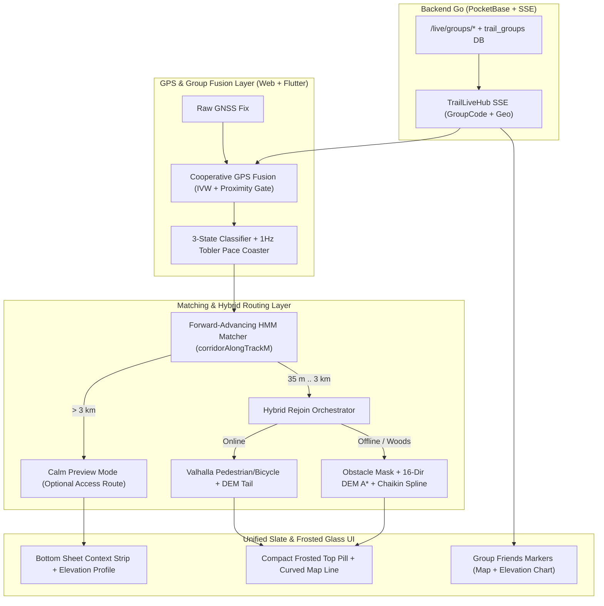

# Navigație Inteligentă, Grup Live (Cooperative GPS) & Identitate Vizuală Unificată — Plan de Implementare

> **For agentic workers:** REQUIRED SUB-SKILL: Use superpowers:subagent-driven-development to implement this plan task-by-task. Steps use checkbox (`- [ ]`) syntax for tracking.

**Goal:** Eliminarea alarmelor false de abatere la GPS slab prin *Pace Coasting* și fuziune GPS cooperativă în grup, înlocuirea liniei drepte de rerutare cu o rutare hibridă curbată atentă la clădiri/obstacole/altitudine (Valhalla OSM + Obstacle/DEM Chaikin A* + Mod Previzualizare `> 3 km`), avans continuu fără întoarcere înapoi la mers prin pădure, adăugarea funcției **Grup Live** (prieteni pe hartă + *Inverse-Variance GPS Fusion* prin SSE) și unificarea completă a interfeței în identitatea vizuală `Deep Slate (#242734) & Sticlă Mată` pe Web și Mobile.

**Architecture:** Un pipeline modular în 4 straturi partajat conceptual între Web (`TypeScript` / `Svelte 5` / `MapLibre GL 6`) și Mobile (`Dart` / `Flutter` / `MapLibre`): (1) fuziune GPS cooperativă *Inverse-Variance Weighting (BLUE)* cu membrii grupului aflați sub raza de incertitudine + clasificator GPS cu *1 Hz Tobler Pace Coasting*; (2) matcher HMM cu avans monoton în coridor (`corridorAlongTrackM`) și selecție de reintrare strict înainte; (3) orchestrator hibrid de rerutare care folosește Valhalla OSM (`/api/v1/valhalla/route`) când există rețea + grid A* în 16 direcții cu mască de obstacole (`building`/`water`) și curbe *Chaikin* offline, respectiv Mod Previzualizare peste `3 km`; (4) sesiuni de grup prin PocketBase + `TrailLiveHub` SSE și componente UI unificate pe token-urile `menu-background` / `primary (#242734)`.

**Architecture Diagram:**



**Tech Stack:** Go 1.24 + PocketBase (`db/`), TypeScript + SvelteKit 5 + MapLibre GL 6 + Vitest + Playwright (`web/`), Dart 3 + Flutter 3.47 + Riverpod + MapLibre (`app/`), Valhalla Routing API (`/api/v1/valhalla/route`).

**Spec:** [2026-11-18-smart-navigation-group-ui-design.md](file:///Volumes/SSD%20extern/Proiecte/Maps/docs/superpowers/specs/2026-11-18-smart-navigation-group-ui-design.md)

## Global Constraints

- **Identitate vizuală unică:** Nicio componentă de navigație nu mai folosește fundaluri pline portocalii (`bg-orange-600` / `#EA580C`) sau verzi țipătoare (`bg-emerald-700`), nici iconul triunghiular portocaliu `!`; toate controalele flotante au `40x40px`, fundal sticlă mată (`bg-menu-background/94 backdrop-blur-md`, `border-input-border/60`) și icon monocrom `#242734` (alb în dark mode). Roșul (`#DC2626`) este rezervat exclusiv alertei SOS active.
- **Zero regresie de confidențialitate:** Rutele `/live/groups/*` nu expun niciodată `device_hash` în JSON/SSE; fiecare membru primește un `memberId` derivat unidirecțional (`sha256("group-member:" + code + ":" + deviceHash)[:12]`).
- **Protecție anti-backtrack:** Reintrarea pe traseu nu propune niciodată puncte în urma `corridorAlongTrackM - 15 m`, iar la `> 3000 m` de traseu nu se desenează nicio linie automată de abatere.
- **Protecție fuziune grup:** Coordonatele unui coleg de grup intră în media *Inverse-Variance* doar dacă `age <= 12 s` și `dist <= max(35 m, selfAccuracy + peerAccuracy)`.

---

## Milestone 1: Motor GPS Inteligent (*Cooperative Fusion*, *Pace Coasting*, *Forward Rejoin*) & Rerutare Curbată cu Obstacole

### Task 1: Fuziune GPS Cooperativă (*IVW*) și *1 Hz Pace Coaster* (Web TypeScript)

**Files:**
- Create: [cooperative_gps_fusion.ts](file:///Volumes/SSD%20extern/Proiecte/Maps/web/src/lib/navigation/cooperative_gps_fusion.ts)
- Create: [gps_pace_coaster.ts](file:///Volumes/SSD%20extern/Proiecte/Maps/web/src/lib/navigation/gps_pace_coaster.ts)
- Modify: [types.ts](file:///Volumes/SSD%20extern/Proiecte/Maps/web/src/lib/navigation/types.ts#L69-L101)
- Modify: [index.ts](file:///Volumes/SSD%20extern/Proiecte/Maps/web/src/lib/navigation/index.ts)
- Test: [smart_gps_engine.test.ts](file:///Volumes/SSD%20extern/Proiecte/Maps/web/src/lib/navigation/smart_gps_engine.test.ts)

**Interfaces:**
- Consumes: `haversineMeters`, `interpolateTrackAtDistance` din [geo_math.ts](file:///Volumes/SSD%20extern/Proiecte/Maps/web/src/lib/navigation/geo_math.ts); `toblerHikingSpeedKmh` din [eta_calculator.ts](file:///Volumes/SSD%20extern/Proiecte/Maps/web/src/lib/navigation/eta_calculator.ts).
- Produces:
  - `PeerGpsObservation { memberId: string; lat: number; lon: number; accuracy: number; ele?: number | null; updatedAtMs: number }`
  - `FusedGpsResult { lat: number; lon: number; accuracy: number; source: "self" | "cooperative" | "group-tether"; fusedPeerCount: number }`
  - `fuseCooperativeGps(selfFix: NavGpsFixWithMeta | null, peers: readonly PeerGpsObservation[], lastCoLocatedPeerIds: ReadonlySet<string>, nowMs: number): FusedGpsResult | null`
  - `GpsSignalState = "good" | "cooperative" | "degraded" | "coasting"`
  - `GpsPaceCoaster` cu metodele `ingestFix(...)`, `tickCoasting(nowMs: number, paceFactor: number): CoastingSnapshot | null`

- [ ] **Step 1: Scrie testele unitare pentru fuziunea IVW, filtrul de proximitate și *Pace Coasting***

Creează `web/src/lib/navigation/smart_gps_engine.test.ts`:

```ts
import { describe, expect, it } from "vitest";
import { fuseCooperativeGps } from "./cooperative_gps_fusion";
import { GpsPaceCoaster } from "./gps_pace_coaster";
import type { NavTrackPoint } from "./types";

const sampleTrack: NavTrackPoint[] = Array.from({ length: 21 }, (_, i) => ({
	lat: 45.44 + i * 0.00045, // ~50m per step
	lon: 25.55,
	ele: 1000 + i * 2,
	distanceM: i * 50,
	gradePct: 4,
}));

describe("fuseCooperativeGps (Inverse-Variance Weighting + Proximity Gate)", () => {
	it("sharpens noisy canopy GPS (60m) using a nearby group peer (6m) within overlap radius", () => {
		const now = 1_700_000_000_000;
		const res = fuseCooperativeGps(
			{ lat: 45.4400, lon: 25.5504, accuracy: 60, timestampMs: now },
			[
				{
					memberId: "peer-1",
					lat: 45.4400,
					lon: 25.5500,
					accuracy: 6,
					updatedAtMs: now - 2_000,
				},
			],
			new Set(),
			now,
		);
		expect(res).not.toBeNull();
		expect(res!.source).toBe("cooperative");
		expect(res!.fusedPeerCount).toBe(1);
		expect(res!.accuracy).toBeLessThan(12);
		expect(Math.abs(res!.lon - 25.55)).toBeLessThan(0.0001);
	});

	it("ignores a group peer standing 300m behind so user position is never pulled backward", () => {
		const now = 1_700_000_000_000;
		const res = fuseCooperativeGps(
			{ lat: 45.4450, lon: 25.5500, accuracy: 45, timestampMs: now },
			[
				{
					memberId: "peer-lagging",
					lat: 45.4420, // ~333m behind
					lon: 25.5500,
					accuracy: 5,
					updatedAtMs: now - 1_000,
				},
			],
			new Set(),
			now,
		);
		expect(res!.source).toBe("self");
		expect(res!.fusedPeerCount).toBe(0);
		expect(res!.lat).toBeCloseTo(45.4450, 6);
	});

	it("uses group-tether when own GPS has dropped out (>6s) and co-located peer is fresh", () => {
		const now = 1_700_000_010_000;
		const res = fuseCooperativeGps(
			null,
			[
				{
					memberId: "peer-1",
					lat: 45.4410,
					lon: 25.5500,
					accuracy: 7,
					updatedAtMs: now - 3_000,
				},
			],
			new Set(["peer-1"]),
			now,
		);
		expect(res).not.toBeNull();
		expect(res!.source).toBe("group-tether");
		expect(res!.lat).toBeCloseTo(45.4410, 6);
	});
});

describe("GpsPaceCoaster", () => {
	it("suppresses off-trail under degraded canopy GPS and coasts forward smoothly when signal drops", () => {
		const coaster = new GpsPaceCoaster(sampleTrack, { isCycling: false });
		const t0 = 1_700_000_000_000;

		const s1 = coaster.ingestFix({
			lat: sampleTrack[2].lat,
			lon: sampleTrack[2].lon,
			accuracy: 8,
			matchedAlongM: 100,
			crossTrackM: 4,
			isPaused: false,
			paceFactor: 1.0,
			nowMs: t0,
		});
		expect(s1.signalState).toBe("good");
		expect(s1.suppressOffTrail).toBe(false);

		// Degraded 65m accuracy 55m off trail -> canopy mode suppresses off-trail!
		const s2 = coaster.ingestFix({
			lat: sampleTrack[3].lat,
			lon: 25.5507,
			accuracy: 65,
			matchedAlongM: 150,
			crossTrackM: 55,
			isPaused: false,
			paceFactor: 1.0,
			nowMs: t0 + 35_000,
		});
		expect(s2.signalState).toBe("degraded");
		expect(s2.suppressOffTrail).toBe(true);
		expect(s2.effectiveAlongM).toBeGreaterThanOrEqual(140);

		// 15 seconds with zero GPS fixes -> 1Hz coasting advances along the trail
		const coast = coaster.tickCoasting(t0 + 50_000, 1.0, false);
		expect(coast).not.toBeNull();
		expect(coast!.signalState).toBe("coasting");
		expect(coast!.effectiveAlongM).toBeGreaterThan(s2.effectiveAlongM + 10);
	});
});
```

- [ ] **Step 2: Rulează testul pentru a confirma că eșuează (Red)**

Run: `cd web && npx vitest run src/lib/navigation/smart_gps_engine.test.ts`  
Expected: FAIL (`Cannot find module './cooperative_gps_fusion'`).

- [ ] **Step 3: Implementează `cooperative_gps_fusion.ts`, `gps_pace_coaster.ts` și exporturile din `types.ts` / `index.ts`**

Extinde `web/src/lib/navigation/types.ts` cu `GpsSignalState`, `PeerGpsObservation`, `ObstaclePolygon` și `PreferredCorridor`, apoi implementează `cooperative_gps_fusion.ts` (proiecție locală ENU cu `w_self = 1 / max(9, acc^2)` și `w_peer = 1 / (acc_i^2 + 64)` sub poarta `dist <= max(35, selfAcc + peerAcc)`) și `gps_pace_coaster.ts` (clasificare `good | cooperative | degraded | coasting` + avans Tobler limitat la `180 s` fără semnal).

- [ ] **Step 4: Rulează testele și verifică trecerea pe verde (Green)**

Run: `cd web && npx vitest run src/lib/navigation/smart_gps_engine.test.ts`  
Expected: PASS (4/4 tests).

- [ ] **Step 5: Commit Task 1**

```bash
git add web/src/lib/navigation/types.ts web/src/lib/navigation/index.ts web/src/lib/navigation/cooperative_gps_fusion.ts web/src/lib/navigation/gps_pace_coaster.ts web/src/lib/navigation/smart_gps_engine.test.ts
git commit -m "feat(nav): add cooperative IVW GPS fusion and 1Hz Tobler pace coaster"
```

---

### Task 2: *Forward-Advancing Corridor Matcher*, *Obstacle Mask + Chaikin Curved A** și Mod Previzualizare `> 3 km` (Web TypeScript)

**Files:**
- Modify: [route_map_matcher.ts](file:///Volumes/SSD%20extern/Proiecte/Maps/web/src/lib/navigation/route_map_matcher.ts#L128-L265)
- Modify: [off_trail_router.ts](file:///Volumes/SSD%20extern/Proiecte/Maps/web/src/lib/navigation/off_trail_router.ts#L276-L760)
- Modify: [navigation.test.ts](file:///Volumes/SSD%20extern/Proiecte/Maps/web/src/lib/navigation/navigation.test.ts)

**Interfaces:**
- Consumes: `NavTrackPoint`, `ObstaclePolygon`, `PreferredCorridor` din [types.ts](file:///Volumes/SSD%20extern/Proiecte/Maps/web/src/lib/navigation/types.ts).
- Produces:
  - `FAR_PREVIEW_THRESHOLD_METERS = 3_000`
  - `RouteMapMatcher.update(fix)` actualizează continuu `committedAtd` pe coridorul înainte chiar și când `isOffTrail === true`, și nu intră în `isOffTrail` când `crossTrack <= max(95, 2.2 * accuracy)` pentru `accuracy > 25`.
  - `computeOffTrailReroute(params)` acceptă `obstacles?: ObstaclePolygon[]`, `preferredPaths?: PreferredCorridor[]`, returnează `null` când `nearestCross > 3_000 m`, interzice candidați `< lastAlongTrackM - 15 m` (folosind `1.0 * remTrailSec`), blochează celulele din poligoanele `building`/`water` (+ halo `8 m`) și netezește traseul cu 2 iterații *Chaikin corner-cutting*.

- [ ] **Step 1: Scrie testele care reproduc cele 3 probleme raportate de utilizator**

Adaugă în `web/src/lib/navigation/navigation.test.ts`:
1. Mers paralel prin pădure la `60 m` lateral pe `400 m` lungime -> `alongTrackMeters` avansează de la `100 m` la `~500 m`, iar `rejoinAlongTrackM >= 500 m` (niciodată întoarcere la `100 m`!).
2. Clădire (`ObstaclePolygon` școală/bloc) plasată direct între utilizator și potecă -> ruta generată de `computeOffTrailReroute` ocolește complet clădirea (niciun punct și niciun segment nu intersectează poligonul) și are `>= 6` puncte curbate *Chaikin* (nu 2 puncte în linie dreaptă).
3. Utilizator aflat la `222 km` (București -> Mediaș) -> `computeOffTrailReroute` returnează `null` (Mod Previzualizare calm, zero linie trasă peste țară).

- [ ] **Step 2: Rulează `navigation.test.ts` pentru a verifica eșecul (Red)**

Run: `cd web && npx vitest run src/lib/navigation/navigation.test.ts`  
Expected: FAIL pe cele 3 teste noi.

- [ ] **Step 3: Implementează avansul în coridor în `route_map_matcher.ts` și obstacolele + curbele Chaikin în `off_trail_router.ts`**

1. În [route_map_matcher.ts](file:///Volumes/SSD%20extern/Proiecte/Maps/web/src/lib/navigation/route_map_matcher.ts#L131-L162):
   - În `computeThreshold(accuracy)`: dacă `acc > 25`, pragul de intrare devine `Math.max(this.offTrailThresholdMeters, Math.min(140, 2.2 * acc))` astfel încât GPS-ul slab în pădure să nu declanșeze `isOffTrail`.
   - Când `this.isOffTrailState === true` și `globalNearest.crossTrackMeters <= 3_000`: caută proiecția în fereastra înainte `[this.committedAtd - 15, Math.min(this.totalLength, this.committedAtd + Math.max(400, 4 * groundDistance))]`; dacă `forwardCandidate.alongTrackMeters > this.committedAtd`, actualizează `this.committedAtd = forwardCandidate.alongTrackMeters` și `this.committedSegmentIndex = forwardCandidate.segmentIndex`.
2. În [off_trail_router.ts](file:///Volumes/SSD%20extern/Proiecte/Maps/web/src/lib/navigation/off_trail_router.ts):
   - Schimbă pragul `> 5_000` în `if (nearestCross > 3_000) return null;` (actualizând tipul de retur la `OffTrailRerouteResult | null` cu backward-compat curat).
   - Candidații de reintrare se generează în `[Math.max(0, params.lastAlongTrackM - 10), Math.min(totalTrailDist, Math.max(nearestAlong, params.lastAlongTrackM) + Math.max(600, 3.0 * nearestCross))]`, iar `terminalCost` devine `mode === "min-climb" ? 1.0 * remTrailSec : 0.92 * remTrailDist`.
   - Rasterizează `obstacles` (point-in-polygon + distanță la muchie `< 8 m`) în `blockedMask: Uint8Array` (lăsând celula `startIdx` să iasă spre exterior dacă utilizatorul pornește lângă clădire) și `preferredPaths` cu multiplicator `0.65` pe costul muchiei.
   - În `smoothOffTrailPath`: după string-pulling validat cu `!segmentHitsBlocked(...)`, aplică 2 treceri *Chaikin* (`Q = 0.75 A + 0.25 B`, `R = 0.25 A + 0.75 B`), acceptând fiecare tăiere de colț doar dacă `!segmentHitsBlocked` și `maxAbsSlope <= preserveSafeThreshold`.

- [ ] **Step 4: Rulează toate testele de navigație Web (Green)**

Run: `cd web && npx vitest run src/lib/navigation/navigation.test.ts src/lib/navigation/smart_gps_engine.test.ts`  
Expected: PASS (100% verde).

- [ ] **Step 5: Commit Task 2**

```bash
git add web/src/lib/navigation/route_map_matcher.ts web/src/lib/navigation/off_trail_router.ts web/src/lib/navigation/navigation.test.ts
git commit -m "feat(nav): forward forest corridor matching, obstacle-aware Chaikin A*, and >3km preview"
```

---

### Task 3: Orchestrator Hibrid Valhalla OSM + Extracție Obstacole din Vector Tiles MapLibre (Web TypeScript)

**Files:**
- Create: [hybrid_rejoin_router.ts](file:///Volumes/SSD%20extern/Proiecte/Maps/web/src/lib/navigation/hybrid_rejoin_router.ts)
- Test: [hybrid_rejoin_router.test.ts](file:///Volumes/SSD%20extern/Proiecte/Maps/web/src/lib/navigation/hybrid_rejoin_router.test.ts)

**Interfaces:**
- Consumes: `/api/v1/valhalla/route`, `decodePolyline(..., 6)` din [polyline_util.ts](file:///Volumes/SSD%20extern/Proiecte/Maps/web/src/lib/util/polyline_util.ts), `computeOffTrailReroute` din [off_trail_router.ts](file:///Volumes/SSD%20extern/Proiecte/Maps/web/src/lib/navigation/off_trail_router.ts).
- Produces:
  - `extractMapLibreObstacles(map: M.Map, bbox: [number, number, number, number]): { obstacles: ObstaclePolygon[]; preferredPaths: PreferredCorridor[] }`
  - `computeHybridOffTrailReroute(params): Promise<OffTrailRerouteResult | null>`
  - `computeValhallaAccessRoute(userLat, userLon, startLat, startLon, isCycling, fetchImpl?): Promise<OffTrailPoint[] | null>` (pentru butonul opțional *Rută de acces* când `> 3 km`).

- [ ] **Step 1: Scrie testele unitare pentru orchestratorul hibrid Valhalla + fallback local**

Creează `web/src/lib/navigation/hybrid_rejoin_router.test.ts` testând:
1. Când `/api/v1/valhalla/route` răspunde cu o polilinie curbată pe alei OSM (precizie 6), `computeHybridOffTrailReroute` returnează geometria curbată Valhalla îmbogățită cu altitudini DEM și atașează conector scurt la potecă dacă capătul e la `> 25 m`.
2. Când rețeaua eșuează (offline / HTTP 502), cade instant fără eroare pe `computeOffTrailReroute` cu obstacolele locale și curbele Chaikin.

- [ ] **Step 2: Rulează testul pentru a confirma că eșuează (Red)**

Run: `cd web && npx vitest run src/lib/navigation/hybrid_rejoin_router.test.ts`  
Expected: FAIL (`Cannot find module './hybrid_rejoin_router'`).

- [ ] **Step 3: Implementează `hybrid_rejoin_router.ts`**

Implementează:
- `extractMapLibreObstacles`: citește `map.querySourceFeatures("openmaptiles", { sourceLayer: "building" })`, `"water"` și `"transportation"` filtrate pe `bbox`, extrăgând inelele exterioare `Polygon`/`MultiPolygon` și liniile de poteci `path`/`footway`/`track`.
- `computeHybridOffTrailReroute`: calculează mai întâi rezultatul local rapid (pentru punctul optim `winningTarget` înainte pe traseu și fallback offline), apoi apelează `POST /api/v1/valhalla/route` cu `use_hills: mode === "min-climb" ? 0.15 : 0.75`, decodează `trip.legs[0].shape` (precizie 6), lipește conectorii DEM dacă e cazul (`> 25 m`) și recalculează `ascentM`, `descentM` și `estimatedSeconds`.

- [ ] **Step 4: Rulează testul și verifică trecerea pe verde (Green)**

Run: `cd web && npx vitest run src/lib/navigation/hybrid_rejoin_router.test.ts`  
Expected: PASS.

- [ ] **Step 5: Commit Task 3**

```bash
git add web/src/lib/navigation/hybrid_rejoin_router.ts web/src/lib/navigation/hybrid_rejoin_router.test.ts web/src/lib/navigation/index.ts
git commit -m "feat(nav): add hybrid Valhalla + DEM/obstacle curved rejoin router"
```

---

### Task 4: Paritate Motor Navigație în Flutter (Cooperative GPS, Pace Coasting, Forward Rejoin, Hybrid Valhalla + Chaikin Curves)

**Files:**
- Create: [cooperative_gps_fusion.dart](file:///Volumes/SSD%20extern/Proiecte/Maps/app/lib/util/navigation/cooperative_gps_fusion.dart)
- Create: [gps_pace_coaster.dart](file:///Volumes/SSD%20extern/Proiecte/Maps/app/lib/util/navigation/gps_pace_coaster.dart)
- Modify: [track_position_matcher.dart](file:///Volumes/SSD%20extern/Proiecte/Maps/app/lib/util/route/track_position_matcher.dart#L124-L199)
- Modify: [off_trail_router.dart](file:///Volumes/SSD%20extern/Proiecte/Maps/app/lib/util/navigation/off_trail_router.dart#L180-L520)
- Test: [smart_navigation_test.dart](file:///Volumes/SSD%20extern/Proiecte/Maps/app/test/util/navigation/smart_navigation_test.dart)

**Interfaces:**
- Produces în Dart exact aceleași reguli matematice ca în Tasks 1–3:
  - `CooperativeGpsFusion.fuse(...)`
  - `GpsPaceCoaster` (`GpsSignalState.good | cooperative | degraded | coasting`)
  - `TrackPositionMatcher.matchDetailed` cu avans continuu `_lastValidAlongTrack` în fereastra înainte și suprimare off-trail sub coronament (`accuracy > 25 m`)
  - `OffTrailRouter.compute` returnând `null` la `> 3000 m`, reintrare strict înainte (`goalPenalty = 1.0 * remTrailSec`) și subdiviziune curbată *Chaikin* + metodă async `OffTrailRouter.computeHybridWithValhalla(...)` folosind `/valhalla/route` prin `Dio`.

- [ ] **Step 1: Scrie testele unitare Dart în `app/test/util/navigation/smart_navigation_test.dart`**

Acoperă: (1) fuziunea IVW cu coleg la `6 m` vs ignorare coleg la `300 m`; (2) *Pace Coasting* la pierdere semnal; (3) mers paralel prin pădure fără întoarcere înapoi; (4) `null` reroute la `> 3000 m` și curbe *Chaikin*.

- [ ] **Step 2: Implementează clasele Dart și actualizează `track_position_matcher.dart` + `off_trail_router.dart`**

Sincronizează formulele 1:1 cu implementarea TypeScript din Tasks 1–3, fără dependențe externe noi în `pubspec.yaml`.

- [ ] **Step 3: Commit Task 4**

```bash
git add app/lib/util/navigation/cooperative_gps_fusion.dart app/lib/util/navigation/gps_pace_coaster.dart app/lib/util/route/track_position_matcher.dart app/lib/util/navigation/off_trail_router.dart app/test/util/navigation/smart_navigation_test.dart
git commit -m "feat(app): port cooperative GPS fusion, pace coasting, forward rejoin, and curved hybrid router"
```

---

## Milestone 2: Funcția „Grup” Live (Backend Go + SSE + Proxy SvelteKit + Client Services)

### Task 5: Migrație PocketBase și Rute Go `/live/groups/*` + Broadcast SSE `GroupCode`

**Files:**
- Create: [1792100000_created_trail_groups.go](file:///Volumes/SSD%20extern/Proiecte/Maps/db/migrations/1792100000_created_trail_groups.go)
- Create: [trail_live_groups.go](file:///Volumes/SSD%20extern/Proiecte/Maps/db/routes/trail_live_groups.go)
- Modify: [trail_live_hub.go](file:///Volumes/SSD%20extern/Proiecte/Maps/db/services/live/trail_live_hub.go#L28-L125)
- Modify: [trail_live.go](file:///Volumes/SSD%20extern/Proiecte/Maps/db/routes/trail_live.go#L155-L173)
- Test: [trail_live_groups_test.go](file:///Volumes/SSD%20extern/Proiecte/Maps/db/routes/trail_live_groups_test.go)

**Interfaces:**
- `Subscriber` în `trail_live_hub.go` primește câmpul `GroupCode string` și metoda `PublishGroupEvent(groupCode, eventName string, payload any)`.
- Rute înregistrate în `RegisterTrailLiveRoutes`:
  - `POST /live/groups` -> `{ code, trailId, expiresAt, selfMemberId, members }`
  - `GET /live/groups/{code}` -> `{ code, trailId, expiresAt, selfMemberId, members }`
  - `POST /live/groups/{code}/join` -> `{ code, trailId, expiresAt, selfMemberId, members }`
  - `POST /live/groups/{code}/ping` -> `{ code, selfMemberId, members }` + SSE `group_member_update`
  - `POST /live/groups/{code}/leave` -> `{ ok: true }` + SSE `group_member_left`

- [ ] **Step 1: Scrie testele Go în `db/routes/trail_live_groups_test.go`**

Testează:
1. `POST /live/groups` creează un cod de 6 caractere (alfabet `ABCDEFGHJKLMNPQRSTUVWXYZ23456789`), returnează `selfMemberId` de 12 hex și nu expune `device_hash`.
2. Al doilea dispozitiv face `POST /live/groups/{code}/join`, apoi `POST /live/groups/{code}/ping` cu `accuracy: 5.5` -> ambii membri apar în `members`, iar abonatul SSE conectat la `/live/stream?groupCode={code}` primește instant evenimentul `event: group_member_update`.
3. Un abonat SSE fără acel `groupCode` **nu** primește pozițiile grupului privat!
4. `POST /live/groups/{code}/leave` elimină membrul și emite `event: group_member_left`.

- [ ] **Step 2: Rulează `go test ./routes -run TestTrailLiveGroups` pentru a confirma eșecul (Red)**

Run: `cd db && go test ./routes -run TestTrailLiveGroups -v`  
Expected: FAIL (funcții/rute inexistente).

- [ ] **Step 3: Implementează migrația `1792100000_created_trail_groups.go`, extensia `TrailLiveHub` și `trail_live_groups.go`**

1. Creează colecțiile `trail_groups` și `trail_group_members` (cu reguli `nil` — acces intern prin proxy autentificat cu `X-Internal-Secret`).
2. Extinde `TrailLiveHub.Subscribe(...)` și `Stream` din `trail_live.go` cu parametrul opțional `groupCode` (normalizat uppercase, 6 caractere) și adaugă `PublishGroupEvent(groupCode, eventName, data)` care trimite exclusiv abonaților cu `sub.GroupCode == groupCode`.
3. Implementează handlerele `CreateGroup`, `GetGroup`, `JoinGroup`, `PingGroup`, `LeaveGroup` + curățarea grupurilor expirate în `RunTrailLiveGC`.

- [ ] **Step 4: Rulează suita completă Go pentru verificare (Green)**

Run: `cd db && go test ./routes ./services/... ./util/...`  
Expected: PASS (exit 0).

- [ ] **Step 5: Commit Task 5**

```bash
git add db/migrations/1792100000_created_trail_groups.go db/services/live/trail_live_hub.go db/routes/trail_live.go db/routes/trail_live_groups.go db/routes/trail_live_groups_test.go
git commit -m "feat(db): add live hiking groups API, private group SSE channel, and GC"
```

---

### Task 6: Rute Proxy SvelteKit `/api/v1/live/groups/*` & Clienți Live Group (Web + Flutter)

**Files:**
- Modify: [device_identity.ts](file:///Volumes/SSD%20extern/Proiecte/Maps/web/src/lib/server/live/device_identity.ts#L226-L235)
- Modify: [+server.ts](file:///Volumes/SSD%20extern/Proiecte/Maps/web/src/routes/api/v1/live/stream/+server.ts#L20-L28)
- Create: `web/src/routes/api/v1/live/groups/+server.ts`
- Create: `web/src/routes/api/v1/live/groups/[code]/+server.ts`
- Create: `web/src/routes/api/v1/live/groups/[code]/join/+server.ts`
- Create: `web/src/routes/api/v1/live/groups/[code]/ping/+server.ts`
- Create: `web/src/routes/api/v1/live/groups/[code]/leave/+server.ts`
- Modify: [live_client.ts](file:///Volumes/SSD%20extern/Proiecte/Maps/web/src/lib/live/live_client.ts)
- Modify: [trail_live_models.dart](file:///Volumes/SSD%20extern/Proiecte/Maps/app/lib/models/live/trail_live_models.dart)
- Modify: [trail_live_service.dart](file:///Volumes/SSD%20extern/Proiecte/Maps/app/lib/services/trail_live_service.dart)
- Test: [live_api.test.ts](file:///Volumes/SSD%20extern/Proiecte/Maps/web/src/lib/server/live/live_api.test.ts) & [live_client.test.ts](file:///Volumes/SSD%20extern/Proiecte/Maps/web/src/lib/live/live_client.test.ts)

**Interfaces:**
- Adaugă rate limitere dedicate în `liveRateLimiters`: `groupCreate: (10, 10 * 60_000)`, `groupJoin: (15, 5 * 60_000)`, `groupPing: (30, 60_000)`.
- Exportă în `live_client.ts` (și metode echivalente în `TrailLiveService` din Flutter):
  - `createLiveGroup({ trailId, displayName })`
  - `joinLiveGroup(code, { displayName })`
  - `fetchLiveGroup(code)`
  - `pingLiveGroup(code, { lat, lon, ele, accuracy, heading, speed, alongTrackM, inNavigation })`
  - `leaveLiveGroup(code)`
  - suport `groupCode` + callbacks `onGroupMemberUpdate` / `onGroupMemberLeft` în `connectLiveStream`.

- [ ] **Step 1: Scrie testele în `live_api.test.ts` și `live_client.test.ts`**

Verifică validarea codului de grup (`/^[A-Z2-9]{6}$/`), rate-limiting-ul de `30 req/min` pe `ping`, propagarea `groupCode` în `/api/v1/live/stream` și parsarea evenimentelor SSE `group_member_update` / `group_member_left`.

- [ ] **Step 2: Rulează testele pentru a confirma eșecul (Red)**

Run: `cd web && npx vitest run src/lib/server/live/live_api.test.ts src/lib/live/live_client.test.ts`  
Expected: FAIL.

- [ ] **Step 3: Implementează rutele SvelteKit, extensiile `live_client.ts` și modelele/metodele Dart în `trail_live_models.dart` + `trail_live_service.dart`**

- [ ] **Step 4: Rulează testele Vitest și `npm run check` (Green)**

Run: `cd web && npx vitest run src/lib/server/live/live_api.test.ts src/lib/live/live_client.test.ts && npm run check`  
Expected: PASS, `0 errors`.

- [ ] **Step 5: Commit Task 6**

```bash
git add web/src/lib/server/live/ web/src/routes/api/v1/live/ web/src/lib/live/ app/lib/models/live/trail_live_models.dart app/lib/services/trail_live_service.dart app/test/services/trail_live_models_test.dart
git commit -m "feat(live): add SvelteKit proxy routes and Web/Flutter clients for live hiking groups"
```

---

## Milestone 3: Identitate Vizuală Unificată (`Deep Slate & Frosted Surface`) + Integrare Completă UI

### Task 7: Identitate Vizuală Unificată, `GroupSheet`, Markere Prieteni & Integrare Motor Inteligent în Web

**Files:**
- Create: [group_sheet.svelte](file:///Volumes/SSD%20extern/Proiecte/Maps/web/src/lib/components/navigation/group_sheet.svelte)
- Modify: [navigation_top_banner.svelte](file:///Volumes/SSD%20extern/Proiecte/Maps/web/src/lib/components/navigation/navigation_top_banner.svelte)
- Modify: [live_elevation_sheet.svelte](file:///Volumes/SSD%20extern/Proiecte/Maps/web/src/lib/components/navigation/live_elevation_sheet.svelte)
- Modify: [report_markers.ts](file:///Volumes/SSD%20extern/Proiecte/Maps/web/src/lib/live/report_markers.ts)
- Modify: [+page.svelte](file:///Volumes/SSD%20extern/Proiecte/Maps/web/src/routes/map/trail/%5Bhandle%5D/%5Bid%5D/navigate/+page.svelte)

**Interfaces & Schimbări Vizuale Cheie:**
1. **[navigation_top_banner.svelte](file:///Volumes/SSD%20extern/Proiecte/Maps/web/src/lib/components/navigation/navigation_top_banner.svelte)**:
   - Pastilă compactă unificată `max-w-md mx-auto bg-menu-background/94 backdrop-blur-md text-content rounded-2xl shadow-[0_4px_20px_rgba(0,0,0,0.12)] border border-input-border/60 px-3.5 py-2.5`.
   - Pe traseu (`data-nav-state="on-trail"`): badge direcție `w-9 h-9 rounded-xl bg-[#242734] text-white` + distanță și instrucțiune curată pe 1 rând.
   - La abatere reală `< 3 km` (`data-nav-state="off-trail"`): **același card alb/slate mat**, doar badge-ul direcției devine `bg-amber-500/15 text-amber-700 dark:text-amber-300`, afișând concis `{formattedRejoinDistance} până la potecă` + instrucțiunea scurtă (fără butoanele mari în bannerul de sus!).
2. **[live_elevation_sheet.svelte](file:///Volumes/SSD%20extern/Proiecte/Maps/web/src/lib/components/navigation/live_elevation_sheet.svelte)**:
   - Bandă contextuală discretă deasupra timpului rămas:
     - Când `reroute !== null`: `Abatere · +{ascentM}m` + toggle compact `data-testid="offtrail-mode-min-climb"` (`Urcare minimă`) / `data-testid="offtrail-mode-shortest-safe"` (`Drum scurt`).
     - Când `isFarPreview`: `La {farDist} de start · Mod previzualizare` + buton discret `data-testid="nav-access-route-btn"` (`Rută de acces`).
     - Când `signalState === "coasting" || signalState === "degraded"`: cip calm `GPS slab · estimat după ritm`.
     - Când `signalState === "cooperative"`: cip calm `GPS grup · ±{acc} m`.
   - Desenează membrii grupului pe graficul de altitudine (buline `#242734` cu inițiala colegului).
   - Unifică culorile: timpul rămas în `text-content font-extrabold`, butonul `X` în `bg-content/[0.08] text-content/75 hover:bg-content/15` (nu cerc roșu aprins!).
3. **[+page.svelte](file:///Volumes/SSD%20extern/Proiecte/Maps/web/src/routes/map/trail/%5Bhandle%5D/%5Bid%5D/navigate/+page.svelte)** + **[group_sheet.svelte](file:///Volumes/SSD%20extern/Proiecte/Maps/web/src/lib/components/navigation/group_sheet.svelte)**:
   - Toate butoanele flotante (`nav-group-btn`, `nav-waze-report-btn`, `nav-pitch-toggle`, `nav-recenter-btn`, `nav-push-bell-btn`, `nav-sos-btn`) folosesc aceeași suprafață `h-10 rounded-full bg-menu-background/94 backdrop-blur-md text-content border border-input-border/60 shadow-md`.
   - `nav-waze-report-btn` înlocuiește `fa-triangle-exclamation text-orange-500` cu un icon calm de **pin + plus** monocrom (`text-content/85`).
   - `nav-group-btn` deschide `GroupSheet` (creare/join grup cu 1 tap, link `?group=CODE` cu auto-join la deschidere, listă prieteni cu distanță relativă).
   - Conectează `fuseCooperativeGps` -> `GpsPaceCoaster` (cu interval `1000 ms`) -> `RouteMapMatcher` -> `computeHybridOffTrailReroute` + `syncGroupMapMarkers`.
   - Linia `LAYER_OFFTRAIL_LINE` folosește `#b45309` (`line-width: 3.5`) peste halou alb `6px`.

- [ ] **Step 1: Creează `group_sheet.svelte` și `syncGroupMapMarkers` în `report_markers.ts`**
- [ ] **Step 2: Actualizează `navigation_top_banner.svelte` și `live_elevation_sheet.svelte` la identitatea vizuală Slate & Sticlă Mată**
- [ ] **Step 3: Integrează pipeline-ul complet (Cooperative GPS + Pace Coaster + Hybrid Rejoin + Group Sync + Controls unificate) în `navigate/+page.svelte`**
- [ ] **Step 4: Verifică compilarea TypeScript & Svelte (`npm run check` + `npm run build`)**

Run: `cd web && npm run check && npm run build`  
Expected: `0 errors, 0 warnings` și build reușit.

- [ ] **Step 5: Commit Task 7**

```bash
git add web/src/lib/components/navigation/ web/src/lib/live/report_markers.ts "web/src/routes/map/trail/[handle]/[id]/navigate/+page.svelte"
git commit -m "feat(web): unify navigation UI to Slate/Frosted identity and wire smart GPS, hybrid reroute, and live groups"
```

---

### Task 8: Identitate Vizuală Unificată, `GroupSheet` și Integrare Completă în Flutter (`app/`)

**Files:**
- Create: [group_sheet.dart](file:///Volumes/SSD%20extern/Proiecte/Maps/app/lib/components/navigation/group_sheet.dart)
- Modify: [navigation_screen.dart](file:///Volumes/SSD%20extern/Proiecte/Maps/app/lib/routes/navigation_screen.dart)
- Modify: [sos_banner_and_dialog.dart](file:///Volumes/SSD%20extern/Proiecte/Maps/app/lib/components/navigation/sos_banner_and_dialog.dart)

**Interfaces & Schimbări Vizuale Cheie:**
1. **`_buildBanner` în `navigation_screen.dart`**:
   - Elimină `color: const Color(0xFFEA580C)` de pe cardul off-trail; folosește aceeași suprafață `theme.colorScheme.surface.withValues(alpha: 0.95)` cu contur discret `theme.colorScheme.outline.withValues(alpha: 0.5)` atât pe traseu, cât și la abatere `< 3 km` (cu badge discret chihlimbar pe săgeată).
2. **`_buildStatsSheetContent` în `navigation_screen.dart`**:
   - Adaugă banda contextuală discretă (comutator `Urcare minimă` / `Drum scurt` la abatere, `GPS slab · estimat după ritm`, `GPS grup · ±Xm`, sau `La X km de start · Mod previzualizare` cu buton `Rută de acces`).
3. **Coloana de controale din dreapta**:
   - Înlocuiește `Icons.warning_amber_rounded` portocaliu de pe `nav-waze-report-btn` cu `Icons.add_location_alt_outlined` în `theme.colorScheme.onSurface`.
   - Adaugă butonul rotund `nav-group-btn` (`Icons.group_outlined`, cu badge numeric când ești într-un grup) care deschide `showLiveGroupSheet(...)`.
   - `SosFloatingButton` folosește `theme.colorScheme.onSurface` în repaus și devine `#DC2626` exclusiv când `isActive == true`.
4. **Pipeline GPS & Markere Grup**:
   - Conectează `CooperativeGpsFusion` + `GpsPaceCoaster` (timer `1s`) + `OffTrailRouter.computeHybridWithValhalla` + afișarea prietenilor în `_LiveCommunityMarkerLayer`.

- [ ] **Step 1: Creează `app/lib/components/navigation/group_sheet.dart`**
- [ ] **Step 2: Actualizează `sos_banner_and_dialog.dart` și `navigation_screen.dart` (UI unificat + pipeline GPS/Hybrid/Group)**
- [ ] **Step 3: Commit Task 8**

```bash
git add app/lib/components/navigation/group_sheet.dart app/lib/components/navigation/sos_banner_and_dialog.dart app/lib/routes/navigation_screen.dart
git commit -m "feat(app): unify navigation visual identity and integrate live groups, cooperative GPS, and hybrid rerouting"
```

---

### Task 9: Teste E2E Playwright Complete, Verificare CI (Go + Web + Android APK + iOS IPA) și Deploy pe `laptop`

**Files:**
- Modify: [trail-live-navigation.spec.ts](file:///Volumes/SSD%20extern/Proiecte/Maps/web/tests/playwright/components/trail-live-navigation.spec.ts)
- Modify: [trail-waze-sos-live.spec.ts](file:///Volumes/SSD%20extern/Proiecte/Maps/web/tests/playwright/components/trail-waze-sos-live.spec.ts)

- [ ] **Step 1: Actualizează și extinde testele Playwright E2E**

În `trail-live-navigation.spec.ts` și `trail-waze-sos-live.spec.ts`:
1. Verifică noua identitate vizuală unificată: `nav-banner` folosește `bg-menu-background` (și **nu** `bg-orange-600` sau `bg-emerald-700` nici în `on-trail`, nici în `off-trail`), iar `nav-waze-report-btn` nu conține `fa-triangle-exclamation` / `text-orange-500`.
2. Verifică **Mod Previzualizare `> 3 km`**: injectează un fix la `222 km` (București) -> `nav-offtrail-line` are `0` features (nicio linie peste țară) și banda de jos afișează `Mod previzualizare`.
3. Verifică **GPS slab & Pace Coasting**: injectează fix-uri cu `accuracy: 70` la `55 m` lateral -> rămâne `on-trail` fără alarmă de abatere; oprește fix-urile și avansează ceasul -> progresul continuă lin.
4. Verifică **Mers paralel prin pădure**: avansează `400 m` paralel la `90 m` lateral cu `accuracy: 8` -> distanța rămasă scade continuu, iar punctul `nav-rejoin-point` se află **în față** pe traseu, ocolind poligoanele de obstacole cu geometrie curbată.
5. Verifică **Grup Live + Cooperative GPS**: deschide `nav-group-btn`, creează grup, injectează un membru de grup pe hartă -> markerul prietenului este vizibil pe hartă și precizia fuzionată se îmbunătățește.

- [ ] **Step 2: Rulează toată suita locală (Go + Vitest + Typecheck + Build + Playwright)**

Run:
```bash
cd db && go test ./routes ./services/... ./util/...
cd ../web && npm run check && npx vitest run src/lib/navigation/ src/lib/live/ src/lib/server/live/
cd ../web && npm run build
cd ../web && npx playwright test tests/playwright/components/trail-live-navigation.spec.ts tests/playwright/components/trail-waze-sos-live.spec.ts tests/playwright/components/mobile-1to1-ui.spec.ts
```
Expected: 100% PASS pe toate suitele.

- [ ] **Step 3: Push pe `main`, verificare GitHub Actions (`App`, `Android APK Build`, `iOS IPA Build`) și Deploy pe `laptop`**

1. `git push origin main`
2. Urmărește build-urile CI (`gh run watch`) pentru validarea `flutter analyze`, `flutter test`, `TraseeRomania-Android.apk` și `TraseeRomania-iOS-unsigned.ipa`.
3. Sincronizează `db/` și `web/build/` pe `laptop:/var/www/maps.skillfy.ro/`, reconstruiește `wanderer-db` și `wanderer-web` (`--env-file ../.env`), instalează atomic noile `.apk` și `.ipa` în `/var/www/maps.skillfy.ro/downloads/` (cu verificare `sha256sum`) și confirmă `HTTP 200` pe `https://maps.skillfy.ro/api/v1/health` și `/downloads/TraseeRomania-Android.apk`.
