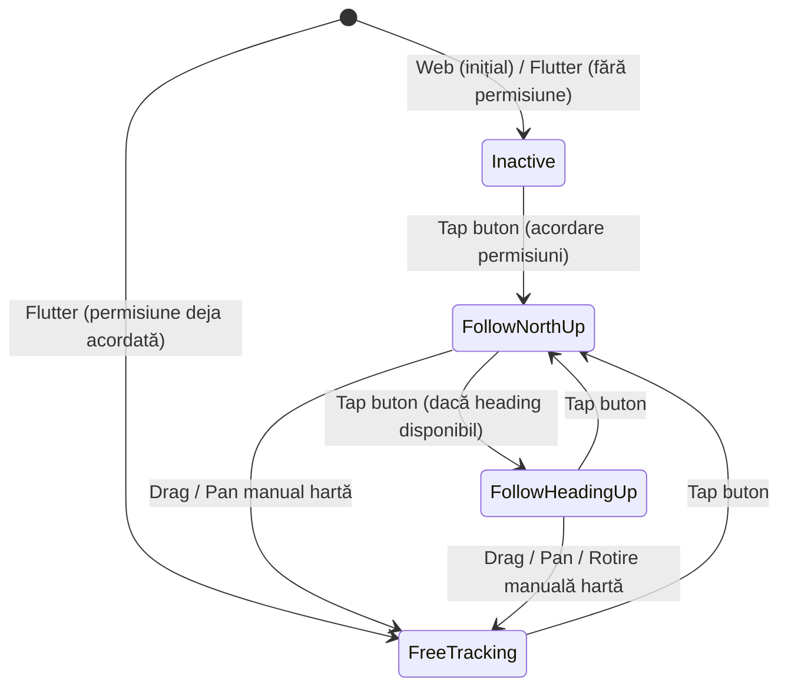

# Specificație de Design — Faza 1: Preluare Wanderer & Bulina de Locație cu Direcție tip Google Maps (Web + Flutter)

**Data:** 2026-11-17  
**Proiect:** Platforma Wanderer România (bazată pe `open-wanderer/wanderer`, licență AGPL-3.0)  
**Domeniu de aplicare (Sub-proiectul 1 din 2):**
1. **Sub-proiectul 1 (acest document):** Preluarea repository-ului `open-wanderer/wanderer` cu păstrarea legăturii `upstream` și implementarea completă a bulinei albastre de locație cu halou de acuratețe, fascicul de busolă activ inclusiv pe loc și buton de orientare în 3 trepte (ca în Google Maps) pe **Web/PWA (`web/`)** și **Flutter iOS/Android (`app/`)**.
2. **Sub-proiectul 2 (specificație separată după finalizarea Fazei 1):** Extragerea, normalizarea (inclusiv marcaje turistice românești: bandă/cruce/triunghi/punct roșu/galben/albastru, Via Transilvanica etc.) și importul tuturor traseelor din România în PocketBase + Meilisearch.

---

## 1. Preluarea Repository-ului și Mediul Local

### 1.1 Structură Git și compatibilitate cu `upstream`
- Repository-ul oficial `https://github.com/open-wanderer/wanderer.git` este clonat în rădăcina workspace-ului `/Volumes/SSD extern/Proiecte/Maps`.
- Remote-ul către proiectul oficial este configurat ca `upstream` (`https://github.com/open-wanderer/wanderer.git`), lăsând `origin` disponibil pentru repository-ul propriu GitHub al platformei România.
- Codul nou este încapsulat în module dedicate (în `web/src/lib/vendor/maplibre-user-location/` pe Web și în fișiere dedicate în `app/lib/` pe Flutter), cu puncte de integrare minime în fișierele existente, astfel încât sincronizările viitoare (`git fetch upstream && git merge`) să nu producă conflicte structurale.
- Toate modificările păstrează conformitatea cu licența **AGPL-3.0**.

### 1.2 Mediu de dezvoltare și testare pe mobil
- **Backend local:** `PocketBase` + `Meilisearch` (+ servicii auxiliare din `docker-compose.yml`) rulate prin Docker Compose.
- **Web HTTPS în rețeaua locală:** Configurația Vite din `web/vite.config.ts` suportă activarea opțională a HTTPS local prin variabila de mediu `VITE_DEV_HTTPS=true` (necesar deoarece iOS Safari și Android Chrome blochează `navigator.geolocation` și `DeviceOrientationEvent` pe origini HTTP non-`localhost`). Implicit (`VITE_DEV_HTTPS` nesetat), serverul pornește pe HTTP standard pentru compatibilitate cu suita Playwright.

---

## 2. Mașina de Stări Comună („Google Maps Location & Compass”)

Atât aplicația Web, cât și aplicația Flutter implementează aceeași mașină de stări deterministă cu 4 stări:

| Stare | Senzori (GPS + Busolă) | Bulină + Halou + Con pe hartă | Comportament Cameră | Iconiță Buton |
| :--- | :--- | :--- | :--- | :--- |
| **`inactive`** | Opriți (`0` consum) | Ascunse | Liberă | Țintă neutră |
| **`freeTracking`** | Activi | Vizibile în timp real | Liberă (utilizatorul explorează manual) | Țintă neutră |
| **`followNorthUp`** | Activi | Vizibile în timp real | `center = userPos`, `bearing = 0°` (Nordul sus) | Țintă activă albastră (`#4285F4`) |
| **`followHeadingUp`** | Activi | Vizibile în timp real | `center = userPos`, `bearing = heading` (Harta se rotește după privire) | Săgeată orientare albastră (`#4285F4`) |

### Reguli de tranziție și detalii UX
- **Zoom la prima centrare:** La trecerea din `inactive` sau `freeTracking` în `followNorthUp`, dacă nivelul curent de zoom este sub `14`, camera face zoom lin la `15.5`; dacă utilizatorul este deja la `zoom >= 14`, se păstrează zoom-ul ales de el.
- **Separarea mișcărilor programatice de gesturile utilizatorului:** Toate repoziționările automate ale camerei marchează un flag intern `isProgrammaticCameraMove` (sau verifică originea evenimentului de gest al utilizatorului), astfel încât animația proprie de centrare/rotire să nu declanșeze accidental ieșirea în `freeTracking`.
- **Lipsă senzor busolă în repaus:** Dacă utilizatorul apasă butonul în starea `followNorthUp`, dar `heading` este `null` (ex. laptop desktop fără magnetometru și viteză `0 m/s`), aplicația rămâne în `followNorthUp` și recentrează poziția fără a roti harta la un unghi arbitrar.

---

## 3. Fuziunea Senzorilor și Matematica Unghiulară

### 3.1 Convenția unghiulară
- Toate valorile `heading` sunt normalizate în intervalul `[0°, 360°)` în sens orar față de Nord (`0° = Nord`, `90° = Est`, `180° = Sud`, `270° = Vest`).

### 3.2 Surse de orientare (în ordinea priorității)
1. **Busolă / Orientare 3D a dispozitivului (activă și pe loc, și în mers):**
   - **Web — iOS (Safari / WebKit PWA):**
     - În handler-ul sincron al click-ului pe butonul de locație se apelează `DeviceOrientationEvent.requestPermission()`.
     - Se citește `event.webkitCompassHeading` compensat cu rotația ecranului (`(webkitCompassHeading + screenAngle) % 360`) și `event.webkitCompassAccuracy`. Dacă `webkitCompassAccuracy < 0`, precizia este tratată ca scăzută (`45°`).
   - **Web — Android / Standard (`deviceorientationabsolute`):**
     - Se ascultă `deviceorientationabsolute` (cu fallback pe `deviceorientation` doar dacă `event.absolute === true`).
     - Din unghiurile Euler W3C `(alpha, beta, gamma)` se calculează azimutul **compensat la înclinare (tilt-compensated)** prin proiecția vectorului de orientare al ecranului în planul orizontal tangent și ajustarea cu `screen.orientation.angle`, astfel încât direcția rămâne stabilă când telefonul este ținut înclinat în mână (`0°–75°`).
   - **Flutter — iOS & Android (`flutter_rotation_sensor`):**
     - Se configurează `RotationSensor` cu sistemul de coordonate al ecranului (`CoordinateSystem.display()`), care combină nativ accelerometrul, magnetometrul și giroscopul și compensează automat atât înclinarea 3D a telefonului, cât și orientarea portrait/landscape.
2. **Fallback din deplasarea GPS (`Course-over-Ground`):**
   - Dacă senzorul de busolă nu există (desktop) sau permisiunea de orientare este refuzată, se folosește `heading`-ul din GPS doar când viteza `speed >= 0.8 m/s` și `heading >= 0`. În repaus fără busolă, `heading = null` (conul este ascuns).

### 3.3 Filtru circular Low-Pass anti-tremurat
Pentru eliminarea oscilațiilor magnetometrului și evitarea saltului invers la trecerea peste Nord (`359° ↔ 0°`), filtrarea se aplică pe cercul unitate:

$$s_t = \alpha \sin(\theta_{\text{raw}}) + (1 - \alpha) s_{t-1}, \quad c_t = \alpha \cos(\theta_{\text{raw}}) + (1 - \alpha) c_{t-1}$$

$$\theta_{\text{smooth}} = \left(\operatorname{atan2}(s_t, c_t) \cdot \frac{180}{\pi} + 360\right) \bmod 360$$

- Coeficient de netezire: $\alpha = 0.22$.
- Prag de re-randare (deadband): actualizarea vizuală/cameră se emite doar când $|\Delta \theta| \ge 0.5^\circ$, evitând redesenări inutile când telefonul stă pe loc.

---

## 4. Specificația Vizuală a Bulinei tip Google Maps

1. **Haloul de acuratețe GPS (în metri reali pe hartă):**
   - Poligon geodezic circular cu 64 de segmente și raza egală cu `accuracy` (metri), afișat când `accuracy >= 5m` (plafonat la maximum `2000m`).
   - Stil: umplere `#4285F4` cu opacitate `0.12`, contur `#4285F4` cu opacitate `0.30` și grosime `1px`.
2. **Fasciculul / Conul de direcție („Flashlight Cone”):**
   - Desenat sub bulina centrală, cu raza exterioară de `44px` (pentru o bulină de `18px` diametru, dimensiune totală canvas/SVG `88x88px`).
   - Deschidere unghiulară adaptivă în funcție de `headingAccuracy`:
     - Precizie ridicată (`<= 15°` sau senzor fuzionat stabil): semi-unghi `25°` (deschidere totală `50°`).
     - Precizie medie (`15° < acc <= 35°`): semi-unghi `35°` (deschidere totală `70°`).
     - Precizie scăzută (`> 35°`): semi-unghi `45°` (deschidere totală `90°`).
   - Gradient radial din centru spre exterior: `rgba(66, 133, 244, 0.48)` la marginea bulinei → `rgba(66, 133, 244, 0.18)` la `60%` din rază → `rgba(66, 133, 244, 0.0)` la `100%`.
3. **Bulina centrală („Blue Dot”):**
   - Diametru `18px`, culoare `#4285F4`, bordură albă `#FFFFFF` de `3px`, umbră `0 1px 4px rgba(0, 0, 0, 0.35)` și inel discret de puls (`2.5s` ciclu).

---

## 5. Arhitectura pe Componente și Fișiere

### 5.1 Aplicația Web (`web/`)
**Fișiere noi izolate în `web/src/lib/vendor/maplibre-user-location/`:**
- `types.ts`: Tipurile `LocationTrackingMode`, `CompassReading`, `UserLocationPosition`, opțiuni de configurare.
- `heading-math.ts`: Funcții pure testabile — normalizare unghiuri, diferență unghiulară minimă, `CircularHeadingFilter`, calcul tilt-compensated azimuth din `(alpha, beta, gamma, screenAngle)`, calcul semi-unghi con din acuratețe.
- `compass-sensor.ts`: Clasă pentru abonarea la senzorii browserului (`requestPermission()` pe iOS, `deviceorientationabsolute` / `deviceorientation`, eliberare completă a listener-elor la `stop()`).
- `accuracy-layer.ts`: Gestionează sursa și layer-ele GeoJSON MapLibre pentru cercul de acuratețe (folosind `@turf/destination` deja prezent în `web/package.json`) și re-atașează automat layer-ul la evenimentul `styledata` / schimbarea stilului hărții (Light / Dark / Topo / Satelit).
- `location-puck-marker.ts`: Gestionează `maplibregl.Marker` cu element SVG (`88x88px`), `rotationAlignment: 'map'` și `pitchAlignment: 'map'` (rămâne lipit de terenul 3D și orientat corect inclusiv când camera se rotește).
- `user-location-control.ts`: Implementează `maplibregl.IControl` — butonul cu 3 stări, `navigator.geolocation.watchPosition`, fuziunea cu `CompassSensor`, controlul camerei MapLibre (`easeTo` / `jumpTo`) și tranziția automată în `freeTracking` la `dragstart` / `rotatestart` inițiate de utilizator.

**Fișiere existente modificate minimal:**
- `web/src/lib/components/trail/trail_map_results.svelte`: Atașarea `UserLocationControl` pe harta de explorare și căutare (`/map` și listele cu hartă).
- `web/src/lib/components/trail/map_with_elevation_maplibre.svelte`: Atașarea `UserLocationControl` pe harta detaliată a traseului (dezactivat când proprietatea de print/export static este activă).
- `web/src/lib/i18n/` (`en.json`, `ro.json` / fișierele de localizare existente): Texte pentru tooltip-urile celor 3 stări și mesajele de eroare permisiune/HTTPS.
- `web/vite.config.ts`: Activare opțională HTTPS în dev când `VITE_DEV_HTTPS=true`.

### 5.2 Aplicația Mobilă Flutter (`app/`)
**Fișiere noi:**
- `app/lib/util/map/heading_math.dart`: Echivalentul Dart pur pentru `CircularHeadingFilter`, diferență unghiulară și calculul semi-unghiului conului.
- `app/lib/provider/compass_heading_stream_provider.dart`: Provider Riverpod cu reference-counting (`acquire()` / `release()`) și `WidgetsBindingObserver` (modelat exact după `ForegroundPositionStream`), care pornește `flutter_rotation_sensor` doar cât timp există o hartă activă pe ecran în foreground și îl oprește complet în background (`0%` consum baterie în fundal).
- `app/lib/provider/location_tracking_mode_provider.dart`: State/Notifier pentru `LocationTrackingMode` (`inactive`, `freeTracking`, `followNorthUp`, `followHeadingUp`) și logica de tranziție la tap / drag manual.
- `app/lib/components/map/location_accuracy_layer.dart`: Widget Riverpod care desenează poligonul geodezic `ml.PolygonLayer` în metri reali pentru acuratețea GPS sub bulină.

**Fișiere existente modificate:**
- `app/lib/components/map/location_marker_layer.dart`:
  - Upgradarea `LocationPuck` la dimensiune canvas `88x88` (cu `dotSize = 18`), înlocuirea săgeții simple cu `_FlashlightConePainter` (`RadialGradient` + semi-unghi adaptiv după acuratețe).
  - Conectarea `LocationMarkerLayer` simultan la `liveLocationProvider`, `liveCompassProvider` și `bearing`-ul camerei curente (`effectiveAngle = heading - cameraBearing`), activând direcția pe toate ecranele de hartă.
- `app/lib/components/map/center_on_location_button.dart`: Suport vizual și funcțional pentru cele 3 stări (iconiță + culoare activă + callback ciclic).
- Integrare în widgeturile de hartă interactive (`trail_map.dart`, `trail_collection_map.dart`, `map_screen.dart`, `trail_detail_map_screen.dart`, `list_detail_map_screen.dart`): legarea modului de urmărire a camerei și detectarea gestului manual (`PointerDown` / `MapEventMove` inițiat de utilizator) pentru trecerea în `freeTracking`.

---

## 6. Gestionarea Erorilor și Degradare Grațioasă

- **Permisiune GPS refuzată sau serviciu GPS oprit:** Nu blochează harta și nu afișează dialoguri repetate; afișează un mesaj discret (toast) la apăsarea butonului și păstrează starea `inactive`.
- **Permisiune busolă refuzată pe iOS sau lipsă senzor (Desktop):** Nu produce eroare; GPS-ul, bulina albastră, haloul de acuratețe și modul `followNorthUp` funcționează integral, iar conul apare automat în mers dacă GPS-ul raportează curs valid (`speed >= 0.8 m/s`).
- **Context nesecurizat pe Web (HTTP pe IP de rețea):** Dacă `window.isSecureContext === false` și `navigator.geolocation` este blocat, butonul afișează o notificare clară care explică necesitatea conexiunii HTTPS.

---

## 7. Strategie de Testare și Criterii de Acceptare

1. **Teste unitare Web (`Vitest`):**
   - `heading-math.test.ts`: Testarea filtrului circular la trecerea `359° -> 1°` și `1° -> 359°` (fără trecere prin `180°`), compensarea tilt Euler + rotație ecran (`0°`, `90°`, `180°`, `270°`) și adaptarea semi-unghiului conului.
   - Testarea mașinii de stări în `user-location-control.test.ts` (tranziții tap 1 → tap 2 → tap 3 → drag manual → fallback fără busolă).
2. **Teste de componente / E2E Web (`Playwright`):**
   - Simularea permisiunii geolocation + coordonate mock + dispatch de evenimente `deviceorientationabsolute` / `webkitCompassHeading`: verificarea apariției bulinei, a conului SVG rotit la unghiul corect, a păstrării haloului după schimbarea stilului hărții și a rotirii `map.getBearing()` în starea `followHeadingUp`.
3. **Teste unitare și Widget Flutter (`flutter test`):**
   - `heading_math_test.dart`: Verificarea filtrului circular și a calculelor unghiulare.
   - `location_marker_layer_test.dart` & `center_on_location_button_test.dart`: Randarea `LocationPuck` cu și fără heading, compensarea cu `cameraBearing`, tranzițiile celor 3 stări și eliberarea stream-ului la `dispose` / background.
