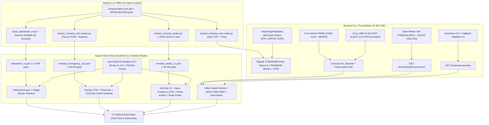

# Specificație Tehnică: Inteligență Montană Offline, Rețeaua Salvamont România, Suită SOS 112 Pro, Simulare Solară/Avalanșă și Straturi Satelitare & Riscuri de Mediu

**Data:** 2026-11-18  
**Status:** Aprobat pentru planificare și implementare modulară (Fazele 1–4)  
**Platforme țintă:** Web PWA (`web/` — SvelteKit 5 + MapLibre GL 6) · Mobile Nativ (`app/` — Flutter + MapLibre + `TileProxyServer` PMTiles) · Backend (`db/` — Go / PocketBase `v0.38.0` + `TrailLiveHub` SSE + Meilisearch) · Pipeline Offline (`scripts/` — Python `pyosmium` + SRTM `DemTileCache`)  
**Specificații fundamentale anterioare:** [2026-11-17-trail-waze-alerts-sos-presence-design.md](file:///Volumes/SSD%20extern/Proiecte/Maps/docs/superpowers/specs/2026-11-17-trail-waze-alerts-sos-presence-design.md) · [2026-11-18-smart-navigation-group-ui-design.md](file:///Volumes/SSD%20extern/Proiecte/Maps/docs/superpowers/specs/2026-11-18-smart-navigation-group-ui-design.md)  
**Planuri de implementare TDD asociate:**
- Faza 1: [2026-11-18-phase1-salvamont-map-and-phones.md](file:///Volumes/SSD%20extern/Proiecte/Maps/docs/superpowers/plans/2026-11-18-phase1-salvamont-map-and-phones.md)
- Faza 2: [2026-11-18-phase2-sos-112-gsm-viewshed-exif.md](file:///Volumes/SSD%20extern/Proiecte/Maps/docs/superpowers/plans/2026-11-18-phase2-sos-112-gsm-viewshed-exif.md)
- Faza 3: [2026-11-18-phase3-solar-shadow-avalanche-peaks.md](file:///Volumes/SSD%20extern/Proiecte/Maps/docs/superpowers/plans/2026-11-18-phase3-solar-shadow-avalanche-peaks.md)
- Faza 4: [2026-11-18-phase4-satellite-snow-hazards-rail.md](file:///Volumes/SSD%20extern/Proiecte/Maps/docs/superpowers/plans/2026-11-18-phase4-satellite-snow-hazards-rail.md)

---

## 1. Obiective, Domeniu de Aplicare și Probleme Rezolvate

Această specificație extinde platforma de navigație montană într-un sistem complet de **inteligență a terenului și siguranță alpină offline-first**, inspirat din instrumentele OSINT/geospațiale de analiză a terenului (*Bellingcat Online Investigation Toolkit*: efemeride solare, umbre de creastă, vizibilitate 3D pe orizont, imagistică satelitară NRT și detecție de incendii/defrișări) și adaptat riguros la realitățile din Munții Carpați și standardele **SNUAU 112 / A.N.S.M.R. Salvamont România**:

1. **Absența bazelor Salvamont pe hartă și erori critice în datele brute OpenStreetMap**:
   - În prezent, [layers.ts](file:///Volumes/SSD%20extern/Proiecte/Maps/web/src/lib/vendor/maplibre-layer-manager/layers.ts) nu expune niciun strat `emergency=mountain_rescue`, iar [overpass-layer.ts](file:///Volumes/SSD%20extern/Proiecte/Maps/web/src/lib/vendor/maplibre-layer-manager/overpass-layer.ts) funcționează exclusiv online (`minZoom = 12`) și eșuează în văi fără semnal sau la erori `502/504` ale serverelor publice Overpass.
   - Auditul live pe OpenStreetMap România (`298` elemente cu tag-uri Salvamont) a demonstrat că `66.4%` sunt stâlpi indicatori sau relații de traseu, **`82.8%` din bazele fizice nu au număr de telefon**, `way/1474958578` (*Salvamont Arad*) conține textul neapelabil `phone=0SALVAMONT`, iar **`way/1242742629` (*Salvamont Voineasa*) conține un număr trunchiat de 9 cifre (`phone=072582668`)** care eșuează la apelare în situații de urgență. În plus, linkul actual `tel:0725826668` din [sos_modal_and_banner.svelte](file:///Volumes/SSD%20extern/Proiecte/Maps/web/src/lib/components/navigation/sos_modal_and_banner.svelte) și [sos_banner_and_dialog.dart](file:///Volumes/SSD%20extern/Proiecte/Maps/app/lib/components/navigation/sos_banner_and_dialog.dart) nu folosește formatul internațional E.164 (`+40725826668`), putând eșua pe SIM-uri străine aflate în roaming, iar pe crestele de graniță interjudețeană (ex. *Vf. Omu* între `PH`/`DB`/`BV` sau *Creasta Făgărașului* între `SB`/`AG`) drumețul nu știe ce dispecerat județean sau local răspunde de versantul său.
2. **Dictarea coordonatelor la 112 și găsirea semnalului GSM în văi adânci**:
   - Dispeceratele 112 / Salvamont și elicopterele SMURD-IGAV lucrează simultan cu `WGS84` zecimal, `DMS` (`GG° MM' SS.s"`), `UTM` (`34T`/`35T`/`34U`/`35U`) și coduri scurte offline (`Plus Codes` — superioare soluției proprietare `what3words` care cere conexiune online și prezintă confuzii fonetice).
   - Când drumețul are `0` linii de semnal într-o căldare glaciară sau pe firul văii, nu știe dacă urcarea `120 m` spre șaua din stânga îi deschide linia de vizibilitate radio (`800/900 MHz`, raza terestră efectivă $\frac{4}{3}R_E$) către un releu GSM aflat la `15 km` distanță.
3. **Verificarea autenticității fotografiilor Waze pe traseu fără expunerea datelor personale (Zero-EXIF)**:
   - Alertele comunitare din `trail_reports` (arbori căzuți, poduri rupte, izvoare secate, urme de urs) devin mult mai credibile cu o fotografie reală de la fața locului, însă fișierele brute ale camerei conțin coordonate exacte, serii de dispozitiv și timestamp-uri sensibile. Totodată, în PocketBase `v0.38.0`, miniaturile generate din fișiere `.webp` sunt re-codificate ca `image/png` lossless (`450–700 KB`), inaccesibil pe conexiune montană `2G/EDGE`.
4. **Întuneric prematur după creastă, pericol de avalanșă și identificarea vârfurilor la orizont**:
   - `EtaCalculator` compară în prezent sosirea doar cu ceasul brut; pe văi precum *Valea Jepilor*, *Valea Rea* sau *Valea Sâmbetei*, peretele vestic blochează soarele cu **60–150 minute înainte de apusul astronomic**, provocând scăderi bruște de temperatură și îngheț.
   - Iarna și primăvara lipsește stratul standard EAWS de înclinare a pantei (`27°–30°–35°–45°–50°+`) calculat direct din DEM-ul local, iar la zoom de navigație (`z > 16`), stilul vectorial [ofm.json](file:///Volumes/SSD%20extern/Proiecte/Maps/web/static/styles/ofm.json) nu încarcă vârfurile aflate la `5–35 km` în afara ecranului curent. În plus, `DemTileGrid` din Flutter ([dem_tile_grid.dart](file:///Volumes/SSD%20extern/Proiecte/Maps/app/lib/util/navigation/dem_tile_grid.dart)) interoghează direct CDN-ul extern în loc să treacă prin `TileProxyServer`, ratând arhivele DEM `.pmtiles` descărcate offline.
5. **Vizibilitate satelitară (zăpadă/ortofoto), alerte automate de mediu și accesibilitate feroviară („Cu trenul”)**:
   - Comutarea pe un strat raster simplu ascunde curbele de nivel, potecile și numele vârfurilor, iar în Flutter [proxy_style_rewriter.dart](file:///Volumes/SSD%20extern/Proiecte/Maps/app/lib/util/region/proxy_style_rewriter.dart) suprascrie din greșeală orice sursă `type: "raster"` cu `/vector/{z}/{x}/{y}.pbf`.
   - Lipsesc stratul satelitar zilnic al zăpezii (NASA VIIRS NOAA-20 NDSI), radarul de precipitații, detecția automată a incendiilor (NASA FIRMS), a doborâturilor masive de vânt pe potecă (UMD GLAD), prognoza meteo la altitudinea reală a vârfului (`700hPa`/`800hPa`, `CAPE`), riscul de viitură în chei (Copernicus GloFAS), imaginile stradale ale intrării în traseu (`KartaView` / `Mapillary`) și filtrul dedicat drumețiilor accesibile din gările CFR (**„Cu trenul”**).

---

## 2. Arhitectura Modulară pe 4 Faze și Contracte Transversale



### 2.1 Împărțirea în cele 4 Faze de Livrare

| Fază | Plan Asociat | Domeniu Funcțional | Livrabile Cheie |
|---|---|---|---|
| **Faza 1** | [phase1-salvamont-map-and-phones](file:///Volumes/SSD%20extern/Proiecte/Maps/docs/superpowers/plans/2026-11-18-phase1-salvamont-map-and-phones.md) | Harta Salvamont România & Telefoane Oficiale | `salvamont_ro.json` (~120 baze/posturi/refugii + 41 servicii ANSMR validate E.164), strat hartă 100% offline Web/Flutter, resolver multi-jurisdicție pe creastă, rutare 1-click *„Rută spre Baza Salvamont”*. |
| **Faza 2** | [phase2-sos-112-gsm-viewshed-exif](file:///Volumes/SSD%20extern/Proiecte/Maps/docs/superpowers/plans/2026-11-18-phase2-sos-112-gsm-viewshed-exif.md) | SOS 112 Pro, Viewshed GSM & Foto Waze EXIF | Coordonate offline (`WGS84`, `DMS`, `UTM` Karney, `Plus Code` 11-char), `SMS 113` / SMS GSM-7 ASCII, căutător *„Unde prind semnal 112?”* (`romania_emergency_112.json`), verificare EXIF locală + eliminare EXIF în 3 straturi (`1792200000`). |
| **Faza 3** | [phase3-solar-shadow-avalanche-peaks](file:///Volumes/SSD%20extern/Proiecte/Maps/docs/superpowers/plans/2026-11-18-phase3-solar-shadow-avalanche-peaks.md) | Teren, Soare/Umbre, Avalanșă & Busolă Vârfuri | `sun_calc` v2, Apus Real după Creastă vs. ETA Live, strat pantă avalanșă EAWS (`27°–50°+`) & umbre scanline, căutător 3D offline de vârfuri (`romania_peaks_v1.json`), fix offline PMTiles `DemTileGrid` în Flutter. |
| **Faza 4** | [phase4-satellite-snow-hazards-rail](file:///Volumes/SSD%20extern/Proiecte/Maps/docs/superpowers/plans/2026-11-18-phase4-satellite-snow-hazards-rail.md) | Satelit Hibrid, Zăpadă NRT, Riscuri Mediu & CFR | Baze hibride Esri HD / Sentinel-2 / ANCPI + fix `proxy_style_rewriter.dart`, zăpadă NASA GIBS NDSI & RainViewer, servicii Go FIRMS/GFW/Open-Meteo/GloFAS/KartaView (`1792300000`), filtru *„Cu trenul”*. |

### 2.2 Contracte Transversale Obligatorii (`Shared Cross-Phase Contracts`)

Pentru ca toate cele 4 faze să se compună fără conflicte de schemă sau regresii între Web, Flutter și PocketBase, următoarele interfețe partajate sunt înghețate prin contract:

#### A. Directorul de Date Offline în Flutter ([pubspec.yaml](file:///Volumes/SSD%20extern/Proiecte/Maps/app/pubspec.yaml)) și Web
În `app/pubspec.yaml` (`flutter.assets`) se înregistrează o singură intrare comună `- assets/data/`, care deservește toate seturile offline:
- `app/assets/data/salvamont_ro.json` ↔ `web/src/lib/data/salvamont_ro.json` (Faza 1 — `~52 KB` brut / `~14 KB` gzip, inclus static în bundle-ul Vite)
- `app/assets/data/romania_emergency_112.json` ↔ `web/static/data/romania_emergency_112.json` (Faza 2 — `~204 KB` brut / `~64 KB` gzip, stocat în `CacheStorage("wanderer-emergency-v1")`)
- `app/assets/data/romania_peaks_v1.json` ↔ `web/static/data/romania_peaks_v1.json` (Faza 3 — `~95 KB` gzip, stocat în `CacheStorage("wanderer-peaks-v1")`)

#### B. Contractul `MapState` și `defaultMapState` în Web ([layers.ts](file:///Volumes/SSD%20extern/Proiecte/Maps/web/src/lib/vendor/maplibre-layer-manager/layers.ts) & [maplibre-layer-manager.ts](file:///Volumes/SSD%20extern/Proiecte/Maps/web/src/lib/vendor/maplibre-layer-manager/maplibre-layer-manager.ts))
Cheia `localStorage["wanderer-ro-map-state-v3"]` își păstrează compatibilitatea retroactivă prin `normalizeMapState()`: orice cheie nouă absentă dintr-un JSON salvat anterior preia valoarea din `defaultMapState` (în particular `salvamont: true` este activ implicit!):

```ts
export type BaseMapStyleKey =
  | "OpenFreeMap"
  | "OpenTopoMap"
  | "OpenHikingMap"
  | "CyclOSM"
  | "Carto Light"
  | "Carto Dark"
  | "Satelit (Esri HD)"          // Phase 4 (hybrid raster z<=18 + vector labels)
  | "Sentinel-2 Fără Nori"       // Phase 4 (hybrid EOX z<=15 + vector labels)
  | "Ortofoto ANCPI (RO)";       // Phase 4 (mounted iff ancpiOrthoAvailable === true)

export interface OverlayStateMap {
  hiking: boolean;
  cycling: boolean;
  MTB: boolean;
  skiing: boolean;
  salvamont: boolean;            // Phase 1 — default: true
  avalancheSlope: boolean;       // Phase 3 — default: false (terrain-slope://)
  solarShadows: boolean;         // Phase 3 — default: false (terrain-shade://)
  snowCover: boolean;            // Phase 4 — default: false (NASA GIBS NOAA-20 NDSI)
  dailySatellite: boolean;       // Phase 4 — default: false (NASA GIBS TrueColor)
  weatherRadar: boolean;         // Phase 4 — default: false (RainViewer z<=7)
  forestDisturbance: boolean;    // Phase 4 — default: false (UMD GLAD DIST-ALERT)
}
```

#### C. Contractul `LocalSettingsEntity` ([local_settings_entity.dart](file:///Volumes/SSD%20extern/Proiecte/Maps/app/lib/entities/local_settings_entity.dart)) și `proxy_style_rewriter.dart` în Flutter
Pentru a evita coliziuni ObjectBox între faze, proprietățile adăugate pe `LocalSettingsEntity` au nume și valori implicite fixe, iar `MapLayersSheet` (Faza 4) expune într-un singur panou unificat atât comutatoarele din Faza 1 și Faza 3, cât și straturile satelitare din Faza 4:

```dart
@Entity()
class LocalSettingsEntity {
  @Id()
  int obxId = 0;

  String themeMode;
  bool backgroundLocationAsked;
  int tileProxyPort;
  String tileProxySecret;
  String mapStyleSourcesJson;
  String demTileTemplate;
  String recentServersJson;

  // Phase 1: Salvamont offline rescue bases & refuges layer (on by default)
  bool showSalvamontLayer;

  // Phase 3: Client-side DEM terrain intelligence overlays
  bool showAvalancheSlope;
  bool showSolarShadows;

  // Phase 4: Base map style & dynamic environmental raster overlays JSON
  // mapBaseStyle in: 'default' | 'esri_satellite' | 'sentinel2_cloudless' | 'opentopomap' | 'ancpi_ortho'
  String mapBaseStyle;
  // JSON map: {"snowCover":bool,"dailySatellite":bool,"weatherRadar":bool,"forestDisturbance":bool,"waymarkedHiking":bool,"satelliteDate":"default"}
  String mapOverlaysJson;

  LocalSettingsEntity({
    this.themeMode = 'system',
    this.backgroundLocationAsked = false,
    this.tileProxyPort = 0,
    this.tileProxySecret = '',
    this.mapStyleSourcesJson = '',
    this.demTileTemplate = '',
    this.recentServersJson = '',
    this.showSalvamontLayer = true,
    this.showAvalancheSlope = false,
    this.showSolarShadows = false,
    this.mapBaseStyle = 'default',
    this.mapOverlaysJson = '{}',
  });
}
```

În [proxy_style_rewriter.dart](file:///Volumes/SSD%20extern/Proiecte/Maps/app/lib/util/region/proxy_style_rewriter.dart#L69-L78), ramura `else` este restrânsă explicit la `else if (sourceMap['type'] == 'vector')`, astfel încât sursele `type: 'raster'` (atât tile-urile locale `/slope/` și `/shade/` din `TileProxyServer` în Faza 3, cât și Esri/EOX/GIBS/RainViewer/GFW în Faza 4) își păstrează intacte URL-urile și atributul `maxzoom`!

#### D. Contractul `DemTileGrid` și Loopback `TileProxyServer`
`DemTileGrid` ([dem_tile_grid.ts](file:///Volumes/SSD%20extern/Proiecte/Maps/web/src/lib/navigation/dem_tile_grid.ts) și [dem_tile_grid.dart](file:///Volumes/SSD%20extern/Proiecte/Maps/app/lib/util/navigation/dem_tile_grid.dart)) este instanța partajată de eșantionare a altitudinii pentru:
1. Rerutarea hibridă / off-trail existentă și rutarea 1-click spre Baza Salvamont (Faza 1);
2. Ray-marching-ul RF 4/3-Earth *„Unde prind semnal 112?”* (Faza 2);
3. Apusul după creastă, panta de avalanșă, umbrele aruncate și Peak Finder-ul 3D (Faza 3).

În Faza 3, `DemTileGrid` primește:
- creșterea limitei LRU de la `9` la `48` tile-uri zoom-12 (`~34 × 34 km` acoperire în jurul drumețului);
- metoda `prefetchRadius(lat, lon, radiusM, maxTiles)` (în Dart: `prefetchRadius(lat, lon, {radiusMeters, maxTiles})`) pentru raze de `15–35 km` fără blocarea firului UI;
- accesorii rapizi `getDecodedTile(x, y)`, `ensureTileLoaded(x, y)`, `webMercatorRowCellSizeMeters(z, tileY, row, tileSize)` și interpolare cu lipire din tile-ul vecin pe margini prin `samplePixelStitched(baseX, baseY, px, py)` (în Web și Dart);
- conectarea `NavigationScreen` din Flutter la `$proxyBaseUrl/dem/{z}/{x}/{y}.png` din [tile_proxy_server.dart](file:///Volumes/SSD%20extern/Proiecte/Maps/app/lib/services/tile_proxy_server.dart) (cu substituție corectă `{z}`, `{x}`, `{y}`), deblocând eșantionarea DEM **100% offline** din pachetele regionale `.pmtiles`.

#### E. Compoziția Ierarhică a Dialogului și Bannerului SOS ([sos_modal_and_banner.svelte](file:///Volumes/SSD%20extern/Proiecte/Maps/web/src/lib/components/navigation/sos_modal_and_banner.svelte) & [sos_banner_and_dialog.dart](file:///Volumes/SSD%20extern/Proiecte/Maps/app/lib/components/navigation/sos_banner_and_dialog.dart))
Ordinea secțiunilor în fereastra SOS este strict deterministă:
1. **Rândul Național Primar**: `Apel 112` (`tel:112`, buton `#DC2626`) + `0-SALVAMONT` (`tel:+40725826668`, buton `#242734`).
2. **Slotul Faza 1 — Context Salvamont Local & Graniță Montană**: cea mai apropiată bază Salvamont operativă + cel mai apropiat refugiu de salvare, cipul de graniță interjudețeană (`isRidgeBorderZone`) cu butoanele `tel:+40...` ale serviciilor Salvamont învecinate și acțiunea **`Rută spre Baza Salvamont`**.
3. **Slotul Faza 2 — Fișa Coordonate 112 Pro & Căutător Semnal GSM**: grila copiabilă (`WGS84 DD`, `DMS`, `UTM`, `Plus Code`, altitudine `±precizie`, distanță/azimut față de cel mai apropiat vârf), butoanele `Copiază fișa 112` + `SMS Coordonate` / `SMS 113`, și panoul expandabil **`Unde prind semnal 112?`**.
4. **Slotul SOS Comunitar (`5 km`)**: selectorul de motiv (`lost` | `injury` | `exhaustion` | `other`), notă scurtă și declanșarea alertei către drumeții din zonă.

#### F. Numerotarea Migrațiilor PocketBase (`db/migrations/`)
- **Faza 2**: [1792200000_add_trail_reports_photo.go](file:///Volumes/SSD%20extern/Proiecte/Maps/db/migrations/1792200000_add_trail_reports_photo.go) — adaugă câmpurile `photo` și `photo_verified` pe colecția `trail_reports`.
- **Faza 4**: [1792300000_add_env_hazards_and_rail_trails.go](file:///Volumes/SSD%20extern/Proiecte/Maps/db/migrations/1792300000_add_env_hazards_and_rail_trails.go) — adaugă câmpurile feroviare și `is_water_gorge` pe `trails` și creează colecția `env_hazards`.

---

## 3. Matricea Referințelor Externe Verificate, Surselor de Date și Compatibilității AGPLv3

Toate depozitele open-source și endpoint-urile externe au fost verificate tehnic și juridic pentru compatibilitate cu licența proiectului (**AGPLv3**) și funcționare *zero-key* implicită:

| Referință / Sursă de Date | URL / Endpoint Verificat | Licență / Regim | Decizie Arhitecturală & Atribuire Obligatorie |
|---|---|---|---|
| **`mourner/suncalc` (v2)** *(inspirat din Bellingcat Toolkit)* | `https://github.com/mourner/suncalc` | **BSD-2-Clause** (Compatibil AGPLv3) | Portare matematică pură (Meeus cap. 12/15/16/25 + `rtsafe`) în TypeScript și Dart, fără dependențe sau chei API. |
| **`mapbox-gl-shadow-simulator` (`ShadeMap`)** *(evaluat din Bellingcat)* | `https://github.com/ted-piotrowski/mapbox-gl-shadow-simulator` | **`UNLICENSED` (Proprietar + API key cu plată)** | **RESPINS COMPLET.** Nu se copiază cod și nu se încarcă SDK-ul. Înlocuit cu motor propriu 100% liber: *Scanline Horizon Sweep* $O(N^2)$ + *1D DEM Ray-Marcher*. |
| **`ChristianSteger/HORAYZON`** | `https://github.com/ChristianSteger/HORAYZON` | **MIT** | Referință științifică (*Geosci. Model Dev.* 15, 2022) pentru orizontul topografic, curbură terestră și refracție atmosferică ($k = 0.13$). |
| **`kylecorry31/Trail-Sense`** | `https://github.com/kylecorry31/Trail-Sense` | **MIT** | Referință pentru UX-ul busolei montane offline, clinometru, alerte de apus și coordonate de salvare. |
| **`onthegomap/maplibre-contour`** | `https://github.com/onthegomap/maplibre-contour` | **BSD-3-Clause** | Model arhitectural pentru `maplibregl.addProtocol` și lipirea marginilor între tile-uri DEM Terrarium pe `OffscreenCanvas`. |
| **`google/open-location-code`** | `https://github.com/google/open-location-code` | **Apache-2.0** | Algoritmul oficial *Plus Codes v1.1* pe 11 caractere (`~2.8 m × 3.5 m`), 100% offline. |
| **Karney (2011) / `chrisveness/geodesy`** | `https://github.com/chrisveness/geodesy` (`arxiv:1002.1417`) | **MIT** | Seria Krüger de ordinul 6 pentru conversie exactă WGS84 ↔ UTM (`5 nm` precizie). |
| **`openinframap` & `mourner/kdbush`** | `https://github.com/openinframap/openinframap` · `https://github.com/mourner/kdbush` | **BSD-3-Clause** / **ISC** | Taxonomia OSM a pilonilor/antenelor telecom (`man_made`, `tower:type`, `communication:*`) și indexare spațială 2D fără alocări. |
| **`organicmaps` / `OsmAnd` / `PeakOrama`** | `https://github.com/organicmaps/organicmaps` | **Apache-2.0** *(OsmAnd/PeakOrama: GPLv3 — doar analiză vizuală UX, 0 linii copiate)* | Convenții de afișare a fișei de coordonate și rampa cromatică EAWS/CalTopo pentru unghiul de pantă. |
| **A.N.S.M.R. Salvamont România & STS `112`/`113`** | `https://www.salvamontromania.ro` · `https://www.sts.ro/ro/servicii-112` | Date publice oficiale | Cele 41 structuri județene/locale Salvamont, `0-SALVAMONT` (`+40725826668`), regulile 3GPP Emergency Camping, AML și `SMS 113`. |
| **Mapterhorn Terrarium DEM** | `https://tiles.mapterhorn.com/12/{x}/{y}.webp` | Open Data (Copernicus GLO-30) | Atribuire: `© Mapterhorn (Copernicus DEM GLO-30)`. |
| **Esri World Imagery** | `https://server.arcgisonline.com/ArcGIS/rest/services/World_Imagery/MapServer/tile/{z}/{y}/{x}` | Esri Basemap Terms (vizualizare/navigație gratuită) | Verificat `200 OK` până la `maxzoom: 18` (`0.6 m/px` în Carpați). Atribuire: `Source: Esri, Maxar, Earthstar Geographics, and the GIS User Community`. |
| **EOX Sentinel-2 Cloudless** | `https://tiles.maps.eox.at/wmts/1.0.0/s2cloudless-2025_3857/default/g/{z}/{y}/{x}.jpg` | **CC BY-NC-SA 4.0** (`2025`) / **CC BY 4.0** (`2016` prin `EOX_CLOUDLESS_YEAR=2016`) | `maxzoom: 15` (`10 m/px`). Atribuire: `Sentinel-2 cloudless - https://s2maps.eu by EOX IT Services GmbH (Contains modified Copernicus Sentinel data)`. |
| **ANCPI Ortofotoplan România** | Variabilă opțională `ANCPI_ORTHO_URL_TEMPLATE` | INSPIRE / Date Deschise Guvernamentale RO | `geoportal.ancpi.ro` returnează în prezent `NXDOMAIN` în DNS public; activat dinamic doar când health-check-ul backend confirmă `ancpiOrthoAvailable: true`. |
| **NASA EOSDIS GIBS (NDSI Snow & TrueColor)** | `https://gibs.earthdata.nasa.gov/wmts/epsg3857/best/VIIRS_NOAA20_NDSI_Snow_Cover/default/default/GoogleMapsCompatible_Level8/{z}/{y}/{x}.png` | **Domeniu Public NASA** | `VIIRS_NOAA20` activ la zi (`VIIRS_SNPP` înghețat pe `2026-11-03`). `maxzoom: 8` (NDSI), `maxzoom: 9` (TrueColor). Atribuire: `NASA EOSDIS GIBS`. |
| **NASA LANCE FIRMS (Incendii 24h)** | `J1_VIIRS_C2_Europe_24h.csv` + `J2_VIIRS_C2_Europe_24h.csv` + `MODIS_C6_1_Europe_24h.csv` | **Domeniu Public NASA** | Ingestie backend la `30 min` (`SUOMI_VIIRS` exclus fiind gol). Atribuire: `NASA FIRMS`. |
| **UMD GLAD DIST-ALERT (GFW)** | `https://tiles.globalforestwatch.org/umd_glad_dist_alerts/latest/dynamic/{z}/{x}/{y}.png` | **CC BY 4.0** | `30 m` rezoluție (acoperă România, spre deosebire de `gfw_integrated_alerts` limitat la tropice). Atribuire: `UMD GLAD DIST-ALERT via Global Forest Watch`. |
| **Open-Meteo & Copernicus GloFAS v4** | `api.open-meteo.com/v1/forecast` · `flood-api.open-meteo.com/v1/flood` | **CC BY 4.0** (opțional `OPEN_METEO_API_KEY` comercial) | Cache în Go (`30 min` meteo, `3 h` hidro) -> `< 500` apeluri/zi. Atribuire: `Weather data by Open-Meteo.com · Copernicus GloFAS`. |
| **RainViewer Weather Radar** | `https://api.rainviewer.com/public/weather-maps.json` | RainViewer Free Public API | Setat strict la **`maxzoom: 7`** (`z >= 8` returnează placeholder watermark). Atribuire: `Radar data © RainViewer`. |
| **KartaView 2.0 & Mapillary v4** | `https://api.kartaview.org/2.0/photo/` · `https://graph.mapillary.com/images` | **CC BY-SA 4.0** | KartaView primar fără cheie (fețe/numere deja blurate); Mapillary opțional server-side prin `MAPILLARY_CLIENT_TOKEN`. |
| **OpenStreetMap & OpenCelliD** | `romania-latest.osm.pbf` · opțional `226.csv.gz` | **ODbL-1.0** · **CC BY-SA 4.0** | Turnurile OpenCelliD (`src=2`) sunt marcate separat și opțional față de extracția pură ODbL (`src=1`). |

---

## 4. Design Tehnic — Faza 1: Harta Salvamont România, Directorul ANSMR (41 Structuri) și Resolver-ul de Creastă

### 4.1 De ce Salvamont este 100% Offline Bundled (și NU `OverpassLayer`) + Curățarea Datelor OSM

Interogarea live pe OpenStreetMap România (`relation/90689`) a returnat `298` elemente cu referințe Salvamont, dintre care:
- **`170` (`57.0%`)** sunt stâlpi indicatori și panouri (`tourism=information`, `information=guidepost|map|board`) cu `operator=Salvamont` — **excluse**;
- **`27` (`9.1%`)** sunt relații de traseu (`route=hiking|mtb`) deja prezente în colecția `trails` — **excluse**;
- **`1` (`0.3%`)** este o stradă (`highway=*`) — **exclusă**;
- **`97` (`32.6%`)** reprezintă baze fizice, posturi montane și refugii Salvamont (plus `2` heliporturi montane SMURD/Salvamont la Sinaia Cota 1400 și Predeal), la care se adaugă bazele operative ANSMR absente din OSM (Cota 2000 Sinaia, Piatra Arsă, Cabana Capra Argeș, Plaiul Foii Zărnești, Muntele Mic, Semenic, Durău/Dochia, Băișoara, Rânca, Cavnic/Mogoșa, Lepșa), rezultând **`~115–120` puncte fizice curate și deduplicate**.

Pipeline-ul [build_salvamont_ro.py](file:///Volumes/SSD%20extern/Proiecte/Maps/scripts/build_salvamont_ro.py) combinat cu catalogul verificat [salvamont_curated_directory.json](file:///Volumes/SSD%20extern/Proiecte/Maps/scripts/salvamont_curated_directory.json) aplică 4 reguli deterministe:
1. **Deduplicare spațială la `60 m`**: unește nodurile și contururile de clădiri suprapuse (ex. cele 4 obiecte OSM co-locate la *Salvamont Glăvoi*, cele 2 de la *Bâlea Lac „Toma Boerescu”*, *Brezoi* și *Refugiul Bistricior*), păstrând toate ID-urile sursă în `osmIds[]`.
2. **Sanitizare strictă E.164 (`normalize_ro_phone`)**:
   - Elimină spațiile, punctele și cratimele; convertește textul vanity `0SALVAMONT` în `"+40725826668"`; exclude `"112"` din câmpul de telefon local al serviciului.
   - Validează expresia regulată **`/^\+40[237]\d{8}$/`** (exact 12 caractere). Numărul eronat de 9 cifre `072582668` de pe `way/1242742629` (*Salvamont Voineasa*) este respins automat (`None`) și înlocuit din catalogul ANSMR cu telefonul valid `SPL Salvamont Voineasa` (`+40768508376`).
   - Corectează eroarea de copy-paste CMS de pe pagina ANSMR `#11` (Gorj, care afișa numărul Bacăului `0731732200`), folosind numerele oficiale verificate ale *SPJ Salvamont Gorj* (`+40253221555` / `+40734889139` Baza Rânca).
3. **Dezambiguizarea numelor generice**: cele `18+` puncte OSM denumite simplu `"Salvamont"` primesc toponimul clar în română (ex. `"Baza Salvamont Babele (Platoul Bucegi)"`, `"Postul Salvamont Clăbucet (Predeal)"`).
4. **Completarea cotei `ele`**: când lipsește tag-ul OSM `ele`, altitudinea se eșantionează biliniar prin `DemTileCache` din [dem_elevation.py](file:///Volumes/SSD%20extern/Proiecte/Maps/scripts/dem_elevation.py).

### 4.2 Directorul Oficial Verificat al celor 41 Structuri Salvamont România (ANSMR)

- **Numere Naționale (afișate întotdeauna primele)**:
  - Urgențe vitale (SNUAU): **`112`** (`tel:112`)
  - Dispeceratul Național Salvamont — A.N.S.M.R.: **`+40725826668`** (`0725 826 668` / `0-SALVAMONT`)
- **25 Servicii Publice Județene (`SPJ`)**:
  - `ro-ab-spj` Alba (`+40731847949`, sec. `+40756636339`) · `ro-ar-spj` Arad (`+40734889153`, `+40372774849`) · `ro-ag-spj` Argeș (`+40248224488`, `+40744501118`, Voina `+40756471711`, Nucșoara `+40744501117`, Câmpulung `+40740870439`) · `ro-bc-spj` Bacău (`+40731732200`) · `ro-bh-spj` Bihor (`+40359436022`, `+40259467876`) · `ro-bn-spj` Bistrița-Năsăud (`+40726686789`) · `ro-bv-spj` Brașov (`+40755272768`, `+40736628948`, Victoria `+40722737912`, Predeal `+40734889160`) · `ro-cs-spj` Caraș-Severin (`+40744559868`, Semenic `+40728970559`, Țarcu/Muntele Mic `+40724629517`, Herculane `+40728970558`) · `ro-cj-spj` Cluj (`+40371493333`, `+40755145126`, Vlădeasa `+40750732124`) · `ro-cv-spj` Covasna (`+40799800028`) · `ro-db-spj` Dâmbovița (`+40374871808`, `+40726194166`, Peștera `+40726686685`) · `ro-gj-spj` Gorj (`+40253221555`, Rânca `+40734889139`, `+40253222555`) · `ro-hr-spj` Harghita (`+40266207786`, `+40772220786`, Toplița `+40744526530`, Gheorgheni `+40741131020`, Odorhei `+40744683384`) · `ro-hd-spj` Hunedoara (`+40354407457`) · `ro-mm-spj` Maramureș (`+40362803501`, `+40372463880`, Borșa `+40745258432`) · `ro-mh-spj` Mehedinți (`+40771020571`, `+40754574246`) · `ro-ms-spj` Mureș (`+40728289442`, `+40365430940`) · `ro-nt-spj` Neamț (`+40372780106`, `+40734889137`) · `ro-ph-spj` Prahova (`+40244311922`, Cheia/Ciucaș `+40722140858`, Azuga `+40734889132`, Bușteni PH `+40732021820`) · `ro-sm-spj` Satu Mare (`+40721774177`) · `ro-sb-spj` Sibiu (`+40269216477`, `+40745140144`) · `ro-sv-spj` Suceava (`+40745313052`, Câmpulung Moldovenesc `+40724212857`) · `ro-tm-spj` Timiș (`+40725826668` — Poiana Ruscă Vest, operativ prin dispeceratul național + CS/HD) · `ro-vl-spj` Vâlcea (`+40744696112`, `+40250732901`) · `ro-vn-spj` Vrancea (`+40738407080`).
- **16 Servicii Publice Locale (`SPL`)**:
  - `ro-bv-poiana` Poiana Brașov (`+40726686693`) · `ro-bv-bran` Bran (`+40723350697`) · `ro-bv-rasnov` Râșnov (`+40741074884`) · `ro-bv-zarnesti` Zărnești (`+40733008323`) · `ro-bv-sacele` Săcele (`+40722652584`) · `ro-ph-sinaia` Sinaia (`+40732313131`) · `ro-ph-busteni` Bușteni (`+40728770627`, `+40720205584`) · `ro-sb-cisnadie` Cisnădie (`+40740421865`) · `ro-vl-brezoi` Brezoi (`+40720374141`) · `ro-vl-olanesti` Olănești (`+40768508376`) · `ro-vl-voineasa` Voineasa (`+40768508376`) · `ro-hd-lupeni` Lupeni (`+40734889147`) · `ro-hd-petrosani` Petroșani (`+40734339741`) · `ro-hd-uricani` Uricani (`+40722262071`) · `ro-bn-rodna` Rodna (`+40742474874`) · `ro-sv-vatra-dornei` Vatra Dornei (`+40726686687`).
- **Zone montane fără structură Salvamont proprie**:
  - **Munții Buzăului (`BZ` — Siriu / Penteleu / Podu Calului)**: acoperiți pe flancurile de graniță de `Salvamont Prahova (Cheia)` și `Salvamont Covasna`, completat informativ cu *Postul de Jandarmi Montan Nehoiu* (`level: "gendarmerie_info"`, `+40238554347`).
  - **Munții Măcin (`TL`) / Câmpie (`> 35 km` de orice bază)**: `isMountainZone = false`, afișând curat `112` + `0-SALVAMONT` fără numere județene îndepărtate irelevante.

### 4.3 Schema `salvamont_ro.json` și Algoritmul `resolveNearestSalvamont`

```ts
export type SalvamontPointKind = "base" | "post" | "refuge" | "dispatch_hq";
export type SalvamontPermanence = "24_7" | "seasonal" | "shelter_unmanned";

export interface SalvamontService {
  id: string;
  name: string;
  shortName: string;
  level: "national" | "county" | "local" | "gendarmerie_info";
  countyCode: string;
  ansmrId: number | null;
  primaryPhone: string;        // Strict E.164: /^\+40[237]\d{8}$/
  secondaryPhones: string[];
  phoneRoleRo: string;
  massifs: string[];
  website?: string;
}

export interface SalvamontPoint {
  id: string;
  name: string;
  kind: SalvamontPointKind;
  permanence: SalvamontPermanence;
  lat: number;
  lon: number;
  ele: number;
  massif: string;
  countyCode: string;
  serviceId: string;
  backupCountyServiceId?: string;
  directBasePhone?: string;
  osmIds: string[];
  source: "osm+ansmr" | "ansmr_curated";
}

export interface ResolvedSalvamontPoint {
  point: SalvamontPoint;
  service: SalvamontService;
  backupCountyService: SalvamontService | null;
  effectivePhone: string;
  distanceM: number;
  bearingDeg: number;
  cardinal: string;            // "N" | "NE" | "E" | "SE" | "S" | "SV" | "V" | "NV"
  deltaEleM: number | null;
}

export interface ResolvedSalvamontService {
  service: SalvamontService;
  nearestPoint: SalvamontPoint;
  distanceM: number;
}

export interface NearestSalvamontResolution {
  emergency112: string;
  nationalDispatchPhone: string;
  nationalDispatchLabel: string;
  isMountainZone: boolean;               // nearestBases[0].distanceM <= 35_000
  isRidgeBorderZone: boolean;            // >= 2 distinct jurisdictions competing on ridge
  borderCountyCodes: string[];           // e.g. ["PH", "DB", "BV"] on Vf. Omu
  nearestBases: ResolvedSalvamontPoint[]; // top k=3 manned bases/posts
  nearestRefuge: ResolvedSalvamontPoint | null; // closest refuge if <= 15_000 m
  activeServices: ResolvedSalvamontService[];   // 1..3 services ordered by proximity
  gendarmerieAdvisory: ResolvedSalvamontService | null;
  referenceMode: "user_gps" | "trail";
}
```

**Formula de detecție a graniței de creastă (`isRidgeBorderZone`)**:
Fie $b_1$ cea mai apropiată bază operativă (`kind` $\in$ `{"base", "post", "dispatch_hq"}`) la distanța $d_1$, aparținând serviciului $S_1 = \text{service}(b_1)$. Pentru orice altă bază operativă $b_m$ aparținând unei jurisdicții distincte ($\text{serviceId}(b_m) \ne S_1.\text{id}$), serviciul $S_m$ intră în `activeServices` (până la maximum 3 servicii distincte) și activează `isRidgeBorderZone = true` dacă și numai dacă:

$$(d_m - d_1 \le 3\,500\,\text{m}) \;\lor\; \left(\frac{d_m}{d_1} \le 1.35 \;\land\; d_m \le 12\,000\,\text{m}\right)$$

Astfel, pe *Vf. Omu* (`45.4458, 25.4563`), drumețul primește instant apel rapid atât pentru `Salvamont Bușteni (PH)`, cât și pentru `Salvamont Dâmbovița (Peștera)` și `Salvamont Bran (BV)`, iar în *Fereastra Zmeilor / Lacul Capra* primește atât `Salvamont Sibiu`, cât și `Salvamont Argeș`.

### 4.4 Straturi de Hartă și Rutare 1-Click „Rută spre Baza Salvamont”

- **Web (`SalvamontLayer` în `web/src/lib/vendor/maplibre-layer-manager/salvamont-layer.ts`)**: implementează `BaseLayer` cu sursă GeoJSON locală `salvamont-ro` și două straturi simbol (`salvamont-refuges` și `salvamont-bases`), vizibile de la `zoom >= 7` și re-atașate automat la schimbarea stilului de bază prin `LayerManager.restoreLayers()`.
- **Flutter (`SalvamontMapLayer` în `app/lib/components/map/salvamont_map_layer.dart`)**: utilizează direct [screen_marker_layer.dart](file:///Volumes/SSD%20extern/Proiecte/Maps/app/lib/components/map/screen_marker_layer.dart) (`Flow.unwrapped` + `projectBatched` cu complexitate $O(1)$ apeluri JNI pe cadru), randând toate cele ~115 markere la `60 fps`.
- **Rutare de salvare 1-click**: apăsarea butonului **`Rută spre Baza Salvamont`** din popup/sheet sau din dialogul SOS setează `activeSalvamontTarget` în [navigate/+page.svelte](file:///Volumes/SSD%20extern/Proiecte/Maps/web/src/routes/map/trail/[handle]/[id]/navigate/+page.svelte) / [navigation_screen.dart](file:///Volumes/SSD%20extern/Proiecte/Maps/app/lib/routes/navigation_screen.dart), calculând ruta sigură pe teren (online prin `/api/v1/valhalla/route` cu ocolire de obstacole + fallback 100% offline pe 16 direcții `computeDirectRescueRoute` DEM A\* cu netezire Chaikin), desenând-o pe `SRC_RESCUE` (`nav-sos-rescue`) și afișând distanța, diferența de nivel și ETA în `LiveElevationSheet`.

---

## 5. Design Tehnic — Faza 2: Suita SOS 112 Pro, Viewshed GSM 4/3-Earth și Verificare/Curățare EXIF Waze

### 5.1 Reguli Telecom 112 / SMS 113 în România și Constructorul Cross-Platform `sms:`

1. **`Apel 112` (Prioritate Absolută — 3GPP TS 23.122 Emergency Camping)**: chiar și atunci când telefonul afișează *„Fără serviciu”* pe operatorul propriu, apelul vocal la `112` obligă modemul baseband să se conecteze la **orice celulă disponibilă** din România (`226-01` Vodafone, `226-03` Telekom, `226-05` Digi, `226-10` Orange) și să transmită pachetul automat de localizare **AML (ETSI TS 103 625)**.
2. **Regula Oficială STS pentru `SMS 113` vs. SMS Contact/Salvamont**:
   - Conform STS (`sts.ro`), serviciul **`SMS 113` funcționează exclusiv pentru persoanele cu deficiențe de auz/vorbire înregistrate prealabil în baza SNUAU** (și după inițierea unui apel la `112`), necesitând semnal pe rețeaua proprie/roaming și **interzicând diacriticele**.
   - Prin urmare, interfața oferă două acțiuni clare: **(a)** `Trimite SMS Coordonate (Contact / Salvamont)` (canalul de semnalizare `SDCCH` reușește adesea la `-108 dBm` când canalul vocal `TCH` cade) și **(b)** `SMS 113 (Utilizatori înregistrați STS)` însoțit de nota explicită de pre-înregistrare.
3. **Încadrarea strictă într-un singur cadru GSM-7 (`<= 160` caractere ASCII, 0 diacritice, 0 emoji)**:
   Orice caracter non-GSM-7 (ex. `ă`, `ș`, `ț`, `±`) comută codificarea SMS pe `UCS-2` (limită `70` caractere/segment), dublând sau triplând riscul de eșec pe semnal marginal:
   ```text
   SOS MUNTE [Accidentare]
   WGS84: 45.44583, 25.45639
   Alt: 2505m (+/-8m)
   UTM: 35T 379287 5033638
   Plus: 8GQ7CFW4+8HJ
   Reper: 120m SV Vf. Omu
   Ora: 14:32
   ```
4. **Formatarea URI `sms:` fără bug-uri pe iOS și Android**:
   - **Web / PWA**: pe iOS/iPadOS Safari (`iPhone|iPad|iPod` sau `MacIntel && maxTouchPoints > 1`) separatorul obligatoriu este `&body=` (`sms:${recipient}&body=${encodeURIComponent(asciiBody)}`); pe Android/Desktop este `?body=`.
   - **Flutter**: nu se folosește `Uri(queryParameters: ...)` (care codifică spațiile ca `+`, afișând literal `SOS+MUNTE` în iOS Messages), ci `Uri.parse('sms:$recipient${Platform.isIOS ? "&" : "?"}body=${Uri.encodeComponent(asciiBody)}')` cu `LaunchMode.externalApplication`.

### 5.2 Motorul Offline de Coordonate Multi-Format (`rescue_coordinates.ts` / `rescue_coordinates.dart`)

1. **DMS fără eroare de rotunjire la `60.0"` (`Carry-Safe Arcsecond Tenths`)**:
   $$\text{totalTenths} = \operatorname{round}(|\deg| \times 36\,000), \quad D = \left\lfloor\frac{\text{totalTenths}}{36\,000}\right\rfloor, \quad M = \left\lfloor\frac{\text{totalTenths} \bmod 36\,000}{600}\right\rfloor, \quad S = \frac{\text{totalTenths} \bmod 600}{10}$$
2. **Proiecția Karney (2011) Krüger de Ordinul 6 WGS84 $\to$ UTM (`34T` / `35T` / `34U` / `35U`)**:
   - Constante elipsoid WGS84: $a = 6\,378\,137.0\,\text{m}$, $f = 1 / 298.257223563$, $k_0 = 0.9996$, $E_0 = 500\,000\,\text{m}$, $N_0 = 10\,000\,000\,\text{m}$ (pentru $\phi < 0$).
   - Zona longitudinală $Z = \lfloor(\lambda_{\deg} + 180)/6\rfloor + 1$ (cu excepțiile standard Norvegia `32V` / Svalbard `X`) și banda MGRS `CDEFGHJKLMNPQRSTUVWXX`[$\lfloor\phi_{\deg}/8 + 10\rfloor$] *(notă critică: nordul extrem al României — Maramureș / Horodiștea Botoșani peste $48.0^\circ\text{N}$ — trece din banda `T` în banda **`U`**!)*.
   - A treia turtire $n = \frac{f}{2-f}$, excentricitatea $e = \sqrt{f(2-f)}$, raza rectificatoare $A = \frac{a}{1+n}\left(1 + \frac{1}{4}n^2 + \frac{1}{64}n^4 + \frac{1}{256}n^6\right)$.
   - Latitudinea conformă: $\tau = \tan\phi$, $\sigma = \sinh\bigl(e\operatorname{atanh}(e\tau / \sqrt{1+\tau^2})\bigr)$, $\tau' = \tau\sqrt{1+\sigma^2} - \sigma\sqrt{1+\tau^2}$.
   - Coordonate transversale: $\xi' = \operatorname{atan2}(\tau', \cos\Delta\lambda)$, $\eta' = \operatorname{asinh}\bigl(\sin\Delta\lambda / \sqrt{\tau'^2 + \cos^2\Delta\lambda}\bigr)$, cu coeficienții Karney $\alpha_1\dots\alpha_6$:
     $$\alpha_1 = \frac{1}{2}n - \frac{2}{3}n^2 + \frac{5}{16}n^3 + \frac{41}{180}n^4 - \frac{127}{288}n^5 + \frac{7891}{37800}n^6, \quad \alpha_2 = \frac{13}{48}n^2 - \frac{3}{5}n^3 + \frac{557}{1440}n^4 + \frac{281}{630}n^5 - \frac{1983433}{1935360}n^6$$
     $$\alpha_3 = \frac{61}{240}n^3 - \frac{103}{140}n^4 + \frac{15061}{26880}n^5 + \frac{167603}{181440}n^6, \quad \alpha_4 = \frac{49561}{161280}n^4 - \frac{179}{168}n^5 + \frac{6601661}{7257600}n^6$$
     $$\alpha_5 = \frac{34729}{80640}n^5 - \frac{3418889}{1995840}n^6, \quad \alpha_6 = \frac{212378941}{319334400}n^6$$
     $$\xi = \xi' + \sum_{j=1}^6 \alpha_j \sin(2j\xi')\cosh(2j\eta'), \qquad \eta = \eta' + \sum_{j=1}^6 \alpha_j \cos(2j\xi')\sinh(2j\eta')$$
     $$\text{Easting} = k_0 A \eta + E_0, \qquad \text{Northing} = k_0 A \xi + N_0 \cdot \mathbf{1}_{\phi < 0}$$

```ts
export interface UtmCoordinate {
  zone: number;
  band: string;
  hemisphere: "N" | "S";
  easting: number;
  northing: number;
  formatted: string;           // "35T 379287 E 5033638 N"
}

export interface NearbyLandmarkRef {
  name: string;
  eleM: number | null;
  distanceM: number;
  bearingFromLandmarkRo: string;
  summaryRo: string;
  summaryAscii: string;
}

export interface RescueCoordinateBundle {
  wgs84Decimal: string;        // "45.44583° N, 25.45639° E"
  wgs84RawPair: string;        // "45.44583, 25.45639"
  wgs84Dms: string;            // "45° 26' 45.0\" N, 25° 27' 23.0\" E"
  utm: UtmCoordinate;
  plusCode: string;            // "8GQ7CFW4+8HJ" (11 chars)
  elevationM: number | null;
  accuracyM: number | null;
  nearestLandmark: NearbyLandmarkRef | null;
  sms113AsciiBody: string;     // Strict 7-bit GSM-03.38 <= 160 ASCII chars
  clipboardFullCardRo: string;
}

export type GsmLosClass = "clear_los" | "grazing_los" | "diffracted" | "blocked";

export interface GsmSignalRecommendation {
  status: "already_los" | "climb_recommended" | "no_los_within_400m";
  targetLat: number;
  targetLon: number;
  walkDistanceM: number;
  ascentM: number;
  estimatedWalkMinutes: number;
  bearingDeg: number;
  cardinalRo: string;
  onTrail: boolean;
  reachableTowerCount: number;
  nearestTowerDistanceKm: number;
  nearestTowerBearingRo: string;
  losQuality: GsmLosClass;
  instructionRo: string;
}
```
3. **Open Location Code (`Plus Codes` pe 11 caractere, `~2.8 m × 3.5 m`)**:
   - Alfabet baza 20: `23456789CFGHJMPQRVWX`; precizii întregi `FINAL_LAT_PREC = 25_000_000`, `FINAL_LNG_PREC = 8_192_000`.
   - **Atenționare numerică critică**: $180 \times 25\,000\,000 = 4.5 \times 10^9 > 2^{31}-1$; în JavaScript se folosesc exclusiv `Math.floor` și împărțiri întregi float64 (niciodată operatori pe biți `| 0` sau `>>`), iar în Dart tipul nativ `int` pe 64 de biți.
4. **Vectori de Referință Obligatorii**:
   - **Vf. Omu** (`45.445833, 25.456389`) $\to$ `35T 379287 E 5033638 N` · Plus11: `8GQ7CFW4+8HJ`
   - **Vf. Moldoveanu** (`45.599444, 24.736111`) $\to$ `35T 323442 E 5052037 N` · Plus11: `8GQ6HPXP+QCH`
   - **Vf. Retezat** (`45.366111, 22.876944`) $\to$ `34T 646986 E 5025336 N` · Plus11: `8GQ49V8G+CQW`
   - **Horodiștea** (`48.258000, 26.701000`) $\to$ `35U 477807 E 5345020 N` · Plus11: `8GW87P52+6C2`

### 5.3 Motorul Offline „Unde prind semnal 112?” (`romania_emergency_112.json` & Viewshed 4/3-Earth)

Extractorul [extract_romania_cell_towers.py](file:///Volumes/SSD%20extern/Proiecte/Maps/scripts/extract_romania_cell_towers.py) extrage din `romania-latest.osm.pbf` toate turnurile și pilonii telecom (`tower:type=communication`, `communication:mobile_phone=yes`, `man_made=communications_tower|mast`, ~2.850 structuri deduplicate) împreună cu ~3.200 vârfuri și șei carpatice pentru reperul din fișa 112, pre-calculând cota la sol `groundEleM` din SRTM:

```json
{
  "v": 1,
  "towers": [[4540612, 2549108, 2488, 35, 15, 1]],
  "peaks": [[4544583, 2545639, 2505, 1, "Vf. Omu"]]
}
```
*(Tuplu turn: `[latE5, lonE5, groundEleM, mastHeightM, carrierMask, sourceFlag]`; tuplu reper `peaks`: `[latE5, lonE5, eleM, kind, name]` unde `kind` = `1` vârf, `2` șa, `3` cabană/refugiu = `~64 KB` gzip total).*

**Fizica propagării radio la `850 MHz` (LTE B20 `800 MHz` / GSM B8 `900 MHz`, $\lambda = 0.353\,\text{m}$, ITU-R P.526 / P.834)**:
- Raza terestră efectivă sub refracție radio standard: $R_{\text{eff}} = \frac{4}{3} R_E = 8\,494\,667\,\text{m}$.
- Între punctul candidat $P_0$ ($H_0 = z_{\text{dem}}(P_0) + 1.7\,\text{m}$) și turnul $T$ la distanța $D \le 30\,\text{km}$ ($H_T = \text{groundEleM} + \text{mastHeightM}$), raza se eșantionează cu pasul $\Delta d = 40\,\text{m}$ pe $[40\,\text{m}, 4\,000\,\text{m}]$ și $\Delta d = 120\,\text{m}$ peste $4\,000\,\text{m}$:
  $$H_{\text{ray}}(d) = H_0 + \frac{d}{D}(H_T - H_0) - \frac{d(D - d)}{2 R_{\text{eff}}}, \qquad \Delta h(d) = H_{\text{ray}}(d) - z_{\text{dem}}(d)$$
  $$r_{F1}(d) = \sqrt{\frac{\lambda \cdot d \cdot (D - d)}{D}}, \qquad \nu(d) = -\sqrt{2}\,\frac{\Delta h(d)}{r_{F1}(d)}$$
- **Clasificarea canalului**:
  - `clear_los`: $\min_d (\Delta h(d) - 0.6\,r_{F1}(d)) \ge 0$ (prima zonă Fresnel liberă);
  - `grazing_los`: $\min_d \Delta h(d) \ge 0$ (vizibilitate radio peste muchia crestei);
  - `diffracted` (fallback doar când nu există niciun punct cu LOS): $-12\,\text{m} \le \min_d \Delta h(d) < 0$ și $\nu_{\max} \le 1.2$.
- **Căutarea candidaților siguri la pas (`50..400 m`)**: evaluează poziția curentă, apoi punctele de pe traseul GPX activ în fereastra `±400 m` (bonus de cost `0.75×` fiind potecă marcată) și o grilă polară `16 azimuturi × 8 raze` (`50..400 m`). Orice candidat al cărui segment traversează o pantă DEM $> 35^\circ$ sau coboară $> 15\,\text{m}$ într-o râpă este respins. Candidații valizi sunt ordonați după timpul de mers Tobler (`< 10 ms` timp total de execuție).

### 5.4 Verificare Locală EXIF (`< 2h` & `<= 250 m`) și Eliminare 100% Metadate în 3 Straturi (`1792200000`)

1. **Verificarea autenticității exclusiv pe dispozitiv**:
   - Înainte de orice conversie `heic2any` sau redimensionare Canvas, `verifyAndStripReportPhoto` scanează octeții bruți (inclusiv containerul ISO-BMFF `.heic` și JPEG `0xFFE1` pentru semnătura `Exif\0\0` — evitând bug-ul existent din `gpx/utils.ts` care aștepta `"O"` în loc de `"E"`).
   - Fotografia primește `photoVerified = true` dacă și numai dacă:
     $$-5\,\text{min} \le (t_{\text{now}} - t_{\text{EXIF}}) \le 120\,\text{min} \quad \land \quad d_{\text{Haversine}}\bigl((lat_{\text{EXIF}}, lon_{\text{EXIF}}),\, (lat_{\text{pin}}, lon_{\text{pin}})\bigr) \le 250\,\text{m}$$
   - Dacă sistemul de operare a eliminat deja EXIF-ul în Photo Picker, încărcarea continuă normal cu `photoVerified = false`. Coordonatele EXIF brute nu părăsesc niciodată telefonul.
2. **Standardizarea pe `image/jpeg` (`quality = 0.82`, `max(w, h) <= 1280 px`)**:
   - În PocketBase `v0.38.0`, miniaturile generate din `.webp` sunt salvate ca `image/png` necomprimat (`450–700 KB`), pe când cele din `.jpg` rămân `image/jpeg` compacte (`~14 KB` pentru `300x300` și `~38 KB` pentru `600x0`).
3. **Eliminarea completă EXIF/PII în 3 straturi independente**:
   - **Stratul 1 — Web (`exif_photo_verifier.ts`)**: `createImageBitmap(blob, { imageOrientation: "from-image" })` desenat pe un `OffscreenCanvas` nou $\to$ `convertToBlob({ type: "image/jpeg", quality: 0.82 })`.
   - **Stratul 2 — Flutter (`exif_photo_verifier.dart`)**: în `Isolate.run`, `img.decodeImage` $\to$ `img.bakeOrientation` $\to$ `img.copyResize` (`<= 1280`) $\to$ **`resized.exif.clear()`** (esențial deoarece `package:image` copiază `exif` la `copyResize`!) $\to$ `img.encodeJpg(resized, quality: 82)`.
   - **Stratul 3 — Backend Go (`db/util/image_sanitize.go`)**: funcția `StripImageMetadata(raw []byte)` validează tipul MIME real prin `mimetype.Detect`, respinge orice payload `> 2 MB` sau non-JPEG/WebP și elimină binar toate segmentele JPEG `APP1..APP15` (`0xFFE1..0xFFEF`) + `COM` (`0xFFFE`) și chunk-urile WebP `EXIF`/`XMP ` în `< 0.2 ms` fără re-compresia pixelilor.
4. **Migrația PocketBase [1792200000_add_trail_reports_photo.go](file:///Volumes/SSD%20extern/Proiecte/Maps/db/migrations/1792200000_add_trail_reports_photo.go) și `TrailReportDto`**:
   ```go
   // Added fields on collection "trail_reports":
   &core.FileField{
       Name:      "photo",
       MaxSelect: 1,
       MaxSize:   2 * 1024 * 1024,
       MimeTypes: []string{"image/jpeg", "image/webp"},
       Thumbs:    []string{"300x300", "600x0"},
       Protected: false,
   }
   &core.BoolField{
       Name: "photo_verified",
   }
   ```
   `TrailReportDto` din [trail_live.go](file:///Volumes/SSD%20extern/Proiecte/Maps/db/routes/trail_live.go) se extinde cu `photoUrl?: string | null`, `photoThumbUrl?: string | null` (`?thumb=300x300`) și `photoVerified: boolean`, iar proxy-ul SvelteKit [api/v1/live/reports/+server.ts](file:///Volumes/SSD%20extern/Proiecte/Maps/web/src/routes/api/v1/live/reports/+server.ts) acceptă atât `application/json`, cât și `multipart/form-data` (`content-length <= 2_200_000`).

---

## 6. Design Tehnic — Faza 3: Inteligența Terenului, Apus Real după Creastă vs. ETA, Pantă Avalanșă și Căutător 3D de Vârfuri

### 6.1 Efemeride Solare Pure fără Dependențe (`sun_calc.ts` / `sun_calc.dart`)

Portarea matematică curată a algoritmilor Meeus (*Astronomical Algorithms*, cap. 12, 15, 16, 25) și `mourner/suncalc` v2 calculează local poziția aparentă a Soarelui cu precizie $\pm 0.03^\circ$ și momentele zilei cu $\pm 60\,\text{s}$:
- **Scara de timp terestră**:
  $$d = \frac{\text{unixMs}}{86\,400\,000} - 0.5 + 2440588 - 2451545, \quad d_{TT} = d + \frac{\Delta T(y)}{86\,400}, \quad T = \frac{d_{TT}}{36\,525}$$
  cu polinomul Espenak–Meeus $\Delta T(y) = 62.92 + 0.32217(y-2000) + 0.005589(y-2000)^2$ pentru $2005 \le y < 2050$.
- **Azimut Nord-orar `[0, 360)`** (aliniat direct cu [geo_math.ts](file:///Volumes/SSD%20extern/Proiecte/Maps/web/src/lib/navigation/geo_math.ts) și [heading_math.dart](file:///Volumes/SSD%20extern/Proiecte/Maps/app/lib/util/navigation/heading_math.dart), spre deosebire de vechiul `suncalc@1.9` raportat la Sud):
  $$\text{azimuthDeg} = \left(\operatorname{atan2}\bigl(\sin H,\, \cos H\sin\phi - \tan\delta\cos\phi\bigr)\cdot\frac{180}{\pi} + 540\right) \bmod 360$$
- **Refracție atmosferică Meeus 16.4 și cazuri polare**: $h_{\text{app}} = h_{\text{true}} + \Delta R(\max(0, h_{\text{true}}))$; solverul `rtsafe` (Newton-bisecție încadrată pe $[d_{\text{transit}}-0.5, d_{\text{transit}}+0.5]$) returnează `null` (niciodată `NaN` sau `Invalid Date`) și marchează `polarState: "normal" | "midnight_sun" | "polar_night"`.

### 6.2 Apus Real după Creastă vs. ETA Live (`ridge_sunset_calculator.ts` / `ridge_sunset_calculator.dart`)

1. **Corecția curburii Pământului și a refracției optice ($k = 0.13$, $R_\oplus = 6\,371\,000\,\text{m}$)**:
   $$\Delta z_{\text{eff}}(d) = \frac{d^2 (1 - k)}{2 R_\oplus} = \frac{0.87\, d^2}{12\,742\,000} \approx 6.8278 \times 10^{-8}\, d^2 \;\text{m}$$
2. **Ray-Marching Adaptiv 1D pe DEM (`computeHorizonAngleDeg`)**:
   Din cota observatorului $H_0 = z_{\text{ground}} + 1.7\,\text{m}$, se parcurge azimutul solar $\alpha$ pe $d \in [40\,\text{m}, 25\,000\,\text{m}]$ în 3 trepte:
   - $40..1\,500\,\text{m}$ cu pas $\Delta d = 25\,\text{m}$ (58 pași — pereți de chei și văi înguste precum *Valea Jepilor*);
   - $1\,500..6\,000\,\text{m}$ cu pas $\Delta d = 60\,\text{m}$ (75 pași — culmi adiacente);
   - $6\,000..25\,000\,\text{m}$ cu pas $\Delta d = 150\,\text{m}$ (127 pași — masive îndepărtate).
   Cele **260 eșantioane biliniare DEM** se execută în `~0.04 ms` și determină unghiul aparent al crestei $\theta_{\text{ridge}}(\alpha) = \max_d \operatorname{atan2}(z(d) - \Delta z_{\text{eff}}(d) - H_0, d) \cdot \frac{180}{\pi}$.
3. **Eliminarea erorii de dublă umbră (turnuri/colțuri stâncoase)**:
   Marja limbii superioare a discului solar ($R_\odot = 0.266^\circ$) este $M(t) = (\text{altitudeDeg}(t) + 0.266^\circ) - \theta_{\text{ridge}}(\text{azimuthDeg}(t))$. Pentru ca un turn îngust care umbrește poteca între `14:30–14:45` să nu fie confundat cu apusul definitiv de la `16:30`, algoritmul caută **invers în timp**, de la `astroSunset + 15 min` către `solarNoon` în pași de `10 min`, găsește ultima trecere $M > 0 \to M \le 0$ și o rafinează în 6 pași de bisecție (`9.4 s` precizie, `< 1 ms`).
4. **Cuplarea cu `EtaCalculator` pe traseul rămas**:
   Eșantionează cel mult 30 puncte de control $d_k$ (la fiecare `500 m`) între `anchorM` și `totalDistanceM`, estimând sosirea $\hat{t}_k = t_{\text{now}} + \Delta t_{\text{reroute}} + (\text{cumBaseSec}(d_k) - \text{cumBaseSec}(\text{anchorM})) \cdot \text{paceFactor}$:

```ts
export type LightSafetyStatus =
  | "daylight_safe"     // Finish reached > 20 min before local ridge sunset
  | "ridge_shade"       // Enters cold valley ridge shadow before finish, but finishes before astro sunset
  | "twilight_warning"  // Finishes between astronomical sunset and civil dusk (-6 deg)
  | "night_danger";     // Still on trail after civil dusk (headlamp mandatory)

export interface RidgeSunsetResult {
  ridgeSunsetMs: number | null;
  astroSunsetMs: number | null;
  civilDuskMs: number | null;
  ridgeHorizonDeg: number;
  minutesBeforeAstroSunset: number;
  partialDemCoverage: boolean;
}

export interface TrailSolarForecast {
  status: LightSafetyStatus;
  finishRidgeSunset: RidgeSunsetResult;
  ridgeShadeAlongM: number | null;
  ridgeShadeTimeMs: number | null;
  astroSunsetAlongM: number | null;
  civilDuskAlongM: number | null;
  nightRemainingDistanceM: number;
}
```

### 6.3 Stratul Unghi de Pantă Avalanșă (EAWS/CalTopo) și Umbre Aruncate 2D Scanline

1. **Corecția Metrică Web Mercator pe Rând ($\cos\phi_{\text{row}}$ — obligatorie!)**:
   Pe tile-urile zoom `z = 12` (`W = 512`), la latitudinea României ($45.5^\circ\text{N}$), pasul real al pixelului este $13.39\,\text{m/px}$; omiterea factorului $\cos\phi_{\text{row}}$ ar subestima unghiurile de pantă cu **~30%**:
   $$\phi_{\text{row}} = \arctan\left(\sinh\left(\pi\left(1 - 2\frac{\text{ty} + (\text{row}+0.5)/W}{2^z}\right)\right)\right), \qquad \Delta x = \Delta y = \frac{2\pi \cdot 6\,378\,137.0 \cdot \cos\phi_{\text{row}}}{W \cdot 2^z}$$
2. **Gradientul Horn (1981) 3×3 fără cusături între tile-uri**:
   Se lipește un chenar de `1 px` din cele 8 tile-uri DEM vecine înainte de calculul derivatelor:
   $$\frac{\partial z}{\partial x} = \frac{(z_{ne} + 2z_e + z_{se}) - (z_{nw} + 2z_w + z_{sw})}{8\Delta x}, \qquad \frac{\partial z}{\partial y} = \frac{(z_{sw} + 2z_s + z_{se}) - (z_{nw} + 2z_n + z_{ne})}{8\Delta y}$$
   $$\text{slopeDeg} = \arctan\left(\sqrt{(\partial z/\partial x)^2 + (\partial z/\partial y)^2}\right)\cdot\frac{180}{\pi}$$
3. **Rampa Cromatică Standard EAWS / CalTopo** (cu anti-aliasing liniar $\pm 0.25^\circ$ la tranziții):
   - `< 27.0°`: `rgba(0, 0, 0, 0)` (complet transparent)
   - `27.0° – <30.0°`: `#EAB308` (`rgba(234, 179, 8, 115)`) — Zonă de atenție / tranziție
   - `30.0° – <35.0°`: `#F97316` (`rgba(249, 115, 22, 140)`) — Declanșare plăci de vânt
   - `35.0° – <45.0°`: `#DC2626` (`rgba(220, 38, 38, 158)`) — Zonă critică maximă de avalanșă
   - `45.0° – <50.0°`: `#9333EA` (`rgba(147, 51, 234, 165)`) — Pantă extremă / cădere
   - `>= 50.0°`: `#1D4ED8` (`rgba(29, 78, 216, 175)`) — Pereți stâncoși / săritori
   *(Legenda afișează întotdeauna nota de siguranță: DEM-ul Copernicus GLO-30 la ~30 m netezește vâlcelele și rupturile locale de pantă de 10–20 m).*
4. **Umbre Aruncate 2D prin *Forward Scanline Horizon Sweep* $O(N^2)$ (`< 1.8 ms/tile`)**:
   Pe o fereastră DEM lipită `512×512` (incluzând tile-urile dinspre Soare), se baleiază o singură dată pe direcția $(\sin\alpha, -\cos\alpha)$ actualizând plafonul umbrei:
   $$\text{shadowZ}_{\text{next}} = \max\bigl(z(x,y),\; \text{shadowZ}_{\text{prev}} - d_{\text{step}}\tan\theta_\odot\bigr)$$
   În Web, tile-urile sunt servite prin `maplibregl.addProtocol("terrain-slope", ...)` și `"terrain-shade"` (`terrain_intel_protocol.ts`); în Flutter, [tile_proxy_server.dart](file:///Volumes/SSD%20extern/Proiecte/Maps/app/lib/services/tile_proxy_server.dart) expune `/<secret>/slope/{z}/{x}/{y}.png` și `/<secret>/shade/{z}/{x}/{y}.png?az=<int>&alt=<int>`, generate în `Isolate.run` cu un encoder PNG `zlib` pur Dart (`terrain_raster_renderer.dart` + cache LRU de 24 tile-uri).

### 6.4 Căutătorul Offline 3D de Vârfuri cu Busolă („Ce vârf văd în față?”)

Deoarece stratul `mountain_peak` din [ofm.json](file:///Volumes/SSD%20extern/Proiecte/Maps/web/static/styles/ofm.json#L11958-L12003) are `maxzoom: 16` și conține doar tile-urile vizibile pe ecran, scriptul [extract_romania_peaks.py](file:///Volumes/SSD%20extern/Proiecte/Maps/scripts/extract_romania_peaks.py) extrage în `romania_peaks_v1.json` toate vârfurile denumite (`natural=peak`, `ele >= 400 m`, ~4.200 vârfuri carpatice) și șeile importante (`natural=saddle` / `mountain_pass=yes`).

- **Testul exact de vizibilitate Line-of-Sight pe interval finit**:
  Pentru un vârf candidat $p$ aflat la distanța $d_p \in [35\,\text{m}, 35\,000\,\text{m}]$ și unghiul de elevație aparent $\theta_p = \operatorname{atan2}(\text{ele}_p - \Delta z_{\text{eff}}(d_p) - (z_0 + 1.7), d_p)\cdot\frac{180}{\pi}$, raza DEM este verificată strict pe intervalul **$s \in [40\,\text{m}, d_p - 90\,\text{m}]$** (oprindu-se cu 3 celule GLO-30 înainte de vârf pentru a nu se auto-ocluda umărul DEM netezit, și păstrând vizibile vârfurile din prim-plan aflate în fața unui masiv mai înalt din fundal!):
  $$\max_{40 \le s \le d_p - 90} \theta_{\text{terrain}}(s) \le \theta_p + \operatorname{atan2}(8.0, d_p)\cdot\frac{180}{\pi}$$
  Dacă tile-urile DEM intermediare lipsesc offline, vârful primește `visibility: "unverified"` (afișat cu tijă punctată discretă, fără listă goală).
- **Silueta panoramică 360° la 60 fps (`peak_finder_sheet.svelte` / `peak_finder_sheet.dart`)**: pre-calculează `720` raze (`0.5°` pas, `< 18 ms`, memorate până la deplasarea cu `>= 40 m`) pe 3 benzi de adâncime (`0–4 km`, `4–12 km`, `12–35 km`), suprapune arcul Soarelui + marcajul de Apus după Creastă și aplică suprimare non-maximă unghiulară (`>= 5.5°` între etichete), condusă de [compass-sensor.ts](file:///Volumes/SSD%20extern/Proiecte/Maps/web/src/lib/vendor/maplibre-user-location/compass-sensor.ts) și [compass_heading_stream_provider.dart](file:///Volumes/SSD%20extern/Proiecte/Maps/app/lib/provider/compass_heading_stream_provider.dart).

---

## 7. Design Tehnic — Faza 4: Straturi Hibride Satelit/Ortofoto, Zăpadă NRT, Alerte Automate de Mediu și Trasee „Cu trenul”

### 7.1 Baze Satelitare Hibride (Raster + Etichete Vectoriale) și Fix-ul `proxy_style_rewriter.dart`

Funcția `buildHybridSatelliteStyle(rasterId, tiles, maxzoom, attribution)` construiește un `StyleSpecification` MapLibre complet care așază peste stratul raster satelitar sursa vectorială `openmaptiles` (poteci semi-transparente, cursuri de apă, cabane și etichete de vârfuri `natural=peak` cu cotă și halou `rgba(20, 22, 30, 0.85)` de `1.8 px`):
1. **`Satelit (Esri HD)`**: `World_Imagery/MapServer/tile/{z}/{y}/{x}`, `maxzoom: 18` (prevenind tile-ul gri *„Map data not yet available”* de la `z=19` și lăsând MapLibre să facă GPU-overzoom fluid până la `z=22`).
2. **`Sentinel-2 Fără Nori`**: EOX `s2cloudless-${year}_3857/default/g/{z}/{y}/{x}.jpg` (`maxzoom: 15`, `10 m` rezoluție alpină curată).
3. **`Ortofoto ANCPI (RO)` (opțional / auto-degradabil)**: ruta proxy [api/v1/map/ancpi-ortho/[z]/[x]/[y]/+server.ts](file:///Volumes/SSD%20extern/Proiecte/Maps/web/src/routes/api/v1/map/ancpi-ortho/%5Bz%5D/%5Bx%5D/%5By%5D/+server.ts) convertește automat `(z, x, y)` în `BBOX` `EPSG:3857` dacă `ANCPI_ORTHO_URL_TEMPLATE` este un serviciu WMS INSPIRE, iar `/api/v1/map/style-sources` expune `ancpiOrthoAvailable: boolean` (verificat la `10 min`, ascunzând opțiunea când `geoportal.ancpi.ro` este `NXDOMAIN`).
4. **Fix critic în Flutter ([proxy_style_rewriter.dart](file:///Volumes/SSD%20extern/Proiecte/Maps/app/lib/util/region/proxy_style_rewriter.dart#L69-L78))**:
   ```dart
   if (sourceMap['type'] == 'raster-dem') {
     sourceMap['tiles'] = ['$proxyBaseUrl/dem/{z}/{x}/{y}.png'];
     sourceMap['encoding'] = 'terrarium';
     sourceMap['tileSize'] = 512;
     sourceMap['maxzoom'] = _proxyDemMaxZoom;
   } else if (sourceMap['type'] == 'vector') {
     sourceMap['tiles'] = ['$proxyBaseUrl/vector/{z}/{x}/{y}.pbf'];
     sourceMap['maxzoom'] = _proxyVectorMaxZoom;
   }
   // Sources with type == 'raster' keep their original tiles & maxzoom untouched!
   ```

### 7.2 Suprapuneri Satelitare de Zăpadă, Radar Precipitații și Perturbări Forestiere

În `dynamic_raster_overlays.ts` și `map_style_json_provider.dart` se adaugă 4 suprapuneri dinamice sub straturile de traseu și etichete:
- **`snowCover` (Stratul de zăpadă NASA)**: `VIIRS_NOAA20_NDSI_Snow_Cover` (`GoogleMapsCompatible_Level8/{z}/{y}/{x}.png`, `maxzoom: 8`, `raster-opacity: 0.68`). Folosește satelitul activ **NOAA-20** și calea `/default/default/` (sau data selectată din ultimele 7 zile).
- **`dailySatellite` (Satelit zilnic True-Color)**: `VIIRS_NOAA20_CorrectedReflectance_TrueColor` (`Level9/{z}/{y}/{x}.jpg`, `maxzoom: 9`), cu selector rapid `Azi / Ieri / -2..-7 zile` pentru vizualizarea ultimei zile fără plafon de nori peste creastă.
- **`weatherRadar` (Radar precipitații live)**: rezolvă ultimul cadru din `api.rainviewer.com/public/weather-maps.json` (memorat `5 min`) cu **`maxzoom: 7` obligatoriu** (`tileSize: 256`, `raster-opacity: 0.65`).
- **`forestDisturbance` (Doborâturi / tăieri recente)**: UMD GLAD `umd_glad_dist_alerts` (`render_type=true_color&alert_confidence=high&tree_cover_density_threshold=30&tree_cover_height_threshold=5`, `maxzoom: 14`).

### 7.3 Servicii Automate Go pentru Riscuri de Mediu, Meteo la Vârf, Viituri în Chei și Previzualizare Stradală (`1792300000`)

Migrația [1792300000_add_env_hazards_and_rail_trails.go](file:///Volumes/SSD%20extern/Proiecte/Maps/db/migrations/1792300000_add_env_hazards_and_rail_trails.go) extinde colecția `trails` (`train_accessible`, `rail_station_name`, `rail_station_distance_m`, `rail_station_lat`, `rail_station_lon`, `is_water_gorge`) și creează colecția `env_hazards`:

```go
// Collection "env_hazards" (internal write by Go cron; exposed via /live/* DTOs):
// - external_key: text (unique index, e.g. "firms:2026-11-18:45.421:25.512")
// - source: select ("nasa_firms", "gfw_dist_alert")
// - hazard_type: select ("wildfire", "forest_disturbance")
// - severity: select ("warning", "danger")
// - lat, lon, radius_m, frp_mw, along_track_m: number
// - confidence: text
// - detected_at, expires_at: date
// - affected_trail_ids: json ([]string)
```

Cele 4 servicii backend din `db/services/env/` (`types.go`, `firms_ingestor.go`, `gfw_disturbance_scanner.go`, `mountain_weather.go`, `street_preview.go`) și contractul DTO asociat:
1. **`firms_ingestor.go` (cron `*/30 * * * *`)**: descarcă CSV-urile `J1_VIIRS_C2`, `J2_VIIRS_C2` și `MODIS_C6_1` (sau endpoint-ul 48h dacă `FIRMS_MAP_KEY` este setat), filtrează bbox-ul României (`43.4..48.5°N, 20.0..30.0°E`) și `confidence != "low"`, grupează focarele sub `500 m`, atașează traseele aflate la `<= 2500 m` (`severity = "danger"` sub `800 m`, altfel `"warning"`, TTL `36 h`) și emite SSE `event: env_hazard_alert` pe `TrailLiveHub`.
2. **`gfw_disturbance_scanner.go` (cron `20 3 * * *`)**: descarcă prin `GET` tile-urile `z=12` `render_type=encoded` atinse de traseele publice (cache pe disc `72 h`), decodează `daysSince2020 = R*255 + G` și `conf = B / 100`, și creează o alertă `forest_disturbance` (TTL `90 zile`) când cel puțin 2 pixeli adiacenți cu `conf == 2` din ultimele `120 zile` intersectează coridorul de `45 m` al potecii.
3. **`mountain_weather.go` (`GET /live/trail/{id}/environment`)**:
   - Interoghează Open-Meteo `forecast` la coordonatele și cota maximă `maxEle` ale traseului, cu cache în memorie de `30 min` pe cheia rotunjită `(round(lat, 0.05), round(lon, 0.05), round(maxEle, 200))`.
   - Activează pragurile montane: `ridgeWindSeverity` (`>= 60 km/h` `"warning"`, `>= 85 km/h` `"danger"` pe maximul `ridgeWindPeakKmh` dintre rafalele la `10 m` și vântul baric la `800hPa`/`700hPa`), `thunderstormRisk` (`maxCapeJkg >= 800 J/kg` sau cod WMO `{95, 96, 99}`) și `freezingOnTrail` (`freezing_level_height <= maxEle + 150 m`).
   - Pentru traseele marcate `is_water_gorge = true`, interoghează Open-Meteo GloFAS (`past_days=92&forecast_days=3`, cache `3 h`), calculând mediana `baselineMedianM3s` și percentila `baselineP90M3s` reală pe ultimele 92 de zile și activând `warning = true` când `forecastPeakM3s >= max(5.0, 2.5 * baselineMedianM3s) && forecastPeakM3s > baselineP90M3s`.
4. **`street_preview.go` (`GET /live/street-preview?lat=...&lon=...`)**: interoghează `api.kartaview.org/2.0/photo/` (`radius=400`, cache `24 h`); dacă returnează `< 2` imagini și `MAPILLARY_CLIENT_TOKEN` este configurat în `.env`, completează server-side din `graph.mapillary.com/images` (`bbox` `±0.0035° < 0.01°`).

```ts
export interface MountainWeatherDto {
  elevationM: number;
  temperatureC: number;
  apparentTempC: number;
  weatherCode: number;
  windSpeed10mKmh: number;
  windGustsKmh: number;
  ridgeWindPeakKmh: number;
  ridgeWindSeverity: "none" | "warning" | "danger";
  freezingLevelM: number;
  freezingOnTrail: boolean;
  snowDepthCm: number;
  maxCapeJkg: number;
  thunderstormRisk: boolean;
  attribution: string;
}

export interface GorgeFloodDto {
  baselineMedianM3s: number;
  baselineP90M3s: number;
  forecastPeakM3s: number;
  ratioToMedian: number;
  warning: boolean;
  severity: "none" | "warning" | "danger";
  attribution: string;
}

export interface EnvHazardDto {
  id: string;
  source: "nasa_firms" | "gfw_dist_alert";
  hazardType: "wildfire" | "forest_disturbance";
  severity: "warning" | "danger";
  title: string;
  lat: number;
  lon: number;
  radiusM: number;
  confidence: string;
  detectedAt: string;
  expiresAt: string;
}

export interface TrailEnvSummaryDto {
  weather: MountainWeatherDto | null;
  gorgeFlood: GorgeFloodDto | null;
  hazards: EnvHazardDto[];
}
```

### 7.4 Trasee Accesibile „Cu trenul” (CFR / Regio) End-to-End

1. **Extractorul PBF ([extract_romania_osm_trails.py](file:///Volumes/SSD%20extern/Proiecte/Maps/scripts/extract_romania_osm_trails.py) & [import_trails_pocketbase.py](file:///Volumes/SSD%20extern/Proiecte/Maps/scripts/import_trails_pocketbase.py))**:
   - Colectează toate nodurile și centroizii `railway in ("station", "halt")` din România, excluzând strict metroul (`station=subway`, `subway=yes`), liniile industriale/militare/turistice izolate (`usage in ("industrial", "military", "tourism")`) și gările dezafectate (`disused:railway=*`, `abandoned:railway=*`).
   - Dacă distanța Haversine minimă între gara/halta CFR și capătul de start sau final al traseului este `<= 2000 m`, setează `train_accessible = true`, `rail_station_name`, `rail_station_distance_m`, `rail_station_lat`, `rail_station_lon` și adaugă eticheta `"Cu trenul"`.
   - Setează simultan `is_water_gorge = true` dacă numele traseului conține `\b(cheile|canionul|defileul)\b` sau `>= 3` puncte ale traseului se află la `<= 80 m` de un way OSM `natural in ("gorge", "canyon")`.
2. **Meilisearch & UI**: [main.go](file:///Volumes/SSD%20extern/Proiecte/Maps/db/main.go) și [meilisearch.go](file:///Volumes/SSD%20extern/Proiecte/Maps/db/util/meilisearch.go) adaugă `"train_accessible"` în `FilterableAttributes`, iar [trail_search_bar.svelte](file:///Volumes/SSD%20extern/Proiecte/Maps/web/src/lib/components/trail/trail_search_bar.svelte) și [trail_quick_filter_bar.dart](file:///Volumes/SSD%20extern/Proiecte/Maps/app/lib/components/trail/trail_quick_filter_bar.dart) expun cipul rapid **`Cu trenul`** + insigna `Gara {rail_station_name} · {dist}` pe cardul și pagina traseului.

---

## 8. Identitate Vizuală Unificată (`Deep Slate #242734` & Sticlă Mată) și Garanții Zero-PII

### 8.1 Reguli Vizuale Unificate (Web & Flutter)

Toate suprafețele, butoanele și legendele introduse în Fazele 1–4 respectă strict sistemul vizual definit în [2026-11-18-smart-navigation-group-ui-design.md](file:///Volumes/SSD%20extern/Proiecte/Maps/docs/superpowers/specs/2026-11-18-smart-navigation-group-ui-design.md):
- **Suprafață flotantă unică**: `bg-menu-background/94 backdrop-blur-md border border-input-border/60 text-content shadow-[0_4px_20px_rgba(0,0,0,0.10)]` (Light: `#FFFFFFF0` cu text/icon `#242734`; Dark: `#1E2028F0` cu text/icon `#F9FAFB`). Clasa `bg-orange-600` și culorile neon saturate sunt **strict interzise** pe bannere și butoane flotante.
- **Butoane flotante `40×40 px`**: butonul de Straturi (`style-switcher-btn` / `MapLayersSheet`), noul buton Busolă Vârfuri (`data-testid="nav-peak-finder-btn"` / `ValueKey('nav-peak-finder-btn')`), Grup, Raportează și SOS folosesc aceeași pastilă pătrat-rotunjită din sticlă mată cu pictogramă monocromă `#242734`. Roșul `#DC2626` este rezervat exclusiv acțiunii primare `tel:112`, stării SOS active și zonelor de pericol critic (`35°–45°` pe rampa EAWS / incendiu FIRMS `< 800 m`).
- **Diferențiere semantică clară Salvamont pe hartă**:
  - **Bază / Post Salvamont operativ (`base` / `post`)**: scut rotunjit `30×30 px` în `Deep Slate #242734`, contur alb `2 px`, cruce albă centrală și punct discret `#DC2626` în colț.
  - **Refugiu montan de salvare (`refuge`)**: insignă `26×26 px` în `#334155` cu simbol acoperiș + cruce albă, astfel încât niciun drumeț să nu confunde un bivuac fără personal permanent (*Refugiul Fereastra Zmeilor*) cu o bază operativă 24/7 (*Baza Bâlea Lac*).
- **Integrare calmă în `LiveElevationSheet`**: alertele de Apus după Creastă (`ridge_shade` / `twilight_warning`), vânt pe creastă sau viitură în chei se afișează ca cipuri compacte în banda contextuală a profilului de altitudine, iar zona de traseu parcursă după apusul după creastă este marcată pe canvas-ul profilului printr-o tentă discretă slate-indigo (`rgba(36, 39, 52, 0.14)`).

### 8.2 Garanții de Confidențialitate și Arhitectură Zero-PII

1. **Zero telemetrie GPS către terți în funcțiile de urgență și teren**: calculul coordonatelor `UTM`/`Plus Code`, rezoluția bazei Salvamont, căutătorul de semnal GSM 112, simularea solară, unghiul de pantă și Peak Finder-ul 3D rulează **100% local pe dispozitiv**; coordonatele drumețului nu sunt transmise către niciun API extern.
2. **Protecție triplă Zero-EXIF pentru fotografiile din teren**: coordonatele GPS din EXIF, ora exactă a capturii, modelul camerei și seria telefonului sunt evaluate doar în memoria RAM a clientului pentru flag-ul boolean `photoVerified` și sunt șterse complet atât pe client (Canvas / `exif.clear()`), cât și pe server (`StripImageMetadata`) înainte de scrierea pe disc în `pb_data/storage/`.
3. **Anonimizarea cererilor meteo și stradale prin proxy-ul Go**: clientul nu apelează direct Open-Meteo, GloFAS sau Mapillary; backend-ul Go rotunjește coordonatele la celule de `0.05° × 0.05°` (`~5.5 km`) și ascunde token-urile opționale (`MAPILLARY_CLIENT_TOKEN`, `FIRMS_MAP_KEY`), păstrând `device_hash` ca atribut `hidden: true` în PocketBase.

---

## 9. Matricea Completă de Verificare și Testare End-to-End

| Nivel / Suită | Fișiere de Test Țintă | Aserțiuni și Cazuri Critice Verificate |
|---|---|---|
| **1. Pipeline Python Offline (`scripts/`)** | `scripts/test_build_salvamont_ro.py` · `scripts/test_extract_romania_cell_towers.py` · `scripts/test_extract_romania_peaks.py` · `scripts/test_extract_romania_osm_trails.py` | Respingerea numărului greșit de 9 cifre `072582668` (Voineasa) și fallback la `+40768508376`; conversia `0SALVAMONT` $\to$ `+40725826668`; 100% telefoane valide `/^\+40[237]\d{8}$/`; colapsarea celor 4 duplicate OSM de la Glăvoi; excluderea `station=subway` și `disused:railway` la filtrul `Cu trenul`; detecția `is_water_gorge` pe *Cheile Nerei*. |
| **2. Backend Go / PocketBase (`db/`)** | `db/routes/trail_live_photo_test.go` · `db/tests/thumbs/thumb_sizes_test.go` · `db/migrations_env_rail_test.go` · `db/services/env/hazards_scanner_test.go` · `db/services/env/weather_and_street_test.go` | Zero octeți `0xFFE1`/`Exif` în fișierul stocat în `pb_data` + `200 OK` JPEG pe `?thumb=300x300` + respingere `400` la PDF deghizat sau `> 2 MB`; parsare FIRMS `J1/J2/MODIS` cu severitate `danger` la `<= 800 m`; decodare PNG `umd_glad_dist_alerts` (`conf == 2` în ultimele `120 zile`); avertisment vânt `700hPa` și viitură GloFAS față de mediana pe `92 zile`; fallback KartaView $\to$ Mapillary cu `bbox < 0.01°`. |
| **3. Unități Web Vitest (`web/src/`)** | `salvamont_resolver.test.ts` · `rescue_coordinates.test.ts` · `gsm_viewshed.test.ts` · `exif_photo_verifier.test.ts` · `sun_calc.test.ts` · `ridge_sunset_calculator.test.ts` · `slope_aspect.test.ts` · `peak_finder_engine.test.ts` · `dynamic_raster_overlays.test.ts` | Graniță multi-județ pe *Vf. Omu* (`PH/DB/BV`) și *Făgăraș* (`SB/AG`); potrivire exactă UTM + Plus11 pe *Vf. Omu* (`35T 379287 5033638`, `8GQ7CFW4+8HJ`), *Vf. Retezat* (`34T`), *Horodiștea* (`35U`) + DMS fără `60.0"`; URI `sms:` cu `&body=` pe iOS și `?body=` pe Android (`<= 160` ASCII); viewshed GSM 4/3-Earth peste vale cu respingerea pantelor `> 35°`; apus după creastă cu `~115 min` înaintea apusului astronomic + testul dublei umbre; pantă Horn `38.0° ± 0.2°` cu corecție $\cos(45.5^\circ)$ și `0` cusături între tile-uri; vizibilitate vârf prim-plan în fața unui vârf mai înalt din fundal; `maxzoom: 7` RainViewer și `maxzoom: 18` Esri. |
| **4. Unități & Widget Flutter (`app/test/`)** | `salvamont_resolver_test.dart` · `sos_salvamont_dialog_test.dart` · `rescue_coordinates_test.dart` · `gsm_viewshed_test.dart` · `exif_photo_verifier_test.dart` · `sos_112_and_waze_photo_test.dart` · `sun_calc_test.dart` · `ridge_sunset_calculator_test.dart` · `terrain_raster_renderer_test.dart` · `peak_finder_engine_test.dart` · `proxy_style_rewriter_raster_test.dart` · `trail_rail_filter_test.dart` | Aceiași vectori geodezici, solari și RF ca în Web; `readExifFromBytes(result.bytes).isEmpty == true` după `verifyAndStripReportPhoto`; test de regresie pe `rewriteStyleForProxy` demonstrând că `type: 'raster'` păstrează URL-urile și `maxzoom` intacte în timp ce `vector` și `raster-dem` trec prin `127.0.0.1`; filtrul `train_accessible = true`. |
| **5. Suite Playwright E2E (`web/tests/playwright/`)** | `components/salvamont-map-and-sos.spec.ts` · `components/sos-112-gsm-exif.spec.ts` · `e2e/terrain-solar-peaks.spec.ts` · `e2e/satellite-env-rail.spec.ts` | Funcționare completă în `context.setOffline(true)` pentru stratul Salvamont, rutarea spre bază, fișa 112 Pro, recomandarea de semnal GSM și Peak Finder-ul cu busolă simulată; încărcare raport Waze cu insigna `Foto verificată la fața locului`; comutare Satelit Esri HD + Zăpadă NASA + filtru `Cu trenul`; verificarea paletei `Deep Slate #242734` (zero `bg-orange-600`). |
