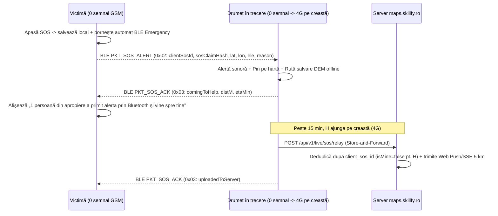

# Specificație Tehnică: SOS fără Semnal & Grup prin Bluetooth (BLE Multi-Hop Mesh + Store-and-Forward Relay)

**Data:** 2026-11-18  
**Platforme țintă:** Mobile Nativ (`app/` — Android API 26+ Kotlin & iOS 15.0+ Swift CoreBluetooth + Dart) · Backend Relay (`db/` — Go / PocketBase) · Proxy (`web/` — SvelteKit `/api/v1/live/sos/relay`)

---

## 1. Rezumatul Cercetării (`/swarm` Research Findings)

1. **Arhitectură Nativă Zero-Dependențe (`BleProximityPlugin.kt` + `BleProximityPlugin.swift`)**:
   - Auditul CI (`android_apk.yaml` cu `compileSdk = 37` / AGP `8.11.1` și `ios_ipa.yaml` pe `macos-26` cu verificare strictă `[CP] Check Pods Manifest.lock`) arată că pachetele terțe (`flutter_ble_peripheral` fără SwiftPM + `flutter_blue_plus` fără GATT Server pe iOS) riscă conflicte de lockfile și nu partajează conexiunile GATT.
   - Soluția optimă este un canal nativ dedicat (`MethodChannel('com.openwanderer.wanderer/ble_proximity')` + `EventChannel('com.openwanderer.wanderer/ble_proximity/events')`) folosind direct Android SDK (`BluetoothLeScanner`, `BluetoothLeAdvertiser`, `BluetoothGattServer`) și Apple `CoreBluetooth` (`CBCentralManager`, `CBPeripheralManager`), testabil 100% în `flutter test` pe Ubuntu prin `TestDefaultBinaryMessengerBinding`.
   - `package:crypto` (`3.0.7`) este **deja prezent în `pubspec.lock`**, oferind `SHA-256` și `HMAC-SHA256` pur în Dart fără modificări native de pod-uri.
2. **Asimetria Hardware/OS iOS ↔ Android (soluția *Herald* & *BitChat*)**:
   - Pe iOS, `CBPeripheralManager` elimină `ServiceData` și `ManufacturerData`, iar cu ecranul blocat mută UUID-ul serviciului în zona *Apple Overflow Area* (`0x004C`, tip `0x01`).
   - Pentru descoperire 100% bidirecțională (`Android ↔ Android`, `iOS ↔ iOS cu ecran blocat`, `Android ↔ iOS cu ecran blocat`):
     - Toate nodurile expun serviciul GATT `TRASEE_MESH_SERVICE_UUID = 7a4e0001-8c3b-4f2d-9e1a-5b6c7d8e9f00` cu două caracteristici fără *pairing* OS (`PERMISSION_READ` / `PERMISSION_WRITE` necriptat la nivel de link, criptat end-to-end la nivel de pachet): `CHAR_SYNC_READ` (`7a4e0002-...`) și `CHAR_MESH_INGRESS` (`7a4e0003-...`, `WriteWithoutResponse | Notify`).
     - Pe Android, `BLUETOOTH_SCAN` se declară **fără** `neverForLocation` (deoarece aplicația deține deja `ACCESS_FINE_LOCATION`), înregistrând atât filtrul `ServiceUuid(7a4e0001-...)`, cât și filtrul *Overflow* `ManufacturerData(0x004C, [0x01])` cu cache negativ de 15 minute pentru dispozitivele non-Wanderer.
     - În timpul navigației, serviciul `FOREGROUND_SERVICE_LOCATION` existent (`Tracelet`) menține procesul Android activ cu ecranul stins fără o a doua notificare permanentă.
3. **Proprietate Criptografică *Lamport Preimage* pentru Store-and-Forward SOS**:
   - Deoarece pachetul `PKT_SOS_ALERT` este public pe Bluetooth (pentru ca orice drumeț să îl poată recepționa și urca pe server când prinde semnal), niciun câmp din `PKT_SOS_ALERT` nu trebuie să permită anularea falsă a SOS-ului de către un terț.
   - Victima generează `clientSosId` (`8B` / 16 hex) și derivează determinist din `deviceToken`:
     - Secretul privat `sosClaimSecret` (`16B` / 32 hex): `HMAC-SHA256(deviceToken, "trasee-sos-v1:" + clientSosId)[0..15]` — **nu părăsește niciodată telefonul victimei cât timp SOS-ul e activ**.
     - Angajamentul public `sosClaimHash` (`8B` / 16 hex): `SHA-256("trasee-sos-claim-v1:" || sosClaimSecret)[0..7]` — inclus în `PKT_SOS_ALERT`.
   - Orice trecător („mule”) urcă `{ clientSosId, sosClaimHash, ... }` la `POST /api/v1/live/sos/relay` fără a deveni proprietar (`device_hash = ""` -> `isMine: false`), serverul deduplică oricâte relee după `client_sos_id` (1 singură alertă + 1 singur Web Push), iar doar victima (care cunoaște preimaginea `sosClaimSecret`) poate emite `PKT_SOS_RESOLVED` sau își poate revendica alerta când revine la 4G.

---

## 2. Protocolul Binar BLE (`v1`, Magic `0x54`, `<= 88 Bytes` / 1 singur PDU GATT)

### Header Comun (4 Octeți, Big-Endian)
- `byte[0]`: `0x54` (`'T'`, versiunea 1)
- `byte[1]`: `pktType` (`0x01` `GROUP_POS`, `0x02` `SOS_ALERT`, `0x03` `SOS_ACK`, `0x04` `SOS_RESOLVED`)
- `byte[2]`: `ttlHops = (hopCount << 4) | ttlRemaining` (exclus din MAC/hash pentru ca releele intermediare să poată decrementa `ttlRemaining` până la `0`, max `5` salturi pt. SOS și `3` pt. Grup)
- `byte[3]`: `bodyLen` (`26..84` octeți; dimensiune totală pachet `30..88` octeți)

### Tipurile de Pachete
1. **`0x01 PKT_GROUP_POS` (`48B` fix, Criptat Autentificat HKDF-SHA256)**:
   - Chei derivate din codul de grup de 6 caractere: `PRK = HMAC-SHA256("trasee-ble-salt-v1", "trasee-ble-group-v1:" + code)`, `kEnc = HMAC(PRK, "enc\x01")`, `kMac = HMAC(PRK, "mac\x01")`.
   - Payload `44B`: `timestamp (4B)` + `nonceSalt (4B)` + `ciphertext (32B: memberId 6B, latE7 4B, lonE7 4B, eleM 2B, accuracyM 1B, flags 1B, headingDeg2 1B, speedDmps 1B, displayName UTF-8 12B)` + `mac4B (4B)`.
   - `memberId (6B)` coincide cu primii 6 octeți ai `memberId`-ului de pe server -> unificare automată între SSE online și BLE offline + intrare directă în `CooperativeGpsFusion`!
2. **`0x02 PKT_SOS_ALERT` (`40..88B`, Public + Angajament `sosClaimHash`)**:
   - Payload: `clientSosId (8B)` + `originTokenHash / sosClaimHash (8B)` + `reasonAndFlags (1B)` + `latE7 (4B)` + `lonE7 (4B)` + `eleM (2B)` + `createdEpochSec (4B)` + `msgLen (1B)` + `shortMsg (0..48B UTF-8)` + `integrityHash4B (4B)`.
3. **`0x03 PKT_SOS_ACK` (`30B` fix, Confirmare Bidirecțională)**:
   - Payload: `clientSosId (8B)` + `responderId (6B)` + `etaMin (1B)` + `distM (2B)` + `ackFlags (1B: bit0=comingToHelp, bit1=uploadedToServer, bit2=cancelled)` + `ackEpochSec (4B)` + `integrityHash4B (4B)`.
4. **`0x04 PKT_SOS_RESOLVED` (`37B` fix, Anulare Autentificată cu Preimagine)**:
   - Payload: `clientSosId (8B)` + `status (1B)` + `resolvedEpochSec (4B)` + `sosRevealToken (16B = sosClaimSecret)` + `integrityHash4B (4B)`. Orice nod verifică `SHA-256("trasee-sos-claim-v1:" || sosRevealToken)[0..7] == sosClaimHash` înainte de a închide alerta și a o marca *tombstoned* timp de 6 ore.

---

## 3. Regimuri Radio Adaptive & Economisire Baterie

1. **`IDLE_OFF` (`0%` consum)**: în afara ecranului de navigație și fără SOS/Grup activ — Bluetooth nu este inițializat (nu cere permisiuni la deschiderea aplicației).
2. **`PASSIVE_TRAIL_GUARD` (`~1.5%/h`)**: drumeț în navigație activă fără grup — scanează rar (`2.5s ON / 27.5s OFF`, `LOW_POWER`) pentru a recepționa și prelua eventuale alerte `SOS fără semnal` de pe munte.
3. **`GROUP_MESH_NORMAL` (`~3%/h`)**: membru într-un grup activ — emite și scanează ciclic (`BALANCED`), trecând prioritar pe BLE când conexiunea la internet lipsește.
4. **`SOS_EMERGENCY_ACTIVE`**: se activează **automat** la apăsarea butonului SOS (indiferent dacă ești sau nu într-un grup):
   - Primele `3 minute` (și ori de câte ori detectează un telefon în apropiere): emisie `LOW_LATENCY` / `TX_POWER_HIGH` (`100 ms`) pentru rază maximă (`200–300 m` în câmp deschis).
   - După `3 minute`: trece automat în regim de supraviețuire (`250 ms`, `TX_POWER_HIGH`), menținând transmisia activă peste 24h.

---

## 4. Experiența Utilizatorului & Limbaj Natural (fără cuvântul „baliză”, identitate `Deep Slate #242734 & Sticlă Mată`)

- **Activare SOS fără semnal**:
  - Nu mai eșuează când lipsește internetul: creează instant alerta locală + pornește transmisia BLE.
  - Titlu stare: **`SOS fără semnal · trimis prin Bluetooth`**
  - Subtitlu: *„Alerta se transmite automat către drumeții din apropiere și va fi trimisă online imediat ce apare semnal.”*
  - La recepția confirmării `PKT_SOS_ACK`:
    - *„1 persoană din apropiere a primit alerta prin Bluetooth și vine spre tine”* (sau *„Alerta ta a fost transmisă online prin telefonul unui drumeț din apropiere”*).
  - **Card calm de economisire a bateriei** (afișat discret în sticlă mată `#242734` doar când `!isOnline` și ai SOS activ):
    - *„Sfat baterie fără semnal: poți activa Modul Avion lăsând Bluetooth și GPS pornite, apoi blochează ecranul — alerta continuă automat cu consum minim.”*
- **Recepție SOS prin Bluetooth de către alt drumeț**:
  - Antet: **`🆘 Alertă SOS în apropiere · prin Bluetooth`** + distanță, diferență de nivel și buton *„Pot să vin să ajut”* (calculează ruta DEM offline + trimite `PKT_SOS_ACK` înapoi prin Bluetooth + salvează alerta în coada *Store-and-Forward* pentru încărcare automată la revenirea semnalului 4G).
- **Grup prin Bluetooth**:
  - Crearea și intrarea într-un grup cu cod de 6 caractere funcționează acum și **100% offline** pe munte; membrii recepționați prin Bluetooth afișează un cip discret `#242734` **`Prin Bluetooth`** și alimentează automat fuziunea GPS cooperativă.
