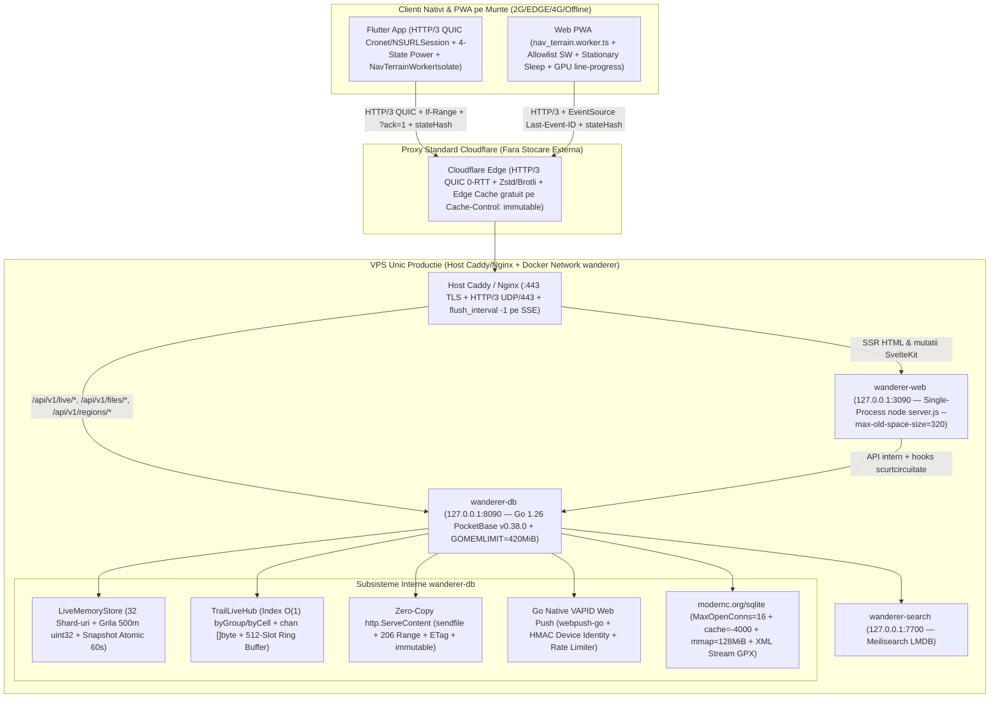
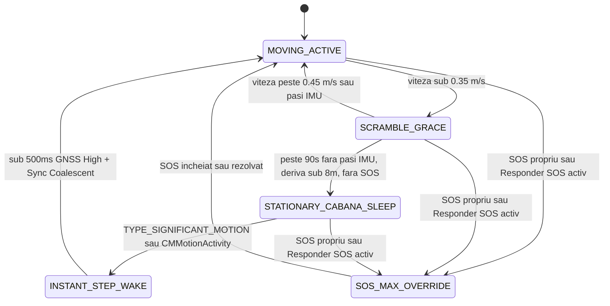

# Specificație Tehnică Master: Optimizarea Performanței End-to-End (Go RAM Spatial Store, Direct SSE & Zero-Copy Sendfile/HTTP3, Autonomie Montană Mobilă & Worker Isolates, Web Workers & MapLibre 60/120 FPS)

**Data:** 2026-11-18  
**Status:** Aprobat pentru planificare și implementare modulară (Fazele 1–4)  
**Constrângere de infrastructură:** **VPS Unic + Proxy Standard Cloudflare** (fără stocare externă de obiecte; servire directă din Go prin `http.ServeContent` / `sendfile` + caching gratuit pe edge-ul Cloudflare prin `Cache-Control: public, max-age=31536000, immutable` + `HTTP/3 QUIC` + `Zstd`/`Brotli`)  
**Platforme țintă:** Backend (`db/` — Go 1.26 / PocketBase `v0.38.0` / `modernc.org/sqlite` + Meilisearch) · Infrastructură & Proxy (`deploy/` — Docker Compose, Caddy/Nginx, CI/CD) · Mobile Nativ (`app/` — Flutter iOS & Android + MapLibre + `Tracelet` + `TileProxyServer`) · Web PWA (`web/` — SvelteKit 5 + MapLibre GL 6 + Service Worker)  
**Specificații fundamentale anterioare:** [2026-11-17-trail-waze-alerts-sos-presence-design.md](file:///Volumes/SSD%20extern/Proiecte/Maps/docs/superpowers/specs/2026-11-17-trail-waze-alerts-sos-presence-design.md) · [2026-11-18-smart-navigation-group-ui-design.md](file:///Volumes/SSD%20extern/Proiecte/Maps/docs/superpowers/specs/2026-11-18-smart-navigation-group-ui-design.md) · [2026-11-18-offline-ble-sos-group-design.md](file:///Volumes/SSD%20extern/Proiecte/Maps/docs/superpowers/specs/2026-11-18-offline-ble-sos-group-design.md) · [2026-11-18-mountain-intelligence-salvamont-design.md](file:///Volumes/SSD%20extern/Proiecte/Maps/docs/superpowers/specs/2026-11-18-mountain-intelligence-salvamont-design.md)  
**Planuri de implementare TDD asociate:**
- Faza 1: [2026-11-18-perf-phase1-go-ram-store-sqlite.md](file:///Volumes/SSD%20extern/Proiecte/Maps/docs/superpowers/plans/2026-11-18-perf-phase1-go-ram-store-sqlite.md)
- Faza 2: [2026-11-18-perf-phase2-direct-go-sse-files-http3.md](file:///Volumes/SSD%20extern/Proiecte/Maps/docs/superpowers/plans/2026-11-18-perf-phase2-direct-go-sse-files-http3.md)
- Faza 3: [2026-11-18-perf-phase3-mobile-battery-isolates.md](file:///Volumes/SSD%20extern/Proiecte/Maps/docs/superpowers/plans/2026-11-18-perf-phase3-mobile-battery-isolates.md)
- Faza 4: [2026-11-18-perf-phase4-web-workers-maplibre-bundle.md](file:///Volumes/SSD%20extern/Proiecte/Maps/docs/superpowers/plans/2026-11-18-perf-phase4-web-workers-maplibre-bundle.md)

---

## 1. Contextul Forensic, Bottleneck-uri Auditate și Ținte Măsurabile

Auditul complet al codului din `db/`, `deploy/`, `app/` și `web/` a evidențiat cinci categorii critice de gâtuire a performanței, memoriei, I/O-ului pe disc și autonomiei bateriei în condiții reale din Munții Carpați (`8–12 ore` de drumeție, temperaturi scăzute, semnal intermitent `2G/EDGE/4G` slab și sute de drumeți concurenți în weekend):

1. **Furtuna I/O în SQLite și capcana OOM off-heap în `wanderer-db` (`mem_limit: 512m`)**:
   - Fiecare apel `POST /live/heartbeat` ([trail_live.go](file:///Volumes/SSD%20extern/Proiecte/Maps/db/routes/trail_live.go#L614-L701)) execută **5+A interogări `SELECT` și 1–2 scrieri serializate** pe singura conexiune `NonconcurrentDB`, decodând de la zero polilinia completă a traseului la fiecare `20 s`. Fiecare `POST /live/groups/{code}/ping` ([trail_live_groups.go](file:///Volumes/SSD%20extern/Proiecte/Maps/db/routes/trail_live_groups.go#L596-L658)) execută **3 `SELECT` + 2 `UPDATE`** (atingând **8 arbori B-tree** la fiecare `5 s`, inclusiv rescrierea rândului `trail_groups.expires_at` de `96 ori/minut` într-un grup de 8 persoane doar pentru a glisa un TTL de `12 ore` cu `5 secunde`). La `500` de drumeți activi rezultă **`7.050` tranzacții de scriere/min (`117,5 tx/s`)** și **`17.700` `SELECT`/min**, cu o amplificare de scriere pe SSD de **`6,3–12,6 GB/oră`**.
   - **Bug de corectitudine descoperit**: `queryVisibleReports` ([trail_live.go](file:///Volumes/SSD%20extern/Proiecte/Maps/db/routes/trail_live.go#L532-L540)) încarcă ultimele `LIMIT 500` rapoarte din toată România fără filtru spațial în SQL; imediat ce baza de date depășește `500` de repere permanente (`spring`, `shelter`, `viewpoint`), izvoarele mai vechi dispar silențios chiar dacă se află la `5 m` în fața drumețului. Simultan, `queryActiveSosAlerts` ([trail_live.go](file:///Volumes/SSD%20extern/Proiecte/Maps/db/routes/trail_live.go#L567-L599)) execută un N+1 `loadActiveRespondersMap` pentru fiecare SOS activ din țară, iar `selectSosPushTargets` ([trail_live.go](file:///Volumes/SSD%20extern/Proiecte/Maps/db/routes/trail_live.go#L1272-L1356)) rulează două scanări integrale `LIMIT 0`.
   - **Capcana OOM `modernc.org/sqlite`**: binarul static Go (`CGO_ENABLED=0`) moștenește din PocketBase `DataMaxOpenConns = 120` și `cache_size = -32000` (`~32 MiB` cache privat off-heap per conexiune în `modernc.org/memory`, invizibil pentru Go GC) fără `mmap_size` și fără `GOMEMLIMIT`. Deschiderea a doar `16–20` conexiuni de citire concurente consumă `512–640 MiB` off-heap și declanșează `OOM-kill` pe containerul de `512 MiB`. În plus, încărcarea unui fișier GPX de `25 MiB` îl citește și îl parsează în DOM de **două ori consecutiv** ([placeholder.go](file:///Volumes/SSD%20extern/Proiecte/Maps/db/services/routeimage/placeholder.go#L51-L58) + [polyline.go](file:///Volumes/SSD%20extern/Proiecte/Maps/db/util/polyline.go#L44-L58)), provocând vârfuri de `250–320 MiB` RAM.
2. **Dublul hop SSE/Fișiere prin Node.js și multiplicatorul `4×` RPC în `wanderer-web` (`mem_limit: 512m`)**:
   - [Dockerfile.web](file:///Volumes/SSD%20extern/Proiecte/Maps/deploy/Dockerfile.web#L17) pornește `npm run start` (`npm` + `node watcher.js` + `node server.js`), consumând **`~270 MiB` RSS în gol** din limita de `512 MiB`.
   - Fluxurile SSE `/api/v1/live/stream` ([+server.ts](file:///Volumes/SSD%20extern/Proiecte/Maps/web/src/routes/api/v1/live/stream/+server.ts#L48-L131)) trec prin Node.js (`150–220 KB` V8 Old Space/conexiune față de `10–14 KB` în Go).
   - În [hooks.server.ts](file:///Volumes/SSD%20extern/Proiecte/Maps/web/src/hooks.server.ts#L103-L268), doar `/api/v1/health` scurtcircuitează autentificarea: fiecare ping GPS la `5 s` și fiecare imagine din `/api/v1/files/*` declanșează **3–4 cereri HTTP secvențiale Node $\to$ Go** (`auth-refresh`, `settings`, `activitypub_actors` sau `/search/token`) și atașează `Set-Cookie: pb_auth` pe răspunsurile de telemetrie, deși doar `POST /live/reports` folosește `X-Actor-Id`. Mai mult, proxy-ul SvelteKit pentru `/api/v1/files/*` ([+server.ts](file:///Volumes/SSD%20extern/Proiecte/Maps/web/src/routes/api/v1/files/%5Bcollection%5D/%5Brecord%5D/%5Bfile%5D/+server.ts#L47-L83)) pierde headerele `Range`, `If-None-Match` și `Cache-Control`.
3. **Drenajul sever de baterie în aplicația nativă Flutter (`app/`)**:
   - **Bug dublu GPS & suprascriere prezență**: ruta părinte [map_screen.dart](file:///Volumes/SSD%20extern/Proiecte/Maps/app/lib/routes/map_screen.dart#L692) rămâne montată offstage sub `NavigationScreen`, păstrând activ un al doilea flux `Geolocator` la `2 s` ([foreground_position_stream_provider.dart](file:///Volumes/SSD%20extern/Proiecte/Maps/app/lib/provider/foreground_position_stream_provider.dart#L150-L179)), o a doua busolă la `20 Hz`, `80–140 MB` de texturi `MapLibreMap` și un timer la `45 s` care trimite `inNavigation: false` peste sesiunea activă de navigație.
   - **Pierderea `MotionConfig` în buzunar & absența somnului în cabană**: `_backgroundConfig()` din [tracelet_position_source.dart](file:///Volumes/SSD%20extern/Proiecte/Maps/app/lib/services/tracelet_position_source.dart#L161-L171) omite `motion:`, resetând pipeline-ul nativ la fiecare blocare/deblocare a ecranului, iar `MotionDetectionMode.speed` trezește cipul GNSS la fiecare `20 s` chiar și într-un popas de o oră în cabană.
   - **Modem celular blocat 100% în `RRC_CONNECTED` (`~650 mW`)**: `_groupPingTimer` la `6 s` ([navigation_screen.dart](file:///Volumes/SSD%20extern/Proiecte/Maps/app/lib/routes/navigation_screen.dart#L1848-L1851)) este mai scurt decât coada `RRC tail` (`10–15 s` LTE / `12–17 s` 3G), consumând singur `~6,5 Wh` (`38%` dintr-un acumulator de `4.500 mAh`) în 10 ore, iar pe grupurile BLE offline reîncearcă `createGroup` la fiecare `6 s` fără semnal. În paralel, `_persistNow()` rescrie la fiecare `10 s` întregul traseu `O(N)` în ObjectBox (`~8,6 GB` scrieri flash în 10 ore).
4. **Blocajele de fir principal (`Main Thread` / `UI Isolate`) în navigație**:
   - **Bug-ul Double-A\* sincron** apare identic în Web ([navigate/+page.svelte](file:///Volumes/SSD%20extern/Proiecte/Maps/web/src/routes/map/trail/%5Bhandle%5D/%5Bid%5D/navigate/+page.svelte#L1047-L1088) $\to$ [hybrid_rejoin_router.ts](file:///Volumes/SSD%20extern/Proiecte/Maps/web/src/lib/navigation/hybrid_rejoin_router.ts#L257-L302), **`70–280 ms` freeze**) și în Flutter ([navigation_screen.dart](file:///Volumes/SSD%20extern/Proiecte/Maps/app/lib/routes/navigation_screen.dart#L1074-L1095) $\to$ [off_trail_router.dart](file:///Volumes/SSD%20extern/Proiecte/Maps/app/lib/util/navigation/off_trail_router.dart#L770), **`36–110 ms` freeze**): `computeOffTrailReroute` este executat sincron de două ori înainte de `fetch`/`dio.post` către Valhalla.
   - Decodarea dalelor DEM (`9 × 512×512` `Float32Array` / RGBA = `9,44 MB`), parsarea GPX XML și cele `8` apeluri MapLibre `GeoJSONSource.setData()`/secundă + busola la `60 Hz` + `ResizeObserver` la `1 Hz` în Web mențin procesorul și GPU-ul sub sarcină continuă.
5. **Payload-uri supradimensionate pe rețea montană și lipsa cache-ului offline PWA**:
   - Paginile de traseu încarcă sincron `TipTap` (`410 KB`) și `JSZip` (`328 KB`); `/map` așteaptă `Chart.js` (`199 KB`) înaintea inițializării hărții; `app.css` servește `14` fonturi `.ttf` brute (`2,47 MB`); `trails_show` face N+1 fetch pe toate fișierele GPX din `summit_logs` în timpul SSR; căutările de carduri descarcă `polyline` complet (`240 KB – 1,4 MB`); iar [service-worker.ts](file:///Volumes/SSD%20extern/Proiecte/Maps/web/src/service-worker.ts#L1-L4) nu are niciun handler `fetch`.

### 1.1 Tabelul Sintetic: Baseline Măsurat vs. Ținta Arhitecturală

| Indicator de Performanță | Baseline Măsurat (Actual) | Țintă După Fazele 1–4 | Factor de Îmbunătățire |
| :--- | :--- | :--- | :--- |
| **Tranzacții scriere SQLite / min (`500` drumeți)** | `7.050 writes/min` (`117,5 tx/s` pe 1 conn) | **`2–5 writes/min`** (doar evenimente umane + drift push) | **`-99,93%` IOPS scriere** |
| **Interogări citire SQLite / min (`500` drumeți live)** | `17.700 SELECT/min` (`750k` rânduri scanate/min) | **`0 SELECT/min` pe hot-path** (100% RAM spatial grid) | **`-100%` QPS live** |
| **Amplificare scriere SSD (`wanderer-db`)** | `105–210 MB/min` (`6,3–12,6 GB/oră` WAL + B-tree) | **`~20 KB/min`** (`1` snapshot atomic secvențial/min) | **`~5.000×` mai puțină uzură SSD** |
| **Latență P99 `/api/v1/live/heartbeat` & `/ping`** | `45 ms – 450+ ms` (coadă `NonconcurrentDB` + Node) | **`0,08 – 0,20 ms`** (Go direct + 32-shard RAM) | **`~500×` latență P99 mai mică** |
| **Risc memorie `wanderer-db` (`512 MiB` limită)** | Expus la OOM (`120×32 MiB` cache + `300 MiB` GPX DOM) | **`< 440 MiB` plafonat** (`16×4 MiB` + `128 MiB` mmap + `GOMEMLIMIT=420MiB` + GPX SAX `12 MiB`) | **`0` OOM-kills** |
| **Memorie RAM `wanderer-web` în repaus + `500` SSE** | `~270 MiB` repaus + `~100 MiB` SSE = `~370–420 MiB` | **`~150 MiB` repaus + `0 MiB` SSE** (`~7 MiB` în Go) | **`~220+ MiB` eliberați în Web** |
| **Trafic HTTP răspuns `/heartbeat` (stare neschimbată)** | `5–30 KB` JSON complet la fiecare `20–60 s` | **`~52 B`** (`{"activeHikers30m":N,"stateHash":"...","unchanged":true}`) | **`-99,5%` octeți pe 2G/EDGE** |
| **Consum baterie `10h` drumeție în Flutter (Solo / Grup)** | `25,6%` Solo / `53,8%` Grup (`42%`/`80%` la `0°C`) | **`13,1%` Solo / `18,9%` Grup** (`4-State Power` + `RadioSyncScheduler`) | **`-38%` .. `-55%` energie economisită** |
| **Blocare UI la rerutare Off-Trail A\* (Flutter / Web)** | `36–110 ms` Flutter / `70–280 ms` Web (Double-A\*) | **`< 0,05 ms` Flutter / `< 1,5 ms` Web** (Worker Isolate / Web Worker) | **`0` cadre pierdute (`60/120 FPS`)** |
| **Memorie RAM dale DEM (`9` dale `z12` `512×512`)** | `9,44 MB` (`Float32Array` / RGBA `Uint8List`) | **`4,72 MB`** (`Uint16List` `0,20 m` Flutter / `Int16Array` `0,1 m` Web, `524 KB/dală`) | **`-50%` RAM + cache `.dem16`** |
| **Apeluri MapLibre `GeoJSONSource.setData()` / sec (Web)** | `8 apeluri/sec` (`450–650 KB/s` IPC către worker) | **`0 apeluri/sec` în regim staționar/constant** (GPU `line-progress` + dirty-gate) | **`-100%` serializare redundantă** |
| **Bundle JS critic `/map/trail` & Fonturi Web** | `2.626 KB` JS + `2.470 KB` `.ttf` + `227 KB` `ofm.json` | **`~1.888 KB` JS (`-738 KB`) + `~96 KB` `.woff2` (`-96%`) + `~68 KB` `ofm.json`** | **Boot rece mobil cu `~1,8 MB` mai ușor** |
| **Dimensiune kit Android APK (`/install`)** | `~55 MB` APK universal fat | **`~20 MB` `arm64-v8a` APK** (`--split-per-abi`) | **`-63%` timp descărcare mobilă** |

---

## 2. Arhitectura End-to-End pe VPS Unic și Contracte Transversale



### 2.1 Împărțirea în cele 4 Faze de Implementare

| Fază | Plan TDD Asociat | Domeniu de Proprietate | Livrabile Principale |
| :--- | :--- | :--- | :--- |
| **Faza 1** | [2026-11-18-perf-phase1-go-ram-store-sqlite.md](file:///Volumes/SSD%20extern/Proiecte/Maps/docs/superpowers/plans/2026-11-18-perf-phase1-go-ram-store-sqlite.md) | Backend Go, `LiveMemoryStore`, SQLite, `TrailLiveHub` & Meilisearch (`db/`) | `LiveMemoryStore` 32-shard cu grilă `500 m` `uint32` + snapshot atomic la `60 s`, index RAM `trail_reports` (fix `LIMIT 500`) & `sos_alerts`, `DataMaxOpenConns=16` / `cache_size=-4000` / `mmap_size=128MiB`, `TrailLiveHub` $O(1)$ `[]byte` + ring buffer `512` `Last-Event-ID`, suport `stateHash`/`?ack=1`/`stationary`, GPX `xml.Decoder`, token HMAC Meilisearch în `2 µs`, `ListFeedHandler` batch (`90->4`), migrația `1792400000`. |
| **Faza 2** | [2026-11-18-perf-phase2-direct-go-sse-files-http3.md](file:///Volumes/SSD%20extern/Proiecte/Maps/docs/superpowers/plans/2026-11-18-perf-phase2-direct-go-sse-files-http3.md) | Rute Directe Go, `sendfile`, VAPID Go, Caddy/Docker & Clienți Rețea (`db/`, `deploy/`, `web/src/lib/live/`, `app/lib/services/`) | Rute directe `/api/v1/live/*`, `/api/v1/files/*` (`http.ServeContent` `206` + `ETag` + `immutable`), `/api/v1/regions/*` în Go, `HMAC-SHA256(X-Device-Token)` + rate limiter + lazy `pb_auth` actor + VAPID `webpush-go` în Go, scurtcircuitare `hooks.server.ts`, `Dockerfile.web` single-process + `GOMEMLIMIT=420MiB`, `deploy/Caddyfile`, `live_client.ts` (`Last-Event-ID`, jitter, `stateHash`, `?ack=1`), Flutter `native_dio_adapter` HTTP/3 QUIC + `.part` `If-Range` `.pmtiles`, APK `--split-per-abi`. |
| **Faza 3** | [2026-11-18-perf-phase3-mobile-battery-isolates.md](file:///Volumes/SSD%20extern/Proiecte/Maps/docs/superpowers/plans/2026-11-18-perf-phase3-mobile-battery-isolates.md) | Autonomie Montană, `RadioSyncScheduler` & `NavTerrainWorkerIsolate` (`app/`) | Hibernare `MapScreen` offstage, `MountainPowerEngine` în 4 stări (Android `TYPE_SIGNIFICANT_MOTION` `0,08 mW` + iOS `ThreeKilometers` `0 mW` + `Expedition Mode` + override obligatoriu SOS), `RadioSyncScheduler` coalescent RRC, `NavTerrainWorkerIsolate` persistent (`.dem16` + `.pmtiles` DEM + grilă `200 m` + fix Double-A\* + salvare GPX într-un singur isolate), split `ValueNotifier` busolă, append binar `24 B/pt`. |
| **Faza 4** | [2026-11-18-perf-phase4-web-workers-maplibre-bundle.md](file:///Volumes/SSD%20extern/Proiecte/Maps/docs/superpowers/plans/2026-11-18-perf-phase4-web-workers-maplibre-bundle.md) | Web Worker Zero-Copy, MapLibre GPU, Stationary Sleep & Bundle/SW (`web/`) | `nav_terrain.worker.ts` (`Transferable` `Int16Array` DEM + A\* + GPX/FIT/KML + fix Double-A\*), MapLibre `8 -> 0..1` `setData()`/s (`line-progress` GPU) + diffing markere + `5× Path2D` canvas, PWA Stationary Sleep (`>90 s` + override SOS), lazy-splitting (`TipTap`, `JSZip`, `Chart.js`, `3D/`), fonturi `.woff2` + `ofm.json` minificat, eliminare GPX/N+1 din SSR & `polyline` din căutări, Service Worker allowlist. |

### 2.2 Contracte Transversale Înghețate (`Shared Cross-Phase Contracts`)

> [!IMPORTANT]
> Toate cele 4 planuri de implementare TDD respectă strict interfețele, rutele, formulele și numele de fișiere de mai jos, astfel încât fazele pot fi dezvoltate, testate și livrate fără conflicte de schemă sau incompatibilități între Go, Web și Flutter.

#### A. Politica de Stocare și Caching pe VPS Unic (Fără Stocare Externă de Obiecte)
1. **Zero dependențe externe de obiecte**: Toate fișierele încărcate în PocketBase (`/pb_data/storage/`), arhivele offline de regiuni (`/pb_data/region_archives/`) și kiturile mobile (`/var/www/maps.skillfy.ro/downloads/`) rămân găzduite pe discul SSD al VPS-ului existent și sunt servite direct de Go sau Caddy prin apeluri de sistem `sendfile(2)` zero-copy.
2. **Contractul `Cache-Control` pentru Proxy-ul Standard Cloudflare**:
   - Când instanța este publică (`PUBLIC_PRIVATE_INSTANCE != "true"`), fișierele din `/api/v1/files/{collection}/{record}/{file}` (ale căror nume conțin deja sufixul aleator imutabil generat de PocketBase, ex. `photo_x8k29a1b2c.webp`) și fonturile/activele versionate primesc `Cache-Control: public, max-age=31536000, immutable` + `ETag` puternic. Proxy-ul standard Cloudflare păstrează gratuit aceste fișiere în edge-ul din București (`OTP`), descărcând complet VPS-ul la citirile repetate.
   - Când `PUBLIC_PRIVATE_INSTANCE == "true"`, handler-ul Go verifică mai întâi autentificarea (`Authorization: Bearer` sau cookie `pb_auth`) și setează `Cache-Control: private, max-age=86400`, prevenind stocarea în cache-uri partajate.

#### B. Protocolul de Rețea Live (`stateHash`, `?ack=1`, `stationary`, `Last-Event-ID` și Cadrul SSE)
1. **Cererea și Răspunsul Delta pe `POST /live/heartbeat` și `POST /api/v1/live/heartbeat`**:
   ```ts
   export interface LiveHeartbeatRequest {
     lat: number;                 // cuantizat la 1e-6 grade
     lon: number;                 // cuantizat la 1e-6 grade
     ele?: number;
     trailId?: string;
     inNavigation: boolean;
     stationary?: boolean;        // NOU: true cand drumetul este in popas (>90s)
     stateHash?: string;          // NOU: hash FNV-1a 64-bit hex al starii locale (16 char lowercase hex)
   }

   export interface LiveHeartbeatResponse {
     activeHikers30m: number;
     stateHash: string;           // hash canonic curent calculat de server
     unchanged?: boolean;         // true cand req.stateHash !== "" && req.stateHash === serverStateHash
     reports?: TrailReportDto[];  // omis complet cand unchanged === true (~52 B raspuns total!)
     sosAlerts?: SosAlertDto[];   // omis complet cand unchanged === true
   }
   ```
   - **Calculul determinist `stateHash` pe server (`computeLiveStateHash`)**: hash FNV-1a pe 64 de biți formatat ca `16` caractere hexazecimale mici peste tuplurile ordonate crescător după `id` ale rapoartelor vizibile `(id, conditionStatus, confirmCount, dismissCount, lastConfirmedAt, expiresAt, note)` și ale alertelor SOS vizibile `(id, status, lat, lon, responderCount, nearestEtaSec, nearestDistanceM, isMine, amResponding)`. Dacă `req.StateHash != ""` și coincide cu hash-ul calculat din `LiveMemoryStore`, serverul omite serializarea listelor `reports` și `sosAlerts`, returnând `{"activeHikers30m":N,"stateHash":"...","unchanged":true}`. Clienții vechi care nu trimit `stateHash` primesc în continuare răspunsul complet.
2. **Ping-ul Compact de Grup `POST /live/groups/{code}/ping?ack=1` și `POST /api/v1/live/groups/{code}/ping?ack=1`**:
   ```ts
   export interface GroupPingRequest {
     lat: number;
     lon: number;
     ele?: number;
     accuracy?: number;
     heading?: number | null;
     speed?: number | null;
     alongTrackM?: number | null;
     inNavigation?: boolean;
     stationary?: boolean;        // NOU: true in STATIONARY_CABANA_SLEEP / PWA Stationary Sleep
   }

   // Cand query param ?ack=1 este prezent (conexiunea SSE este activa):
   export interface GroupPingAckResponse {
     ok: true;
     code: string;
     selfMemberId: string;
     expiresAt: string;
   }
   ```
   - Când `?ack=1` lipsește (fallback fără SSE sau primă sincronizare), endpoint-ul returnează `GroupSessionDto` complet (`members[]`), păstrând compatibilitatea 100% cu testele și clienții existenți.
   - **Semantica `stationary: boolean` în `PresenceStore` și `GroupStore`**: când un client raportează `stationary: true`, TTL-ul de vizibilitate a membrului în grup și pe traseu este menținut activ timp de `10 minute` (acoperind confortabil intervalul de keepalive de `300 s` cu marjă de `2×` pentru pierderi radio), iar `GroupMemberDto` expune `"stationary": true` pentru afișarea etichetei calme `Popas` în UI.
3. **Formatul Unificat Zero-Reflection al Cadrelor SSE și Replay-ul `Last-Event-ID`**:
   - Fiecare cadru difuzat de `TrailLiveHub` primește un identificator secvențial strict monoton `seq uint64` și o singură anvelopă JSON construită prin concatenare directă de octeți (`0` apeluri `json.Unmarshal`, `-48%` dimensiune față de dublarea anterioară top-level + cheie imbricată):
     ```text
     id: 10482
     event: report_update
     data: {"type":"report_update","report":{...}}

     id: 10483
     event: sos_update
     data: {"type":"sos_update","sos":{...}}

     id: 10484
     event: group_member_update
     data: {"type":"group_member_update","groupCode":"ABC234","member":{...}}

     id: 10485
     event: group_member_left
     data: {"type":"group_member_left","groupCode":"ABC234","memberId":"a1b2c3d4e5f6"}
     ```
   - Acest format este **100% compatibil retroactiv** atât cu Web ([live_client.ts](file:///Volumes/SSD%20extern/Proiecte/Maps/web/src/lib/live/live_client.ts#L1388-L1422): `parsed.report ?? parsed`, `parsed.sos ?? parsed`, `parsed.member ?? parsed`), cât și cu Flutter ([trail_live_models.dart](file:///Volumes/SSD%20extern/Proiecte/Maps/app/lib/models/live/trail_live_models.dart#L1040-L1068): `map['report'] is Map`, `map['sos'] is Map`, `map['member'] is Map`).
   - La reconectare cu header-ul `Last-Event-ID: <lastSeq>` (sau query param `?lastEventId=<lastSeq>` pentru clienți custom), `TrailLiveHub` parcurge ring buffer-ul circular de **512 sloturi** și retransmite imediat doar cadrele cu `entry.Seq > lastSeq` care se potrivesc filtrului spațial / `trailId` / `groupCode` al abonatului. Dacă `lastSeq` este mai vechi decât cel mai vechi slot din ring buffer (`seqGap`), serverul emite un cadru `event: resync_required\ndata: {"type":"resync_required"}\n\n` pentru ca aplicația să reîmprospăteze sumarul o singură dată.

#### C. Identitatea Anonimă a Dispozitivului și Securitatea VAPID în Go
- Atât rutele interne `/live/*` (apelate din SvelteKit în dev), cât și rutele publice directe `/api/v1/live/*` din Go calculează exact același `device_hash`:
  ```go
  // Trim spații; validează lungime 24..128 caractere ASCII printabile (0x21..0x7E).
  // Secret: os.Getenv("POCKETBASE_PROXY_SECRET"), cu fallback la "wanderer-live-fallback".
  // Returnează hex.EncodeToString(hmacSha256(secret, token)) — 64 caractere lowercase hex.
  ```
- **Regulă critică de securitate**: Răspunsurile rutelor publice `POST /api/v1/live/sos` și `POST /api/v1/live/sos/relay` **nu conțin niciodată** câmpul intern `pushTargets` (endpoint-uri Web Push și chei `p256dh`/`auth`); livrarea notificărilor RFC 8291 Web Push se execută asincron în interiorul procesului Go.

#### D. Numerotarea Migrațiilor PocketBase și Directorul Playwright
- **Migrație PocketBase**: Faza 1 creează exclusiv [1792400000_optimize_trails_filter_and_indexes.go](file:///Volumes/SSD%20extern/Proiecte/Maps/db/migrations/1792400000_optimize_trails_filter_and_indexes.go) (evitând orice coliziune cu `1792100000` din Grupuri și `1792200000` / `1792300000` din Inteligența Montană). Fazele 2, 3 și 4 nu adaugă migrații de schemă SQLite.
- **Directorul oficial pentru teste Playwright E2E**: Toate testele Playwright se plasează exclusiv în `web/tests/playwright/` (conform `testDir: './tests/playwright'` din [playwright.config.ts](file:///Volumes/SSD%20extern/Proiecte/Maps/web/playwright.config.ts#L13)), niciodată în `web/e2e/`.

#### E. Politica Aprobată de Autonomie și Prioritatea Absolută SOS
- **Somn Staționar Automat (`> 90 s`)**: activ implicit atât în Flutter, cât și în Web PWA după `90 s` de absență a pașilor și derivă `< 8 m`, cu revenire sub `500 ms` la primii pași detectați hardware/IMU.
- **Mod Opțional `Expedition Mode` („Ultra-Munte”)**: comutator explicit în setările de navigație (și sugestie discretă la baterie `<= 20%`), care relaxează filtrul GPS în mers la `12 m`, plafonează randarea la `30 FPS`, dezactivează hillshade-ul 3D și extinde fereastra de sincronizare radio la `300 s`, păstrând activă garda pasivă BLE pentru SOS.
- **Override Obligatoriu SOS (`SOS Max-Precision Override`)**: în secunda în care utilizatorul are o alertă SOS proprie activă (`activeMySos != null`) sau răspunde activ la un SOS din apropiere (`amResponding == true`), atât `STATIONARY_CABANA_SLEEP`, cât și `Expedition Mode` sunt **suspendate necondiționat**, forțând recepția GNSS la precizie maximă (`3 m`, `enableHighAccuracy: true`) și sincronizarea radio prioritară.

---

## 3. Faza 1 — Backend Go (`db/`): `LiveMemoryStore` 32-Shard, Scutul OOM SQLite, `TrailLiveHub` $O(1)$ și GPX/Meilisearch

### 3.1 `LiveMemoryStore`: Store Spațial Efemer în RAM cu 32 Shard-uri și Grilă `500 m`

Pachetul nou `db/services/live/memory_store.go` înlocuiește complet citirile și scrierile SQLite de pe calea critică de telemetrie, păstrând `CGO_ENABLED=0` și consumând **`< 4 MiB` RAM** pentru `1.000` de drumeți concurenți și toate reperele permanente din România:

1. **Cuantizarea Spațială Echirectangulară `~500 m` (`uint32` fără alocări)**:
   - La latitudinea Carpaților (`~45,5° N`), `0,0045°` latitudine $\approx 500\text{ m}$, iar `0,0064°` longitudine $\approx 500\text{ m}$:
     ```go
     const (
         gridLatInv = 1.0 / 0.0045 // ~500.4 m per celula pe meridiane
         gridLonInv = 1.0 / 0.0064 // ~498.8 m per celula la 45.5°N
     )

     func PackCellKey(lat, lon float64) uint32 {
         cLat := uint16(math.Max(0, math.Min(65535, math.Floor((lat+90.0)*gridLatInv))))
         cLon := uint16(math.Max(0, math.Min(65535, math.Floor((lon+180.0)*gridLonInv))))
         return (uint32(cLat) << 16) | uint32(cLon)
     }
     ```
   - Calculul `PackCellKey` durează `~3 ns` cu `0` alocări pe heap. Pentru o rază de `2.000 m` (coridor traseu) se inspectează o fereastră de `±4` celule în jurul bounding-box-ului poliliniei, iar pentru `5.000 m` (alerte Waze / SOS) o fereastră de `±11` celule nevide, urmată de verificarea exactă Haversine.
2. **32 Shard-uri Lock-Striped cu Histereză de Celulă (`PresenceStore`)**:
   ```go
   type PresenceEntry struct {
       DeviceHash   string
       TrailID      string
       Lat          float64
       Lon          float64
       Ele          float64
       InNavigation bool
       Stationary   bool
       LastSeenUnix int64
       CellKey      uint32
   }

   type presenceShard struct {
       mu     sync.RWMutex
       byDev  map[string]*PresenceEntry
       byCell map[uint32]map[string]*PresenceEntry
   }

   type LiveMemoryStore struct {
       presence [32]presenceShard // indexat prin fnv1a64(deviceHash) & 31
       groups   groupMemoryStore
       reports  reportSpatialIndex
       sos      sosActiveCache
       trails   trailCorridorLRU
       pushSubs pushSubMemoryCache
   }
   ```
   - **Histereză pe grilă**: la viteza medie de `4,0 km/h`, un drumeț traversează o celulă de `500 m` o dată la `~7,5 minute` (`~22` heartbeats). În `>95%` din apelurile `/heartbeat`, `newCellKey == entry.CellKey`, deci shard-ul actualizează doar coordonatele și `LastSeenUnix` în structura existentă fără nicio mutație în `byCell`.
   - TTL-ul intrărilor în `PresenceStore`: `2 minute` pentru drumeții activi (`LiveMovingPresenceWindow = 2 * time.Minute`; `10 minute` garantate când `Stationary == true`; `30 minute` retenție pentru contorul `activeHikers30m` și țintele SOS). Un goroutine ușor mătură intrările expirate la fiecare `60 s` în `< 100 µs`.
3. **`GroupStore` în RAM + Lazy TTL Write pe `trail_groups`**:
   - Crearea (`POST /groups`), alăturarea inițială (`POST /groups/{code}/join`) și ștergerea explicită (`POST /groups/{code}/leave`) rămân persistate în SQLite pentru durabilitatea codului de grup, dar `POST /groups/{code}/ping` și `GET /groups/{code}` operează **100% în `GroupStore` din RAM** (`0 SELECT`, `0 UPDATE` pe `trail_group_members`).
   - **Eliminarea furtunii de scrieri pe `trail_groups.expires_at`**: în loc să execute `e.App.Save(groupRec)` la fiecare `5 s` ([trail_live_groups.go](file:///Volumes/SSD%20extern/Proiecte/Maps/db/routes/trail_live_groups.go#L627-L630)), `GroupStore` actualizează `ExpiresUnix = now + 12h` în RAM și declanșează o scriere asincronă în SQLite **doar când `sqlPersistedExpiresUnix - now < 11h`** (cel mult **1 scriere/oră/grup** în loc de `5.760 scrieri/oră/grup`).
4. **`ReportSpatialIndex` & `SosActiveCache` Write-Through (Repararea Bug-ului `LIMIT 500` și a N+1 SOS)**:
   - La pornirea serverului (`OnServe`), `LiveMemoryStore` încarcă în RAM toate înregistrările `trail_reports` active sau permanente (`condition_status IN ('active', 'dry_or_closed')`, fără `LIMIT 500`!) indexate pe celule `uint32` și pe `trailId`, precum și toate alertele `sos_alerts` active împreună cu harta `sos_responders` aferentă.
   - Orice mutație (`CreateReport`, `VoteReport`, `ExpireCron`, `CreateSos`, `RelaySos`, `RespondSos`, `CancelSos`) actualizează sincron SQLite și imediat indexul write-through din RAM. Astfel, `queryVisibleReports` și `queryActiveSosAlerts` citesc în `< 25 µs` din RAM, **niciun izvor permanent nu mai este trunchiat de `LIMIT 500`**, iar bucla N+1 pe `sos_responders` dispare complet.
5. **`TrailCorridorLRU` și `PushSubMemoryCache` cu Coalescență la `1.000 m`**:
   - `TrailCorridorLRU` păstrează în memorie până la `512` polilinii de traseu decodate ca `[][2]float32` + bounding box în celule (`~1,6 MiB`), eliminând `app.FindRecordById("trails", ...)` și `polyline.DecodeCoords` de pe fiecare `/heartbeat` (cu invalidare automată pe hook-urile `OnRecordAfterUpdateSuccess` / `Delete` ale colecției `trails`).
   - `PushSubMemoryCache` încarcă la start abonamentele din `push_subscriptions` (`~900 KB` pt. `5.000` dispozitive), le actualizează coordonatele instant în RAM la `/heartbeat` (oferind selecție spațială `< 0,2 ms` în `selectSosPushTargets` fără scanări `LIMIT 0`), și marchează rândul `dirty` pentru persistență SQLite **doar când `Haversine(lastSaved, current) >= 1000 m` sau `trailId` s-a schimbat**, salvând tot lotul într-o singură tranzacție `RunInTransaction` la fiecare `5 minute`.

### 3.2 Snapshot Atomic pe Disc (`/pb_data/live_state.snap`) la 60s + `OnTerminate`

Pentru ca membrii grupurilor montane active și salvatorii `sos_responders` aflați în mișcare să nu își piardă pozițiile la un `docker compose up -d` sau restart de proces:
- Un ticker de fundal la `60 s` și hook-ul `app.OnTerminate()` serializează starea activă din `GroupStore`, `PresenceStore` (`<= 30 min`) și `PushSubMemoryCache` dirty într-un fișier binar/JSON compact `/pb_data/live_state.snap.tmp`, execută `Sync()` și apoi `os.Rename("/pb_data/live_state.snap.tmp", "/pb_data/live_state.snap")`.
- La pornire (`OnServe`), dacă `/pb_data/live_state.snap` există și `time.Since(stat.ModTime()) <= 15*time.Minute`, `LiveMemoryStore` hidratează memoria înainte de acceptarea traficului HTTP.

### 3.3 Scutul Anti-OOM pentru `modernc.org/sqlite` și `GOMEMLIMIT`

În [main.go](file:///Volumes/SSD%20extern/Proiecte/Maps/db/main.go#L70), inițializarea `pocketbase.New()` este înlocuită cu `pocketbase.NewWithConfig` dimensionat riguros pentru containerul de `512 MiB`:

```go
app := pocketbase.NewWithConfig(pocketbase.Config{
    DataMaxOpenConns: 16,
    DataMaxIdleConns: 4,
    AuxMaxOpenConns:  4,
    AuxMaxIdleConns:  2,
    DBConnect:         buildOptimizedSQLiteConnect(),
})
```

DSN-ul din `buildOptimizedSQLiteConnect()` aplică pe fiecare conexiune `modernc.org/sqlite`:
- `_pragma=busy_timeout(10000)`
- `_pragma=journal_mode(WAL)`
- `_pragma=journal_size_limit(67108864)` (`64 MiB` limită WAL, față de `200 MiB`)
- `_pragma=synchronous(NORMAL)`
- `_pragma=mmap_size(134217728)` (`128 MiB` mapare partajată în page-cache-ul kernelului Linux între toate conexiunile, zero apeluri `read()` redundante)
- `_pragma=cache_size(-4000)` (`~4 MiB` cache privat off-heap per conexiune $\Rightarrow$ plafon maxim `16 × 4 MiB = 64 MiB` în loc de `120 × 32 MiB = 3.840 MiB`!)
- `_pragma=temp_store(MEMORY)` și `_pragma=foreign_keys(ON)`

Un job cron la `6 ore` rulează `PRAGMA optimize` (`0x10002`), iar în [docker-compose.prod.yml](file:///Volumes/SSD%20extern/Proiecte/Maps/deploy/docker-compose.prod.yml#L41-L50) serviciul `db` primește `GOMEMLIMIT=420MiB`.

### 3.4 `TrailLiveHub` $O(1)$ cu `[]byte` Partajat, Re-Bucketing Live și Ring Buffer `512`

[trail_live_hub.go](file:///Volumes/SSD%20extern/Proiecte/Maps/db/services/live/trail_live_hub.go) este reproiectat pentru zero alocări redundante și complexitate $O(1)$ pe grup/celulă:
1. **Indexare multi-cheie a abonaților**: `byGroup map[string]map[uint64]*Subscriber`, `byTrail map[string]map[uint64]*Subscriber`, `byCell map[uint32]map[uint64]*Subscriber` și `byDevice map[string]map[uint64]*Subscriber`. `PublishGroupEvent` inspectează exclusiv `byGroup[code]` ($O(G \approx 4)$ în loc de $O(N_{\text{global}})$).
2. **Actualizare in-place a coordonatelor abonatului (`UpdateSubscriberLocation`)**: când sosește `/heartbeat` sau `/groups/{code}/ping` pentru `deviceHash`, hub-ul actualizează `(Lat, Lon, CellKey, TrailID)` direct pe conexiunile SSE active ale acelui dispozitiv, eliminând nevoia clientului de a închide și redeschide conexiunea SSE la fiecare `1.200 m` parcurși.
3. **Canale `chan []byte` + Pre-serializare SOS în afara lock-ului**: `Subscriber.Ch` devine `chan []byte` (capacitate `32`), keepalive-ul folosește un slice static `[]byte(": keepalive\n\n")`, iar `BroadcastSosUpdate` pre-construiește **un singur** `[]byte` partajat pentru cazul majoritar `(isMine: false, amResponding: false)` înainte de `h.mu.RLock()`, generând cadre dedicate doar pentru autorul alertei și dispozitivele din `respondingDevices`.
4. **Ring Buffer `512` Sloturi (`replayRing [512]replayEntry`)**: fiecare `replayEntry` păstrează `{Seq uint64, EventName string, GroupCode string, Target GeoTarget, SharedFrame []byte, OwnerHash string}` (`~160 KB` RAM total), permițând replay-ul instantaneu la `Last-Event-ID` fără interogări SQLite.

### 3.5 Parser GPX Streaming (`xml.Decoder`), Meilisearch `2 µs`, Batch Feed și Migrația `1792400000`

1. **Parser GPX Streaming într-o singură trecere ([polyline.go](file:///Volumes/SSD%20extern/Proiecte/Maps/db/util/polyline.go), [placeholder.go](file:///Volumes/SSD%20extern/Proiecte/Maps/db/services/routeimage/placeholder.go), [trails.go](file:///Volumes/SSD%20extern/Proiecte/Maps/db/hooks/trails.go), [geometry.go](file:///Volumes/SSD%20extern/Proiecte/Maps/db/util/geometry.go))**:
   - Înlocuiește dubla citire `io.ReadAll` + DOM `tkrajina/gpxgo` cu o funcție unică `StreamParseGPX(r io.Reader)` bazată pe `encoding/xml.Decoder` care extrage `<trkpt>`/`<rtept>` într-un slice plat `[]float64`, calculează simultan `bounds`, `distance`, `elevation_gain/loss`, polilinia simplificată, SVG-ul placeholder și `iri` înainte de primul `INSERT` SQL (`250–320 MiB` RAM $\to$ `~12 MiB` RAM; `3` scrieri SQLite $\to$ `1` scriere).
   - În `util.TrailCoordinates` ([geometry.go](file:///Volumes/SSD%20extern/Proiecte/Maps/db/util/geometry.go#L24-L62)), folosit de `trail-merge`, se decodează direct `record.GetString("polyline")` când există, evitând deschiderea fișierelor `.gpx` de pe disc pentru fiecare candidat.
2. **Token Meilisearch în `2 µs` & Indexare Asincronă Coalescentă ([meilisearch.go](file:///Volumes/SSD%20extern/Proiecte/Maps/db/util/meilisearch.go#L514-L548))**:
   - Cheia de semnare `(apiKeyUID, apiKey)` obținută din `client.GetKeys` este memorată într-un `atomic.Pointer[meiliSigningKey]` (cu invalidare la eroare de autentificare), reducând `GET /search/token` de la un apel HTTP la calcul local `HMAC-SHA256` în **`~2 µs`**.
   - Actualizările non-critice Meilisearch (`likes`, `shares`, ștergeri fără `WaitForTask` blocant de `5 s`) sunt trimise într-o coadă cu fereastră de coalescență de `250 ms` deduplicată pe `trailId`.
3. **Eliminarea Furtunilor N+1 în `UpdateUserHandler` și `ListFeedHandler`**:
   - [users.go](file:///Volumes/SSD%20extern/Proiecte/Maps/db/hooks/users.go#L40-L75): reindexează traseele/listele utilizatorului **exclusiv** dacă câmpul `avatar` sau `name` s-a modificat efectiv față de `e.Record.Original()`, folosind `util.TrailSearchDocuments` în loturi în loc de `5 × N` interogări secvențiale.
   - [feed.go](file:///Volumes/SSD%20extern/Proiecte/Maps/db/hooks/feed.go#L31-L85): grupează ID-urile din pagina de feed pe `type` (`trails`, `lists`, `summit_logs`) și execută câte un singur `FindRecordsByIds` + `ExpandRecords` per colecție (**`90` interogări SQL $\to$ `4` interogări SQL**).
4. **Migrația [1792400000_optimize_trails_filter_and_indexes.go](file:///Volumes/SSD%20extern/Proiecte/Maps/db/migrations/1792400000_optimize_trails_filter_and_indexes.go)**:
   - Rescrie view-ul `trails_filter` folosind subinterogări corelate `WHERE author = a.id` și `WHERE ts.actor = a.id` (eliminând scanarea necorelată `GROUP BY` a întregii tabele la apelurile `GET /api/v1/trail/filter`) și adaugă indecșii de acoperire `idx_trails_public_filter_metrics ON trails (public, distance, elevation_gain, elevation_loss, duration)` și `idx_sos_alerts_status_expires ON sos_alerts (status, expires_at)`.

---

## 4. Faza 2 — Rutare Directă Go (`SSE` & `sendfile`), Rețea Montană HTTP/3 QUIC, Resumable `.pmtiles` și Optimizare Containere

### 4.1 Rute Publice Directe în Go și Scurtcircuitarea `hooks.server.ts`

1. **Montarea rutelor `/api/v1/live/*`, `/api/v1/files/*` și `/api/v1/regions/{id}/download*` direct în PocketBase (`127.0.0.1:8090`)**:
   - În producție, reverse-proxy-ul de pe host trimite aceste trei familii de rute direct către `wanderer-db` (`127.0.0.1:8090`), ocolind complet procesul Node.js (`wanderer-web`).
   - Rutele interne `/live/*` protejate cu `X-Internal-Secret` rămân active în paralel pentru compatibilitate totală cu mediul de dezvoltare local (`vite dev` / `localhost:3000` fără Caddy).
2. **Scurtcircuitarea `hooks.server.ts` pentru Dev & Fallback ([hooks.server.ts](file:///Volumes/SSD%20extern/Proiecte/Maps/web/src/hooks.server.ts#L103-L115))**:
   - Chiar și atunci când traficul trece prin SvelteKit (în `localhost:3000` sau teste Playwright), hook-ul `auth` scurtcircuitează imediat:
     - Toate rutele `/api/v1/live/*` cu excepția `POST /api/v1/live/reports` (singura rută care poate atașa opțional `author_actor`), fără a apela `auth-refresh`, `settings`, `activitypub_actors` sau `/search/token` și fără a emite `Set-Cookie: pb_auth`.
     - Toate cererile `GET`/`HEAD` către `/api/v1/files/*` când `env.PUBLIC_PRIVATE_INSTANCE !== 'true'`, transmițând mai departe headerele `Range`, `If-Range`, `If-None-Match` și `If-Modified-Since` și returnând intacte headerele `ETag`, `Content-Range`, `Accept-Ranges` și `Cache-Control`.

### 4.2 Middleware Go: `HMAC-SHA256` Device Token, Rate Limiter Sharded, Actor Lazy și VAPID Nativ

1. **Middleware-ul `PublicLiveMiddleware` în Go (`db/routes/trail_live_public.go`)**:
   - Extrage tokenul din header-ul `X-Device-Token` (sau query param `?deviceToken=` pe `GET /api/v1/live/stream`), validează formatul ASCII printabil `24..128` caractere și derivă `device_hash` identic pe biți cu [device_identity.ts](file:///Volumes/SSD%20extern/Proiecte/Maps/web/src/lib/server/live/device_identity.ts#L33-L51).
   - Aplică un **Rate Limiter Sliding-Window Sharded** (32 shard-uri în RAM, curățare automată la `5 min`) cu exact cele 11 cote din [device_identity.ts](file:///Volumes/SSD%20extern/Proiecte/Maps/web/src/lib/server/live/device_identity.ts#L234-L246):
     - `Heartbeat`: `6 req/min` · `Reports`: `6 req/10 min` · `Votes`: `20 req/5 min` · `Sos`: `3 req/15 min` · `SosRelay`: `20 req/5 min` · `SosUpdate`: `30 req/min` · `SosRespond`: `30 req/min` · `PushSubscribe`: `12 req/5 min` · `GroupCreate`: `10 req/10 min` · `GroupJoin`: `15 req/5 min` · `GroupPing`: `30 req/min`.
     - La depășire, returnează `HTTP 429 Too Many Requests` cu header `Retry-After: <sec>` și corp `{"message":"rate_limit_exceeded","retryAfterSec":<sec>}`.
2. **Rezoluție Lazy `author_actor` Exclusiv pe `POST /api/v1/live/reports`**:
   - Acceptă atât `Authorization: Bearer <jwt | wanderer_key_*>`, cât și cookie-ul `pb_auth` (decodare URL + parsare JSON `.token` + verificare semnătură JWT în memorie prin `app.FindAuthRecordByToken(token, core.TokenTypeAuth)`), urmată de căutarea `userID -> actorID` într-un cache TTL în RAM (`10 minute`) peste `activitypub_actors`. Celelalte `15` endpoint-uri live execută **zero** operații de autentificare și nu emit niciodată `Set-Cookie`.
3. **Web Push VAPID RFC 8291 Nativ în Go (`db/services/live/vapid_push.go`)**:
   - Utilizează pachetul pur Go `github.com/SherClockHolmes/webpush-go` (`CGO_ENABLED=0`).
   - Încarcă perechea de chei P-256 din variabilele `VAPID_PUBLIC_KEY` / `VAPID_PRIVATE_KEY` sau din `/pb_data/.vapid_keys.json` (generând și salvând atomic cu `0600` o pereche nouă doar dacă lipsește) și expune direct `GET /api/v1/live/push/vapid-public-key`.
   - La `POST /api/v1/live/sos` și `POST /api/v1/live/sos/relay`, Go lansează un worker pool mărginit (`8` goroutine-uri, timeout `6 s`/cerere) pentru trimiterea notificărilor criptate către țintele selectate din `LiveMemoryStore`, șterge automat din SQLite + RAM abonamentele care răspund cu `HTTP 404` sau `HTTP 410`, și returnează clientului strict `{ "sos": ... }` (fără `pushTargets`).

### 4.3 Zero-Copy `http.ServeContent` (`sendfile`) pentru Fișiere și Arhive `.pmtiles`

1. **`GET /api/v1/files/{collection}/{record}/{file}` (`db/routes/public_files.go`)**:
   - Validează parametrii împotriva traversării de cale (`..`, `/`, `\`), verifică vizibilitatea instanței (`PUBLIC_PRIVATE_INSTANCE`), generează la nevoie miniatura `?thumb=WxH` pe disc prin subsistemul nativ PocketBase, deschide descriptorul local `*os.File` din `/pb_data/storage/` și apelează `http.ServeContent(e.Response, e.Request, filename, modTime, file)`:
     - Kernelul Linux transmite paginile direct din page-cache în socketul TCP/QUIC prin `sendfile(2)` (**`0` copii în heap-ul Go, `0` procesare Node.js**).
     - Suportă nativ `206 Partial Content` (`Range: bytes=...`), `If-Range`, `If-None-Match` (`304 Not Modified`) și `ETag` determinist bazat pe `(size, mtimeHex, filename)`.
     - Setează `Cache-Control: public, max-age=31536000, immutable` pe instanțele publice pentru cache-uire automată în Cloudflare Edge.
2. **`GET /api/v1/regions/{id}/download` și `/api/v1/regions/{id}/download-dem`**:
   - Autentifică cererea în Go (acceptând atât `Authorization: Bearer`, cât și cookie-ul `pb_auth` din Web/Dio `CookieManager`) și servește fișierul `.pmtiles` din `/pb_data/region_archives/` prin `http.ServeContent` cu `ETag` puternic și suport complet `206 Range` + `If-Range`.

### 4.4 Configurația Host Reverse-Proxy (`deploy/Caddyfile`) și Right-Sizing Containere

1. **Fișierul de referință [Caddyfile](file:///Volumes/SSD%20extern/Proiecte/Maps/deploy/Caddyfile) (și echivalentul Nginx în `deploy/`)**:
   ```caddyfile
   trasee.skillfy.ro {
       servers {
           protocols h1 h2 h3
       }

       encode {
           zstd
           gzip 6
           minimum_length 512
           match {
               not header Content-Type text/event-stream*
               not header Content-Type application/vnd.pmtiles*
           }
       }

       @sse path /api/v1/live/stream
       handle @sse {
           reverse_proxy 127.0.0.1:8090 {
               flush_interval -1
               transport http {
                   read_timeout 2h
               }
           }
       }

       @direct_go path /api/v1/live/* /api/v1/files/* /api/v1/regions/*/download /api/v1/regions/*/download-dem
       handle @direct_go {
           reverse_proxy 127.0.0.1:8090
       }

       @immutable_static path /_app/immutable/* /fonts/*
       handle @immutable_static {
           header Cache-Control "public, max-age=31536000, immutable"
           reverse_proxy 127.0.0.1:3090
       }

       handle /downloads/* {
           root * /var/www/maps.skillfy.ro
           header *.apk Cache-Control "public, max-age=3600"
           header *.ipa Cache-Control "public, max-age=3600"
           file_server
       }

       handle {
           reverse_proxy 127.0.0.1:3090
       }
   }
   ```
2. **Containerul Single-Process [Dockerfile.web](file:///Volumes/SSD%20extern/Proiecte/Maps/deploy/Dockerfile.web) & [docker-compose.prod.yml](file:///Volumes/SSD%20extern/Proiecte/Maps/deploy/docker-compose.prod.yml)**:
   - `Dockerfile.web` înlocuiește `CMD ["npm", "run", "start"]` cu un entrypoint suplu care rulează `exec node --max-old-space-size=320 server.js` ca **PID 1** (pornind `watcher.js` în fundal *doar* dacă variabila `UPLOAD_USER` este nevidă), iar `docker-compose.prod.yml` adaugă `init: true` pe `web` și `GOMEMLIMIT=420MiB` pe `db`, eliberând imediat `~110–120 MiB` RSS în `wanderer-web`.

### 4.5 Clienți Rețea Montană: `live_client.ts`, HTTP/3 QUIC Nativ în Flutter, `.pmtiles` Rezumabil și Split-ABI APK

1. **Web [live_client.ts](file:///Volumes/SSD%20extern/Proiecte/Maps/web/src/lib/live/live_client.ts)**:
   - Păstrează `lastEventId` la reconectări și aplică backoff exponențial cu **jitter aleator `±30%`** (`base * (0.7 + 0.6 * Math.random())`, plafonat la `30 s`), eliminând furtunile sincronizate de reconectare după căderea unui releu GSM.
   - Elimină deconectarea/reconectarea forțată a `EventSource` la fiecare `1.200 m` parcurși (`openedLat`/`openedLon`), deoarece `TrailLiveHub` actualizează coordonatele abonatului in-place la fiecare `/heartbeat` și `/ping`.
   - Trimite `stateHash` pe `sendLiveHeartbeat` (aplicând răspunsul scurt `unchanged: true` de `~52 B`) și `?ack=1` pe `pingTrailGroup` ori de câte ori fluxul SSE este conectat.
2. **Flutter HTTP/3 QUIC 0-RTT ([api_provider.dart](file:///Volumes/SSD%20extern/Proiecte/Maps/app/lib/provider/api_provider.dart))**:
   - Integrează `native_dio_adapter` (`CupertinoAdapter` bazat pe `NSURLSession` pe iOS și `CronetAdapter` pe Android, cu fallback sigur la `IOHttpClientAdapter` în mediul de test / desktop). Aceasta activează multiplexarea HTTP/2 și migrarea conexiunii **HTTP/3 QUIC 0-RTT** la schimbarea antenei `Digi <-> Orange` pe creastă fără blocaj TCP Head-of-Line.
3. **Descărcări `.pmtiles` Rezumabile prin `Range` + `If-Range` ([tile_repository_manager.dart](file:///Volumes/SSD%20extern/Proiecte/Maps/app/lib/services/tile_repository_manager.dart))**:
   - La întreruperea rețelei în timpul descărcării unei regiuni de `300–600 MB`, fișierul parțial `<target>.part` și `<target>.etag` **nu mai sunt șterse** (`deleteOnError: false`).
   - La reluare, dacă `partLen > 0` și există un `ETag` salvat, clientul trimite `Range: bytes=<partLen>-` și `If-Range: <etag>`:
     - La `HTTP 206 Partial Content`: deschide `.part` în `FileMode.append` și continuă exact de la octetul rămas.
     - La `HTTP 200 OK` (arhiva s-a regenerat pe server) sau `HTTP 416`: trunchiază `.part` de la `0` și rescrie curat.
     - La finalizare, validează headerul magic `PMTiles v3` prin `_isValidPmTiles()` înainte de redenumirea atomică.
4. **APK Split-per-ABI în CI ([android_apk.yaml](file:///Volumes/SSD%20extern/Proiecte/Maps/.github/workflows/android_apk.yaml) & [install/+page.svelte](file:///Volumes/SSD%20extern/Proiecte/Maps/web/src/routes/install/+page.svelte))**:
   - Adaugă build-ul `arm64-v8a` (`~20 MB` față de `~55 MB` fat APK, `-63%`) ca link principal recomandat pentru 99% din telefoanele Android moderne, păstrând APK-ul universal ca opțiune secundară de compatibilitate.

---

## 5. Faza 3 — Autonomie Montană Nativă (`app/` Flutter), `RadioSyncScheduler` și `NavTerrainWorkerIsolate`

### 5.1 Hibernarea `MapScreen` în Back-Stack (`RouteAware` + `TickerMode`)

În [router_provider.dart](file:///Volumes/SSD%20extern/Proiecte/Maps/app/lib/provider/router_provider.dart) se înregistrează un `RouteObserver<ModalRoute<void>>` global, iar [map_screen.dart](file:///Volumes/SSD%20extern/Proiecte/Maps/app/lib/routes/map_screen.dart) + [foreground_position_stream_provider.dart](file:///Volumes/SSD%20extern/Proiecte/Maps/app/lib/provider/foreground_position_stream_provider.dart) intră în hibernare imediat ce o rută full-screen (`/trail/:id/navigate`, `/record`, `/trail/:id`) acoperă harta principală:
- Oprește al doilea flux `Geolocator.getPositionStream` la `2 s` și timerul `_presenceTimer` la `45 s` (**reparând bug-ul critic în care `MapScreen` suprascria `inNavigation: true` cu `inNavigation: false`** în timpul navigației active!).
- Deconectează listener-ul offstage `RotationSensor` la `20 Hz` și suspendă suprafața `MapLibreMap` din back-stack (`TickerMode(enabled: false)` + demontare controlată în timpul navigației), eliberând `80–140 MB` de texturi GPU duplicate.

### 5.2 Motorul Montan de Energie în 4 Stări (`MountainPowerEngine`)



În [tracelet_position_source.dart](file:///Volumes/SSD%20extern/Proiecte/Maps/app/lib/services/tracelet_position_source.dart) și noul `app/lib/services/mountain_power_engine.dart`:
1. **`MotionConfig` Unificat Foreground/Background**: `_foregroundConfig()` și `_backgroundConfig()` partajează aceeași configurație de mișcare, modificând doar `distanceFilter` (`3,0 m` cu ecranul pornit, `5,0 m` cu ecranul stins în buzunar; sau `12,0 m` în `Expedition Mode`) printr-un update ușor de parametri, fără a reporni la rece pipeline-ul nativ GNSS la fiecare verificare a hărții.
2. **Cele 4 Stări Operative**:
   - **`MOVING_ACTIVE`**: GNSS `DesiredAccuracy.high` (`3 m` / `5 m`), Kalman activ, cronometru de mișcare activ.
   - **`SCRAMBLE_GRACE` (`0..90 s` viteză orizontală `< 0,35 m/s`)**: păstrează GNSS cald la precizie maximă timp de `90 s` pentru pasajele tehnice abrupte cu lanțuri (*La Lanțuri*, *Jepii Mici*, *Strunga Dracului*, unde viteza orizontală scade sub `0,4 m/s`, dar altitudinea și pașii continuă), înghețând ceasul de timp în mișcare după `15 s` de varianță nulă în banda pașilor (`0,8–3,2 Hz`, $\text{Var}(\|\mathbf{a}\| - g) < 0,015\text{ m}^2/\text{s}^4$).
   - **`STATIONARY_CABANA_SLEEP` (`> 90 s` fără pași + derivă netă `< 8 m` + zero SOS activ)**:
     - **Android (Zero permisiune `ACTIVITY_RECOGNITION`)**: păstrează [AndroidManifest.xml](file:///Volumes/SSD%20extern/Proiecte/Maps/app/android/app/src/main/AndroidManifest.xml#L43-L45) fără `ACTIVITY_RECOGNITION` (conform politicii Google Play Health); în interiorul serviciului foreground existent, armează senzorul hardware DSP de trezire `Sensor.TYPE_SIGNIFICANT_MOTION` (`~0,08 mW`, zero permisiuni runtime) și comută `FusedLocationProvider` pe `PRIORITY_PASSIVE` / `300 s` balanced (`< 1 mW`, păstrând efemeridele calde pentru re-achiziție în `~1,5 s`).
     - **iOS (Fără pierderea sesiunii de fundal)**: **nu apelează niciodată `stopUpdatingLocation()` în background** (care ar revoca `UIBackgroundModes: location` în `~10 s`) și păstrează `pausesLocationUpdatesAutomatically = false`; în schimb, retrogradează dinamic `desiredAccuracy` la `kCLLocationAccuracyThreeKilometers` cu `distanceFilter = 500 m` (**`0 mW` RF satelit GNSS**, menținând aplicația vie în background) și ascultă `CMMotionActivityManager` (`NSMotionUsageDescription` este deja declarat în [Info.plist](file:///Volumes/SSD%20extern/Proiecte/Maps/app/ios/Runner/Info.plist#L128)).
   - **`INSTANT_STEP_WAKE` (`< 500 ms`)**: la declanșarea `TYPE_SIGNIFICANT_MOTION` sau `CMMotionActivity.walking / running / cycling` (sau la >2 pași IMU cu ecranul aprins), motorul revine instantaneu în `MOVING_ACTIVE` (`DesiredAccuracy.high` `3 m`/`5 m`) și trimite un sync radio coalescent.
3. **`Expedition Mode` Opțional & `SOS Max-Precision Override` Obligatoriu**:
   - `LocalSettingsEntity` primește câmpul `bool expeditionBatteryMode = false` (activabil din foaia de navigație sau la sugestia discretă sub `20%` baterie).
   - Dacă `hasActiveSosOrResponding == true`, motorul intră imediat în `SOS_MAX_OVERRIDE`, ignorând atât `STATIONARY_CABANA_SLEEP`, cât și `Expedition Mode`.

### 5.3 `RadioSyncScheduler`: Coalescența Cozii Celulare RRC și Garda Offline BLE

Noul `app/lib/services/radio_sync_scheduler.dart` înlocuiește cele 3 timere necoordonate (`6 s` `_groupPingTimer`, `30 s` `_liveHeartbeatTimer`, `20 s` `_sosOutboxFlushTimer`) cu un singur planificator conștient de starea ecranului, mișcare și conectivitate:
- **Grup în mișcare**: fereastră de `15 s` (sau deplasare `>= 20 m`) cu ecranul PORNIT; **`30 s` cu ecranul OPRIT în buzunar**. La fiecare fereastră, `pingGroup(?ack=1)`, `heartbeat(stateHash)` (o dată la 2 ferestre) și eventualele elemente din `sosOutbox` sunt trimise **în aceeași rafală paralelă pe conexiunea multiplexată HTTP/3**, plătind o singură coadă `RRC tail` în loc de a ține modemul blocat permanent la `650 mW`.
- **Solo în mișcare**: `60 s` cu ecranul PORNIT / `180 s` cu ecranul OPRIT.
- **Popas Staționar (`> 90 s`) / `Expedition Mode`**: keepalive unic la **`300 s` (`5 min`)** cu `stationary: true` (`-98%` treziri radio în cabană).
- **Gardă Zonă Fără Semnal & Fix Grup BLE Offline**: când `onlineStatusProvider == false`, toate cererile HTTP non-SOS sunt suspendate (reparând bug-ul din [navigation_screen.dart](file:///Volumes/SSD%20extern/Proiecte/Maps/app/lib/routes/navigation_screen.dart#L1867-L1870) care lansa `createGroup` cu timeout TCP de `8 s` la fiecare `6 s` pe grupurile BLE în văi fără semnal), folosind sondare rară cu backoff exponențial (`15 s -> 30 s -> 60 s -> 180 s`) și resetare instantanee la evenimentul OS de revenire a rețelei.

### 5.4 Isolate-ul Persistent `NavTerrainWorkerIsolate` și Salvarea GPX Unificată

`app/lib/services/nav_terrain_worker_isolate.dart` pornește un singur isolate persistent pe durata ecranului de navigație/înregistrare:
1. **Dale DEM `Uint16List` (`0,20 m`) + `.pmtiles` Offline First + Cache `.dem16` pe Disc**:
   - Citește mai întâi dalele DEM `z12` din arhivele locale `.pmtiles` descărcate (`PmTilesArchive`), apoi din cache-ul binar pre-decodat `<ApplicationSupportDirectory>/dem16/{z}_{x}_{y}.dem16` (`Uint16List` cu pas `0,20 m`, `512 × 512 × 2 B = 524.288 B` + header compact, citire în `< 3 ms`), și doar la lipsă descarcă WebP-ul și îl decodează în Dart pur direct în slab-uri `Uint16List` (`0,20 m`), eliminând complet `ui.instantiateImageCodec` și readback-ul GPU$\to$CPU de pe firul UI (`-50%` RAM).
2. **Grilă Spațială `200 m` pentru `TrackPositionMatcher` + Fix Double-A\***:
   - Segmentele traseului sunt stocate într-un `Float32List` plat și indexate într-o grilă spațială cu pasul de `200 m` și `cosMidLat` precalculat, reducând potrivirea GPS la `1 Hz` de la `30.000` apeluri `math.cos()`/s la `< 20` produse scalare (`< 0,03 ms`).
   - Elimină apelul dublu la `OffTrailRouter.compute` din [off_trail_router.dart](file:///Volumes/SSD%20extern/Proiecte/Maps/app/lib/util/navigation/off_trail_router.dart#L770): worker-ul rulează 16-dir Obstacle+DEM A\* + Chaikin **o singură dată** cu verificare cooperativă de `generation` (anulând rulările depășite în `< 0,1 ms`), trimite curba locală instant către UI (`48 B` intrare / `~4 KB` ieșire) și furnizează punctul optim de reintrare către Valhalla fără re-calcul.
3. **Parsare GPX Offline pe `Isolate.run` & Salvare într-un Singur Isolate**:
   - `TrailNotifier` returnează imediat `TrailEntity` din cache-ul local când conexiunea este offline/slabă și mută `parseGpxSafely` din `TrailEntity.toModel()` pe `Isolate.run` (`0 ms` blocare UI).
   - `_saveRecordedTrack` ([navigation_screen.dart](file:///Volumes/SSD%20extern/Proiecte/Maps/app/lib/routes/navigation_screen.dart#L3566-L3615)) consolidează serializarea XML GPX, calculul metricilor și construcția `TrailEntity` într-un **singur apel de isolate**, eliminând cele 3 isolate-uri separate și dubla serializare XML.

### 5.5 Split `ValueNotifier` pentru Busolă și Persistența Sesiunii prin Append Binar (`24 B/punct`)

1. **Decuplarea Unghiului Busolei de Poziția GPS**:
   - Separă `ValueNotifier<double?> _headingDegNotifier` de `_currentPosition` în `NavigationScreen`, înfășoară `LocationPuck` într-un `RepaintBoundary` dedicat, memorează în cache `RadialGradient.createShader` în [location_marker_layer.dart](file:///Volumes/SSD%20extern/Proiecte/Maps/app/lib/components/map/location_marker_layer.dart#L99-L114), plafonează animația camerei la `30 Hz` și adaptează frecvența `RotationSensor`: `15 Hz` în modul `headingUp` $\to$ `5 Hz` cu deadband `1,5°` în `northUp` $\to$ `0 Hz` după `10 s` de repaus.
2. **Jurnal Binar Incremental pentru Sesiunea Înregistrată (`24 B/punct` — `BreadcrumbSlabStore`)**:
   - Oprește `_coasterTimer` (`1 Hz`) când `!_uiVisible || _frozen`.
   - Înlocuiește rescrierea `O(N)` din `10 în 10 s` în ObjectBox cu `BreadcrumbSlabStore` și un fișier jurnal append-only `<ApplicationSupportDirectory>/active_breadcrumb_v1.bin` în care fiecare punct nou adaugă exact **`24 octeți`** (`float64 lat`, `float64 lon`, `float32 ele`, `uint32 epochSec`), sincronizat pe disc doar când s-au acumulat puncte noi (`~8,6 GB` scrieri flash în 10h $\to$ **`< 1 MB`**). La recuperarea după crash sau salvare, fișierul binar se citește liniar în `< 2 ms`.

---

## 6. Faza 4 — Web PWA (`web/` SvelteKit 5 + MapLibre GL 6): `nav_terrain.worker.ts`, Zero-Copy WebGL, Stationary Sleep și Code-Splitting

### 6.1 Worker-ul Persistent `nav_terrain.worker.ts` cu `Transferable` `ArrayBuffer` Zero-Copy

Noul modul `web/src/lib/navigation/nav_terrain.worker.ts` (și clientul său tipizat `nav_terrain_client.ts`) mută complet de pe firul principal decodarea DEM, rutarea 16-dir A\* + Chaikin și parsarea GPX/FIT/KML:

```ts
// Main -> Worker (zero-copy Transferable: 10.000 puncte = 400 KB Float64Array, 0 ms clonare)
// Stride 5: [lat, lon, ele, cumulativeDistM, gradePct]
export type NavWorkerRequest =
  | { type: "SET_TRACK"; reqId: number; trackId: string; packedTrack: Float64Array }
  | { type: "PREFETCH_CORRIDOR"; reqId: number; bbox: [number, number, number, number] }
  | {
      type: "COMPUTE_REROUTE";
      reqId: number;
      lat: number;
      lon: number;
      corridorAlongM: number;
      mode: "shortest" | "min-climb";
      packedObstacles: Float32Array; // poligoane/poteci extrase usor din MapLibre
    }
  | {
      type: "COMPUTE_RESCUE";
      reqId: number;
      fromLat: number;
      fromLon: number;
      toLat: number;
      toLon: number;
      packedObstacles: Float32Array;
    }
  | { type: "PARSE_TRACK_FILE"; reqId: number; format: "gpx" | "kml" | "fit"; bytes: Uint8Array };

export type NavWorkerResponse =
  | { type: "REROUTE_RESULT"; reqId: number; meta: RerouteMetaDto | null; packedCoords: Float32Array }
  | { type: "PARSE_RESULT"; reqId: number; stats: TrackStatsDto; packedTrack: Float64Array }
  | { type: "ACK"; reqId: number };
```

- **Dale DEM `Int16Array` (`0,1 m`) cu `OffscreenCanvas(512, 512)`**: în worker, dalele Terrarium WebP sunt decodate prin `createImageBitmap(blob)` + `OffscreenCanvas(512, 512)` (cu fallback transparent dacă `OffscreenCanvas` este indisponibil în medii vechi) direct în `Int16Array` (`Math.round(eleM * 10)`, `524 KB/dală`, **`-50%` RAM**: `9,44 MB -> 4,72 MB`) și persistate în IndexedDB / `CacheStorage` pentru reîncărcare în `< 2 ms`.
- **Eliminarea Double-A\* și a Re-parsării GPX la Inversarea Direcției**:
  - [navigate/+page.svelte](file:///Volumes/SSD%20extern/Proiecte/Maps/web/src/routes/map/trail/%5Bhandle%5D/%5Bid%5D/navigate/+page.svelte) trimite `COMPUTE_REROUTE` o singură dată către worker (anulând cererile anterioare prin `reqId`), randează imediat curba locală primită și transmite punctul `{ rejoinLat, rejoinLon }` direct către [hybrid_rejoin_router.ts](file:///Volumes/SSD%20extern/Proiecte/Maps/web/src/lib/navigation/hybrid_rejoin_router.ts) pentru interogarea Valhalla, fără a mai apela a doua oară `computeOffTrailReroute`.
  - Inversarea sensului traseului (`handleReverseDirection` / auto-reverse) inversează în memorie vectorul `activePoints` + recalculează distanțele cumulate în `< 0,2 ms`, fără a mai apela `GPX.parse(rawXml)`.

### 6.2 MapLibre GL 6: `8 -> 0..1` `setData()`/sec, Canvas `5× Path2D` și Diffing Markere

1. **Sursă GeoJSON Unică cu `lineMetrics: true` și Actualizare GPU `line-progress`**:
   - Înlocuiește `SRC_WALKED` + `SRC_UPCOMING` + `buildSplitRouteGeoJson()` ([navigate/+page.svelte](file:///Volumes/SSD%20extern/Proiecte/Maps/web/src/routes/map/trail/%5Bhandle%5D/%5Bid%5D/navigate/+page.svelte#L589-L688)) cu o singură sursă statică încărcată **o singură dată** la inițializare/inversare (`{ type: "geojson", data: fullRouteGeoJson, lineMetrics: true }`).
   - La fiecare tick `1 Hz`, progresul parcurs/rămas se actualizează exclusiv pe GPU prin `map.setPaintProperty("nav-trail-line", "line-gradient", ["step", ["line-progress"], "#94a3b8", Math.max(1e-4, progressRatio), "#2563eb"])` (`0` octeți serializați către worker-ul MapLibre!).
   - Sursele `SRC_BREADCRUMB`, `SRC_OFFTRAIL`, `SRC_REJOIN`, `SRC_ACCESS` și `SRC_RESCUE` sunt protejate prin referință/lungime (*dirty-gating*), eliminând cele `4` apeluri `setData(EMPTY_FC)` pe secundă, iar [accuracy-layer.ts](file:///Volumes/SSD%20extern/Proiecte/Maps/web/src/lib/vendor/maplibre-user-location/accuracy-layer.ts) actualizează cercul doar la deplasare `>= 1,5 m` sau variație `>= 10%` a razei, calculând cele 64 de vârfuri prin trigonometrie plană rapidă cu cosinus local în locul celor `65` apeluri `@turf/destination`.
2. **Eliminarea Reflow-ului Forțat la `1 Hz`, Canvas `5× Path2D` și Markere In-Place**:
   - În [navigate/+page.svelte](file:///Volumes/SSD%20extern/Proiecte/Maps/web/src/routes/map/trail/%5Bhandle%5D/%5Bid%5D/navigate/+page.svelte#L241-L262), `$effect`-ul `ResizeObserver` nu mai depinde de `etaSnapshot`/`reroute`, montându-se o singură dată pe elementul DOM.
   - În [live_elevation_sheet.svelte](file:///Volumes/SSD%20extern/Proiecte/Maps/web/src/lib/components/navigation/live_elevation_sheet.svelte#L359-L528), `canvas.width` și `canvas.height` sunt modificate doar când dimensiunea reală în pixeli se schimbă; segmentele de pantă sunt grupate în **5 obiecte `Path2D`** (`5` apeluri `ctx.stroke()` în loc de `N` apeluri), iar proiecția `report.id -> alongTrackM` este memorată într-un `Map` (`O(1)`).
   - În [report_markers.ts](file:///Volumes/SSD%20extern/Proiecte/Maps/web/src/lib/live/report_markers.ts#L103-L472), markerele comunitare și de grup sunt reconciliate incremental pe `id`/`memberId` (`marker.setLngLat(...)` și actualizare punctuală de text/clasă), fără `m.remove()` și fără închiderea popup-urilor deschise la sosirea ping-urilor de grup.

### 6.3 Suspendarea Ciclului de Viață PWA, Busolă rAF cu Deadband și Stationary Sleep (`> 90 s`)

1. **Busolă Coalescentă rAF + CSS Compositor Puck**:
   - [compass-sensor.ts](file:///Volumes/SSD%20extern/Proiecte/Maps/web/src/lib/vendor/maplibre-user-location/compass-sensor.ts) adaugă deadband unghiular de `1,2°` și coalescență pe `requestAnimationFrame`, actualizând camera prin `map.jumpTo({ bearing })` în loc de 60 de animații `map.easeTo({ duration: 120 })` suprapuse pe secundă.
   - [location-puck-marker.ts](file:///Volumes/SSD%20extern/Proiecte/Maps/web/src/lib/vendor/maplibre-user-location/location-puck-marker.ts#L75-L86) înlocuiește buclele SVG SMIL `<animate repeatCount="indefinite">` cu o animație CSS `@keyframes` pe `transform: scale()` și `opacity` rulată exclusiv pe firul compositor GPU.
2. **Suspendare pe `visibilityState === "hidden"` și Somn Staționar PWA (`> 90 s`)**:
   - Când `document.visibilityState === "hidden"`, pagina oprește `compassSensor`, suspendă `coastingTimer` și închide curat `EventSource` SSE (reconectându-se cu `Last-Event-ID` la revenirea în `"visible"`), dar **nu apelează `clearWatch`** în fundal pentru a nu pierde permisiunea activă de geolocație a sesiunii Safari/Chrome.
   - Când PWA-ul este vizibil, nu există niciun SOS activ (`!activeSos && !amResponding`), iar în ultimele `90 s` deplasarea netă este `< 8 m` și viteza `< 0,25 m/s`: `watchPosition` trece de pe `{ enableHighAccuracy: true, maximumAge: 2000 }` pe `{ enableHighAccuracy: false, maximumAge: 30000, timeout: 30000 }`, timerele HTTP de grup/heartbeat trec la `60 s` / `300 s` cu `stationary: true`, și un listener pasiv `devicemotion` (`linearAcceleration > 1,2 m/s²` pe 2 pași) readuce instantaneu `enableHighAccuracy: true` la plecarea de la cabană. Declanșarea unui SOS forțează imediat `enableHighAccuracy: true`.

### 6.4 Code-Splitting Chirurgical, `.woff2`, `ofm.json` Minificat, Eliminare SSR GPX/N+1 și Allowlist SW

1. **Code-Splitting pe Rutele Critice**:
   - Încărcare dinamică (`{#await import(...)}`) pentru [editor.svelte](file:///Volumes/SSD%20extern/Proiecte/Maps/web/src/lib/components/base/editor.svelte) (`TipTap/ProseMirror`, **`-410 KB`** pe `/map/trail` și `/trail/view`) doar când utilizatorul deschide modul de editare sau formularul de comentariu/jurnal.
   - Importuri dinamice `await import('jszip')`, `fit_parser`, `@xmldom/xmldom` și `@tmcw/togeojson` în interiorul funcțiilor `fromKMZ`/`fromFIT`/`fromKML` din [gpx_util.ts](file:///Volumes/SSD%20extern/Proiecte/Maps/web/src/lib/util/gpx_util.ts#L13-L20) (**`-328 KB`** pe `/trails`, `/map/trail`, `/profile`).
   - În [map_with_elevation_maplibre.svelte](file:///Volumes/SSD%20extern/Proiecte/Maps/web/src/lib/components/trail/map_with_elevation_maplibre.svelte#L1225-L1262), `new M.Map(...)` pornește imediat fără a aștepta `ElevationProfileControl` (`Chart.js`, **`-199 KB`**), care este importat asincron ulterior doar când `showElevation && !clusterTrails`.
   - În [+page.svelte](file:///Volumes/SSD%20extern/Proiecte/Maps/web/src/routes/+page.svelte), scena `3D/` (`Three.js/Threlte` `872 KB` + Draco WASM `1,5 MB`) este importată dinamic doar pe desktop (`innerWidth >= 1024`) pentru vizitatorii neautentificați, iar fișierul nefolosit [mountain.svelte](file:///Volumes/SSD%20extern/Proiecte/Maps/web/src/lib/components/mountain.svelte) (`879` linii) este eliminat.
2. **Fonturi `.woff2` (`-86%`), FontAwesome Optim și Stilul `ofm.json` Minificat**:
   - Convertește greutățile utilizate `IBMPlexSans` (`400`, `500`, `600`, `700` normal + italic) în format `.woff2` (`~24 KB`/greutate față de `~177 KB` `.ttf`) cu `font-display: swap` în [app.css](file:///Volumes/SSD%20extern/Proiecte/Maps/web/src/css/app.css#L51-L148), mută [icon_util.ts](file:///Volumes/SSD%20extern/Proiecte/Maps/web/src/lib/util/icon_util.ts) pe import dinamic în selectorul de waypoint-uri și minifică [ofm.json](file:///Volumes/SSD%20extern/Proiecte/Maps/web/static/styles/ofm.json) (`227 KB -> ~68 KB`) cu sprite-uri găzduite local în `/static/styles/sprites/` (zero handshake TLS extern către `api.maptiler.com`).
3. **Eliminarea GPX + N+1 din SSR și Trimming `polyline` în Căutări**:
   - Separă `trailCardSearchAttributes` (fără `"polyline"` și `"description"`) de `trailMapSearchAttributes` în [trail.ts](file:///Volumes/SSD%20extern/Proiecte/Maps/web/src/lib/models/trail.ts#L373-L407), economisind `240 KB – 1,4 MB` JSON la fiecare căutare de 48 de carduri.
   - Elimină bucla N+1 care descărca toate fișierele GPX ale `summit_logs_via_trail` din [trail_store.ts](file:///Volumes/SSD%20extern/Proiecte/Maps/web/src/lib/stores/trail_store.ts#L366-L373) și încarcă fișierul GPX al traseului pe client prin `CacheStorage("wanderer-gpx-v1")` + `nav_terrain.worker.ts` (evitând injectarea a multi-MB de XML escapat în HTML-ul SSR).
4. **Service Worker cu Allowlist Strict ([service-worker.ts](file:///Volumes/SSD%20extern/Proiecte/Maps/web/src/service-worker.ts))**:
   - Implementează un handler `fetch` **strict allowlist-only**:
     - `/_app/immutable/*`: strategie **Cache-First** (active imutabile cu hash în nume).
     - `/styles/*`, `/fonts/*`, `/data/*`: strategie **Stale-While-Revalidate**.
     - **Regulă de siguranță**: orice altă cale (`/api/*`, `EventSource`, `POST`/`PUT`/`DELETE`, navigări HTML cu cookie-uri `pb_auth`) face `return;` imediat fără `event.respondWith(...)`, garantând zero interferență cu autentificarea sau fluxurile SSE, dar oferind pornire offline pe creastă în `< 30 ms`.

---

## 7. Matricea Completă de Verificare, Benchmark-uri și Testare End-to-End

| Suită / Fază | Fișiere de Test și Benchmark Țintă | Criterii Obiective de Acceptare (RED $\to$ GREEN) |
| :--- | :--- | :--- |
| **1. Backend Go & SQLite (`db/` — Faza 1)** | `db/services/live/memory_store_test.go` · `db/services/live/trail_live_hub_test.go` · `db/routes/trail_live_test.go` · `db/util/gpx_stream_test.go` · `db/tests/trails_filter_plan_test.go` | `go test -race ./...` 100% verde; `0` interogări SQLite pe `POST /live/heartbeat` și `POST /live/groups/{code}/ping` după hidratare; prezervare `> 600` izvoare permanente fără trunchiere `LIMIT 500`; supraviețuire grup la snapshot/restore `/pb_data/live_state.snap`; replay exact `Last-Event-ID` din ring buffer `512` + `resync_required` la decalaj `> 512`; răspuns `unchanged: true` (`< 80 B`) când `stateHash` coincide; parsare streaming GPX `25 MiB` cu `< 20 MiB` heap alocat; `/search/token` fără HTTP la al doilea apel; `EXPLAIN QUERY PLAN` pe `trails_filter` fără scanare globală `GROUP BY`. |
| **2. Rute Directe Go, `sendfile` & VAPID (`db/`, `deploy/` — Faza 2)** | `db/routes/trail_live_public_test.go` · `db/routes/public_files_and_regions_test.go` · `web/src/lib/live/live_client.test.ts` · `app/test/services/resumable_archive_downloader_test.dart` · `app/test/services/trail_live_wire_protocol_test.dart` | Paritate pe biți `HMAC-SHA256(X-Device-Token)` între Go și Node; `HTTP 429` + `Retry-After` pe toate cele 11 limite; rezoluție `author_actor` din `Cookie: pb_auth` pe `POST /api/v1/live/reports` și absența garantată a câmpului `pushTargets` din `POST /api/v1/live/sos*`; `206 Partial Content` + `ETag` + `If-Range` + `Cache-Control: public, max-age=31536000, immutable` pe `/api/v1/files/*` când `!privateInstance` și `401/403` fără auth când `privateInstance`; reluare descărcare `.pmtiles` de la `50%` `.part` prin `If-Range` fără corupție. |
| **3. Autonomie Montană & Isolates (`app/` — Faza 3)** | `app/test/provider/nav_session_hibernation_test.dart` · `app/test/util/map/compass_rate_policy_test.dart` · `app/test/services/power/mountain_power_engine_test.dart` · `app/test/services/power/radio_sync_scheduler_test.dart` · `app/test/store/breadcrumb_slab_store_test.dart` · `app/test/util/navigation/dem_slab_and_spatial_matcher_test.dart` · `app/test/services/navigation/nav_terrain_worker_isolate_test.dart` | `flutter test` + `flutter analyze` 0 erori; tranziție exactă `MOVING_ACTIVE -> SCRAMBLE_GRACE (90s) -> STATIONARY_CABANA_SLEEP` și revenire `< 500 ms` la pas; **override SOS obligatoriu** (reintrare imediată în `sosEmergencyMax` din somn/Expedition când `activeSos != null`); hibernare `MapScreen` (zero ping `inNavigation: false` când `NavigationScreen` este activ); zero cereri HTTP la `6 s` pe `isOfflineBleGroup` fără semnal; o singură execuție A\* în `computeHybridWithValhalla`; scriere/recuperare jurnal binar `active_breadcrumb_v1.bin` (`24 B/punct`) bit-identic. |
| **4. Web Worker, MapLibre & Bundle (`web/` — Faza 4)** | `web/src/lib/navigation/nav_terrain_worker.test.ts` · `web/src/lib/live/report_markers.test.ts` · `web/src/lib/navigation/pwa_power_governor.test.ts` · `web/src/lib/stores/trail_ssr_and_sw.test.ts` | `npm test` (Vitest) + `npm run build` 0 erori; transfer `Float64Array`/`Float32Array` + dale DEM `Int16Array` (`0,1 m` precizie); o singură rulare A\* pe abatere + inversare traseu fără `GPX.parse`; `0` apeluri `setData()` pe sursele inactive la tick `1 Hz`; păstrarea instanței DOM/Popup în `report_markers.ts` la update de coordonate; absența chunk-urilor `tiptap`/`jszip` din graful static al rutei `/map/trail` și `/trails`; omisiunea `"polyline"` din `trailCardSearchAttributes`. |
| **5. Suite End-to-End Playwright (`web/tests/playwright/`)** | `web/tests/playwright/components/live-sse-resilience.spec.ts` · `web/tests/playwright/components/perf-phase4-web-maplibre.spec.ts` | Rulare verde în `web/tests/playwright/`: verificare headers `Cache-Control: immutable` & `206 Range`, flux SSE cu `stateHash` delta, `?ack=1` & `resync_required`, funcționare rerutare prin `nav_terrain.worker.ts` fără Long Tasks blocante, persistență popup grup în timpul ping-urilor și reîncărcare offline a shell-ului PWA prin allowlist Service Worker fără interceptarea `/api/*`. |
