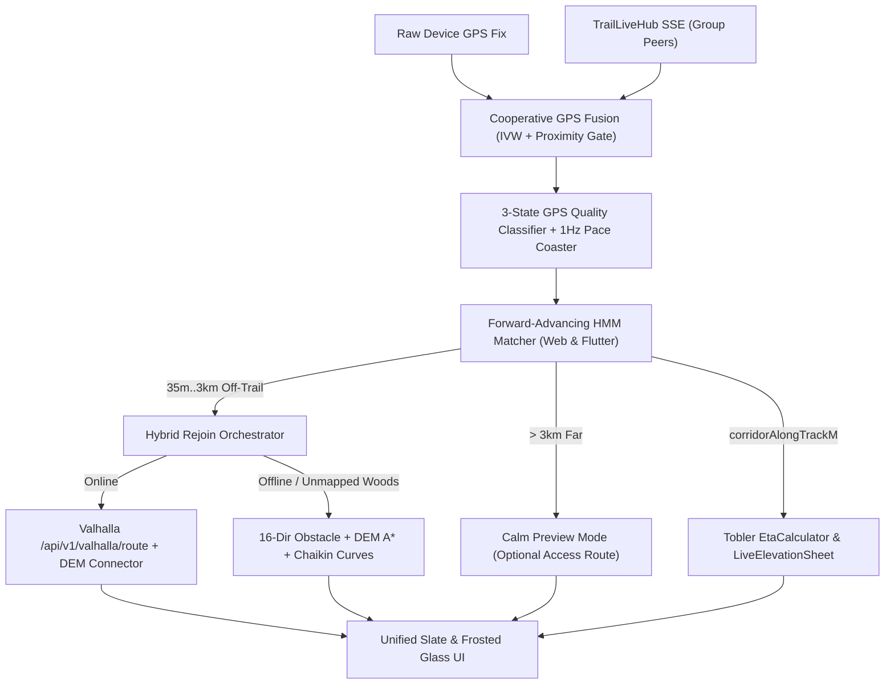

# Specificație Tehnică: Navigație Inteligentă (Pace Coasting & Rerutare Hibridă Curbată), Grup Live cu Fuziune GPS Cooperativă și Identitate Vizuală Unificată

**Data:** 2026-11-18  
**Platforme țintă:** Web PWA (`web/` — SvelteKit 5 + MapLibre GL 6) · Mobile Nativ (`app/` — Flutter + MapLibre) · Backend (`db/` — Go / PocketBase + SSE `TrailLiveHub`)

---

## 1. Context și Probleme Rezolvate

1. **Alarme false și blocaj la GPS slab în pădure**: În implementarea actuală (`RouteMapMatcher` / `TrackPositionMatcher`), când precizia GPS scade sub coronament (`40–100 m`) sau semnalul îngheață temporar, aplicația intră repetat în starea *off-trail*, afișează permanent bannerul portocaliu și **îngheață** progresul (`committedAtd`).
2. **Întoarcere inutilă înapoi la mers paralel prin pădure**: Dacă drumețul merge prin pădure în direcția traseului timp de câteva sute de metri, `committedAtd` rămâne blocat în urmă, iar motorul de rerutare propune întoarcerea la punctul vechi în loc să reintre lin în față pe direcția de mers.
3. **Linie dreaptă peste clădiri, râuri și munți**: Peste `5 km` (ex. pornire din București pentru un traseu din Mediaș la `222 km`), `off_trail_router` trasa o linie dreaptă geodezică peste școli, blocuri și Munții Făgăraș; sub `5 km`, grid-ul DEM A* nu cunoștea clădirile, apele sau potecile OSM și producea segmente liniare fără curbe organice.
4. **Lipsa modului „Grup” (prieteni pe hartă + GPS cooperativ)**: Drumeții care merg împreună nu își văd colegii pe hartă/profil și nu pot folosi recepția GPS superioară a telefoanelor din imediata apropiere pentru a stabiliza poziția sub copaci.
5. **Agresivitate și neuniformitate vizuală**: Bannerul portocaliu aprins (`#EA580C`), butonul `!` triunghiular portocaliu, butonul albastru electric de recentrare, butonul roșu aprins `X` și verdele puternic creează zgomot vizual și nu respectă paleta nativă a aplicației (`Deep Slate #242734` + suprafețe sticlă mată).

---

## 2. Referințe Open-Source Analizate (GitHub)

- **[`valhalla/valhalla`](https://github.com/valhalla/valhalla)** (*Sif dynamic pedestrian/bicycle costing + Skadi DEM*): rutare pe rețeaua OpenStreetMap cu ocolire nativă de clădiri/obstacole, suport `sac_scale` (`max_hiking_difficulty`) și penalizare de pantă (`use_hills`). Deja activ în producție prin `/api/v1/valhalla/route` (`https://valhalla1.openstreetmap.de`).
- **[`osmandapp/OsmAnd`](https://github.com/osmandapp/OsmAnd) & [`abrensch/brouter`](https://github.com/abrensch/brouter)**: arhitectură hibridă *OSM graph + conector la potecă + reintrare înainte pe traseu* fără întoarcere la punctul de abatere.
- **[`bmwcarit/hmm-lib`](https://github.com/bmwcarit/hmm-lib)** (*Newson & Krumm 2009 HMM Map Matching*): adaptarea dinamică a deviației standard de emisie `sigma_z` la raza de incertitudine GPS, combinată cu *Pace Coasting* pe modelul de viteză Tobler.
- **Cooperative GNSS (*Inverse-Variance Weighting / BLUE*)**: fuziunea statistică în plan local tangent (ENU) a pozițiilor raportate de dispozitivele co-locate în același grup, ponderat cu `1 / (sigma_i^2 + sigma_spacing^2)`.

---

## 3. Arhitectura pe 4 Piloni

---

### Pilonul 1: Clasificator GPS, *Pace Coasting* și Mers Paralel prin Pădure

#### 1.1 Clasificarea calității semnalului (`GpsSignalState`)
- **`good`**: `accuracy <= 25 m` și fix proaspăt (`age < 6 s`).
- **`cooperative`**: fix propriu cu `accuracy > 15 m` stabilizat statistic cu cel puțin un membru al grupului aflat în proximitate, sau *Group Tether* activ când GPS-ul propriu a căzut.
- **`degraded` (Coronament / Canion)**: `accuracy > 25 m` și distanța până la coridorul traseului `<= max(95 m, 2.2 * accuracy)`.
  - **Regulă critică:** Starea `isOffTrail` este **blocată pe `false`** (zero alarme false din cauza GPS-ului slab).
  - Poziția pe traseu combină proiecția HMM (`sigmaZ = max(35, accuracy)`) cu avansul așteptat din ritm: `blendedAlong = max(prevAlong, 0.35 * hmmAlong + 0.65 * pacePredictedAlong)`.
- **`coasting` (Semnal pierdut `6 s – 180 s` în mers)**:
  - Când `!paused` și nu a sosit niciun fix valid de peste `6 s` (și utilizatorul se afla pe traseu / în mișcare), un ticker la `1 Hz` (`GpsPaceCoaster`) avansează estimarea pe geometria traseului:
    `deltaM = dtSec * (toblerSpeedMps(currentSlope) / paceFactor)`.
  - Limita superioară de coasting autonom fără niciun semnal (nici propriu, nici de la grup) este `180 s`, prevenind avansarea la nesfârșit în cazul unei opriri într-o cabană fără semnal.
  - La revenirea unui fix GPS bun, poziția se reconciliază lin (interpolare exponențială pe 2–3 fix-uri, fără salt brusc înapoi dacă diferența este în limita `accuracy`).

#### 1.2 Proiecție continuă înainte în pădure (`corridorAlongTrackM`)
- În `RouteMapMatcher` (`web/src/lib/navigation/route_map_matcher.ts`) și `TrackPositionMatcher` (`app/lib/util/route/track_position_matcher.dart`), eliminăm înghețarea lui `committedAtd` pe durata stării `isOffTrail`:
  - La fiecare fix cu `crossTrackMeters < 3000 m`, proiectăm poziția pe fereastra înainte `[committedAtd - 15 m, min(totalLength, committedAtd + max(400 m, 4 * stepDist))]`.
  - Dacă utilizatorul avansează în direcția traseului (`projectedAlong > committedAtd` și unghiul de deplasare față de tangenta traseului este `< 80°`), `committedAtd` avansează continuu cu utilizatorul.
- **Reintrare strict înainte (*Forward Tangent Rejoin*)**:
  - Candidații de reintrare se eșantionează exclusiv în intervalul `[corridorAlongTrackM, min(totalLength, corridorAlongTrackM + max(600 m, 3.0 * crossTrackMeters))]` (niciodată în spate!).
  - Funcția obiectiv minimizează **timpul total până la finalul traseului**:
    `TotalCost(P) = RejoinTime(user -> P) + 1.0 * RemainingTrailTime(P -> Finish)`.
  - Conform inegalității triunghiului, punctul optim `P*` se află natural la `30°–55°` înainte pe direcția de mers — utilizatorul nu se întoarce niciodată de unde a ieșit și nu pierde timp.

---

### Pilonul 2: Rerutare Hibridă cu Obstacole, Clădiri, Altitudine și Curbe + Previzualizare (`> 3 km`)

#### 2.1 Peste `3 km` de traseu — Mod Previzualizare Calm
- Când `nearestCrossTrackMeters > 3000 m`:
  - `computeOffTrailReroute` returnează `null` (nu se desenează nicio linie de abatere peste orașe sau munți; `isFarPreview = true`, `distanceToTrailM = nearestCross`).
  - Cardul de jos afișează discret `La X km de traseu · Mod previzualizare` și un buton calm **`Rută de acces`**, care la apăsare încarcă ruta rutieră/pietonală Valhalla până la startul traseului.

#### 2.2 Între `35 m` și `3 km` — Orchestrator Hibrid (Valhalla OSM + Obstacle/DEM Curved A*)
1. **Stratul 1 — Online Valhalla (`/api/v1/valhalla/route`)**:
   - Cu debounce (`>= 20 m` deplasare sau `>= 10 s`, ori schimbare mod *Urcare minimă* / *Drum scurt*), interoghează `/api/v1/valhalla/route` către candidatul optim de reintrare în față:
     - `costing`: `"pedestrian"` (sau `"bicycle"` pt. MTB/ciclism), `language: "ro-RO"`.
     - `costing_options.pedestrian`: `{ use_hills: mode === "min-climb" ? 0.15 : 0.75, walkway_factor: 0.85, max_hiking_difficulty: 3 }`.
   - Decodează polilinia Valhalla (precizie 6) -> urmează fidel aleile, trotuarele, podurile și potecile marcate, ocolind 100% clădirile (inclusiv școli/curți/garduri) și apele.
   - **Conector scurt de pădure**: dacă utilizatorul sau punctul de reintrare se află la `> 25 m` de cel mai apropiat drum/potecă din Valhalla, segmentele de capăt sunt completate prin routerul local curbat Obstacle+DEM A*.
   - Fiecare punct primește cota reală din `DemTileGrid` pentru afișarea profilului de altitudine.
2. **Stratul 2 — Local Obstacle + Contour Curved A* (instant + fallback 100% offline)**:
   - **Mască de obstacole (`ObstacleGridMask`)**: în Web, extrage din MapLibre (`querySourceFeatures("openmaptiles", ...)`) poligoanele `building` (cu buffer de siguranță `8 m`), `water`, `waterway` (`river`) ca celule interzise (`Infinity`), și liniile `transportation` (`path`, `footway`, `track`) ca celule preferate (`0.65x` cost). Dacă poziția curentă cade în interiorul unui poligon `building` din cauza erorii GPS la interior, celula de start permite doar ieșirea spre exterior.
   - **Netezire cu curbe organice (*Chaikin Corner-Cutting*)**: după găsirea căii optime pe pantele DEM (16 direcții), aplică 2 iterații de subdiviziune Chaikin (`Q = 0.75 A + 0.25 B`, `R = 0.25 A + 0.75 B`), păstrând fiecare segment curbat doar dacă nu intersectează nicio celulă blocată și nu depășește panta sigură.

---

### Pilonul 3: Funcția „Grup” — Prieteni pe Hartă & Fuziune GPS Cooperativă

#### 3.1 Model de date și API (`/live/groups/*` + `/api/v1/live/groups/*`)
- **Colecții PocketBase (`1792100000_created_trail_groups.go`)**:
  - `trail_groups`: `code` (6 caractere alfanumerice fără ambiguități `0/O/1/I`, index unic), `trail_id`, `owner_device_hash` (hidden), `expires_at` (TTL glisant `12h`).
  - `trail_group_members`: `group_code`, `member_id` (hash scurt public de 12 hex derivat din `group_code + device_hash`, fără a expune `device_hash`), `device_hash` (hidden, unic pe grup), `display_name` (max 24 caractere, sanitizat), `color_hex`, `lat`, `lon`, `ele`, `accuracy`, `heading`, `speed`, `along_track_m`, `in_navigation`, `last_seen`.
- **Rute Backend & SvelteKit Proxy**:
  - `POST /api/v1/live/groups` — creează grupul și returnează `GroupSessionDto`.
  - `GET /api/v1/live/groups/{code}` — citește starea curentă a membrilor activi (`last_seen <= 10 min`).
  - `POST /api/v1/live/groups/{code}/join` — intră în grup cu `displayName` (funcționează și automat la deschiderea linkului `?group=CODE`).
  - `POST /api/v1/live/groups/{code}/ping` — trimite poziția + `accuracy` (rate-limit dedicat `30 req / min`, trimis la `5 s` în mișcare / `20 s` staționar), difuzează instant prin SSE (`event: group_member_update`) tuturor abonaților cu `groupCode=CODE` și returnează lista colegilor.
  - `POST /api/v1/live/groups/{code}/leave` — părăsește grupul și emite `event: group_member_left`.

#### 3.2 Fuziunea GPS Cooperativă (*Inverse-Variance Weighting + Group Tether*)
- Pentru fiecare fix propriu `selfFix` și lista de colegi activi `peers`:
  1. **Filtru de proximitate și prospețime**: un coleg `i` este eligibil pentru fuziune doar dacă `age_i <= 12 s`, `0 < accuracy_i <= 60 m` și `dist(selfFix, peer_i) <= max(35 m, selfFix.accuracy + accuracy_i)`. (Un prieten rămas la `250 m` în urmă este afișat pe hartă, dar **exclus complet** din media GPS!).
  2. **Ponderare BLUE în coordonate locale ENU** (când `selfFix.accuracy > 12 m` și există `>= 1` coleg eligibil):
     - `w_self = 1 / max(9, selfFix.accuracy^2)`
     - `w_i = 1 / (accuracy_i^2 + 64)` (`8 m` dispersie naturală de formație pe potecă)
     - Coordonata fuzionată și noua rază efectivă `accuracy_fused = sqrt(1 / (w_self + sum(w_i)))` intră direct în `RouteMapMatcher` și `AccuracyLayer`.
  3. **Group Tether la pierderea semnalului**: dacă telefonul propriu nu mai primește fix GPS (`> 6 s`), dar un coleg care era lângă tine (`ultima distanță cunoscută <= 45 m`) transmite fix-uri proaspete (`<= 12 s`), poziția ta face *tether* pe acel coleg (`accuracy = hypot(peer.accuracy, 15)`), mult mai precis decât simpla estimare din ritm.

#### 3.3 Reprezentarea prietenilor în UI
- Pe hartă: markere rotunde curate cu inițialele prietenului (ex. `DI`, `AN`) în paleta Slate cu inel alb și etichetă discretă la tap (`Diana · +95 m în față`).
- Pe profilul de altitudine: buline discrete cu inițiala fiecărui membru aflat pe traseu (`alongTrackM`).

---

### Pilonul 4: Identitate Vizuală Unificată (Slate & Sticlă Mată)

Toate componentele din ecranul de navigație (Web și Flutter) respectă același limbaj vizual bazat pe token-urile aplicației:
- **Suprafață unică flotantă**: `bg-menu-background/94 backdrop-blur-md border border-input-border/60 text-content shadow-[0_4px_20px_rgba(0,0,0,0.10)]` (Light: alb mat `#FFFFFFF0` + text/icon `#242734`; Dark: `#1E2028F0` + text/icon `#F9FAFB`).
- **Pastila compactă de sus (`NavigationTopBanner` / `_buildBanner`)**:
  - `max-w-md`, un singur rând principal compact, **fără** fundal portocaliu (`bg-orange-600`) și **fără** fundal verde țipător (`bg-emerald-700`).
  - Pe traseu: badge pătrat-rotunjit `#242734` (`36x36px`) cu săgeata albă + distanța și instrucțiunea în `text-content`.
  - La abatere reală (`35 m – 3 km`): același card alb/slate mat, doar badge-ul săgeții devine chihlimbar cald discret (`bg-amber-500/15 text-amber-700 dark:text-amber-300`), afișând scurt `↗ 140 m până la potecă · +12 m`.
- **Banda de stare discretă integrată în cardul de jos (`LiveElevationSheet` / `_buildStatsSheetContent`)**:
  - La abatere (`35 m – 3 km`): rând compact cu comutatorul discret `Urcare minimă` / `Drum scurt`.
  - La GPS slab / coasting / grup: cip calm `GPS slab · estimat după ritm` sau `GPS grup · ±7 m`.
  - La distanță mare (`> 3 km`): `La X km de start · Mod previzualizare` + buton discret `Rută de acces`.
- **Unificarea tuturor butoanelor flotante (`40x40px`)**:
  - Straturi, Grup (`fa-user-group`), Raportează (`fa-location-dot` cu `+`, înlocuind complet triunghiul portocaliu `!`), 2D/3D, Recentrează, Notificări și SOS folosesc **același cerc/pastilă sticlă mată cu icon monocrom `#242734`** (alb în dark mode).
  - SOS devine roșu (`#DC2626`) **exclusiv** când utilizatorul are o alertă SOS activă; butonul `X` din bara de jos devine neutru (`bg-content/[0.08] text-content/75`).
  - Linia de revenire pe hartă folosește o nuanță caldă temperată (`#B45309`, `3.5px` cu halou alb fin `6px`), curbată natural.

---

## 4. Strategia de Testare și Verificare

1. **Teste unitare Go (`db/routes/trail_live_groups_test.go`)**: creare grup, join cu cod, unicitate membru, izolare `member_id` (fără scurgere `device_hash`), broadcast SSE pe `groupCode`, leave și expirare GC.
2. **Teste unitare TypeScript / Vitest (`web/src/lib/navigation/*.test.ts` & `web/src/lib/live/*.test.ts`)**:
   - *Cooperative GPS Fusion*: reducerea erorii cu coleg la `6 m` vs ignorarea colegului aflat la `250 m` în urmă; *Group Tether* la căderea GPS-ului propriu.
   - *Pace Coasting & Canopy Suppression*: zero intrare în `isOffTrail` la `accuracy = 65 m` sub copaci; avans monoton `1 Hz` pe timp de pierdere semnal; avans `corridorAlongTrackM` la mers paralel prin pădure + reintrare strict înainte (`rejoinAlongTrackM >= corridorAlongTrackM`).
   - *Hybrid Obstacle + Chaikin Router*: ocolirea unui poligon `building` interzis fără a tăia colțurile clădirii; Mod Previzualizare (`null` reroute) la `> 3 km`; integrare Valhalla cu fallback local.
3. **Teste Flutter (`app/test/`) & Playwright E2E (`web/e2e/`)**: verificarea vizuală a noii identități unificate (absența `bg-orange-600` și a iconului `!` portocaliu), fluxul de creare/join grup pe hartă, Previzualizare la distanță mare și build complet Web + APK + IPA.
